## 2

### 使用 Animation View

本章介绍了 **Animation View**，它是 Unity 动画工作流程中的必备工具，本章涵盖以下主题：

- 使用 Animation View 创建闪烁灯光
- 使用 Animation View 和 Animator Controller 混合灯光颜色
- 动画化对象的世界位置 – 创建移动平台
- 动画化对象的局部位置 – 创建自动门
- 使用 Hierarchy 动画化局部旋转 – 创建环绕行星
- 动画化触发器 – 创建死亡陷阱
- 创建由玩家输入触发的电梯

### 简介

在第一章中，我们将动画从外部 3D 软件包导入到 Unity。现在我们将学习如何使用 Unity 强大的内置工具 Animation View。它允许我们在编辑器中动画化几乎所有内容，可用于创建有趣的游戏玩法机制。了解此工具对于学习未来的食谱至关重要，因为我们将大量使用 Animation View。


## 使用 Animation View 创建闪烁灯光

本教程首先展示如何在 Unity 中制作基础动画。我们将对光照强度值进行动画制作，以创建有趣的闪烁灯光效果，这种效果常见于恐怖或科幻游戏。

### 准备工作

开始之前，你需要有一个包含几何体和至少一个灯光的场景。你也可以下载提供的示例；打开 Unity 中的项目并进入文件夹 `Chapter 02 Working with the animation view\Recipe 01 Using the animation view to create a flickering light`。你会在那里找到一个名为 `Example.unity` 的场景，其中包含一个已经制作了动画的点光源。

### 如何操作...

要使用 Animation View 并创建闪烁灯光，请按照以下步骤操作：

- 1. 打开场景并选择你想要制作动画的灯光。
- 2. 在选中灯光的情况下，转到 **Window | Animation**。Animation View 将打开。
- 3. 要创建新动画，请点击 **Create** 按钮，如以下截图所示：

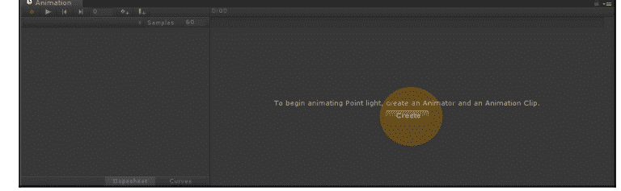

- 4. 将出现 **Create New Animation Clip**。你可以选择目录和动画名称。然后，点击 **Save** 按钮。
- 5. 将创建一个新的空动画，**Animator** 组件将被添加到选中的游戏对象（本例中为灯光），并且在与动画片段相同目录下会创建一个 Animator Controller。
- 6. 要对灯光强度进行动画制作，我们需要添加一个 **Intensity** 属性。点击 Animation View 中的 **Add Property** 按钮，然后选择 **Light | Intensity**，然后点击其旁边的 + 图标，如以下截图所示：

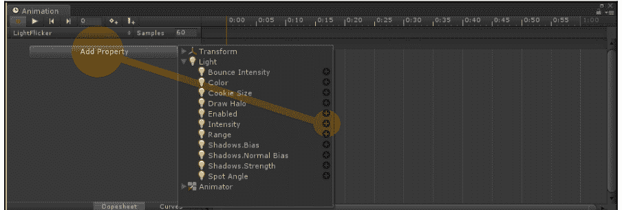

- 7. 将添加两个关键帧。你可以点击并拖动它们来调整其在时间上的位置。你也可以通过更改灯光游戏对象 **Inspector** 中的任何属性来添加新的关键帧（确保在 **Animation** View 左上角点击了记录按钮）。
- 8. 添加多个具有不同灯光强度值的关键帧。
- 9. 动画完成后关闭 **Animation** View。任何更改都会自动保存。
- 10. 播放游戏以查看效果。

### 原理...

Animation View 被分为三个主要部分，如以下截图所示：

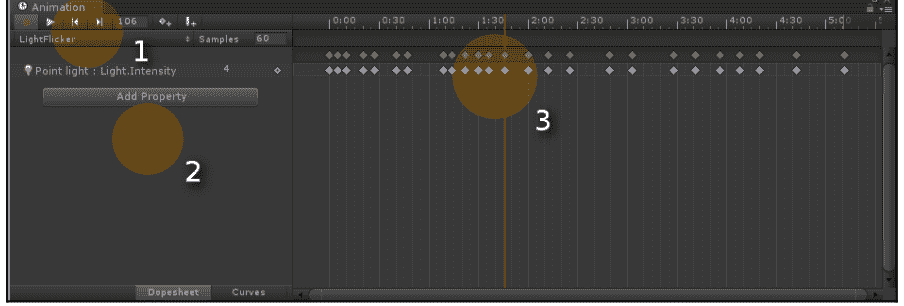

-   - **Playback buttons (1)**：在这里你可以播放场景中的动画（无需进入 **Play Mode** 即可查看动画）。在播放按钮的右侧，你可以找到一个 **Insert Key Frame** 按钮和一个 **Insert Animation Event** 按钮。你可以使用第一个插入关键帧；第二个插入 **Animation Events**，允许从动画中调用脚本函数（Animation Events 将在第 6 章 Handling Combat 中后续介绍）。播放按钮正下方，你可以找到一个下拉菜单，可用于在该对象的动画之间切换并添加新动画。
-   - **Animated properties (2)**：在这里你可以找到此动画使用的游戏对象的全部属性。你也可以点击 **Add Property** 按钮向动画添加新属性。
-   - **Timeline (3)**：它代表动画中的时间。你可以在这里找到所有关键帧（和动画事件）。你可以点击时间轴标题（显示秒数的时间）跳转到你点击的帧。如果点击关键帧，则时间轴将自动跳转到该精确关键帧。

当你首次为给定游戏对象在 Animation View 中创建动画时，会创建一个新的 **Animation Clip** 和一个 Animation Controller。Animator Controller 会自动分配给你正在制作动画的游戏对象，并且 Animation Clip 会被添加到 Animator Controller。针对同一游戏对象创建的任何新动画都会自动添加到同一个 Animator Controller。

### 扩展...

Animation View 的时间轴有两种模式（你可以通过点击属性部分底部的相应按钮在它们之间切换）：

-   - **Dope Sheet**：此模式在时间轴中显示关键帧。
-   - **Curves**：使用此模式，你可以调整动画的插值曲线。当你点击一个属性时，其动画曲线将被显示。你可以操作手柄来调整曲线的形状。你也可以右键点击任何手柄来更改其切线类型，如以下截图所示：

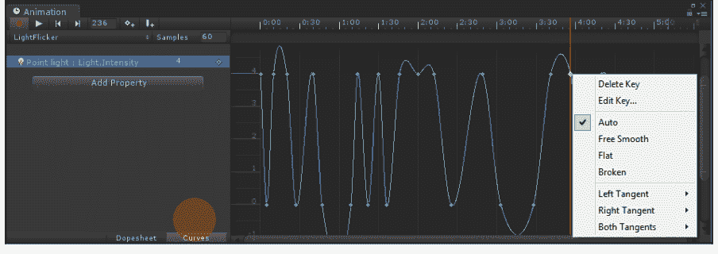

-   - 在 Animation View 中创建的所有 Animation Clip 默认都是循环的。要更改此设置，请找到 Animation Clip 资源，选择它，并在其 **Inspector** 中禁用 **Loop Time** 复选框。
-   - 所有动画都是为 Hierarchy 中选中的游戏对象创建的。要查看对象动画，你需要选择它并打开 **Animation View**。
-   - 如果你的对象 **Hierarchy** 中有多个 Animator 组件，将为每个 Animator 组件创建一个新的 Animator Controller。可能有用的是为 Hierarchy 中的不同对象创建不同的动画并同时播放。例如，你可以有一个 2D 精灵角色，其头部和身体作为单独的游戏对象。你可以使用两个 Animator 组件：一个用于身体，一个用于头部。如果你这样选择，你将能够独立于身体动画创建面部表情。

## 使用 Animation View 和 Animator Controller 混合灯光颜色

本教程展示如何使用 Animation View 中创建的片段与 Animation Controllers 配合使用。

### 准备工作

我们将在本示例中对灯光颜色进行动画制作。你需要有一个包含至少一个灯光和一个网格以查看效果的场景。你也可以下载提供的示例 Unity 项目并进入 Chapter 02 Working with the animation view\Recipe 02 Using the animation view and the animator controller to blend light colors 目录。你会在那里找到一个名为 Example.unity 的场景，其中包含一个已经制作了动画的方向光。在本示例中，我们还对摄像机的背景颜色进行动画制作（摄像机是方向光的子对象）。

### 如何操作...

要混合游戏对象的动画（本示例中为颜色），你需要按照以下步骤操作：

- 1. 打开场景并在 Hierarchy 中选择灯光游戏对象。
- 2. 在选中灯光的情况下，转到 Window | Animation 打开 Animation View 并至少创建两个动画，方法与 Using Animation View to create a flickering light 教程相同，但这次设置颜色属性而不是灯光强度。在我们的示例中，我们有两个 Animation Clips：Day 和 Night。它们只是设置方向光的颜色：Day 将其设置为明亮黄色，Night 设置为深蓝色。灯光颜色随时间没有变化。每个动画都有两个关键帧，每个关键帧中的颜色值完全相同（该颜色在每个动画中不同）。每个动画持续约 7 秒。
- 3. Animator Controller 将自动创建。
- 4. 打开 Animator Controller 并在我们的动画之间创建两个过渡，一个从 Day 到 Night，一个从 Night 到 Day，如以下截图所示：
- 5. 这些动画是循环的，因此你可以将 Transition Duration 设置为约 5 秒以使效果更细微。你可以在选择过渡后在 Inspector 的 Settings 折叠面板中设置 Transition Duration。
- 6. 确保选中 Has Exit Time 选项，因为在本示例中我们不使用其他条件。你也可以添加自己的条件并使用脚本来触发它们。
- 7. 播放游戏以查看效果。

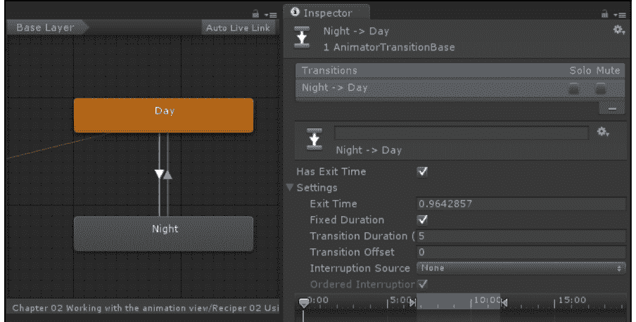

### 原理...

本教程的目的是展示 Unity 动画系统的一个非常重要的特性：Animator Controller 可以混合存储在 Animation Clips 中的 Color、Vector3、Quaternion、bool 和 float 值。不支持 Int 和 string 值，无法对其进行动画制作。你只能对 public MonoBehaviour 脚本变量和 Unity 组件属性进行动画制作。


你不必总是为游戏对象的属性设置动画。使用 Animator Controller 中的过渡效果会在它们之间创建平滑的混合。

## 动画化物体的世界位置 – 创建移动平台

在本教程中，我们将创建一个非常常见的游戏机制：移动平台。我们将为角色使用 Rigidbody，为平台使用一个动画化的、运动学 Rigidbody。

### 准备工作

开始之前，你应该有一个包含角色和要动画化的平台的场景。你可以使用示例项目；前往 `Chapter 02 Working with the animation view\Recipe 03 Animating objects world position - creating a moving platform` 目录。那里有一个名为 `Example.unity` 的场景。如果打开它，你会在 **层级** 中找到一个 **Sheep** 角色。这就是我们的角色，使用 **刚体** 组件和 Simple Move 脚本来移动。**层级** 中还有一个 **Moving Platform** 游戏对象。这是一个带有 `Platform` 脚本附加的运动学刚体。它还有一个 Animator 组件和一个 Animator Controller，其中只有一个动画。这个动画使平台移动。

### 如何操作...

要创建并分配一个动画化的移动平台，请按照以下步骤操作：

- 1. 在 **层级** 中选择你的平台游戏对象。
- 2. 打开 **动画** 视图。
- 3. 确保录制按钮处于按下状态（在 **动画** 视图的左上角）。
- 4. 在第一帧将平台移动到所需位置。
- 5. 将时间线向前调整几秒，并将平台移动到新的目的地。
- 6. 要使动画循环，请选择第一个关键帧并按 Ctrl + C（Mac 上为 cmd + C）。然后从第二个关键帧向前调整时间线，与上一步相同的秒数。如果第一个关键帧在 0 秒标记，第二个在 10 秒标记，则将时间线设置为 20 秒标记。按 Ctrl + V 粘贴复制的关键帧。在我们的示例中，平台从一个漂浮岛移动到另一个岛并返回。它在两端也有一些停顿，以便玩家更容易跳上去。
- 7. 当你对动画满意时，退出动画视图。
- 8. Animator Controller 将被创建，并且 Animation Clip 会自动分配给它。此外，Animator 组件将被添加到平台游戏对象上。
- 9. 在平台游戏对象上找到 Animator Controller，并将 Update Mode 属性设置为 Animate Physics。将 Culling Mode 设置为 Always Animate。
- 10. 为平台添加 Rigidbody 组件并选中 Kinematic 复选框。
- 11. 为你的平台添加碰撞体组件（一个 Mesh Collider 或一个 Box Collider）。如果使用 Mesh Collider，请确保选中 Convex 复选框。
- 12. 创建一个新脚本，并将文件命名为 Platform.cs。
- 13. 打开脚本并编写以下代码：

```
using UnityEngine;
using System.Collections;

public class Platform : MonoBehaviour {

/*This function is called by Unity every time this object
starts to collide with any other game object with a Collider
component attached.The Collision collisionInfo object
parameter stores the information about the collision and the
object we are colliding with.*/

void OnCollisionEnter(Collision collisionInfo)
{
/*We are checking if the object we are colliding with
has a RigidBody component and the RigidBody is not set
to kinematic. Optionally we can also check the tag of
the object we are colliding with here (to make it work
only for the player for instance).*/
if (collisionInfo.rigidbody != null
&& !collisionInfo.rigidbody.isKinematic)
{
/*We are setting the parent of the object we are
colliding with to the platform game object (the
object our script is attached to).This will make
our character move with the platform instead of
slide from it.*/
    collisionInfo.transform.parent = transform;

}
}

/*This function is called by Unity every time this object stops colliding with any object with a Collider component attached.
The Collision collisionInfo parameter stores the same information as in the OnCollisionEnter function.*/

void OnCollisionExit(Collision collisionInfo)
{

    /*We are checking the same conditions as before*/

        if (collisionInfo.rigidbody != null
        && !collisionInfo.rigidbody.isKinematic)
        {
        /*We are setting the parent of the object we are
colliding with to null. The object has no parent
        at all and stops moving with the platform*/
            collisionInfo.transform.parent = null;
        }
    }
}
```

- 14. 将脚本附加到平台游戏对象并播放游戏以查看效果。
- 15. 这个移动平台将与使用 **刚体** 组件移动的角色配合工作。你可以从 Unity 的 `Standard Assets` 导入 `ThirdPersonCharacter` 预制体。你也可以编写自己的简单角色移动。要这样做，请参阅 *There's more section.*

### 工作原理...

这是最简单但可行的移动平台解决方案。它使用了几个关键元素：

- **动画驱动移动**：平台仅由 Animation View 创建的 Animation Clip 移动。这使你可以轻松尝试移动效果。
- **运动学刚体**：要为附加了 **刚体** 组件的游戏对象设置动画，你需要将 **运动学** 复选框设置为 true。它完全禁用了刚体的物理。你仍然可以在 **运动学** 设置为 false 的情况下为对象设置动画，但物理仍会对移动产生影响（对象无法穿透其他对象，碰撞时会旋转，等等）。
- **Animate Physics 选项**：在 **刚体** 组件的 **更新模式** 参数中设置。此选项使刚体在物理循环中被动画化（你可以将其视为 `FixedUpdate()` 函数的等效项）。它防止与此对象碰撞的刚体抖动并表现出奇怪的行为。
- **世界空间中的动画**：我们的平台在世界坐标中进行动画化。这意味着动画根据场景的 0x、0y、0z 点设置对象的位置。对象在场景中的放置位置无关紧要；播放动画后，它将被放置在动画关键帧中存储的位置。我们将在 *Animating object's local position – creating automatic doors* 教程中讨论局部空间动画。
- **移动平台作为角色的父对象**：我们将平台设置为与之碰撞的游戏内角色的父对象。父对象为其他 **变换** 的刚体会尝试随它们在游戏中移动。这是使我们的角色随平台游戏对象移动/相对移动的最简单且相当可靠的方法。而且由于平台的 **更新模式** 设置为 **Animate Physics**，不会发生抖动。除了将角色设为平台的子对象外，你还可以尝试创建具有适当摩擦力的物理材质，或编写自己的自定义解决方案，将平台的速度添加到角色的速度中。

### 还有更多...

在提供的示例中，我们创建了自己的脚本，使用 **刚体** 组件移动角色。你可以在 `Shared scripts` 目录中找到该脚本。它名为 `SimpleMove.cs`。要使你的角色移动：

- 1. 添加一个碰撞体组件（我们在示例中使用 **球体碰撞体**）并为其添加 **刚体** 组件。
- 2. 创建一个零摩擦的 `Physics Material` 并将其分配给碰撞体组件。
- 3. 将 **刚体** 组件 **约束** 设置为在 X、Y 和 Z 轴上 **冻结旋转**。
- 4. 创建一个空游戏对象，将其放置在角色脚部上方约 0.2 个单位处，并将其设为角色的子对象。为清晰起见，将其命名为 `GroundCheck`。
- 5. 将脚本附加到角色的游戏对象。将 `GroundCheck` 游戏对象附加到 `Simple Move` 脚本组件的 `Ground Check Transform` 字段。
- 6. 如果你希望你的角色有动画，创建一个具有 `float Speed`、`bool Ground` 和 `Trigger Jump` 参数的 Animator Controller。
  准备空闲、行走和跳跃动画。空闲和行走应循环，跳跃应在空中结束。
- 7. 使用 `Speed` 参数并使用 `Speed > 0.1` 条件在空闲和奔跑之间创建过渡。
- 8. 使用 `Speed` 参数并使用 `Speed < 0.1` 条件在奔跑和空闲之间创建过渡。
- 9. 使用 `Jump` 触发器参数从奔跑和空闲创建到跳跃的过渡。
- 10. 使用 `Ground` 和 `Speed` 参数从跳跃到奔跑和空闲创建过渡。条件应检查 `Ground` 是否为 true 且 `Speed < 0.1`（过渡到空闲）或 `Speed > 0.1`（过渡到奔跑）。
- 11. 将 Animator Controller 附加到你的角色。
- 12. 将游戏摄像机设为角色的子对象，或使用在 Shared scripts 目录中找到的提供的 `CameraFollow.cs` 脚本。你也可以使用 Unity 的 **标准资源** 中找到的摄像机脚本之一。

## 动画化物体的局部位置 – 创建自动门

在本教程中，我们将学习如何动画化物体的局部位置，以便在场景的多个位置使用同一个动画对象。我们将创建一个常见的游戏机制——自动门，作为示例。


## 准备工作

为了制作一个动画门，你应该准备好两个对象：**门框** 和 **门**。**门** 应该是 **层级** 中 **框架** 的子对象。它应放置在 *关闭位置*。我们假设打开时我们的 **门** 会向上滑动。你还应该有一个分配了 `Player` 标签的玩家角色。角色应使用 **刚体** 组件移动或具有运动学 **刚体** 组件。我们将为门使用触发器，而触发器仅对刚体做出反应。你也可以前往 `Chapter 02 Working with the animation view\Recipe 04 Animating objects local position - creating automatic doors` 目录，并在其中找到 `Example.unity` 场景。如果打开它，你可以在 **层级** 中找到 **自动门** 游戏对象，以及一个将作为我们玩家使用的 **羊** 游戏对象（它具有 `Player` 标签）。如果运行游戏并靠近门，门会打开。

## 如何操作...

要创建自动门，请按照以下步骤操作：

- 1. 选择你的 **门框** 游戏对象，并为其添加 Animator 组件。为此，在 **检查器** 中点击 **添加组件** 按钮并选择 **Animator**。确保将组件添加到 **门框** 而不是 **门**（父对象而不是子对象）。将 **Animator** 组件的 **更新模式** 设置为 **动画物理**。
- 2. 在选择 **门框** 游戏对象的情况下，转到 **窗口 | 动画** 以打开 **动画** 视图。
- 3. 创建一个新的动画剪辑并将其命名为 `Closed`；这将是我们门的关闭动画。要创建新剪辑，点击回放按钮下方的下拉列表并选择 **创建新剪辑** 选项。
- 4. 点击 **添加属性** 按钮并在列表中找到你的 **门** 对象（**门框** 游戏对象的子对象）。
- 5. 展开 **门** 游戏对象折叠面板并找到 **变换** 部分。展开它并点击 **位置** 属性旁的加号图标，如以下屏幕截图所示：

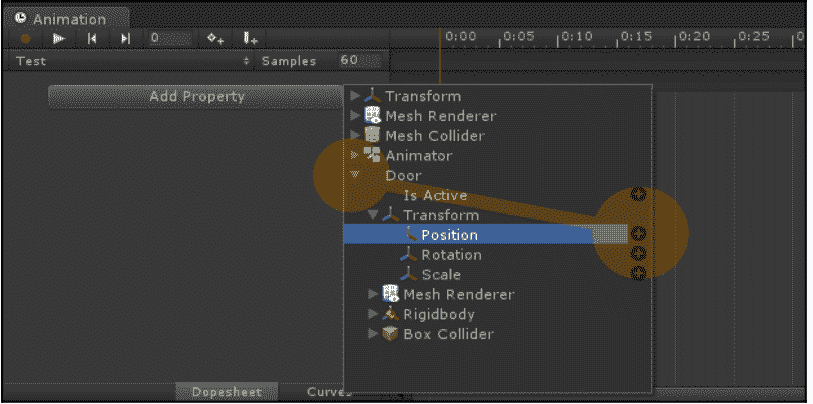

- 6. 将为 **门** 游戏对象的本地位置添加两个关键帧。我们不会调整它们（假设 **门** 处于关闭位置）。
- 7. 添加另一个动画剪辑并将其命名为门打开。
- 8. 点击 **添加属性** 按钮，选择你的门游戏对象，并以步骤 5 相同的方式添加 **变换 | 位置** 关键帧。
- 9. 将第二个关键帧移动到大约 3 秒的位置。
- 10. 选择 **门** 游戏对象（**门框** 的子对象）。
- 11. 将其向上移动到打开位置。确保录制按钮处于活动状态（在 **动画** 视图的左上角）。如果播放动画，它应该将 **门** 游戏对象向上移动。
- 12. 选择 **门** 打开动画的最后一帧（在 **动画** 视图中）。转到 **检查器** 并复制门的 **变换** 组件。为此，点击组件右上角的小齿轮图标并选择 **复制组件** 选项。
- 13. 创建一个新的动画剪辑并将其命名为 `Opened`。以步骤 5 相同的方式为 **门** 子对象添加关键帧。如果你的 **门** 对象移动了，选择它，点击 **检查器** 中 **变换** 组件旁的齿轮图标，并选择 **粘贴组件值**。这将粘贴我们从 `Door Opening` 动画最后一帧复制的 **变换** 属性。
- 14. 确保动画中的两个帧具有相同的[content]
## 准备工作

为了制作一个动画门，你应该准备好两个对象：**门框** 和 **门**。**门** 应该是 **层级** 中 **框架** 的子对象。它应放置在 *关闭位置*。我们假设打开时我们的 **门** 会向上滑动。你还应该有一个分配了 `Player` 标签的玩家角色。角色应使用 **刚体** 组件移动或具有运动学 **刚体** 组件。我们将为门使用触发器，而触发器仅对刚体做出反应。你也可以前往 `Chapter 02 Working with the animation view\Recipe 04 Animating objects local position - creating automatic doors` 目录，并在其中找到 `Example.unity` 场景。如果打开它，你可以在 **层级** 中找到 **自动门** 游戏对象，以及一个将作为我们玩家使用的 **羊** 游戏对象（它具有 `Player` 标签）。如果运行游戏并靠近门，门会打开。

## 如何操作...

要创建自动门，请按照以下步骤操作：

- 1. 选择你的 **门框** 游戏对象，并为其添加 Animator 组件。为此，在 **检查器** 中点击 **添加组件** 按钮并选择 **Animator**。确保将组件添加到 **门框** 而不是 **门**（父对象而不是子对象）。将 **Animator** 组件的 **更新模式** 设置为 **动画物理**。
- 2. 在选择 **门框** 游戏对象的情况下，转到 **窗口 | 动画** 以打开 **动画** 视图。
- 3. 创建一个新的动画剪辑并将其命名为 `Closed`；这将是我们门的关闭动画。要创建新剪辑，点击回放按钮下方的下拉列表并选择 **创建新剪辑** 选项。
- 4. 点击 **添加属性** 按钮并在列表中找到你的 **门** 对象（**门框** 游戏对象的子对象）。
- 5. 展开 **门** 游戏对象折叠面板并找到 **变换** 部分。展开它并点击 **位置** 属性旁的加号图标，如以下屏幕截图所示：


- 6. 将为 **门** 游戏对象的本地位置添加两个关键帧。我们不会调整它们（假设 **门** 处于关闭位置）。
- 7. 添加另一个动画剪辑并将其命名为门打开。
- 8. 点击 **添加属性** 按钮，选择你的门游戏对象，并以步骤 5 相同的方式添加 **变换 | 位置** 关键帧。
- 9. 将第二个关键帧移动到大约 3 秒的位置。
- 10. 选择 **门** 游戏对象（**门框** 的子对象）。
- 11. 将其向上移动到打开位置。确保录制按钮处于活动状态（在 **动画** 视图的左上角）。如果播放动画，它应该将 **门** 游戏对象向上移动。
- 12. 选择 **门** 打开动画的最后一帧（在 **动画** 视图中）。转到 **检查器** 并复制门的 **变换** 组件。为此，点击组件右上角的小齿轮图标并选择 **复制组件** 选项。
- 13. 创建一个新的动画剪辑并将其命名为 `Opened`。以步骤 5 相同的方式为 **门** 子对象添加关键帧。如果你的 **门** 对象移动了，选择它，点击 **检查器** 中 **变换** 组件旁的齿轮图标，并选择 **粘贴组件值**。这将粘贴我们从 `Door Opening` 动画最后一帧复制的 **变换** 属性。
- 14. 确保动画中的两个帧具有相同的[content]
## 准备工作

为了制作一个动画门，你应该准备好两个对象：**门框** 和 **门**。**门** 应该是 **层级** 中 **框架** 的子对象。它应放置在 *关闭位置*。我们假设打开时我们的 **门** 会向上滑动。你还应该有一个分配了 `Player` 标签的玩家角色。角色应使用 **刚体** 组件移动或具有运动学 **刚体** 组件。我们将为门使用触发器，而触发器仅对刚体做出反应。你也可以前往 `Chapter 02 Working with the animation view\Recipe 04 Animating objects local position - creating automatic doors` 目录，并在其中找到 `Example.unity` 场景。如果打开它，你可以在 **层级** 中找到 **自动门** 游戏对象，以及一个将作为我们玩家使用的 **羊** 游戏对象（它具有 `Player` 标签）。如果运行游戏并靠近门，门会打开。

## 如何操作...

要创建自动门，请按照以下步骤操作：

- 1. 选择你的 **门框** 游戏对象，并为其添加 Animator 组件。为此，在 **检查器** 中点击 **添加组件** 按钮并选择 **Animator**。确保将组件添加到 **门框** 而不是 **门**（父对象而不是子对象）。将 **Animator** 组件的 **更新模式** 设置为 **动画物理**。
- 2. 在选择 **门框** 游戏对象的情况下，转到 **窗口 | 动画** 以打开 **动画** 视图。
- 3. 创建一个新的动画剪辑并将其命名为 `Closed`；这将是我们门的关闭动画。要创建新剪辑，点击回放按钮下方的下拉列表并选择 **创建新剪辑** 选项。
- 4. 点击 **添加属性** 按钮并在列表中找到你的 **门** 对象（**门框** 游戏对象的子对象）。
- 5. 展开 **门** 游戏对象折叠面板并找到 **变换** 部分。展开它并点击 **位置** 属性旁的加号图标，如以下屏幕截图所示：


- 6. 将为 **门** 游戏对象的本地位置添加两个关键帧。我们不会调整它们（假设 **门** 处于关闭位置）。
- 7. 添加另一个动画剪辑并将其命名为门打开。
- 8. 点击 **添加属性** 按钮，选择你的门游戏对象，并以步骤 5 相同的方式添加 **变换 | 位置** 关键帧。
- 9. 将第二个关键帧移动到大约 3 秒的位置。
- 10. 选择 **门** 游戏对象（**门框** 的子对象）。
- 11. 将其向上移动到打开位置。确保录制按钮处于活动状态（在 **动画** 视图的左上角）。如果播放动画，它应该将 **门** 游戏对象向上移动。
- 12. 选择 **门** 打开动画的最后一帧（在 **动画** 视图中）。转到 **检查器** 并复制门的 **变换** 组件。为此，点击组件右上角的小齿轮图标并选择 **复制组件** 选项。
- 13. 创建一个新的动画剪辑并将其命名为 `Opened`。以步骤 5 相同的方式为 **门** 子对象添加关键帧。如果你的 **门** 对象移动了，选择它，点击 **检查器** 中 **变换** 组件旁的齿轮图标，并选择 **粘贴组件值**。这将粘贴我们从 `Door Opening` 动画最后一帧复制的 **变换** 属性。
- 14. 确保动画中的两个帧具有相同的[content]
## 准备工作

为了制作一个动画门，你应该准备好两个对象：**门框** 和 **门**。**门** 应该是 **层级** 中 **框架** 的子对象。它应放置在 *关闭位置*。我们假设打开时我们的 **门** 会向上滑动。你还应该有一个分配了 `Player` 标签的玩家角色。角色应使用 **刚体** 组件移动或具有运动学 **刚体** 组件。我们将为门使用触发器，而触发器仅对刚体做出反应。你也可以前往 `Chapter 02 Working with the animation view\Recipe 04 Animating objects local position - creating automatic doors` 目录，并在其中找到 `Example.unity` 场景。如果打开它，你可以在 **层级** 中找到 **自动门** 游戏对象，以及一个将作为我们玩家使用的 **羊** 游戏对象（它具有 `Player` 标签）。如果运行游戏并靠近门，门会打开。

## 如何操作...

要创建自动门，请按照以下步骤操作：

- 1. 选择你的 **门框** 游戏对象，并为其添加 Animator 组件。为此，在 **检查器** 中点击 **添加组件** 按钮并选择 **Animator**。确保将组件添加到 **门框** 而不是 **门**（父对象而不是子对象）。将 **Animator** 组件的 **更新模式** 设置为 **动画物理**。
- 2. 在选择 **门框** 游戏对象的情况下，转到 **窗口 | 动画** 以打开 **动画** 视图。
- 3. 创建一个新的动画剪辑并将其命名为 `Closed`；这将是我们门的关闭动画。要创建新剪辑，点击回放按钮下方的下拉列表并选择 **创建新剪辑** 选项。
- 4. 点击 **添加属性** 按钮并在列表中找到你的 **门** 对象（**门框** 游戏对象的子对象）。
- 5. 展开 **门** 游戏对象折叠面板并找到 **变换** 部分。展开它并点击 **位置** 属性旁的加号图标，如以下屏幕截图所示：


- 6. 将为 **门** 游戏对象的本地位置添加两个关键帧。我们不会调整它们（假设 **门** 处于关闭位置）。
- 7. 添加另一个动画剪辑并将其命名为门打开。
- 8. 点击 **添加属性** 按钮，选择你的门游戏对象，并以步骤 5 相同的方式添加 **变换 | 位置** 关键帧。
- 9. 将第二个关键帧移动到大约 3 秒的位置。
- 10. 选择 **门** 游戏对象（**门框** 的子对象）。
- 11. 将其向上移动到打开位置。确保录制按钮处于活动状态（在 **动画** 视图的左上角）。如果播放动画，它应该将 **门** 游戏对象向上移动。
- 12. 选择 **门** 打开动画的最后一帧（在 **动画** 视图中）。转到 **检查器** 并复制门的 **变换** 组件。为此，点击组件右上角的小齿轮图标并选择 **复制组件** 选项。
- 13. 创建一个新的动画剪辑并将其命名为 `Opened`。以步骤 5 相同的方式为 **门** 子对象添加关键帧。如果你的 **门** 对象移动了，选择它，点击 **检查器** 中 **变换** 组件旁的齿轮图标，并选择 **粘贴组件值**。这将粘贴我们从 `Door Opening` 动画最后一帧复制的 **变换** 属性。
- 14. 确保动画中的两个帧具有相同的[content]
## 准备工作

为了制作一个动画门，你应该准备好两个对象：**门框** 和 **门**。**门** 应该是 **层级** 中 **框架** 的子对象。它应放置在 *关闭位置*。我们假设打开时我们的 **门** 会向上滑动。你还应该有一个分配了 `Player` 标签的玩家角色。角色应使用 **刚体** 组件移动或具有运动学 **刚体** 组件。我们将为门使用触发器，而触发器仅对刚体做出反应。你也可以前往 `Chapter 02 Working with the animation view\Recipe 04 Animating objects local position - creating automatic doors` 目录，并在其中找到 `Example.unity` 场景。如果打开它，你可以在 **层级** 中找到 **自动门** 游戏对象，以及一个将作为我们玩家使用的 **羊** 游戏对象（它具有 `Player` 标签）。如果运行游戏并靠近门，门会打开。

## 如何操作...

要创建自动门，请按照以下步骤操作：

- 1. 选择你的 **门框** 游戏对象，并为其添加 Animator 组件。为此，在 **检查器** 中点击 **添加组件** 按钮并选择 **Animator**。确保将组件添加到 **门框** 而不是 **门**（父对象而不是子对象）。将 **Animator** 组件的 **更新模式** 设置为 **动画物理**。
- 2. 在选择 **门框** 游戏对象的情况下，转到 **窗口 | 动画** 以打开 **动画** 视图。
- 3. 创建一个新的动画剪辑并将其命名为 `Closed`；这将是我们门的关闭动画。要创建新剪辑，点击回放按钮下方的下拉列表并选择 **创建新剪辑** 选项。
- 4. 点击 **添加属性** 按钮并在列表中找到你的 **门** 对象（**门框** 游戏对象的子对象）。
- 5. 展开 **门** 游戏对象折叠面板并找到 **变换** 部分。展开它并点击 **位置** 属性旁的加号图标，如以下屏幕截图所示：


- 6. 将为 **门** 游戏对象的本地位置添加两个关键帧。我们不会调整它们（假设 **门** 处于关闭位置）。
- 7. 添加另一个动画剪辑并将其命名为门打开。
- 8. 点击 **添加属性** 按钮，选择你的门游戏对象，并以步骤 5 相同的方式添加 **变换 | 位置** 关键帧。
- 9. 将第二个关键帧移动到大约 3 秒的位置。
- 10. 选择 **门** 游戏对象（**门框** 的子对象）。
- 11. 将其向上移动到打开位置。确保录制按钮处于活动状态（在 **动画** 视图的左上角）。如果播放动画，它应该将 **门** 游戏对象向上移动。
- 12. 选择 **门** 打开动画的最后一帧（在 **动画** 视图中）。转到 **检查器** 并复制门的 **变换** 组件。为此，点击组件右上角的小齿轮图标并选择 **复制组件** 选项。
- 13. 创建一个新的动画剪辑并将其命名为 `Opened`。以步骤 5 相同的方式为 **门** 子对象添加关键帧。如果你的 **门** 对象移动了，选择它，点击 **检查器** 中 **变换** 组件旁的齿轮图标，并选择 **粘贴组件值**。这将粘贴我们从 `Door Opening` 动画最后一帧复制的 **变换** 属性。
- 14. 确保动画中的两个帧具有相同的位置。
- 15. 创建一个额外的动画剪辑（最后一个）并将其命名为 `Door Closing`。
- 16. 使 **门** 游戏对象的动画从打开位置滑向关闭位置。记住你可以从适当的动画帧复制门的 **变换** 组件并将其粘贴到正在工作的动画中。
- 17. 使用 **动画** 视图预览所有动画。你可以使用回放按钮下方的下拉列表在动画之间切换。
- 18. 如果你对动画满意，关闭 **动画** 视图。选择你的 **门框** 游戏对象并在 **检查器** 中找到其 Animator 组件。
- 19. 点击 **控制器** 字段，这将在 **项目** 视图中显示自动创建的 Animator Controller。双击打开它。
- 20. 创建一个 `bool` 参数并将其命名为 `Open`。
- 21. 创建动画状态之间的转换循环：**Closed** | **Door Opening** | **Open** | **Door Closing** | **Closed**。请参阅以下屏幕截图：

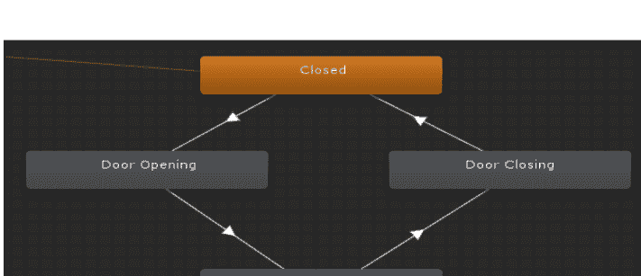

- 22. 选择 **Closed** | **Door Opening** 转换。为其添加一个条件，选择 `Open` 参数，并将条件设置为 true。在转换中禁用 **Has Exit Time** 选项。
- 23. 选择 **Opened | Door Closing** 转换。为其添加一个条件，选择 `Open` 参数，并将条件设置为 false。在转换中禁用 **Has Exit Time** 选项。
- 24. 让 **Door Opening | Opened** 和 **Door Closing | Closed** 转换不带条件。确保在这两个转换中启用 **Has Exit Time** 选项。
- 25. 关闭 Animator Controller。
- 26. 在场景的层级中选择门框游戏对象。
- 27. 在门框游戏对象下添加一个 **立方体** 子对象。为此，右键点击 **门框** 游戏对象并选择 **创建 | 3D 对象 | 立方体**。这将是我们触发器。
- 28. 选择 **立方体** 并缩放它，使其在门框两侧突出。请参阅以下屏幕截图作为参考：

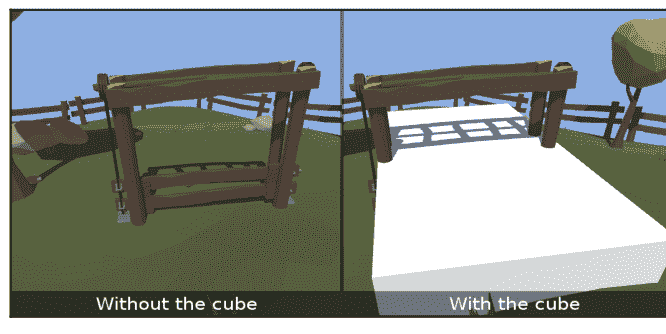

- 29. 从 **立方体** 中移除 **网格渲染器** 和 **网格过滤器** 组件。为此，点击给定组件右上角的小齿轮图标并选择 **移除组件** 选项。这将只在立方体上留下 **变换** 和 **盒状碰撞体** 组件。
- 30. 在立方体的 **盒状碰撞体** 组件上启用 **Is Trigger** 复选框。
- 31. 将立方体游戏对象重命名为 `Trigger`。
- 32. 选择 **门框** 游戏对象并为其添加 **网格碰撞体** 组件。
- 33. 选择 **门** 游戏对象并为其添加 **盒状碰撞体** 组件（或设置为 **凸** 的 **网格碰撞体**）以及一个 **刚体** 组件。在 **刚体** 组件中启用 **Is Kinematic** 选项。
- 34. 创建一个新的 C# 脚本并将其命名为 `AutomaticDoors.cs`。打开它并写入以下代码：

```csharp
using UnityEngine;
using System.Collections;

public class AutomaticDoor : MonoBehaviour
{
    /*The anim variable is used to store the reference
    to the Animator component*/

    private Animator anim;

    void Start ()
    {
        /*We assign the Animator component of the parent object
        because this script is attached to the trigger, which
        is the child object of our animated doors*/

        anim = transform.parent.GetComponent<Animator> ();
    }
    /* This function is called when a Rigidbody intersects with
    the collider attached to our game object for the first time.
    Our collider has to be set to trigger. The Collider other
    parameter stores information about the object which collided
    with our trigger (entered the trigger).*/
    void OnTriggerEnter (Collider other)
    {

        //We check the tag of the object entering the trigger
        if (other.gameObject.CompareTag ("Player")) {

            /*If the tag equals "Player", we set the
            bool parameter "Open" to true in our
            Animator Controller - that plays the open
            animation and opens the doors*/

            anim.SetBool ("Open", true);
        }
    }
    /* This function is called when a Rigidbody exits the trigger
    (stops colliding with our trigger collider).*/
    void OnTriggerExit (Collider other)
    {
        /*Again, we check if the object was the player*/
        if (other.gameObject.CompareTag ("Player")) {
            /*If it's true, we set the bool parameter "Open"
            to false in our Animator Controller. That plays
            the close animation and closes the doors.*/
            anim.SetBool ("Open", false);
        }
    }
}
```

- 35. 将脚本分配给你的 **触发器** 游戏对象，并确保你的角色具有 **刚体** 组件和 `Player` 标签。
- 36. 播放游戏并靠近门；它应该打开。当你离开触发器时，它应该关闭。

## 工作原理...

本教程说明了 Unity 动画工作流程中一个非常重要的特性，即在本地空间中动画化对象的可能性。如果我们动画化子游戏对象，它们的[content]
## 准备工作

要制作动画门，需准备两个对象：**门框** 和 **门**。**门** 应为 **层级** 中 **框架** 的子对象，并置于 *关闭位置*。我们假设打开时 **门** 会向上滑动。还需一个带 `Player` 标签的玩家角色，角色需使用 **刚体** 组件移动或具有运动学 **刚体** 组件。我们使用触发器，触发器仅对刚体起作用。你也可以打开 `Chapter 02 Working with the animation view\Recipe 04 Animating objects local position - creating automatic doors` 目录，找到 `Example.unity` 场景。打开后可在 **层级** 中找到 **自动门** 游戏对象和作为玩家的 **羊** 游戏对象（带 `Player` 标签）。运行游戏靠近门时门会打开。

## 如何操作...

创建自动门按以下步骤操作：

- 1. 选择 **门框** 游戏对象并添加 Animator 组件。在 **检查器** 中点击 **添加组件** 并选择 **Animator**。确保组件加到 **门框** 而非 **门**，即父对象而非子对象。将 **Animator** 组件的 **更新模式** 设为 **动画物理**。
- 2. 选择 **门框** 游戏对象后，打开 **窗口 | 动画** 打开 **动画** 视图。
- 3. 新建动画剪辑命名为 `Closed`，用于关闭门动画。点击回放按钮下下拉列表选择 **创建新剪辑**。
- 4. 点击 **添加属性** 按钮，在列表中找到 **门框** 游戏对象的子对象 **门**。
- 5. 展开 **门** 折叠面板，找到 **变换** 部分，展开后点击 **位置** 属性旁的加号，如下图所示：


- 6. 会为 **门** 游戏对象的本地位置添加两帧关键帧。保持不动，假设 **门** 在关闭位置。
- 7. 再新建一个动画剪辑命名为门打开。
- 8. 点击 **添加属性**，选择门游戏对象，按步骤5方式添加 **变换 | 位置** 关键帧。
- 9. 将第二关键帧移至约3秒处。
- 10. 选择 **门框** 的子对象 **门**。
- 11. 将其上移至打开位置。确保 **动画** 视图左上角录制按钮激活。播放动画时 **门** 应上移。
- 12. 在 **动画** 视图中选择 **门** 打开动画的最后一帧。打开 **检查器** 复制门的 **变换** 组件，点击组件右上角齿轮选择 **复制组件**。
- 13. 新建动画剪辑命名为 `Opened`。按步骤5为 **门** 子对象添加关键帧。若 **门** 已移动，选择它，点击 **检查器** 中 **变换** 组件齿轮选择 **粘贴组件值**，即可粘贴 `Door Opening` 最后一帧的 **变换** 属性。
- 14. 确保该动画两帧位置相同。
- 15. 再新建最后一个动画剪辑命名为 `Door Closing`。
- 16. 让 **门** 游戏对象从打开位置滑回关闭位置。可复制相应动画帧的 **变换** 组件并粘贴到当前动画。
- 17. 用 **动画** 视图预览所有动画，可用回放按钮下下拉列表切换。
- 18. 满意后关闭 **动画** 视图。选择 **门框** 游戏对象，在 **检查器** 中找到其 Animator 组件。
- 19. 点击 **控制器** 字段，在 **项目** 视图中显示自动生成的 Animator Controller，双击打开。
- 20. 新建一个 `bool` 参数命名为 `Open`。
- 21. 创建状态间的转换循环：**Closed** | **Door Opening** | **Open** | **Door Closing** | **Closed**。见下图：


- 22. 选择 **Closed** | **Door Opening** 转换，添加条件选择 `Open` 参数设为 true，关闭转换的 **Has Exit Time**。
- 23. 选择 **Opened | Door Closing** 转换，添加条件选择 `Open` 参数设为 false，关闭 **Has Exit Time**。
- 24. **Door Opening | Opened** 和 **Door Closing | Closed** 转换不加条件，确保两者 **Has Exit Time** 启用。
- 25. 关闭 Animator Controller。
- 26. 在场景层级中选择门框游戏对象。
- 27. 为 **门框** 添加 **立方体** 子对象。右键 **门框** 选择 **创建 | 3D 对象 | 立方体**，作为触发器。
- 28. 选择 **立方体** 并缩放使其在门框两侧突出，参考下图：


- 29. 移除 **立方体** 的 **网格渲染器** 和 **网格过滤器** 组件。点击组件右上角齿轮选择 **移除组件**，仅保留 **变换** 和 **盒状碰撞体**。
- 30. 在 **立方体** 的 **盒状碰撞体** 组件中启用 **Is Trigger**。
- 31. 将立方体游戏对象重命名为 `Trigger`。
- 32. 为 **门框** 游戏对象添加 **网格碰撞体** 组件。
- 33. 为 **门** 游戏对象添加 **盒状碰撞体** 组件或设为 **凸** 的 **网格碰撞体**，并添加 **刚体** 组件，启用 **刚体** 的 **Is Kinematic**。
- 34. 新建 C# 脚本命名为 `AutomaticDoors.cs`，打开后写入以下代码：

```csharp
using UnityEngine;
using System.Collections;

public class AutomaticDoor : MonoBehaviour
{
    /*The anim variable is used to store the reference
    to the Animator component*/

    private Animator anim;

    void Start ()
    {
        /*We assign the Animator component of the parent object
        because this script is attached to the trigger, which
        is the child object of our animated doors*/

        anim = transform.parent.GetComponent<Animator> ();
    }
    /* This function is called when a Rigidbody intersects with
    the collider attached to our game object for the first time.
    Our collider has to be set to trigger. The Collider other
    parameter stores information about the object which collided
    with our trigger (entered the trigger).*/
    void OnTriggerEnter (Collider other)
    {

        //We check the tag of the object entering the trigger
        if (other.gameObject.CompareTag ("Player")) {

            /*If the tag equals "Player", we set the
            bool parameter "Open" to true in our
            Animator Controller - that plays the open
            animation and opens the doors*/

            anim.SetBool ("Open", true);
        }
    }
    /* This function is called when a Rigidbody exits the trigger
    (stops colliding with our trigger collider).*/
    void OnTriggerExit (Collider other)
    {
        /*Again, we check if the object was the player*/
        if (other.gameObject.CompareTag ("Player")) {
            /*If it's true, we set the bool parameter "Open"
            to false in our Animator Controller. That plays
            the close animation and closes the doors.*/
            anim.SetBool ("Open", false);
        }
    }
}
```

- 35. 将脚本分配给 **触发器** 游戏对象，确保角色有 **刚体** 组件和 `Player` 标签。
- 36. 播放游戏靠近门，门应打开；离开触发器时门应关闭。

## 工作原理...

本教程展示了 Unity 动画工作流程的重要特性：可在本地空间动画化对象。动画化子游戏对象时，其位置、旋转和缩放相对于父对象变化。这样可创建动画游戏对象并保存为预制件复用。

关键点如下：

- **Door as a child of Door Frame**：有两个对象：可动的动画 **门** 和静止的 **门框**。**门** 在 **层级** 中是 **门框** 的子对象。动画化时 Animator 组件加到 **门框** 父对象上，**门** 子对象相对父对象动画化。
- **Bool parameter "Open"**：该参数由门 Animator Controller 用于在打开和关闭状态间切换。脚本挂在触发器上设置它。玩家进入触发器时将 `Open` 设为 true，Animator Controller 播放 `Door Opening` 动画；玩家离开触发器时将 `Open` 设为 false，Animator Controller 播放 `Door Closing` 动画。


-   **动画驱动的移动**：**门** 游戏对象被动画化以打开（向上移动）和关闭（向下移动），取决于 **布尔 Open** 参数。`Door` 游戏对象有一个碰撞体以防止任何刚体穿过它。它还有一个 **刚体** 组件设置为 **Is Kinematic**。出于优化原因，所有移动的碰撞体都应该是运动学刚体。
-   **触发器游戏对象**：**门框** 也有一个触发器游戏对象作为子对象。触发器是一个碰撞体设置为 **Is Trigger** 的游戏对象。它识别具有 **刚体** 组件的对象何时进入或退出碰撞体，并分别调用 `OnTriggerEnter` 和 `OnTriggerExit` 函数。我们在这些函数中设置 **布尔 Open** 参数的值。

## 另请参阅

在本书的课程中，动画化游戏对象在局部空间的概念将被多次使用。我们将在下一个配方中创建一个有趣的示例。

## 使用层级动画化局部旋转 – 创建一个绕轨道运行的行星

在本配方中，我们将进一步探索局部变换动画。我们将使用 **层级** 并在游戏对象之间创建智能的父子关系，以实现行星绕轨道运行的有趣效果。学习如何动画化对象的局部位置和旋转并利用 **层级** 来发挥优势，是充分利用 Unity 动画系统的关键。

### 准备工作

开始之前，您需要准备至少两个要动画化的对象。在此示例中我们使用行星。您也可以使用提供的示例 Unity 项目并进入 `Chapter 02 Working with the animation view\Recipe 05 Using the hierarchy to animate local rotation - creating an orbiting planet` 目录。在那里您会找到一个 `Example.unity` 场景。其中有一个 **行星** 游戏对象，已分配了 Animator 组件和 Animator Controller。如果您选择 **行星** 游戏对象并进入 **窗口 | 动画**，您可以编辑绕轨道运行的行星的动画。

### 如何操作...

要使用层级动画化对象的局部旋转，请按照以下步骤操作：

1.  将您的行星模型放入场景中。
2.  我们的其中一颗行星将成为我们的小“行星系统”的父对象。将其命名为 **Planet1**（因为我们将在本配方中多次提到它）。
3.  在 **Planet1** 下添加一个空的子游戏对象并命名为 **Planet2Orbit**。**Planet2Orbit** 游戏对象应放置在 **Planet1** 游戏对象的中心。
4.  将您的第二个行星游戏对象（我们称之为 **Planet2**）设为 **Planet2Orbit** 游戏对象的子对象。
5.  将 **Planet2** 游戏对象的位置设置为 0x、0y、0z，以使其与 **Planet2Orbit**（和 **Planet1**）游戏对象完全处于同一位置。
6.  将您的 **Planet2** 对象移动到距离 **Planet1** 的期望距离。仅使用一个轴（X、Y 或 Z）。请参阅以下屏幕截图：

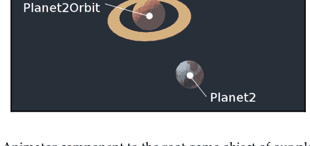

7.  在我们行星系统的根游戏对象（**Planet1**）上添加一个 Animator 组件。
8.  在选择 **Planet1** 游戏对象的情况下打开 **动画** 视图（前往 **窗口** | **动画**）。
9.  通过点击 **创建** 按钮创建一个新的动画剪辑。
10. 确保记录按钮已按下（**动画** 视图的左上角）。
11. 从 **层级** 中选择 **Planet2Orbit** 游戏对象。
12. 在一个轴上稍微旋转 **Planet2Orbit**（例如选择 *Y*）以创建新的关键帧。旋转后，该对象的 **旋转** 属性将自动添加到 **动画** 视图中。在 **Planet2Orbit** 游戏对象的 **检查器** 中 **变换** 组件中找到 **旋转** 部分，并在您选择的轴中输入 0（本示例中为 *Y*）。
13. 在 **动画** 视图中将时间线向前移动几秒钟以创建第二个关键帧。
14. 确保 **Planet2Orbit** 游戏对象仍被选中并且记录按钮处于按下状态。
15. 在 **Planet2Orbit** 游戏对象的 `Transform` 组件的旋转部分输入 `360`。请记住在之前选择的同一轴中输入（本示例中为 *Y*）。这将创建第二个关键帧，并且动画将完美循环。
16. 播放游戏以查看绕轨道运行的行星的效果。

### 工作原理...

本配方的关键要素是我们游戏对象的 **层级**。使用 Unity **动画** 视图创建的所有动画都是在局部空间中制作的，这意味着如果您动画化父对象的位置或旋转，其子对象也会分别移动或旋转。

我们的层级如下：**Planet1** | **Planet2Orbit** | **Planet2**：

-   **Planet1**：这是我们的根游戏对象。我们可以在空间中移动它，我们的动画仍然会完美运行。
-   **Planet2Orbit**：此游戏对象是 **Planet1** 游戏对象的子对象。它放置在 **Planet1** 的中心。整个 **层级** 中只有此对象被动画化。我们使用这个空游戏对象是因为我们可能想要旋转根行星（**Planet1**），并且需要在 **层级** 中使用另一个对象来使 **Planet1** 的旋转与 **Planet2** 的绕轨道运动不同步。
-   **Planet2**：此游戏对象是 **Planet2Orbit** 的子对象。它仅在 **Planet2Orbit** 的局部空间中沿一个轴平移。**Planet2Orbit** 游戏对象的旋转使 **Planet2** 呈圆形移动，从而产生绕轨道运行的行星效果。

### 还有更多...

-   您可以向我们的行星系统添加更多行星。在提供的示例中，还有一个 **月亮** 游戏对象绕 **Planet2** 运行。
-   您也可以拥有带有各自 Animator 组件附加的嵌套游戏对象。这将使多个 Animator Controller 能够驱动 **层级** 不同部分的动画成为可能。

## 动画化触发器 – 创建死亡陷阱

在本配方中，我们将动画化触发器位置并用它来创建一个死亡陷阱。您可以使用 Unity 的动画视图在最少脚本的情况下创建各种游戏玩法机制。

### 准备工作

开始之前，您应该准备一个死亡陷阱模型。我们使用“压力陷阱”作为示例。它包含两个相同的移动元素。请参阅以下屏幕截图：

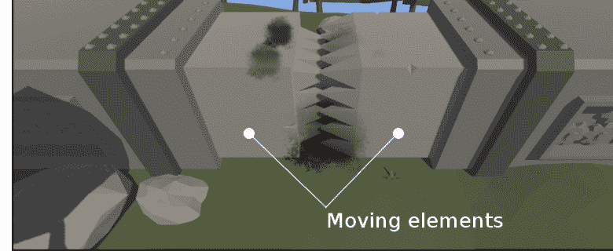

该模型没有蒙皮也没有骨架；相反，移动元素是单独的对象。我们将使用 Unity 的 **动画** 视图对它们进行动画化。您也可以使用提供的示例 Unity 项目并进入 `Chapter 02 Working with the animation view\Recipe 06 Animating triggers - creating a death trap` 目录。在那里您会找到一个 `Example.unity` 场景。如果您播放游戏，您可以看到陷阱的工作情况。如果您打开场景，您会发现 **陷阱** 游戏对象，其子对象为 **LeftTrap** 和 **RightTrap** 游戏对象。这些子对象是此示例中唯一被动画化的对象。它们有触发器对象作为子对象。这些触发器对象在玩家进入时会杀死玩家。**陷阱** 游戏对象的其他所有子对象仅为装饰，是可选的。

### 如何操作...

要动画化触发器位置并创建死亡陷阱，请按照以下步骤操作：

1.  在场景中创建一个空对象并命名为 **陷阱**。它将成为我们移动部件的父对象。
2.  将您的模型放入场景中并设为 **陷阱** 游戏对象的子对象。模型应具有描述性名称，例如 **LeftTrap** 和 **RightTrap**。
3.  在您的 **陷阱** 游戏对象（我们死亡陷阱的根对象）上添加一个 Animator 组件。将 **更新模式** 设置为 **动画物理**。
4.  前往 **窗口** | **动画** 并打开 **动画** 视图。
5.  通过点击 **创建** 按钮创建一个新的动画剪辑。
6.  选择 **LeftTrap** 游戏对象并确保记录按钮已按下（在 **动画** 视图的左上角）。
7.  将 **LeftTrap** 游戏对象移动到打开位置。
8.  将时间线向前调整几秒钟并将 **LeftTrap** 游戏对象移动到关闭位置。
9.  再次将时间线向前调整几秒钟并将 **LeftTrap** 游戏对象再次移动到打开位置以创建循环动画。
10. 对 **RightTrap** 游戏对象重复步骤 7-9。
11. 您应该拥有陷阱打开和关闭的循环动画。您可以根据需要调整动画。您可以在打开位置添加暂停，以便玩家更容易通过陷阱而不被杀死。
12. 关闭 **动画** 视图。


13. 我们需要为角色编写一个脚本，以便我们的死亡陷阱能够伤害它们。创建一个新的 C# 脚本并将其命名为 Character.cs。编写以下代码：

```
using UnityEngine;
using System.Collections;

public class Character : MonoBehaviour
{
    /*We are going to store the reference to a blood effect prefab
    in this variable*/
    public GameObject bloodEffect;

    /*This variable is set to true when the character object was
    already killed*/
    bool isKilled = false;

    /*This function is called by the death
    trap, when we enter it*/
    public void Kill ()
    {
        /*If the character was already killed by the trap,
        we don't want to do anything*/
        if (isKilled) {
            return;
        }
        /*If it was not killed, we set the isKilled
        variable to true*/
        isKilled = true;

        /*We check if the character has a RigidBody component*/
        Rigidbody rb = GetComponent<Rigidbody> ();

        if (rb != null) {
            /*If we find the component, we need to set it to
            kinematic to prevent our character from being
            launched in the air by the collision with our
            trap*/
            rb.isKinematic = true;
        }

        /*Here we spawn a blood effect prefab stored in the
        bloodEffect variable*/
        GameObject.Instantiate (bloodEffect, transform.position
            + Vector3.up * 2f, Quaternion.identity);

        /*We are getting all the Renderer components of our character*/
        Renderer[] r = GetComponentsInChildren<Renderer> ();

        for (int i = 0; i < r.Length; i++) {
            /*We are turning all the renderers off, making the object disappear*/
            r [i].enabled = false;
        }

        /*We are also checking if our character uses our SimpleMove script if so, we are turning it off to prevent player from moving the character after death*/
        SimpleMove move = GetComponent<SimpleMove> ();

        if (move != null) {
            move.enabled = false;
        }
    }
}
```

- 14. 选择 **左陷阱** 游戏对象并为其添加一个 **盒形碰撞器** 组件。
- 15. 调整碰撞体形状，使其不会覆盖尖刺部分（我们计划在那里添加一个触发器）。为此，请在 **盒形碰撞器** 组件中点击 **编辑形状** 按钮。形状手柄将出现在 **场景视图** 中 **盒形碰撞器** 的每个面上。您可以点击手柄并移动它来调整形状。
- 16. 为 **左陷阱** 游戏对象添加一个 **刚体** 组件并将其设置为 **是否运动学**。
- 17. 右键点击 **左陷阱** 游戏对象并选择 **3D 对象 | 立方体** 为其添加一个立方体子对象。它将成为我们的触发器。

18. 将立方体缩放以覆盖尖刺。参见以下截图：

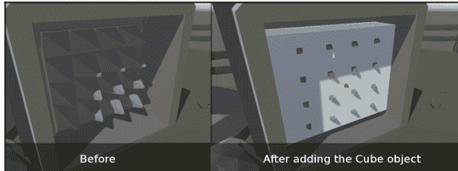

19. 从立方体中移除网格渲染器和网格过滤器组件。为立方体指定一个描述性的名称，例如 LeftTrapTrigger。

20. 在 LeftTrapTrigger 的盒形碰撞器中勾选是否触发选项。

21. 对右陷阱重复步骤 14-20。

22. 现在我们需要为死亡陷阱本身编写一个脚本。创建一个新的 C# 脚本并将其命名为 DeathTrap.cs。打开脚本并编写以下代码：

```
using UnityEngine;
using System.Collections;

public class DeathTrap : MonoBehaviour
{
    /*This function is called when a RigidBody enters the trigger object*/
    void OnTriggerEnter (Collider other)
    {
        /*We are checking if the object which entered the trigger has a Character script, if so we are calling the Kill() method on it*/
        Character characterScript = other.gameObject.GetComponent<Character> ();

        if (characterScript != null) {
            characterScript.Kill ();
        }
    }
}
```

- 23. 将 `DeathTrap.cs` 脚本附加到 **左陷阱触发器** 游戏对象和 **右陷阱触发器** 游戏对象。
- 24. 确保你的角色具有一个 **刚体** 组件
（Unity 标准资源中的 **第三人称角色** 预制件可用）。
- 25. 将 `Character.cs` 脚本添加到你的角色。
- 26. 创建一个血粒子效果并将其保存为预制件。将其命名为 **血花**。
- 27. 将 **血花** 预制件分配给角色中 **角色** 脚本组件的 **血效果** 字段。
- 28. 播放游戏并进入陷阱以查看效果。你的角色应该消失并且 **血花** 效果应该被生成。

## 它是如何工作的...

在本教程中，我们将触发器（设置为 **是否触发** 的 **盒形碰撞器** 组件的游戏对象）作为陷阱移动部件的子对象附加。只要具有 **刚体** 组件的对象进入我们的触发器对象之一，我们的 `DeathTrap.cs` 脚本中的 `OnTriggerEnter()` 方法就会被调用。对象或触发器是否在移动并不重要。陷阱移动部件的动画也会移动子触发器对象。您可以使用它在游戏中创建一些非常壮观的陷阱。

## 更多内容...

在我们的示例中，只要角色触碰到陷阱的尖刺就会死亡。我们可以通过使用动画事件在陷阱关闭时启用触发器，在陷阱打开时禁用它们来增加更多真实感。这将防止我们在陷阱没有关闭时杀死角色。您可以在 `Chapter 6, Handling Combat` 中了解有关动画事件的更多信息。

请记住，您也可以旋转触发器，就像我们在 *使用层级动画本地旋转 – 创建一个环绕的行星* 教程中所做的那样。缩放触发器也是可能的。

您不应将此概念用于移动普通碰撞器。当您想要移动碰撞器时，始终尝试使用设置为 **是否运动学** 的刚体（出于优化原因）。

## 创建一个由玩家输入触发的电梯

在本最后一个教程中，我们将使用玩家输入创建一个简单的电梯。

### 准备工作

开始之前，您应该准备一个电梯模型来包含对象：名为 **电梯** 的根对象、**升降平台** 对象（这个将被动画化），以及用作装饰的 **电梯框架** 对象。**升降平台** 和 **电梯框架** 对象应为空的 **电梯** 对象的子对象。您也可以使用提供的示例 Unity 项目并进入 `Chapter 02 Working with the animation view\Recipe 07 Creating an elevator triggered by player input` 目录。您将在那里找到一个 `Example.unity` 场景，其中包含 **电梯** 游戏对象及其子对象 **升降平台** 和 **电梯框架**。示例资源中的 **电梯** 已被动画化。

### 如何操作...

要创建由玩家输入触发的电梯，请按照以下步骤操作：

- 1. 选择根 **电梯** 对象并为其分配一个动画器组件。将 **更新模式** 设置为 **动画物理**。
- 2. 打开 **窗口 | 动画** 并通过点击 **创建** 按钮创建一个新的动画剪辑。将其命名为 **ElevatorGoingDown**。
- 3. 确保录制按钮被按下（在 **动画视图** 的左上角）。
- 4. 选择你的 **升降平台** 游戏对象并将其移动到上位置。
- 5. 将时间线向前调整几秒并将 **升降平台** 游戏对象移动到下位置。你的 **升降平台** 游戏对象应从最大上位置动画到最小下位置。
- 6. 通过从动画下拉列表中选择 **创建新剪辑** 选项创建另一个动画剪辑（您可以在播放按钮下方找到它）。将其命名为 **ElevatorGoingUp**。
- 7. 将你的 **升降平台** 游戏对象从下位置动画到上位置。
- 8. 创建另一个动画剪辑并将其命名为 **ElevatorDown**。为 **升降平台** 游戏对象在下位置创建一个一秒循环动画。
- 9. 创建另一个动画剪辑并将其命名为 **ElevatorUp**。为 **升降平台** 游戏对象在上位置创建一个一秒循环动画。
- 10. 关闭 **动画** 视图。
- 11. 在 **项目** 视图中导航到 **ElevatorGoingUp** 和 **ElevatorGoingDown** 资源。选择它们并在 **检查器** 中取消勾选 **循环时间** 选项。
- 12. 在 **层级** 中选择 **电梯** 游戏对象并在 **检查器** 中找到其动画器组件。
- 13. 双击 **控制器** 字段以打开自动创建的动画控制器资源。
- 14. 创建一个新的触发器参数并将其命名为 `Move`。
- 15. 创建一个转换循环，如以下截图所示：

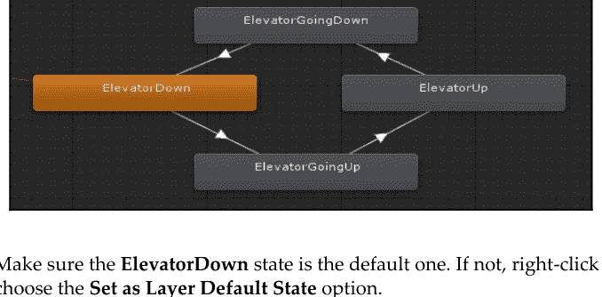

- 16. 确保 **ElevatorDown** 状态是默认状态。如果不是，右键点击它并选择 **设置为图层默认状态** 选项。
- 17. **ElevatorDown | ElevatorGoingUp** 和 **ElevatorUp | ElevatorGoingDown** 转换都应将 **Move** 触发器设置为条件并将 **Has Exit** 选项设置为 false。
- 18. **ElevatorGoingDown | ElevatorDown** 和 **ElevatorGoingUp | ElevatorUp** 转换应将 **Has Exit Time** 选项设置为 true 并且不应有其他条件。


19. 创建一个新的 C# 脚本并将其命名为 `Elevator.cs`。编写以下代码：

```
using UnityEngine;
using System.Collections;

public class Elevator : MonoBehaviour
{
    // Update is called once per frame
    void Update ()
    {
        /*When the player presses the E key, we are setting the
        Move trigger on the Animator component. We are assuming
        the Animator component is present on the game object our
        script is attached to*/
        if (Input.GetKeyDown (KeyCode.E)) {
            GetComponent<Animator> ().SetTrigger ("Move");
        }
    }
}
```

20. 将 `Elevator.cs` 脚本分配给 **Elevator** 游戏对象。

21. 选择 **ElevatorFrame** 游戏对象并为其添加一个 **Mesh Collider** 组件。

22. 选择 **Lift** 游戏对象并通过右键菜单选择 **3D Object | Cube** 为其添加三个 **Cube** 游戏对象。使用这些立方体来封装 **Lift** 的地板和两个屏障（具体情况下立方体的数量可能会有所不同）。请参阅以下截图：

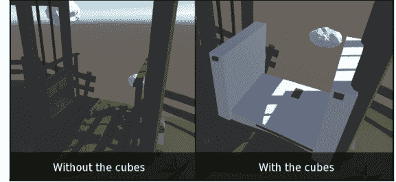

23. 从立方体中移除 **Mesh Renderer** 和 **Mesh Filter** 组件，只保留 **Box Collider** 组件。为立方体赋予适当的名称，例如 `FloorCollider`、`LeftCollider` 和 `RightCollider`。
24. 再次选择 **Lift** 对象。为其添加一个 **Rigidbody** 组件并将其设置为 **Is Kinematic**。
25. 向 **Lift** 游戏对象添加 `Platform.cs` 脚本。您可以在 *为物体的世界位置设置动画 – 创建移动平台配方* 的 *如何操作* 部分第 13 步中找到该脚本。
26. 这个简单的电梯适用于使用 **Rigidbody** 组件的角色。您可以使用 Unity 标准资源包中的 **ThirdPersonCharacter** 预制体，或使用提供的 Unity 示例项目中的预制体。
27. 运行游戏并按下键盘上的 *E* 按钮来触发电梯。

## 它是如何工作的...

本配方有几个关键要素使其发挥作用：

- **动画化的 Lift 游戏对象**：**Lift** 游戏对象使用动画从上到下移动。
- **Lift 作为子游戏对象**：**Lift** 游戏对象是 **Elevator** 游戏对象的子对象，这使得可以复制 **Elevator** 并在场景中的多个位置使用它。
- **Platform.cs 脚本**：我们使用的是 *为物体的世界位置设置动画 – 创建移动平台配方* 中相同的 `Platform.cs` 脚本。该脚本将角色设为 **Lift** 的父级。这样角色就会被迫随 **Lift** 移动，从而防止抖动（您可以尝试从 **Lift** 游戏对象中移除 `Platform.cs` 脚本并在 **Elevator** 中向下移动：角色会上下跳动）。
- **玩家输入**：我们使用玩家输入来设置 **Elevator** 的 Animator Controller 中的 `Move` 触发参数。这会播放动画（**ElevatorGoingUp** 或 **ElevatorGoingDown**，取决于 Elevator 当前所处的状态）。

## 还有更多...

目前，**Elevator** 会在每次玩家输入后移动，无论玩家是否站在 **Lift** 中。您可以使用设置为 **Is Trigger** 的 **Box Collider** 组件并编写脚本来检查玩家是否在 **Lift** 中，只有在这种情况下才允许玩家使用输入。以下是可以实现此功能的示例 `LiftCheck.cs` 脚本（您可以在提供的示例 Unity 项目的 `Chapter 02 Working with the animation view\Recipe 07 Creating an elevator triggered by player input\Scripts` 目录中找到该脚本）：

```
using UnityEngine;
using System.Collections;

public class LiftCheck : MonoBehaviour
{
    Elevator elevatorScript;
    // Use this for initialization
    void Start ()
    {
        /*We try to find the Elevator script on the root
        transform (we are assuming this is the Elevator game
        object)*/
        elevatorScript = transform.root.GetComponent<Elevator> ();
    }
    // This function is called when our character
    enters the trigger
    void OnTriggerEnter (Collider other)
    {
        /*We check if we've found the Elevator script*/
        if (elevatorScript != null) {
            /*We check if the object which entered
            the trigger is the Player*/
            if (other.gameObject.CompareTag ("Player")) {
                /*We enable the Elevator script
                (and enable the input)*/
                elevatorScript.enabled = true;
            }
        }
    }
    // This function is called when our character
    exits the trigger
    void OnTriggerExit (Collider other)
    {
        /*We check if we've found the Elevator script*/
        if (elevatorScript != null) {
            /*We check if the object which exited the
            trigger is the Player*/
            if (other.gameObject.CompareTag ("Player")) {
                /*We disable the Elevator script (and
                disable the input)*/
                elevatorScript.enabled = false;
            }
        }
    }
}
```

## 3

## 2D 和用户界面动画

本章将涵盖以下主题：

- 从 3D 软件包导出 2D 精灵动画
- 使用 Animation View 创建逐帧精灵动画
- 使用 Animation View 创建 2D 精灵木偶动画
- 使用 Animator Controller 播放精灵动画
- 使用 Animation View 创建淡出-淡入过渡
- 使用 Animation View 创建滑动过渡
- 使用填充图像创建动画进度条
- 使用 Mecanim 状态为 UI 按钮状态设置动画

## 简介

在上一章中，我们使用的是 Animation View，它是 Unity 中制作动画的基本工具。本章解释了 **2D 和用户界面动画管线**。在本章中，我们将继续使用 Animation View 创建各种 2D 和 UI 动画。

## 从 3D 软件包导出 2D 精灵动画

绘制动画 2D 精灵可能具有挑战性。一些艺术家在 3D 软件包中创建角色并将其导出为 2D 精灵，以使动画过程更简单。在本第一个配方中，我们将创建这样一个角色并将其动画导出为精灵表。

## 准备工作

开始之前，您需要在所选的 3D 软件包中拥有一个动画模型（我们使用的是 Blender）。您也可以下载提供的示例；在 Unity 中打开项目；转到 `Chapter 03 2D and user interface animation\Recipe 01 Exporting a 2d sprite animation from a 3d package` 文件夹。您将在那里找到一个名为 `Example.unity` 的场景，其中包含一个动画硬币精灵。在 `Animation` 目录中，您可以找到导出的帧和包含它们的精灵表。您还可以找到一个包含硬币模型的 `*.blend` 文件；设置为渲染出动画。

## 如何操作...

要从 3D 软件包导出 2D 精灵动画并将其导入 Unity，请按照以下步骤操作：

1. 在您选择的 3D 软件包中创建一个动画对象。
2. 设置相机以渲染动画对象。相机可以是透视或正交，取决于您想要实现的效果。在此示例（旋转硬币）中，它设置为透视以更好地显示动画。尝试将对象的中心放在画面的中心。
3. 将动画渲染为具有透明背景的单独帧（通常每秒 12 帧足以获得高质量的精灵动画）。使用合理的命名约定（例如 `frame_01.png`、`frame_02.png` 等）。所有帧的像素尺寸应相同。
4. 在所选的图像编辑软件中创建一个新图像（本配方中使用 GIMP）。图像应具有透明背景。
5. 统计所有渲染的帧，并将新创建的图像大小设置为足够大，以容纳所有渲染的帧，彼此相邻（按列和行排列）。例如，大小为 512 × 512 像素的图像最多可容纳 8 个 256 × 256 像素大小的帧、16 个 128 × 128 像素大小的帧或 32 个 64 × 64 像素大小的帧。
6. 将所有帧按列和行排列在新创建的图像上，从第一帧开始，如以下屏幕截图所示：
7. 将图像导出为具有透明背景的 *.png 文件。
8. 将图像导入 Unity（将其拖放到 Project View 或转到 Assets | Import New Asset 并在资源管理器中选择图像文件）。

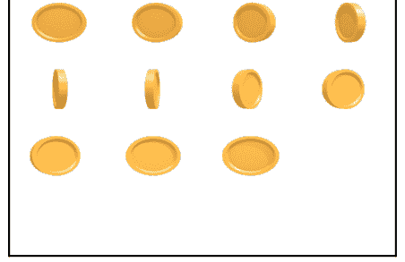


- 9. 在项目视图中选择导入的文件并打开检查器。将纹理类型设置为 Sprite (2d and UI)，如下截图所示：
- 10. 将精灵模式设置为 Multiple，点击应用按钮（保存设置），然后点击精灵编辑器按钮。
- 11. 精灵编辑器窗口将打开，如下截图所示：

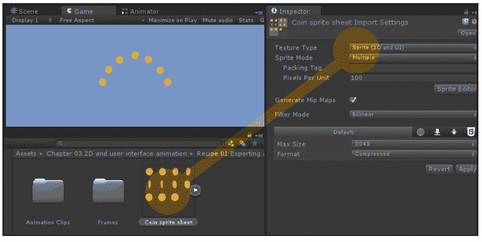

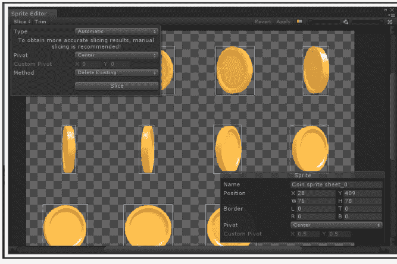

- 12. 点击 **Slice** 按钮，将出现一个包含额外设置的对话框。
- 13. 将 **Type** 设置为 **Automatic**，**Pivot** 设置为 **Center**，然后点击 **Slice** 按钮。
- 14. 完成编辑后，点击 **Apply** 按钮并关闭 **Sprite Editor** 窗口。
- 15. 纹理资源将被转换为精灵资源，所有帧都作为单独的子对象：名称后添加数字的精灵，如下截图所示：

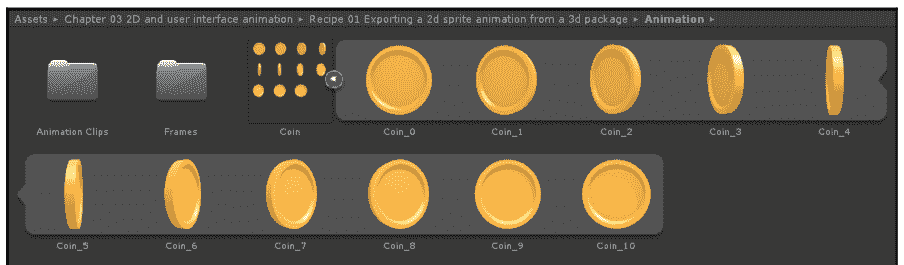

- 16. 你可以使用这些子精灵作为静态 2D 图像，或在 **Animation** 视图中创建动画。

## 工作原理...

你可以使用从 3D 软件渲染的动画帧来在 Unity 中创建 2D 精灵，只要这些帧具有透明背景。将这些帧合并到精灵表中可以节省宝贵的绘制调用（精灵被视为一个纹理），使游戏在低端设备上运行更流畅。如果将精灵合并到精灵表中，组织项目文件也更容易。Unity 可以自动将具有透明度的精灵表拆分为多个精灵。它能识别 *空像素*（透明像素），并相当有效地分离单个对象（或动画帧）。

Unity 还可以使用精灵打包功能自动将精灵打包到精灵表中。要将精灵打包到图集中，首先确保已启用打包。为此，请转到 **Edit | Project Settings | Editor** 并检查 **Sprite Packer Mode**。应将其更改为 **Always Enabled**。然后选择要打包到一个图集中的精灵，并为它们指定相同的 **Packing Tag**。最后，打开 **Sprite Packer**（转到 **Window | Sprite Packer**）并点击 **Pack** 按钮。所有具有相同 **Packing Tag** 的精灵将被一起打包。

## 还有更多...

**Sprite Editor** 中还有一些其他有趣的选项：

- 在 **Slice** 对话框中，你可以设置 **Type** 为：
  - **Automatic**：Unity 将尝试自动将精灵表切片为单独的精灵。
  - **Grid By Cell Size**：Unity 将精灵表切片为网格，每个单元格的大小以像素为单位定义。例如，你可以将精灵表切片为 64 × 64 像素的单元格
  - **Grid By Cell Count**：Unity 将精灵表切片为具有给定单元格数和行数的精灵网格
- 你还可以在 **Slice** 对话框中设置每个精灵的 **Pivot**。有多种选项可将每个创建精灵的轴心点设置为精灵中心、右角、左角等。
- 你也可以在选择精灵时手动裁剪它。为此，点击精灵的边框并拖动。
- 你可以以类似的方式调整每个精灵的轴心点。在 **Sprite Editor** 中选择精灵，点击其轴心点（蓝色圆圈），并拖动以更改其位置。

## 另请参阅

要创建精灵动画，请参阅下一个食谱。

## Creating a frame-by-frame sprite animation with the Animation View

本食谱展示如何使用 Animation View 从之前渲染的（或手绘的）帧创建精灵动画。

## 准备工作

要在 Unity 中创建逐帧精灵动画，你应首先从 3D 软件绘制或渲染出动画帧，将它们合并为精灵表，并将精灵表导入 Unity（请参阅 Exporting a 2D sprite animation from a 3D package 食谱）。你也可以下载提供的示例 Unity 项目并进入 Chapter 03 2D and user interface animation\Recipe 02 Creating a frame by frame sprite animation with the animation view 目录。你将在那里找到一个名为 Example.unity 的场景，其中包含一个 Coin 游戏对象，该对象已被动画化。你可以选中它并转到 Window | Animation 查看动画是如何准备的。

## 如何操作...

要在 Unity 中创建逐帧精灵动画，请按照以下步骤操作：

- 1. 在项目视图中选择你的精灵表资源。
- 2. 展开精灵表以查看单个精灵（精灵表资源的子对象）。
- 3. 选择其中一个精灵，然后将其拖放到场景的层级中。
- 4. 你可以重命名创建的游戏对象。
- 5. 在选中游戏对象后，转到 Window |Animation。
- 6. 在 Animation View 中点击 Create 按钮创建新的 Animation Clip。
- 7. 将 **Samples** 调整为动画创建时的帧率（本例中为 12），如下截图所示：

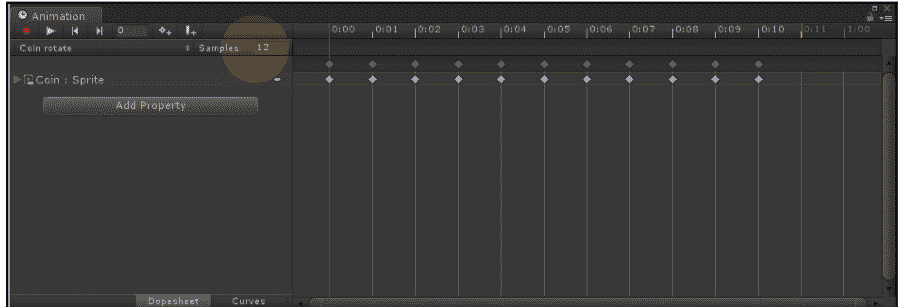

- 8. 确保记录按钮处于按下状态。在 **Project** 视图中，选择精灵表资源中的所有帧（子精灵）并将其拖入 **Animation** 视图。
- 9. 将创建逐帧精灵动画。点击 **Animation** 视图中的 **Play** 按钮或运行游戏以查看效果。

## 工作原理...

Unity 可以动画化游戏对象的 **Sprite Renderer** 组件中的公共 **Sprite** 字段。这正是本食谱中所做的。我们在每一帧更改精灵以创建逐帧动画。我们已更改 **Samples** 数字以降低动画帧率。这允许我们使用更少的每秒帧数。在标准的 2D 逐帧动画中，我们使用每秒 12 或 24 帧，而 Unity 的默认 **Samples** 数字为 60。

在某些情况下，你可以使用更低的 **Samples** 值：尝试使用每秒 8 帧进行实验。

## Creating a 2D sprite doll animation with the Animation View

在本食谱中，我们将使用不同的方法：2D 精灵娃娃动画。它基于创建具有所有肢体作为单独精灵的 2D 娃娃角色，然后使用 Unity 的 **Hierarchy** 和 **Animation** 视图对这些精灵进行动画。

## 准备工作

要创建 2D 娃娃动画，首先需要准备包含所有肢体作为单独精灵的角色精灵表。参考以下截图：

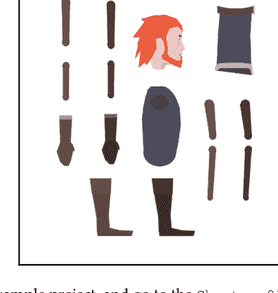

你也可以使用示例项目，并进入 `Chapter 03 2D and user interface animation\Recipe 03 Creating a 2d sprite doll animation with the animation view` 目录。你可以在那里找到 `Example.unity` 场景，其中 **Hierarchy** 中已有一个 **Warrior** 角色被动画化。在 `Animation` 目录中，你可以找到一个 `Warrior.png` 精灵表，其中包含角色的所有身体部位。

## 如何操作...

要创建 2D 精灵娃娃风格动画，请按照以下步骤操作：

- 1. 将包含所有身体部位的角色精灵表导入 Unity。
- 2. 选择精灵表并打开其 **Inspector**。
- 3. 将 **Sprite Mode** 设置为 **Multiple** 并点击 **Apply** 按钮。
- 4. 点击 **Sprite Editor** 按钮打开 **Sprite Editor**。
- 5. 在 **Sprite Editor** 中点击 **Slice** 按钮。**Slice** 对话框将出现。
- 6. 将 **Type** 设置为 **Automatic**。
- 7. 点击 **Slice** 对话框底部的 **Slice** 按钮。
- 8. 在 **Sprite Editor** 中调整角色身体部位的所有轴心点。动画中身体部位将在这些轴心点周围旋转。尝试将轴心点放在肢体的关节上，如下截图所示：

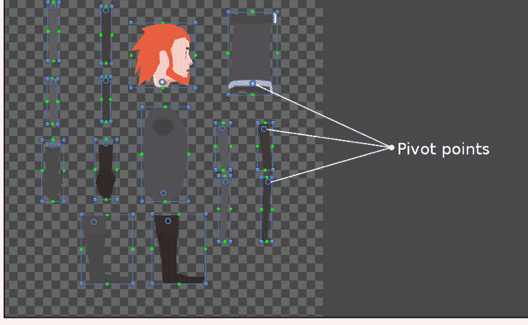

- 9. 在 **Sprite Editor** 中点击 **Apply** 按钮。
- 10. 在场景的 **Hierarchy** 中创建一个空游戏对象并为其命名（本例中为 `Warrior`）。
- 11. 将角色精灵表中的所有身体部位拖放到 **Warrior** 游戏对象上（你必须一次拖放一个身体部位，因为拖放多个精灵会创建 Animation Clip）。
- 12. 重命名身体部位以提高清晰度。在我们的示例中，我们有 `Hips`、`Chest`、`Head`、`FrontUpperArm`、`FrontLowerArm`、`Front Hand`、`BackUpperArm`、`BackLowerArm`、`BackHand`、`FrontUpperLeg`、`FrontLowerLeg`、`FrontFoot`、`BackUpperLeg`、`BackLowerLeg` 和 `BackFoot`。
- 13. 在场景的 **Hierarchy** 中使用所有身体部位构建一个类人层级结构，以 **Warrior** 游戏对象作为根。在我们的示例中，层级结构如下：
- 14. 为每个身体部位中每个 **Sprite Renderer** 组件的 **Order in Layer** 字段进行调整。在我们的示例中，身体部位的顺序如下：
```
Warrior | Hips | Chest | Head
Chest | FrontUpperArm | FrontLowerArm | FrontHand
Chest | BackUpperArm | BackLowerArm | BackHand
Hips | FrontUpperLeg | FrontLowerLeg | FrontFoot
Hips | BackUpperLeg | BackLowerLeg | BackFoot
```

|  |  |
|---|---|
| 0 | BackUpperArm |
| 1 | BackLowerArm |
| 2 | BackHand |
| 3 | BackUpperLeg |
| 4 | BackLowerLeg |
| 5 | BackFoot |
| 6 | FrontUpperLeg |
| 7 | FrontLowerLeg |
| 8 | FrontFoot |
| 9 | Head |
| 10 | Chest |
| 11 | Hips |


|  |  |
|---|---|
| 12 | `FrontUpperArm` |
| 13 | `FrontLowerArm` |
| 14 | `FrontHand` |

15. 将身体部位移动到其“解剖学”位置以形成角色，如以下屏幕截图所示：

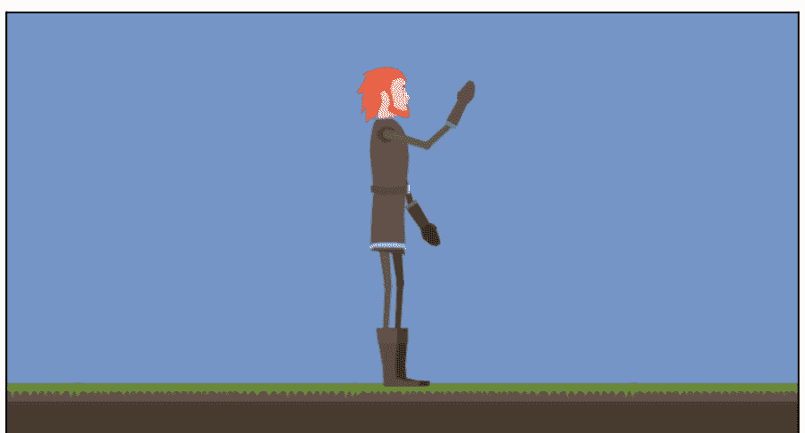

- 16. 选择 **Warrior** 游戏对象（包含所有身体部位的根游戏对象）。
- 17. 转到 **Window** | **Animation**。
- 18. 通过点击 **Animation** 视图中的 **Create** 按钮创建一个新的 Animation Clip。
- 19. 确保已按下录制按钮（**Animation** 视图左上角）。
- 20. 通过旋转其各个身体部位来为角色设置动画。

## 工作原理...

创建 2D 木偶动画使用的概念与第 2 章《Working with the Animation View》中 Using the Hierarchy to animate local rotation – creating an orbiting planet 配方中所示的概念相同。本配方的关键元素是包含我们角色所有身体部位作为子游戏对象的 Warrior 根游戏对象。当我们选择此对象并打开 Animation View 时，我们可以为其所有子游戏对象设置动画。保存的 Animation Clip 将由 Warrior 游戏对象的 Animator Controller 使用。这使我们能够创建复杂的层级动画（例如此动画）并将其保存为单个 Animation Clip。

## 使用 Animator Controller 播放精灵动画

在本配方中，我们将创建一个 Animator Controller 来播放角色的 2D 动画。Unity 的动画系统对 2D 和 3D 动画剪辑使用相同的原理，这使其使用起来非常直观。

## 准备工作

首先，你应该准备好至少两个精灵动画（或 2D 精灵木偶动画）。你也可以前往 Chapter 03 2D and user interface animation\Recipe 04 Using the animator controller to play sprite animations 目录并打开 Example.unity 场景。你将在那里找到一个已经动画化的 Warrior 游戏对象。如果播放游戏，你可以使用方向键（左右）移动角色。它将相应地播放 2D 动画。

## 如何操作...

要为 2D 动画创建 Animator Controller，请按照以下步骤操作：

- 1. 以 Exporting a 2D sprite animation from a 3D package 配方中的相同方式将你的 2D 精灵表导入 Unity。
- 2. 将其中一个子精灵（不是精灵表）拖放到 Hierarchy 中。
- 3. 选择精灵游戏对象并为其指定适当名称（本示例中命名为 Warrior）。

- 4. 在选择 **Warrior** 游戏对象后，转到 **Window** | **Animation** 以打开 **Animation** 视图。
- 5. 使用 **Animation** 视图创建所需的 Animation Clip（与 *Creating a frame-by-frame sprite animation with the Animation View recipe* 中的方式相同）。在本示例中，我们使用两个动画：**Warrior2dIdle** 和 **Warrior2dWalk**。
- 6. 将自动创建 Animator Controller 并分配给 **Warrior** 游戏对象上的 Animator 组件。
- 7. 打开创建的 Animator Controller（你可以通过在 **Hierarchy** 中选择 **Warrior** 游戏对象然后转到 **Window** | **Animator** 来轻松完成）。
- 8. 在 Animator Controller 中创建一个新的 `float` 参数并将其命名为 Speed。我们将使用它来控制动画流程。
- 9. 创建两个过渡：从 **Warrior2dIdle** 到 **Warrior2dWalk**，以及从 **Warrior2dWalk** 到 **Warrior2dIdle**。第一个的条件应为 Speed 大于 0.1，第二个应为 **Speed** 小于 0.1。请参阅以下屏幕截图：

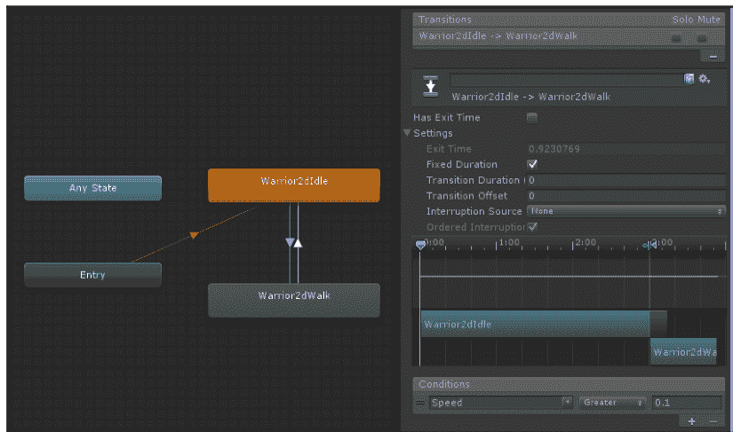

- 10. 在两个过渡中将 **Has Exit Time** 设置为 false，将 **Transition Duration** 设置为 0（你无法混合逐帧精灵动画）。

- 11. 编写脚本以根据玩家输入设置 **Speed** 参数。你也可以在该配方的 `Scripts` 目录中提供的 Unity 项目中找到并使用 `Warrior2dMove.cs` 脚本。

- 12. 在该脚本的 `Update()` 函数中，我们将 `Horizontal` 轴作为输入。然后我们将 **Speed** 变量设置为输入的绝对值，因为在我们的 Animator Controller 中，我们只检查它是否大于或小于 0.1，而 `Horizontal` 轴的值可以在 -1 到 1 之间。我们使用 `speed` 变量在 Animator Controller 中设置 **Speed** 参数。`animator` 变量保存对同一游戏对象上 Animator 组件的引用（我们在 `Start()` 函数中设置此引用）：

```
hor = Input.GetAxis("Horizontal");
speed = Mathf.Abs(hor);
animator.SetFloat("Speed", speed);
```

- 13. 这将使角色在用户按下键盘上的左右箭头时播放 **Warrior2dWalk** 动画，并在玩家未按下任何按钮时播放 **Warrior2dIdle** 动画。

## 工作原理...

本配方有几个关键元素：

- **Animator Controller for 2D animations**：控制 2D 动画播放与 Unity 中的 3D 和骨骼动画非常相似。你可以像往常一样创建 Animator Controller，并包含所有所需的状态及其之间的过渡。
- **Transition Duration set to 0**：**Transition Duration** 参数只有在可以混合动画以创建平滑过渡时才有意义。在 2D 逐帧动画中这是不可能的（Unity 无法自动创建“中间精灵”）。这就是将参数设置为 0 并实现清晰、即时过渡的原因。如果参数值大于 0，过渡仍会看起来很清晰，但也会被延迟。

## 扩展内容...

我们在 Warrior2dMove.cs 脚本中使用了一个简单的技巧来减少所需的动画数量。我们的角色可以向左向右移动，但我们只使用一个动画：Warrior2dWalk（其中角色向右移动）。在脚本的 Update() 函数中，我们检查玩家 Horizontal 轴输入是否大于 0 或小于 0，并根据移动方向将角色的局部 X 缩放设置为 1 或 -1。这会翻转角色并为我们节省大约 50% 的动画：

```
if (hor > 0f)
{
    transform.localScale = Vector3.one;
}
else if (hor < 0f)
{
    transform.localScale = new Vector3(-1f, 1f, 1f);
}
```

## 使用 Animation View 创建淡出-淡入过渡

每个游戏都有某种淡入/淡出过渡：在关卡之间，或在进入对话或过场动画时等等。在 Unity 中，我们可以使用 Animation View 非常轻松地创建此类过渡。

## 准备工作

你无需为本配方准备任何内容；所有内容都在 Unity 中从头创建。你可以打开提供的示例 Unity 项目并前往 Chapter 03 2D and user interface animation\Recipe 05 Creating a fade out - fade in transition with the animation view 目录。你将在那里找到一个 Example.unity 场景。播放游戏并按空格键即可看到淡入/淡出效果。

## 如何操作...

要创建淡入/淡出效果，请按照以下步骤操作：

- 1. 打开一个场景。
- 2. 在 **Hierarchy** 中创建一个 **Image**。为此，请在屏幕顶部选择 **Game Object** | **UI** | **Image** 菜单。
- 3. **Image** 和 **Canvas** 游戏对象将在 **Hierarchy** 中创建。
- 4. 选择 **Image** 游戏对象并将其名称设置为 `BlackScreen`。
- 5. 右键单击 **Canvas** 游戏对象并选择 **Create Empty** 以创建一个空游戏对象。
- 6. 将新创建的游戏对象的名称设置为 `FadeAnimator`。该对象将为效果设置动画。
- 7. 将 **BlackScreen** 和 **FadeAnimator** 游戏对象的 **Anchor Preset** 设置为在 X 和 Y 坐标上均拉伸，如以下屏幕截图所示：

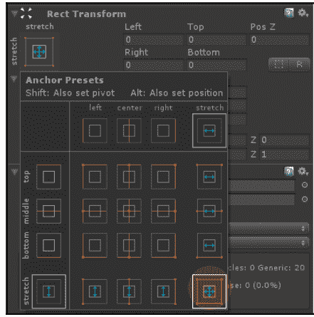

- 8. 将 **BlackScreen** 和 **FadeAnimator** 游戏对象中 **Left**、**Top**、**Right** 和 **Bottom** 位置参数均设置为 0。这将使 **BlackScreen** 和 **FadeAnimator** 游戏对象覆盖整个屏幕。
- 9. 在 **Hierarchy** 中将 **BlackScreen** 游戏对象设为 **FadeAnimator** 游戏对象的父对象。


10. 选择 **FadeAnimator** 游戏对象并前往 **窗口** | **动画** 打开 **动画** 视图。
11. 通过点击 **创建** 按钮创建新的动画剪辑。将剪辑命名为 `Alpha_0`；这将是我们默认的动画。
12. 确保记录按钮处于按下状态并选择 **BlackScreen** 游戏对象。将颜色设置为黑色，alpha 通道设置为 0（同样为黑色）。同时禁用 **BlackScreen** 游戏对象。此动画剪辑在第 0 帧上应只有一个关键帧；删除任何不需要的关键帧。在此动画器中禁用 **BlackScreen** 游戏对象（将其设为非活动）。这样当其 alpha 为 0% 时，对象将不会渲染。
13. 再次选择 **FadeAnimator** 游戏对象并创建另一个动画剪辑。将其命名为 `Alpha_100`。此动画中的对象应启用。
14. 确保记录按钮处于按下状态并选择 **BlackScreen** 游戏对象。将颜色设置为黑色，alpha 通道设置为 100%（白色）。启用 **BlackScreen** 游戏对象（确保 **动画** 视图中显示 **Game Object.Is Active** 属性，如果没有，请点击游戏对象的 **enable** 复选框两次）。此动画剪辑也应在第 0 帧上只有一个关键帧；删除其他任何关键帧。
15. 再次选择 **FadeAnimator** 游戏对象并创建另一个动画。命名为 `FadeIn`。在记录按钮按下状态下，选择 **BlackScreen** 游戏对象并创建两个关键帧：一个在第 0 帧，一个在 1 秒处。**BlackScreen** 游戏对象在第一帧应为黑色且 alpha 设置为 0%（黑色），在第二个关键帧应为黑色且 alpha 设置为 100%（白色）。这将是我们淡入黑色的动画。你还应在第 0 帧启用 **BlackScreen** 游戏对象以使其渲染。
16. 再次选择 **FadeAnimator** 游戏对象并创建另一个动画。命名为 `FadeOut`。在记录按钮按下状态下，选择 **BlackScreen** 游戏对象并创建两个关键帧：一个在第 0 帧，一个在 1 秒处。**BlackScreen** 游戏对象在第一帧应为黑色且 alpha 设置为 100%（白色），在第二个关键帧应为黑色且 alpha 设置为 0%（黑色）。这将是我们淡出黑色的动画。你还应在第二个关键帧禁用 **BlackScreen** 游戏对象，以防止其在 alpha 为 0% 时仍渲染。
17. 打开分配给 **FadeAnimator** 游戏对象的动画控制器。
18. 创建一个 `Trigger` 参数并将其命名为 `Fade`。
19. 创建一个过渡循环（请参考以下截图）：
- **Alpha_0 | FadeIn** 的触发器 **Fade** 设为条件且 **是否有退出时间** 设为 `false`。
- **FadeIn | Alpha_100** 无条件且 **是否有退出时间** 设为 `true`。
- **Alpha_100 | FadeOut** 的触发器 **Fade** 设为条件且 **是否有退出时间** 设为 `false`。
- **FadeOut | Alpha_0** 无条件且 **是否有退出时间** 设为 `true`。

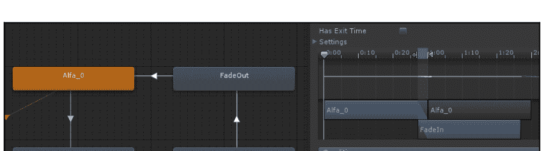
20. 编写脚本以在动画控制器中设置 Fade Trigger 参数。在此示例中，我们使用玩家输入来设置 Fade 参数。每当玩家按下空格键时，Fade Trigger 就会被设置。你可以在提供的示例 Unity 项目中的 Chapter 03 2D and user interface animation\Recipe 05 Creating a fade out - fade in transition with the animation view\Scripts 目录中找到 Fade.cs 脚本：
```
if (Input.GetKeyDown(KeyCode.Space))
{
    animator.SetTrigger("Fade");
}
```
21. 将脚本附加到 FadeAnimator 游戏对象。

## 它是如何工作的...

本教程对 Image 组件（Unity UI 的一部分）的颜色进行动画。我们可以对 alpha 参数进行动画以淡化 Image 的透明度。它使我们能够非常轻松地创建淡入/淡出效果。本教程还有一些其他关键要素：
- **FadeAnimator 空游戏对象**：我们的 **BlackScreen** 游戏对象（包含 **Image** 组件）是空游戏对象的子对象（在本示例中命名为 **FadeAnimator**）。空游戏对象附加了 Animator 组件。这样我们就可以在动画中禁用和启用 **BlackScreen** 游戏对象（如果 Animator 组件附加到同一个 **BlackScreen** 游戏对象上则无法实现）。
- **禁用和启用 BlackScreen 游戏对象**：禁用我们的黑屏是一个良好的实践，因为如果启用（即使完全透明），它们可能会阻挡 UI 元素的鼠标输入。
- **Hierarchy 中的 BlackScreen 底部**：我们的 **BlackScreen** 对象应放置在 **Hierarchy** 的最底部，以覆盖游戏中的所有其他 UI 元素。

## 使用动画视图创建滑动过渡

在本教程中，我们将创建一个更具创意的过渡效果。很多步骤与上一教程相似，但最终结果完全不同。本教程的目标是鼓励你尝试为不同 UI 属性制作动画以实现有趣的效果。

## 准备工作

与上一教程类似，我们将在 Unity 中从头开始创建所有内容；你无需提前准备任何东西。你可以打开提供的示例 Unity 项目并进入 `Chapter 03 2D and user interface animation\Recipe 06 Creating a swipe transition with the animation view` 目录。你将在那里找到一个 `Example.unity` 场景。播放游戏并按空格键查看滑动过渡效果。

## 如何操作...

要创建滑动过渡效果，请按照以下步骤操作：
1. 打开一个场景。
2. 在 **Hierarchy** 中创建 **Image**。为此，请在屏幕顶部前往 **Game Object** | **UI** | **Image** 菜单。
3. **Image** 和 **Canvas** 游戏对象将在 **Hierarchy** 中创建。
4. 选择 **Image** 游戏对象并将其名称设置为 `BlackScreen`。
5. 右键点击 **Canvas** 游戏对象并选择 **Create Empty** 以创建空游戏对象。
6. 将新创建的游戏对象的名称设置为 `FadeAnimator`。此对象将为效果制作动画。
7. 将 **BlackScreen** 和 **FadeAnimator** 游戏对象的 **Anchor Preset** 设置为在 X 和 Y 坐标上均拉伸，与上一教程中相同的方式。
8. 选择 **Canvas** 游戏对象并向其添加 **Canvas Scaler** 组件。我们需要它在玩家更改游戏屏幕分辨率时缩放我们的效果。
9. 将 **Canvas Scaler** 组件中的 **UI Scale Mode** 设置为 **Scale With Screen Size**，以根据屏幕分辨率缩放整个画布。
10. 将 **BlackScreen** 和 **FadeAnimator** 游戏对象中的 **Left**、**Top**、**Right** 和 **Bottom** 位置参数均设置为 0，与上一教程中相同的方式。
11. 将 **BlackScreen** 游戏对象中 **Image** 组件的颜色设置为完全不透明的黑色。
12. 在 **Hierarchy** 中将 **BlackScreen** 游戏对象设为 **FadeAnimator** 游戏对象的父对象。
13. 确保 **Scene** 视图设置为 2D。将 **BlackScreen** 游戏对象中的 **Right** 位置参数设置为 –20 像素，并将 Left 位置参数设置为大于当前 **Game** 视图屏幕分辨率的数字。**BlackScreen** 游戏对象在 **Scene** 视图中应显示为 **Canvas** 右侧的一个非常细的条带，如以下截图所示：

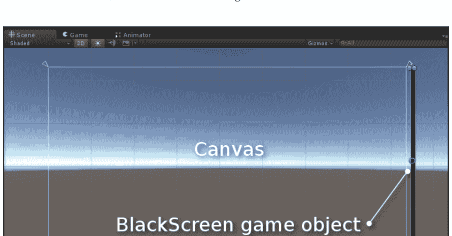
14. 选择 **FadeAnimator** 游戏对象并前往 **窗口** | **动画** 打开 **动画** 视图。
15. 通过点击 **创建** 按钮创建新的动画剪辑。将剪辑命名为 **Alpha_0**；这将是我们默认的动画。
16. 确保记录按钮处于按下状态并选择 **BlackScreen** 游戏对象。在 **Inspector** 中点击 **Left** 位置输入字段并再次输入相同的值。它应为所有位置值插入关键帧。禁用 **BlackScreen** 游戏对象；它也应创建关键帧。此动画剪辑在第 0 帧上应只有一个关键帧；删除任何不需要的关键帧。
17. 再次选择 **FadeAnimator** 游戏对象并创建另一个动画剪辑。将其命名为 `Alpha_100`。


18. 确保记录按钮被按下并选择 **黑屏** 游戏对象。将 **右** 和 **左** 位置设为 0。启用 **黑屏** 游戏对象（确保在 **动画** 视图中显示 **游戏对象是否激活** 属性，如果没有，请点击游戏对象的 **启用** 复选框两次）。此动画剪辑也应仅在第 0 帧有一个关键帧；删除任何其他关键帧。整个 **游戏** 视图应显示黑屏。

19. 再次选择 **淡入淡出动画器** 游戏对象并创建另一个动画。将其命名为 **淡入**。在记录按钮被按下的情况下，选择 **黑屏** 游戏对象并创建两个关键帧：一个在第 0 帧，一个在 1 秒标记处。**黑屏** 游戏对象在第 0 帧的位置应设置为与 **Alpha_0** 动画中相同的值（**右** 为 −20，**左** 为大于 **游戏** 视图屏幕分辨率的数字）。在 1 秒帧中，位置应设置为 **左** 0、**右** 0。还在两个帧中启用该游戏对象。当你在 **动画** 视图中播放动画时，你应该看到 **黑屏** 游戏对象从右向左滑动（从清晰的游戏画面到完全黑屏）。

20. 再次选择 **淡入淡出动画器** 游戏对象并创建另一个动画。将其命名为 `FadeOut`。在记录按钮被按下的情况下，选择 **黑屏** 游戏对象并创建两个关键帧：一个在第 0 帧，一个在 1 秒标记处。第 0 帧中 **黑屏** 游戏对象的位置应设置为左 0 右 0。在 1 秒标记帧中，**左** 位置应设置为 −20，**右** 位置应设置为大于 **游戏** 视图屏幕分辨率的数字。还请确保在两个关键帧中启用 **黑屏** 游戏对象。当你在 **动画** 视图中播放动画时，你应该看到 **黑屏** 游戏对象从右向左滑动（从全黑屏到清晰的游戏画面）。

21. 打开分配给 **淡入淡出动画器** 游戏对象的 Animator Controller。

22. 创建一个 `Trigger` 参数并将其命名为 **淡入淡出**。

23. 创建一个转换循环：
- **Alpha_0** | **淡入** with the trigger **淡入淡出** set as condition and **Has Exit Time** set to `false`
- **淡入** | **Alpha_100** with no conditions and **Has Exit Time** set to `true`
- **Alpha_100** | **FadeOut** with the trigger **淡入淡出** set as condition and **Has Exit Time** set to `false`
- **FadeOut** | **Alpha_0** with no conditions and **Has Exit Time** set to `true`

24. 将每个 **转换持续时间** 设置为 0。

25. 编写脚本以在 Animator Controller 中设置 Fade 触发器参数。在此示例中，我们使用与上一教程相同的脚本。每当玩家按下空格键按钮时，就会设置 Fade 触发器。你可以在提供的示例 Unity 项目中找到 Fade.cs 脚本，路径为 Chapter 03 2D and user interface animation\Recipe 05 Creating a fade out - fade in transition with the animation view\Scripts 目录：

```
if (Input.GetKeyDown(KeyCode.Space))
{
    animator.SetTrigger("Fade");
}
```

26. 将脚本附加到 **淡入淡出动画器** 游戏对象。

## 它是如何工作的...

此教程与上一教程非常相似，但对黑屏动画使用了不同的概念。我们不是动画化颜色值，而是动画化黑屏的位置以创建滑动效果。此教程有几个与上一教程不同的关键要素：
- **动画化左和右位置**：我们的 UI **黑屏** 游戏对象的锚点设置为在 X 和 Y 坐标上都拉伸，以使其覆盖整个屏幕。使用这种锚点类型，**左**、**右**、**上** 和 **下** 位置参数作为相对于屏幕边缘的偏移量。因此将它们设置为 0 意味着游戏对象将覆盖整个屏幕。将 **右** 位置设置为 -20 像素并将 **左** 位置设置为大于 **游戏视图** 屏幕分辨率的数字的目的是将我们的 **黑屏** 游戏对象完全移出屏幕右侧。这样我们就可以在游戏中隐藏它并稍后动画化其位置。
- **Canvas Scaler**：我们使用了新的组件 Canvas Scaler。该组件的工作是缩放整个 UI 画布以填充整个屏幕。如果我们不使用此组件，在更改屏幕分辨率后，我们的黑屏将无法覆盖整个屏幕。

## 使用填充图像创建动画进度条

在此教程中，我们将创建一个非常常见的 UI 机制：进度条。相同的概念也可以用于创建生命条、冷却指示器等。

## 准备工作

开始之前，你应该准备至少一张精灵图像并将其导入 Unity。你也可以使用提供的示例 Unity 项目并进入 Chapter 03 2D and user interface animation\Recipe 07 Using filled images for creating animated progress bars 目录。你将在那里找到一个 Example.unity 场景。打开它并播放游戏以查看效果。

## 如何操作...

创建动画进度条，请按照以下步骤操作：
+   1. 将进度条图像导入 Unity 并将其类型设置为 **精灵 (2d 和 UI)**。
+   2. 打开一个场景并使用 **Game Object | UI | Image** 命令创建一个新的 **图像**。将创建 **画布** 和 **图像** 游戏对象。
+   3. 选择 **图像** 游戏对象并将其名称更改为 **进度条**。
+   4. 在 **进度条** 游戏对象的 **检查器** 中找到 **图像** 组件。
+   5. 将 **图像类型** 属性设置为 **填充**，**填充方法** 设置为 **水平**，并将 **填充量** 设置为 0，如以下屏幕截图所示：

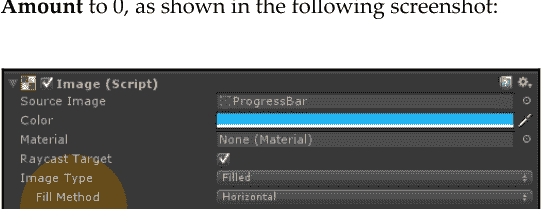

+   6. 通过更改 **填充量** 值可以为进度条设置动画。你可以用 **动画** 视图来完成，但在这里使用脚本更有意义。
+   7. 创建一个新脚本并将其命名为 `ProgressBars.cs`（你也可以使用示例 Unity 项目提供的相同脚本；你可以在本教程的 `Scripts` 目录中找到它）。确保在脚本中包含 `UnityEngine.UI` 命名空间。在 `Update()` 函数中写入以下行：
+   8. `image` 对象是对同一游戏对象上 **图像** 组件的引用。我们在 `Start()` 函数中通过调用以下行将其分配：
+   9. `fillSpeed` 变量是一个 `public float` 变量，描述每秒的填充量增量。
+   10. 在此简单脚本中，我们随时间增加 **图像** 组件的 **填充量**。
+   11. 将脚本分配给 **进度条** 游戏对象并播放游戏以查看效果。

```
image.fillAmount += Time.deltaTime * fillSpeed;
```

```
image = GetComponent<Image>();
```

## 它是如何工作的...

此教程有几个使其工作的关键要素：
- **图像类型设置为填充**：Unity 为 UI 图像组件提供了 **填充图像** 类型。它从左到右（或任何其他所需方向）填充图像。
- **脚本中的填充量引用**：图像的填充量可以通过脚本更改：它是 `Image` 类的公共变量。

## 还有更多...

尝试使用不同的填充类型进行实验。你可以在提供的示例 Unity 项目中找到一个填充类型设置为 Radial360 的示例。

## 使用 Mecanim 状态为 UI 按钮状态设置动画

Unity 有一个非常强大的内置 UI 系统。其重要组成部分是按钮。按钮有四种状态：**普通**、**高亮**、**按下** 和 **禁用**。你可以使用默认的 **颜色调色** 选项来可视化这些状态，但还有一个更有趣的选项：动画转换。本教程涵盖了它。

## 准备工作

你不需要提前准备任何东西，因为我们将在 Unity 中从头创建动画按钮。你也可以使用提供的示例 Unity 项目并进入 `Chapter 03 2D and user interface animation\Recipe 08 Using Mecanim states for animating UI button states` 目录。你将在那里找到一个 `Example.unity` 场景。打开它，播放游戏，然后点击按钮以查看效果。

## 如何操作...

创建动画按钮，请按照以下步骤操作：
+   1. （可选）将 **按钮** 图像导入 Unity。
+   2. 打开一个场景并使用 **Game Object | UI | Button** 命令创建一个新的 **按钮**。将创建 **画布** 和 **按钮** 游戏对象。
+   3. 选择 **按钮** 游戏对象并在 **检查器** 中找到 **按钮** 组件。
+   4. 将 **转换** 设置为 **动画**。


5. 点击“自动生成动画”按钮，如以下截图所示：

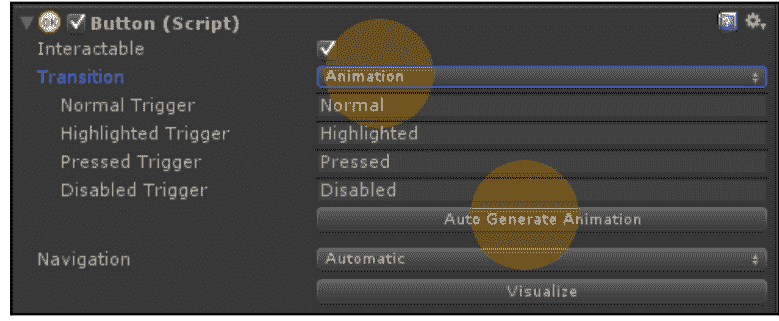

6. 将创建四个空的 Animation Clip，每个按钮状态一个。

7. 在选中按钮的情况下，打开 Animation View。

8. 在 Animation View 中选择每个动画（其名称对应按钮状态），并在 Animation View 中按下录制按钮时更改 Button 游戏对象的外观。你可以更改按钮的大小、颜色、文本等等。即使动画只有一帧也足以创建平滑过渡，因为当游戏更改 Button 状态时 Unity 会在这些动画之间平滑过渡。

9. 完成动画后，关闭 Animation View 并运行游戏查看效果。

## 它是如何工作的...

本教程有几个关键要素使其发挥作用：

- **Button Animator Controller**：当你点击 **自动生成动画** 按钮时，不仅会创建 Animation Clip，还会创建 Animator Controller。它也会自动分配给按钮（连同 Animator 组件）。Animator Controller 中动画状态之间的所有过渡也都已设置好。Unity 还会为你创建 Animator Controller 中的参数——这些是用于按钮状态之间过渡的 `Trigger` 参数。
- **Calling the Triggers**：你可以在 Button 组件中找到四个属性：**Normal Trigger**、**Highlighted Trigger**、**Pressed Trigger** 和 **Disabled Trigger**。Unity 会尝试在按钮的 Animator Controller 中调用这些触发器以过渡到正确的按钮状态。如果你更改 Animator Controller 中的 `Trigger` 名称，请确保也在 **Button** 组件中更改它们。

## 更多内容...

你不必为按钮状态制作单帧动画。事实上，你的动画可以任意长、任意复杂。记住，你也可以向按钮添加子对象并以与我们在 *从 3D 软件包导出 2D 精灵动画* 教程中相同的方式对它们进行动画制作。尝试实验吧！你可以用这个简单系统取得很棒的效果。

## 4

## 角色移动

本章解释了动画在角色移动中的使用，并涵盖以下教程：

- 使用 Blend Trees 混合行走和奔跑动画
- 使用根运动通过动画驱动刚体角色的移动
- 使用根运动控制角色转向
- 使用动画实现更美观的过渡
我们在过去的游戏中见过很多“悬浮”的怪物，但会飞的生物 s
- 使用根运动实现 180 度转身
- 使用三阶段动画让角色跳跃
- 使用根运动通过动画驱动 Nav Mesh Agent 的移动
- 使用触发器在跳跃时抓住边缘
- 蹲下时更改角色的碰撞体
- 为离网格链接添加动画
- 使用根运动进行攀爬
- 使用根运动创建飞行角色

### 简介

角色移动几乎是每个游戏的重要组成部分。在本章中，我们将探索不同的可能性，从简单的行走和奔跑混合到复杂的动画驱动移动。

### 使用 Blend Trees 混合行走和奔跑动画

在本第一个教程中，我们将熟悉 **Blend Trees**（Animator Controller 中的一种新型状态）。Blend Trees 允许平滑地混合多个动画。它们的一个常见用途是混合行走和奔跑循环。

### 准备工作

开始之前，你应该有一个至少包含三种循环动画的角色：idle、walk（原地）和 run（原地）。你可以下载提供的示例；在 Unity 中打开项目并进入 `Chapter 04 Character movement\Recipe 01 Using blend trees to blend walk and run animations` 文件夹。你会在那里找到一个名为 `Example.unity` 的场景，其中包含一个带动画的人形角色。如果运行游戏，你可以点击地面移动角色，并在移动时按下 *Shift*，角色会平滑地混合到奔跑动画。在 `Rigs` 目录中，你可以找到包含所需动画的 `Humanoid.fbx` 资源。

### 操作方法...

要在行走和奔跑动画之间创建平滑混合，请按照以下步骤操作：

1. 导入带有 **Idle**、**Walk** 和 **Run** 动画的动画角色。**Walk** 和 **Run** 动画应为“原地”制作。
2. 在角色资源的 **Inspector** 中 **Animation** 选项卡下将动画设置为 **Loop Time**。如果你的角色骨架设置为 **Humanoid**，你可能还需要为每个动画将所有 **Bake Into Pose** 选项设为 true，并将所有 **Based Upon** 选项设为 **Original**，如下截图所示：

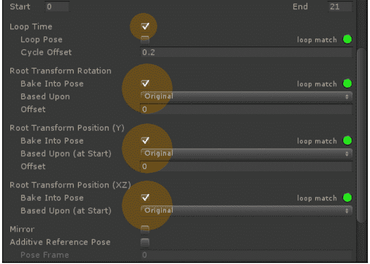

原地 Idle、Walk 和 Run 动画的设置

3. 为你的角色创建一个 Animator Controller。
4. 将 Idle 动画拖放到 Animator Controller 中，使其成为默认状态。
5. 在 Animator Controller 中添加一个 float 类型的 Speed 参数。
6. 在 Animator Controller 的空白处右键单击并选择 Create State | New From Blend Tree。这将创建一个空的 Blend Tree。
7. 点击 Blend Tree 并在 Inspector 中将其名称更改为有意义的名称；本示例中使用 WalkAndRunBlend。
8. 双击 Blend Tree。它将打开 Blend Tree 设置。
9. 点击加号按钮（以下截图中标记为数字 1）并两次选择 Add Motion Field 选项。将会添加两个 Motion 字段。

10. 将你的 **WalkInPlace** 动画拖放到第一个（上方）字段，将你的 **RunInPlace** 动画拖放到第二个（下方）字段。字段标记为数字 **2**，如下截图所示：

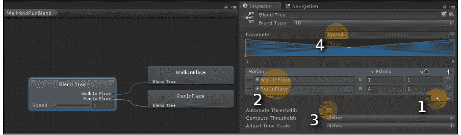

Blend Tree 属性

11. 取消选择 **Automate Thresholds** 选项（前一截图中的 **3**）。这将使每个 **Motion** 字段的 **Threshold** 字段可用。这些是 **Blend Tree** 使用的 **Parameter** 的阈值（前一截图中标记为 **4**）。如果 **Parameter** 设置为给定阈值的确切值，则播放对应阈值的动画。如果 **Parameter** 设置为两个阈值之间的值，则两个动画都将以适当的权重播放（并混合在一起）。

12. 将 **WalkInPlace** 动作的 **Thresholds** 设置为 1，将 **RunInPlaceMotion** 设置为 4（你可能以后需要调整这些值）。

13. 点击 **Blend Tree** 设置下方 **Preview** 窗口中的 **Play** 按钮。

14. 在 **Blend Tree** 节点上找到 **Speed** 参数滑块，并移动它以查看动画根据 **Speed** 参数值平滑混合。

15. 在 Animator Controller 中双击空白处以退出 **Blend Tree** 设置。

16. 创建两个过渡：
- **Idle | WalkAndRunBlend**，条件设置为 **Speed** 参数大于 0.5，**Has Exit Time** 设置为 false，**Transition Duration** 设置为 0.2 秒。
- **WalkAndRunBlend | Idle**，条件设置为 **Speed** 参数小于 0.5，**Has Exit Time** 设置为 false，**Transition Duration** 设置为 0.2 秒。

17. 编写脚本移动你的角色并根据角色的移动速度设置 **Speed** 参数值。本示例使用点按移动。你可以在提供的 Unity 项目中找到两个脚本，`Shared` 脚本目录中的 `ClickToMove.cs` 和本教程的 `Scripts` 目录中的 `SetSpeedFromAgent.cs`。第一个用于设置附加到角色的 Nav Mesh Agent 组件的目标。

18. 在 `SetSpeedFromAgent.cs` 脚本的 `Update()` 函数中，我们使用 **NavMeshAgent** 的 `desiredVelocity` 来设置 Animator Controller 中的 **Speed** 参数：

```
anim.SetFloat("Speed", agent.desiredVelocity.magnitude,
0.2f, Time.deltaTime);
```

19. `anim` 变量存储角色的 Animator 组件引用，而 `agent` 变量存储 Nav Mesh Agent 组件引用。

20. 我们还在 `Update()` 函数中调整 `agent.speed` 变量以设置 **NavMeshAgent** 的最大速度。这使我们可以在玩家按住 *Shift* 按钮时让角色奔跑，在玩家释放 *Shift* 按钮时让角色行走：

```
if (Input.GetKey(KeyCode.LeftShift) ||
Input.GetKey(KeyCode.RightShift))
{
    agent.speed = 4f;
}
else
{
    agent.speed = 1f;
}
```

### 它是如何工作的...

Blend Trees 根据所选的 Animator Controller 参数值和 **Motion** 字段的阈值混合多个动画。在标准的 Blend Tree 中，同时混合的动画始终只有两个：具有较低 **Threshold** 的动画和具有较高 **Threshold** 的动画。每个动画都根据实际参数值与该动画 **Threshold** 之间的距离进行加权混合。例如，如果你的 **Walk** 动画 **Threshold** 设置为 1，你的 **Run**

动画 **阈值** 设置为 2，且当前 **速度** 参数值等于 1.5，**行走** 和 **奔跑** 动画都将以 50% 的权重播放，这很可能会导致你的角色缓慢地小跑。

在混合 **行走** 和 **奔跑** 动画时，请确保在两个动画中接触姿势位于相同的归一化时间。例如，如果 **行走** 动画的接触姿势位于动画的 0%、50% 和 100%，则 **奔跑** 动画也应在动画的 0%、50% 和 100% 处具有接触姿势。这样可以确保动画之间正确且平滑地混合。

## 还有更多...

**混合树** 设置中有一些其他有趣的选项：

- 你可以將 **混合树** 的 **混合类型** 设置为以下：
  - **1D**：一个简单的混合树，使用一个参数来定义当前播放动画的权重。
  - **2D Simple Directional**：此选项使用两个参数来混合动画，例如 *X* 轴和 *Y* 轴。它最适合用于表示不同移动方向的动作，例如向前走、向左走、向右走和向后走。不应将其与表示相同移动方向的多个动画一起使用（例如向前走和向前跑）。
  - **2D Freeform Directional**：此选项与前一个类似，但你可以使用表示相同移动方向的多个动画（例如行走和奔跑）。你需要在 0, 0 位置添加一个表示动作的单个动画（例如空闲）。
  - **2D Freeform Cartesian**：此选项与前一个类似，但用于你的动画不表示不同方向的移动时。它可用于混合多个空闲动画版本，例如。
  - **Direct**：你可以直接控制每个节点（动作字段）的权重。此类型通常用于混合面部表情（请参阅第 5 章《角色动作和表情》中的 *使用 Blend Shapes 动画化面部表情* 配方）。

- 你可以设置一些额外的 **动作** 字段选项：
  - **时间缩放**：你可以通过更改 **混合树** 中带有时钟图标的 **时间缩放** 字段中的数字来更改每个动画的播放速度。默认设置为 1（100%）。
  - **镜像**：你可以通过勾选带有镜像人形图标的 **镜像** 选项来镜像 **混合树** 中的任何动画。
- 你还可以勾选 **自动阈值** 选项，这将均匀地在整个参数范围内分布 **动作** 字段的 **阈值**。例如，如果你的参数范围为 0 到 9 且你有四个动画，则第一个的 **阈值** 为 0，第二个为 3，第三个为 6，第四个为 9。你可以通过单击混合图下方 0 和 1 数字来更改参数范围。
- 你还可以使用 **计算阈值** 选项（**自动阈值** 必须设置为 **false**）。此选项将根据动画的根运动信息计算 **阈值**（速度大小、X 轴速度、Y 轴速度、Z 轴速度、弧度角速度和度角速度）。我们将在下一个配方中介绍根运动。

## 使用根运动通过动画驱动刚体角色的移动

本配方描述了一个非常重要的概念，称为根运动。它允许从动画中提取平移和旋转数据并将其应用于游戏中的角色。

### 准备工作

要使用根运动，首先你需要创建一个带有行走或奔跑动画的角色，该动画具有平移；请参阅以下屏幕截图：

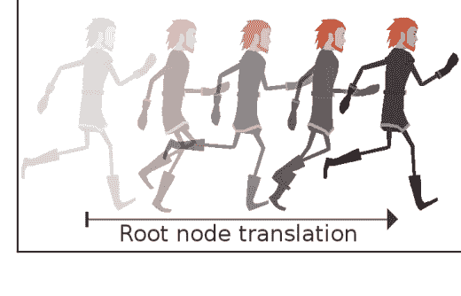

使用根运动的奔跑动画帧。角色使用根节点平移进行动画制作

如果你使用的是 **人形** 角色，则臀部骨骼用作根节点，即描述根运动的节点。因此臀部平移将描述游戏中角色的平移（你仍然可以在 Y 轴上有运动，因为我们可以在 **导入** 设置中对其进行调整）。其旋转将描述游戏中角色的旋转。如果你使用的是 **通用** 角色，则需要在 **导入** 设置中手动选择 **根节点**。选择模型，转到 **检视器**，单击 **骨架** 选项卡，将 **动画类型** 设置为 **通用**，并从其下拉菜单中选择 **根节点**（它包含你的骨架的整个骨骼层级）。

你还可以下载提供的示例 Unity 项目并进入 `Chapter 04 Character movement\Recipe 02 Using root motion to drive rigid body characters movement with animations` 目录。你将在那里找到一个名为 `Example.unity` 的场景，其中包含 **层级** 中的 **人形** 游戏对象。


如果你播放游戏，可以使用 `WSAD` 或方向键移动角色，并使用 `Shift` 奔跑。移动由根运动描述，但转向由脚本完成（我们只是旋转角色）。在 `Rigs` 目录中，你可以找到导入的 `Humanoid.fbx` 文件，其中包含所有必需的动画。

### 如何操作...

要使用动画移动角色，请按照以下步骤操作：

1. 将带有根运动动画的角色导入 Unity。本示例中使用了三个动画：Idle、WalkRoot 和 RunRoot。
2. 选择角色资源文件并转到检视器。确保为你的角色正确设置了动画类型（通用或人形）。如果你使用的是通用角色，请确保设置其根节点。
3. 转到动画选项卡并选择 Idle 动画。选择所有烘焙到姿势选项。这会将所有根运动数据烘焙到动画中，使其完全静止。我们不希望 Idle 动画移动或旋转我们的角色。你还可以将根变换旋转的基础依据选项设置为原始。这将使你的角色以在 3D 软件中制作的相同姿势站立。
4. 对于 WalkRoot 和 RunRoot 动画，选择与 Idle 动画相同的选项，但取消选中根变换位置（XZ）的烘焙到姿势。这将使我们的角色仅在 X 和 Z 轴上移动。根节点的 Y 轴移动及其旋转将被烘焙到动画中，不再存储为根运动。
5. 将所有动画的循环时间选项设置为 true。
6. 应用导入设置。
7. 将你的角色放置到场景中。
8. 在层级中选择它并添加胶囊碰撞体。你可能需要调整胶囊碰撞体的属性以更好地适应你的角色。在我们的示例中，我们需要将高度属性设置为 2 个单位，并将中心属性的 Y 轴设置为 1 个单位。
9. 向角色添加刚体组件并将其约束设置为在每个轴上冻结旋转。
10. 导航到角色的动画器组件（它会自动为动画游戏对象添加）。将更新模式设置为动画物理。确保在动画器组件中勾选应用根运动选项。
11. 为角色创建动画控制器资源。
12. 将 Idle 动画拖放到动画控制器中，使其成为默认状态。
13. 在动画控制器中创建一个 float DesiredSpeed 参数。
14. 在动画控制器中右键单击空白区域并选择创建状态 | 从混合树新建。
15. 单击 **混合树** 并在 **检视器** 中将其名称更改为 **WalkAndRun**。
16. 双击 **混合树** 以打开其设置。
17. 单击 **加号** 按钮并选择 **添加动作字段** 选项两次。
18. 将你的 **WalkRoot** 动画拖放到第一个（上方）字段中，将你的 **RunRoot** 动画拖放到第二个（下方）字段中。
19. 取消选中 **自动阈值** 选项。
20. 将 **WalkRoot** 动画 **阈值** 设置为 1，将 **RunRoot** 动画 **阈值** 设置为 2。
21. 在动画控制器中双击空白区域以退出 **混合树** 设置。
22. 创建两个过渡：
    - **Idle | WalkAndRun** 条件设置为 **DesiredSpeed** 参数大于 0.5，**退出时间** 设置为 false，**过渡持续时间** 设置为 0.2 秒。
    - **WalkAndRun | Idle** 条件设置为 **DesiredSpeed** 参数小于 0.5，**退出时间** 设置为 false，**过渡持续时间** 设置为 0.2 秒。
23. 编写脚本来设置 **DesiredSpeed** 参数并将其分配给角色。播放游戏以查看效果（确保你的场景有一个带碰撞器的地面，以防止角色掉落）。
24. 你还可以使用本配方 `Scripts` 目录中的 `MoveAndSteer.cs` 脚本。在 `Update()` 函数中，我们获取玩家输入并将值保存在 `hor` 和 `ver` 变量中：

```
hor = Input.GetAxis("Horizontal");

ver = Input.GetAxis("Vertical");
```

25. 然后我们使用 `Rotate()` 方法根据 `hor` 变量和 `public float rotationSpeed` 变量（设置为每秒 90 度）将角色在全局 Y 轴（`Vector3.up`）上旋转：

```
transform.Rotate(Vector3.up * hor * rotationSpeed *
Time.deltaTime);
```

26. 我们根据玩家输入修改 `desiredSpeed` 变量（我们检查玩家是否按住 *Shift* 键）：

```
if (Input.GetKey(KeyCode.LeftShift) ||
Input.GetKey(KeyCode.RightShift))
{
```

```
    desiredSpeed = 2f;
}
else
{
    desiredSpeed = 1f;
}
```

27. 最后，我们使用存储在 ver 变量中的垂直轴输入以及我们的 desiredSpeed 值来设置 Animator Controller 中的 DesiredSpeed 参数（它使用根运动移动我们的角色）：

```
anim.SetFloat("DesiredSpeed", desiredSpeed * ver, 0.2f,
Time.deltaTime);
```

28. 我们使用 SetFloat() 方法，并将 dampTime 参数设置为 0.2 秒。这会平滑参数的变化，从而在跑步和行走动画之间实现更平滑的混合。anim 变量存储对 Animator 组件的引用，并在 Start() 函数中设置。

## 工作原理...

游戏中传统的动画方法要求所有移动动画都“就地”完成。角色仅通过代码移动（在 Unity 中，使用 transform.Translate() 和 transform.Rotate() 方法，通过更改 rigidbody.velocity 向量，或使用 rigidbody.ApplyForce() 方法）。动画仅仅是视觉效果，游戏可以在不播放任何动画的情况下运行。在根运动方法中，动画驱动角色的移动。平移和旋转数据从根节点（骨骼层级中的一个骨骼）捕获并应用于游戏中的整个角色。每种方法都有一些优缺点：

| 传统方法 | 根运动方法 |
|---|---|
| 优点<br>• 动画数量少<br>• 你可以在没有单个动画的情况下进行原型制作<br>• 你可以轻松调整角色的速度 | 优点<br>• 看起来更自然，没有脚滑现象<br>• 你可以使用动画创建复杂的动作甚至游戏机制<br>• 你可以拥有不规则的移动，例如受伤或僵尸行走 |
| 缺点<br>• 难以消除脚滑<br>• 特殊攻击和闪避动作必须编程<br>• 看起来像“上一代” | 缺点<br>• 需要更多的动画<br>• 你不能在没有动画的情况下移动角色<br>• 原型迭代时间更长 |

关于根运动，在 **Animation Import Settings** 中有几个重要选项：

- **Root Transform Rotation**: 此选项捕获根节点的旋转并将其应用于整个游戏对象。你可以将其设置为 **Bake Into Pose** 以禁用根运动旋转。选择此选项后，旋转将被视为动画的视觉效果，不会应用于游戏对象。你应该将其设置为 true 用于所有不应该旋转角色的动画。你可以将 **Based Upon** 选项设置为以下其中一个选项：
  - **Original**: 这是动画文件中的原始根节点旋转。
  - **Body Orientation**: 这会改变原始旋转，使角色的上半身面向游戏对象的 Z 轴（向前轴）。你还可以设置 **Offset** 选项来偏移旋转。
- **Root Transform Position Y**: 此选项捕获根节点的垂直移动并将其应用于整个游戏对象。你可以将其设置为 **Bake Into Pose** 以禁用 Y 轴的根运动。选择此选项后，Y 轴运动将被视为动画的视觉效果，不会应用于游戏对象。你应该将其设置为 true 用于所有“地面上”的动画（除非是跳跃）。你可以将 **Based Upon** 选项设置为以下选项：
  - **Original**: 这是动画文件中的原始根节点 Y 轴运动。
  - **Center Of Mass**: 这会使质心与根节点的垂直位置对齐。
  - **Feet**: 这会使脚与垂直根节点位置保持对齐。你还可以设置 **Offset** 选项来偏移垂直根节点位置。
- **Root Transform Position XZ**: 此选项捕获根节点的水平（XZ）移动并将其应用于整个游戏对象。你可以将其设置为 **Bake Into Pose** 以禁用 X 和 Z 轴的根运动。选择此选项后，水平运动将被视为动画的视觉效果，不会应用于游戏对象。你应该将其设置为 true 用于所有静止动画（例如 **Idle**）。你可以将 **Based Upon** 选项设置为以下选项：
  - **Original**: 这是动画文件中的原始根节点水平运动。
  - **Center Of Mass**: 这会使质心与根节点的水平位置对齐。你还可以设置 **Offset** 选项来偏移水平根节点位置。

## 还有更多...

在 Unity 中，你可以非常轻松地结合根运动和传统方法。事实上，我们在本文中就是这样做的。我们使用根运动控制角色的移动，但使用 `transform.Rotate()` 方法来操控它。你还可以创建一个具有传统移动（“就地”动画，行走和奔跑动画的所有 **Bake Into Pose** 选项都设置为 true）的角色，以及诸如攻击和闪避动作之类的根运动动作。

## 使用根运动操控角色

在本教程中，我们将使用动画来移动和操控我们的角色。

### 准备工作

要使用根运动进行操控，你需要准备一个至少包含四个动画的角色：**Idle**、**WalkForward**、**WalkLeft** 和 **WalkRight**。**WalkRight** 和 **WalkLeft** 应该使角色沿圆圈行走（顺时针和逆时针）。你不需要创建完整的圆圈，只需确保动画的开始和结束姿势看起来相似即可。如同往常一样，所有动画的脚部接触点应在相同的归一化时间。确保不要切换左右脚。如果 **WalkForward** 动画以左脚向前开始，则 **WalkLeft** 和 **WalkRight** 动画也应以左脚向前开始，如以下屏幕截图所示：

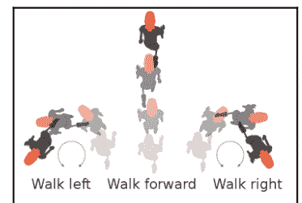

使用根运动的操控动画

你也可以使用示例项目；前往 Chapter 04 Character movement\Recipe 03 Using root motion to steer a character 目录。你可以在那里找到 Example.unity 场景，其中在场景的 Hierarchy 中已有一个 Humanoid 角色被动画化。你可以开始游戏并使用 WSAD 键相对于摄像机移动角色。在 Rigs 目录中，你可以找到带有所有所需动画的 Humanoid.fbx 角色。

### 如何操作...

要使用根运动进行操控，请按照以下步骤操作：

1. 将带有 **Idle**、**WalkForward**、**WalkLeft** 和 **WalkRight** 根运动动画的角色导入 Unity。
2. 选择角色资源文件并前往 **Inspector**。确保 **Animation Type** 已为你的角色正确设置（**Generic** 或 **Humanoid**）。如果使用 **Generic** 角色，请确保设置其 **Root Node**。
3. 前往 **Animation** 选项卡并选择 **Idle** 动画。选择所有 **Bake Into Pose** 选项，并将 **Root Transform Rotation** 的 **Base Upon** 选项设置为 **Original**。
4. 对于 **WalkForward** 动画，选择与 **Idle** 动画相同的选项，但取消选中 **Root Transform Position (XZ)** 的 **Bake Into Pose**。
5. 对于 **WalkLeft** 和 **WalkRight** 动画，将所有选项与 **WalkForward** 动画相同，但额外取消选中 **Root Transform Rotation** 的 **Bake Into Pose** 选项。
6. 将这些动画的 **Loop Time** 选项设置为 true。
7. 如果你的动画不能完美循环，你可以尝试 **Loop Pose** 选项。它将强制开始和结束姿势循环。
8. 应用 **import** 设置。
9. 将你的角色放置到场景中。
10. 在 **Hierarchy** 中选择它并添加一个 **Capsule Collider**。你可能需要调整 **Capsule Collider** 属性以更好地适应你的角色。在我们的示例中，我们需要将 **Height** 属性设置为 2 个单位，并将 **Center** 属性中的 Y 轴设置为 1 个单位。
11. 向角色添加 **Rigidbody** 组件，并将其 **Constraints** 设置为在每个轴上 **Freeze Rotation**。
12. 导航到角色的 **Animator** 组件（它会自动为动画化游戏对象添加）。将 **Update Mode** 设置为 **Animate Physics**。确保在 Animator 组件中选中 **Apply Root Motion** 选项。
13. 为角色创建一个 Animator Controller 资源。
14. 将 **Idle** 动画拖放到 Animator Controller 中，使其成为默认状态。
15. 在 Animator Controller 中创建 `float` **Speed** 和 `float` **Direction** 参数。
16. 在 Animator Controller 中右键单击空白区域并选择 **Create State** | **New From Blend Tree**。
17. 单击 **Blend Tree** 并在 **Inspector** 中将其名称更改为 **Steering**。
18. 双击 **Blend Tree** 以打开其设置。
19. 单击加号按钮并三次选择 **Add Motion Field** 选项。
20. 将 **Blend Tree** 的 **Parameter** 设置为 **Direction**；我们将仅使用 **Direction** 参数来混合行走动画。
21. 将 **WalkLeft** 动画拖放到第一个（上方）字段，将 **WalkForward** 拖放到第二个（中间）字段，将 **WalkRight** 拖放到第三个（下方）字段。
22. 取消选中 **Automate Thresholds** 选项。
23. 将 **WalkLeft** 动画的 **Threshold** 设置为 -45，**WalkForward** 动画的 **Threshold** 设置为 0，将 **WalkRight** 动画的 **Threshold** 设置为 45。
24. 在 Animator Controller 中双击空白区域以退出 **Blend Tree** 设置。


25. 创建两个过渡：
- **Idle | Steering** 条件设置为 **Speed** 参数大于 0.5，**Has Exit Time** 设置为 false，且 **Transition Duration** 设置为 0.2 秒。
- **Steering | Idle** 条件设置为 **Speed** 参数小于 0.5，**Has Exit Time** 设置为 false，且 **Transition Duration** 设置为 0.2 秒。

26. 编写一个脚本来设置我们的 Animator Controller 的 **Speed** 和 **Direction** 参数，并将该脚本分配给角色。

27. 你可以在本教程提供的 Unity 项目的 `Scripts` 目录中找到该脚本。它名为 `RootMotionSteering.cs`。

28. 在此脚本中，我们使角色相对于摄像机移动。在 `Update()` 函数中，首先我们获取并将玩家输入存储在两个变量中，`hor`（用于 `Horizontal` 输入）和 `ver`（用于 `Vertical` 输入）：

```
hor = Input.GetAxis("Horizontal");

ver = Input.GetAxis("Vertical");
```

29. 由于我们希望角色相对于摄像机移动，因此我们使用摄像机的前方向和右方向来构建期望的移动向量。我们的摄像机并非完全水平（例如它可能略微向下），因此首先需要通过取正常的摄像机前向向量，将其 Y 轴设为 0，并对向量进行归一化（使其长度为 1）来计算 `cameraHorizontalForward`：

```
cameraHorizontalForward = new
Vector3(cameraTransform.forward.x,
0f, cameraTransform.forward.z).normalized;
```

30. 在此脚本中，`cameraTransform` 是一个 `public Transform` 变量，我们将游戏中的摄像机附加到它。

31. 接下来我们计算 `desiredMoveDirection`：这是一个指向我们希望角色移动的方向的向量。当玩家按住右箭头时，该向量指向摄像机的右轴，当玩家按住左箭头时指向摄像机的左侧，当玩家按住上箭头时指向摄像机前轴的水平版本（`cameraForwardHorizontal`），当玩家按住下箭头时指向该向量的相反方向：

```
desiredMoveDirection = ver * cameraHorizontalForward + hor *
cameraTransform.right;
```

32. 接下来我们计算角色的前向向量与 `desiredMoveDirection` 向量之间的角度。我们将使用此值来设置 Animator Controller 中的 **Direction** 参数。`Vector3.Angle()` 方法返回两个向量之间的角度。此角度始终为正（大于 0）。因此，我们使用 `desiredMoveDirection` 和 `transform.right`（我们角色的右轴）向量的点积来确定 `desiredMoveDirection` 是指向角色的右侧还是左侧（点积对于指向相同方向的向量大于 0，对于指向相反方向的向量小于 0）。我们使用 `Mathf.Sign()` 方法确保点积值等于 -1 或 1。结果是一个从 -180 到 180 度的角度；我们将该值存储在 `float direction` 变量中：

```
direction = Vector3.Angle(transform.forward,
    desiredMoveDirection) *
    Mathf.Sign(Vector3.Dot(desiredMoveDirection,
    transform.right));
```

33. 然后我们计算 `float speed` 变量的值；它只是我们 `desiredMoveVector` 的大小。`speed` 变量用于设置我们 Animator Controller 中的 **Speed** 参数：

```
speed = desiredMoveDirection.magnitude;
```

34. 最后，我们使用计算出的 `direction` 和 `speed` 值并将其设置在我们的 Animator Controller 中，将 `SetFloat()` 方法的 `dampTime` 参数设置为 0.2 秒以平滑过渡。`anim` 变量存储我们角色的 Animator 组件的引用，并在 `Start()` 函数中设置：

```
anim.SetFloat("Direction", direction, 0.2f, Time.deltaTime);
anim.SetFloat("Speed", speed, 0.2f, Time.deltaTime);
```

## 如何工作...

根运动转向的工作方式与根运动移动相同。我们使用根骨骼的旋转来旋转角色。在我们的示例中，角色正在绕圈行走，因此其骨盆在动画期间会旋转。这些数据随后用于旋转整个角色。

同样，为了使行走动画正确混合，你必须确保它们都以同一只脚开始，并且脚部接触姿势与动画的归一化时间相同。


如果你使用的是 **Humanoid** 骨架，只需创建前向和左向动画即可。然后你可以在角色的 **Import Settings** 中的 **Animation** 选项卡中创建一个新的动画片段（你需要在 **Clips** 部分点击加号按钮）。当你选择 **WalkLeft** 动画作为源时，将其设置为 **Mirror** 并将其 **Cycle Offset** 设置为 0.5；你应该能得到一个正确的 **WalkRight** 动画。

## 使用动画实现更美观的过渡

你可能已经注意到，有时当我们的角色停止行走时，它会以一种奇怪的方式（脚滑动）混合到 **Idle** 动画中。这在 **Walk** 动画中的腿部姿势看起来像镜像的 Idle 姿势时最明显。我们将在本教程中修复这个问题。

## 准备工作

你应该使用与上一教程相同的角色，并准备一个额外的动画，该动画将从镜像的 Idle 姿势过渡到正常的 Idle 姿势。你也可以进入 `Chapter 04 Character movement\Recipe 04 Using animations for better looking transitions` 目录并打开 `Example.unity` 场景。你会发现我们的 Humanoid 角色的工作方式与上一教程相同，但添加了 **ToIdle** 动画。你也可以在 `Rigs` 目录中找到包含所有所需动画的骨架。

## 如何操作...

要使用额外的动画实现更美观的过渡，请按照以下步骤操作：

- 1. 首先，按照 *使用根运动来操纵角色* 教程中的所有要点，使角色由根运动动画驱动并正常工作。
- 2. 在角色的 **Animation Import Settings** 中，找到你的额外 **ToIdle** 动画。你可能需要通过点击 **Clips** 部分（**Animations** 选项卡）中的加号按钮将其添加为新片段，并选择 **ToIdle** 动画作为源。

- 3. 在 **ToIdle** 动画中，勾选 **Root Transform Rotation** 和 **Root Transform Position (Y)** 的 **Bake Into Pose** 选项。
- 4. 打开 Animator Controller（这应与上一教程中的控制器相同），添加另一个 float 参数，并将其命名为 **ToIdle**。
- 5. 返回 **Animation Import Settings** 并找到 **WalkForward** 动画。
- 6. 在其导入设置中，滚动到 **Curves** 部分，展开它，然后点击加号图标添加一个新的 **Animation Curve**。
- 7. 将其命名为 **ToIdle**（其名称应与步骤 4 中在 Animator Controller 中创建的参数完全匹配）。点击曲线（目前它是一条平坦的绿色线）以打开 **Curve Editor**。曲线由垂直轴上的浮点值和水平轴上的归一化动画时间描述。
- 8. 创建一个方形曲线，其最大值等于 1，最小值等于 0（如下图所示中的点 **1**）。你可以通过点击曲线来添加曲线控制点。你可以通过点击它们来选择点。你可以使用 *删除* 键删除点。要调整点的手柄和插值类型，请右键单击它。要设置方形曲线，请选择 **Both Tangents | Constant**。你可以通过点击 **Curve Editor** 左下角的小齿轮图标来保存 **Curve Preset** 以供以后使用（如下图所示中的点 **2**）。当你拖动时间线（如下图所示中的点 **3**）时，你可以看到你的曲线在归一化动画时间中的起始位置（如下图所示中的点 **4**）：

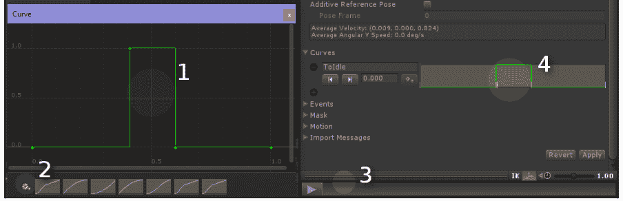

动画曲线和曲线编辑器


9. 在我们的示例中，**Idle** 动画的左脚在前，而我们的 **ToIdle** 动画以右脚在前开始。在动画过程中，角色会迈出小步回到正确的 **Idle** 姿势，左脚在前。在 **WalkForward** 动画设置中，尝试在通过姿势时将曲线值设为 1，即右脚越过左脚（并且在接下来的几帧内会在角色前方）时。

10. 将曲线保存为 **Curve Preset** 并将其添加到 **WalkLeft** 和 **WalkRight** 动画中。同样将它们的曲线名称设为 **ToIdle**。

11. 进入 Animator Controller。

12. 添加 **ToIdle** 动画并创建新的状态转换：
- **Steering | ToIdle** 两个条件，**Speed** 参数小于 0.5 且 **ToIdle** 参数大于 0.5。**Has Exit Time** 应设为 false，**Transition Duration** 应设为 0.2 秒。
- **ToIdle | Idle** 无条件，**Has Exit Time** 设为 true，**Transition Duration** 设为 0.2 秒。

13. 通过添加第二个条件来修改 **Steering | Idle** 转换：**ToIdle** 参数小于 0.5。参见以下截图：

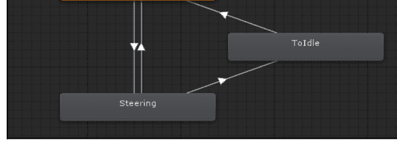

使用额外的 ToIdle 转换动画的 Animator Controller

14. 启动游戏并尝试在行走动画的不同时间行走和停止角色。你应该会看到角色播放 **ToIdle** 动画，以防止在行走姿势为镜像空闲姿势时最明显的脚滑现象。

## 工作原理...

此食谱有几个关键要素：

- **Animation Curves**：你可以在 **Import Settings** 的 **Animation** 选项卡中为动画（每个动画剪辑可添加多个曲线）添加曲线。曲线为动画帧分配任意浮点值。如果曲线名称与 Animator Controller 中参数的名称相同，则该参数的值将在动画的任意帧中设置为曲线的值。
- **使用曲线值**：我们使用 **WalkForward**、**WalkLeft** 和 **WalkRight** 动画中 **Animation Curves** 设置的 **ToIdle** 值来触发从 **Steering** 到 **Idle** 的转换（当 **ToIdle** 值小于 0.5 时）或从 **Steering** 到 **ToIdle** 动画的转换（当 **ToIdle** 参数大于 0.5 时）。这使我们能够根据动画中的姿势控制 Animator Controller 中的状态转换。

## 还有更多...

我们已在此食谱中涵盖了最简单（但也最明显）的案例。你可以从不同的行走和奔跑姿势添加更多停止动画（或任何转换动画）。根据你的 Idle 姿势，你可能需要为行走和奔跑的通过姿势以及所有极端情况添加停止动画。为此，请向动画添加更多曲线，并在 Animator Controller 中对它们做出反应。例如，你可以为 `LeftFootExtreme`、`RightFootExtreme`、`LeftFootPassing` 和 `RightFootPassing` 创建曲线；在你的 **Walk** 和 **Run** 动画中使用它们来触发适当的停止动画。

你还可以通过在脚本中检查 Animator Controller 的相应参数值，在运行时检查 **Animation Curve** 的值。为此，使用 `animator.GetFloat()` 方法，其中 `animator` 是对 Animator 组件的引用。

## 使用根运动实现 180 度转身

在之前的食谱中，我们为更平滑过渡到空闲状态添加了停止动画。我们可以为移动添加更多动画，使其更准确、更灵敏。此类动画的示例是 180 度转身。

## 准备工作

使用与上一个食谱相同的角色。添加一个 180 度转身动画，从 Idle 姿势开始，以垂直轴旋转 180 度的 Idle 姿势结束。为清晰起见，将动画命名为 `180Turn`。你可以打开提供的示例 Unity 项目并进入 `Chapter 04 Character movement\Recipe 05 Using root motion for a 180 degrees turn` 目录。你会在那里找到一个 `Example.unity` 场景。播放游戏并尝试朝与角色面向相反的方向行走（按向下箭头）。你可以在 `Rigs` 目录中找到包含所有所需动画的 `Humanoid.fbx` 资源。

## 如何操作...

要实现 180 度转身，请按照以下步骤操作：

1. 创建四个转换（参见以下截图）：
2. 将你的 **180Turn** 动画拖放到 Animator Controller 中以创建新状态。
3. 打开 Animator Controller（应与上一个食谱中的控制器相同），添加两个 float 参数，并将它们命名为 `DirectionRaw` 和 `SpeedRaw`。
4. 在 **180Turn** 动画中为 **Root Transform Position (Y)** 勾选 **Bake Into Pose** 选项。
5. 在角色的 **Animation Import Settings** 中，找到额外的 **180Turn** 动画。你可能需要通过在 **Clips** 部分（**Animations** 选项卡）点击加号按钮并选择 **180Turn** 动画作为源，将其添加为新剪辑。
6. 导入角色并重复 *Using root motion to steer a character* 和 *Using animations for better looking transitions* 食谱中的所有步骤，使角色能够行走。
   - **Idle | 180Turn** 两个条件：**SpeedRaw** 参数应大于 0.5 且 **DirectionRaw** 参数应大于 160。**Has Exit Time** 应设为 false，**Transition Duration** 应设为约 0.1 秒。
   - **Idle | 180Turn**（第二个）两个条件：**SpeedRaw** 参数应大于 0.5 且 **DirectionRaw** 参数应小于 -160。**Has Exit Time** 应设为 false，**Transition Duration** 设为约 0.1 秒。我们在相同状态之间创建了两个转换，因为我们希望它们作为逻辑或运算符工作；如果其中任何一个满足，转换将被触发。
   - **180Turn | Idle** 一个条件：**Speed** 参数小于 0.5。**Has Exit Time** 应设为 true，**Transition Duration** 设为约 0.1 秒。
   - **180Turn | Steering** 一个条件：**Speed** 参数大于 0.5。**Has Exit Time** 应设为 true，**Transition Duration** 设为约 0.1 秒。

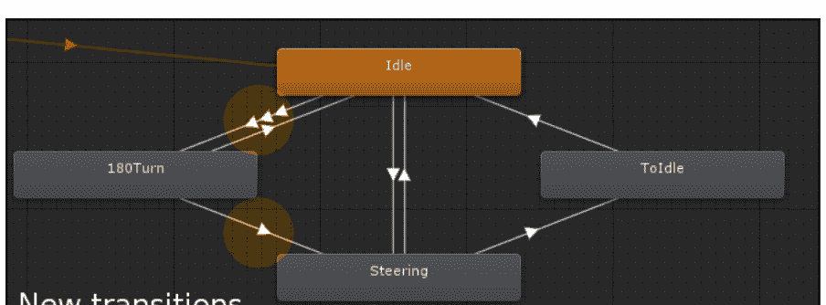

使用额外 180Turn 转换动画的 Animator Controller

7. 通过添加两个更多条件来编辑 **Idle | Steering** 转换：**DirectionRaw** 参数大于 -160 且 **DirectionRaw** 参数小于 160。同一转换中的多个条件作为逻辑与运算符工作；所有条件都必须满足才能触发转换。
8. Animator Controller 已设置，但我们需要从脚本设置 **SpeedRaw** 和 **DirectionRaw** 参数。我们创建了这两个额外参数，因为这里需要原始值（而非随时间阻尼）。首先，打开计算并设置 `direction` 和 `speed` 参数的脚本。在此示例中，它名为 `RootMotionSteering.cs`；你可以在 `Chapter 04 Character movement\Recipe 03 Using root motion to steer a character\Scripts` 目录中找到它。
9. 在那里有两个 `float` 变量：`direction` 和 `speed`。它们每帧都在计算。我们只需要将它们设为 `public`，以便在另一个脚本中读取它们（在示例脚本中它们已是 public）。

10. 编写另一个脚本并将其命名为 SetRawDirectionAndSpeed.cs（你可以在本食谱的 Scripts 目录中找到它）。要设置 DirectionRaw 和 SpeedRaw 参数，我们在 Update() 函数中使用以下行：

```
anim.SetFloat("DirectionRaw", steeringScript.direction);
anim.SetFloat("SpeedRaw", steeringScript.speed);
```

11. 在前面的行中，anim 变量是对 Animator 组件的引用，steeringScript 变量是对 RootMotionScript 组件的引用（我们在 Start() 函数中用 steeringScript = GetComponent<RootMotionSteering>() 行设置它），而 steeringScript.direction 和 steeringScript.speed 变量是计算得到的原始方向和速度值。

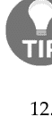

或者，你可以直接在 RootMotionSteering.cs 脚本的 Update() 函数中调用 anim.SetFloat("DirectionRaw", direction) 和 anim.SetFloat("SpeedRaw", speed) 方法（无需编写另一个脚本）。

12. 将脚本分配给角色，播放游戏，并尝试朝与角色面向相反的方向行走。角色应首先播放 180Turn 动画。

## 工作原理...

此食谱添加了一个起始动画，作为 Idle 和 Steering 状态之间的转换。我们使用 SpeedRaw 和 DirectionRaw 参数来检查原始玩家输入（未阻尼）。使用阻尼值在此情况下不起作用，因为阻尼的 Direction 参数始终从 0 开始并随时间增加到原始输入方向值。这将始终在 Idle | 180Turn 转换之前触发 Idle | Steering 转换，因为 Idle | 180Turn 转换检查方向是否大于 160 或小于 -160 度。

## 还有更多...

为了简单起见，本食谱仅展示了一种起始动画的情况：180 度转身。你可能需要更多起始动画（-90 和 +90 度转身，甚至 -45、+45、-270 和 +270 转身）。你可能还需要从行走/奔跑添加 180 度转身转换，以使角色更快地对输入做出反应。在这种情况下，你可能需要使用 Animation Curves 来确定行走/奔跑位置

(LeftPassing, RightPassing, LeftExtreme, RightExtreme) 并据此播放适当的转身动画（从 LeftPassing、RightPassing、LeftExtreme 或 RightExtreme 姿势开始）。

## 使用三阶段动画使角色跳跃

在本教程中，我们将使角色跳跃。跳跃最好使用物理来实现，因此我们将采用这种方法。

### 准备工作

在开始之前，您应该为角色添加三个动画：一个简短的 **跳跃** 动画，从地面开始，姿势类似于 **空闲**；一个 **空中** 动画，是角色在空中时的循环动画；以及一个 **着陆** 动画，从角色双脚触地开始，以 **空闲** 姿势结束。所有这些动画都应“就地”完成，不进行根节点平移。您可以打开提供的示例 Unity 项目并进入 `Chapter 04 Character movement\Recipe 06 Making a character jump with 3-phase animation` 目录。在那里您会找到一个 `Example.unity` 场景。播放游戏并按空格键查看角色跳跃。您可以在 `Rigs` 目录中找到所需的所有动画。

### 如何操作...

要使角色跳跃，请按照以下步骤操作：

- 1. 导入角色并重复 *使用根运动操控角色*、*使用动画实现更好的过渡效果* 和 *使用根运动进行 180 度转身* 教程中的所有步骤，以使角色能够正常移动。
- 2. 在角色的 **动画导入设置** 中，找到您额外的 **跳跃**、**空中** 和 **着陆** 动画。您可能需要通过在 **剪辑** 部分（**动画** 选项卡）中点击加号按钮并选择适当的动画作为源来将它们添加为新的剪辑。
- 3. 检查 **跳跃**、**空中** 和 **着陆** 动画的所有 **烘焙到姿势** 选项。
- 4. 打开 Animator Controller（这应与上一教程中的控制器相同）并添加两个参数：一个名为 **跳跃** 的 `Trigger` 和一个名为 **接地** 的 `bool`。
- 5. 将您的 **跳跃**、**空中** 和 **着陆** 动画拖放到 Animator Controller 中。
- 6. 创建以下转换，如以下屏幕截图所示：
  - **任意状态 | 跳跃** 使用 **跳跃** 触发器参数。**是否有退出时间** 应设置为 false，**转换持续时间** 设置为大约 0.1 秒。
  - **跳跃 | 空中** 无条件：**是否有退出时间** 应设置为 true，**转换持续时间** 设置为大约 0.1 秒。
  - **空中 | 空闲** 有一个条件：**接地** 参数设置为 true。**是否有退出时间** 应设置为 false，**转换持续时间** 设置为大约 0.1 秒。
- 7. 创建一个新脚本并将其命名为 `Jump.cs`（您可以在本教程的 `Scripts` 目录中找到它）。
- 8. 在脚本的 `Update()` 函数中，我们检查玩家是否按下了空格键以及角色是否在地面上：`onGround` 变量由 `GroundCheck()` 函数设置。如果玩家按下空格键且角色在地面上，我们将当前游戏时间保存为我们的 `lastJumpTime`（此变量在 `GroundCheck()` 函数中使用）。然后我们通过将 `anim.applyRootMotion` 变量设置为 `false` 来在 Animator 组件上禁用根运动。我们将 `onGround` 变量设置为 `false`，因为我们的角色正在跳跃。我们向角色的 **刚体** 组件添加力并在 Animator Controller 中设置 `Trigger` 跳跃。最后，我们调用 `GroundCheck()` 函数，该函数将在后面描述：

```
if (Input.GetKeyDown(KeyCode.Space) && onGround)
{
    lastJumpTime = Time.time;
    anim.applyRootMotion = false;
    onGround = false;
    rb.AddForce(Vector3.up* jumpForceUp +
transform.forward * jumpForceForward, ForceMode.Impulse);
    anim.SetTrigger("Jump");
}
GroundCheck();
```

- 9. `anim` 变量存储对 Animator 组件的引用。`rb` 变量存储对 **刚体** 组件的引用。两个变量都在 `Start()` 函数中设置。`jumpForceUp` 和 `jumpForceForward` 是 `public float` 变量，用于控制施加力的大小。
- 10. 在 GroundCheck() 函数中，我们检查当前游戏时间是否大于我们的 lastJumpTime 加上 public float groundCheckPauseTime 变量的值。如果不是这样，我们将 onGround 变量设置为 false（我们假设在玩家按下跳跃按钮后的一小段时间内角色始终在空中）。然后我们使用 Physics.Raycast() 方法检查我们的角色是否站在地面上。此方法从 groundCheck 变换向下投射射线。我们使用 public float 变量 maxGroundCheckDistance 设置最大射线投射长度。如果角色站在地面上，我们将 onGround 变量设置为 true 并在 Animator 组件中启用根运动。我们还在 Animator Controller 中将 OnGround 参数设置为 onGround 变量的值：

```
void GroundCheck()
{
    if(Time.time > lastJumpTime + groundCheckPauseTime      &&
Physics.Raycast(groundCheck.position, Vector3.down,
    maxGroundCheckDistance))
    {
        onGround = true;
        anim.applyRootMotion = true;
    }
    else
    {
        onGround = false;
    }
    anim.SetBool("OnGround", onGround);
}
```

- 11. 将脚本分配给我们的角色。
- 12. 为角色创建一个空的子对象并将其命名为 GroundCheck。将其本地位置设置为 X = 0、Y = 0.1 和 Z = 0。确保它是角色游戏对象的子对象。
- 13. 将 GroundCheck 游戏对象分配给附加到角色的 Jump 脚本的 Ground Check 字段。
- 14. 播放游戏并按空格键查看结果。

### 工作原理...

在本教程中，我们使用物理使角色跳跃。为了正确执行，当角色在空中时，我们需要在 Animator 组件中关闭根运动，以便它完全由物理引擎控制而不是我们的动画。我们只允许角色在站在地面上时跳跃。为了避免在跳跃后立即将 `onGround` 变量设置为 true，我们在玩家按下跳跃按钮后暂时禁用地面检查功能。

跳跃动画分为三个部分：

- **跳跃**：在此动画中，我们的角色开始跳跃
- **空中**：这是一个角色在空中（或下落）的长时间循环动画
- **着陆**：当角色在空中后触地时播放此动画

### 还有更多...

再次，本教程展示了最基本的跳跃设置。您可能希望从不同姿势添加更多起始跳跃动画（运行和行走极值、通过姿势以及来自空闲动画的一个）。为此，为这些姿势中的每一个创建 Animator Controller 参数以及名称与您创建的参数相同的 **动画曲线**。在行走和运行动画中使用 **动画曲线** 来告诉 Unity 动画当前处于哪个姿势（左/右极值或左/右通过姿势）。在 Animator Controller 中使用参数来设置动画之间的适当转换。您可能还需要添加更多着陆动画，这些动画会根据当前角色 **速度** 参数值（玩家输入）转换为空闲、行走或运行。

## 使用根运动通过动画驱动 NavMesh Agent 的移动

在本教程中，我们将使用根运动来移动和操控具有 Nav Mesh Agent 组件的角色。这可用于消除此类角色的脚滑现象。

### 准备工作

我们将使用与上一教程相同的角色及其所有动画。您应该拥有至少 **空闲**、**向左行走**、**向前行走** 和 **向右行走** 动画的角色，并以与 *使用根运动操控角色* 教程相同的方式在 Animator Controller 中设置。您也可以进入 `Chapter 04 Character movement\Recipe 07 Using root motion to drive Navmesh Agents movement with animations` 目录。在那里您会找到一个 `Example.unity` 场景。打开它，播放游戏，然后点击地面以使角色使用 **NavMesh** Agent 和根运动移动。

### 如何操作...

要使用根运动移动和操控具有 Nav Mesh Agent 组件的角色，请按照以下步骤操作：

- 1. 导入具有 **空闲**、**向左行走**、**向前行走** 和 **向右行走** 动画的角色，并以与 *使用根运动操控角色* 教程相同的方式设置它，但不要编写 `RootMotionSteering.cs` 脚本，因为我们将创建一个新的脚本。
- 2. 向角色添加 Nav Mesh Agent 组件。确保它还具有 **胶囊碰撞体** 组件和具有在每个轴上冻结旋转的 **刚体** 组件。还确保 Animator 组件的 **应用根运动** 选项设置为 true 且 **更新模式** 设置为 **动画物理**（与 *使用根运动操控角色* 教程相同的方式）。
- 3. 在场景中烘焙 **NavMesh**。为此，确保您的地面模型附加了碰撞器（您可以使用 **网格碰撞体** 组件）。然后转到 **窗口 | 导航**。在场景中选择地面，并在 **导航** 窗口的 **对象** 选项卡中将其设置为 **导航静态**。点击 **导航** 窗口底部的 **烘焙** 按钮。片刻后，**NavMesh** 应被烘焙（它在场景中显示为覆盖地面模型的淡蓝色半透明网格）。它对于我们的 **NavMesh Agent** 工作是必需的。
- 4. 如果您的角色使用本书中的任何脚本，请将其从其 **检查器** 中移除（我们不需要 **跳跃**、**RootMotionSteering** 和 **SetRawDirectionAndSpeed** 脚本）。
- 5. 创建一个新脚本并将其命名为 `NavMeshAgentWithRigidBody.cs`。我们将在此脚本中使用 **NavMesh Agent** 和 **刚体** 组件。


6. 在脚本的 Update() 函数中，我们首先禁用 NavMesh Agent 中的旋转和位置更新。这将防止代理移动我们角色的 transform。然后我们计算 float 类型的 direction 变量的值。我们这样做的方式与我们在《使用根运动转向角色》配方中所做的方式非常相似，但我们不是创建自己的 desiredMoveDirection 向量，而是使用 NavMesh Agent 的 desiredVelocity 向量。该向量描述了代理希望移动的速度和方向：

```
agent.updatePosition = false;
agent.updateRotation = false;

direction = Vector3.Angle(transform.forward,
agent.desiredVelocity) *
Mathf.Sign(Vector3.Dot(agent.desiredVelocity,
transform.right));
```

在前面的代码中，agent 是我们存储对 Nav Mesh Agent 组件引用的变量。我们在 Start() 函数中设置此引用。

7. 接下来我们计算 float 类型的 speed 变量值：它只是 agent.desiredVelocity 向量的大小。我们还使用存储对 Animator 组件引用的 anim 变量，在我们的 Animator Controller 中设置 Direction、Speed、DirectionRaw 和 SpeedRaw 参数。anim 变量在 Start() 函数中设置。最后，我们每帧将 agent.nextPosition 设置为与我们的 transform 位置相同。这可以防止代理使角色的 transform 远离。

8. 保存脚本并将其附加到角色。

9. 我们还需要一个脚本来告诉 NavMesh Agent 我们想要去哪里。提供的 Unity 示例中 Shared Scripts 文件夹里有一个 ClickToMove.cs 脚本。在 Update() 函数中，当玩家按下鼠标左键时，我们使用 agent.SetDestination() 方法。从主摄像机向前方向的鼠标光标位置投射一条射线。如果射线击中碰撞体，则使用该击中位置来设置 NavMesh Agent 的新目的地：

```
if (Input.GetKeyDown(KeyCode.Mouse0))
{
    if (Physics.Raycast(Camera.main.ScreenPointToRay(
    Input.mousePosition), out hit))
    {
        agent.SetDestination(hit.point);
    }
}
```

在前面的代码中，`agent` 是一个 `public NavMeshAgent` 变量，用于存储对 Nav Mesh Agent 组件的引用。我们在 **检视面板** 中手动分配此引用，通过将带有 Nav Mesh Agent 组件的游戏对象拖到脚本的 **Agent** 字段。`hit` 变量是一个全局的 `RaycastHit` 变量，由 `Physics.Raycast()` 方法用来存储射线投射结果。

- 10. 保存脚本并将其附加到角色。将角色游戏对象拖放到脚本的 **Agent** 字段中（脚本附加在同一游戏对象上，但也可以附加到任何游戏对象）。
- 11. 播放游戏并点击地面，以查看角色如何同时使用 **NavMesh** 代理和根运动移动。

## 工作原理...

本配方有几个关键要素使其发挥作用：

- **NavMesh and NavMesh Agent**：Nav Mesh Agent 组件用于在烘焙了 **NavMesh** 的游戏关卡中导航。如果缺少其中一个元素，我们的角色将无法通过点按输入有效地移动。
- **Disabling the agent's updateRotation and updatePosition**：默认情况下，**NavMesh** 代理会更新游戏对象的旋转和位置。为了使用根运动，我们需要禁用此功能，并改用根节点动画来更新游戏对象的位置和旋转。
- **Rigid Body and Animator with Apply Root Motion set to true**：我们使用刚体来实现游戏中所有对象之间的碰撞（不仅仅是其他 **NavMesh** 代理），并在 Animator 中使用 **Apply Root Motion** 选项使角色随根节点动画移动。

## 还有更多...

在本配方的 `Scripts` 目录中，你还可以找到一个 `NavAgent.cs` 脚本，它在没有 **RigidBody** 组件的情况下使用根运动。该脚本的 `Update()` 函数与本配方中使用的 `NavMeshAgentWithRigidBody.cs` 脚本非常相似，但我们启用了由 Nav Mesh Agent 组件更新位置。我们只禁用旋转更新。我们向脚本添加了 `OnAnimatorMove()` 函数。此方法在 Unity 完成 Animator 中所有状态的评估后每帧调用一次。

在此函数中，我们将 agent.velocity 向量设置为与根节点的速度相同。我们还将 transform 旋转更新为与根节点的旋转相同：

```
void OnAnimatorMove()
{
    agent.velocity = anim.deltaPosition / Time.deltaTime;
    transform.rotation = anim.rootRotation;
}
```

## Using triggers to grab an edge while jumping

在跳跃时抓住边缘是一个常见功能，尤其是在平台游戏中。它可以在 Unity 中通过少量脚本轻松实现。本配方涵盖了一个简单的边缘抓取功能。

## 准备工作

你需要为角色准备三个新动画：EdgeGrab、EdgeGrabLoop 和 EdgeGrabClimb。第一个是从 InAir 动画过渡到 EdgeGrabLoop 动画的过渡动画。如果可能，根节点应具有最小的移动。第二个是悬挂在悬崖边缘的循环动画。最后一个是使用根运动攀爬悬崖边缘的动画，并以 Idle 姿势结束。参考以下截图：

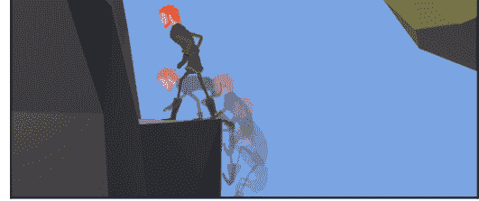

使用根运动攀爬过悬崖边缘的 EdgeGrabClimb 动画帧

**EdgeGrab** 和 **EdgeGrabLoop** 动画应在 **Import Settings** 中选择所有 **Bake Into Pose** 选项。**EdgeGrabLoop** 还应选择 **Loop Time** 选项。你也可以使用提供的示例 Unity 项目并进入 `Chapter 04 Character movement\Recipe 08 Using triggers to grab an edge while jumping` 目录。你将在那里找到一个 `Example.unity` 场景。打开它，播放游戏，按空格键向边缘跳跃。角色抓住后，按上方向键攀爬过边缘。

## 如何操作...

要能够在跳跃时抓住悬崖边缘，请按照以下步骤操作：

- 1. 将你的角色导入 Unity。确保你的角色可以移动和跳跃（如果需要，请遵循 *制作具有三阶段动画的角色跳跃* 配方）。角色应使用 **Rigidbody** 组件进行移动和跳跃。你仍然可以使用根运动来移动和转向角色。
- 2. 将角色放置在场景中，并确保它已设置 `Player` 标签。
- 3. 你需要一个悬崖才能抓住其边缘。导入合适的模型或使用 **Game Object** | **3D Object** | **Cube** 菜单中的立方体。悬崖游戏对象应具有碰撞体（例如 **Mesh Collider**），因为我们使用的是刚体角色。
- 4. 添加一个触发器游戏对象（一个带有设置为 **Is Trigger** 的 **Box Collider** 组件的空游戏对象）。为清晰起见，将其命名为 `GrabTrigger`。将触发器放置在悬崖边缘附近。触发器在步骤 5 之后的截图中用数字 **1** 标记。
- 5. 添加另一个空游戏对象并命名为 **RootTarget**。将其放置在角色抓住边缘时 transform 应在的位置。它在以下截图中用数字 **2** 标记。你可以稍后调整确切位置。

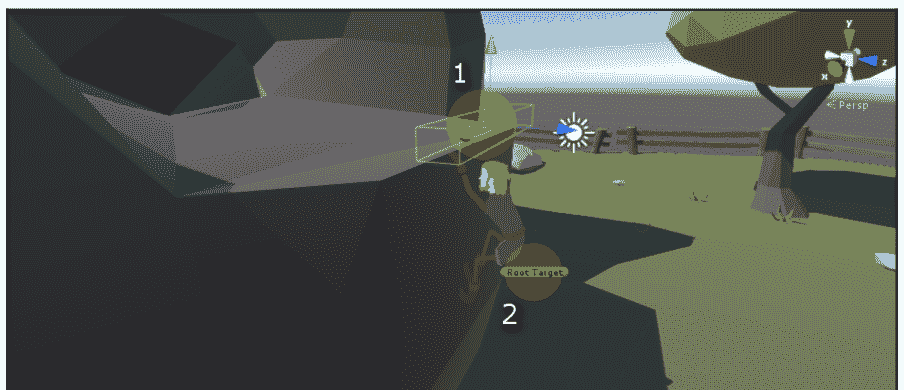

GrabTrigger 和 RootTarget 游戏对象的放置

- 6. 打开角色的 Animator Controller。将你的 **GrabEdge**、**GrabEdgeLoop** 和 **GrabEdgeClimb** 动画拖放到控制器中。
- 7. 向控制器添加 `Trigger` **GrabEdge** 参数和 `Trigger` **PullUp** 参数。
- 8. 创建以下过渡：
  - **Jump | GrabEdge** 有一个条件：**GrabEdge** 触发器参数。**Has Exit Time** 应设置为 false，**Transition Duration** 设置为大约 0.2 秒。
  - **InAir | GrabEdge** 有一个条件：**GrabEdge** 触发器参数。**Has Exit Time** 应设置为 false，**Transition Duration** 设置为大约 0.2 秒。
  - **GrabEdge | GrabEdgeLoop** 没有条件。**Has Exit Time** 应设置为 true，**Transition Duration** 设置为大约 0.2 秒。
  - **GrabEdgeLoop | GrabEdgeClimbing** 有一个条件：**PullUp** 触发器参数。**Has Exit Time** 应设置为 false，**Transition Duration** 设置为大约 0.2 秒。
  - **GrabEdgeClimbing | Idle** 没有条件：**Has Exit Time** 应设置为 true，**Transition Duration** 设置为大约 0.2 秒。


9. 关闭 Animator Controller 并将其分配给角色的 Animator 组件。

10. 创建一个新脚本并将其命名为 EdgeGrab.cs（你可以在本教程的 Scripts 目录中找到完成的脚本）。此脚本的目标是在我们触碰悬崖边缘时播放适当的动画。我们还需要禁用碰撞和物理，并确保在播放动画时角色位于正确的位置（在 RootTarget 游戏对象的位置）。

11. 首先我们需要一个 Grab() 函数来处理玩家开始触碰边缘的情况（我们稍后将从 GrabTrigger 游戏对象调用此函数）：

```
public void Grab (Transform target) {
    grabTarget = target;

    if (grabTarget != null)
    {
        anim.SetTrigger("GrabEdge");
        adjustPosition = true;
        steeringScript.enabled = false;
        jumpScript.enabled = false;
        rb.isKinematic = true;
        anim.applyRootMotion = true;
    }
}
```

12. 此函数有一个 target 参数，将保存对 RootTarget 游戏对象的引用。我们将此参数赋给类成员变量 grabTarget（我们稍后会用到它）。我们通过在控制器中设置 GrabEdge Trigger 来开始播放 GrabEdge 动画。我们还将一个标志（类成员）adjustPosition 设置为 true。此标志稍后用于确定是否应将角色的位置与 RootTarget 游戏对象的位置匹配。然后我们禁用存储在 steeringScript 和 jumpScript 变量中的两个脚本。我们这样做只是因为我们不希望它们干扰我们的边缘抓取动作。我们还将 RigidBody 组件（rb 变量存储对其的引用）的 isKinematic 选项设置为禁用碰撞和重力。最后，我们为 Animator 组件（引用存储在 anim 变量中）启用 root motion。这使得 GrabEdgeClimb 动画能够正常工作。

13. 接下来我们需要编写 GrabLerp() 函数来处理角色位置与 RootTarget 位置的匹配：

```
void GrabLerp()
{
    if (grabTarget == null || !adjustPosition)
    {
        return;
    }
    if ((transform.position -
    grabTarget.
```
