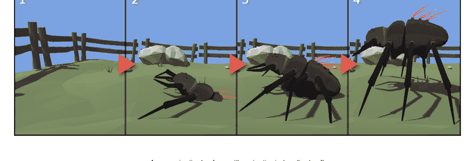
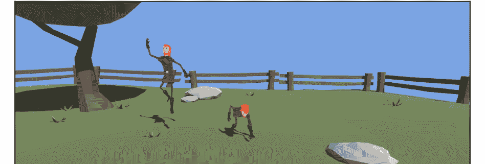
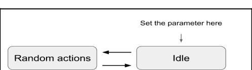
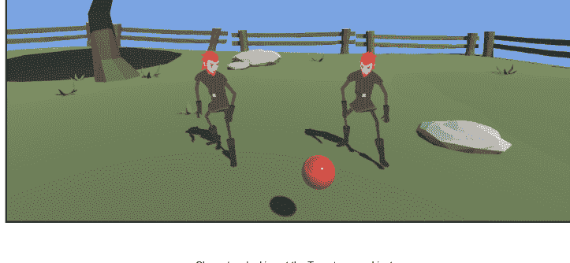
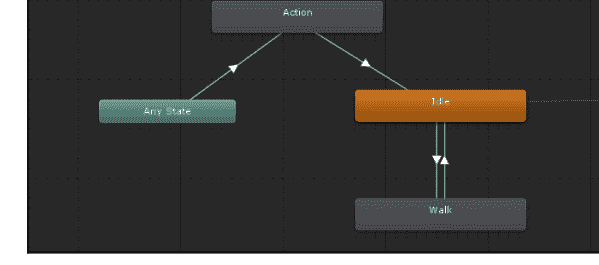
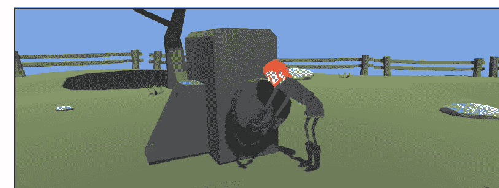
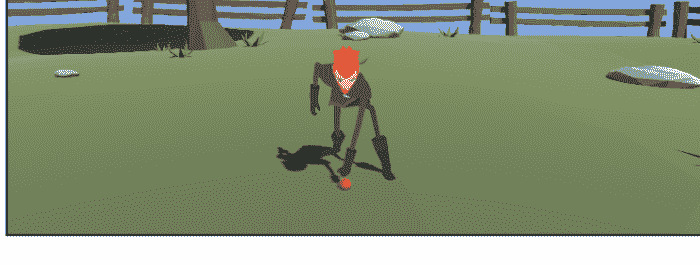
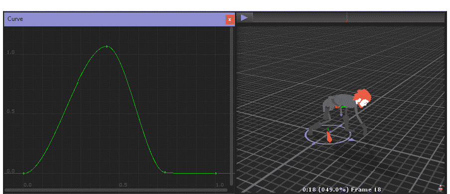
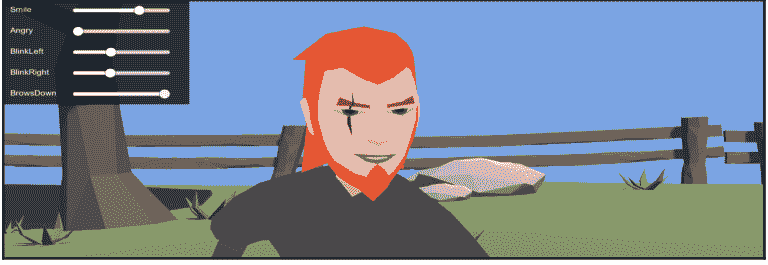

## 5 角色动作和表情

本章解释了角色动作和表情动画的使用方法，并涵盖了以下教程：

- 创建出现或消失动画
- 创建具有动画驱动行为的背景角色和小动物
- 使用 **Blend Trees** 创建随机动作
- 使用 `Quaternion.LookRotation()` 和 `Animator.SetLookAtPosition()` 方法使角色用视线跟随物体
- Action Points – 在指定位置执行动作
- 将动画与场景中的对象同步
- 使用 IK 与场景对象交互
- 使用 Blend Shapes 动画化面部表情

## 简介

在大多数游戏中，角色会执行各种动作和表情。本章解释了如何使用动画来创建逼真的行为和交互。

## 创建出现或消失动画

如果我们的游戏中有怪物，那么我们很可能需要使用出现或消失动画来在场景中引入这些角色。经常情况下，怪物会在玩家附近生成以伏击他们。这时出现动画就派上用场了。

## 准备工作

开始之前，你应该有一个至少包含两种动画的角色：循环的 **Idle** 动画和一个 **Appear** 动画。此动画应从地面下方开始（如果你的角色是飞行类型的，则在空中高处）。它应以 **Idle** 姿势结束。参考下图：



出现动画关键帧（动画是“原地”完成的）

你可以下载提供的示例；在 Unity 中打开项目并进入 `Chapter 05 Character actions and expressions\Recipe 01 Creating an appear or disappear animation` 文件夹。你会在那里找到一个名为 `Example.Scene` 的场景。播放时，一个 Spider 角色将被生成（实例化）并播放 **Appear** 动画。在 `Rigs` 目录中，你可以找到包含所需动画的 `Spider.fbx` 资源。

## 如何操作...

要创建出现动画，请按照以下步骤操作：

1. 导入带有 **Idle** 和 **Appear** 动画的动画角色。
2. 确保勾选 **Idle** 动画的 **Loop Time** 选项。
3. 将导入的角色放置在场景中。
4. 创建一个新的 Animator Controller 并将其命名为 `Appear`（或者你可以编辑现有的控制器）。
5. 将你的 **Appear** 动画拖放到控制器中并确保它是默认状态。如果不是，右键单击它并选择 **Set As Layer Default State** 选项。
6. 将你的 **Idle** 动画拖放到控制器中。
7. 创建一个过渡：
   - **Appear** | **Idle** 无条件过渡：**Has Exit Time** 应设置为 true，**Transition Duration** 设置为 0.2 秒。
8. 将 Animator Controller 分配给场景中站立的角色（分配到其 Animator 组件）。
9. 为了更好地看到 **Appear** 动画的效果，从角色创建一个预制体。为此，将其从 **Hierarchy** 拖放到 **Project** 视图中的任意文件夹。
10. 从 **Hierarchy** 中删除角色并编写一个脚本在运行时生成（实例化）角色。在本教程中，我们使用示例 Unity 项目 `Shared Scripts` 目录中的 `Spawner.cs` 脚本。
11. 此脚本在与 **Spawner** 游戏对象（`Spawner.cs` 脚本附加到的对象）相同的位置和旋转下生成预制体（预制体列表）。

## 原理...

我们在这里使用一个非常简单的机制——当 Unity 实例化一个动画游戏对象时，它总是播放该游戏对象的默认动画状态。因此，当我们将 **Appear** 动画设置为默认状态时，角色被生成（实例化）时就会播放它。这样我们就可以创建有趣的动画，使角色出现在玩家附近。在此示例中，我们的角色从地面爬出。

## 还有更多...

为了使效果完整，你还应为角色添加一个生成 VFX。你可以在提供的 Unity 项目的 `Prefabs` 目录中找到一个示例：名为 **RocksEffect** 的粒子系统预制体。这是一个“挖掘出土”效果。我们使用相同的 `Spawner.cs` 脚本生成它。此外，此预制体还有一个 `AutoDestroy.cs` 脚本，可在几秒后销毁生成的特效。

## 创建具有动画驱动行为的背景角色和小动物

在本教程中，我们将创建动画角色作为游戏中的装饰物。此类角色的行为仅由动画驱动；因此，我们可以在游戏中放置相当多的此类角色。

## 准备工作

开始之前，我们需要一个具有几种动画的角色。在此示例中，我们使用一只鸟。它具有 **Idle**、**StartFlying**、**FlyingInCircles** 和 **Land** 动画。**Idle** 动画是循环的，当我们的鸟坐在地面上时播放。**StartFlying** 动画是 **Idle** 和 **FlyingInCircles** 之间的过渡，后者是鸟飞行的循环动画。最后一个动画 **Land** 动画是 **FlyingInCircles** 和 **Idle** 之间的过渡。我们不为这些动画使用 root motion，因为我们希望鸟总是落在同一位置（我们不想检查地面在哪里，这只是装饰）。

你也可以下载提供的示例 Unity 项目并进入 `Chapter 05 Character actions and expressions\Recipe 02 Creating background characters and critters with animation driven behavior` 目录。你会在那里找到一个名为 `Example.scene` 的场景，其中有一些鸟在周围坐着。按下空格键，鸟会开始飞行。再按一次，它们会降落。在 `Rigs` 目录中，你可以找到具有所有所需动画的 `Bird.fbx` 角色。


## 如何操作...

要创建具有动画驱动行为的轻量级背景角色，请按照以下步骤操作：

- 1. 将你的角色（一只带有 **Idle**、**StartFlying**、**FlyingInCircles** 和 **Land** 动画的鸟）导入 Unity。
- 2. 创建一个新的 Animator Controller。
- 3. 将 **Idle**、**StartFlying**、**FlyingInCircles** 和 **Land** 动画拖放到控制器中。
- 4. 创建一个 `bool` **Fly** 参数。我们稍后将使用它来让鸟开始飞行。
- 5. 创建四个过渡：
  - **Idle** | **StartFlying** 条件为：**Fly** 参数应设为 true，**Has Exit Time** 设为 false，**Transition Duration** 设为 0.2 秒。
  - **StartFlying** | **FlyingInCircles** 无条件：**Has Exit Time** 应设为 true，**Transition Duration** 设为 0.2 秒。
  - **FlyingInCircles** | **Land** 有一个条件：**Fly** 参数应设为 false，**Has Exit Time** 设为 true，**Transition Duration** 设为 0.2 秒。在这种情况下我们需要将 **Has Exit Time** 设为 true，因为我们的 **Land** 动画从 **FlyingInCircles** 动画的最后一帧开始。
  - **Land** | **Idle** 无条件：**Has Exit Time** 设为 true，**Transition Duration** 设为 0.2 秒。
- 6. 将我们的角色放置在场景中，并将其控制器分配给其 Animator 组件。
- 7. 为角色添加一个 `Bird` 标签。我们将在下面的脚本中使用该标签。
- 8. 创建一个新脚本并将其命名为 `FlockDecoration.cs`。
- 9. 在此脚本中，我们首先查找所有带有 `Bird` 标签的游戏对象并将它们存储在 `GameObject[] birds` 数组中。我们在 `Start()` 函数中执行此操作。在 `Update()` 函数中，当玩家按下空格键时，我们将控制器中的 `bool` **Fly** 参数设置为其反转值（如果为 true，则设为 false，反之亦然）。我们对存储在 `birds` 数组中的每只鸟都执行此操作：

```
for (int i = 0; i < birds.Length; i++)
{
    Animator anim = birds[i].GetComponent<Animator>();
    anim.SetBool("Fly", !anim.GetBool("Fly"));
}
```

- 10. 将脚本分配给场景中的一个空游戏对象。播放游戏并按下空格键以查看效果。你也可以多次复制 Bird 游戏对象。

## 其工作原理...

本配方使用 Animator Controller 为角色创建状态。我们的鸟可以站在地面上也可以飞行。我们还在这两个循环状态之间拥有过渡动画，以便让鸟起飞或着陆。通过这种简单的设置，我们可以创建会对玩家做出反应的鸟。例如，当玩家靠近时开始飞行，当玩家走开时着陆。本配方的目的是展示我们仅用动画（以及一个调用动画的脚本）就能创建有趣的行为。没有脚本且没有附加刚体的动画游戏对象在 Unity 中非常轻量。这使我们能够将它们用作有趣的装饰。

## 还有更多...

在 `FlockDecoration.cs` 脚本中，我们还尝试使鸟的动画不同步。我们在 `Start()` 函数中对每只鸟执行此操作，通过将其 Animator 中的 speed 变量设置为随机数：

```
for (int i = 0; i < birds.Length; i++)
{
    Animator anim = birds[i].GetComponent<Animator>();
    anim.speed = Random.Range(0.8f, 1.3f);
}
```

这使得鸟以随机的播放速度播放动画。我们可以通过创建多个版本的 FlyingInCircles 和 Idle 动画来进一步随机化。然后我们需要随机选择当前播放的动画（请参阅下一个配方了解详情）。

在我们 FBX 文件的导入设置中，在 Rig 选项卡中，我们还勾选了 Optimize Game Objects 选项。这使我们的骨骼层级（骨骼）在层级中不可见，并减少了 Unity 需要处理的游戏对象数量。

## 使用 Blend Trees 创建随机动作

### 准备工作

在开始之前，我们需要有一个角色，该角色至少有两个不同的动画以使随机化生效。在此示例中，我们使用一个带有 **Walk**、**Idle**、**Hurray**、**Wave** 和 **PickUp** 动画的角色。**Walk** 和 **Idle** 动画用作辅助。其他三个动画会被随机化。你也可以使用示例项目；前往 `Chapter 05 Character actions and expressions\Recipe 03 Using blend trees to create randomized actions` 目录。你可以在那里找到 `Example.scene` 场景，其中包含两个角色。你可以开始游戏以查看效果。两个角色在行走后应播放不同的动画。你可能需要多次启动游戏，因为我们只有三个动画可供选择，所以两个角色播放相同动画的概率为 9%。在 `Rigs` 目录中，你可以找到所需的动画。



具有随机动画的角色

### 如何操作...

要使用随机动画，请按照以下步骤操作：

- 1. 导入你的角色及其可选动画。在我们的例子中，它们是 Hurray、Wave 和 PickUp。我们还使用 Idle 和 Walk 动画（Walk 动画在随机动作之前使用，Idle 动画在随机动作之后使用）。
- 2. 创建一个新的 Animator Controller（或编辑现有控制器）。
- 3. 在控制器中创建一个新的 float 参数并将其命名为 Random。
- 4. 在控制器中创建一个新的 Blend Tree 并将其命名为 RandomAction。
- 5. 在 Blend Tree 设置中，为你的随机动画添加 Motion Fields。在我们的示例中，我们有三个 Motion Fields（用于 Hurray、Wave 和 PickUp）。
- 6. 将你的动画分配给 Motion Fields。
- 7. 选择 Random 参数作为 Blend Tree 的 Parameter。
- 8. 取消选中 Automate Thresholds 选项。
- 9. 将 Thresholds 设置为从 0 开始的整数。在我们的示例中，它们是 0、1 和 2。
- 10. 退出 Blend Tree 设置。
- 11. 在需要时创建到 Blend Tree 的过渡和从 Blend Tree 的过渡。在我们的示例中，我们有以下过渡：
  - Walk | RandomAction 无条件：Has Exit Time 应设为 true，Transition Duration 设为 0.2 秒。我们的场景以角色播放一个 Walk 动画周期开始，然后过渡到 RandomAction Blend Tree。
  - RandomAction | Idle 无条件：Has Exit Time 应设为 true，Transition Duration 设为 0.2 秒。我们的场景以角色从 RandomAction 过渡到 Idle 动画结束。
- 12. 将角色放置在场景中。
- 13. 将控制器分配给角色的 Animator 组件。
- 14. 创建一个新脚本并将其命名为 RandomAction.cs。
- 15. 在此脚本的 Start() 函数中，我们创建一个整数随机值并将其设置为控制器中我们的 float Random 参数的值：

```csharp
Animator anim = GetComponent<Animator>();
int randomValue = Random.Range(0, numActions);
anim.SetFloat("Random", (float)randomValue);
```

- 16. 在前面的脚本中，`numActions` 是一个 `public int` 变量，用于存储我们 **Blend Tree** 中的随机动作总数（在我们的示例中为 3）。
- 17. 将脚本分配给角色并播放游戏以查看效果。你可能需要多次启动游戏或复制多个角色。

### 其工作原理...

这里的技巧是在过渡到 **Blend Tree** 之前先设置控制器中的 **Random** 参数。这样我们就不会看到动画的突然变化（动画在开始播放前已被选中）。

我们仍然在 **Blend Tree** 中使用 `float` 类型参数，因为在 Unity 中 **Blend Trees** 不能使用整数。

### 还有更多...

有时你需要一个接一个地播放多个随机动画，例如当你的角色站在原地并执行一些随机动作时。为了能够设置负责随机化动画的参数，你可能需要通过一个中性的 **Idle** 姿势进行过渡。在该状态下，你可以安全地设置参数值。请参阅以下图像：



此外，如果你的随机动作融合得很好（也许它们是 **Idle** 动画的不同版本），你可以允许在已经处于 **Blend Tree** 时更改参数。为此，请确保使用 `SetFloat()` 函数并将 `dampTime` 参数设置为适当的值（0.5 应该可以，但你需要进行实验）。


## 使用 Quaternion.LookRotation() 和 Animator.SetLookAtPosition() 方法使角色注视物体

有时你需要在游戏中让角色注视某个物体，例如摄像机。为此，我们可以使用两种方法：`Quaternion.LookRotation()` 和 `Animator.SetLookAtPosition()`。在本教程中我们将介绍这两种方法（第二种在“更多内容…”部分介绍）。

### 准备工作

要跟随本教程，你需要一个带有 `Idle` 动画的角色。你也可以前往 `Chapter 05 Character actions and expressions\Recipe 04 Using LookRotation and SetLookAtPosition methods to make characters follow an object with their gaze` 目录。打开那里的 `Example.scene` 场景。你会在那里找到 `HumanoidLookAt` 和 `HumanoidIKLookAt` 游戏对象。第一个使用通用的 `LookAt()` 方法，第二个使用 `Animator.SetLookAtPosition()` 函数。要查看效果，请播放游戏，切换到 Scene View，并移动 `Target` 游戏对象（一个红色发亮的球体）。



角色注视 Target 游戏对象

### 如何操作...

要使角色注视物体，请按照以下步骤操作：

- 1. 将角色导入 Unity 并放置在场景中。
- 2. 确保创建了一个至少包含一个动画的 Animator Controller，或使用现有的控制器。
- 3. 要使用第一个 Quaternion.LookRotation() 方法，创建一个新脚本并将其命名为 CharacterLookAt.cs。
- 4. 在该脚本中，我们使用 void LateUpdate() 函数在所有动画评估后更改骨骼旋转。在该函数中，我们首先检查 public float weight 变量是否小于或等于 0。如果是，我们不执行任何操作（关闭注视行为）：
- 5. 如果不是这样，我们计算所需的 lookDirection。这是我们角色应注视的向量。我们通过将 public Transform bone 位置从 public Transform target 位置中减去来计算它。该向量随后使用 SmoothDamp() 函数随时间进行阻尼。这可以防止其突然变化。我们使用 public float dampTime 变量来确定平滑该向量的时间。dampVelocity 向量是 SmoothDamp() 函数所需的类成员变量，用于存储 lookDirection 向量在帧之间的变化：
- 6. 接下来我们检查所需 lookDirection 向量与角色的 transform.forward 向量之间的角度是否大于 public float maxAngle 值。如果是，我们计算 finalLookVector。这是我们角色的 transform.forward 向量，其朝向所需 lookDirection 向量旋转 maxAngle 度。这样我们为角色创建了一个视野锥体，防止其折断颈部关节。我们需要使用 Mathf.Deg2Rad 常量将 maxAngle 度转换为弧度，因为 Vector3.RotateTowards() 函数使用弧度而不是度。如果 lookDirection 与 transform.forward 之间的角度小于或等于 maxAngle，我们不更改 lookDirection：

```
if (weight <= 0f)
{
    return;
}
```

```
lookDirection = Vector3.SmoothDamp(lookDirection,
    target.position - bone.position, ref dampVelocity,
    dampTime);
```

```
if (Vector3.Angle(lookDirection, transform.forward) > maxAngle)
{
    finalLookVector =
    Vector3.RotateTowards(transform.forward,
    lookDirection, Mathf.Deg2Rad*maxAngle, 0.5f);
}
else
{
    finalLookVector = lookDirection;
}
```

- 7. 最后，我们使用 Quaternion.LookRotation() 方法计算 Quaternion 旋转值，并将其结果乘以 public Vector3 additionalRotation 值。首先我们需要使用 Quaternion.Euler() 函数将此 Vector3 转换为 Quaternion。相乘两个四元数相当于添加一个额外的旋转。我们需要使用 additionalRotation 向量，因为在大多数情况下，头部骨骼的前向轴并不匹配角色的面部。通过在 X、Y 或 Z 轴之一上应用 +90 或 -90 度的额外旋转，我们可以使脚本适用于每个骨架。计算旋转后，我们使用 weight 值将当前 bone.rotation 值线性插值到我们计算的旋转值。这样我们就可以轻松地打开和关闭注视：

```
rotation = Quaternion.LookRotation(finalLookVector) * Quaternion.Euler(additionalRotation);
bone.rotation = Quaternion.Lerp(bone.rotation, rotation, weight);
```

- 8. 保存脚本并将其添加到角色。
- 9. 将角色的头部骨骼拖放到脚本 Inspector 中的 Bone 字段。
- 10. 将注视目标 transform 拖放到脚本 Inspector 中的 Target 字段。
- 11. 你可能需要调整 Additional Rotation 字段。在 Play Mode 中尝试不同轴上的 +90 或 -90 值以找到匹配的值。一次修改一个轴通常就足够了。
- 12. 在 Play Mode 中移动目标 transform 以查看效果（你可以在 Scene View 中执行此操作）。

### 工作原理...

在本教程中，我们使用 `Quaternion.LookRotation()` 方法创建旋转，其工作方式与使用 `Transform.LookAt()` 函数相同。它应用于头部骨骼的 transform。我们的角色骨架及其所有骨骼在 Unity 中都是标准的 transform。我们可以像对其他游戏对象一样修改它们的旋转或位置，但我们需要在 `LateUpdate()` 函数中执行此操作，因为所有动画必须先进行评估。我们不能在 `Update()` 函数中修改任何骨骼的 transform，因为所有修改都会被动画覆盖。

`Quaternion.LookRotation()` 函数创建一个使 transform 前向轴指向所需方向的旋转。在大多数情况下，头部骨骼的前向轴并不匹配角色的面部；因此，我们需要应用额外的旋转。为此，我们使用 `public Vector3 additionalRotation` 变量。

### 更多内容...

对于人形角色，我们可以使用 IK 方法。为此，请按照以下步骤操作：

- 1. 确保在 Animator Controller 的图层属性中勾选 IK Pass 选项。
- 2. 创建一个新脚本并将其命名为 `CharacterLookAtIK.cs`。
- 3. 在该脚本中创建一个 void `OnAnimatorIK(int layerIndex)` 函数。该函数在所有动画评估后在 IK Pass 中被调用。
- 4. 在该脚本中，我们在 Animator 组件上使用 `SetLookAtPosition()` 和 `SetLookAtWeight()` 函数。我们使用 `public Transform target` 变量设置注视位置，并使用 `public float weight` 变量设置注视权重。我们还使用 `Vector3.SmoothDamp()` 方法来阻尼目标位置的任何突然变化：
- 5. 保存脚本并将其分配给角色。
- 6. 将 **Target** 游戏对象分配给脚本 **Inspector** 中的 **Target** 字段。确保将 **Weight** 字段设置为 1。

```
targetPosition = Vector3.SmoothDamp(targetPosition,
target.position, ref dampVelocity, dampTime);
anim.SetLookAtPosition(targetPosition);
anim.SetLookAtWeight(weight);
```

- 7. 播放游戏并移动 **Target** 游戏对象以查看结果（你可以在 **Scene View** 中执行此操作）。
- 8. 要平滑地打开和关闭 **注视**，请使用 `Mathf.Lerp()` 函数随时间插值 `weight` 值。

## Action Points – 在指定位置执行动作

Action Points 是游戏中角色需要在特定位置执行特定动作时常用的概念。你会在很多 RPG 游戏中找到它们，其中 NPC 填充城镇并执行不同的动作，营造出一个充满活力的社区的错觉。我们将在本教程中介绍 Action Point 的一个简单案例。

### 准备工作

我们将使用一个具有三个动画的角色：**Walk**、**Idle** 和 **Action**。我们还将使用 *第5章，角色移动* 中 *使用混合树混合行走和奔跑动画* 教程中的 `SetSpeedFromAgent.cs` 脚本。你也可以打开提供的示例 Unity 项目并前往 `Chapter 05 Character actions and expressions\Recipe 05 Action points performing an action in a specified spot` 目录。你会在那里找到一个 `Example.scene` 场景。播放游戏以查看效果——Humanoid 角色将接近一个 Action Point 并执行拾取动画。

### 如何操作...

要创建一个简单的 Action Point，请按照以下步骤操作：

- 1. 将角色导入 Unity。
- 2. 将其放置在场景中并添加 **NavMesh** Agent 组件。
- 3. 在场景中烘焙 **NavMesh**。
- 4. 创建一个 Animator Controller 并将其分配给角色的 Animator 组件。
- 5. 在控制器中创建一个 `float` **Speed** 参数和一个 `Trigger` **Action** 参数。


6. 将 **Idle**、**Walk** 和 **Action** 动画拖放到控制器中。确保 **Idle** 动画是默认状态。

7. 创建四个过渡（见下图）：

- **Idle | Walk** 条件为一个：**Speed** 参数大于 0.5。**Has Exit Time** 应设为 false，**Transition Duration** 设为约 0.1 秒。
- **Walk | Idle** 条件为一个：**Speed** 参数小于 0.5。**Has Exit Time** 应设为 false，**Transition Duration** 设为约 0.1 秒。
- **Any State | Action** 条件为一个：**Action** 触发器参数。**Has Exit Time** 应设为 false，**Transition Duration** 设为约 0.1 秒。
- **Action | Idle** 无条件：**Has Exit Time** 应设为 true，**Transition Duration** 设为约 0.1 秒。



使用 Action Point 的 Animator Controller，其中包含 Action 状态

8. 创建一个新脚本并将其命名为 `ActionPoint.cs`。

9. 在该脚本中，我们有一个 `IEnumerator PerformAction()` 协程来处理 **Action Point** 的使用（它在 `Start()` 函数中启动）。在此协程中，我们首先检查角色是否足够接近 **Action Point**。如果不是，我们将 **NavMesh Agent's** 目标位置设置为 **Action Point's** 位置，等待一帧，然后再次检查：

```
while ((agentTransform.position -
transform.position).sqrMagnitude > actionDistance *
actionDistance)
{
agent.SetDestination(transform.position);
agent.Resume();
yield return null;
}
```

10. `agentTransform` 变量保存对角色 transform 的引用。`actionDistance` 是角色应开始执行动作时与 Action Point 的距离。

11. 当角色距离 Action Point 比 `actionDistance` 更近时，我们停止 NavMesh Agent 并检查是否希望在角色开始播放动作动画之前将角色的位置和/或旋转与我们的 Action Point 匹配。如果不匹配，我们立即开始播放动画：

```
agent.Stop();
if (!matchBeforeAction)
{
    anim.SetTrigger(actionTrigger);
}
```

12. 接下来我们检查是否希望将角色的位置和/或旋转与 Action Point 的位置/旋转匹配。如果是，我们使用线性插值来匹配位置和/或旋转。如果角色的位置和/或旋转足够接近 Action Point 的位置/旋转，我们将角色的位置/旋转设置为与 Action Point 的位置/旋转完全相同：

```
while (matchPosition == true || matchRotation == true)
{
    yield return null;
    if (matchPosition && (agentTransform.position - transform.position).sqrMagnitude > 0.01f)
    {
        agentTransform.position = Vector3.Lerp(agentTransform.position, transform.position, Time.deltaTime * lerpSpeed);
    }
    else
    {
        matchPosition = false;
        agentTransform.position = transform.position;
    }
    if (matchRotation && Vector3.Angle(agentTransform.forward, transform.forward) > 1f)
    {
        agentTransform.rotation =
        Quaternion.Lerp(agentTransform.rotation,
        transform.rotation, Time.deltaTime *
        lerpSpeed);
    }
    else
    {
        agentTransform.rotation =
        transform.rotation;
        matchRotation = false;
    }
}
```

13. 最后，我们检查是否希望在角色的位置和/或旋转与 Action Point 匹配后播放动画。如果是，我们现在播放动画（因为角色的位置和/或旋转已被调整）：

```
if (matchBeforeAction)
{
    anim.SetTrigger(actionTrigger);
}
```

14. 保存脚本。
15. 创建一个新的空游戏对象，命名为 **Action Point**，并将其放置在场景中，角色应在该位置执行动作。
16. 将脚本附加到 Action Point 游戏对象。将角色拖放到脚本组件的 **Agent** 字段中。
17. 您可能需要调整脚本的 **Action Distance** 值。您还可以设置 **Match Position**、**Match Rotation** 和 **Match Before Action** 选项以实现不同的结果。
18. 播放游戏以查看效果。

## 工作原理...

`ActionPoint.cs` 脚本的作用是告诉角色去哪里以及播放什么动画。`PerformAction()` 协程还会调整角色的位置和旋转以匹配 **Action Point** 的位置和旋转。我们在此处对位置和旋转都使用简单的 `Lerp()` 函数。在大多数情况下，这已经足够了。

## 更多内容...

您还可以使用 `MatchTarget()` 函数来插值角色的位置和旋转并使其与 **Action Point** 匹配。我们在 *第 4 章，角色移动* 中的 *为离网格链接添加动画* recipe 中使用了这种技术。在这种情况下，最好有一个特殊的接近动画，角色在其中接近 **Action Point**。

您可能还想使用随机动作概念来创建具有随机动作的 **Action Points**。该概念在 *使用混合树创建随机动作* recipe 中有描述。除了创建随机动作之外，您还可以准备一个包含所有动作作为枚举的 `public enum Action` 变量，以及一个公共变量用于存储 Action，即 Actionable Action `actionPointAction` 变量，用于在 **Action Point** 中存储 Action。然后您需要将 **RandomAction** 参数（按所述 recipe 中描述的）设置为 `(float) actionPointAction` 值。这将允许您使用 **Blend Trees** 执行指定的动作（而不是随机动作）。

此外，在许多情况下，您需要将动作分为三个步骤：

- **Pre-Action：** 此动画可用于接近 **Action Point** 或作为“状态转换”动画。例如，当我们希望角色坐在椅子上时，最好有一个角色坐下的 **Pre-Action** 动画（从 **Idle** 到 **Sitting** 状态的转换）。
- **Looped-Action：** 适用于此 Action Point 的循环动画。在我们的坐下示例中，这将是一个循环坐下动画。它也可以是一系列动画（例如，我们的角色可以坐着吃东西或坐着喝东西）。
- **Post-Action：** 这是从 **Looped-Action** 动画转换到 **Idle** 动画的动画。在我们的示例中，这将是角色从椅子上站起来的动画。

## 将动画与场景中的对象同步

在本 recipe 中，我们将同步角色的动画与放置在场景中的对象。这是游戏中再次常用的机制。

## 准备工作

要遵循本 recipe，您需要两个动画游戏对象：一个角色和一个交互对象。在我们的示例中，我们使用一个角色可以旋转的轮杆。我们仅对 **Character** 和 **Wheel** 对象使用两个动画，**WheelStart** 和 **WheelLoop**。这些动画具有相同数量的帧，并且已在 3D 软件包中同步。您也可以打开提供的示例 Unity 项目并进入 `Chapter 05 Character actions and expressions\Recipe 06 Synchronizing an animation with objects in the scene` 目录。您将在那里找到一个 `Example.scene`。播放游戏并按空格键，查看 **Character** 和 **Wheel** 播放同步动画。您可以在 `Rigs` 目录中找到所有必要的动画。



角色和轮对象播放同步动画

## 操作方法...

要使两个对象播放同步动画，请按照以下步骤操作：

- 1. 将 **Character** 和 **Wheel** 对象导入 Unity。
- 2. 对 **Wheel** 和 **Character** 的 **WheelLoop** 动画设置 **Loop Time** 选项。
- 3. 将 **Character** 和 **Wheel** 放置在场景中，并根据 3D 软件包中的设置匹配它们的位置。
- 4. 为角色创建一个 **Animator Controller**。
- 5. 将 **WheelStart** 和 **WheelLoop** 动画插入控制器。确保 **WheelStart** 动画是默认状态。


6. 在控制器中创建一个 **PlayAnim** bool 参数。
7. 创建两个过渡：
   - **WheelStart | WheelLoop** 条件为一个：**PlayAnim** 参数设为 true。**Has Exit Time** 应设为 false 且 **Transition Duration** 设为大约 0.1 秒。
   - **WheelLoop | WheelStart** 条件为一个：**PlayAnim** 参数设为 false。**Has Exit Time** 应设为 true 且 **Transition Duration** 设为大约 0.1 秒。
8. 将控制器分配给 **Character** 游戏对象的 **Animator** 组件。
9. 创建一个 **Animator Override Controller**。从 **Character's** 控制器派生它。将其分配给 **Wheel** 游戏对象的 **Animator** 组件。
10. 将覆盖控制器中的动画更改为 **Wheel's** 动画。
11. 编写一个新脚本并命名为 `PlayAndStop.cs`。在该脚本的 `Update()` 函数中，我们检查玩家是否按下了空格键。如果是，则将 **PlayAnim** bool 参数设为其反转值，同时应用于 **Character's** 和 **Wheel's** 动画控制器：
12. 在前述脚本中，`play` 是一个辅助成员变量，`characterAnimator` 是对 **Character** 游戏对象的 **Animator** 组件的引用，而 `objectAnimator` 是对 **Wheel** 游戏对象的 **Animator** 组件的引用。
13. 将脚本分配给 **Character** 游戏对象。
14. 将 **Character** 游戏对象拖放到脚本中的 **Character Animator** 字段，并将 **Wheel** 游戏对象拖放到 **Object Animator** 字段。
15. 运行游戏并按空格键查看效果。

```
if (Input.GetKeyDown(KeyCode.Space))
{
    play = !play;
    characterAnimator.SetBool("PlayAnim", play);
    objectAnimator.SetBool("PlayAnim", play);
}
```

## 工作原理...

在 Unity 中，具有相同帧数和相同播放速度的动画是同步的。我们需要关心的只是让它们在同一帧开始。这就是为什么我们有 **WheelStart** 动画。我们还需要关注过渡——如果两个 **Animator Controllers** 中的过渡长度不同，动画可能会不同步。

## 更多内容...

你可以将此配方与之前的配方结合起来创建具有同步对象动画的 **Action Points**。确保在循环动作之前有 **Pre-Action** 动画。这样更容易在同一时间触发动画（例如，从 **Pre-Action** 动画中的 **Animation Event** 触发）。

你可能还需要关闭角色的 **Rigidbody** 物理和 **NavMesh** Agent 组件，以便在播放动画前让其站在正确的位置。我们在 `Chapter 4, Character Movement` 中的 *使用触发器在跳跃时抓住边缘* 配方中这样做了。

## 使用 IK 与场景对象交互

有时我们的角色需要在场景中与对象交互。最可能的是我们需要一种从地面或其他对象拾取物品的解决方案。此配方展示了这样一个简单解决方案。

### 准备工作

在本配方中，我们仅使用两个动画：**Idle** 和 **Pickup**。第二个动画使角色从地面拾取东西。你可以进入 `Chapter 05 Character actions and expressions\Recipe 07 Using IK for interacting with scene objects` 目录。那里有一个 `Example.scene`。打开它，运行游戏，并按空格键查看角色尝试从地面拾取物体的情况。你可以移动物体并再次运行游戏。角色仍会尝试够到物体。



角色尝试从地面拾取物体

### 如何操作...

要使用 IK 与场景对象交互，请按照以下步骤操作：

1. 将角色导入 Unity。确保拥有 **Idle** 和 **Pickup** 动画并将骨架设为 **Humanoid**。
2. 创建一个 Animator Controller 并将其分配给角色。
3. 确保在控制器的图层属性中勾选 **IK Pass** 选项。
4. 将 **Idle** 和 **Pickup** 动画拖放到控制器中。确保 **Idle** 是默认状态。
5. 创建一个 `Trigger` 参数并命名为 `Pickup`。同时创建一个 `float` 参数并命名为 **PickupIK**。
6. 创建两个过渡：
   - **Idle | Pickup** 条件为一个：**Pickup** `Trigger` 参数。**Exit Time** 应设为 false 且 **Transition Duration** 设为大约 0.1 秒。
   - **Pickup | Idle** 无条件。**Has Exit Time** 应设为 true 且 **Transition Duration** 设为大约 0.1 秒。
7. 进入 **Animations** 选项卡中的角色 **Import** 设置。
8. 创建一个新的 **Animation Curve** 并命名为 `PickupIK`（名称必须与 `float` **PickupIK** 参数名称匹配）。
9. 创建一条平滑曲线，最小值为 0，最大值为 1。最大值应与角色伸手够取物体的时刻相匹配。参考以下图片：



PickupIK 动画曲线。最大值（1）与角色拾取物体的帧相匹配

10. 应用导入设置。
11. 创建一个新脚本并命名为 `PickUpIK.cs`。在该脚本中，我们有一个 void `OnAnimatorIK(int layerIndex)` 函数。该函数在 IK Pass 中每帧调用一次，动画评估完成后调用。在该函数中，我们从控制器获取 **PickupIK** `float` 参数的值（等于 **Animation Curve** 的值）。然后我们将此值设为左手 IK 的权重。我们还将左手 IK 位置设为与存储要拾取对象引用的 `public Transform ikTarget` 成员变量相匹配：
12. 在脚本的 `Update()` 函数中，我们检查玩家是否按下了空格键并播放了 **Pickup** 动画。

```
ikWeight = anim.GetFloat("PickupIK");
anim.SetIKPosition(AvatarIKGoal.LeftHand,
    ikTarget.position);
anim.SetIKPositionWeight(AvatarIKGoal.LeftHand, ikWeight)
```

13. 保存脚本并将其附加到角色。创建一个新的游戏对象作为要拾取的对象。将其命名为 **PickupObject** 并将其拖到脚本的 **Inspector** 中的 **Ik Target** 字段。
14. 运行游戏并按空格键查看效果。你可以在 **Scene** 视图中移动 **PickupObject** 并再次按空格键。我们的角色仍会尝试够到它（可能因手臂范围有限而失败）。

### 工作原理...

此配方仅适用于 Humanoid 角色。它使用 Unity 内置的逆运动学求解器。此配方的关键要素如下：

- **Animation Curve**：我们在 Pickup 动画播放期间使用 Animation Curve 平滑地设置 IK 求解器的权重。
- **SetIKPosition()**：此函数为给定身体部位设置目标位置。我们在脚本中使用 `public Transform ikTarget` 变量并将其传递给函数。你可以在运行时获取目标。
- **SetIKPositionWeight()**：此函数设置 IK 求解器的权重。权重值为 1 表示 IK 完全控制给定身体部位，值为 0 表示动画完全控制。
- **IK Pass**：要能够为 Humanoid 角色使用逆运动学，我们需要在控制器的图层属性中启用 **IK Pass** 选项。

### 另请参阅

如果你想进一步尝试 IK 解决方案，强烈建议查看 `Asset` 商店中由 *RootMotion* 发行的 Final IK 包。它是 Unity 的一个非常强大的全身 IK 解决方案。

## 使用 Blend Shapes 动画化面部表情

如果你想为角色制作说话或改变面部表情的动画，最好使用 Blend Shapes。此配方涵盖使用从 3D 软件导出的 Blend Shapes 创建面部表情。


## 准备工作

我们需要几个存储面部表情的**混合形状**。在本教程中，我们将使用**微笑**、**愤怒**、**BlinkLeft**、**BlinkRight**和**BrowsDown**形状。在你的 3D 软件中创建它们。如果你使用 Blender，**混合形状**称为 Shape Keys。在其他软件中，它们可能被称为 Morph Targets。

你也可以使用提供的示例 Unity 项目并进入 `Chapter 05 Character actions and expressions\Recipe 08 Animating facial expressions with blend shapes` 目录。你会在那里找到一个 `Example.scene`。打开它，运行游戏，并调整 UI 上的滑块以查看效果。你可以在 `Rigs` 目录中找到带有所有混合形状的角色。

## How to do it...

要使用**混合形状**进行面部表情，请按照以下步骤操作：

- 1. 将你的角色导入 Unity。将其放置在场景中。
- 2. 在与角色相同的位置创建一个空游戏对象。将该对象命名为**FaceAnims**。
- 3. 将角色设为**FaceAnims**游戏对象的子对象。
- 4. 在选中**FaceAnims**游戏对象后，打开**动画**视图（前往**窗口** | **动画**）。
- 5. 创建一个新的动画剪辑并将其命名为`Angry`。
- 6. 点击添加属性按钮并选择**Character** | **Mesh** | **SkinnedMesh Renderer** | **Blend Shape.Angry**，其中**Character**是你的角色游戏对象的名称，**Mesh**是包含**蒙皮网格渲染器**组件的角色游戏对象的名称，而**Angry**是从 3D 软件导出的混合形状的名称。
- 7. 点击**Blend Shape.Angry**选项旁边的加号图标以添加该属性。
- 8. 进入**曲线**选项卡。选择两个关键帧并右键单击其中一个。选择**编辑键**选项并在**值**字段中输入 100。
- 9. 这样我们就创建了一个**愤怒**动画，其中**愤怒混合形状**设置为 100（最大值）。
- 10. 对**微笑**、**BlinkLeft**、**BlinkRight**和**BrowsDown**混合形状重复步骤 5 到 9。记住根据混合形状的名称命名动画（这样更容易识别动画）。
- 11. 为**FaceAnims**游戏对象自动创建了一个 Animator Controller。打开它。
- 12. 删除控制器中的所有状态并添加一个新的**混合树**。
- 13. 双击**混合树**以进入其设置。
- 14. 将**混合树**类型设置为**直接**。它允许将多个动画一起混合。
- 15. 在**混合树**中创建五个**动作字段**并将**Angry**、**Smile**、**BlinkLeft**、**BlinkRight**和**BrowsDown**动画分配给它们。
- 16. 在控制器中创建五个`float`参数，每个动画一个。相应地命名它们并将它们分配给**动作字段**（**Smile**参数分配给**Smile**动画，**Angry**参数分配给**Angry**动画，以此类推）。
- 17. 编写一个新脚本并将其命名为`BlendMultiple.cs`。在脚本中创建五个公共 float 成员变量并根据**混合形状**名称命名它们（`public float Smile`、`public float Angry`，以此类推）。
- 18. 在`Update()`函数中，我们将控制器参数的值设置为变量的值。这样当我们更改变量的值时，控制器中的参数也会更改，我们的角色会播放面部表情：
- 19. 将脚本附加到**FaceAnims**游戏对象。运行游戏并在运行时更改脚本的 float 变量以查看效果（你可以使用**场景**视图）。

```
anim.SetFloat("Angry", Angry);
anim.SetFloat("Smile", Smile);
anim.SetFloat("BlinkLeft", BlinkLeft);
anim.SetFloat("BlinkRight", BlinkRight);
anim.SetFloat("BrowsDown", BrowsDown);
```



混合不同混合形状会产生有趣的面部表情

## How it works...

本教程有几个关键要素使其发挥作用：

- **混合形状**：你需要从 3D 软件导出混合形状。混合形状存储同一网格的不同版本。网格必须具有相同数量的顶点。在创建新的混合形状时，你只能移动顶点（不能添加或删除顶点）。
- **FaceAnims 游戏对象**：我们的角色是新游戏对象**FaceAnims**的子对象。这使我们能够为面部表情设置动画。由于我们的角色拥有自己的 Animator 组件和自己的动画，因此我们无法使用**动画**视图对其进行修改。添加父游戏对象解决了这个问题。
- **直接混合树**：我们使用设置为**直接**的**混合树**。这允许我们同时混合多个动画。这适用于混合形状和面部表情。

## There's more...

你不必为混合形状创建动画剪辑。相反，你可以直接从代码中操作它们。在**蒙皮网格渲染器**组件上使用`setBlendShapeWeight()`函数。你需要知道**混合形状**在**混合形状**数组中的索引（你可以在检查器中，在角色的**蒙皮网格渲染器**组件中查看）。我们准备了一个设置权重的简短脚本。它附加到**DirectBlendShapes**游戏对象。你也可以在该教程的`Scripts`目录中找到它。

为**混合形状**创建动画可以提供更大的灵活性。你也可以使用**动画**视图为混合形状的权重设置动画。这样你就可以创建对话动画和逼真的动画面部表情。
