## 6

## Handling Combat

本章解释了战斗中动画的使用并涵盖了以下主题：

- 在 Animator Controller 中使用子状态机
- 使用动画事件触发脚本函数
- 使用从任意状态的转换来播放受击反应
- 使用根运动创建闪避动作
- 检查当前活动的 Animator 状态以禁用或启用玩家操作
- 使用动画事件绘制武器
- 使用 Avatar Mask 和动画控制器层进行行走和瞄准
- 使用`LookAt()`方法进行瞄准
- 使用混合树进行瞄准
- 检测角色上的命中位置

## Introduction

每个游戏都不同，每个游戏都以自己的方式处理战斗机制。尽管如此，几乎在每种情况下都有一个通用的概念集合是有用的。在本章中，我们将介绍近战和远程战斗必不可少的工具。

## Using Sub-State Machines in Animator Controller

本教程展示了如何使用子状态机。这个概念有助于在 Animator Controller 中组织流程。

## Getting ready

开始时，你需要一个具有几个动画的角色。在此示例中，我们使用具有**NormalIdle**、**NormalMove**、**CombatIdle**和**CombatMove**动画的角色。这些动画随后将被分组到两个**子状态机：Combat**和**Normal**中。

你也可以打开提供的示例 Unity 项目并进入`Chapter 06\Handling combat\Recipe 01 Using sub state machines in animator controller`目录。在`Rigs`目录中你会找到所有必要的动画。在`Controllers`目录中，你可以找到带有两个子状态机的完成控制器。你可以在`Example.unity`场景中找到**Humanoid**角色。如果按下空格键，我们的角色将从**Normal**切换到**Combat 子状态机**。

## How to do it...

要在控制器中创建子状态机，请按照以下步骤操作：

- 1. 创建并打开一个新的 Animator Controller。
- 2. 右键单击空白区域并选择**创建子状态机**。将创建一个新的子状态机。将其命名为`Normal`。
- 3. 创建另一个子状态机并将其命名为`Combat`。
- 4. 创建一个`bool`参数：**CombatState**。
- 5. 创建两个转换：
  - **Combat** | **Normal** 无条件。
  - **Normal** | **Combat** 无条件。
- 6. 双击**Normal**子状态机。
- 7. 创建一个`float`**Speed**参数。
- 8. 将**NormalIdle**和**NormalMove**动画拖放到控制器中（确保你在**Normal**子状态机中）。


9. 创建两个过渡：
- **NormalIdle | NormalMove**，条件为一个：**Speed** 参数大于 0.5。**Has Exit Time** 应设为 `false`，**Transition Duration** 应设为约 0.2 秒。
- **NormalMove | NormalIdle**，条件为一个：**Speed** 参数小于 0.5。**Has Exit Time** 应设为 `false`，**Transition Duration** 应设为约 0.2 秒。

10. 创建两个过渡——一个从 **NormalIdle** 到 **Exit** 状态，另一个从 **NormalMove** 到 **Exit** 状态——两者条件均为一个：**CombatState** 参数设为 `true`。**Transition Duration** 应设为约 0.2 秒，**Has Exit Time** 应设为 `false`。

11. 在控制器中双击空白处以退出 **NormalSub-State Machine**。

12. 双击 **Combat** Sub-State Machine，并使用 **CombatIdle** 和 **CombatMove** 动画重复步骤 9 和 10。

13. 关闭 **Animator Controller** 并将其分配给你的角色。

14. 编写一个脚本以能够设置 **Speed** 值和 **CombatState** bool 参数。将其命名为 `SetCombatAndSpeed.cs`。

15. 在此脚本的 `Update()` 函数中，我们检查玩家是否按下了空格键。如果是，则反转 **CombatState** 参数值。我们还检查玩家是否按下了上箭头。如果是，则设置 **Speed** 参数以使角色播放移动动画：

```
if (Input.GetKeyDown(KeyCode.Space))
{
    combat = !combat;
    anim.SetBool("CombatState", combat);
}
if (Input.GetKey(KeyCode.UpArrow))
{
    anim.SetFloat("Speed", 1f);
}
else
{
    anim.SetFloat("Speed", 0f);
}
```

16. 将脚本分配给角色，启动游戏，按空格键查看角色切换 Sub-State Machines。

## 它是如何工作的...

子状态机的概念使组织控制器变得更容易。你可以把它们想象成嵌套的控制器。你可以在其他子状态机内部拥有子状态机。巧妙地组织你的控制器可以防止出现意大利面条式图表。

要退出子状态机，你必须过渡到 Exit 状态。你可以拥有多个这样的过渡，就像你可以在子状态机之间拥有多个过渡一样。使用过渡条件来确定你的图表应过渡到何处。

## 还有更多...

你还可以从子状态机过渡到任何其他子状态机中的特定状态。为此，请向名为 (Up) Base Layer 的状态创建过渡（名称可能因你当前所在的子状态机和图层的名称而异）。如果执行此过渡，将出现一个菜单，让你选择要过渡到的状态；请参阅以下屏幕截图作为参考：

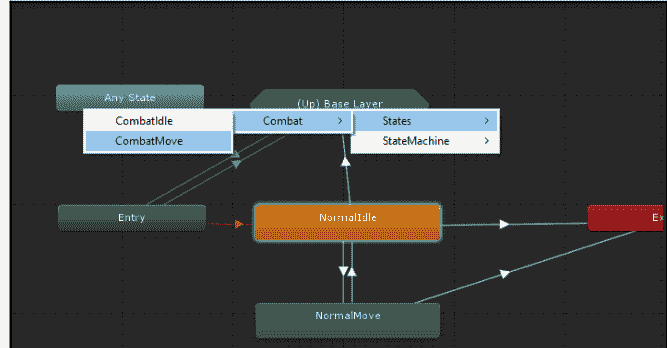

过渡到另一个子状态机中的特定状态

## 使用动画事件触发脚本函数

我们在之前的配方中零星地使用了动画事件，因为它们非常方便，而且只是很难等到这一刻。大多数现代游戏非常广泛地使用动画事件，尤其是在处理战斗时。没有这个方便的工具，创建逼真的近战遭遇会困难得多。

### 准备工作

开始之前，我们需要一个带有攻击动画的角色。在示例文件中，我们将动画命名为 HumanAttack。我们还需要一个敌人（在本示例中我们使用 Spider 角色），它具有 Idle 和 Death 动画。你也可以下载提供的示例 Unity 项目并进入 Chapter 06 Handling combat\Recipe 02 Using animation events to trigger script functions 目录。你将在那里找到一个名为 Example.unity 的场景，其中包含 Humanoid 和 Spider 角色。在 Rigs 目录中，你可以找到带有所有所需动画的 Humanoid.fbx 角色。游戏运行时，Humanoid 角色会多次攻击 Spider 并对其造成伤害。

### 如何操作...

要使用动画事件触发脚本函数，请按照以下步骤操作：

1. 将带有 HumanAttack 动画的角色导入 Unity。
2. 在 Inspector 窗口中转到动画导入设置选项卡。
3. 选择 HumanAttack 动画。
4. 向下导航到 Events 部分并展开它。
5. 使用预览窗口拖动动画到攻击中命中时刻。

6. 通过按 **Add Event** 按钮添加 **Animation Event**，如下图所示：

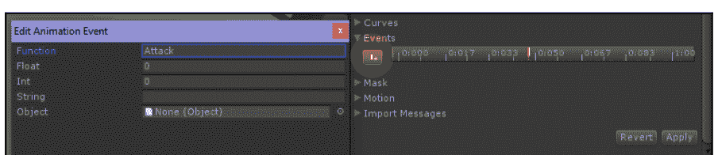

添加动画事件

7. **Edit Animation Event** 窗口将出现。在 **Function** 文本字段中输入 Attack。为了使事件生效，我们需要在分配给角色的脚本中有一个同名函数。

8. 我们将创建一个简单的战斗场景，因此我们需要敌人的脚本。创建一个新脚本并将其命名为 Enemy.cs。在此脚本中，我们有 public float hitPoints 变量来存储敌人当前的生命值。我们还有两个 public virtual void 函数：Hit(float damage) 和 Die()。Hit(float damage) 函数从当前 hitPoints 中减去伤害，并在 hitPoints 降至 0 时调用 Die() 函数。Die() 函数通过在控制器中设置 bool Dead 参数来播放死亡动画。这些函数是虚拟的，因为我们希望在后续配方中从此脚本派生以添加新功能：

```
public void Hit(float damage)
{
    hitPoints -= damage;
    if (hitPoints <= 0)
    {
        Die();
    }
}
public void Die()
{
    anim.SetBool("Dead", true);
}
```

9. 创建一个过渡：

10. 在其中，创建 bool Dead 参数。将 Idle 和 Death 动画拖放到控制器中。使 Idle 成为默认状态。

11. 为我们的 Spider 角色创建一个新的 Animator Controller。
- Idle | Death，条件为：Dead 参数设为 true，Has Exit Time 设为 false，Transition Duration 设为 0.2 秒。
- 将 Spider 角色放置在场景中。为其添加 Rigidbody 组件、Sphere Collider 组件和我们的 Enemy.cs 脚本组件。将 Rigidbody 组件设为 Is Kinematic。

12. 将控制器分配给 Spider 的 Animator 组件。

13. 为我们的 Humanoid 角色创建另一个 Animator Controller。

14. 在该控制器中放置一个循环的 HumanAttack 动画并将其分配给 Humanoid 角色。

15. 将 Humanoid 角色放置在场景中 Spider 附近。

16. 创建一个新脚本并将其命名为 MeleeAttack.cs。在此脚本中，我们使用 public void Attack() 函数。这是从动画事件调用的函数。我们有一个范围内所有敌人的列表。我们遍历该列表并对列表中的每个敌人调用 Hit() 函数。我们还有一个 public float damage 变量来存储角色的伤害值并在 Hit() 函数中发送：

```
public void Attack () {
    for (int i = 0; i < enemiesInRange.Count; i++)
    {
        enemiesInRange[i].Hit(damage);
    }
}
```

17. 将脚本分配给 Humanoid 角色。

18. 我们还需要一个脚本来获取范围内的目标。创建一个新脚本并将其命名为 TargetTrigger.cs。在此脚本的 void OnTriggerEnter(Collider other) 函数中，我们检查进入触发器的对象是否具有 Enemy.cs 组件。如果是，则将其添加到 MeleeAttack.cs 组件中的 enemiesInRange 中：

```
Enemy e = other.gameObject.GetComponent<Enemy>();
if (e != null)
{
    if (!attackScript.enemiesInRange.Contains(e))
    {
    attackScript.enemiesInRange.Add(e);
}
}
```

19. 在 void OnTriggerExit(Collider other) 函数中，我们从 enemiesInRange 列表中移除敌人：

```
Enemy e = other.gameObject.GetComponent<Enemy>();
if (e != null)
{
    if (attackScript.enemiesInRange.Contains(e))
    {
        attackScript.enemiesInRange.Remove(e);
    }
}
```

20. 在前面的脚本中，attackScript 是对 MeleeAttack.cs 脚本组件的引用。

21. 创建一个空游戏对象并将其命名为 TargetTrigger。为其添加 Box Collider 组件并将碰撞体设为 Is Trigger。将我们的 TargetTrigger.cs 脚本分配给它。

22. 使 TargetTrigger 游戏对象成为我们 Humanoid 角色的子对象，并塑造 Box Collider 以检查近战命中范围。见以下屏幕截图：

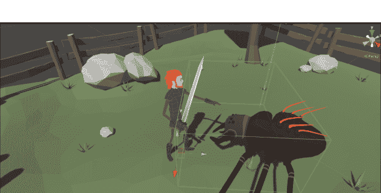

近战攻击范围触发器

23. 播放游戏以查看效果。


## 它是如何工作的...

动画事件会调用正在播放动画的游戏对象上所分配脚本中的公共函数。要使其正常工作，动画事件的 **函数** 字段需要与我们希望从脚本中调用的函数名称相同。

事件非常有用，因为它们允许我们将函数调用与动画同步。检查玩家是否击中目标的最佳时机是在动画中看到视觉上的击中时——拳头在出拳时处于极端位置，或剑在挥砍时处于极端位置。如果没有动画事件，我们就必须始终手动延迟函数调用才能达到类似的效果。

## 还有更多...

动画事件还可以具有 `int`、`float`、`string` 或对象类型的参数。要使用这些参数，我们必须在事件调用的函数中实现它们。这些参数可用于播放特效或音效（你可以在 `Chapter 7` 的 *使用动画事件触发音效和视觉效果* 食谱中了解更多信息，*特效*）。

## 使用从任意状态的过渡来播放受击反应

通常，会出现我们希望从任何其他动画过渡到一个动画的情况。最常见的例子是受击反应。我们的角色可能在站立、行走甚至攻击时被击中。创建和管理所有这些过渡会很麻烦且困难。在 Unity 中，我们可以在控制器中使用特殊的 **任意状态** 来实现从任何给定动画的过渡。

## 准备工作

我们将使用上一食谱中的角色，并为 **Spider** 角色添加一个动画：**HitReaction**。你也可以使用示例项目并进入 `Chapter 06 Handling combat\Recipe 03 Using transitions from any state to play hit reactions` 目录。你可以在那里找到 `Example.unity` 场景，其中包含两个角色：**Humanoid** 和 **Spider**。当你游玩游戏时，**Spider** 会对击中做出反应。在上一食谱的 `Rigs` 目录中，你可以找到所需的动画。

## 如何操作...

要使用任意状态过渡，请按照以下步骤操作：

- 1. 按照上一食谱导入角色并将它们放置在场景中。
- 2. 为 **Spider** 创建一个新的 **动画控制器**（你也可以编辑现有的）。
- 3. 在控制器中创建一个新的 `bool` 参数并将其命名为 **Dead**。
- 4. 在控制器中创建一个新的 `Trigger` 参数并将其命名为 **Hit**。
- 5. 将 **Spider** 的 **Idle**、**Death** 和 **HitReaction** 动画拖放到控制器中。**Idle** 动画应为我们的默认状态。
- 6. 在控制器中找到蓝色的 **任意状态** 节点。参考以下截图：
- 7. 右键单击它并创建以下过渡：
  - **任意状态** | **HitReaction** 条件为一个：**Hit** `Trigger` 参数。**退出时** 应设置为 `false`，**可自行转换** 设置为 true，且 **转换持续时间** 设置为 0.2 秒。
  - **任意状态** | **Death** 条件为一个：**Dead** `bool` 参数设置为 `true`。**退出时** 应设置为 `false`，**可自行转换** 设置为 false，且 **转换持续时间** 设置为 0.2 秒。
  - **HitReaction** | **Idle**：对于这个，你需要先右键单击 **HitReaction** 状态。它不应有条件，**退出时** 设置为 `true`，且 **转换持续时间** 设置为 0.2 秒。
- 8. 将控制器分配给 **Spider's Animator** 组件。
- 9. 创建一个新脚本并将其命名为 `EnemyWithHits.cs`。

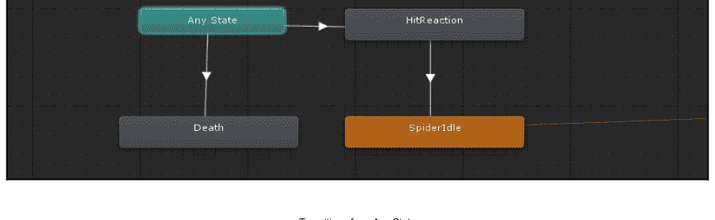

从任意状态的过渡

- 10. 让此脚本继承自 `Enemy.cs` 脚本而不是 `MonoBehaviour`。你可以在上一食谱中找到 `Enemy.cs` 脚本。
- 11. 为了使受击反应正常工作，我们需要重写 `Hit()` 和 `Die()` 函数。在第一个函数中，我们检查角色的 `isAlive` 标志。如果我们的 **Spider** 已经死亡，我们就不会尝试播放受击反应。如果它还活着，我们通过在控制器中设置 **Hit Trigger** 参数来播放受击反应。接下来我们调用 `Hit()` 函数的基础实现：
```
public override void Hit(int damage)
{
    if (!isAlive)
    {
        return;
    }
    anim.SetTrigger("Hit");
    base.Hit(damage);
}
```
- 12. 在 `Die()` 函数中，我们将 `isAlive` 标志设置为 false 并调用 `Die()` 函数的基础实现：
```
public override void Die()
{
    isAlive = false;
    base.Die();
}
```
- 13. 将脚本分配给 **Spider** 角色并游玩游戏以查看效果。

## 它是如何工作的...

任意状态是组织动画图的有力工具。如果我们知道需要从任何其他状态访问一个动画状态，我们可以从任意状态节点创建过渡，而不是从所有必要状态创建过渡网络。

这个特殊状态的过渡有一个额外的参数：**可自行转换**。如果设置为 `false`，它会阻止过渡到同一状态。

任意状态过渡对于受击反应和死亡动画最有用。

## 使用根运动创建闪避动作

我们可以使用仅动画来实现许多战斗中的游戏玩法动作。闪避动作就是此类动作的一个很好的例子。

## 准备工作

要按照本食谱操作，我们需要一个具有 SpiderIdle 和 Dodge 动画的角色（在本示例中我们将使用我们的 Spider 角色）。闪避动画应使用根运动创建。请查看以下截图中的示例：

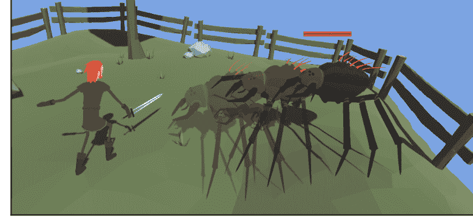

使用根运动平移的蜘蛛闪避

你也可以进入 `Chapter 06 Handling combat\Recipe 04 Using root motion to create a dodge move` 目录。在那里打开 `Example.unity` 场景。你会找到与之前食谱中相同的 **Humanoid** 和 **Spider** 角色。它们具有与 *使用从任意状态的过渡来播放受击反应* 食谱中相同的动画和脚本。**Spider** 有一个额外的动画：**Dodge**。如果你在 **Play Mode** 中按下空格键，**Spider** 将尝试闪避剑的挥砍。你可以在 `Chapter 06 Handling combat\Recipe 02 Using animation events to trigger script functions\Rigs` 目录中找到所有必要的动画。

## 如何操作...

要使角色闪避，请按照以下步骤操作：

- 1. 将角色导入 Unity 并放置在场景中。
- 2. 如果你希望角色受到伤害并播放受击反应，请按照上一食谱操作。
- 3. 创建一个新的动画控制器或编辑上一食谱中的控制器。
- 4. 将 **Dodge** 动画拖放到控制器中。
- 5. 在控制器中创建一个 **Dodge** `Trigger` 参数。
- 6. 创建两个过渡：
  - **SpiderIdle** | **Dodge** 条件为一个：**Dodge** `Trigger` 参数。**退出时** 应设置为 false 且 **转换持续时间** 设置为 0.2 秒。
  - **Dodge** | **SpiderIdle** 无条件：**退出时** 应设置为 true 且 **转换持续时间** 设置为 0.2 秒。
- 7. 为 **Spider** 角色添加 **刚体** 组件并冻结其旋转。
- 8. 为 **Spider** 角色添加一个碰撞体（我们为 **Spider** 使用 **球形碰撞体**）。你可能还需要创建一个零摩擦的 **物理材质** 并将其添加到碰撞体中。它允许动画在没有额外摩擦的情况下控制刚体移动。
- 9. 在我们的 **Spider** 中将 **动画** 组件的 **更新模式** 设置为 **动画物理**。
- 10. 将控制器附加到我们 **Spider** 的 **动画** 组件。
- 11. 创建一个新脚本并将其命名为 `Dodge.cs`。在此脚本的 `Update()` 函数中，我们只需在玩家按下空格键时在控制器中设置 **Dodge** `Trigger`：
```
if (Input.GetKeyDown(KeyCode.Space))
```

```
{
    anim.SetTrigger("Dodge");
}
```

- 12. 如同以往，`anim` 变量存储对 **动画器** 组件的引用，并在 `Start()` 函数中设置。
- 13. 将脚本附加到 **蜘蛛** 角色上。
- 14. 运行游戏并按空格键，查看 **蜘蛛** 播放闪避动画。它应该能够脱离 **人形** 角色的攻击范围并避免被击中。

## 它是如何工作的...

本食谱使用一个非常简单但强大的概念。我们在这里做的唯一额外事情就是触发 **闪避** 动画。此动画使用根运动并平移我们的 **蜘蛛** 角色。我们的 **人形** 角色使用 **攻击动画事件** 和 **目标触发器** 来检查敌人是否在其攻击范围内（请参阅 *使用动画事件触发脚本函数* 食谱了解详情）。如果我们的 **蜘蛛** 在 **攻击** 事件发生之前离开 **目标触发器**，它将避免被击中。

## 还有更多...

闪避动画也适用于其他命中检测机制。例如，你可以在 **攻击** 事件中使用 `Vector3.Distance()` 和 `Vector3.Angle()` 方法手动检查范围和攻击角度。你也可以在剑上使用 **刚体** 组件并使用 `void OnCollisionEnter(Collision collision)` 方法检查其碰撞。在这两种情况下，我们的 **闪避** 动作都将正常工作。它也适用于使用碰撞来判定命中的子弹（例如，箭矢）。

你可以将相同的概念用于其他动作：冲刺、连招以及一些使用根平移和/或旋转的疯狂近战攻击（例如，跳跃攻击）。根运动是战斗设计的非常强大的工具。尝试使用自己的动画创意来创造有趣的动作。

## 检查当前活动的 Animator 状态以禁用或启用玩家动作

有时我们需要根据当前播放的动画来阻止或允许某些动作。本食谱描述了如何轻松检查当前正在播放的动画。

## 准备工作

我们将使用上一食谱中的同一个 **蜘蛛** 角色。它拥有 **SpiderIdle**、**Dodge**、**HitReaction** 和 **Death** 动画。你可以打开提供的示例项目并进入 `Chapter 06 Handling combat\Recipe 05 Checking what animator state is currently active to disable or enable player actions` 目录。`Example.unity` 场景中有一个 **蜘蛛** 角色。当你按下 *H* 键时，它将开始治疗动作，仅在 **SpiderIdle** 状态下。你可以在 `Chapter 06 Handling combat\Recipe 02 Using animation events to trigger script functions\Rigs` 目录中找到所有必要的动画。

## 如何操作...

要检查当前活动的 Animator 状态，请按照以下步骤操作：

- 1. 将角色导入 Unity。
- 2. 为其创建 Animator 控制器或使用现有控制器。
- 3. 如果你希望角色对命中做出反应，请遵循 *使用从任意状态的过渡来播放命中反应* 食谱。
- 4. 在本食谱中，我们将使用治疗动作作为示例。创建一个新脚本并将其命名为 `Healing.cs`。在此脚本的 `Update()` 函数中，首先我们检查玩家是否按下了 *H* 键。然后我们检查我们的角色是否正在播放正确的 **动画器** 状态并保存在 `public string healingAllowedState` 变量中。我们还检查治疗动作是否未激活，因为我们不想堆叠治疗动作。如果所有这些条件都满足，我们将启动一个治疗协程：

```
if (Input.GetKeyDown(KeyCode.H))
{
    if (anim.GetCurrentAnimatorStateInfo(0).IsName(
healingAllowedState))
    {
        if (!isHealing)
{
    StartCoroutine("Heal");
}
}
}
```

- 5. `IEnumerator Heal()` 协程负责随着时间增加我们蜘蛛的 `hitPoints`：

```
isHealing = true;
Enemy enemyScript = GetComponent<Enemy>();

while (enemyScript.hitPoints < (float)enemyScript.initialHitPoints)
{
    enemyScript.hitPoints += healingSpeed * Time.deltaTime;
    yield return null;
}

enemyScript.hitPoints = enemyScript.initialHitPoints;
isHealing = false;
```

- 6. 将脚本分配给蜘蛛角色。
- 7. 运行游戏并按 H 键开始治疗动作。我们的角色需要在 SpiderIdle 状态下（在检查器中 public string healingAllowedState 设置为 Base Layer.SpiderIdle）。

## 它是如何工作的...

要检查角色当前所在的 Animator 状态，我们首先使用 GetCurrentAnimatorStateInfo(int layerIndex) 函数获取角色 Animator 所处的状态。我们需要在 Animator 组件上调用此函数；因此，我们需要有一个存储其引用的变量（在我们的示例中为 anim）。然后我们在从 GetCurrentAnimatorStateInfo(int layerIndex) 函数获取的状态上调用 IsName(string name) 函数。IsName(string name) 函数将 Animator 状态名称与我们作为参数输入的名称进行比较。


我们需要指定状态的完整名称。此名称的格式应为：<图层名称>.<状态名称>。例如，我们的 SpiderIdle 状态位于 Base Layer 中，因此我们需要在 IsName() 函数中将 Base Layer.SpiderIdle 作为名称参数。

## 还有更多...

有时我们不仅需要检查 Animator 的当前状态，还需要检查其中的特定时刻。假设我们有一个持续 2 秒的跳跃攻击动画。我们的角色在动画的第一秒开始跳跃，然后在动画结束时跳跃并落地并进行打击。我们可能希望在角色仍在地面上时允许玩家中断动画（例如，使用闪避动画）。为此，我们可以使用动画曲线在控制器中设置一个 AllowBreak 浮点参数（你可以选择不同的名称），并在尝试执行动作或过渡到其他状态时检查此参数值。动画曲线在第 4 章《角色移动》中的 *使用动画实现更佳过渡* 食谱中进行了描述。

## 使用动画事件绘制武器

在战斗机制中，拔出和收起武器是另一个常见情况。在本食谱中，我们将使用动画事件以及 Draw 动画使我们的角色拔出和收起剑。

## 准备工作

要遵循本食谱，我们需要有一个拥有两个动画的战士角色：Idle 和 Draw。第一个是标准的、循环的 Idle 动画。第二个是角色伸手去拿系在腰带上的剑鞘中武器的动画。这里我们不使用剑鞘模型以使食谱更简单紧凑。你可以打开提供的示例项目并进入 Chapter 06 Handling combat\Recipe 06 Using animation events to draw a weapon 目录。Example.unity 场景中有一个战士角色。当你按下空格键时，它将拔出或收起剑。你可以在 Rigs 目录中找到所有必要的动画。

## 如何操作...

要使角色拔出或收起武器，请按照以下步骤操作：

- 1. 将带有 Idle 和 Draw 动画的战士角色导入 Unity。
- 2. 将剑道具导入 Unity。
- 3. 进入导入设置 | 动画 选项卡。选择 Draw 动画并导航到事件部分。
- 4. 在角色的手触及剑鞘中剑的帧添加一个 **Draw** 事件。
- 5. 创建一个包含 **Idle** 和 **Draw** 动画的 **动画控制器**。
- 6. 在控制器中创建一个 **Draw** `Trigger` 参数。
- 7. 创建两个过渡：
  - **Idle | Draw** 条件为一个：**Draw** `Trigger` 参数。**Has Exit Time** 应设置为 `false`，**Transition Duration** 设置为约 0.2 秒。
  - **Draw | Idle** 无条件：**Has Exit Time** 应设置为 `true`，**Transition Duration** 设置为约 0.2 秒。
- 8. 将 **战士** 角色放置在场景中。
- 9. 将控制器分配给 **战士** 游戏对象的 **动画器** 组件。
- 10. 将 **剑** 道具放置在场景中。将它移至角色臀部附近，并将其摆姿为放置在剑鞘中时的样子。
- 11. 当你对 **剑** 的位置满意时，在其中创建一个空的子对象。将其命名为 **SheathMarker** 并将其拖到角色的髋骨上，使其成为 **战士** 臀部的子对象。这样 **SheathMarker** 将存储我们的 **剑** 相对于角色臀部的初始位置和旋转。你还应将剑设为 **SheathMarker** 的子对象。参考以下截图：

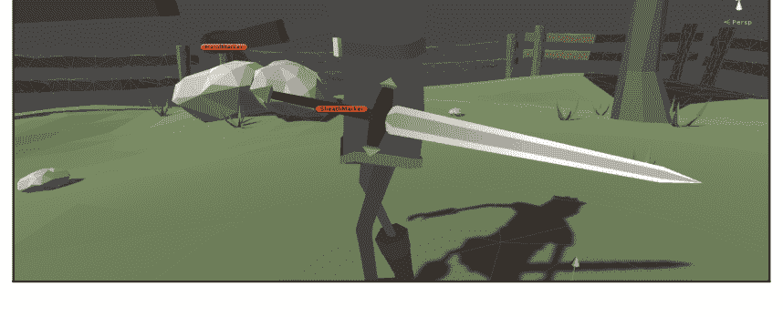

Sheath Marker（红色）存储剑的期望位置和旋转


12. 将剑移动到战士的手中。按需摆好剑的姿势。在剑中创建一个新的空子对象并命名为 HandMarker。将 HandMarker 游戏对象拖放到角色骨架中右手骨骼上，使其成为战士手的父级。请参考以下截图：

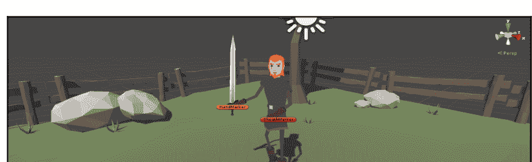

Hand Marker（橙色）存储剑在手中的期望位置和旋转

13. 编写一个新脚本并命名为 DrawWeapon.cs。在此脚本的 Update() 函数中，我们检查玩家是否按下了空格键。如果是，我们首先设置控制器中的 Draw Trigger 参数以播放动画：

```
if (Input.GetKeyDown(KeyCode.Space))
{
    anim.SetTrigger("Draw");
}
```

14. 我们还将剑的位置和旋转插值到其父游戏对象的位置和旋转（Hand Marker 或 Sheath Marker）：

```
if (weapon.parent != null)
{
    if ((weapon.position - weapon.parent.position).sqrMagnitude > 0.0001f)
    {
        weapon.position =
        Vector3.Lerp(weapon.position,
        weapon.parent.position, Time.deltaTime *
        lerpSpeed);
        weapon.rotation =
        Quaternion.Lerp(weapon.rotation,
        weapon.parent.rotation, Time.deltaTime *
        lerpSpeed);
    }
}
```

15. 在前面的脚本中，weapon 变量保存对剑的 Transform 组件的引用。public float lerpSpeed 变量在 Inspector 中设置。

16. 该脚本还有一个 public void Draw() 函数，该函数由 Draw 动画中设置的 Animation Event 调用。在此函数中，我们使用 public bool weaponInHand 变量检查剑是否已在手中。我们需要在 Inspector 中根据剑的初始位置（在手中或在剑鞘中）设置此变量的初始值。Draw() 函数仅更改剑的父级并设置 weaponInHand 标志：

```
if (weaponInHand)
{
    weaponInHand = false;
    weapon.parent = sheathMarker;
}
else
{
    weaponInHand = true;
    weapon.parent = handMarker;
}
```

17. 将脚本附加到角色。将 Sheath Marker 游戏对象拖放到脚本中的 Sheath Marker 字段，将 Sword 游戏对象拖放到 Weapon 字段，将 Hand Marker 拖放到 Hand Marker 字段。设置 Weapon In Hand 复选框以匹配剑的初始位置。

18. 播放游戏并按空格键查看效果。

## 工作原理...

我们使用 Draw 动画中的 Animation Event 来找到角色伸手去拿系在腰带上的武器的时刻。在此事件中，我们更改武器的父级以将其附加到手或腰带上（取决于角色是拔出武器还是收回武器）。我们还使用 Lerp() 方法来调整或匹配武器的位置和旋转与角色中的适当插槽（Hand Marker 和 Sheath Marker）。这样我们的 Draw 动画就不必与武器的期望位置完全匹配。它使得更容易使用相同的动画用于更广泛的不同武器。

## 使用 Avatar Masks 和 Animator Controller 层进行行走和瞄准

本教程展示了如何在 Animator Controller 中使用 Avatar Masks 和 Layers 在特定身体部位播放动画。在战斗中，这对于在上半身播放瞄准动画并在下半身播放移动动画非常有用。

### 准备工作

在本教程中，我们使用 WalkForward、WalkLeft、WalkRight 和 Idle 动画，以及一个循环的 AimForward 动画。前四个动画在第 4 章《角色移动》中《使用根运动操控角色》教程中介绍。最后一个是一个简单的循环瞄准动画，我们的角色直视前方瞄准弩。你可以前往 Chapter 07 Special effects\Recipe 07 Using sprite sheets to animate particles 目录。你将在那里找到一个 Example.unity 场景。打开它并播放游戏。你可以使用 WSAD 键移动角色并用鼠标旋转摄像机。你可以在 Rigs 目录中找到 AimForward 动画，所有其他必需的动画都在 Chapter 04 Character movement\Recipe 03 Using root motion to steer a character 目录中。我们还需要一个 Crossbow 道具，你可以在 Props 文件夹中找到它。

### 如何操作...

要使用 Avatar Masks 和 Layers，请按照以下步骤操作：

- 1. 将角色和弩道具导入 Unity。确保拥有所有必需的动画。
- 2. 创建一个 Animator Controller 并将其分配给角色。
- 3. 按照第 4 章《角色移动》中《使用根运动操控角色》教程使角色移动。
- 4. 打开 Animator Controller 并找到 Layers 选项卡。
- 5. 点击 **Layers** 选项卡附近的加号按钮创建一个新的 **Layer** 并命名为 **Aim**。请参考以下截图：

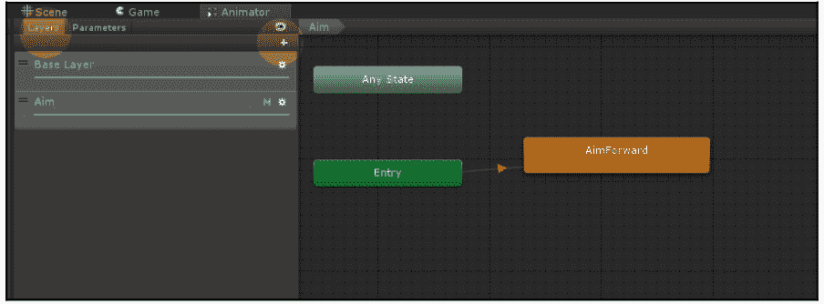

Layers 选项卡
- 6. 将 **AimForward** 动画拖放到其中。
- 7. 点击 **Layer** 中的小齿轮图标。**Layer Properties** 窗口将会出现。
- 8. 找到 **Weight** 滑块并将其拖动到最右边至 1。
- 9. 在 **Project View** 上右键单击并选择 **Create | Avatar Mask** 创建一个新的 **Avatar Mask**。命名为 **AimMask**。
- 10. 点击它并展开 **Humanoid** 折叠面板。
- 11. 取消选择角色的腿部。请参考以下截图：

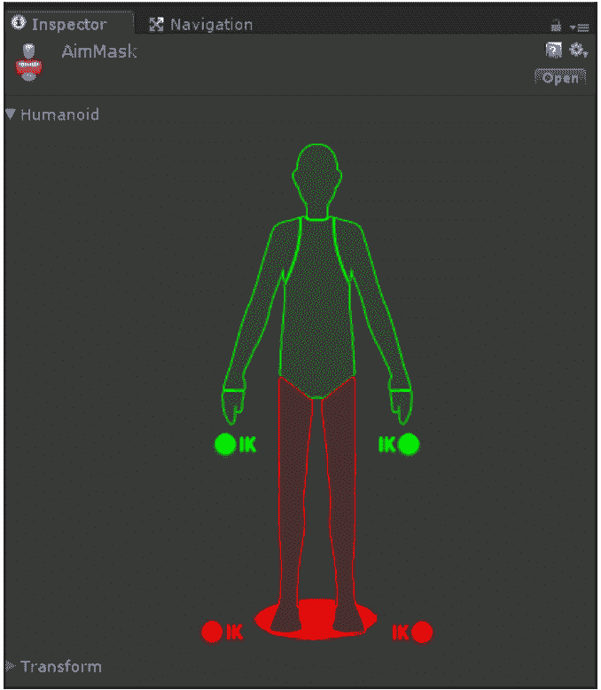

仅上半身开启的 Avatar Mask
- 12. 返回 Animator Controller，打开 Aim 层的 Layer Properties，并将 AimMask 分配给 Mask 字段。请参考以下截图：

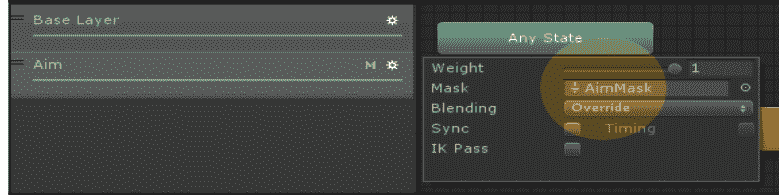

Avatar Mask 已分配给 Aim 层
- 13. 将 RootMotionSteering.cs 脚本分配给角色以使角色行走。你可以在《使用根运动操控角色》教程（Chapter 04 Character movement\Recipe 03 Using root motion to steer a character\Scripts）中找到它。
- 14. 播放游戏以查看效果。

### 工作原理...

本教程有几个关键元素使其工作：

- **Layers**：Animator Controller 层对于覆盖动画很有用。**Layer Properties** 中的 **Blending** 下拉菜单定义了动画混合的类型。我们可以覆盖动画或使用叠加混合（这将在下一章介绍）。
- **Layer Weight**：混合层时，Unity 会考虑 **Weight** 参数。权重为 1 表示 100% 覆盖。你可以通过使用 `animator.SetLayerWeight(int index, float weight)` 函数在运行时设置权重（`animator` 是保存对 Animator 组件引用的变量）。
- **Avatar Masks**：我们可以创建 Avatar Mask 资源并指定要在其上播放动画的身体部位。然后我们可以在 **Layers** 中使用此 **Avatar Mask** 仅覆盖特定身体部位的动画。这样我们可以在上半身播放 **AimForward** 动画，而不在腿部和根部播放。这使得角色在播放 **AimForward** 动画时仍能移动。

### 还有更多...

你也可以在 **Layer Properties** 中选择 Sync 选项。它将继承另一个所选层的结构，但你可以更改所有动画。此选项可能有助于为不同角色状态（例如正常/受伤）实现不同类型的动画。

我们在本教程中还使用了 `CameraLook.cs` 脚本。该脚本可以在提供的 Unity 项目的 `Shared Scripts` 文件夹中找到。该脚本与基础摄像机 rig 配合工作。rig 由三个游戏对象构建：

- **CameraRig**：此游戏对象跟随 `CameraLook.cs` 脚本组件中指定的 Target transform。它还根据玩家水平鼠标输入在全局 *Y* 轴上旋转。
- **CameraPivot**：此游戏对象在其本地 *X* 轴上旋转以上下倾斜摄像机。它响应垂直鼠标输入。
- **Main Camera**：这是标准的游戏摄像机。它在本地 *Z* 轴上远离 **CameraPivot** 游戏对象。这样我们就有了摄像机的起重机行为。它围绕 **CameraPivot** 游戏对象轨道移动。

## 使用 LookAt() 方法进行瞄准

在本教程中，我们将使用一种简单但有效的瞄准机制实现。

### 准备工作

我们将使用与上一教程相同的资源。此外，我们将使用在 *第 5 章，角色动作和表情* 中 *Using Quaternion.LookRotation()* 和 *Animator.SetLookAtPosition()* 方法使角色注视物体教程中创建的 `CharacterLookAt.cs`。

你也可以使用提供的示例 Unity 项目并前往 `Chapter 06 Handling combat\Recipe 08 Using the LookAt method to aim` 目录。你将在那里找到一个 `Example.unity` 场景，其中包含一个 **Humanoid** 角色。播放游戏以查看瞄准效果。


## 如何操作...

使用 `LookAt()` 方法进行瞄准，请按以下步骤操作：

- 1. 将你的角色导入 Unity 并放置在 **场景** 中。
- 2. 按照之前的配方让角色行走并瞄准。
- 3. 将 `CharacterLookAt.cs` 脚本附加到角色上。
- 4. 创建一个新的 **球体** 对象并将其命名为 AimTarget。
- 5. 将胸骨分配给 `CharacterLookAt.cs` 组件的 **骨骼** 字段。
- 6. 将 **AimTarget** 分配给 `CharacterLookAt.cs` 组件的 **目标** 字段。
- 7. 将 **AimTarget** 设为 **主摄像机** 游戏对象的子对象。我们在此配方中使用相同的 `CameraLook.cs` 脚本。你可以在提供的示例 Unity 项目的 `Shared Scripts` 文件夹中找到该脚本。
- 8. 将 **AimTarget** 的位置在其局部 Z 轴上偏移约 20 个单位。
- 9. 运行游戏查看效果。我们的角色将尝试瞄准 **AimTarget**。你可能需要调整 `CharacterLookAt.cs` 组件中的 **额外旋转** 向量。在我们的示例中，它设置为 X 为 15，Y 为 20。

## 工作原理...

我们使用与 *使用 LookRotation() 和 SetLookAtPosition()* 方法中相同的原理，使角色通过注视跟随物体。我们的脚本以这样的方式旋转胸骨，使角色看起来在瞄准目标。我们在 `CharacterLookAt.cs` 脚本中使用 **额外旋转** 向量来调整旋转（在大多数动画中胸部并非正向前方）。这种瞄准方式适用于角色相对于摄像机行走的游戏（适用于肩上视角的第三人称游戏）。当角色需要旋转超过 50-60 度时就会失效。下一个配方解决了这个问题。

## 更多内容...

LookAt() 瞄准最适合与机器人和机器一起使用。它对于实现炮塔非常有用。你可以在场景中找到一个 Turret 游戏对象。它由三个对象构成：

- - **Turret**：这是 Turret 的底座。
- - **TurretPivot**：此游戏对象仅在水平方向（Y 轴）旋转。这是 Turret 的子对象。
- - **Gun**：此对象始终指向目标。它是 TurretPivot 的子对象。TurretPivot 在水平方向旋转，因此 Gun 看起来只在垂直方向旋转。

Turret 游戏对象附加了 TurretAim.cs 脚本。在此脚本的 Update() 函数中，我们首先对公共 Transform 目标位置进行阻尼并将值保存在 Vector3 dampedTargetPosition 变量中。然后我们使用此变量计算 aimVector，并使用 aimVector 计算 horizontalAimVector（我们只需移除其 Y 分量）。最后，我们使用 aimVector 和 horizontalAimVector 为 TurretPivot 和 Gun 游戏对象（存储在公共 Transform 变量中）计算新的旋转：

```
dampedTargetPosition =
Vector3.SmoothDamp(dampedTargetPosition,
 aimTarget.position, ref dampSpeed, dampTime);

 aimVector = dampedTargetPosition - turretGun.position;

horizontalAimVector = aimVector;
horizontalAimVector.y = 0f;

turretPivot.rotation =
Quaternion.LookRotation(horizontalAimVector);
turretGun.rotation = Quaternion.LookRotation(aimVector);
```

## 使用 Blend Trees 进行瞄准

在此配方中，我们将使用一种更复杂的瞄准方法。此方法基于将多个瞄准动画组合到 Blend Tree 中。

## 准备工作

我们将使用与上一个配方相同的资源，但不使用 `CharacterLookAt.cs` 脚本，而是使用额外的动画：**AimForward**、**AimForwardUp**（向上瞄准 45 度）、**AimForwardDown**（向下 45 度）、**AimLeft**（向左 45 度）、**AimLeftUp**（向左 45 度且向上 45 度）、**AimLeftDown**（向左 45 度且向下 45 度）、**AimRight**（向右 45 度）、**AimRightDown**（向右 45 度且向下 45 度）、**AimRightUp**（向右 45 度且向上 45 度）。请参阅以下截图作为参考：

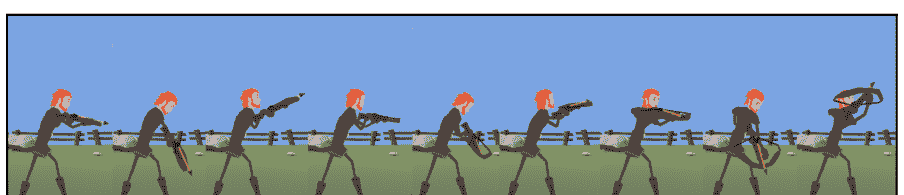

九个方向的瞄准动画

你也可以使用提供的示例 Unity 项目并进入 `Chapter 06 Handling combat\Recipe 09 Using blend trees to aim` 目录。你将在那里找到一个 `Example.unity` 场景，其中有一个 **人形** 角色。运行游戏查看效果。你可以在 `Rigs` 目录中找到所有必要的动画。

## 如何操作...

使用 **Blend Trees** 方法进行瞄准，请按以下步骤操作：

- 1. 将带有所有必要动画的角色导入 Unity 并放置在 **场景** 中。
- 2. 按照 *使用 Avatar Masks 和动画控制器层行走和瞄准* 配方让角色行走并瞄准。
- 3. 打开控制器并进入 **瞄准层**。
- 4. 删除 **AimForward** 状态并创建一个新的 **混合树**。
- 5. 创建两个浮点参数：**AimVer** 和 **AimHor**。
- 6. 将 **混合类型** 设置为 **自由形式笛卡尔**。
- 7. 将 **混合树** 的第一个参数设置为 **AimHor**，第二个设置为 **AimVer**。
- 8. 在 **混合树** 中创建九个 **动作字段** 并将所有瞄准动画分配给它们。
- 9. 按如下方式设置 **动作字段**（同时参阅以下截图作为参考）：
- - **AimLeftDownPos X** 设置为 -45，**Pos Y** 设置为 -45
- - **AimLeftPos X** 设置为 -45，**Pos Y** 设置为 0
- - **AimLeftUpPos X** 设置为 -45，**Pos Y** 设置为 45
- - **AimForwardDownPos X** 设置为 0，**Pos Y** 设置为 -45
- - **AimForwardPos X** 设置为 0，**Pos Y** 设置为 0
- - **AimForwardUpPos X** 设置为 0，**Pos Y** 设置为 45
- - **AimRightDownPos X** 设置为 45，**Pos Y** 设置为 -45
- - **AimRightPos X** 设置为 45，**Pos Y** 设置为 0
- - **AimRightUpPos X** 设置为 45，**Pos Y** 设置为 45

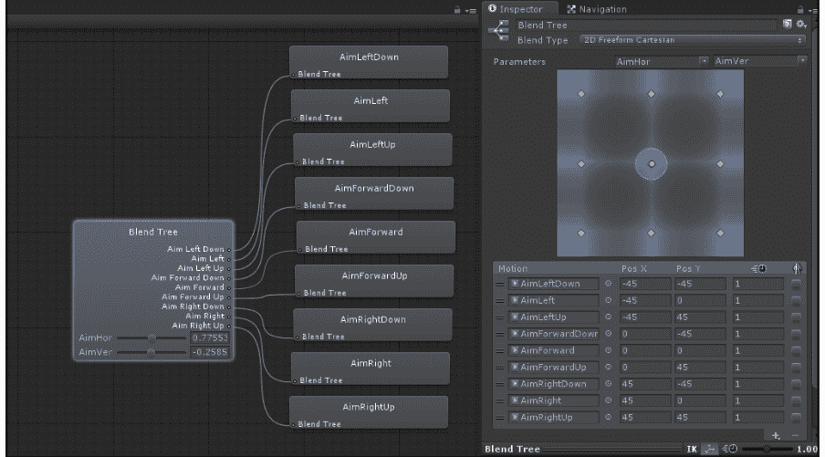

瞄准混合树设置

- 10. 创建一个新的 **球体** 对象并将其命名为 **AimTarget**。
- 11. 将 **AimTarget** 设为 **主摄像机** 游戏对象的子对象。我们在此配方中使用相同的 `CameraLook.cs` 脚本。你可以在提供的示例 Unity 项目的 `Shared Scripts` 文件夹中找到该脚本。
- 12. 将 **AimTarget** 的位置在其局部 Z 轴上偏移约 20 个单位。
- 13. 创建一个新脚本并将其命名为 `AimWithBlendTree.cs`。在此脚本的 `Update()` 函数中，我们首先计算 `aimVector`。这是一个从辅助 `aimNode` 变换到 `target` 变换的向量。然后我们使用此向量计算 `horAimVector`，即用于瞄准的水平向量。然后我们使用 `horAimVector` 计算 `aimHor` 角度。我们使用 `Vector3.Angle()` 方法找到 `horAimVector` 与 `transform.forward` 轴之间的角度，并使用 `Mathf.Sign()` 与 `Vector3.Dot()` 来确定角度的符号。我们以类似的方式计算 `aimVer` 角度，但使用 `horAimVector` 而不是 `transform.forward` 轴。最后，我们在控制器中分配 **AimVer** 和 **AimHor** 参数：
- 14. 将脚本分配给角色。将 **AimTarget** 变换拖放到脚本的 **Target** 字段中。
- 15. 创建一个空游戏对象并将其命名为 **AimNode**。将其放置在角色胸部的大致位置并使其成为角色变换的子对象。
- 16. 将 **AimNode** 变换分配给脚本的 **Aim Node** 字段。你可以使用 **AimNode** 来调整 `aimVector` 计算。
- 17. 运行游戏查看效果。

```
aimVector = target.position - aimNode.position;

horAimVector = aimVector;
horAimVector.y = 0f;

 aimHor = Vector3.Angle(horAimVector, transform.forward) *
Mathf.Sign(Vector3.Dot(horAimVector, transform.right));

 aimVer = Vector3.Angle(horAimVector, aimVector) *
Mathf.Sign(Vector3.Dot(aimVector, Vector3.up));

anim.SetFloat("AimHor", aimHor, aimSmooth, Time.deltaTime);
anim.SetFloat("AimVer", aimVer, aimSmooth, Time.deltaTime);
```

## 工作原理...

我们使用与 `Chapter 4` 中 *使用根运动创建飞行角色* 配方中使用的类似原理，*角色移动*。我们的脚本计算目标与角色前向轴之间的角度。然后它将这些角度作为参数分配给控制器。混合树使用这些参数在九个方向的瞄准动画之间进行混合。

## 更多内容...

你可以进一步使用额外的动画开发此配方以处理更极端的角度。你甚至可以拥有在水平角度上瞄准 +180 和 -180 度的动画。这将使你的角色能够在每个可能的方向上瞄准。

## 检测角色上的命中位置

另一个与动画相关的战斗主题是命中位置检测。此配方展示了如何轻松检测到不同身体部位的命中。

## 准备工作

我们将在此配方中使用一个仅有一个循环 **Idle** 动画的简单角色。你也可以使用提供的示例 Unity 项目并进入 `Chapter 06 Handling combat\Recipe 10 Detecting the hit location on a character` 目录。你将在那里找到一个 `Example.unity` 场景，其中有一个 **人形** 角色。运行游戏查看效果。

## 如何操作...

能够检测不同身体部位的命中，请按以下步骤操作：

- 1. 将带有所有必要动画的角色导入 Unity。将它放置在场景中。


2. 创建一个新的图层并将其命名为 BodyParts。 为此，请转到图层菜单并选择编辑图层选项，如以下屏幕截图所示：

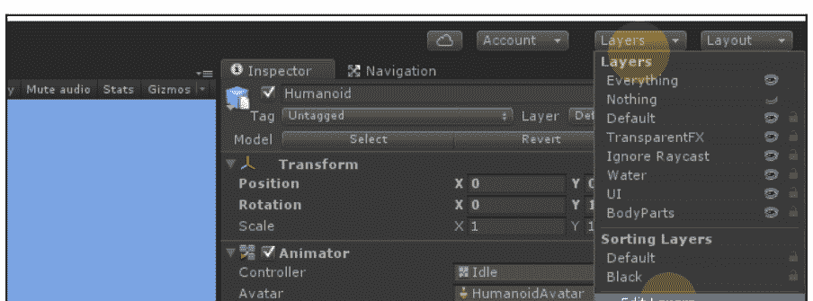

添加新图层

- 3. 创建一个新脚本并将其命名为 BodyPart.cs。 在此脚本中仅创建一个 public string bodyPartName 变量。 我们将把它用作身体部位的占位脚本。 您可以在此脚本层中实现给定身体部位击中的自定义效果。
- 4. 创建一个空游戏对象并将其命名为 Head。
- 5. 将 BodyPart.cs 脚本分配给 Head 游戏对象。 在 BodyPart.cs 组件的身体部位名称字段中输入 Head。
- 6. 为 Head 游戏对象分配一个胶囊碰撞体组件。
- 7. 将 Head 图层设置为 BodyParts。
- 8. 为 Head 游戏对象添加一个 Rigidbody 组件并将其设置为 Is Kinematic。

- 9. 转到 **编辑** | **项目设置** | **物理** 菜单。 取消选中 **BodyParts <-> BodyParts** 图层之间以及 **BodyParts <-> Default** 图层之间的碰撞，如以下屏幕截图所示：
- 10. 在角色骨架的层级结构中找到头部骨骼。 将 **Head** 游戏对象拖放到头部骨骼上以将其设为父级。
- 11. 将 **Head** 的变换的旋转和位置归零。
- 12. 调整 **Capsule Collider's** 设置，使其大致包围角色的头部形状。
- 13. 复制 **Head** 游戏对象并将其命名为 **Chest**。 在 `BodyPart.cs` 组件的 **身体部位名称** 中输入 **Chest**。
- 14. 将 **Chest** 游戏对象拖放到角色骨架层级结构中的胸部骨骼上。
- 15. 将 **Chest's** 位置和旋转归零。
- 16. 调整 **Chest's Capsule Collider** 属性，使其大致匹配角色胸部的形状。

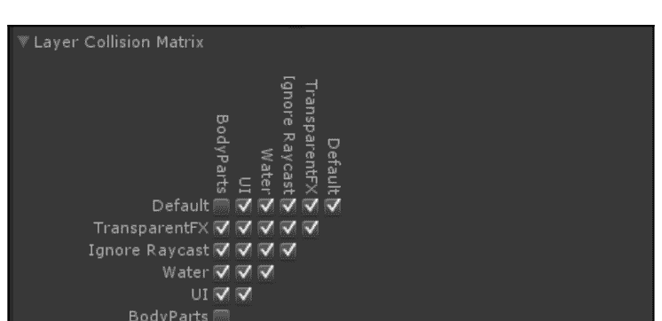

BodyParts 图层的碰撞矩阵

17. 对所有身体部位重复步骤 13 到 16。 在此示例中，我们创建了 **Head**、**Chest**、**ArmL**（以及前臂的副本）、**ArmR**（以及前臂的副本）、**LegL**（以及小腿的副本）、**LegR**（以及小腿的副本）和 **Groin**。 请参阅以下屏幕截图以供参考：

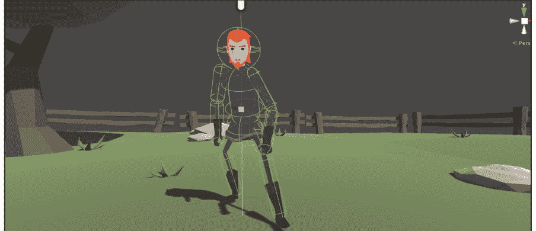

被碰撞体包围的身体部位

18. 所有身体部位都会随角色一起移动。 它们彼此之间或与 **Default** 图层不发生碰撞。 这可以防止角色的物理行为变得奇怪。 您可能还需要在游戏中为其他图层关闭碰撞。

19. 我们将使用附加到摄像机的简单脚本来检测身体部位的命中。 创建一个新脚本并将其命名为 `Shoot.cs`。 在此脚本的 `Update()` 函数中，我们不断从摄像机的前向轴发射射线。 我们使用带有 **LayerMask** 参数的 `Physics.Raycast()` 实现。 这使我们只能命中具有适当图层的碰撞体。 如果我们命中了这样的碰撞体，我们将检查它是否附加了 `BodyPart.cs` 组件。 如果是，我们将屏幕上的 UI 文本设置为我们命中的身体部位的名称：

```
Transform cameraTransform = Camera.main.transform;

if (Physics.Raycast(cameraTransform.position,
cameraTransform.forward, out hit, maxDistance,
bodyPartsLayer))
```

```
{
    BodyPart p =
    hit.collider.gameObject.GetComponent<BodyPart>();
    if (p != null)
    {
        bodyPartText.text = "Hit body part: " +
        p.bodyPartName;
    }
    else
    {
        bodyPartText.text = "No body part was hit";
    }
}
else
{
    bodyPartText.text = "No body part was hit";
}
```

- 20. 将脚本附加到摄像机。
- 21. 在场景中创建一个 UI Text 并将其附加到 `BodyPart.cs` 组件的 **身体部位文本** 字段。
- 22. 将 `BodyPart.cs` 组件中的 **身体部位图层** 图层掩码设置为 **BodyParts**。
- 23. 将任何自由视角脚本附加到摄像机； 您也可以使用 `Shared Scripts` 文件夹中的 `CameraLook.cs` 脚本。
- 24. 播放游戏以查看效果。

## 它是如何工作的...

我们使用 Unity 的 **Hierarchy** 将碰撞体附加到角色骨架中的骨骼上。 这样我们就可以检查这些身体部位的碰撞并通过脚本对其做出反应。 为了使本配方简单，我们只在 UI 上显示命中的身体部位名称，但您可以轻松实现对特定身体部位命中的复杂反应。 例如，您可以为头部射击实现额外的伤害，甚至是复杂的伤口系统。

## 还有更多...

我们已使用 `Physics.Raycast()` 方法介绍了命中检测，这对于瞄准身体部位或快速移动的投射物很有用。 但您也可以同样轻松地在近战中实现身体部位检测。 您需要做的就是在 `BodyPart.cs` 脚本或附加到武器的新脚本中实现 `void OnCollisionEnter(Collision collision)` 方法（它需要具有 **Collider** 和设置为 **Is Kinematic** 的 **Rigid Body** 组件）。 然后您必须检查进入的碰撞对象是否附加了适当的脚本或标签，以确定是否击中了身体部位。
