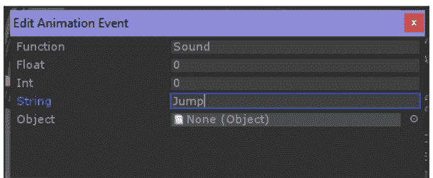
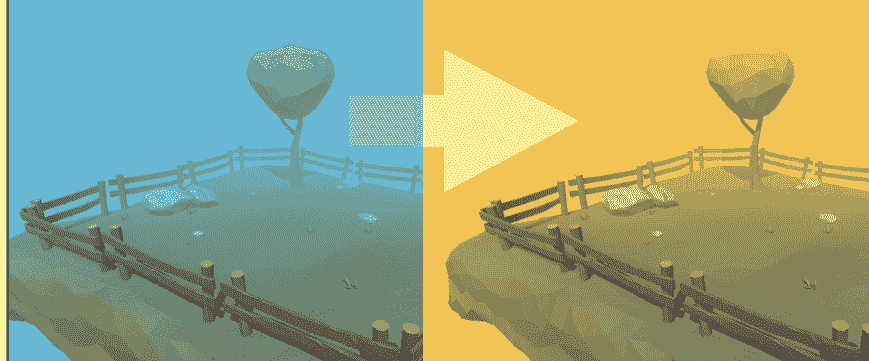
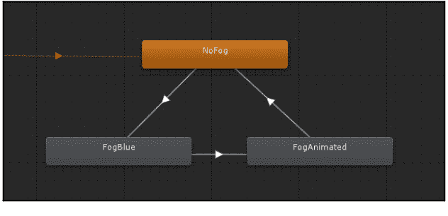
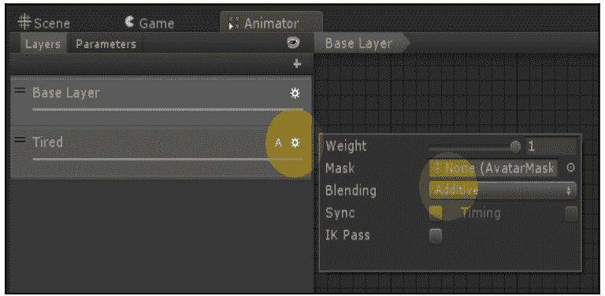
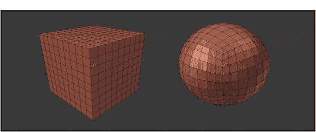
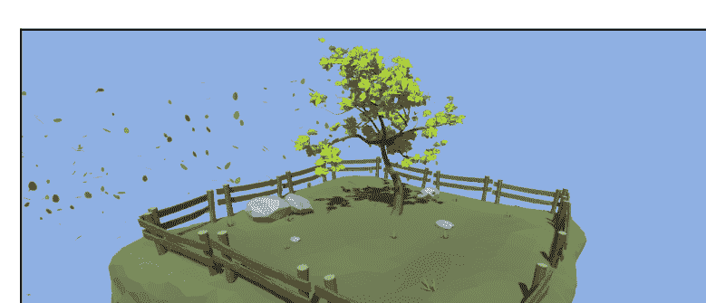
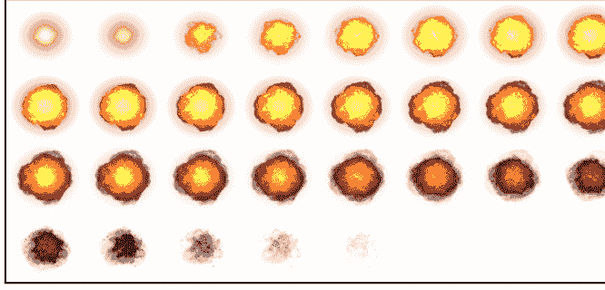
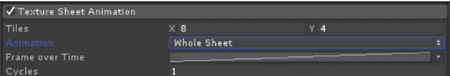
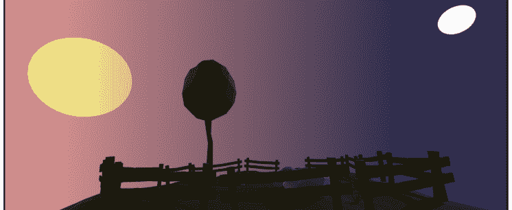
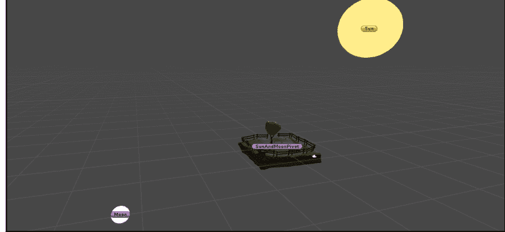

## 7

## 特殊效果

本章解释了如何通过动画实现有趣的效果，并涵盖以下配方：

- 使用 Animation Events 触发声音和视觉效果
- 使用 **Animation** 视图和 Animator Controller 创建摄像机抖动
- 使用 **Animation** 视图为公共脚本变量设置动画
- 使用 additive Mecanim 层为角色添加额外动作
- 使用 Blend Shapes 将一个对象变形为另一个对象
- 使用风发射器为植被和粒子系统创建运动
- 使用精灵表为粒子设置动画
- 使用 **Animation** 视图为粒子系统的属性设置动画
- 使用声音片段的波形为场景中的对象设置动画
- 使用 **Animation** 视图创建昼夜循环

### 简介

我们在前几章中学到了很多。 本章的全部内容都是鼓励您尝试 Unity 的动画系统。 在接下来的 10 个配方中，我们将创建有趣的效果并以新的创造性方式使用动画。 本章还涵盖了可用于为场景设置动画的 Unity 其他内置功能。

## 使用 Animation Events 触发声音和视觉效果

本配方展示了一种简单、通用的方法，使用 Animation Events 播放不同的声音和视觉效果。

### 准备工作

开始时，您需要有一个带有循环动画的角色：Jump。 我们还需要一个音效和一个粒子系统。 我们需要一个透明的 DustParticle.png 纹理用于粒子系统。 它应类似于一个小尘云。 您可以打开提供的示例 Unity 项目并转到 Chapter 07 Special effects\Recipe 01 Using animation events to trigger sound and visual effects 目录。 在 Rigs 目录中，您将找到所有需要的动画，而在 Resources 文件夹中，您将找到所有其他必要资源。 当您播放游戏时，您将看到一个角色正在播放 Jump 动画。 着陆时它还会播放音效和粒子效果。

### 如何操作...

要使用 Animation Events 播放声音和视觉效果，请按照以下步骤操作：

- 1. 导入带有 Jump 动画的角色。
- 2. 在导入设置中，动画选项卡中，选择 Jump 动画。
- 3. 使其循环。
- 4. 转到事件部分。
- 5. 在预览部分中拖动时间线并单击添加事件按钮。 编辑动画事件窗口将出现，如以下屏幕截图所示：



编辑动画事件窗口

- 6. 在 **函数** 字段中输入 `Sound`，在 **字符串** 字段中输入 `Jump`。 这将在附加到角色的脚本中调用 **Sound** 函数，并将 **Jump** 单词作为字符串参数传递给它。
- 7. 创建另一个动画事件。 将 **函数** 字段设置为 **Effect**，将 **字符串** 字段设置为 **Dust**。
- 8. 应用 **导入设置**。
- 9. 为角色创建一个 Animator Controller，其中仅包含 **Jump** 动画。
- 10. 将角色放置在场景中。
- 11. 将控制器附加到角色的 Animator 组件。
- 12. 为角色附加一个 **音频源** 组件。
- 13. 取消选中 **播放时唤醒** 选项。
- 14. 创建一个空游戏对象并将其命名为 **Dust**。
- 15. 为其添加一个 **粒子系统** 组件。 这将是我们尘埃效果。
- 16. 按如下方式设置 **粒子系统** 的参数：
  - **持续时间** 为 1 秒
  - **开始生命周期** 为 0.5 秒
  - **开始速度** 为 0.4
  - **开始大小** 随机介于两个常数之间：1 和 2
  - **开始颜色** 为浅棕色
  - **发射 | 速率** 为 0
  - **发射 | 爆发** 为一次爆发，时间设置为 0，**最小值** 和 **最大值** 设置为 5
  - **形状 | 形状** 为球体


-   **形状 | 半径** 调至 0.2
-   **生命周期颜色**—为 alpha 通道创建渐变。在 0% 标记和 100% 标记处，应设置为 0。在 10% 和 90% 标记处，应设置为 255。

17. 创建一个新的 **材质** 并将着色器设置为 **粒子 | Alpha 混合**。

18. 将 `DustParticle.png` 的透明纹理拖放到 **材质** 的 **纹理** 字段中。

19. 将 **材质** 拖放到我们的 **DustParticle 系统** 的 **渲染器 | 材质** 槽中。

20. 在项目结构中创建一个 `Resources` 文件夹。Unity 可以在运行时从 `Resources` 文件夹加载资源，而无需将其作为预制件引用。

21. 将 `Jump.ogg` 音效和 **Dust** 游戏对象拖放到 `Resources` 文件夹中。

22. 编写一个新脚本并将其命名为 `TriggerEffects.cs`。

23. 此脚本有两个 public void 函数。两者都作为 Animation Events 从 **Jump** 动画中调用。在第一个函数中，我们从 `Resources` 文件夹加载一个 Audio Clip。我们在 Animation Event 本身中将 `Audio Clip` 名称设置为字符串参数（设置为 **Jump**）。当我们成功加载 `Audio Clip` 时，我们使用 Audio Source 组件播放它，其引用我们存储在 `source` 变量中。我们还随机化 Audio Source 的音高，以便在播放 `Jump.ogg` 音效时产生一点变化：

```csharp
public void Sound (string soundResourceName) {
    AudioClip clip = (AudioClip)
    Resources.Load(soundResourceName);
    if (clip != null)
    {
        source.pitch = Random.Range(0.9f, 1.2f);
        source.PlayOneShot(clip);
    }
}
```

24. 在第二个函数中，我们尝试加载一个以函数参数指定的名称的预制件。我们也在 Animation Event 中设置此名称（设置为 **Dust**）。如果我们成功加载预制件，我们将实例化它，在角色脚下创建尘埃效果：

```csharp
public void Effect (string effectResourceName) {
    GameObject effectResource =
    (GameObject) Resources.Load(effectResourceName);
    if (effectResource != null)
    {
        GameObject.Instantiate(effectResource,
        transform.position, Quaternion.identity);
    }
}
```

25. 将脚本分配给我们的角色并播放游戏以查看效果。

### 它是如何工作的...

我们在此配方中使用 Animation Events 的一个重要功能：可以将字符串、int 或 float 参数传递给脚本的函数。这样我们就可以创建一个函数来播放与角色关联的所有音效，并从 Animation Events 将剪辑名称作为字符串参数传递。相同的概念也用于生成 Dust 效果。

Resources 文件夹是使用 Resources.Load(string path) 函数获取任何资源（预制件、纹理、音频剪辑等）所必需的。此方法使用其名称加载资源非常方便。

### 还有更多...

我们的 Dust 效果附加了 AutoDestroy.cs 脚本，使其在一段时间后消失。您可以在提供的示例 Unity 项目的 Shared Scripts 文件夹中找到该脚本。

## 使用动画视图和 Animator Controller 创建摄像机抖动

在本配方中，我们将使用一种简单但非常有效的方法来创建摄像机抖动。这些效果通常用于强调游戏中的冲击或爆炸。

### 准备工作

本配方不需要任何特殊内容。我们将在 Unity 中从头开始创建所有内容。您也可以下载提供的示例 Unity 项目并前往 Chapter 07 Special effects\Recipe 02 Creating camera shakes with the animation window and the animator controller 目录。当您打开 Example.unity 场景并播放游戏时，您可以按空格键查看简单的摄像机抖动效果。

### 如何操作...

要创建摄像机抖动效果，请按照以下步骤操作：

-   1. 在场景视图中创建一个空游戏对象并将其命名为 CameraRig。
-   2. 将 Main Camera 作为父对象挂载到 CameraRig 下。
-   3. 选择 Main Camera 并为其添加一个 Animator 组件。
-   4. 打开动画视图。
-   5. 创建一个新的动画剪辑并将其命名为 CamNormal。摄像机在此剪辑中不应有任何运动。为摄像机的位置和旋转添加关键帧。
-   6. 创建另一个动画剪辑并将其命名为 CameraShake。动画化摄像机的旋转和位置以创建抖动效果。动画时长应约为 0.5 秒。
-   7. 打开自动创建的 Main Camera 控制器。
-   8. 添加一个 Shake Trigger 参数。
-   9. 创建两个过渡：
  -   CamNormal | CameraShake 条件为：Shake Trigger 参数。应将 Has Exit Time 设置为 false，并将 Transition Duration 设置为 0.2 秒。
  -   CameraShake | CamNormal 无条件：应将 Has Exit Time 设置为 true，并将 Transition Duration 设置为 0.2 秒。
-   10. 编写一个新脚本并将其命名为 CamShake.cs。
-   11. 在此脚本的 Update() 函数中，我们检查玩家是否按下了空格键。如果是，我们在控制器中触发 Shake Trigger：

```csharp
if (Input.GetKeyDown(KeyCode.Space))
{
    anim.SetTrigger("Shake");
}
```

-   12. 如同往常一样，`anim` 变量保存对 Animator 组件的引用，并在 `Start()` 函数中使用 `GetComponent<Animator>()` 方法进行设置。
-   13. 将脚本分配给 Main Camera。
-   14. 播放游戏并按空格键查看效果。

### 它是如何工作的...

在本配方中，我们已相对于 **CameraRig** 对象动画化摄像机的位置和旋转。这样我们仍然可以移动 **CameraRig**（或将其附加到角色）。
我们的 **CameraShake** 动画仅影响摄像机的局部位置和旋转。在脚本中，我们只需调用 `Shake Trigger` 一次播放 **CameraShake** 动画。

### 还有更多...

您可以使用 **BlendTrees** 创建更复杂的摄像机抖动效果。为此，准备几个具有不同强度的抖动动画，并在 **Blend Tree** 中使用 **Strength** `float` 参数进行混合。这样，您就可以根据游戏中的不同情况设置抖动的强度（例如距离爆炸的距离）。

## 使用动画视图动画化公共脚本变量

在 Unity 中，我们可以动画化公共脚本变量。大多数标准类型都受支持。我们可以利用这一点实现无法直接实现的有趣效果。例如，我们可以动画化雾的颜色和密度，而这些在动画视图中无法直接访问。

### 准备工作

在本配方中，所有内容都将从头开始创建，因此您无需准备任何特殊资源。您也可以使用示例项目并前往 `Chapter 07 Special effects\Recipe 03 Using the animation window to animate public script variables` 目录。您可以在那里找到 `Example.unity` 场景。如果您打开它并按空格键，您可以观察雾的颜色和密度发生变化。

这是通过动画化脚本的公共变量实现的。



动画化雾

### 如何操作...

要动画化公共脚本变量，请按照以下步骤操作：

-   1. 创建一个新脚本并将其命名为 `FogAnimator.cs`。
-   2. 在此脚本中创建两个公共变量：`public float fogDensity` 和 `public Color fogColor`。
-   3. 在此脚本的 `Update()` 函数中，当玩家按下空格键时，我们在控制器中调用 **ChangeFog** Trigger。我们还使用公共变量设置 `RenderSettings.fogColor` 和 `RenderSettings.fogDensity` 参数。我们还调整 **Main Camera** 的背景颜色以匹配雾的颜色：

```csharp
if (Input.GetKeyDown(KeyCode.Space))
{
    anim.SetTrigger("ChangeFog");
}
RenderSettings.fogColor = fogColor;
RenderSettings.fogDensity = fogDensity;

Camera.main.backgroundColor = fogColor;
```

-   4. 创建一个新的游戏对象并将其命名为 `FogAnimator`。
-   5. 将 `FogAnimator.cs` 脚本附加到它。
-   6. 选择 **FogAnimator** 游戏对象并为其添加一个 Animator 组件。
-   7. 打开 **Animation** 视图。
-   8. 创建一个新的动画剪辑。
-   9. 确保记录按钮已按下。
-   10. 通过更改其值，为公共 float `fogDensity` 和公共 Color `fogColor` 参数创建动画。
-   11. 您可以创建任意数量的动画，并在自动创建的 Animator Controller 中通过基于 **ChangeFog** Trigger 的过渡连接它们（您需要先将此参数添加到控制器）。
-   12. 以下是一个示例控制器：



示例控制器用于不同的雾动画

-   13. 请记住，您无需创建雾颜色或密度变化的动画。您可以依赖控制器中动画之间的混合。您只需要为每个动画中的密度和颜色各设置一个关键帧即可。在此示例中，所有 **Transition Durations** 都设置为 1 秒，并且每个过渡的 **Has Exit Time** 参数都设置为 false。
-   14. 确保在 **Lighting** 设置中启用了雾。
-   15. 播放游戏并按空格键查看效果。


### 如何工作...

通常，我们无法使用 **Animation** 视图来动画化雾的颜色或密度。但我们可以通过一个脚本轻松实现，该脚本每帧设置 `RenderSettings.fogColor` 和 `RenderSettings.fogDensity` 参数。我们使用动画随时间改变脚本的公共变量值。这样我们就在 Unity 中为雾动画创建了一个变通方法。

我们才刚刚触及通过动画化脚本公共变量所能实现的功能的表面。尝试实验以实现出色的效果。

## 使用叠加的 Mecanim 层为角色添加额外动作

在之前的食谱中，我们使用覆盖模式的 Mecanim 层。我们可以将一个层设置为叠加。这可以为我们的基础层动画添加额外的移动。

### 准备工作

我们需要一个具有三个动画的角色：**Idle**、**TiredReference** 和 **Tired**。**Idle** 动画是一个正常的、静止的待机。**TiredReference** 动画没有动作，并用作计算 **Tired** 动画叠加运动的参考姿势。**TiredReference** 动画可以是 **Tired** 动画的第一帧。在 **Tired** 动画中，我们的角色正在大口呼吸。

你也可以进入 `Chapter 07 Special effects\Recipe 04 Using additive mecanim layers to add extra motion to a character` 目录。打开那里的 `Example.unity` 场景。你会在那里找到相同的 **Humanoid** 角色。如果播放游戏并按下空格键，我们的角色会在继续播放 **Idle** 动画的同时开始大口呼吸。你可以在 `Rigs` 目录中找到所有需要的动画。

### 如何操作...

要使用叠加层，请按照以下步骤操作：

- 1. 将角色导入 Unity 并放置到场景中。
- 2. 在 **Import Settings** 中进入 **Animation** 选项卡。
- 3. 找到 **TiredReference** 动画并勾选 **Additive Reference Pose** 选项（你也可以使用普通的 **Tired** 动画并在 **Pose Frame** 字段中指定帧）。
- 4. 循环 **Idle** 和 **Tired** 动画。
- 5. 创建一个新的 Animator Controller。
- 6. 将 **Idle** 动画拖放到控制器中并使其成为 **Default** 状态。
- 7. 在 **Animator** 窗口左上角找到 **Layers** 选项卡。
- 8. 选择它并点击下方的加号按钮添加一个新层。
- 9. 将新创建的层命名为 **Tired**。
- 10. 点击 **Gear** 图标并将 **Blending** 设置为 **Additive**，如下图所示：
- 11. 将 **Tired** 动画拖放到新创建的层上。
- 12. 将控制器分配给我们的角色。



叠加层设置

- 13. 创建一个新脚本并命名为 Tired.cs。在此脚本的 Update() 函数中，我们在玩家按下空格键时设置 Tired 层的权重。Tired 层的索引为 1。我们使用辅助变量 weightTarget 根据其当前值将新权重设置为 0 或 1。这使我们每次玩家按下空格键时都可以打开和关闭叠加层。最后，我们随时间插值权重值以使过渡更平滑，并使用 SetLayerWeight() 函数设置我们的叠加层的权重：
```
if (Input.GetKeyDown(KeyCode.Space))
{
    if (weightTarget < 0.5f)
    {
        weightTarget = 1f;
    }
    else if (weightTarget > 0.5f)
    {
        weightTarget = 0f;
    }
}
weight = Mathf.Lerp(weight, weightTarget, Time.deltaTime * tiredLerpSpeed);

anim.SetLayerWeight(1, weight);
```
- 14. 将脚本附加到 Humanoid 角色上。
- 15. 播放游戏并按下空格键以查看叠加动画效果。

### 如何工作...

叠加动画是使用参考姿势计算的。相对于此姿势的移动随后会添加到其他动画中。这样我们不仅可以用其他层覆盖基础层，还可以通过添加次要运动来修改基础运动。

尝试使用不同的叠加动画进行实验。你可以例如让角色弯腰、瞄准或改变其整体身体姿势。

## 使用 Blend Shapes 将一个物体变形为另一个物体

之前，我们使用 Blend Shapes 来创建面部表情。Blend Shapes 也是特殊效果的优秀工具。在本食谱中，我们将把一个物体变形为另一个物体。

### 准备工作

要遵循本食谱，我们需要准备一个带有 Blend Shapes 的物体。我们在 Blender 中创建了一个非常简单的示例——一个细分立方体，具有一个看起来像球体的形状键。参考以下截图：



一个带有 Blend Shape 的立方体，可将其变为球体

你也可以进入 Chapter 07 Special effects\Recipe 05 Using blendshapes to morph an object into another one 目录。打开那里的 Example.unity 场景。你会看到一些立方体。如果在播放模式下按下空格键，立方体会变形为球体。你可以在 Model 目录中找到带有所需 Blend Shapes 的 Cuboid.fbx 资源。

### 如何操作...

要使用 Blend Shapes 使物体变形，请按照以下步骤操作：

- 1. 将至少带有一个 Blend Shape 的模型导入 Unity。你可能需要进入 Import Settings 的 Model 选项卡并选择 Import BlendShapes。
- 2. 将模型放置到场景中。
- 3. 创建一个新脚本并命名为 `ChangeShape.cs`。此脚本与上一食谱中的脚本类似。在 `Update()` 函数中，我们在玩家按下空格键时更改第一个 Blend Shape 的权重。同样，我们使用辅助变量 `weightTarget` 根据其当前值将新的 `weight` 设置为 0 或 100。Blend Shapes 的权重范围为 0 到 100 而不是 1。最后，我们随时间插值 `weight` 值以使过渡更平滑。我们在 `skinnedRenderer` 对象上使用 `SetBlendShapeWeight()` 函数。此变量在 `Start()` 函数中通过 `GetComponent<SkinnedMeshRenderer>()` 函数设置：
```
if (Input.GetKeyDown(KeyCode.Space))
{
    if (weightTarget < 50f)
    {
        weightTarget = 100f;
    }
    else if (weightTarget > 50f)
    {
        weightTarget = 0f;
    }
}
weight = Mathf.Lerp(weight, weightTarget, Time.deltaTime * blendShapeLerpSpeed);
skinnedRenderer.SetBlendShapeWeight(0, weight);
```
- 4. 将脚本附加到场景中的模型上。
- 5. 播放游戏并按下空格键以查看模型变形。

### 如何工作...

Blend Shapes 存储网格的顶点位置。我们必须在 3D 软件包中创建它们。Unity 导入 Blend Shapes，我们可以使用 `SetBlendShapeWeight()` 函数在运行时修改其权重，该函数位于 **Skinned Mesh Renderer** 组件上。我们也可以使用动画，如 *Chapter 5, Characters Actions and Expressions* 中 *Animating facial expressions with Blend Shapes* 食谱所示。


Blend Shapes 在存储 **Normals** 时存在问题。如果我们从模型导入 **Normals**，变形后可能看起来很奇怪。有时，在 **Import Settings** 中将 **Normals** 选项设置为 **Calculate** 可以帮助解决问题。如果我们选择此选项，Unity 将根据模型面之间的角度计算 **Normals**。这使我们能够在本示例中将硬表面立方体变形为光滑球体。

## 使用风发射器为植被和粒子系统创建运动

Unity 支持风发射器，我们可以用它为植被和粒子创建逼真的效果。使用它们非常简单。

### 准备工作

要遵循本食谱，你需要一个粒子系统和一个使用 Unity 内置 **Tree Creator** 创建的树。你可以打开提供的示例项目并进入 `Chapter 07 Special effects\Recipe 06 Using wind emitters to create motion for foliage and particle systems` 目录。在那里的 `Example.unity` 场景中，你可以找到一棵树和一个简单的粒子系统（落叶）。播放游戏以查看树和粒子随风移动。



带落叶粒子系统的树。两者均由 WindZone 驱动动画

### 如何操作...

要使用 Unity 的风，请按照以下步骤操作：

- 1. 将树和粒子系统放置到场景中。
- 2. 创建一个新的 **WindZone**。为此，请进入 **GameObject** | **3D Object** | **Wind Zone** 选项。


3. 树在游戏运行时会移动，但粒子系统需要进行调整。
4. 要使粒子系统对风产生反应，请打开其属性并勾选 **External Forces** 选项。
5. 点击展开它。你可以编辑 **Multiplier** 字段来增加或减少风的影响。
6. 如果不确定粒子是否对风产生反应，请将其 **Start Speed** 设置为 0。
7. 运行游戏查看效果。

## 工作原理...

Wind Zones 是 Unity 内置的功能，可用于动画化植被和粒子系统。Wind Zone 有两种类型：

- **Directional**：这是整个场景的全局风（仍然可以有多个）。它朝一个方向吹。
- **Spherical**：此类型具有一个 **Radius**，在该半径内影响粒子和树。适用于直升机和爆炸效果。

Wind Zones 由一系列参数描述，定义风的强度：

- **Main**：这是主要的风力。它会随时间缓慢变化。
- **Turbulence**：产生快速变化的力，有助于创建风暴。
- **Pulse Magnitude**：描述风随时间变化的幅度。
- **Pulse Frequency**：描述风变化的频率。


请记住，你可以使用 **Animation** 视图为 Wind Zone 的参数制作动画。这能让你在时间上控制风的变化方式。例如，你可以为爆炸创建强烈的球形风，并让 **Main** 和 **Turbulence** 参数的动画快速淡出。你还可以为 Wind Zone 的旋转和/或位置制作动画（仅适用于 Spherical 类型）以改变效果。

## 使用精灵表为粒子制作动画

我们可以为 Unity 的粒子添加精灵表动画，使其更具趣味性。这个概念对于各种爆炸和魔法效果尤其有用。

### 准备工作

要按照本教程操作，我们需要一个导出为精灵表的动画。如果你想了解如何创建精灵表动画，可以阅读 `Chapter 3` 中 *Exporting a 2D sprite animation from a 3D package* 教程，2D 和用户界面动画，其中包含示例精灵动画。



示例精灵表动画

你也可以打开提供的示例项目并进入 `Chapter 07 Special effects\Recipe 07 Using sprite sheets to animate particles` 目录。如果在那里打开 `Example.unity` 场景并运行游戏，你将看到使用精灵表动画的爆炸粒子系统。必要的精灵表可以在 `Rigs` 目录中找到。

### 操作方法...

要使用精灵表为粒子制作动画，请按照以下步骤操作：

1. 将精灵表纹理导入 Unity。其尺寸应为 2 的幂。动画应从左到右、从上到下以相等的小块渲染（128 × 128、256 × 256 或类似）。
2. 将其设为普通的 **Texture**（不是 Sprite）并勾选 **Alpha Is Transparency** 选项。
3. 创建一个新的 **Material** 并将其命名为 `Explosion`。
4. 将 **Shader** 设置为 **Particles | Alpha Blended**（你也可以使用 Additive 或 Additive Soft）。
5. 将纹理拖放到 **Material** 中的 **Particle Texture** 槽位。
6. 在场景中创建一个空的游戏对象并将其命名为 `AnimatedExplosion`。
7. 为其添加 **Particle System** 组件。
8. 将 **Explosion** 材质拖放到 **Renderer | Material** 槽位。
9. 勾选 **Texture Sheet Animation** 选项并展开它。
10. 根据导出的精灵表设置 **Tile's X** 和 **Y** 字段。在我们的示例中，该表在 **X** 方向有 **8** 个图块，在 **Y** 方向有 **4** 个，如下图所示：



纹理表动画设置

11. 调整粒子的 **Start Lifetime** 以匹配导出的精灵表动画的帧率。如果导出的动画持续 1 秒，则粒子的 **Start Lifetime** 也应等于 1 秒。
12. 根据喜好调整粒子系统的其他设置。在本示例中，这些设置如下：
    - **Start Lifetime**: 1
    - **Looping**: True
    - **Start Speed**: 0
    - **Start Size**: 5
    - **Emission** | **Rate**: 1
    - **Shape** | **Shape**: Sphere
    - **Shape** | **Radius**: 4

13. 运行游戏或模拟粒子系统以查看效果。

### 工作原理...

Unity 的粒子系统可以为每个粒子播放精灵表动画。为此，必须勾选 **Texture Sheet Animation** 选项。该选项有几个重要的设置：

- **Tiles**：**X** 和 **Y** 字段指定纹理表在 **X** 和 **Y** 方向上有多少个图块。动画从左到右、从上到下播放。
- **Animation**：我们可以使用整张表或单行。如果选择 **Single Row** 选项，我们可以使用精灵表的随机行或指定动画的单行。这样我们可以在一张精灵表中拥有多个动画。它还使我们可以在一个粒子系统中拥有多个动画，而不是为每个粒子播放相同的动画（必须勾选 **Random Row** 才能实现此功能）。
- **Frame Over Time**：这是描述随时间应播放哪个帧的曲线。请记住，默认情况下，整个精灵表始终在粒子的整个生命周期内播放。
- **Cycles**：在这里可以指定在粒子一个生命周期内应播放动画的循环次数。

## 使用 Animation 视图为粒子系统的属性制作动画

本教程展示如何使用 Animation 视图为粒子系统的属性制作动画。并非所有属性都可以通过 **Animation** 视图直接访问，但我们将使用与 *Using the Animation View to animate public script variables* 教程中雾效果相同的技巧。

### 准备工作

本教程在 Unity 中从零开始创建；你不需要任何特殊资源。在开始之前，你应该准备好一个粒子系统。你可以进入 `Chapter 07 Special effects\Recipe 08 Animating properties of a particle system with the animation window` 目录。那里有一个 `Example.unity` 场景。打开它并运行游戏，即可看到具有动画属性的粒子系统。

### 操作方法...

要为粒子系统属性制作动画，请按照以下步骤操作：

1. 创建一个空的游戏对象并将其命名为 **AnimatedParticleSystem**。
2. 为其添加 **Particle System** 组件。
3. 按需创建粒子系统。在本示例中，我们有一个非常简单的粒子系统，粒子沿直线飞行。
4. 向 **AnimatedParticleSystem** 游戏对象添加 **Animator** 组件。
5. 创建 **Emission | Rate** 参数的动画。只能直接为粒子系统的 **Emission Module** 和 **Shape Module** 制作动画。
6. 要为其他属性制作动画，请创建一个新脚本并将其命名为 `ParticleAnims.cs`。在此脚本中，我们有两个公共变量：`public float gravityModifier` 和 `public Color color`。我们在 `Update()` 函数中使用这些变量来设置粒子系统的 `gravityModifier` 和 `startColor` 属性。Particle System 组件的引用在 `Start()` 函数中设置并存储在 `particles` 变量中：
7. 将脚本分配给 **AnimatedParticleSystem** 游戏对象。
8. 再次打开 **Animation** 视图并为脚本的 **Color** 和 **Gravity Modifier** 公共字段制作动画。这样我们就可以创建一个变通方法来为无法从 **Animation** 视图访问的粒子系统属性制作动画。
9. 运行游戏查看效果。

```
void Update () {
    particles.gravityModifier = gravityModifier;
    particles.startColor = color;
}
```


## 如何运作...

本教程使用与 *使用动画视图为公开脚本变量制作动画* 教程中描述的相同概念。这次我们使用公开脚本变量动画来为粒子系统的属性制作动画，这些属性通常无法从 **Animation** 视图中访问。Unity 秉持着制作 *一切* 动画的理念，所以我认为未来所有粒子系统的属性都将可以直接在 **Animation** 视图中进行动画制作。

## 使用音效剪辑的波形为场景中的物体制作动画

在本教程中，我们将使用音效的波形，根据波形片段的平均音量来创建运动。

### 准备工作

为遵循本教程，我们需要一个音效。你可以使用提供的示例 Unity 项目并进入 `Chapter 07 Special effects\Recipe 09 Using waveform of a sound clip to animate objects in the scene` 目录。如果在那里打开 `Example.unity` 场景并运行游戏，你将能够看到几个立方体对正在播放的音频剪辑做出反应。

### 如何操作...

要使用声音波形进行动画，请按照以下步骤操作：

- 1. 将声音导入 Unity。
- 2. 创建一个空的游戏对象并将其命名为 `AudioSource`。
- 3. 为其添加 Audio Source 组件，并将声音设为 **Loop** 和 **Play On Awake**。将你的声音拖放到 **AudioClip** 字段中。
- 4. 创建一个 **Cube** 游戏对象（前往 **Game Object | 3D Object | Cube**）。
- 5. 创建一个新脚本并命名为 `ScaleWithWaveForm.cs`。在此脚本中，我们有一个 `public AudioSource audioSource` 变量，一个 `public float lerpSpeed` 变量，一个 `float[] samples` 数组，以及一个 `float currentSample` 变量用于存储 `samples` 的平均音量。在此脚本的 `Start()` 函数中，我们将 `samples` 数组的大小设置为 1024（它需要是 2 的幂）。这是我们将从 Audio Source 读取的样本数量。我们还启动一个 IEnumerator SampleAudio() 协程：

```csharp
public AudioSource audioSource;
public float lerpSpeed = 100f;
float[] samples;
float currentSample;

void Start()
{
    samples = new float[1024];
    StartCoroutine("SampleAudio");
}
```

- 6. 此协程使用 audioSource.GetOutputData() 函数获取并将输出音频样本存储在 samples 数组中。然后我们对所有平方样本求和并计算平均音量（RMS）。最后，我们使用该值来缩放 Cube 游戏对象。此外，我们在时间上对缩放变化进行插值以使其更平滑。currentSample 值乘以 10 以使变化更明显（RMS 范围为 0 到 1）：

```csharp
IEnumerator SampleAudio()
{
    while (true)
    {
        audioSource.GetOutputData(samples, 0);
        currentSample = 0f;
        for (int i = 0; i < samples.Length; i++)
        {
            currentSample += (samples[i]*
            samples[i]);
        }
        currentSample = Mathf.Sqrt(currentSample /
        samples.Length);
        transform.localScale =
        Vector3.Lerp(transform.localScale,
        Vector3.one * currentSample*100f,
        Time.deltaTime*4f);
        yield return null;
    }
}
```

- 7. 将脚本分配给 Cube 游戏对象。
- 8. 将 AudioSource 游戏对象拖放到脚本的 Audio Source 字段中。
- 9. 运行游戏以查看效果。

### 如何运作...

本教程的关键组件是 AudioSource.GetOutputData(float[] samples, int channel) 函数。它从当前播放的音频中抓取一定数量的样本。样本数量由 float[] samples 数组的长度指定。此长度必须是 2 的幂。我们在 IEnumerator SampleAudio() 协程中每帧获取样本。我们对平方样本的值取平均以计算音频的 RMS（一定数量样本的平均音量）。平均的样本越多，RMS 的变化越平滑。对于大多数声音，1024 是一个不错的数字。我们使用计算出的 RMS 来缩放 Cube 游戏对象。

### 另请参阅

你可以对波形执行更复杂的信号分析以创建更有趣的效果。例如，如果你想创建一个显示声音不同频率的均衡器，你需要使用快速傅里叶变换。你可以在 Unity 论坛中找到大量关于它的有趣信息。

## 使用动画视图创建昼夜循环

在本教程中，我们将使用动画视图创建一个简单的昼夜循环动画。

### 准备工作

我们将从头开始在 Unity 中创建本教程，因此不需要任何额外资源。你也可以使用提供的示例 Unity 项目并进入 Chapter 07 Special effects\Recipe 10 Creating a day and night cycle with the animation window 目录。那里有一个 Example.unity 场景。

打开它并运行游戏以查看效果。



简单的昼夜循环

### 如何操作...

要使用动画视图创建昼夜循环，请按照以下步骤操作：

- 1. 创建一个空的游戏对象并命名为 `DayAndNight`。
- 2. 创建另一个空的游戏对象，命名为 `SunAndMoonPivot`，并将其设为 **DayAndNight** 游戏对象的子对象。
- 3. 再创建两个游戏对象，**SunPivot** 和 **MoonPivot**，并将其设为 **SunAndMoonPivot** 的子对象。
- 4. 然后创建 **Sun** 和 **Moon** 对象，并将第一个设为 **SunPivot** 的子对象，第二个设为 **MoonPivot** 的子对象。
- 5. 最后，创建两个 **Directional Lights** 和两个 **Spheres**，并将其中一个分别设为 **Sun** 对象的子对象，剩下的两个设为 **Moon** 对象的子对象。
- 6. 层级结构应如下所示：
  - 1. **DayAndNight** | **SunAndMoonPivot**
  - 2. **SunAndMoonPivot** | **SunPivot**
  - 3. **SunAndMoonPivot** | **MoonPivot**
  - 4. **SunPivot** | **Sun**
  - 5. **MoonPivot** | **Moon**
  - 6. **Sun** | **Directional Light**
  - 7. **Sun | SunSphere**
  - 8. **Moon | Directional Light**
  - 9. **Moon | MoonSphere**
- 7. 创建两个材质：**Moon** 和 **Sun**。为它们选择 **Unlit | Color** 着色器并调整颜色以符合你的喜好（你也可以使用带有自发光颜色的 Standard Shader）。
- 8. 将材质应用到 **SunSphere** 和 **MoonSphere** 对象上。
- 9. 将 **Sun** 和 **Moon** 移离中心。你也可以使用 **SunPivot** 和 **MoonPivot** 来旋转 **Sun** 和 **Moon**。请参考以下截图：



太阳和月亮的放置

- 10. 选择 **DayAndNight** 游戏对象并为其添加 **Animator** 组件。
- 11. 创建一个新脚本并命名为 `CameraColor.cs`。此脚本有一个 public `Color cameraColor` 变量。在此脚本的 `Update()` 函数中，我们将主摄像机的 `backgroundColor` 设置为 `cameraColor` 变量的值：

```
void Update () {
    Camera.main.backgroundColor = cameraColor;
}
```

- 12. 将脚本分配给 **DayAndNight** 游戏对象。
- 13. 在选择 **DayAndNight** 游戏对象后，打开 **Animation** 视图。
- 14. 创建 **Sun** 和 **Moon** 在地平线上移动的动画。旋转 **SunAndMoonPivot** 以简化操作。
- 15. 为 **Directional Light** 的颜色及其 **Intensity** 和 **Shadow Strength** 制作动画。白天，只有 **Sun's Directional Light** 应投射阴影，夜晚，只有 **Moon's Directional Light** 应投射阴影。
- 16. 如果你使用摄像机的背景颜色作为场景的背景颜色，请使用附加到 **SunAndMoonPivot** 游戏对象的脚本中的 `public Color cameraColor` 为其制作动画。如果使用 Unity 的参数化天空盒，请确保在 **Lighting** 设置中将你的 **Sun's Directional Light** 选择为 **Sun**。这样天空盒会根据 **Sun's Directional Light** 的旋转而变化。
- 17. 运行游戏以查看效果。

### 如何运作...

在本教程中，我们使用 **Hierarchy** 为 **Sun** 和 **Moon** 的旋转制作动画。我们还为附加到这些游戏对象的 **Directional Lights** 的 **Intensity**、**Color** 和 **Shadow Strength** 制作动画。这样，我们可以创造出昼夜循环的错觉。

### 还有更多...

要控制昼夜循环动画的速度，你可以在运行时从脚本中修改 `anim.speed` 参数。`anim` 变量是对附加到 **DayAndNight** 游戏对象的 **Animator** 组件的引用。


## 8