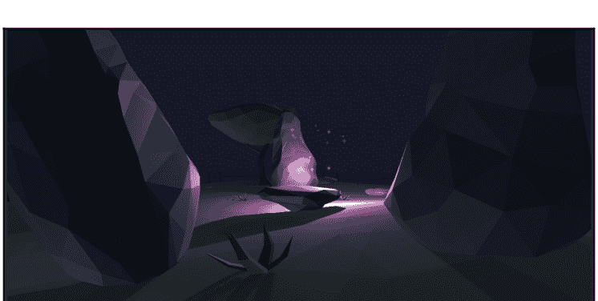
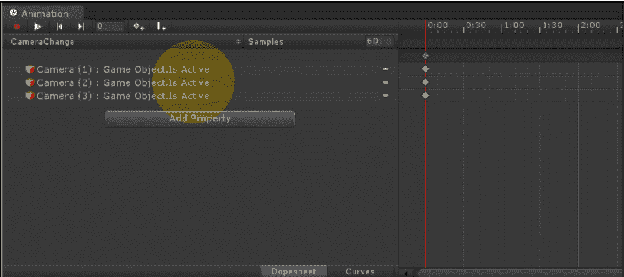
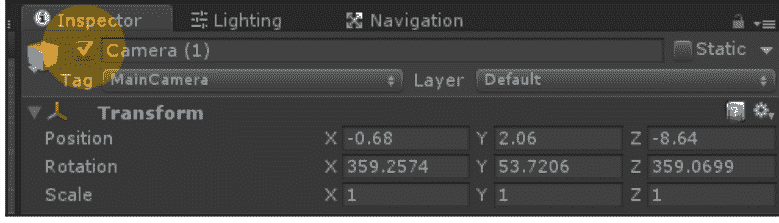
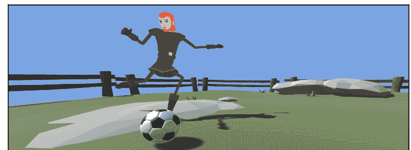
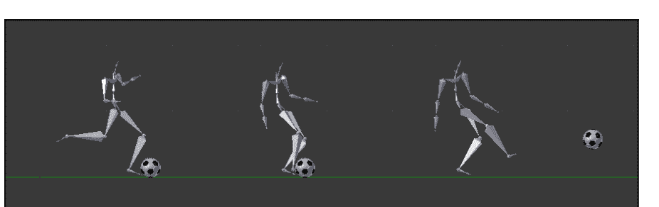
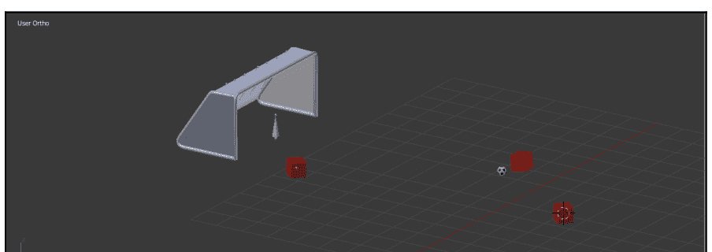
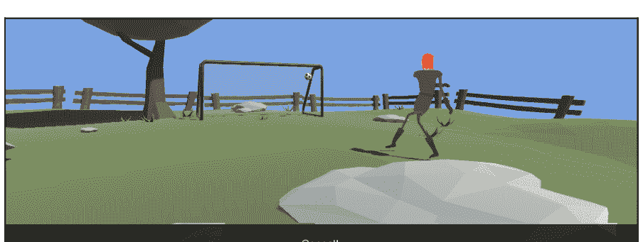
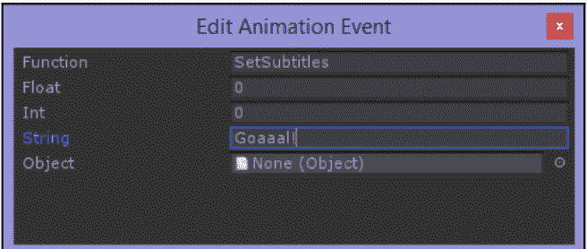
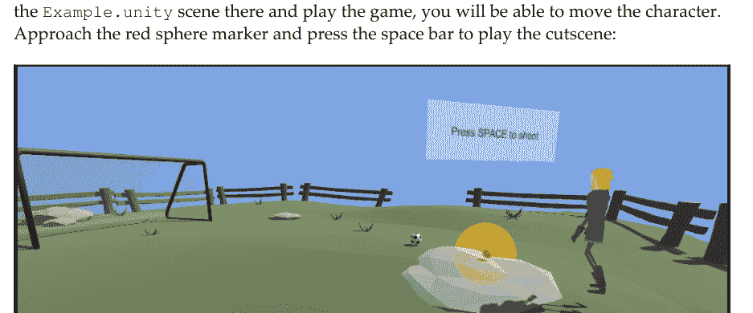

## 制作动画过场

本章解释如何在游戏中创建和播放过场动画，并涵盖以下配方：

- 使用 **动画** 视图来为摄像机制作动画
- 使用动画切换摄像机
- 同步多个对象的动画
- 从 3D 软件包导入完整的过场动画
- 同步字幕
- 使用根运动在游戏玩法中播放过场动画

### 引言

在本章中我们将处理过场动画。这些是主要用于揭晓新故事事件的短动画序列。你可以直接在 Unity 中创建大量过场动画，或从你喜欢的 3D 软件包导入动画（我们将以 Blender 3D 为例）。

## 使用动画视图来为摄像机制作动画

在本配方中，我们将使用 Unity 内置的动画视图创建摄像机动画：



### 准备工作

对于本配方我们不需要什么花哨的东西，因为我们将从头在 Unity 中创建它。场景中可能需要一些装饰。你也可以打开提供的示例 Unity 项目并进入 Chapter 08 Animating Cutscenes\Recipe 01 Using the animation view to animate the camera 目录。你可以在那里的 Example.unity 场景中找到一个动画化的 Camera (1) 游戏对象。如果播放游戏，摄像机将播放动画。

### 如何操作...

要使用动画视图创建摄像机动画，请按照以下步骤操作：

1. 选择你要制作动画的摄像机（你也可以向场景中添加一个新摄像机）。
2. 打开动画视图（转到 窗口 | 动画）。
3. 创建一个新的动画剪辑并将其命名为 `CameraAnimation`。
4. 确保记录按钮处于按下状态。
5. 移动和旋转摄像机以创建所需的动画。如果摄像机未父级化到任何游戏对象，动画将在世界空间中完成。
6. 如果你想将此动画用作过场动画，请从摄像机创建一个预制件。
7. 播放游戏以查看效果。

### 工作原理...

摄像机可以像其他游戏对象一样被制作动画。我们可以制作它们的 **变换** 动画，但此外，我们还可以制作 **摄像机** 组件的动画。这样我们就可以使用 **视野** 参数创建有趣的效果（例如示例项目中显示的简单眩晕效果）。

### 还有更多...

如果你从动画化的摄像机创建了一个预制件，你可以实例化它来播放过场动画。记住将过场摄像机的 **深度** 设置为大于游戏内摄像机的深度。这样，简单地实例化过场摄像机预制件就会自动播放过场动画。你需要做的就是在动画结束后销毁实例化的游戏对象。你可以使用与销毁对象的函数关联的动画事件来做到这一点（你需要为此使用脚本）。

你还应该记住在实例化过场摄像机时禁用游戏内摄像机中的 **音频监听器** 组件。过场动画结束后，请确保再次重新启用 **音频监听器** 组件。

## 使用动画切换摄像机

我们不仅可以使用动画视图制作摄像机动画，还可以随时间切换镜头。

### 准备工作

本配方也将从头在 Unity 中创建。你可以下载提供的示例 Unity 项目并进入 `Chapter 08 Animating Cutscenes\Recipe 02 Changing cameras with animation` 目录。你可以在那里的 `Example.unity` 场景中找到一个 **摄像机切换器** 游戏对象，其中有三个摄像机作为子对象。如果播放游戏，摄像机会切换。

### 如何操作...

要使用动画切换摄像机，请按照以下步骤操作：

1. 在场景视图中创建一个空游戏对象并将其命名为 `CameraChanger`。
2. 将 **主摄像机** 重命名为 **摄像机 (1)** 并复制两次。你应该有 **摄像机 (1)**、**摄像机 (2)** 和 **摄像机 (3)** 游戏对象。
3. 将三个摄像机都设为 **CameraChanger** 的父级。
4. 按你希望的方式放置摄像机。
5. 按递增顺序设置摄像机的 **深度**。每个新镜头都应具有更大的 **深度** 值。
6. 选择 **CameraChanger** 游戏对象并打开 **动画** 视图。
7. 创建一个新的 **动画剪辑** 并将其命名为 **CameraChange**。
8. 确保记录按钮处于按下状态。
9. 选择所有摄像机并禁用它们的游戏对象。然后选择第一个摄像机并启用其游戏对象。动画的第一帧中应创建新的键。第一个摄像机应处于活动状态，其余两个应处于非活动状态（你可以通过单击键来检查这一点）。你可能需要先将摄像机设置为活动以创建键，然后再将其设置为非活动（Unity 有时在你停用对象时不会创建键，只有在你单击启用它时才会创建键）：



包含摄像机状态（活动/非活动）的键

10. 调整时间线并激活第二个摄像机。你不需要停用第一个摄像机，但应只有一个音频监听器组件处于启用状态。
11. 再次调整时间线并激活第三个摄像机。
12. 关闭 **动画** 视图。
13. 播放动画或运行游戏以查看效果。

### 工作原理...

本配方有几个重要元素：

- **摄像机作为子对象**：所有摄像机都是 **CameraChanger** 游戏对象的子对象。这样，我们可以向 **CameraChanger** 添加 Animator 组件，并使用一个动画剪辑制作动画所有子摄像机。
- **摄像机的深度**：深度参数描述摄像机的“图层”。深度更大的摄像机将在深度较小的摄像机之上渲染。这样，我们可以在无需担心不渲染任何内容的情况下切换摄像机。
- **启用/禁用游戏对象**：我们可以使用动画启用或禁用游戏对象。我们需要做的就是单击启用复选框，如以下屏幕截图所示。始终，动画中被制作动画的参数（动画中有键）会以红色标记：



带关键帧的启用/禁用游戏对象复选框

## 同步多个对象的动画

在过场动画中，我们需要在时间上同步多个对象的动画。本配方展示了如何做到这一点。

### 准备工作

要遵循本配方，你需要一个动画化的角色和一个动画化的对象。你可以下载提供的示例 Unity 项目并进入 `Chapter 08 Animating Cutscenes\Recipe 03 Synchronizing animation of multiple objects` 目录。你可以在那里找到 `Example.unity` 场景。如果播放游戏，你将看到一个角色踢足球。两个对象都被制作了动画并且同步。你可以在 `Animations` 目录中找到所需的动画：



球和踢球角色的同步动画

### 如何操作...

要同步多个对象的动画，请按照以下步骤操作：

1. 在你的 3D 软件包中打开两个对象（在本示例中我们使用 Blender）。
2. 在 3D 软件包中同步两个对象的动画。在我们的示例中，动画大约有 160 帧。两个对象都有相同的动画长度：



3D 软件包中球和角色动画同步
3. 在本示例中，球没有骨骼动画；我们只制作其变换动画。
4. 确保在动画的第一帧和最后一帧中为球和角色都设置关键帧。这样，导入到 Unity 后动画将具有相同的长度。
5. 在 3D 软件包中同步动画后，将其保存为两个文件：一个仅包含球对象及其动画，另一个仅包含角色及其动画。Unity 可以导入多个变换动画，但导入多个骨骼动画时存在问题（例如，你将无法将骨架设置为 **人形**）。
6. 分别将两个文件导出为 FBX 格式并确保包含 **默认拍摄**。在 Blender 中，使用 FBX 的 6.1 版本。
7. 将两个文件导入 Unity。
8. 如果你想使用 **人形** 角色，请确保在 **动画导入设置** 中将所有 **基于** 选项设置为 **原始**。
9. 为球创建一个 Animator 控制器，为角色创建一个带有足球踢击动画的控制器。
10. 将球和角色放置在场景中的同一位置。将 Animator 控制器附加到它们。
11. 播放游戏以查看效果。

### 工作原理...

同步过场动画的最佳方法是确保它们具有相同的长度并且在 3D 软件包中同步。如果我们在 Unity 中导入它们并在同一时刻开始播放，它们将保持同步。

记住，如果你想使用 **人形** 骨架，你需要将角色导出为单独的文件。

### 还有更多...

你也可以使用动画事件同步动画。在我们的示例中，我们可以从角色被踢的时刻创建球动画，并使用角色踢击动画中的动画事件过渡到它。虽然这是可能的，但这比在 3D 软件包中同步整个过场动画更麻烦。


## 从 3D 软件导入完整的过场动画

在 Unity 中创建过场动画的最佳方式是从 3D 软件导入完整的动画。我们在之前的食谱中做过类似的事情（在导入到 Unity 之前在 3D 软件中同步动画）。在这里我们将创建一个带有摄像机动画的完整过场动画。

### 准备工作

对于本食谱，我们需要与上一食谱相同的角色，并带有 *kicking the ball* 动画。此外，我们在动画中添加了三个简单的立方体。这些立方体是动画化的，表示摄像机。我们使用立方体而不是空对象或摄像机，是因为 Unity 在导入既不是骨架也不是具有网格渲染器的对象时有时会出现问题：



Blender 中的过场动画对象。红色立方体保存摄像机位置

你也可以前往 `Chapter 08 Animating Cutscenes\Recipe 04 Importing a whole cutscene from a 3D package` 目录。你可以在那里找到 `Example.unity` 场景。如果运行游戏，你会看到一个角色踢足球。摄像机会随动画进程进行动画并切换。你可以在 `Animations` 目录中找到所有需要的动画。

### 操作方法

要从 3D 软件导入完整的过场动画，请按照以下步骤操作：

- 1. 在 3D 软件中创建过场动画。记住所有对象的动画长度应相同。它们应在第一帧和最后一帧上都有关键帧。
- 2. 如果计划使用 **Humanoid** 骨架，请在导入 Unity 之前将每个角色保存为单独的文件。
- 3. 将过场动画导入 Unity（如果需要，还包括所有角色）。使用 **Generic** 骨架的所有对象可以一起导出为一个文件。在这种情况下，会为整个过场动画创建一个 **Generic** 骨架。
- 4. 如果你使用 Blender 并希望将过场动画导出为 FBX 格式，请使用 6.1 版本并确保勾选 **Default Take** 选项。
- 5. 在 **Import Settings** 中进入 **Animation** 选项卡。
- 6. **Default Take** 包含整个过场动画。你可能会在 Animation 选项卡中看到额外的片段（尤其是在使用骨骼动画时）。不要使用它们。你可以从导入设置中删除它们，并将 **Default Take** 片段名称更改为更具描述性的名称。
- 7. 如果角色使用 **Humanoid** 骨架，请从单独的文件中逐一导入它们。
- 8. 为过场动画创建一个 **Animator Controller**，并为每个角色创建一个（如果使用 **Humanoid** 骨架）。
- 9. 将过场动画放置在控制器中。
- 10. 将所有对象放置在场景的同一位置。
- 11. 如果你想为摄像机做动画，为过场动画的每个镜头创建一个摄像机。
- 12. 将摄像机设为过场动画中动画化的摄像机持有对象的子对象。你可能需要调整摄像机旋转。
- 13. 我们的摄像机是摄像机持有对象（以及过场动画对象）的子对象。但动画是导入的且只读。因此，我们无法像 *Changing cameras with animation* 食谱中那样更改摄像机。我们需要在过场动画的根对象（带有 Animator 组件的对象）上添加一个脚本。创建一个新脚本并命名为 `CutsceneCameraChanger.cs`。在此脚本中，我们有一个所有过场动画摄像机的列表，以及一个 `public void ChangeCamera()` 动画事件，该事件根据给定的 `int newCameraIndex` 参数更改摄像机。它会禁用列表中的其他所有摄像机：
```
public void ChangeCamera (int newCameraIndex)
{
for (int i = 0; i < cutsceneCameras.Length; i++)
{
    cutsceneCameras[i].gameObject.
        SetActive(false);
}
    cutsceneCameras[newCameraIndex].gameObject.
        SetActive(true);
}
```
- 14. 将脚本分配给过场动画的根对象。
- 15. 打开过场动画的 **Animation Import Settings**。
- 16. 将时间线调整到你想要切换镜头的位置。
- 17. 添加 Animation Events 以启用适当的摄像机并切换镜头。使用 `int` 参数为 `ChangeCamera` 函数提供 `newCameraIndex`。记住将摄像机的 **Depth** 参数设置为高于游戏摄像机。
- 18. 应用 **Animation Import Settings** 并禁用每个摄像机持有对象的 **Mesh Renderer** 组件，以便它们在游戏中不可见。
- 19. 运行游戏以查看效果。

### 工作原理

Unity 可以将整个过场动画作为单个资源导入。你可以用大量对象和角色制作过场动画，然后导出为 FBX（如果你使用 Blender，也可以直接保存文件）。导入后，**Default Take** 包含整个动画。你无法更改动画（它是只读的），但可以使用脚本通过 Animation Events 启用/禁用摄像机。不过你需要在 Animation Import Settings 中添加事件。

如果你计划为不同角色重用动画，需要将过场动画中的每个骨架作为单独文件导出。只有这样才能将其设置为 **Humanoid**。

你无法从 3D 软件导出粒子系统。仅支持变换和骨骼动画。你需要在 Unity 中创建 VFX 并使用 Animation Events 与过场动画同步。音效也适用相同规则。我们在第 7 章《Special Effects》的 *Using Animation Events to trigger sound and visual effects* 食谱中做过此事。

### 还有更多

根据 Unity 的路线图，Director 工具计划在 5.x 时间表中的某个时候推出。它可能会使在 Unity 中制作过场动画变得更容易。但对于习惯使用自己喜欢的 3D 软件的动画师来说，导入完整的过场动画仍然可能是首选方案。

## 同步字幕

在本食谱中，我们创建字幕并将其与动画同步：



与动画同步的字幕

### 准备工作

在本食谱中，我们将使用与上一食谱相同的过场动画。你也可以打开示例 Unity 项目并前往 `Chapter 08 Animating Cutscenes\Recipe 05 Synchronizing subtitles` 目录。如果在那里打开 `Example.unity` 场景并运行游戏，你会看到随动画同步变化的字幕。

### 操作方法

要将字幕与过场动画同步，请按照以下步骤操作：

- 1. 按照上一食谱中的方式导入过场动画。
- 2. 创建一个新的 Image（前往 Game Object | UI | Image）。
- 3. 将其命名为 SubtitlesContainer。
- 4. 创建一个新的 Text 游戏对象并将其设为 SubtitlesContainer 的子对象。为此，右键单击 SubtitlesContainer 并选择 UI | Text。
- 5. 将 SubtitlesContainer 的 Image 组件颜色更改为半透明黑色。将 Text 组件的颜色更改为白色。按需调整对象的位置和大小。
- 6. 将模型放置在场景中。
- 7. 创建一个新的脚本并命名为 Subtitles.cs。此脚本有一个 string subtitlesText 变量，我们将在其中存储字幕中显示的文本。它还具有对 SubtitlesContainer 和 Text 游戏对象的公共引用：public GameObject subtitlesContainer 和 public Text textComponent。此脚本有一个 public void SetSubtitles(string text) 函数。它从 Animation Event 调用并用于设置 subtitlesText 变量的值：
```
public void SetSubtitles(string text)
{
    subtitlesText = text;
}
```
- 8. 在此脚本的 Update() 函数中，我们检查 subtitlesText 变量是否包含任何文本。如果有，我们启用 SubtitlesContainer 游戏对象并设置 Text 游戏对象以显示我们的字幕。如果 subtitlesText 为空字符串，我们禁用 SubtitlesContainer：
```
if (string.IsNullOrEmpty(subtitlesText)
&& subtitlesContainer.activeSelf)
{
    subtitlesContainer.SetActive(false);
}
else if (!string.IsNullOrEmpty(subtitlesText)
&& !subtitlesContainer.activeSelf)
{
    subtitlesContainer.SetActive(true);
}
else
{
```


```
textComponent.text = subtitlesText;
}
```

- 9. 将脚本附加到过场动画游戏对象（拥有 Animator 组件并为所有道具做动画的对象）上。
- 10. 打开过场动画的动画导入设置。
- 11. 你可以在时间线上拖动并添加动画事件。
- 12. 添加一个动画事件并将函数命名为 SetSubtitles。在 String 参数中输入你想要显示为字幕的文本，如以下截图所示：
- 13. 如果你想让字幕消失，添加一个 SetSubtitles 动画事件并将 String 参数留空。
- 14. 应用动画导入设置。
- 15. 运行游戏查看效果。



SetSubtitles 动画事件，文本为 "Gooaal!"

## 工作原理...

在本教程中，我们使用动画事件将字幕与过场动画同步。其原理与第 7 章《特殊效果》中《使用动画事件触发音效和视觉效果》教程相同。`Subtitles.cs` 脚本还根据通过动画事件调用的 `public void SetSubtitles(string text)` 函数所设置的 `subtitlesText` 变量的值来处理字幕的显示和隐藏。

如果你想本地化字幕，请使用字符串本地化键而不是文本。然后 `Subtitles.cs` 脚本需要使用这些键在你的本地化库中查找文本。

## 使用根运动在游戏过程中播放过场动画

我们也可以在不改变摄像机的情况下在游戏过程中播放过场动画，并使用平滑过渡进入和退出过场动画。本教程展示了该方法的示例。

### 准备工作

在本教程中，我们将使用与上一教程相同的过场动画。你也可以打开示例 Unity 项目并进入 `Chapter 08 Animating Cutscenes\Recipe 06 Using root motion to play cutscenes during gameplay` 目录。如果在那里打开 `Example.unity` 场景并运行游戏，你将能够移动角色。靠近红色球体标记并按下空格键即可播放过场动画：



游戏过程中播放的过场动画

### 操作方法...

要在游戏过程中播放过场动画，请按以下步骤操作：

- 1. 导入你的过场动画。确保将角色动画作为单独文件导入。
- 2. 进入过场动画资源导入设置中的动画选项卡。
- 3. 将 Default Take 动画重命名为 Cutscene。
- 4. 创建一个新的动画剪辑，选择 Default Take 作为源，并将起始帧设为 0、结束帧设为 1。将此动画命名为 CutsceneIdle 并使其循环播放。
- 5. 将过场动画游戏对象（在我们的示例中是 Ball 游戏对象）和角色放置在场景中。
- 6. 按照第 4 章《角色移动》中的《使用根运动控制角色》教程操作。这样你将拥有一个可控制的移动角色。
- 7. 为过场动画创建一个 Animator Controller。
- 8. 将 CutsceneIdle 设为默认动画。
- 9. 拖放 Cutscene 动画。
- 10. 创建一个 Trigger 参数并将其命名为 Cutscene。
- 11. 使用 Cutscene Trigger 参数从 CutsceneIdle 到 Cutscene 动画创建过渡。将 Has Exit Time 设为 false，Transition Duration 设为 0.1 秒。
- 12. 将 Player 标签分配给角色。
- 13. 将过场动画添加到角色的 Animator Controller 中。在我们的示例中，动画名为 SoccerKick。
- 14. 在角色的控制器中添加一个 Cutscene Trigger 参数。
- 15. 使用 Cutscene Trigger 作为条件从 Any State 创建到 SoccerKick 的过渡。Has Exit Time 应设为 false，Transition Duration 设为约 0.5 秒。
- 16. 再添加一个从 SoccerKick 到 Idle 的过渡，无条件，Has Exit Time 设为 true。Transition Duration 也应设为约 0.5 秒。
- 17. 创建一个新的 C# 脚本并命名为 CutsceneTrigger.cs。在此脚本中，我们有 void OnTriggerEnter() 和 void OnTriggerExit() 函数。它们的主要任务是设置 bool inTrigger 标志。OnTriggerEnter() 函数还存储对玩家游戏对象的引用：
```
void OnTriggerEnter (Collider other) {
    if (other.gameObject.CompareTag("Player"))
    {
        player = other.gameObject;
        inTrigger = true;
    }
}
void OnTriggerExit(Collider other)
{
    if (other.gameObject.CompareTag("Player"))
    {
        inTrigger = false;
    }
}
```
- 18. 我们在 Update() 函数中检查 inTrigger 标志的值。如果其设为 true，玩家可以按空格键开始过场动画。这会启动一个协程，使角色的位置和旋转与触发器的位置和旋转匹配。此位置和旋转是角色在过场动画开始时应具有的位置和旋转。我们还会启用或禁用提示，其引用存储在 public GameObject onScreenInfo 变量中。当玩家开始过场动画时，我们关闭 Box Collider 组件以禁用触发器：
```
if (inTrigger)
{
    onScreenInfo.SetActive(true);

    if (Input.GetKeyDown(KeyCode.Space))
    {
        GetComponent<BoxCollider>().enabled = false;
        inTrigger = false;
        StartCoroutine("StartCutscene");
    }
}
else
{
    onScreenInfo.SetActive(false);
}
```
- 19. 在 IEnumerator StartCutscene() 协程中，我们首先将角色的 Rigidbody 组件设为 Kinematic。这样我们就关闭了物理模拟。然后我们插值玩家的位置和旋转，使其与触发器的位置和旋转匹配。如果足够接近，我们就在玩家和过场动画的 Animator 组件中设置 Cutscene Trigger，以便在两个对象上同时播放动画：
```
IEnumerator StartCutscene()
{
    player.GetComponent<Rigidbody>().isKinematic = true;
    bool positionAdjusted = false;
    bool rotationAdjusted = false;
    while(true)
    {
        yield return null;
        if ((player.transform.position -
        transform.position).magnitude <= 0.01f)
        {
            positionAdjusted = true;
        }
        else
        {
            player.transform.position =
            Vector3.Lerp(player.transform.position,
            transform.position, positionAdjustmentSpeed
            * Time.deltaTime);
        }
        if (Vector3.Angle(player.transform.forward,
        transform.forward) <= 1f)
        {
            rotationAdjusted = true;
        }
        else
        {
            player.transform.rotation =
            Quaternion.Lerp(player.transform.rotation,
            transform.rotation, positionAdjustmentSpeed
            * Time.deltaTime);
        }
        if (positionAdjusted && rotationAdjusted)
        {
            break;
        }
    }
    player.GetComponent<Animator>
    ().SetTrigger(animationTrigger);
    cutsceneAnimator.SetTrigger(animationTrigger);
}
```
- 20. 创建一个新的空游戏对象并将其命名为 `CutsceneTrigger`。为其添加 **盒状碰撞体** 组件并将其设为 **是否触发**。
- 21. 将其放置在角色在过场动画中必须所在的确切位置。将其旋转方式与角色所需旋转方式相同。你可以使用过场动画中的空对象（从 3D 软件导出）来简化操作。
- 22. 将 `CutsceneTrigger.cs` 脚本分配给 **CutsceneTrigger** 游戏对象。
- 23. 创建一个提示 UI 文本并将其分配给 **Cutscene Trigger** 组件的 **On Screen Info** 字段。
- 24. 将过场动画游戏对象的 **Animator** 组件分配给 **Cutscene Trigger** 组件的 **CutsceneAnimator** 字段。
- 25. 再创建一个 C# 脚本并命名为 `SetKinematic.cs`。在此脚本中，我们只有一个 `public void NotKinematic()` 函数，其中我们将 **Rigidbody** 组件设为非运动学：
- 26. 将脚本附加到角色。
- 27. 在选中角色的情况下，打开 **Animation** 视图。
- 28. 选择 **SoccerKick** 动画。
- 29. 在动画接近结尾处添加一个 **Animation Event** 并选择 **NotKinematic()**。这将使角色再次对物理做出反应。
- 30. 运行游戏，靠近触发器并按空格键查看效果。
```
public void NotKinematic()
{
    GetComponent<Rigidbody>().isKinematic = false;
}
```

### 工作原理...

本教程使用与 `Chapter 5, Characters Actions and Expressions` 中 *行动点 – 在指定位置执行动作* 教程相同的概念。这里我们为动画道具（在我们的示例中是 Ball 游戏对象）添加了一个一帧循环的 CutsceneIdle 动画。这使得对象等待过场动画开始。我们的角色过场动画以单独文件导出，这使我们能够将其骨架设为 **Humanoid** 并与其他动画一起使用。

我们的角色与过场动画游戏对象在同一时刻开始播放动画。这使它们同步。

另一件重要的事情是，我们在过场动画期间将角色的 **Rigidbody** 组件设为 **Is Kinematic**。这使得动画以 100% 的权重控制我们的角色。没有碰撞可以打断角色播放动画。过场动画结束后，我们关闭 **Is Kinematic** 选项以使角色恢复正常行为。


## 9