## 物理和动画

本章介绍了 Unity 的 5 物理引擎及其可实现的功能。它涵盖了以下配方：
- 使用布料
- 使用刚体关节
- 可破坏物体
- 使用布娃娃向导创建人形布娃娃
- 使用角色关节创建通用布娃娃
- 对布娃娃施加力
- 截肢
- 从布娃娃状态站起

### 引言

Unity 的物理引擎可用于创建有趣的效果以及游戏玩法机制。之前我们使用刚体来移动角色并检测碰撞。在本章中，我们将重点关注刚体和物理的更具视觉吸引力的方面。

## 使用布料

在本配方中，我们将创建一个简单的布料模拟：

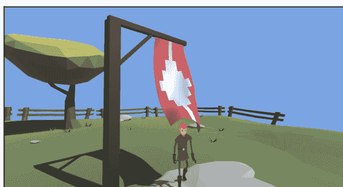

用于创建旗帜的布料模拟

### 准备工作

对于本配方，我们需要一个布料模型。它应该是一个平面并多次细分，以拥有足够多的顶点供布料模拟使用。在我们的示例中，我们使用了一个额外的模型：旗杆。您可以前往 Chapter 09 Physics and animations\Recipe 01 Using cloth 目录。在那里，您会在 Example.unity 场景中找到一个 FlagPole 游戏对象。该对象包含 Flag 和 FlagPole 对象作为子对象。Flag 游戏对象使用布料模拟。

### 如何操作...

要使用布料模拟，请按照以下步骤操作：
- 1. 将 Flag 游戏对象放置到场景中。
- 2. 为 Flag 游戏对象添加 Cloth 组件（前往 Component | Physics | Cloth）。
- 3. 注意会自动添加一个 **蒙皮网格渲染器** 组件。您可以从对象中移除 **网格渲染器** 组件。
- 4. 找到 **Flag** 的网格并将其拖到 **蒙皮网格渲染器** 组件中的 **网格** 字段。如果您的游戏对象仍有 **网格过滤器** 组件，您可以点击其附加的网格，它将在 **项目视图** 中显示。这使得找到我们需要的网格更容易。
- 5. 如果您的游戏对象仍附加了 **网格过滤器** 组件，您可以将其移除。
- 6. 您可能需要为 **Flag** 游戏对象添加材质。如果缺少材质，请将适当的材质拖入 **蒙皮网格渲染器** 中的 **材质** 部分。
- 7. 在 **检视面板** 中进入 Cloth 组件设置并点击 **编辑约束** 按钮，如以下屏幕截图所示：
- 8. **布料约束** 窗口将会出现，如以下屏幕截图所示：

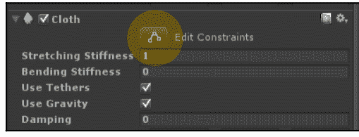

编辑约束按钮

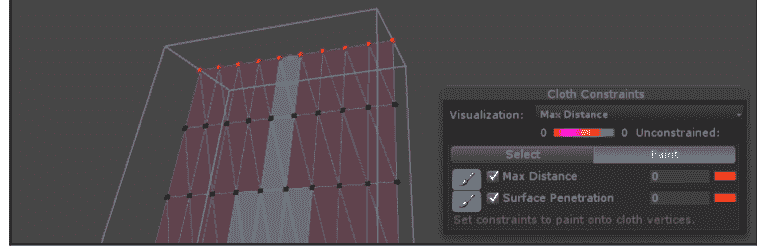

编辑约束
- 9. 它用于约束布料的移动。要将布料固定到某物上，请选择 **绘制** 选项卡并点击 **最大距离** 复选框。通过左键点击顶点，您可以将其涂成红色，这意味着其移动完全受约束。您可以选择其他颜色使布料略微移动。黑色表示没有任何约束。
- 10. 绘制至少一个顶点后，您可以切换到 **选择** 选项卡。在此选项卡中，您可以框选顶点。选择一组顶点后，您可以勾选 **最大距离** 复选框并一次性为所有选定顶点编辑值。
- 11. 如果无法选择或绘制顶点，请旋转视图——您可能正在从背面查看网格。选择和绘制仅在正面有效，除非在 **可视化** 下拉菜单中勾选 **操作背面** 选项。
- 12. 我们的 Flag 的方向是自上而下（其顶部固定在杆上）。因此我们应选择所有顶部顶点并将其涂成红色（将 **最大距离** 设置为 0）。在您的情况下，您可能希望固定其他顶点。
- 13. 要移除对某个顶点的约束，请选择它（您需要在 **选择** 选项卡中）并取消勾选 **最大距离** 复选框。顶点将变为黑色，这意味着它不再受约束。
- 14. 要使 **Flag** 与其他游戏对象发生碰撞，请前往 Cloth 组件设置中的 **胶囊碰撞体** 和 **球形碰撞体** 数组。您可以在此处添加场景中存在的 **球形碰撞体** 或 **胶囊碰撞体**。**布料** 只能与这两种类型的碰撞体发生碰撞。
- 15. 播放游戏以查看效果。

### 原理...

布料模拟使用网格的顶点来模拟布料般的行为。网格需要足够密集才能使模拟看起来良好。本示例中使用的旗帜有 100 个顶点。

**布料** 组件有许多可使用和调整的选项：
- **拉伸刚度**：布料在拉伸时的刚度。
- **弯曲刚度**：布料在弯曲时的刚度。
- **使用系绳**：这有助于防止未约束的顶点远离受约束的顶点
- **使用重力**：这会将重力应用于布料顶点。
- **阻尼**：这会阻尼布料顶点的运动。
- **外部加速度：** 这是布料顶点恒定的加速度，可用于模拟风。
- **随机加速度：** 这与前一个选项类似，但为随机。它可用于模拟风。
- **世界速度缩放：** 这会缩放布料所附着物体的世界速度。它适用于角色的服装。
- **世界加速度缩放：** 当布料所附着的物体加速时，这会缩放布料顶点的世界加速度。它适用于角色的服装。
- **摩擦：** 布料顶点与物体碰撞时应用的摩擦。
- **碰撞质量缩放：** 布料顶点在碰撞时质量的缩放。
- **使用连续碰撞：** 这与刚体的连续碰撞检测类似，可提高碰撞质量但会增加性能开销。
- **使用虚拟粒子：** 这会为每个布料三角形添加一个虚拟粒子/顶点并提高碰撞质量。
- **求解器频率：** 每秒求解器迭代次数。
- **休眠阈值：** 布料停止模拟（休眠）后的阈值。
- **胶囊碰撞体：** 用于碰撞的胶囊碰撞体数组。
- **球形碰撞体：** 用于碰撞的球形碰撞体数组。

### 了解更多...

布料最适合单面平面网格（细分平面）。它也可以用于薄的细分盒子。避免使用面法线反转的复制平面（这会产生两个布料片，它们会不断相互碰撞）。

为获得最佳效果，您应在单面平面网格上使用某种双面着色器。您可以使用示例项目提供的简单着色器；您可以在 `Textures materials and shaders\Shaders` 目录中找到它。它不支持阴影。您也可以在 Asset Store 中找到好的双面着色器；我可以推荐由 Mario Lelas 创建的 **Double Sided Standard Mobile Legacy Shaders** 包。

布料组件可与任何蒙皮网格渲染器一起使用。因此您可以使角色的某些部分作为布料进行模拟。最佳做法是拥有第二个仅包含布料网格的蒙皮网格渲染器（这样约束此类网格会比尝试约束整个角色容易得多）。

## 使用刚体关节

在本配方中，我们将创建两个具有物理模拟的物体：绳索和门。我们将使用刚体关节来约束这些物体的移动和旋转。

### 准备工作

对于本配方，我们需要四个模型：一个 **RopePole**（类似于上一配方中的那个）、一个带有包含约 10 个骨骼的 **RopeRig** 的蒙皮 **Rope**、一个 **Frame** 以及两个门，**DoorLeft** 和 **DoorRight**（类似于沙龙中那种旋转门）。我们还需要一个带有刚体的角色来与我们的物体发生碰撞。您可以前往 `Chapter 09 Physics and animations\Recipe 02 Using rigid body joints` 目录。您将在 `Example.unity` 场景中找到所有这些物体。播放游戏时，尝试用我们的角色行走并与绳索和门发生碰撞以查看效果。

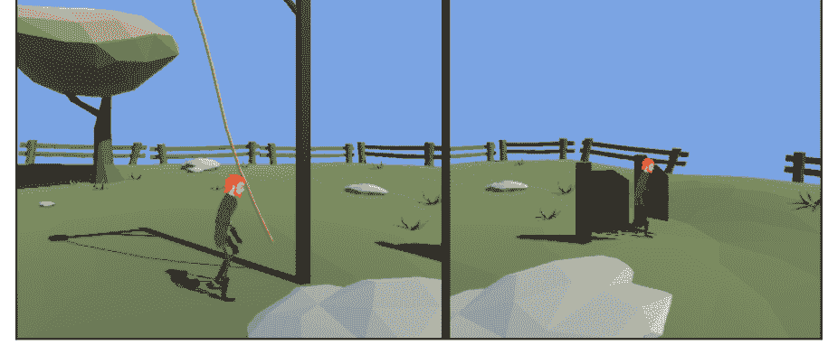

绳索和旋转门


## 如何操作...

使用刚体关节，请按以下步骤操作：

- 1. 将我们的摆动门导入 Unity。模型应包含三个对象：**框架**、**左门**和**右门**。
- 2. 将对象放置在场景中，并将它们全部设为一个空游戏对象的子对象，您可以将其命名为**摆动门**。
- 3. 在**框架**游戏对象上添加一个**网格碰撞体**，以防止我们的角色穿过它。
- 4. 在**左门**游戏对象上添加一个**方框碰撞体**或设置为**凸**的**网格碰撞体**。
- 5. 在**左门**游戏对象上添加一个**刚体**组件。
- 6. 向**左门**添加一个**铰链关节**组件。
- 7. 将**轴**参数设置为 0 X、1 Y 和 0 Z。这是我们的**铰链关节**可以旋转的轴。
- 8. 勾选**使用限制**选项，并将**最小值**设置为 -120，**最大值**设置为 120（具体限制在您的情况下可能有所不同）。这些值描述了我们的**铰链关节**从中性位置可以旋转的范围。
- 9. 如果您希望门在被推动后回到原始位置，请勾选**使用弹簧**选项。
- 10. 将**弹簧**参数设置为 1，**阻尼器**设置为 0.5（您可能需要尝试具体数值）。
- 11. 对**右门**游戏对象重复步骤 4-10。
- 12. 运行游戏并让其他任何刚体与门发生碰撞以查看效果（如果您的角色使用刚体物理移动，也可以[content]
## 如何操作...

使用刚体关节，请按以下步骤操作：

- 1. 将我们的摆动门导入 Unity。模型应包含三个对象：**框架**、**左门**和**右门**。
- 2. 将对象放置在场景中，并将它们全部设为一个空游戏对象的子对象，您可以将其命名为**摆动门**。
- 3. 在**框架**游戏对象上添加一个**网格碰撞体**，以防止我们的角色穿过它。
- 4. 在**左门**游戏对象上添加一个**方框碰撞体**或设置为**凸**的**网格碰撞体**。
- 5. 在**左门**游戏对象上添加一个**刚体**组件。
- 6. 向**左门**添加一个**铰链关节**组件。
- 7. 将**轴**参数设置为 0 X、1 Y 和 0 Z。这是我们的**铰链关节**可以旋转的轴。
- 8. 勾选**使用限制**选项，并将**最小值**设置为 -120，**最大值**设置为 120（具体限制在您的情况下可能有所不同）。这些值描述了我们的**铰链关节**从中性位置可以旋转的范围。
- 9. 如果您希望门在被推动后回到原始位置，请勾选**使用弹簧**选项。
- 10. 将**弹簧**参数设置为 1，**阻尼器**设置为 0.5（您可能需要尝试具体数值）。
- 11. 对**右门**游戏对象重复步骤 4-10。
- 12. 运行游戏并让其他任何刚体与门发生碰撞以查看效果（如果您的角色使用刚体物理移动，也可以将其使用）。

使用**铰链关节**创建绳索，请按以下步骤操作：

- 1. 将我们的蒙皮**绳索**模型导入 Unity。绳索应具有足够多的骨骼来模拟其行为（大多数情况下 10-20 根就足够了）。确保骨骼大小相同或相似且未相互设为父对象（这样编辑会更容易）。
- 2. 将**绳索**模型放置在场景中。
- 3. 进入**绳索骨架**游戏对象并选择所有骨骼。
- 4. 向骨架中的所有骨骼添加**胶囊碰撞体**、**刚体**和**铰链关节**组件。
- 5. 在选择所有骨骼的情况下，使用检查器缩放**胶囊碰撞体**以适应骨骼大小。
- 6. 确保在每个骨骼的**铰链关节**设置中选中了**自动配置连接锚点**选项。
- 7. 对每个骨骼查找其**铰链关节**设置。将下一个骨骼拖放到前一个骨骼的**连接体**字段中。例如，如果您有一个包含五个骨骼的骨架，**骨骼1**、**骨骼2**、**骨骼3**、**骨骼4**、**骨骼5**。**骨骼5**是顶部的骨骼——将**骨骼5**拖放到**骨骼4**的**铰链关节**设置中的**连接体**字段。将**骨骼4**拖放到**骨骼3**的**铰链关节**设置中的**连接体**字段，以此类推。让顶部骨骼的**连接体**字段保持为空——这将限制其在空间中的移动。
- 8. 您可能还需要调整**限制**和**轴**字段。旋转轴应指向与骨骼指向相同的方向。如果您选择一个带有**铰链关节**的游戏对象，您可能会看到旋转轴作为一个小棕色箭头。
- 9. 禁用或移除**绳索**游戏对象上的**动画器**组件。
- 10. 运行游戏并与绳索发生碰撞以查看效果。

## 其工作原理...

在本教程中，我们使用了铰链关节——Unity 中的一种关节类型。这些关节限制刚体运动。如果我们将它们用于蒙皮网格渲染器的骨架上，我们可以为其引入物理模拟（如我们对绳索所做的）。铰链关节有几个有趣的参数：

- **连接体**：我们可以通过将对象放入此字段将其连接到另一个刚体。连接的对象可以形成绳索、链条和其他有趣的结构。
- **锚点**：关节可以在其周围旋转的定义局部空间位置。
- **轴**：这指定了关节可以旋转的轴。
- **自动配置连接锚点**：如果我们勾选此项，连接锚点将自动配置以匹配连接体的锚点。
- **连接锚点**：在这里我们可以手动配置连接体位置（我们必须先禁用**自动配置连接锚点**）。
- **使用弹簧**：如果勾选此选项，关节将表现得好像附着了一个弹簧。它将尝试回到其**目标位置**（请参阅本列表后面的内容）。
- **弹簧**：这是弹簧的力。
- **阻尼器**：这会阻尼由弹簧力引起的运动。对象将随着时间减速直至完全停止。
- **目标位置**：这是关节弹簧想要拉动对象的目标角度。
- **使用马达**：这使对象围绕其关节**轴**旋转。
- **目标速度**：这是对象在旋转时想要达到的速度。
- **力**：这是应用于对象以达到**目标速度**的力。
- **自由旋转**：启用此选项时，对象不会尝试减速以匹配**目标速度**，它只会加速。
- **使用限制**：如果您想限制对象围绕其关节**轴**的旋转，请启用此选项。
- **最小值**：这是最低旋转限制。
- **最大值**：这是最高旋转限制。
- **弹性**：对象达到旋转限制时弹跳的程度。
- **接触距离**：它使限制*具有一定的宽度*以减少抖动。在此距离内，关节将与给定的限制接触。
- **断裂力**：这是破坏关节所需的力，如果您想撞开门则很有用。
- **断裂扭矩**：与前者类似，这是破坏关节所需的扭矩。
- **启用碰撞**：这会在连接到关节的刚体之间启用碰撞。
- **启用预处理**：这用于稳定无法实现的情况。

## 可破坏对象

在本教程中，我们将创建一个简单的可破坏对象。

## 准备工作

要遵循本教程，您需要一个具有两种状态的对象：正常和破碎。破碎的对象是正常对象的切割成块版本。破碎对象的每个碎片都应是一个单独的游戏对象。请参阅以下屏幕截图（我们使用 Blender 破碎工具对一个简单的球体进行破碎）：

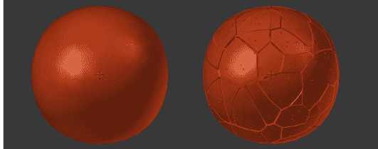

正常球体和破碎的球体：每个破碎元素都是一个单独的游戏对象

您也可以下载提供的示例 Unity 项目并进入 `Chapter 09 Physics and animations\Recipe 03 Destructible objects` 目录。您可以在那里找到 `Example.unity` 场景。如果您运行游戏，您将看到一个球体掉落。当它撞击地面时，它会被破碎成碎片。

## 如何操作...

要创建可破坏对象，请按以下步骤操作：

- 1. 将正常和破碎的对象导入 Unity。在我们的示例中，我们有一个名为**球**的对象，另一个名为**破碎球**。
- 2. 将两个对象都拖放到场景中。
- 3. 选择**破碎球**游戏对象的所有子游戏对象（碎片）。向它们添加**刚体**和**网格碰撞体**组件。将**网格碰撞体**设置为**凸**。
- 4. 从**破碎球**游戏对象（包含所有碎片）创建一个预制件。
- 5. 选择**球**游戏对象并向其添加一个**刚体**和一个**球形碰撞体**（或根据对象形状使用其他类型）。
- 6. 编写一个新的 C# 脚本并将其命名为 `SpawnFracturedObject.cs`。在此脚本中，我们有一个 `void Fracture()` 函数，它会生成一个破碎的游戏对象预制件（我们的**破碎球**），为其所有碎片应用速度，并销毁主对象（**球**）：

```
void Fracture()
{
    GetComponent<Collider>().enabled = false;
    GameObject fracturedObject =
        (GameObject)GameObject.Instantiate(fracturedObject
```


```
Prefab, transform.position, transform.rotation);
Rigidbody[] rigidBodies =
fracturedObject.GetComponentsInChildren<Rigidbody> ();
for (int i = 0; i < rigidBodies.Length; i++)
{
    rigidBodies[i].velocity +=
    lastRigidBodyVelocity;
}
Destroy(gameObject);
}
```

7. void Fracture() 函数在我们的主对象与任何物体发生碰撞时被调用：

```
void OnCollisionEnter(Collision col)
{
    Fracture();
}
```

8. 球的速度每帧都会保存到 float 类型的 lastRigidBodyVelocity 变量中（在 FixedUpdate() 函数中）：

```
void FixedUpdate () {
    lastRigidBodyVelocity = rb.velocity;
}
```

9. 将脚本分配给 Ball 游戏对象，并将 BallFractured 预制体拖到 Inspector 中的 Fractured Object Prefab 字段上。

10. 运行游戏以查看效果：

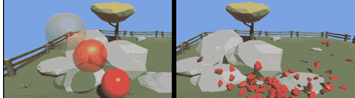

碰撞前后

## 如何工作...

两个对象，一个正常的和一个由多个碎片构成的破碎对象。正常对象在游戏中像其他任何游戏对象一样工作。破碎游戏对象仅在我们销毁正常对象时才生成。我们每帧保存正常对象的速度（在本例中为其刚体速度），以便将该速度添加到生成的破碎碎片上。这使得它们在正常对象被销毁后仍能继续运动。

在本教程中，我们创建了两个对象，一个正常的和一个由多个碎片构成的破碎对象。正常对象在游戏中像其他任何游戏对象一样工作。破碎游戏对象仅在我们销毁正常对象时才生成。我们每帧保存正常对象的速度（在本例中为其刚体速度），以便将该速度添加到生成的破碎碎片上。这使得它们在正常对象被销毁后仍能继续运动。还有更多内容……

你可以使用这种简单技术创建更复杂的物体（例如可破坏的木桶，其中每块木板都是一个单独的物体就是一个很好的例子）。Asset Store 上也有不同的破碎系统可用（尝试搜索“fracture”、“shatter”或“destructible”）。

## 使用 Ragdoll 助手创建人形布娃娃

在本教程中，我们将把角色变成布娃娃并学习如何启用和禁用布娃娃。我们将使用 Unity 内置的 Ragdoll 助手，它对于创建人形布娃娃非常有用：

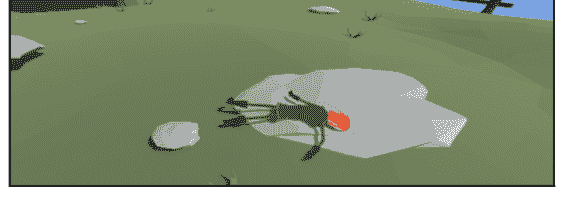

应用了布娃娃效果的角色

### 准备工作

对于本教程，我们需要一个动画角色。我们可以使用之前使用过的角色（例如来自第 4 章《角色移动》的角色）。你也可以前往 Chapter 09 Physics and animations\Recipe 04 Creating a humanoid ragdoll with ragdoll wizard 目录。你可以在那里找到 Example.unity 场景。如果运行游戏并按下空格键，角色将变成布娃娃。你可以再次按下空格键来关闭布娃娃。

### 如何操作...

要创建人形布娃娃，请按照以下步骤操作：

- 1. 将你的角色放置在场景中。
- 2. 进入 Game Object | 3D Object | Ragdoll 以打开 Create Ragdoll 窗口。
- 3. 将角色骨骼从角色骨架拖放到 Create Ragdoll 窗口中的字段中。这些字段的名称不够准确。Left Hips 表示左大腿，Left Knee 表示左小腿，LeftArm 表示左上臂，LeftElbow 表示左下臂，如以下截图所示。右侧同理。其余名称不言自明：

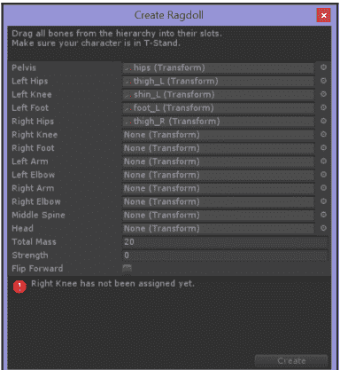

Create Ragdoll 窗口

4. 在你分配所有骨骼后，点击 **创建** 按钮。布娃娃将被创建。**刚体**、**胶囊碰撞体**（或 **盒状碰撞体**）和 **角色关节** 组件将被添加到所需的骨骼上。

5. 你可能需要调整碰撞体的大小以更好地匹配角色的形状。参见以下截图：

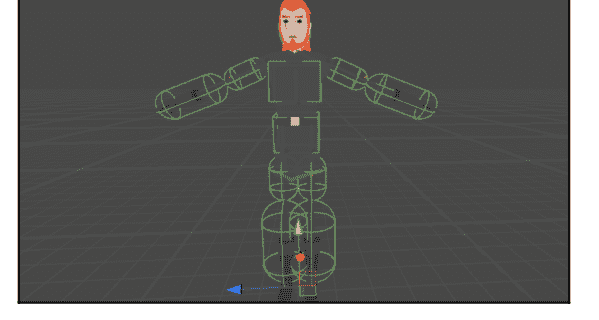

已配置的布娃娃

6. 在游戏中添加两个图层：**角色** 和 **布娃娃**。为此，进入 **编辑** | **项目设置** | **标签和图层**。

7. 将角色的图层设置为 **角色**，将其骨架及其所有子对象（布娃娃）设置为 **布娃娃**。

8. 进入 **编辑** | **项目设置** | **物理** 并禁用 **角色** 和 **布娃娃** 图层之间的碰撞。这是一种防止布娃娃与角色的主碰撞体发生碰撞的好方法，否则会导致不想要的行为（抖动、移动故障等）。

9. 创建一个新的 C# 脚本并将其命名为 `HandleRagdoll.cs`。在此脚本中，我们有 `public void EnableRagdoll(bool enable, List<Rigidbody> rigidbodies)` 函数。它遍历 `public Transform charactersRig` 变换下的所有子对象所附带的刚体，并根据 enable 标志启用或禁用它们。它还启用或禁用 `mainRigidbody` 和 `mainCollider`（附加到角色根对象上）。最后，它启用或禁用角色的 **动画器** 组件：

```
public void EnableRagdoll(bool enable, List<Rigidbody>
rigidbodies)
{
```

```
for (int i = 0; i < rigidbodies.Count; i++)
{
    rigidbodies[i].isKinematic = !enable;
}
if (mainCollider != null)
{
    mainCollider.enabled = !enable;
}
if (mainRigidbody != null)
{
    mainRigidbody.isKinematic = enable;
}
if (anim != null)
{
    anim.enabled = !enable;
}
```

- 10. 我们在玩家每次按下空格键时调用此函数。在游戏开始时，我们收集附加到角色骨架子对象上的所有刚体并将它们存储在全局列表中。我们每次调用时都将该列表传递给 `EnableRagdoll()` 函数。我们还在游戏开始时使用 `enable` 参数设置为 `false` 调用 `EnableRagdoll()` 函数。这会禁用布娃娃。
- 11. 将脚本附加到角色上，并将其骨架拖到脚本的 **角色骨架** 字段中。
- 12. 运行游戏并按下空格键以查看效果。

### 如何工作...

**创建布娃娃** 窗口有助于将 **角色关节**、**胶囊碰撞体** 和 **刚体** 组件附加到人形角色的骨架上。这些角色不必像 Mecanim 功能那样使用 Humanoid 骨架。

刚体、碰撞体和角色关节组件共同创建布娃娃。要打开布娃娃，我们需要禁用 Animator 组件，因为动画会覆盖刚体的运动。这就是我们的脚本所做的。它还在布娃娃关闭时使布娃娃的刚体变为运动学状态，以便在不需要时关闭物理模拟。

## 使用角色关节创建通用布娃娃

这次我们将为非人形角色创建布娃娃。在这种情况下我们无法使用 Ragdoll 助手，而是将手动制作布娃娃。

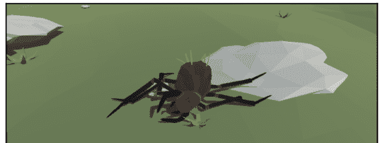

通用角色布娃娃的演示

### 准备工作

对于本教程，我们需要一个非人形角色。我们以老朋友蜘蛛为例。角色需要进行绑定。你也可以打开示例 Unity 项目并前往 Chapter 09 Physics and animations\Recipe 05 Creating a generic ragdoll with character joints 目录。如果在那里打开 Example.unity 场景并运行游戏，你将看到一只正在下落且布娃娃已开启的蜘蛛。你可以在 Rigs 目录中找到 Spider。

### 如何操作...

要创建通用布娃娃，请按照以下步骤操作：

- 1. 将角色导入 Unity 并放置在场景中。
- 2. 选择角色骨架中将用于布娃娃模拟的所有骨骼。在我们的示例中，我们跳过了獠牙。
- 3. 向所选骨骼添加胶囊碰撞体、刚体和角色关节组件。

- 4. 调整碰撞体的形状以匹配角色的四肢。你应避免碰撞体相互相交。你可能需要将一些碰撞体更改为 **盒状碰撞体** 或 **球形碰撞体**（我们的蜘蛛腹部使用 **盒状碰撞体** 而非 **胶囊碰撞体**，头部使用 **球形碰撞体**）。
- 5. 确保所有 **角色关节** 都选中了 **自动配置连接锚点** 选项。
- 6. 选择角色的根身体部位（对于我们的 **蜘蛛**，它是腹部）。
- 7. 从该身体部位移除 **角色关节** 组件，使其像普通刚体一样工作。
- 8. 将所有其他 **角色关节** 连接到其父游戏对象（也包含 **角色关节** 组件）。例如，如果角色有一条由三个段组成的腿，**Leg1**、**Leg2** 和 **Leg3**，则将 **Leg2** 对象拖到 **Leg3** 对象的 **角色关节** 组件中的 **连接体** 字段。然后将 **Leg1** 拖到 **Leg2** 的 **连接体** 字段。最后将 **Leg1** 拖到其根骨骼的 **连接体** 字段（在我们的例子中是 **腹部**）。
- 9. 对所有带有 **角色关节** 的骨骼重复此过程。关节的层级应反映骨架的层级。
- 10. 禁用角色的 **动画器** 组件并运行游戏以查看效果。你可能需要进一步调整 **角色关节** 组件的属性以达到所需效果：

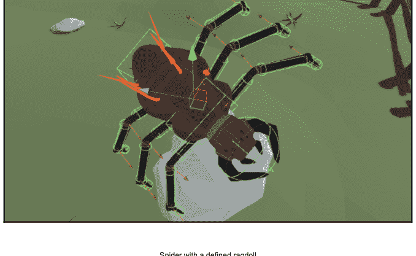

具有定义布娃娃的蜘蛛


### 工作原理...

在本教程中，我们使用 **角色关节** 组件从零开始创建一个布娃娃。每个这样的组件都必须与附加到同一游戏对象的 **刚体** 组件和 **碰撞体** 组件配合使用。我们可以通过将连接的游戏对象拖到关节的 **连接体** 字段来创建 **角色关节** 组件的链条。

**角色关节** 组件有一组可以调整的参数：

- **连接体**：这是关节所连接的父对象。
- **锚点**：这是关节绕其旋转的空间点。
- **轴**：这是扭转轴——骨骼将绕其扭转的轴。它用橙色箭头可视化。
- **自动配置连接锚点**：如果希望 Unity 尝试自动配置连接锚点，请启用此选项。
- **连接锚点**：如果禁用 **自动配置连接锚点**，则可以在此处手动配置它。
- **摆动轴**：这是骨骼将摆动（或弯曲）的轴。它用绿色箭头可视化。
- **低扭转限制**：这是骨骼扭转的下限角度。
- **高扭转限制**：这是骨骼扭转的上限角度。
- **摆动1限制**：这是骨骼摆动的下限角度。
- **摆动2限制**：这是骨骼摆动的上限角度。
- **断裂力**：这是破坏关节所需的力。
- **断裂扭矩**：这是破坏关节所需的扭矩。
- **启用碰撞**：如果勾选，则此关节连接的刚体之间的碰撞将被启用。
- **启用预处理**：用于稳定无法满足的场景。

## 对布娃娃施加力

在本教程中，我们将在打开布娃娃时对其施加额外的力。通常，当你打开布娃娃时，它从静止状态开始；不会引入初始运动。看起来僵硬不自然。对身体部位施加力将有助于避免这种情况。

### 准备工作

我们将使用 *使用 ragdoll 巫师创建人形布娃娃* 教程中的相同角色。我们还将使用同一教程中的 `HandleRagdoll.cs` 脚本来打开布娃娃。你也可以打开示例 Unity 项目并进入 `Chapter 09 Physics and animations\Recipe 06 Applying force to a ragdoll` 目录。如果在那里打开 `Example.unity` 场景并运行游戏，你可以点击角色的任何身体部位。这将打开布娃娃并对该身体部位施加力，使角色看起来像是在该肢体被击中或射击：

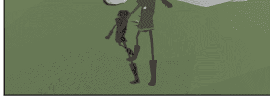

直接作用于角色头部的作用力

### 操作方法

要对布娃娃的身体部位施加力，请按照以下步骤操作：

- 1. 按照 *使用 ragdoll 巫师创建人形布娃娃* 教程操作，使角色拥有可工作的布娃娃和 `HandleRagdoll.cs` 脚本（用于打开布娃娃的脚本）。
- 2. 创建一个新的 C# 脚本并将其命名为 `RagdollForceApply.cs`。在此脚本的 `Update()` 函数中，我们首先检查玩家是否点击了鼠标左键。然后我们从鼠标光标位置沿摄像机方向创建一个射线，并检查是否击中了具有 `public LayerMask ragdollBodyPartsLayer` 变量描述的其中一个图层的碰撞体。如果我们成功击中碰撞体，我们将尝试从中获取 `Rigidbody` 组件并将其存储在我们的 `Rigidbody hitBodyPart` 变量中。如果我们确实找到了刚体，我们将调用 `void AddForce()` 函数：

```
if (Input.GetKeyDown(KeyCode.Mouse0))
{
    if (Physics.Raycast(Camera.main.ScreenPointToRay
    (Input.mousePosition), out hitInfo, 100f,
    ragdollBodyPartsLayer))
    {
        hitBodyPart = hitInfo.collider.gameObject
        .GetComponent<Rigidbody>();
        if (hitBodyPart != null)
        {
            AddForce();
        }
    }
}
```
- 3. `void AddForce()` 函数使用 HandleRagdoll 脚本打开布娃娃。之后，它以 `public float forceMagnitude` 的强度沿摄像机方向施加力：

```
void AddForce()
{
    ragdollHandler.EnableRagdoll(true);
    force = (hitInfo.point -
    Camera.main.transform.position).normalized *
    forceMagnitude;
    hitBodyPart.AddForce(force, ForceMode.Impulse);
}
```
- 4. 我们在 `Start()` 函数中设置对 HandleRagdoll 脚本的引用。
- 5. 将脚本添加到角色。
- 6. 确保角色布娃娃的身体部位设置了正确的图层。
- 7. 在检查器中将 RagdollForceApply 中的布娃娃身体部位图层掩码设置为与布娃娃身体部位的图层相匹配。
- 8. 运行游戏并点击角色的任意身体部位以查看效果。

### 工作原理

本教程 simply 使用在肢体 `RigidBody` 组件上调用的 `AddForce()` 函数对布娃娃的选定身体部位施加力。该函数需要一个 `Vector3 force` 参数来描述施加力的方向和大小。我们还可以指定一个 `ForceMode` 模式参数来更改施加力的模式。在这里，我们选择使用 `ForceMode.Impulse`，因为我们的力只在一帧内施加。

脚本的其余部分处理选择要施加力的身体部位。在此示例中，我们使用鼠标输入投射射线并尝试击中身体部位的碰撞体。如果我们成功击中，我们就选择该特定肢体作为要施加力的目标。

### 扩展知识

你也可以使用 *可破坏对象* 教程中说明的概念来存储角色（或其肢体）的速度，然后将其应用到布娃娃的身体部位。为此，你可以在 `Update ()` 函数中通过将当前位置减去上一个位置，以及当前欧拉角旋转减去上一个旋转来计算任何给定身体部位的线速度和角速度。然后在打开布娃娃时，可以将计算出的值作为 `velocity` 和 `angularVelocity` 应用到该部位的 `Rigidbody` 组件。

## 分离肢体

本教程展示了如何为绑定角色创建分离肢体效果。我们将以斩首为例。这种效果常用于各种战斗游戏（包括射击游戏和近战游戏）：

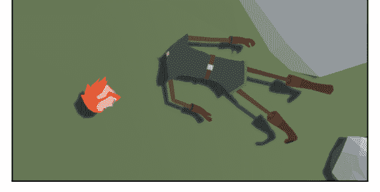

斩首——分离肢体效果的示例

### 准备工作

我们将使用 *使用 ragdoll 巫师创建人形布娃娃* 教程中的相同角色。我们还将使用同一教程中的 `HandleRagdoll.cs` 脚本来打开布娃娃。除此之外，我们还需要两个额外的网格：**头部** 模型和 **颈部** 模型。参考以下截图：

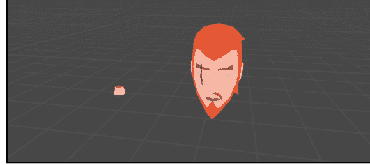

颈部和头部模型

你也可以打开示例 Unity 项目并进入 `Chapter 09 Physics and animations\Recipe 07 Dismemberment` 目录。如果在那里打开 `Example.unity` 场景，运行游戏并按空格键，贫穷的角色将被斩首。你可以在 `Models` 目录中找到所有额外的模型。

### 操作方法

要创建斩首效果，请按照以下步骤操作：

- 1. 按照 *使用 ragdoll 巫师创建人形布娃娃* 教程操作，使角色拥有可工作的布娃娃和 `HandleRagdoll.cs` 脚本（用于打开布娃娃的脚本）。
- 2. 导入 **颈部** 和 **头部** 模型并将其放置在场景中角色附近。
- 3. 创建两个空游戏对象；第一个命名为 **头部标记**，第二个命名为 **颈部标记**。
- 4. 将 **头部标记** 设为头部骨骼的子对象，将 **颈部标记** 设为颈部骨骼的子对象。确保 **头部标记** 和 **颈部标记** 的本地位置为 0。
- 5. 将 **头部** 对象设为 **头部标记** 的子对象，将 **颈部** 对象设为 **颈部标记** 的子对象。将 **头部** 和 **颈部** 的本地旋转和位置归零。


+   6. 使用 **HeadMarker** 和 **NeckMarker** 来定位 **Head** 和 **Neck**，使其尽可能匹配角色的头部和颈部。记住 **Head** 和 **Neck** 的本地位置和旋转为 0，因此通过操作 **HeadMarker** 和 **NeckMarker** 来定位它们，会使我们之后更容易生成 **Head** 和 **Neck**。
+   7. 为 **Head** 游戏对象添加一个 **Sphere Collider** 和一个 **Rigidbody** 组件。
+   8. 从 **Head** 游戏对象制作一个预制体，并从 **Neck** 游戏对象制作另一个预制体。
+   9. 从场景中删除 **Head** 和 **Neck**，但确保 **HeadMarker** 和 **NeckMarker** 仍作为父对象保持在角色骨架中对应的骨骼下。
+   10. 创建一个新的 C# 脚本并将其命名为 `Dismemberment.cs`。在此脚本的 `Update()` 函数中，我们检查玩家是否按下空格键，如果 `wasSevered` 标志为 `false` 则调用 `void Decapitate()` 函数（你真的只能斩首一次）：
+   11. `void Decapitate()` 函数完成剩余工作。首先它检查是否找到了 `HandleRagdoll.cs` 脚本（对它的引用在 `Start()` 函数中设置）。如果找到了，我们使用它启用 ragdoll 并禁用该脚本。接下来我们从头部骨骼中移除 **Character Joint**、**Rigidbody** 和 **Collider** 组件（我们将把它缩放到 0，因为我们不想再处理这个关节了）。接下来我们从存储在 `public GameObject headPrefab` 变量中的预制体生成新的、被斩断的 **Head**。**Head** 使用 **HeadMarker** 的位置和旋转生成，其引用存储在 `public Transform headMarker` 变量中。然后我们获取生成的 **Head** 的 **Rigidbody** 组件并施加随机力和随机扭矩使其移动。我们使用 `public Vector3` 变量来存储 `randomForce1`、`randomForce2`、`randomTorque1` 和 `randomTorque2` 值。我们有一个小的辅助函数 `Vector3 RandomVector(Vector3 v1, Vector3 v2)`，它接受两个向量并返回由这两个参数构建的随机向量。最后，我们将头部骨骼缩放到 0（其引用存储在 `public Transform head` 变量中）。最后，我们生成 **Neck** 预制体并将其设为 **NeckMarker** 的子对象：

```
if (Input.GetKeyDown(KeyCode.Space) && !wasSevered)
{
    Decapitate();
}
```

```
wasSevered = true;
if (ragdollHandler != null)
```

```
{
    ragdollHandler.EnableRagdoll(true);
    ragdollHandler.enabled = false;
}
Joint headJoint = head.GetComponent<Joint>();
if (headJoint != null)
{
    Destroy(headJoint);
}
Collider headCollider = head.GetComponent<Collider>();
if (headCollider != null)
{
    Destroy(headCollider);
}
Rigidbody headRigidBody = head.GetComponent<Rigidbody>();
if (headRigidBody != null)
{
    Destroy(headRigidBody);
}
GameObject spawnedHead =
(GameObject)GameObject.Instantiate(headPrefab,
headMarker.position, headMarker.rotation);

Rigidbody spawnedHeadRB = spawnedHead.GetComponent<Rigidbody>();
if (spawnedHeadRB != null)
{
    spawnedHeadRB.AddForce(RandomVector(randomForce1,
    randomForce2), ForceMode.Impulse);

    spawnedHeadRB.AddTorque(RandomVector(randomTorque1,
    randomTorque2),ForceMode.Impulse);
}
head.localScale = Vector3.zero;

GameObject spawnedNeck =
(GameObject)GameObject.Instantiate(neckPrefab,
neckMarker.position, neckMarker.rotation);
spawnedNeck.transform.parent = neckMarker;
```

+   12. 将脚本添加到角色上。
+   13. 运行游戏并按空格键查看效果。

## 它是如何工作的...

本食谱的主要特点是隐藏角色的头部。为此，我们只需将头部骨骼缩放到 0。分配给该骨骼的所有顶点将被压缩到空间中的同一点。在隐藏头部后，我们可以生成一个带有 **Rigidbody** 组件和附加 **Collider** 的第二个头部。这样我们的第二个头部就会掉落。为了使效果更壮观，我们为新生成的头部添加了少量随机力和扭矩。这使其在斩首后旋转并飞起。

我们还生成一个颈部游戏对象，以掩盖缩放头部到 0 后出现的拉伸多边形。我们使用父对象设为角色骨架中对应骨骼的 **HeadMarker** 和 **NeckMarker** 游戏对象，只是因为它们使匹配 **Head** 和 **Neck** 对象的位姿和旋转变得更容易。

## 还有更多...

你也可以用这种技术切断其他肢体。如果想将此概念用于切断手臂或腿部，请考虑生成一个带有 ragdoll 的带骨骼的断臂或断腿。这样的 ragdoll 只包含两个 **Rigidbody** 组件、两个 **Colliders** 和一个 **Character Joint**（肘部或膝盖）。

## 从 ragdoll 中站起

本食谱稍微更高级但很有趣。它使我们的角色使用三种不同的骨架：原始动画骨架、角色网格蒙皮的骨架以及 ragdoll。通过使用这三种骨架，我们可以随时在 ragdoll 和动画之间平滑混合。

## 准备工作

再次，我们将使用与 *Creating a humanoid ragdoll with the ragdoll wizard* 食谱中相同的角色。我们需要两个起身动画：一个是从面朝下位置起身，一个是从面朝上位置起身。分别将它们命名为 **StandUpFaceUp** 和 **StandUpFaceDown**。我们还需要至少一个循环的 **Idle** 动画。

你也可以打开示例 Unity 项目并进入 `Chapter 09 Physics and animations\Recipe 08 Getting up from a ragdoll` 目录。如果在那里打开 `Example.unity` 场景，运行游戏并按空格键；角色将使用 ragdoll 倒下。如果再次按空格键，它将从 ragdoll 混合到起身动画并再次被动画化。

## 如何操作...

使角色从 ragdoll 状态站起来，请按照以下步骤操作：

+   1. 将你的角色放置在场景中。
+   2. 制作它的两个副本并将角色命名为 **CharacterAnimated**、**CharacterSkinned** 和 **CharacterRagdoll**。我们将使用这些名称以提高清晰度。
+   3. 使所有角色在场景中站在完全相同的位置。
+   4. 选择 **CharacterRagdoll** 并按照 *Creating a humanoid ragdoll with the ragdoll wizard* 食谱制作一个可用的 ragdoll 角色。这次我们不会使用 `HandleRagdoll.cs` 脚本，因此你可以在使用 Ragdoll Wizard 后停止。
+   5. 选择 **CharacterRagdoll** 游戏对象的骨架并将其命名为 `Ragdoll`。
+   6. 选择 **CharacterAnimated** 并展开其层级。
+   7. 删除除角色骨架外的所有对象。你不能更改骨架的名称。
+   8. 选择 **CharacterSkinned** 并展开其层级。
+   9. 将 **CharacterSkinned** 骨架重命名为 `SkinnedRig`。
+   10. 选择 **SkinnedRig** 和蒙皮网格（如果有多个则为多个）。将它们拖放到 **CharacterAnimated** 上。可能会出现关于预制体连接丢失的警告窗口。点击 **Continue**。这将使 **SkinnedRig** 和蒙皮到它的网格成为 **CharacterAnimated** 游戏对象的子对象。
+   11. 选择 **CharacterRagdoll**，抓取 **Ragdoll** 骨架并将其拖放到 **CharacterAnimated** 游戏对象上以设为其子对象。如果出现警告再次点击 **Continue**。
+   12. 你可以删除 **CharacterRagdoll** 和 **CharacterSkinned** 游戏对象。
+   13. 创建一个 Animator Controller 或打开一个已有的。
+   14. 在此控制器中，创建两个 Triggers：**StandUpFaceUp** 和 **StandUpFaceDown**。
15. 创建四个过渡：
+   - **Any State | StandUpFaceDown** 条件为一个：**StandUpFaceDown** Trigger。**Has Exit Time** 应设为 false 且 **Transition Duration** 设为 0。
+   - **Any State | StandUpFaceUp** 条件为一个：**StandUpFaceUp** Trigger。**Has Exit Time** 应设为 false 且 **Transition Duration** 设为 0。
+   - **StandUpFaceDown | Idle** 无条件：**Has Exit Time** 应设为 true 且 **Transition Duration** 设为大约 0.2。
+   - **StandUpFaceUp | Idle** 无条件：**Has Exit Time** 应设为 true 且 **Transition Duration** 设为大约 0.2。

16. 将控制器分配给角色的 Animator 组件。

17. [Optional] 你可以在 `Shared Scripts` 文件夹中找到 `ShowRig.cs` 脚本。如果将其三次附加到 **CharacterAnimated** 游戏对象，你可以将它的三个骨架拖放到每个 `ShowRig` 脚本中。你也可以为每个骨架分配不同的颜色。如果运行游戏，你将能够看到三个骨架的工作情况。在下面的截图中，红色骨架是 ragdoll，黄色的是被动画化的骨架（我们不能更改其名称，在我们的示例中它称为 `metarig`），绿色的是我们的网格蒙皮的骨架（它不太明显，因为它隐藏在网格内部）。

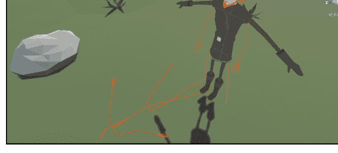

Ragdoll 骨架（红色）、动画骨架（黄色）和蒙皮骨架（绿色）


18. 创建一个新的 C# 脚本并命名为 RagdollWeight.cs。该脚本包含多个函数。首先，在从 Start() 函数调用的 void Init() 函数中，我们设置对三个骨架的骨骼的引用，以便稍后在它们之间进行混合。我们还获取附加到角色上的 RigidBody 和 Animator 组件的引用。最后，我们关闭 ragdoll 游戏对象：

```
void Init()
{
    rb = GetComponent<Rigidbody>();
    anim = GetComponent<Animator>();
    skinnedRigTransforms = 
    skinnedRig.GetComponentsInChildren<Transform>();
    ragdollTransforms = 
    ragdoll.GetComponentsInChildren<Transform>();
    animatedRigTransforms = 
    animatedRig.GetComponentsInChildren<Transform>();
    ragdoll.gameObject.SetActive(false);
}
```

19. 在 void EnableRagdoll() 函数中，我们首先检查 float blendFactor 是否不大于 0.5（这意味着我们仍处于“ragdoll 阶段”）。如果它小于 0.5，我们将所有 ragdoll 骨骼的位置和旋转设置为与 animatedRigTransforms 匹配（我们使 ragdoll 的姿势与当前角色姿势匹配）。最后，我们将主 RigidBody 组件设置为 kinematic 并启用 ragdoll 游戏对象。我们还将 blendFactor 设置为 1，这意味着 ragdoll 已完全启用：

```
void EnableRagdoll()
{
    if(blendFactor > 0.5f)
    {
        return;
    }
    for (int i = 0; i < ragdollTransforms.Length; i++)
    {
        ragdollTransforms[i].localPosition = 
        animatedRigTransforms[i].localPosition;
        ragdollTransforms[i].localRotation = 
        animatedRigTransforms[i].localRotation;
    }
    rb.isKinematic = true;
    ragdoll.gameObject.SetActive(true);
    ragdollOn = true;
    blendFactor = 1f;
}
```

20. 在 void DisableRagdoll() 函数中，我们检查角色是面朝下还是面朝上躺着并播放适当的站立动画。在触发动画后，我们启动 IEnumeratorBlendFromRagdoll() 协程以平滑地从 ragdoll 骨架混合到 animatedRig：

```
void DisableRagdoll()
{
    bool faceUp = Vector3.Dot(
        faceDirectionHelper.forward, Vector3.up) > 0f;
    if (faceUp)
    {
        anim.SetTrigger("StandUpFaceUp");
    }
    else
    {
        anim.SetTrigger("StandUpFaceDown");
    }

    StartCoroutine("BlendFromRagdoll");
}
```

21. IEnumerator BlendFromRagdoll() 协程随时间减少 blendFactor 并检查它是否仍大于 0。如果它小于或等于 0，我们将其设置为恰好为 0，再次启用主 RigidBody 组件，并禁用 ragdoll：

```
IEnumerator BlendFromRagdoll()
{
    while (blendFactor > 0f)
    {
        blendFactor -= Time.deltaTime * blendSpeed;
        yield return null;
    }
    blendFactor = 0f;
    rb.isKinematic = false;
    blendFactor = 0f;
    ragdollOn = false;
    ragdoll.gameObject.SetActive(false);
}
```

22. 在 FixedUpdate() 函数中，如果 ragdoll 已启用，我们将角色的 RigidBody 移动到 ragdoll 臀部的位置。我们还额外检查地面位置，以确保主 RigidBody 站在地面上并且不会漂浮。我们还旋转 RigidBody，使角色朝向臀部 -> 头部的方向。我们有意省略 Vector3 desiredLookVector 的 Y 分量，以防止角色胶囊倾斜。将角色的 RigidBody 移动到 ragdoll 臀部的位置使得从 ragdoll 到动画的混合更容易：

```
void FixedUpdate()
{
    if (!ragdollOn)
    {
        return;
    }
    desiredLookVector = head.position - hips.position;
    desiredLookVector.y = 0f;
    desiredLookVector = desiredLookVector.normalized;
    lookVector = Vector3.Slerp(transform.forward,
        desiredLookVector, Time.deltaTime);

    if (Physics.Raycast(hips.position, Vector3.down,
        out groundHit, groundCheckDistance,
        groundCheckMask))
    {
        finalPosition = groundHit.point;
    }
    else
    {
        finalPosition = hips.position;
    }
    rb.MovePosition(finalPosition);
    rb.MoveRotation(Quaternion.LookRotation(lookVector
    ));
}
```

23. 在 Update() 函数中，我们检查玩家是否按下了空格键。如果是，我们根据 ragdoll 当前是启用还是禁用来启用或禁用 ragdoll：

```
void Update()
{
    if (Input.GetKeyDown(KeyCode.Space))
    {
        if (ragdollOn)
        {
            DisableRagdoll();
        }
        else
        {
            EnableRagdoll();
        }
    }
}
```

24. 在 LateUpdate() 函数中，我们不断插值 skinnedRig（角色网格使用的骨架）的所有骨骼的 localPosition 和 localRotation。骨骼的位置和旋转在 ragdoll 和 animatedRig 的位置和旋转之间进行插值。我们使用 blendFactor 变量进行插值：

```
void LateUpdate()
{
    for (int i=0; i<skinnedRigTransforms.Length; i++)
    {
        skinnedRigTransforms[i].localPosition =
            Vector3.Lerp(
                animatedRigTransforms[i].localPosition,
                ragdollTransforms[i].localPosition,
                blendFactor);

        skinnedRigTransforms[i].localRotation =
            Quaternion.Lerp(
                animatedRigTransforms[i].localRotation,
                ragdollTransforms[i].localRotation,
                blendFactor);
    }
}
```

25. 将上述脚本添加到角色中。

26. 将动画骨架（在我们的示例中称为 metarig）拖放到 Animated Rig 字段，将 Ragdoll 拖放到 Ragdoll 字段，并将 SkinnedRig 拖放到 Skinned Rig 字段。选择胸部骨骼作为 Face Direction Helper（如果不起作用，您可以创建一个父级为胸部骨骼的空对象——目标是使此辅助对象的向前轴在角色面朝下躺着时指向下方，在角色面朝上躺着时指向上方）。将 Ground Check Mask 设置为包含您的关卡图层。将臀部骨骼分配给 Hips 字段，将头部骨骼分配给 Head 字段（您可以选择其他骨骼，只要它们能正确描述 ragdoll 启用时角色的旋转即可）。

27. 播放游戏并按空格键查看效果。

## How it works...

本食谱背后的概念基于拥有三个骨架：一个保存动画，一个是简单的 ragdoll，一个是网格蒙皮的骨架。为了在 Unity 中实现它，我们需要复制角色三次。其中一个副本用于创建 ragdoll，第二个是动画骨架，我们需要从中移除网格，最后一个是带有骨架但没有 Animator 组件的网格。所有这些对象最终都会被父级化到动画骨架的父级（CharacterAnimated 游戏对象）。这样，我们的角色仍然是一个单一的游戏对象，并且可以用 root motion 驱动。最终的层级结构如下所示：

+   - **CharacterAnimated**
+   - **metarig (the original name of the rig of this character)**
+   - **SkinnedRig**
+   - **SkinnedMesh**
+   - **Ragdoll**

通过这种设置，我们可以从 metarig（实际被动画化的骨架）、SkinnedRig（网格蒙皮的骨架）和 ragdoll 获取所有变换。由于我们角色的网格使用的是 SkinnedRig（在游戏中看不到另外两个骨架），我们可以动态设置其变换的位置和旋转。这样我们就可以使用 Vector3.Lerp() 和 Quaternion.Lerp() 函数在 Ragdoll 和 metarig（动画骨架）的变换之间插值 SkinnedRig 变换。

站立动画是这样准备的，角色的臀部大致位于 0,0,0 点。我们将角色的主 RigidBody 移动到 ragdoll 臀部所在的位置。这样，当我们混合到站立动画时，我们角色的动画骨架（一个动画）与 ragdoll 的位置相匹配。其余部分由从 ragdoll 到当前动画的姿势混合处理。

## There's more...

您也可以将此概念用于非人形角色。


## 10