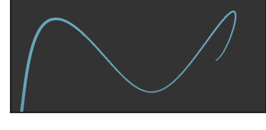
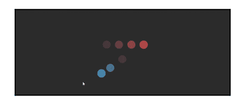
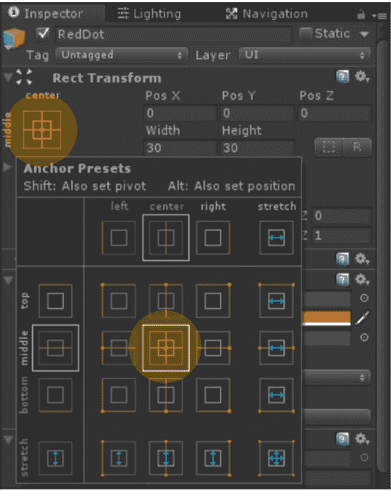
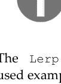
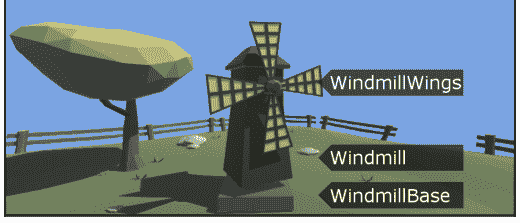
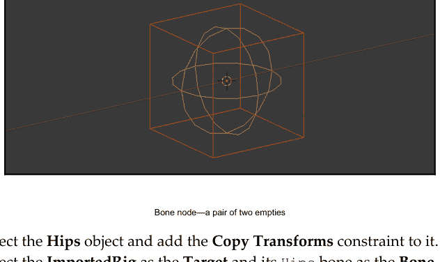
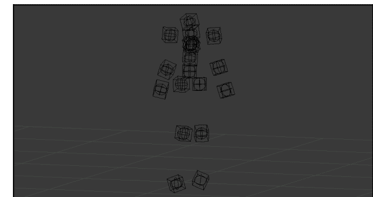
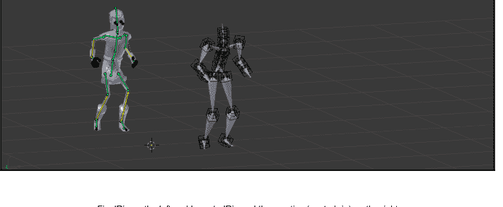
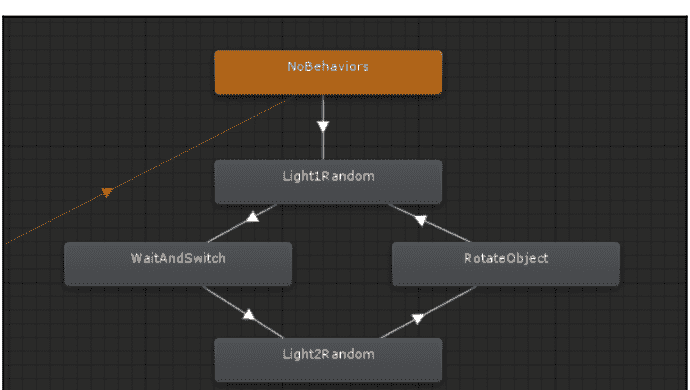
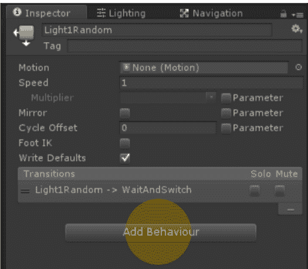

## 杂项

本章包含若干额外食谱：

- 使用数学为对象制作动画
- 使用 Lerp() 函数为对象制作动画
- 使用 Rotate() 函数为对象制作动画
- 为人形角色准备动作捕捉文件
- 为 Mecanim 状态添加行为

### 引言

本章包含具有实用技巧和解决方案的额外食谱。

## 使用数学为对象制作动画

我们可以使用数学公式创建外观有趣的动画。我们将使用这一概念，利用 Mathf.Sin() 和 Mathf.Cos() 函数制作无限曲线动画。

### 准备工作

本食谱不需要任何特殊内容。我们将在 Unity 中从头开始创建它。您也可以下载提供的示例项目。打开 `Chapter 10 Miscellaneous\Recipe 01 Using math to animate an object` 目录并加载其中的 `Example.unity` 场景。如果运行游戏，您将看到成品效果——使用 `Mathf.Sin()` 和 `Mathf.Cos()` 函数制作的曲线动画：



最终效果——使用 Mathf.Sin() 和 Mathf.Cos() 函数制作的曲线动画

### 如何操作...

要使用数学为曲线制作动画，请按照以下步骤操作：

1. 创建一个空游戏对象。
2. 为其添加 **Line Renderer** 组件。
3. 创建一个您喜欢的新材质并将其分配给 **Line Renderer**。
4. 确保 **Line renderer** 组件中的 **Use World Space** 选项未被选中（在本示例中我们将使用局部坐标，因为这样在摄像机中定位 **Line Renderer** 会稍微容易一些）。
5. 将 **Line Renderer** 的 **Start Width** 和 **End Width** 改为 0.2 以使线条变细。
6. 创建一个新的 C# 脚本并将其命名为 `MathAnim.cs`。在此脚本的 `Start()` 函数中，我们使用 `SetVertices()` 方法设置 `Line Renderer` 的点数：

```
positions = new Vector3[linePoints];
lRenderer = GetComponent<LineRenderer>();
```

```
if (lRenderer != null)
{
    lRenderer.SetVertexCount(linePoints);
}
```

7. 然后，在 Update() 函数中，我们调用 void SetLinePositions() 函数并移动游戏对象，使线条中心位于 (0, 0, 0) 点：

```
transform.position = new Vector3(-0.5f
    * lineLength, 0f, 0f);
SetLinePositions();
```

8. 在 void SetLinePositions() 函数中，使用 Mathf.Sin() 和 Mathf.Cos() 函数计算点的 Y 和 Z 位置。我们使用 SetPositions() 函数设置线条点的坐标。我们还使用一个简单的计时器将时间引入公式。我们有两个计时器：timerY 和 timerZ。第一个用于 Y 位置值，第二个用于 Z 位置值。我们还有用于控制 frequencyY、frequencyZ、amplitudeY 和 amplitudeZ 的 public float 变量。线条点的 X 位置以相等距离设置，使得线条总长度等于 public float lineLength 变量的值：

```
if (lRenderer == null)
{
    return;
}

timerY += Time.deltaTime * speedY;
timerZ += Time.deltaTime * speedZ;

for (int i = 0; i < positions.Length; i++)
{
    positions[i].x = lineLength * (float)i /
        (float)positions.Length;
    positions[i].y = amplitudeY * Mathf.Sin(frequencyY
        * ((2f*Mathf.PI * (float)i /
        (float)positions.Length) + timerY));
    positions[i].z = amplitudeZ * Mathf.Cos(frequencyZ
        * ((2f * Mathf.PI * (float)i /
        (float)positions.Length) + timerZ));
}
lRenderer.SetPositions(positions);
```

9. 将脚本附加到我们的游戏对象。
10. 运行游戏查看效果。

### 原理...

我们可以从 `Mathf` 库中使用大量数学公式。使用其中一些公式可以为动画带来有趣的结果。在本示例中我们使用 `Mathf.Sin()` 和 `Mathf.Cos()` 函数。它们是周期性的，这为我们提供了无限循环的运动。

## 使用 Lerp() 函数为对象制作动画

我们之前使用过 `Lerp()` 方法，但重要的是要知道我们可以用两种不同的方式使用它。本食谱涵盖这两种用法。

### 准备工作

我们将从头开始创建本食谱，并且不需要任何特殊资源。您可以下载示例项目并进入 `Chapter 10 Miscellaneous\Recipe 02 Using the Lerp function to animate an object` 目录。在那里打开 `Example.unity` 场景并运行游戏。您将看到两个对象：**RedDot** 和 **BlueDot**（两者都是 **Canvas** 对象的子对象）。第一个使用标准的 `Lerp()` 方法并随时间将其位置从最小值插值到最大值。第二个以不同方式使用 `Lerp()` 方法并持续跟随鼠标指针。



RedDot 在最小值和最大值之间插值其位置，而 BlueDot 跟随光标

### 如何操作...

要使用 Lerp() 函数为对象制作动画，请按照以下步骤操作：

1. 首先我们需要创建一些对象来操作。创建一个新的 Image（前往 Game Object | UI | Image）。将其命名为 RedDot（您可以添加圆形精灵或保持原样）。将其颜色更改为红色。
2. 将 RedDot 位置设置为 (0,0,0)，并将其 Anchor Preset 设置为 middle center，如以下截图所示：



RedDot 的 Anchor Preset

3. 创建另一个 **Image** 并将其命名为 **BlueDot**。将其颜色更改为蓝色。
4. 将其 **Anchor Preset** 更改为 bottom left。
5. 创建一个新的 C# 脚本并将其命名为 `LerpNormal.cs`。在此脚本的 `Update()` 函数中，我们将 `float posX` 变量的值从 `public float minPos` 插值到 `public float maxPos` 值。我们使用一个 `float timer`，它随时间增加到 1 的值。如果其值达到 1，则开始减小到 0。如果达到 0，则再次开始增加。最后，我们使用插值后的 `posX` 值设置 **RedDot** `rectTransform` 的 `localPosition`。`posY` 和 `posZ` 值在 `Start()` 函数中设置并且是恒定的：

```csharp
if (timer > 1f)
{
    lerpDir = -1f;
}
else if (timer < 0f)
{
    lerpDir = 1f;
}

timer += lerpDir*Time.deltaTime * speed;

posX = Mathf.Lerp(minPos, maxPos, timer);

rectTransform.localPosition = new Vector3(posX, posY, posZ);
```

6. 将脚本分配给 **RedDot** 游戏对象。
7. 创建另一个 C# 脚本并将其命名为 `LerpContinuous.cs`。在此脚本的 `Update()` 函数中，我们将 **BlueDot** 的位置与其自身和鼠标光标位置进行插值。我们每帧都执行此操作。在 `Lerp()` 函数中，我们使用乘以 `public float speed` 变量的 `Time.deltaTime` 值：

```csharp
rectTransform.position =
    Vector3.Lerp(rectTransform.position,
    Input.mousePosition, Time.deltaTime *
    speed);
```

8. 将脚本分配给 **BlueDot** 游戏对象。
9. 运行游戏查看效果。

### 原理...

我们以两种方式使用 `Lerp()` 函数：

- **标准方法：** `Lerp()` 函数的 `float t` 参数的值范围为 0 到 1。我们使用计时器作为 t 参数。`timer` 首先增加到 1 的值。达到 1 后，它开始减小到 0。这种方法在两个值之间提供标准的线性插值。t 参数是插值的百分比（对于 t = 0.5，插值值为两个输入值的平均值）。
- **连续方法：** 第二种方法基于将输出值（在我们的例子中是位置）用作 `Lerp()` 函数中的下限输入值。我们在 `Update()` 中调用 `Lerp()` 函数并使用 `Time.deltaTime` 作为 t 参数。`Time.deltaTime` 是一个非常小的值，因此每次调用函数时，输出值都会以很小的一部分向结束值插值。在 `Update()` 中调用此方法会导致平滑移动。它不再是线性的。**BlueDot** 在远离光标时移动更快，靠近时减速。



请记住，当您使用第二种方法时，插值的值永远不会真正达到结束位置或结束值。这就是为什么有时我们必须实现一个 `if` 语句并检查插值的值是否足够接近结束值。如果是，我们可以将其设置为完全相同。

`Lerp()` 函数在各种类中实现。以下是最常用的示例：

- `Mathf.Lerp()`: 这在两个 float 值之间进行插值
- `Vector3.Lerp()`: 这在两个向量之间进行插值（例如位置）
- `Quaternion.Lerp()`: 这在两个旋转之间进行插值
- `Color.Lerp()`: 这在两种颜色之间进行插值


## 另请参阅

另外两种方法也值得在 Unity 的 Scripting Reference 中查看：`Vector3.Slerp()` 和 `Vector3.SmoothDamp()`。第一种以球面方式插值一个向量（就像我们通过旋转它一样），第二种会减缓向量（例如位置）的变化。它可用于实现应平滑跟随另一个物体的物体。

## 使用 Rotate() 函数为物体制作动画

在本教程中，我们将使用 `Transform.Rotate()` 函数为风车创建无限循环动画。也可以使用 **Animation** 视图实现相同效果，但有时编写一个简单脚本比创建关键帧动画要省力得多。

### 准备工作

本教程中我们需要一些可以旋转的模型。作为示例，我们将使用风车。它由三个游戏对象组成：**WindmillBase**，它是整个风车的根节点，**Windmill**，它是 **WindmillBase** 的子对象，以及 **WindmillWings**，它是 **Windmill** 的子对象。**Windmill** 游戏对象本身可以在 Y 轴上旋转。**WindmillWings** 游戏对象可以在其本地 Z 轴上旋转。



风车层级结构

你可以下载示例项目并进入 `Chapter 10 Miscellaneous\Recipe 03 Using the Rotate function to animate an object` 目录。在那里打开 `Example.unity` 场景并运行游戏。你会看到风车绕 *Y* 轴旋转，其叶片绕其本地 *Z* 轴旋转。

### 操作方法...

要使用 `Rotate()` 函数为物体制作动画，请按照以下步骤操作：

- 1. 将我们的风车导入 Unity。模型应包含三个对象：**WindmillBase**、**Windmill**（是 **WindmillBase** 的子对象）以及 **WindmillWings**（是 **Windmill** 的子对象）。
- 2. 将模型放置在场景中。
- 3. 创建一个新的 C# 脚本并将其命名为 `ScriptRotation.cs`。在此脚本的 `Update()` 函数中，我们只使用一个方法：`transform.Rotate()`。我们有一系列 `public` 变量以便控制旋转速度和轴。`Rotate()` 方法可以在 `World` 或 `Self`（本地）空间中旋转物体。我们有一个 `public Space rotationSpace` 变量，以便从 **Inspector** 中控制它：
- 4. 将脚本分配给 **Windmill** 游戏对象。
- 5. 将 **Rotation Space** 设置为 **World**，并将 **Rotation Axis** 设置为 (0, 1, 0)。这意味着我们的物体将在全局 *Y* 轴（上向量）上旋转。将 **Rotation Speed** 设置为你喜欢的值（单位为每秒度数；45-90 的值应该可以）。
- 6. 将相同的脚本分配给 **WindmillWings** 游戏对象。
- 7. 将 **Rotation Space** 设置为 **Self** 并将 **Rotation Axis** 设置为 (0,0,1)。这意味着物体将绕其本地 *Z* 轴（物体的前向量）旋转。同样，将 **Rotation Speed** 设置为你喜欢的值。
- 8. 运行游戏并观察效果。**Windmill** 游戏对象在全局 *Y* 轴上旋转，而 **WindmillWings** 游戏对象绕其本地 *Z* 轴旋转并跟随 **Windmill** 的 *Y* 轴旋转（由于层级设置）。

```
transform.Rotate(rotateAxis * rotationSpeed *
    Time.deltaTime, rotationSpace);
```

### 原理...

在本教程中我们使用 Unity 的 `Transform.Rotate()` 函数。它允许围绕任意给定轴旋转 transform。它将物体旋转我们作为函数参数设定的度数。我们使用 `Time.deltaTime` 使物体每秒旋转 X 度。该函数还具有 `space` 参数，可让我们在世界空间或本地空间中进行旋转。其余部分由层级设置处理（**WindmillWings** 是 **Windmill** 游戏对象的子对象）。

使用此方法可以为简单的旋转物体节省大量调整动画的时间。更重要的是，我们仍然可以使用 **Animation** 视图为脚本的 `public float rotationSpeed` 参数创建动画。这样我们就可以用一个非常简单的动画片段来控制旋转速度的变化，而不必对整个 transform 进行动画制作。

### 还有更多...

Unity 还有一个 `Transform.Translate()` 函数，它的参数与 `Transform.Rotate()` 方法相同，但会移动我们的游戏对象而不是旋转它。我们可以用它创建类似的脚本并在场景中移动物体。

## 为人形角色准备动作捕捉文件

使用动作捕捉文件并不总是容易。在大多数情况下，我们可以直接使用它们（导出为 **FBX** 文件后）用于使用 **Generic** 骨架类型的角色。但我们几乎总是希望将动作捕捉文件用于人形角色。问题出现在我们的动作捕捉骨架不是标准的 Unity **Humanoid** 骨架时（而且这种情况几乎总是如此）。我们可以预期各种各样的错误——骨骼带偏移旋转、网格变形等等。

本教程展示了如何将动作捕捉文件重新映射到适合 Unity 人形动画的骨架上。我们将使用 Blender 3D。

### 准备工作

要按照本教程操作，你需要一个准备好绑定到合适的 Unity **Humanoid** 骨架的人形角色。我们还需要一个动作捕捉动画。你可以在卡内基梅隆大学的网站 `http://mocap.cs.cmu.edu/` 上找到一个庞大的可免费使用的动作捕捉数据库。在本示例中我们将使用 `01_01.bvh` 文件。

你也可以下载提供的示例 Unity 项目并进入 `Chapter 10 Miscellaneous\Recipe 04 Preparing motion capture files for humanoid characters` 目录。你可以在那里找到 `Example.unity` 场景。如果运行游戏，你会看到一个角色正在播放重新映射的动作捕捉动画。你可以在 `Raw data` 目录中找到 BVH 文件。最终的 FBX 文件位于 `Final FBX` 目录中，所有 `blend` 文件位于 `Blend Files` 目录中。

### 操作方法...

要为人形角色使用动作捕捉数据，请按照以下步骤操作：

- 1. 首先我们需要创建一个适合 Unity 人形角色的骨架。在 Blender 中创建这样的骨架相当容易。首先启用 **Rigify** 插件并从 **Armature** 部分创建一个新的 **Human (metarig)** 对象。
- 2. 该骨架的结构几乎与 Unity 的 Humanoid 骨架相同，但我们需要调整一些地方。首先编辑骨架并从脚部删除 **heel.L**、**heel.R**、**heel.02.L** 和 **heel.02.R** 骨骼。
- 3. 然后从手部删除 **palm.01.L**、**palm.02.L**、**palm.03.L**、**palm.04.L**、**palm.01.R**、**palm.02.R**、**palm.03.R** 和 **palm.04.R** 骨骼。
- 4. 这样我们就得到了一个合适的 Unity Humanoid 骨架。我们还可以调整 T 姿势（**Rigify** 骨架是在更放松的 T 姿势下创建的）。这一步不是必需的。将该骨架命名为 `FinalRig`。
- 5. 现在根据你的角色调整骨骼大小并将角色绑定到骨架上。
- 6. 进入 **Pose Mode** 并点击两个肩膀。启用它们的 *Y* 轴旋转（默认情况下是锁定的）。这一步对于制作最终动画很重要。
- 7. 导入你的 BVH 文件（**File | Import | BVH**）。你可能需要在导入设置中调整骨架的大小。
- 8. 将导入的 BVH 骨架缩放以大致匹配你的角色大小。为便于区分，将 BVH 骨架命名为 **ImportedRig**。
- 9. 现在我们将创建一个控制骨架用于纠正任何错误。为此，在 Blender 中创建一个空对象并将其命名为 `Hips`。再创建一个空对象并命名为 `HipsTarget`。确保两个对象的位置和旋转完全相同。
- 10. 将 **HipsTarget** 设为 **Hips** 的子对象。
- 11. 为了使对象更易见，将 **Hips** 的 **Display** 设置为 **Cube**，将 **HipsTarget** 的 **Display** 设置为 **Sphere**。
- 12. 这两个空对象的组合就是我们的骨节点——我们将为角色的每个骨骼创建一个：



骨节点——一对空对象

- 13. 选择 **Hips** 对象并为其添加 **Copy Transforms** 约束。
- 14. 选择 **ImportedRig** 作为 **Target**，并选择其 `Hips` 骨骼作为 **Bone**。
- 15. 对 **FinalRig** 的每个骨骼重复步骤 9-14（你可以省略手指，因为大多数动作捕捉文件并没有手指数据）。完成此过程后，你应该有一组空对象反映 **FinalRig** 的结构。它应类似于以下内容：
- **Hips**（以及设为其子对象的 **HipsTarget**）
- **Spine**（以及设为其子对象的 **SpineTarget**）
- **Chest**（以及设为其子对象的 **ChestTarget**）
- **Neck**（以及设为其子对象的 **NeckTarget**）
- **Head**（以及设为其子对象的 **HeadTarget**）
- **Shoulder.L**（以及设为其子对象的 **ShoulderTarget.L**）
- **Shoulder.R**（以及设为其子对象的 **ShoulderTarget.R**）
- **LegUp.L**（以及设为其子对象的 **LegUpTarget.L**）


- LegUp.R（并且 **LegUpTarget.R** 以它为父级）
- Leg.L（并且 **LegTarget.L** 以它为父级）
- Leg.R（并且 **LegTarget.R** 以它为父级）
- Foot.L（并且 **FootTarget.L** 以它为父级）
- Foot.R（并且 **FootTarget.R** 以它为父级）
- ArmUp.L（并且 **ArmUpTarget.L** 以它为父级）
- ArmUp.R（并且 **ArmUpTarget.R** 以它为父级）
- Arm.L（并且 **ArmTarget.L** 以它为父级）
- Arm.R（并且 **ArmTarget.R** 以它为父级）
- Hand.L（并且 **HandTarget.L** 以它为父级）
- Hand.R（并且 **HandTarget.R** 以它为父级）

16. 有时我们的 **ImportedRig** 结构不同，例如它可能有更多的脊柱骨骼（三根或更多）。在这种情况下，我们应该在 **Copy Transform** 约束中选择最合适的骨骼，或添加两个 **Copy Rotation** 约束并通过设置 **Influence** 滑块来插值两个相邻骨骼的最终旋转：



Control rig with Copy Transform constraints

17. 现在我们需要为脚设置 IK。选择 **FinalRig** 并进入 **Edit Mode**。

18. 复制两个脚骨骼并将其名称更改为 **footTarget.L** 和 **footTarget.R**。

19. 移除它们的父级并取消选择 **Deform** 选项（它们不应变形网格）。

20. 进入 **Pose Mode**。
21. 选择 **shin.L** 骨骼并添加一个 **Inverse Kinematics** 约束。将 **Chain Length** 设置为 2，并选择 **FinalRig** 作为 **Target**，**footTarget.L** 作为 **Bone**。
22. 选择 **foot.L** 骨骼并为其添加 **Copy Rotation** 约束。选择 **FinalRig** 作为 **Target**，**footTarget.L** 作为 **Bone**。
23. 对右腿重复步骤 21 和 22。
24. 选择 **hips** 骨骼并为其添加 **Copy Rotation** 和 **Copy Location** 约束。在两个约束中，均将 **Target** 设置为 **HipsTarget** 空对象。
25. 在 **Copy Location** 约束中选择 **Offset** 选项，并在 **Pose Mode** 中移动 **hips** 骨骼，使其大致匹配场景中 **HipsTarget** 空对象的位置。
26. 选择 **footTarget.L** 骨骼。为其添加 **Copy Location** 和 **Copy Rotation** 约束。在两个约束中，均选择 **FootTarget.L** 空对象作为 **Target**。
27. 在 **Copy Location** 约束中选择 **Offset** 选项，并在 **Pose Mode** 中移动 **footTarget.L** 骨骼，使其大致匹配场景中 **footTarget.L** 空对象的位置。
28. 对右脚目标重复步骤 26 和 27。
29. 为每个其他骨骼（包括具有 **Inverse Kinematics** 约束的骨骼）添加一个 **Copy Rotation** 约束。将每个此类约束的 **Target** 设置为相应的空对象（对于 **shin.L** 骨骼，选择 **LegTarget.L** 空对象，以此类推）。
30. 你应该会看到 **ImportRig** 的运动被转移到 **FinalRig**。此外，你可以移动 **hips** 骨骼以及 **footTarget.L** 和 **footTarget.R** 骨骼来调整动画。
31. 如果网格上出现任何错误，尤其是角色的四肢以奇怪的方式旋转，你可以旋转目标空对象来修复此问题。
32. 你也可以旋转目标空对象来轻松更改角色的整体姿势。
33. 要完成重定向过程，请将文件另存为新文件。在 **Pose Mode** 中选择 **FinalRig** 中的所有骨骼，按空格键，输入 **Bake Action**，然后按 *Enter*。
34. 在 **Bake Action** 窗口中，选择 **Visual Keying** 和 **Clear Constraints**。你也可以为新创建的动作提供名称。如果点击 **OK**，所有约束将被移除，最终动画将被烘焙。
35. 记得在 **Action Editor** 中选择该动作附近的小 **F** 符号（这将在 rig 不使用它时仍保存数据）。

36. 移除所有空对象和 **ImportedRig**（你可能还需要手动移除其动作）。保存文件。
37. 将文件导入 Unity 并将 rig 设置为 Humanoid。动画应按预期工作。你也可以选择先将文件导出为 FBX。如果遇到任何问题，请尝试使用 6.1 版本的 FBX 格式，这可能会有所帮助：



FinalRig on the left and ImportedRig and the empties (control rig) on the right

## How it works...

Problems with importing motion capture data can be very frustrating. The most common errors are connected with an inappropriate **T-POSE** of the **BVH** rig. This T-Pose depends on the software the animation was recorded in and exported from. Additionally, BVH rigs can have arbitrary bone hierarchies, with more than two spine bones for instance. A proper Unity Humanoid rig hierarchy was covered in the *Configuring Generic and Humanoid rigs* recipe in *Chapter 1, Working with animations.*

In Blender, the Rigify rig has a proper T-Pose. Thus, the best solution is to retarget the animation from the **ImportRig** to the **FinalRig** (the **Rigify** one). In theory, we could omit creating the control rig (the empties) but those give us more control. The (...)**Target** empties are not constrained to the **ImportRig** bones—they are only parented to the empties that are constrained. This way we can rotate or move the (...)**Target** empties to correct any rotation errors or adjust a pose.

We also use **Inverse Kinematics** for the feet in this setup. This, combined with the **Offset** option in the **Copy Location** constraints (set for the **footTarget.L**, **footTarget.R**, and **hips** bones), allows us to adjust the feet and hips positions. This way we can move the character to the center of the scene quite easily. We can even make it crouch while moving,

## See also

If you are on a budget and want to use motion capture data, you can find a lot of free motions on the Carnegie Mellon University's website at http://mocap.cs.cmu.edu/. Another good option is to invest in the Perception Neuron solution (https://neuronmocap.com/)—it is a project successfully founded on Kickstarter. Perception Neuron seems affordable for most indie studios or even individuals. It is a suit with a set of sensors (gyroscopes, magnetometers, and accelerometers) that the actor puts on. It works similar to standard motion capture solutions based on markers. I must say the quality of the recorded motions is mostly very good (it has some problems with rapid motions though). You also have to watch out for large metal objects, speakers, and other sources of magnetic fields in the room. But if you can't afford a motion capture studio session and want to use mocap for your project, it can be a good bet.

## Adding behaviors to Mecanim states

In this last recipe, we will cover behaviors. These are scripts that can be attached to Mecanim states. You can use them to turn standard Animator Controllers into logic graphs such as AI trees, quests, and so on.

## Getting ready

We are going to create this recipe from scratch and we don't need any special assets. You can download the example project and go to the Chapter 10 Miscellaneous\Recipe 05 Adding behaviors to Mecanim states directory. Open the Example.unity scene there and play the game. If you play the game, you can press the space bar to change the states in the Animator Controller attached to the Controller game object. The cycle starts in the NoBehaviors state—this is simply an empty state with no additional behavior. If we press the space bar, we transition to Light1Random. This state changes the color of the Light1 light in the scene. If we press the space bar again, the state will change to WaitAndSwitch. This state waits for a given time and switches to the next state: Light2Random. This one changes the color of the Light2 light. If we press the space bar again, we will transition to the RotateObject state, which rotates an object visible in the scene. Pressing the space bar yet again transitions the controller to the Light1Random state again. See the following screenshot for reference:



完成控制器

## 如何操作...

要在 Mecanim 状态中使用行为，请按照以下步骤操作：

1. 首先我们需要准备示例场景。在场景中创建一个 **立方体**。
2. 创建两个灯光并将它们命名为 **Light1** 和 **Light2**。将它们放置在立方体附近，以便可以看到它们的效果。
3. 创建一个空的游戏对象并将其命名为 `Controller`。
4. 创建一个新的 Animator Controller 并将其命名为 `LogicController`。
5. 向 **控制器** 游戏对象添加一个 Animator 组件并将 **逻辑控制器** 分配给它。
6. 打开 **逻辑控制器**。
7. 创建一个空状态并将其命名为 **无行为**。使其成为默认状态。
8. 创建一个 `Trigger` 参数并将其命名为 **切换**。
9. 创建四个空状态并将它们命名为 **灯光1随机**、**等待并切换**、**灯光2随机** 和 **旋转对象**。

10. 创建以下列出的过渡。它们都具有相同的条件：`Trigger` **切换** 参数且 **退出时间** 设置为 false。

- **无行为** | **灯光1随机**
- **灯光1随机** | **等待并切换**
- **等待并切换** | **灯光2随机**
- **灯光2随机** | **旋转对象**
- **旋转对象** | **灯光1随机**

11. 选择 **灯光1随机** 状态并在 **检查器** 中点击 **添加行为** 按钮，如以下屏幕截图所示：



向 Mecanim 状态添加行为

12. 包含所有可用行为的列表将会出现。在搜索字段中输入 **LightColorChange** 并按下 *回车*。将会出现一个 **创建并添加** 按钮。如果点击它，`LightColorChange.cs` 脚本将在 `Assets` 文件夹中创建。

13. 将脚本移动到你的脚本目标文件夹。

14. 打开脚本。向脚本添加三个全局变量：`public string lightGameObjectName`、`public Color color` 和 `public bool randomColor`。

15. 脚本包含多个注释掉的函数。取消注释 override public void OnStateEnter() 函数。在其中我们首先尝试查找名称存储在 lightGameObjectName 变量中的游戏对象。如果找到它，我们尝试获取其 Light 组件并根据 randomColor 标志将灯光颜色设置为随机值或指定值：

```
GameObject go = GameObject.Find(lightGameObjectName);
if (go != null)
{
    Light light = go.GetComponent<Light>();
    if (light != null)
    {
        if (randomColor)
        {
            light.color = Random.ColorHSV();
        }
        else
        {
            light.color = color;
        }
    }
}
```

16. 在 Animator Controller 中，选择 Light1Random 状态。在其检查器中，将灯光游戏对象名称设置为 Light1 并勾选随机颜色复选框。

17. 选择 WaitAndSwitch 状态并添加一个 WaitAndSwitch 行为。WaitAndSwitch.cs 脚本将被创建。这次添加四个全局变量（带默认值）：public string triggerName = "Switch", public float waitTime = 5f, bool switched = false, 和 float startTime。取消注释 override public void OnStateEnter() 函数，检查我们进入状态的时间并将其存储在 startTime 变量中。我们还将 switched 标志设置为 false：

```
startTime = Time.time;
switched = false;
```

18. 取消注释 override public void OnStateUpdate() 函数并检查当前时间是否大于我们的 startTime 加上 waitTime。如果是，我们设置 Trigger 以在状态之间转换。我们还将 switched 标志设置为 true 以防止发送多个 Trigger：

```
if (Time.time >= startTime + waitTime && !switched)
{
    switched = true;
    animator.SetTrigger(triggerName);
}
```

19. 在控制器中选择 Light2Random 状态并向其添加 LightColorChange.cs 行为。将随机颜色复选框设置为 true 并将灯光游戏对象名称设置为 Light2。

20. 创建一个新的 C# 脚本并将其命名为 LogicController.cs。此脚本有三个全局变量：public string switchTriggerName = "Switch", public Transform activeObject, 和 Animator anim。anim 变量在 Start() 函数中设置。在此脚本的 Update() 函数中，当玩家按下空格键时，我们在 Animator Controller 中设置 Trigger。Trigger 名称存储在 switchTriggerName 变量中。

21. 将脚本分配给 Controller 游戏对象。然后将 Cube 游戏对象拖放到脚本的活动对象字段中。

22. 选择 RotateObject 状态并向其添加一个 RotateObject.cs 行为（你需要创建一个新的）。将创建的脚本移动到你的目标文件夹。

23. 打开 RotateObject.cs 脚本。添加四个全局变量：public float rotationSpeed = 45f, public Vector3 rotationAxis = Vector3.up, public Space rotationSpace = Space.World, 和 LogicController controller。前三个用于旋转对象，最后一个是对 LogicController 脚本的引用。取消注释 override public void OnStateEnter() 函数并在其中设置对 LogicController 的引用：

```
controller =
animator.gameObject.GetComponent<LogicController>();
```

24. 取消注释 override public void OnStateUpdate() 函数并旋转存储在 LogicController.activeObject 变量中的对象：

```
if (controller == null)
{
    return;
}
if (controller.activeObject == null)
{
    return;
}
controller.activeObject.Rotate(rotationAxis * rotationSpeed * Time.deltaTime, rotationSpace);
```

25. 确保 Controller 游戏对象的 Animator 组件设置为始终动画。
26. 播放游戏并按下空格键以查看效果。你需要多次按下空格键才能完成整个循环。

## 如何工作...

状态行为可用于创建逻辑图——这些图使用 Animator Controller 作为状态机。Animator Controller 可以在没有任何 Animation Clips 的情况下工作——空状态也可以具有行为。

Mecanim 状态行为是派生自 `StateMachineBehaviour` 类而不是 `MonoBehaviour` 类的脚本。它们有许多我们可以重写的功能。最有用的如下：

- `OnStateEnter()`：当 Animator Controller 进入此状态时调用此函数。
- `OnStateUpdate()`：当此状态处于活动状态（正在播放）时，每帧调用此函数。它将在 `OnStateEnter()` 之后和 `OnStateExit()` 之前被调用。
- `OnStateExit()`：当 Animator Controller 退出此状态时调用此函数。

我们仍然可以从普通的 `MonoBehaviour` 脚本管理状态转换（在我们的示例中，它是 `LogicController.cs` 脚本）。

Animator Controllers 是资源，因此它们无法引用场景中的对象。我们可以通过按名称（或标签）查找游戏对象或通过创建另一个可以引用场景中对象的 `MonoBehaviour` 脚本来解决这个问题。我们的 `LogicController.cs` 脚本就是一个例子：`public Transform activeObject` 变量。我们可以在行为中获取 `LogicController.cs` 脚本组件（只要 Animator 组件在同一个游戏对象上）。这样我们就可以访问其 `activeObject` 变量并在此变换上执行操作。
