## 游戏 AI 简介

本章将介绍 **人工智能** (AI) 的基本理念，以及它如何直接影响和提升游戏体验。您将了解传统 AI 目标与游戏特定 AI 目标之间的差异。我们将介绍游戏 AI 中使用的各种技术，包括导航、行为树、传感器系统等。您将简要了解我们在 Unreal Engine 4 编辑器中用于 AI 的工具。阅读本章后，读者将了解如何将 AI 应用于游戏开发以获得更好的游戏体验。我们将在此简要介绍的 AI 技术将在后续章节中讲解。

### 游戏人工智能

当您初次想到人工智能时，机器人立即会浮现在脑海中。AI 源于帮助生物做出决策的智能理念。我们会根据输入、上下文和个人推理来决定将执行的操作。在 AI 中，我们试图在虚拟环境中复制这一过程，以创建能够具有自主行为的系统。假设您有相当丰富的游戏经验，您会知道游戏 AI 通常并不比某些老游戏更智能，在这些老游戏中，敌人可能会卡在角落里无法出来。当今的游戏 AI 毫无疑问无法与科学研究中的通用 AI 相媲美。游戏 AI 的设计目的是在受控且可预测的虚拟世界中运行。它主要由硬编码规则组成，以便游戏行为者能针对不同情况采取适当操作。游戏 AI 的初衷是有趣，因此它只需在该环境下让玩家感觉智能即可。

可以公平地说，AI 是一个非常广泛的主题，因此实现每一种可能的技术并非我们的计划。毋庸置疑，我们只会介绍您创建出色游戏 AI 所需的内容。不过请记住，我们只会涉及非常特定的游戏 AI 技术；AI 的世界既广阔又伟大。

### AI 如何影响游戏体验

玩家在游戏中追求真实且身临其境的体验。AI 在形成这种游戏体验方面起着巨大作用，它为虚拟世界带来了真实感和乐趣。想象一下，您在四处走动时身边有一只陪伴的狗，或者您发出噪音时一群鸟四散而逃。敌对手是游戏 AI 最常见、最重要的实现之一。几种游戏 AI 类型——导航、战斗、辅助或分析——为其他玩家补充了缺失的元素，使他们显得真实且具有挑战性。这可以追溯到其在国际象棋、Nim、Pong 和吃豆人中最为著名的应用。截至目前，它已被用于带有程序生成关卡的战争框架中。随着现代游戏设计迅速引入新功能（如开放世界、庞大的游戏内角色和社交互动），也带来了问题，因为这些功能导致 AI 决策需要在不可预测的环境中获取更多输入。即使在今天，AAA 大作也有其自身的 AI 复杂性，导致用户满意度不高。我们将在以下章节介绍一些强大的技术，以帮助创建这个重要的 AI 模块，并讨论它们在 Unreal Engine 中的实现方式。

### 游戏 AI 的技术与实践

存在许多技术来涵盖游戏 AI 的不同方面，从基本移动到高级环境感知和决策制定。让我们逐一了解。

### 导航

AI 的导航通常由以下工具组成：

- **导航网格**：使用诸如导航网格（也称为 **NavMesh**）之类的工具，您可以指定 AI 可以通过的区域。NavMesh 是关卡的简化多边形表示（以下截图中的绿色区域），其中每个多边形充当与附近多边形相连的单个节点。通常，此过程是自动化的，不需要设计师手动放置节点。使用 Unreal 中的特殊工具，它们分析关卡的几何形状并相应地生成最优化的导航网格。当然，其目的是确定游戏代理在关卡中的可玩区域。请注意，这是目前仅提供的路径查找技术；我们将在本书提供的示例中使用 NavMesh，因为它在此演示中效果良好。

- **路径跟随（路径节点）**: 与NavMesh类似的解决方案，路径节点可以指定AI遍历的空间：

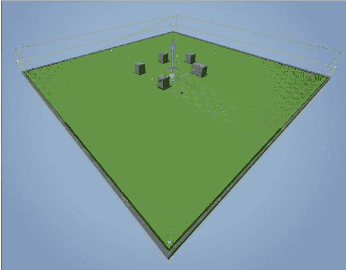

- **行为树**: 使用行为树影响AI的下一个目的地可以创造更丰富的玩家体验。它不仅计算请求的目的地，还决定AI是否应该带着侧手翻双后空翻、双手着地，或者三周空翻配爵士手势进入屏幕。

- **转向行为**: 转向行为影响AI在导航避开障碍物时的移动方式。这也意味着使用转向来创建你设定为攻击国王城墙的舰队编队。转向可以以多种方式影响角色的移动。

- **感官系统**: 感官系统可以提供关键细节，例如附近的玩家、音量、附近的掩体以及许多其他可改变移动的环境变量。至关重要的是，你的AI需要理解不断变化的环境，以免打破其作为真实对手的假象。

虽然实现AI导航并非所有这些组件都是必要的，但它们都提供可影响导航的关键反馈。在世界中导航仅受游戏内路径的限制。我们可以在此处看到几个成员跟随领导者的群体行为示例：

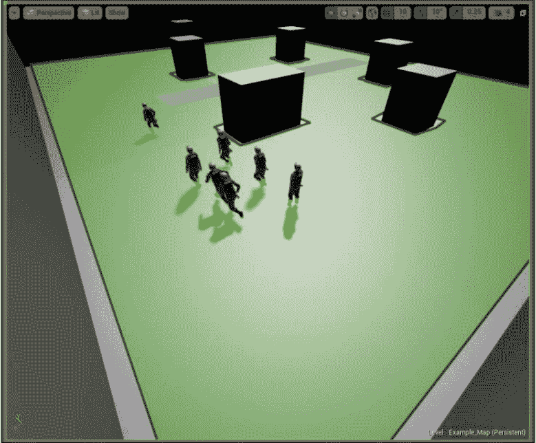

### 使用转向实现逼真的移动

当你想到转向对汽车的作用时，你会正确地想象将同样的理念应用于游戏AI导航。转向会影响AI前往下一个目的地时的移动。这些影响可以根据需要提供，但我们将介绍最常用的。避开（Avoidance）主要用于避免与迎面而来的AI相撞。群聚（Flocking）是转向中的另一个关键因素，有助于模拟有趣的群体移动，例如完全恐慌的情况，或鱼群。转向行为的目标是在玩家的世界中实现逼真的移动和行为。

### 使用随机性和概率创建角色

为AI赋予个性，正是随机性和概率为机器人决策能力所增加的内容。如果机器人始终以相同方式攻击你、始终以相同方式进入场景，并在每次成功命中后用笑声惹恼你，那就无法带来独特的体验。使用随机性和概率，你可以让AI基于概率发笑，或者为AI的技能选择引入随机性。应用随机性和概率的另一个极佳副产品是，它允许你引入难度等级或降低技能施放miss的概率，甚至允许机器人瞄准得更精确。如果你有四处游荡寻找敌人的机器人，可以使用概率和随机性配合机器人的感官输入，做出更合理的决策。

### 使用行为树创建复杂决策

**有限状态机（FSM）**是一个定义有限数量状态如何相互转换的模型。例如，这使得它可以从收集转换到搜索，然后转到攻击，如下图所示。行为树类似，但允许更多灵活性。行为树允许分层FSM，这引入了另一层决策。因此，机器人会在定义其当前状态的行为分支之间进行决策。UE4提供了一个名为行为树的工具。这个编辑器工具允许我们快速且轻松地修改AI行为。

下面是FSM模型的图示：

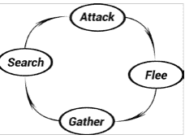

让我们来看看行为树的组件：

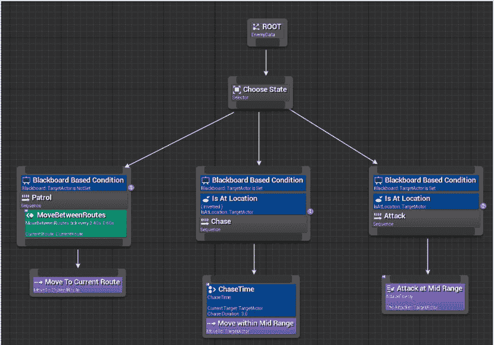

现在，我们将讨论UE4行为树中包含的组件。

### 根节点

这个节点是起始节点，向树中的下一个节点发送信号。它连接到一个复合节点，该节点开始你的第一棵树。你可能会注意到，需要先使用复合节点来定义树，然后为该树创建任务。这是因为分层FSM创建状态分支。这些状态将由其他状态或任务填充。这允许在多个状态之间轻松切换。你可以看到根节点如下图所示：

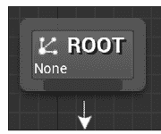

### 装饰器

装饰器是条件语句（节点顶部的蓝色部分），用于控制树中的分支甚至单个节点是否可以执行。我在将要制作的AI中使用了一个装饰器，告诉它更新到下一个可用路径。

在下图中，你可以看到位于复合节点顶部的“攻击与摧毁（Attack & Destroy）”装饰器，它定义了状态。该状态包含两个任务，攻击敌人（Attack Enemy）和移动至敌人（Move To Enemy），这两个任务也有一个装饰器，指示仅在机器人状态为搜索（Search）时才执行：

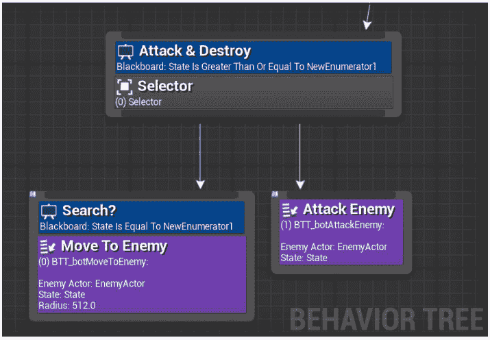

在上图中，你可以看到位于复合节点顶部的“攻击与摧毁（Attack & Destroy）”装饰器，它定义了状态。该状态包含两个任务，攻击敌人（Attack Enemy）和移动至敌人（Move To Enemy），这两个任务也有一个装饰器，指示仅在机器人状态为搜索（Search）时才执行。

### 复合节点

这些是状态的起始点。它们定义状态如何通过返回值和执行流来行为。主要有三种类型：选择器（Selector）、序列（Sequence）和简单并行（Simple Parallel）。这个起始分支有一个条件语句，如果状态等于或高于搜索状态：选择器从左到右执行其每个子节点且不会失败；但是，当其中一个子节点返回成功时，它会返回成功。因此，这适用于不检查成功执行节点的状态。下图显示了选择器的示例：

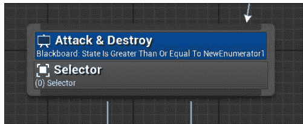

序列以与选择器类似的方式执行其子节点，但当其中一个子节点返回失败时，它会返回失败。这意味着要求所有节点都返回成功才能完成序列。你可以在下图中看到序列节点：

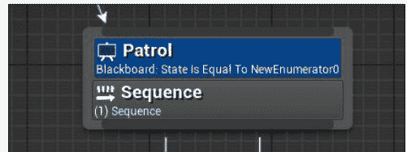

最后，简单并行允许你基本上同时执行一个任务和一棵树。这非常适合创建需要始终调用另一个任务的状态。要设置它，你需要先将其连接到它将执行的任务。连接的第二个任务或状态将与第一个任务一起继续被调用，直到第一个任务返回成功。

### 服务

只要服务添加到的复合节点保持激活，服务就会运行。它们按你在属性中设置的间隔进行Tick。它们还有一个名为Tick Interval的浮点属性，允许你控制此服务在后台执行的频率。在大多数情况下，服务用于修改AI的状态，因为它始终被调用。例如，在我们将要创建的机器人中，我们将向树的第一个分支添加一个服务，使其不间断地被调用，并能够维持机器人在任何给定时刻应处的状态。下图中的绿色节点是一个带有明确重要信息的服务：

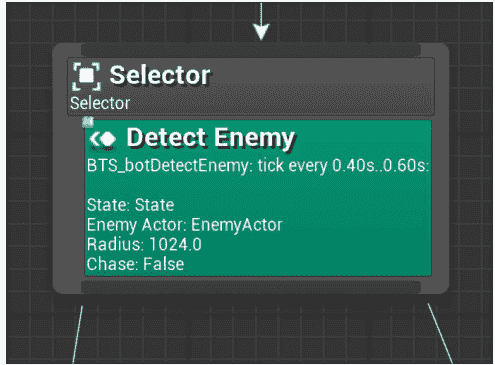

这个名为**检测敌人（Detect Enemy）**的服务实际上运行一个偏移循环，用于更新黑板变量，例如**状态（State）**和**敌方角色（Enemy Actor）**。

### 任务

任务完成具体工作并在必要时报告成功或失败。它们在行为树中拥有可引用的蓝图节点。使用任务时最常用的两种节点是：Event Receive Execute，用于接收执行连接脚本的信号；以及Finish Execute，用于发回信号并在成功时返回`true`或`false`。在为序列复合节点制作任务时，这一点很重要。

### 黑板

黑板是一种资产，用于存储 AI 行为树中要使用的变量。它们是在行为树外部创建的。在我们的示例中，我们将使用 **状态** 来存储一个表示状态的枚举变量，使用 **敌人角色** 对象来保存当前选定的敌人，并使用 **路由** 来存储 AI 被请求前往的当前路径位置，仅举几例。您可以按照如下所示，在 **黑板** 面板中查看所有当前变量作为键：

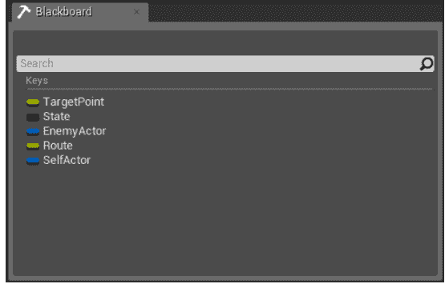

它们的工作原理只是将节点的公共变量设置为下拉菜单中可用的黑板变量之一。以下屏幕截图中的命名约定使此过程更加简化：

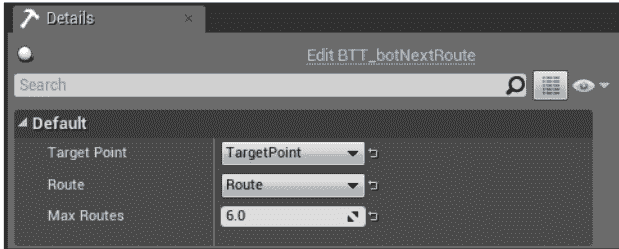

### 感官系统

感官系统通常由多个模块组成，例如视觉、听觉和记忆，以帮助 AI 捕获有关环境的信息。机器人可以利用环境中的声音，在与危险威胁交战或帮助呼救的附近队友之前，进行深思熟虑的风险评估，从而维持智能的假象。使用记忆将使机器人能够避开其记得曾经出现过严重威胁的区域，或冲回其上次看到队友的区域。针对敌方玩家创建感官系统在很大程度上取决于 AI 与玩家交战的环境。它需要能够寻找掩体、躲避敌人、获取弹药，以及您觉得能为游戏创造身临其境体验的 AI 的其他功能。具有能够挑战玩家的 AI 的游戏会创造独特的个人体验。一个好的感官系统会提供关键信息，从而构成反应式 AI。在本项目中，我们将使用感官系统来检测 AI 可以看到的控制体。我们还将使用函数来检查敌人的视线。我们将检查我们路径上是否有其他控制体。我们可以检查区域内的掩体和其他资源。

### 机器学习

机器学习是一个独立的分支。这种技术允许 AI 从情境和模拟中学习。输入来自环境，包括机器人做出决定性行动的上下文。在机器学习中，输入被放入分类器中，该分类器可以以一定的确定性预测一组输出。分类器可以组合成集成模型，以提高概率预测的准确性。我们不会深入研究此主题，但存在大量用于学习机器学习的资源，从教科书（Pattern Recognition and Machine Learning by Christopher M. Bishop, Springer）到在线课程（Machine Learning on coursera.org）。

### 追踪

追踪允许世界中的另一个参与者通过射线追踪来检测对象。会发出一条单线追踪，如果它与参与者发生碰撞，则将返回该参与者以及撞击信息。追踪被用于多种目的；在 FPS 中，它的一种用途是检测命中。您熟悉命中框吗？当您的玩家在游戏中射击时，会发射一条追踪，它与对手的命中框发生碰撞，从而确定对玩家的伤害，如果您足够熟练，会导致死亡。可用于追踪的其他形状，例如球体、胶囊体和盒子，允许针对不同情况进行追踪。最近，我为我的汽车使用了 Box Trace 来检测其附近的对象。

### 影响图

影响图不是一种有限的方法；其理念是地图上的特定位置将被赋予直接影响玩家或 AI 的信息。将影响图与 AI 一起使用的一个示例是存在感衰减。假设我们有一组其他敌方 AI；它们的存在图将在群组周围创建一个径向圆圈，强度基于群组的大小。这样一来，其他 AI 进入该区域时就会知道它们正在进入由其他敌方 AI 占据的区域。

实际信息并非人们使用它的唯一目的，因此只需理解它旨在提供另一层输入，以帮助您的机器人做出更多额外决策。如下图所示，不同颜色代表不同类型 AI 占据的区域，颜色强度表示相对于每个 AI 角色的影响力：

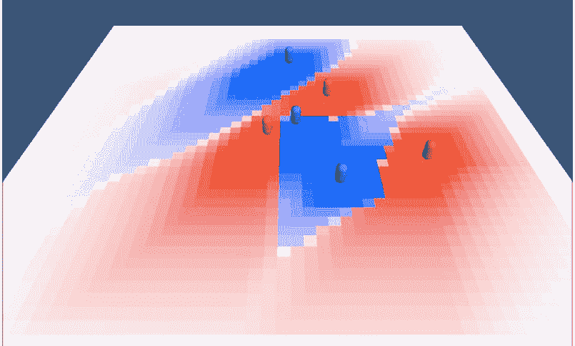

### 虚幻引擎 4 工具

虚幻引擎 4 提供了一整套工具，用于为您的游戏添加常见的 AI 功能。我们将在本书中详细介绍每个工具。以下是涵盖的工具列表：

- **行为树**：这用于创建不同的状态以及 AI 背后的逻辑。
- **导航组件**：这处理 AI 的移动。
- **黑板资产**：这些用于存储信息。它们充当 AI 的局部变量。
- **枚举**：这用于创建状态，您可以在它们之间切换。
- **目标点**：我们的 Waypoints 类派生自目标点类，我们将使用它来创建基本的路径节点形式。
- **AI 控制器和角色**：此控制器将处理世界与 AI 控制的控制体之间的通信。
- **导航体积**：这用于在环境中创建导航网格，以便为 AI 启用路径查找。

让我们看看以下屏幕截图：

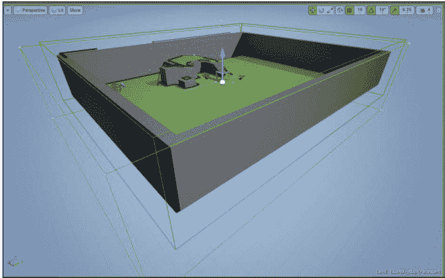

有两种类型的 NavMesh 体积。第一种，NavMesh 边界体积，定义了 NavMesh 的区域。Nav 修饰体积，当提供 Nav 区域类时，会在两者相交的地方影响 NavMesh 边界体积的导航属性。

### 总结

在本章中，我们首先介绍了游戏 AI 并讨论了它对游戏体验的重要性。然后，我们说明了大部分使用的游戏 AI 技术及其功能。还提到了相应的 UE4 游戏 AI 工具，以便对本书中将要涵盖的内容提供更全面的图景。在下一章中，我们将通过设置 AI 控制的玩家并为其添加一些简单行为来创建我们的基础 AI。
