## 2 创建基础 AI

在本章中，我们将逐步创建我们的第一个 AI，并讨论一路上演示的技术。因此今天，我们将直接进入虚幻引擎 4，使用创建具有随机移动的单状态所需的基本组件来为您的 AI 构建。然后，我们将回顾所做的工作、可以进行的更改以及所演示技术的缺点。

本章将涵盖：

- 设置我们的项目
- 创建 AI 控制器
- 使用 AI 控制器向控制体发送指令
- 创建小型蓝图脚本以协助导航

### 目标

本章的目标是在关卡中放置一个 AI 角色，该角色拥有蓝图来指示它随机且无限期地移动。我们将在本章中演示多种技术，以很好地掌握一些在游戏中常见的真正基础的 AI 技术。这些技术列表如下：

- 首先，我们希望在关卡中放置一个名为 Hero 的 AI 角色，该角色拥有蓝图来指示它随机且无限期地移动。我们将通过首先创建一个新的第三人称项目并为其取一个合适的名称来实现这一点。然后，我们将使用示例内容中提供的默认控制体作为机器人。我们将创建一个 AI 控制器来控制我们的控制体。然后，我们将为 AI 控制器提供指令，使我们的机器人随机且无限期地移动。

- 其次，我们希望 AI 角色沿着一些基本路径移动。例如，我们将让 AI 沿着墙壁向一个方向移动。我们可以使用现有的项目，并用新指令修改 AI 控制器。从此，我们的 AI 将沿着墙壁向一个方向无限期地移动。

- 第三，我们希望创建一个新的敌方 AI 角色，它会追逐我们创建的第一个 AI 角色——即 Hero。

> 我们需要对 Hero 进行额外更改，使其具有直接远离敌人奔跑的能力。

敌人将被简单地指示每秒朝 Hero 移动一次。

### 设置项目

让我们打开虚幻引擎 4！我们将从创建新项目的第一个流程开始。

> 我们将在本书中始终使用虚幻引擎 4.6.0。说明可能因版本而异。我们将在使用虚幻引擎 4 演示时展示我们行为背后的理念；因此，希望您能根据需要翻译这些说明。

这里，我们将使用第三人称射击模板，这使我们可以轻松观察角色在环境中的移动方式。执行以下步骤：

- 1. 如果您尚未进入新建项目窗口，请前往：

  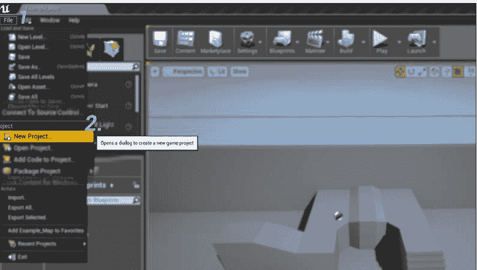

- 2. 选择第三人称蓝图项目：

  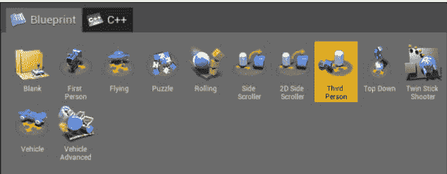

- 3. 按您喜欢的方式命名项目；我将我的项目命名为 ImprovedAI。然后，在窗口右下角点击“创建项目”。

### Environment

尽管我们使用的是第三人称蓝图模板，但这些技术也可以用于其他模板。你必须应用在这里所学的知识。话虽如此，你开始理解到，这些技术是工具。通常认为，了解如何创建状态、感官组件、导航组件等是一回事，但使用什么以及如何使用，取决于 AI 环境。

### Prerequisites

请注意，我的窗口和函数名称可能不同。我将带您了解我的设置，以便您可以拥有与我相同的配置。执行以下步骤：

- 1. 让我们转到编辑器偏好设置中的“常规 | 外观”，在“用户界面”下，选择“用户小型工具栏图标”选项，并取消选择“显示友好变量名”选项。您的设置应如下图所示：

  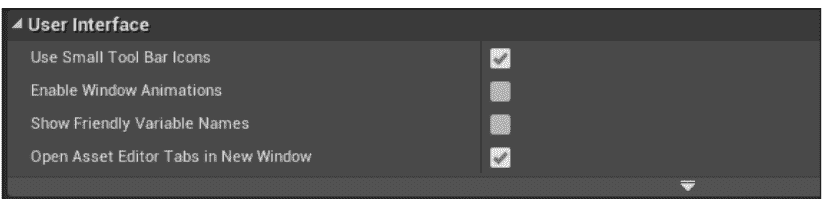

- 2. 在项目中导航到 **Blueprints** 文件夹：

  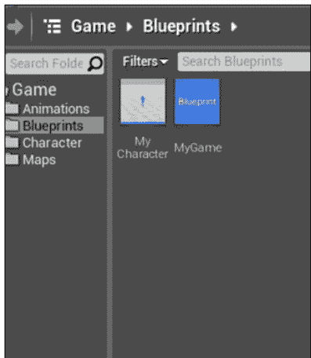

- 3. 现在我们将控制我们的载体。右键单击并点击 **Blueprint** 选项以创建蓝图：

  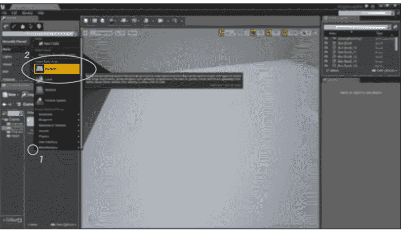

- 4. 接下来，我们将创建 AIController 类。转到自定义类并输入 AIController。选择它，然后点击“选择”，如下图所示：

  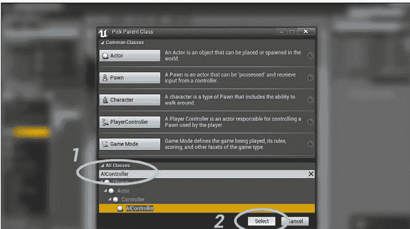

这将创建蓝图，我在此处将其命名为 MyController。

### Using our new AIController class

您是否注意到，一名玩家可以扮演任何他们想要的角色？这就是创建载体和控制器的层次结构。控制器是玩家在游戏大厅等待一段时间后继承的内容。它用于管理来自玩家的输入和连接。此类带有额外函数，可帮助导航机器人，并能为控制器分配行为树。在此演示中，我们将介绍 AIController 类的一些基础知识。

### Assigning the AIController class

现在，既然我们拥有创建 AI 所需的一切，我们将把 MyController 类分配给 MyCharacter 基础。为此，请转到 MyCharacter 蓝图中的“默认值”部分。搜索 AIController 类并将其设置为 MyController，如下图所示：

  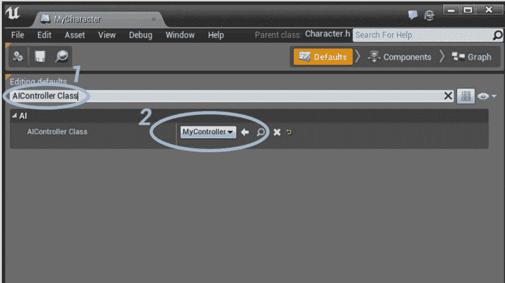

当角色未被控制时，它会自动由 AIController 控制。因此，通过我们刚刚所做的更改，控制我们 MyCharacter 蓝图的默认 AIController 类将是 MyController。

### Placing the pawn

我们假设您明白这样简单的任务！让我们通过从内容浏览器中拖放我们新设置的载体，将其放入这个明亮美丽的世界中：

  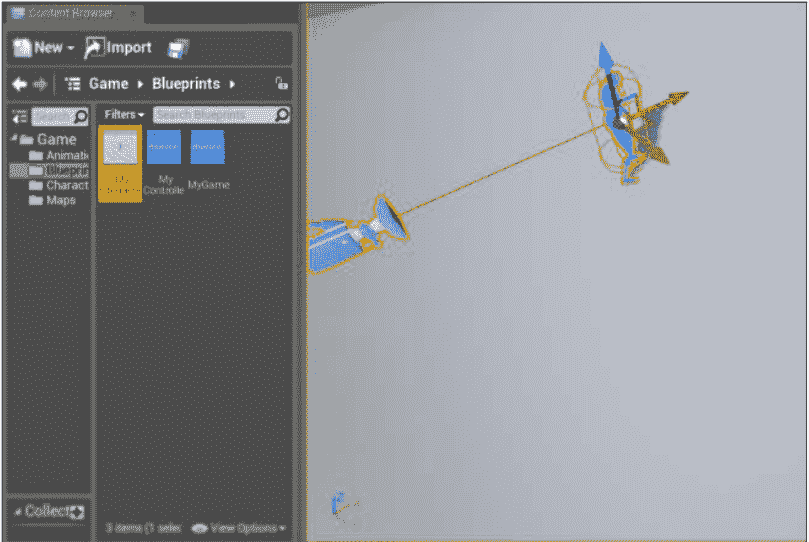

将 MyCharacter 蓝图拖放到关卡中以创建载体

> 有很长一串人因为崩溃和其他意外而丢失工作；如果您想加入他们，请跳过此步骤。否则，在对关卡进行重大更改时，请转到“文件 | 保存全部”。

### Sending the instructions

既然我们的项目已经设置并保存——或者对于我们那些勇敢的家伙来说，可能未保存——让我们继续进入有趣的部分：蓝图！让我们来看看发送指令的步骤：

- 1. 在 **内容浏览器** 中打开您的 `MyController` 蓝图，并缩放到 **EventGraph**：计划是让我们的机器人随机移动。这将以简单的方式构建，因此我们将手动进行计算。
- 2. 首先，让我们创建一个 **Event Tick** 节点，它将在游戏运行时的每一帧触发。
- 3. 我们将添加一个 **Delay** 节点，以接收来自 **Event Tick** 的信号，并将 **Duration** 引脚设置为 **1**。
- 4. 接下来，我们将添加一个 **Move To Location** 节点，它将向 `AIController` 类发送信号，指示其载体移动到指定的目标点。
- 5. 由于我们此时未使用 **Path Finding**（这是我们稍后将要涉及的主题），请转到 **MoveToLocation** 节点并将 **bUsePathFinding** 设置为 false 或保持未选中状态。

您的 `MyController` 类的 EventGraph 应类似于以下屏幕截图：

  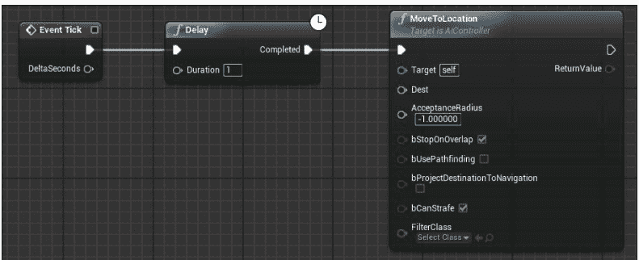

- 6. 在 **MoveToLocation** 节点准备就绪后，我们现在需要为其提供一个随机位置。我们将获取受控载体的当前位置，为 **X** 和 **Y** 变量创建一个值为 -255 到 255 的随机额外向量，并将 **Z** 保留为 **0.0**。然后，我们将受控载体的位置添加到我们刚刚创建的向量中。您的蓝图应类似于以下设置：

  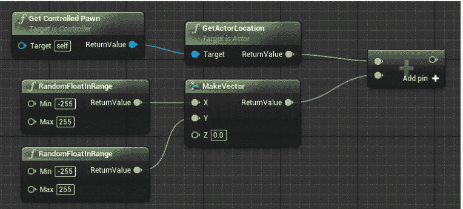

- 7. 让我们完成此步骤，并将这个新的随机位置蓝图移动到我们之前设置的 **MoveToLocation** 节点。现在，让我们将两个向量相加的结果连接到 **MoveToLocation** 节点的目标位置。完成后，您的蓝图设置应类似于以下预览：

  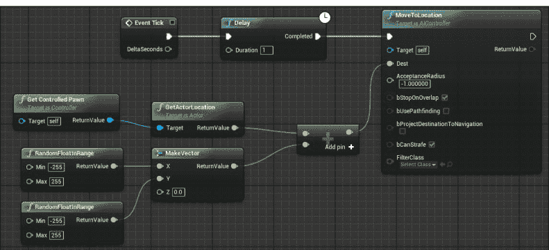

全部保存！

### Small tips on MoveToLocation

以下是 MoveToLocation 的一些基本提示：

- **AcceptanceRadius**：这允许您增加完成移动可接受的半径。假设有一个拿着剑的敌人想要攻击玩家。**AcceptanceRadius** 选项将帮助您定义该敌人应距离其目标多远——理想情况下为 1 米——然后执行挥剑的攻击动画。
- **bStopOnOverlap**：这告诉您的机器人，如果它与点重叠而不是精确地到达该点，则停止。这将考虑附加到机器人上的碰撞网格的半径。
- **bUsePathFinding**：如果选中此项，机器人将使用 **NavMesh** 选项来查找其目的地。如果未选中，机器人将简单地沿直线移动到目的地，不考虑任何障碍物。这在某些情况下有助于节省性能。
- **bProjectDestinationToNavigation**：这在使用前将位置投影到导航数据上。这有助于验证目标角色的位置——即它是否存在于可玩区域中。
- **bCanStrafe**：这决定 AI 是否可以在 **NavMesh** 上对角移动。
- **FilterClass**：这允许您使用 **AreaClass**，这是另一种影响 AI 导航的导航组件。这会更改 **NavMesh** 区域的排斥或独占访问等内容，并改变导航成本。

### Reviewing the current progress

您可以擦去额头上的汗水；艰苦的工作才刚刚开始。那么，我们迄今为止做了什么？

- 我们已设置 AI 项目
- 我们已使用新的 AIController 设置我们的载体
- 我们已使用 AIController 向我们的载体发送了指令

我们已经完成一半。这个简单的设置允许我们将所有指令放在 AIController 上，它将控制我们从示例内容中创建的载体。AIController 被分配给载体，这意味着多个载体可以共享同一个 AIController。如我们所见，我们的 AI 现在无限运行。完美！让我们继续进入本章的第二部分！

### Adding the challenge

现在，我们将向 AI 角色添加射线检测。在我们的演示中，我们将使用射线检测来检测载体前方的墙壁。在 AI 中使用射线检测的其他示例包括视线检查、获取表面旋转和获取附近的角色。

让我们返回到虚幻引擎关卡编辑器，并在 **内容浏览器** 中查找。执行以下步骤：

- 1. 将我们的 `MyController` 蓝图重命名为 `Hero`；此角色将在此场景中充当玩家。
- 2. 打开我们的 `Hero` 蓝图并转到 **EventGraph** 部分。
- 3. 现在，除了 **Event Tick** 和 **Move to Location** 节点外，删除每个节点。我们将用新的蓝图脚本替换这些节点：

  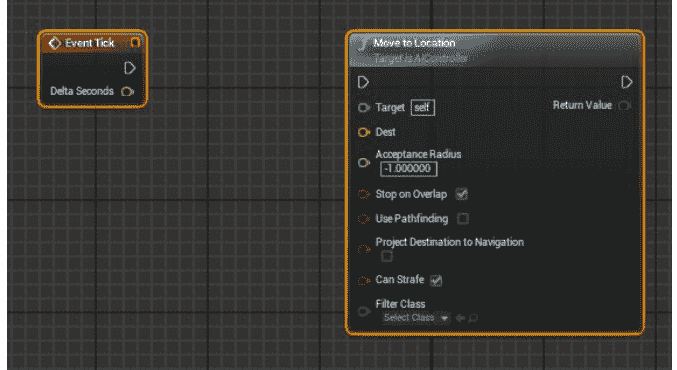

删除不必要的节点后的蓝图

- 4. 从 **Event Tick** 节点的返回执行引脚拖出并创建一个 **Delay** 节点。

- 5. 将 **持续时间** 值设置为 .05，以便其更新速度相对较快。
- 6. 现在，我们需要从 Pawn 获取位置以创建线追踪。当前方检测到碰撞时，我们还将使用右向量，使 Pawn 面向当前旋转的右侧。
- 7. 右键单击 **事件图** 并搜索 **获取受控 Pawn**。
- 8. 从 **获取受控 Pawn** 的 **返回值** 引脚拉出 **获取角色位置** 节点。
- 9. 从 **获取角色位置** 的 **返回值** 引脚拉出一个向量，然后将其放置在空白区域。
- 10. 搜索 **按通道线追踪**，它位于 **碰撞** 类别下，如下图所示：

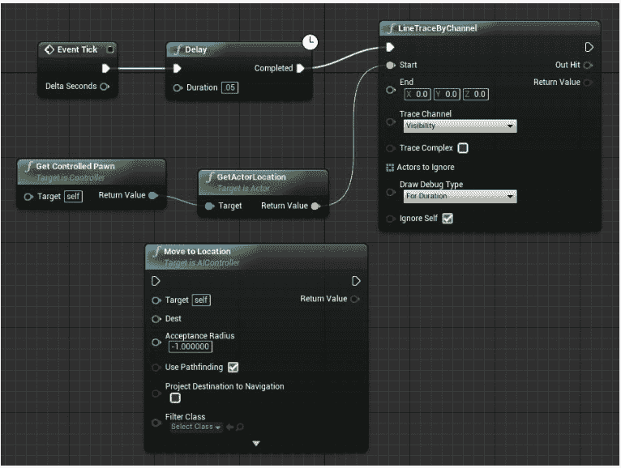

### 线追踪

我们将使用此功能从玩家位置向角色前方 255 单位进行追踪。如果有任何物体与追踪发生碰撞，我们将根据 Pawn 的旋转使其面向右侧。此简单检查足以让我们的机器人沿着墙壁无限期奔跑；因此，执行以下步骤：

- 1. 从 获取角色位置 拉出 返回值 引脚并放置。然后，搜索 向量 + 向量。
- 2. 我们现在需要选择 获取受控 Pawn，并从中拉出 获取角色前向量。它包含朝向 Pawn 前方的方向向量信息。
- 3. 因此，我们将 返回值 乘以 255。这是我们要添加到角色位置的向量。这会在 Pawn 当前位置前方添加 255 个单位。
- 4. 现在，我们需要获取 **按通道线追踪** 节点 **终点** 引脚的加法结果。这将直接在我们的 Pawn 前方进行追踪：

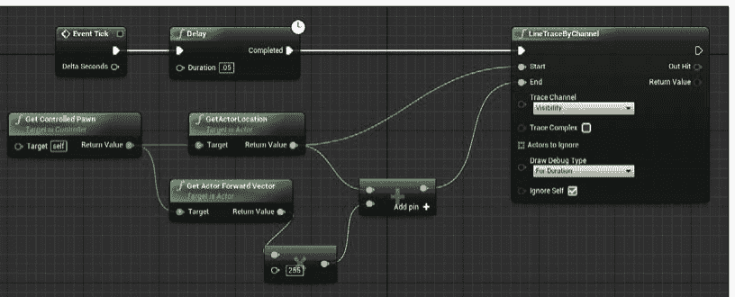

- 5. 再次从 向量 + 向量 节点拉出，这次我们将其插入到 **移动到位置** 节点的 **目标** 引脚中。这将使角色无限期向前移动：

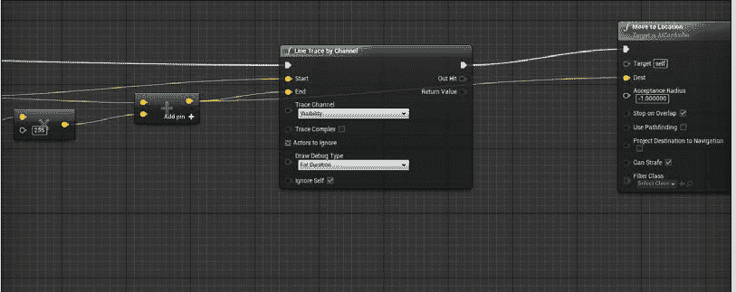

让我们试试吧！点击 **模拟**，观察你的角色无限期向前移动！唯一的问题是它目前还无法避开墙壁。我们将通过引入 **选择向量** 节点来改变这一点，当 **线追踪** 检测到碰撞时，该节点会选择不同的方向：

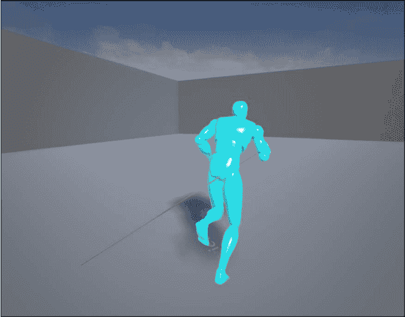

- 6. 再次，我们将从 **获取受控 Pawn** 节点拉出并搜索 **获取角色右向量**。
- 7. 从此节点，我们将拉出向量并将其乘以 512。
- 8. 我们将此添加到 Pawn 的当前位置。因此，类似于之前向前移动的做法，我们将向 Pawn 当前位置的右侧添加 512 个单位：

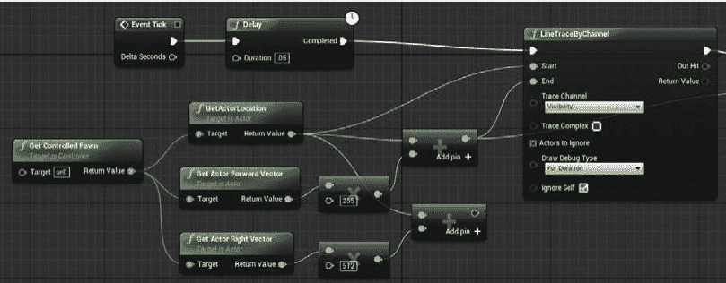

- 9. 在 **事件图** 部分右键单击并搜索 **选择向量**。
- 10. 从 **按通道线追踪** 节点拉出 **返回值** 并将其连接到 **选择向量** 节点。然后，选择 **A**。
- 11. 现在，从右侧位置拉出到 **选择向量** 节点的 **A**。
- 12. 然后，从前方位置拉出到 **选择向量** 节点的 **B**。
- 13. 选择 **选择向量** 节点，并从 **返回值** 拉出到 **移动到位置** 的 **目标** 引脚。
- 14. 选择节点并创建注释：

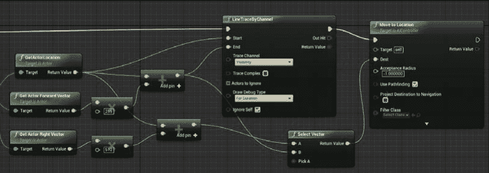

让我们看看在游戏中是这个效果：

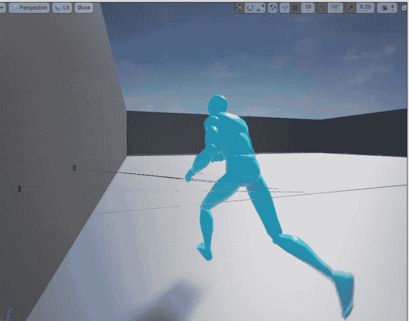

似乎运行完美！这将为本项目的下一次添加创建追逐效果。

### 审查当前进度

现在，我们已经创建了 Hero 角色，虽然他并不算什么英雄，只是无限期奔跑，但那是另一个故事。以下是当前的更改：

- 我们更新了 AI 指令
- 我们演示了一个基本的感官组件

现在，让我们继续创建敌人 AI。

### 敌人逻辑

敌人需要能够找到并朝 Hero 奔跑。我们将通过搜索 Hero 角色、计算方向差异，并使敌人面向 Hero 来实现这一点。

### 添加敌人 AI

让我们回到虚幻引擎并关注内容浏览器。我们现在需要一个对手。要添加它，请执行以下步骤：

- 1. 右键单击并选择 蓝图。
- 2. 在窗口的下端，让我们放下所有类并搜索 AIController。
- 3. 在 Controller 下选择 AIController 并在右下角点击 Select。
- 4. 我们将此 AIController 命名为 Enemy。
- 5. 打开 Enemy AIController 并转到 事件图 部分。

首先，我们必须找到 Hero，然后将其存储在局部变量中以便随时使用。要执行此操作，请执行以下步骤：

- 1. 在 事件图 的空白区域右键单击并搜索 开始玩游戏时。
- 2. 从 exec 引脚拉出并搜索 获取指定类的所有角色。
- 3. 将 角色类 引脚设置为 Hero。
- 4. 从 **输出角色数组** 拉出并搜索 **带中断的 ForEach 循环**：

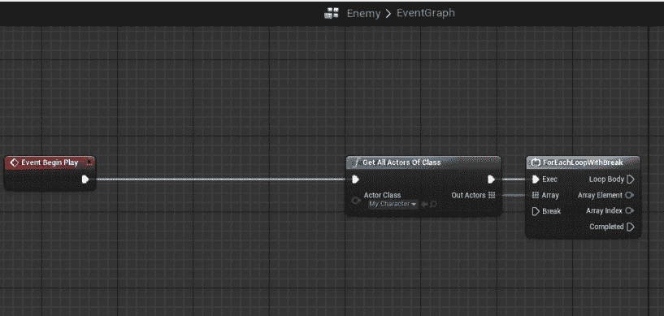

我们想要在返回的 `MyCharacter` Pawn 中为 `Hero` 类添加过滤器。要执行此操作，请执行以下步骤：

- 1. 从 **数组元素** 引脚拉出并搜索 **转换为 MyCharacter**。
- 2. 然后，从 **作为 MyCharacter** 引脚拉出并搜索 **获取控制器**。
- 3. 使用 **获取类** 节点获取控制器的类。
- 4. 使用 **类 = 类** 节点比较 `Hero` 类。
- 5. 从 **相等** 的返回值创建一个 **分支** 节点。
- 6. 从 **循环体** 引脚链接新创建的分支。
- 7. 从 **分支** 节点的 **真** 执行引脚创建 **设置** 节点。
- 8. 然后，从刚才创建的纯 cast 拉出到 **设置** 节点。

- 9. 我们想要对此进行注释并将此部分命名为 查找 Hero：

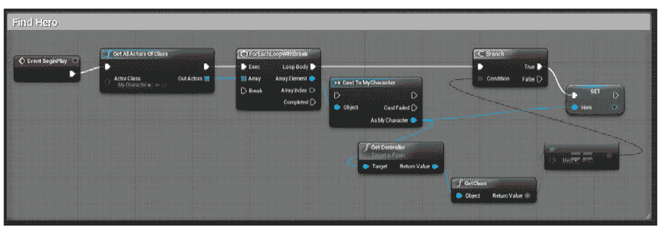

我们现在需要不断更新敌人的指令，使其朝向正在逃跑的 Hero 角色移动。请注意，有一些节点可以直接实现这一点，例如 Simple Move to Actor、AI MoveTo 等等。我们将实现类似行为，以让您了解这在内部是如何完成的。执行以下步骤：

- 1. 在 **事件图** 部分右键单击并搜索 **每帧事件**。
- 2. 从 exec 引脚拖放并搜索 **延迟**。
- 3. 将 **持续时间** 引脚设置为 .05 秒。
- 4. 从 **完成** 拉出并创建新节点 **移动到位置**：

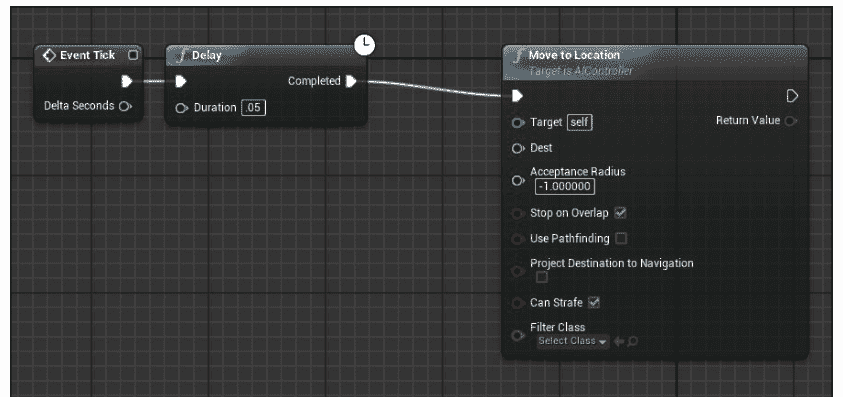

现在，我们需要获取从 Enemy 到 Hero 的方向，并沿此方向移动 Enemy。我们可以这样做：

- 1. 获取 `Hero` 变量并将其放置在 **延迟** 节点附近。
- 2. 从 `Hero` 变量获取角色的位置。
- 3. 从 **获取角色位置** 节点的 **返回值** 拉出，放置并搜索 **获取方向向量**。
- 4. 现在，右键单击并搜索 **获取受控 Pawn**。
- 5. 从 **获取受控 Pawn** 的 **返回值** 引脚拉出并获取 **获取角色位置**。
- 6. 然后，从 **获取角色位置** 节点的 **返回值** 引脚拉出并插入到 **获取方向向量** 节点的 **起点** 引脚中。
- 7. 从 **获取方向向量** 节点的 **返回值** 拉出并使用 **根据 X 生成旋转**。
- 8. 从 **根据 X 生成旋转** 拉出并使用 **获取前向量**。
- 9. 现在，从 **获取前向量**，我们将其乘以 **255** 以获取前向量方向上的 **255** 个单位。
- 10. 最后，我们将此添加到 Hero Pawn 的 **获取角色位置** 节点。
- 11. 加法的结果是 **移动到位置** 的目标：

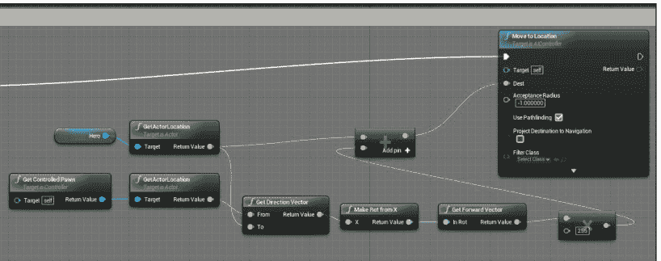

- 12. 现在，在此周围放置注释并将其命名为 `追逐 Hero`。

全部保存！

现在，返回到 视图 部分并点击 **模拟**。您现在应该看到我们的 Hero 角色正在向前奔跑，并在检测到前方有障碍物时向右转弯。我们的 Enemy 角色正在紧随其后快速追赶。现在，想象一下如果你处于 Hero 角色的位置；你将会感到极度恐惧！

### 摘要

这里我们演示了如何创建一个追赶玩家或另一个 AI 的敌人 AI。这种行为可用于创建挑战并为玩家提供反馈，从而带来更好的游戏体验。AI 当然可以更加复杂，但只有在需要改善游戏体验时才应这样做。在下一章中，我们将向 AI 角色添加随机性和概率，以使其行为更加有趣。

