## 添加随机性和概率

在本章中，我们将介绍随机性和概率技术，可用于为原本完美的AI增加随机性、机会和特色。我们将先进行一个简要的“概率入门”来解释一些基本概念；接着，将演示如何使用Stream来控制数字的非均匀分布，并利用这些结果来展示概率。我们将介绍这些技术在虚幻引擎4中的应用。最后，我们将在敌人AIController的基础上，让它随机执行一个动作。

本章将涵盖：

- 概率、概率分布和非均匀分布
- 在UE4中使用RandomStream为我们的AI增加随机性
- 为基于状态的敌人AI添加随机行为

### 介绍概率

我们知道一个事件会发生，但它发生的频率是多少？这就是我们量化概率的方式，也是我们将用来控制结果频率的方法。比方说，我们抛一枚25美分硬币。我们知道会发生的事件是正面（H），但它也可能落在反面（T）上。因此，我们书写落在正面上的概率的方式是 P(H) = ?

此刻，我们知道正面会出现，尽管我们仍不知道它出现的频率。为了理解这一点，我们必须首先获得满足我们条件的可能结果的数量，对于正面来说是1。然后，我们必须获得等可能发生的事件数量，即2。因此，现在我们需要将这些代入概率公式：

```
#### of possible met conditions / #### of equally likely outcomes
```

如果我们做一些基本数学并进一步分解，我们将得到50%：

```
P(H) = 1/2 = 50%
```

也就是说，如果你抛一百万甚至十亿次硬币，抛得越多，结果就越接近50%的事件平均落在正面和反面上。这在控制函数执行的概率时很有用。

在我们的示例中，我们将演示一种彩票类型的概率。我们确定获得金色的概率是20%，即小数.2。我们将生成一个0到1之间的随机数。我们得到.19，中奖了！我们再掷一次，得到.57，没中奖！

这些是控制AI执行流程的一些方法。你还可以将此应用于与特定AI特性直接关联的其他行为。因此，如果该角色属于某个特定职业，某些怪物可能会更害怕该职业的角色。

### 概率分布

数字的概率分布意味着我们知道等可能结果的有限数量。因此，例如，如果我们有一个拥有大量武器的怪物，我们会使用它。我们不希望怪物死亡时所有武器都掉落。不过，如果我们只是应用一个简单规则来限制掉落的武器数量，那么获得稀有剑和没人想要的糟糕剑的机会仍然是相等的。

假设我们将概率分布应用于武器选择。场景如下。我们有50%的物品等级从糟糕到一般，35%的物品等级从良好到最佳，最后稀有物品占15%。现在，我们将生成他们可以获得的武器随机数量，并使用概率分布生成所选的单个物品。

### 非均匀分布

数字的非均匀分布意味着我们不会知道结果的有限数量。我们知道0到1之间的数会被生成，但不知道0还是1更有可能被生成。也就是说，这非常适合创建许多不可预测的场景。在UE4中，我们有典型的Random和RandomStream工具。两者之间的明确区别在于，我们可以控制生成随机输出的种子。

换句话说，非均匀分布是生成不等可能发生的数字的随机过程。随机性的真实行为可以被复制，但代价是时间和效率。因此，我们提出了生成随机数的算法。UE4提供的生成随机数的工具之一是RandomStream。

### 虚幻引擎4中的RandomStream

假设你想冻结你创建的随机生成的树木。通常，当使用UE4武器库中的随机节点时，退出游戏后此信息会丢失。使用RandomStream，你可以实际保存生成随机输出的种子，并通过调用该种子加载相同的随机输出。因此，在UE4中，你会找到一个名为Make RandomStream的蓝图节点。该节点有一个名为Initial Seed的输入引脚。

我们使用种子的原因是这是一个伪随机数生成器。这意味着数字是计算出来的并且是确定性的。伪意味着我们将使用算法来计算随机性；然而，通过计算随机性，我们在技术上事先就知道它会是什么，因此使其成为确定性的。对比的是真随机性，它会捕捉森林、瀑布、大气层甚至电视频道的噪声。之所以这会无限更加随机，是因为捕捉到的噪声不太可能重复，就像生活中的许多事物一样。通过计算，总是存在容量限制，因为任务是以极低成本复制现象。最初，当我们创建计算机时，内存非常重要——它现在仍然很重要。但到了这个阶段，我们创建了算法来替代存储噪声的需求，但我们更倾向于拥有一个密钥或种子，因为我们更熟悉它们。之所以它可以被视为密钥，是因为拥有它，两台不同计算机上的人可以生成相同的随机数。

从技术上讲，如果我们将种子长度增加到指数级高，它在实践中将是无限随机的。你必须添加这一点，因为我们知道有明确的结束，而生活则没有有限的结束。因此，在UE4中，随机化种子将直接影响计算数字的随机性。这就是我创建实践中不可预测随机性的方法。

### 计划

我们将从*第2章，创建基础AI*中断开的地方继续，并继续对我们的两个AIController进行更改。在上一章中，我们设置了敌人无限追逐我们的英雄。在本章中，我们将向敌人AI引入另一个状态，这将允许它要么远离我们跑，要么向我们跑。这代表了敌人攻击我们或逃跑，具体取决于我们遇到敌人时的惊吓概率。

让我们开始吧！

### 添加漫游

在这里，我们将定义三种AI状态。这将使在不同状态下指定动作变得更容易。现在，我们将添加的第一个状态是漫游。它将使AI随机且无限地移动。这将是AI的初始状态，一旦我们接近AI，它就能够转换到其他状态。另外两个状态是我们给予AI的两种反应。其理念是，当我们接近AI时，它有机会逃跑或攻击。这个机会就是我们在蓝图中确定和创建的概率。

### 设置项目

打开虚幻引擎4！执行以下步骤：

- 1. 首先，我们需要将敌人更改为表现得像一个漫游的受惊怪物。因此，双击**敌人** AIController。现在，导航到**事件图**并放大。
- 2. 我们想要为**状态**创建一个新变量，并将其设置为**整数**。
- 3. 接下来，我们需要修改**查找英雄**脚本。我们将调整它以检测英雄。我们还想保留追逐英雄的蓝图。这将用于追逐我们或受惊地逃离，即相反的情况。所以，专注于脚本。
- 4. 从脚本开头删除**开始时事件**。接下来，从**追逐英雄**脚本中拉回**事件Tick**。
- 5. 替换**追逐英雄**脚本中**事件Tick**节点之后的**延迟**节点，并放置一个**整数开关**节点。然后，拉取**状态**变量并将其连接到**选择**值引脚：

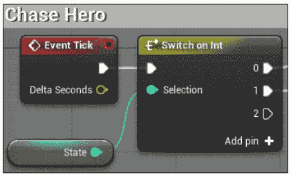

> **整数开关**是一个非常有用的函数。我无数次使用它来替代你通常可以在多个步骤中完成的冗余工作，例如在进入下一个索引之前重复执行任务多次。

- 6. 现在，AI将基于**状态**不断执行Tick。将执行不同的脚本，它们之间可以进行转换，这是有限状态机的基础。
- 7. 接下来，让我们将我们的两个脚本合并到**整数开关**节点。我们希望**查找英雄**脚本连接到节点的索引**0**。然后，将节点的索引**1**连接到**追逐英雄**脚本。因此，你可以按**Ctrl**并单击索引**0**，在将索引**0**连接到**获取所有指定类的角色**后，将**移动到位置**移动到索引**1**。


- 8. 因此，我们需要检查从 Get All Actors Of Class 找到的 Actors 元素的距离，然后，如果某个 Actor 在范围内，我们将计算转为 Attacking 状态或远离此 Actor 的几率：

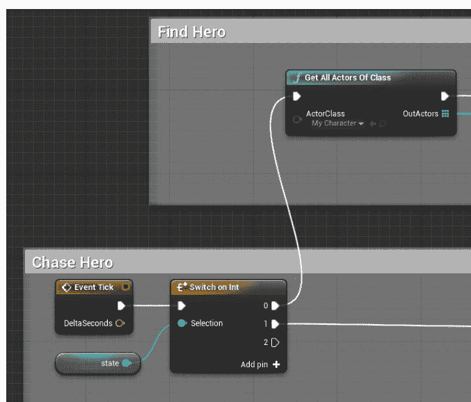

- 9. 现在，关注 ForEachLoopWithBreak，并使用 Get Horizontal Distance To 节点检查当前 Actor 元素的距离。放置此节点以及 Get Controlled Pawn，并将其连接到 Get Horizontal Distance To 的 Target 引脚。

- 10. 从 Array Element 引脚连接到 Get Horizontal Distance To 的 Other Actor。我们希望 Actor 处于的距离为 512 单位。因此，从 Return Value 拉出线，输入小于（<）符号，并将其与 512 进行比较。再说一次，我们想要做的是确保我们永远不会逃离自己。

- 11. 使用 Not Equal 节点将 Array Element 节点与 Get Controlled Pawn 进行比较。然后，创建一个 AND 门节点并连接两个布尔结果。从 AND 门节点的结果创建一个 Branch 节点。这个 Branch 节点应位于 Get Horizontal Distance To 之后。

### 创建概率

我们即将创建的 Blueprint 脚本演示了一种简单而有效的概率。该系统基于简单的 0-1 彩票并带有变体的理念。首先，你确定函数将返回 TRUE 的几率。接下来，你确定彩票将跨越的范围，默认值为 1。其余部分留给脚本。它现在获取 Change Weight 和 Number Span，然后计算一个偏移量。从那里，我们将从 Chance Weight 计算一组概率范围。然后，我们将在 Number Span 的范围内生成一个随机数，并检查它是否在我们之前确定的概率范围内。这个小变体使概率不那么可预测。以下图片显示了简单的彩票概率脚本，用于检查确定的概率范围内的随机值：

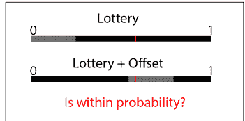

注意第二个中的 Offset from Lottery，它落在 true 上。下次，概率范围将不存在，并且将计算一个新的随机值。

### 带有 RandomStream 的非均匀分布

我们要做的第一件事是初始化 RandomStream。我们可以通过创建 Make RandomStream 节点并将初始 seed 引脚填充为 Range 中的随机整数来实现这一点。RandomStream 允许我们控制输出的随机生成。如果我们不在 RandomStream 中更改 seed，它将不断产生相同的结果。因此，出于这个原因，我们必须不断在流中重置 seed，以便随机输出发生变化。执行以下步骤：

- 1. 重新将焦点放回 Enemy AIController，创建 Random Integer in Range 并将 Max 值设置为 65535。然后，从 Return Value 拉出线并输入 Make RandomStream。

- 2. 现在，我们需要创建变量来更新 RandomStream。创建一个默认值为 0 的 Offset 浮点数。然后，创建一个默认值为 .25 的 ChanceWeight 浮点数。创建一个默认值为 1 的 Max N 浮点数。

- 3. 然后，创建 Event Begin Play。拖出 Offset 变量并创建一个 SET 节点。从 Event Begin Play 的 exec 引脚拖动到你刚刚创建的 SET 节点。接下来，从 Stream 中创建 Random Float in Range，并从 Return Value 拉出线到 Offset 浮点数：

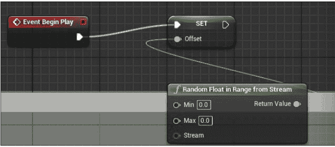

- 4. 我们现在需要将我们的 RandomStream 插入此节点，并将 Max N 变量连接到 Random Float in Range from Stream 的 Max Float。这将在游戏开始时创建一个随机偏移量。

- 5. 现在，让我们开始概率脚本。让我们获取我们的变量并从 Stream 中创建 Random Float in Range。然后，我们要从此创建两个节点来比较 Return Value。我们要检查该值是大于还是小于。然后，拉出一个引脚并创建一个 AND 逻辑门。最后，拉出另一个布尔比较。

- 6. 接下来，将 AND 的结果拉到一个新的 Branch 节点。我们接下来需要做的是将随机结果与使用 Offset 计算出的 Lottery Probability Range 进行比较：

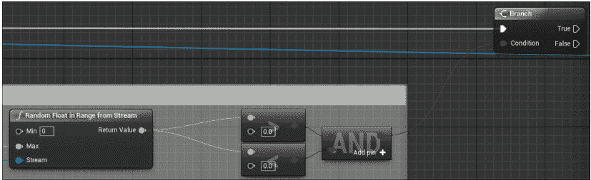

- 7. 所以，从变量中获取 **偏移量**。我们想将其放入模运算（%）中，然后将其连接到大于（>）比较节点。

- 8. 接下来，我们想从变量中获取 **概率权重**。然后，我们将用 **最大 N** 值乘以它来计算概率范围。我们将对计算结果做两件事，如下一步所示。

- 9. 首先，我们想从 **最大 N** 值与结果中获取差值。然后，我们将其连接到模运算（%）。

- 10. 接下来，我们想将概率范围添加到模运算（%）的结果中。然后，我们将其管道传输到 clamp 中以确保安全。我们将 **最小值** 设置为 0，**最大值** 设置为 **最大 N**。此 clamp 的结果插入到如下所示的比较节点的小于（<）中：

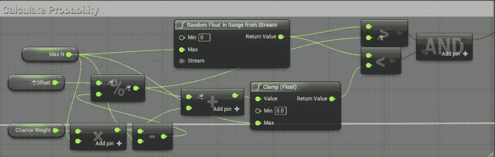

### 创建转换

转换有助于将适当的动作应用到 AI 环境中所感知的内容上。它们还继续执行流程，这就是有限状态机如此特别的原因。我们将在项目中应用此功能，转换为 Flee 或 Attack 状态，过一段时间后，它将计算是应该逃跑还是继续攻击。一旦未找到敌人，AI 将转换回游荡状态。执行以下步骤：

- 1. 所以，从我们上次创建的 **分支** 节点，让我们在 **分支** 节点的 **真** 引脚上设置我们的 **状态** 变量。然后，我们将在 **分支** 节点的 **假** 引脚上设置另一个 **状态** 变量。从那里，让我们将 **真设置状态** 值设置为 **1**，然后将 **假设置状态** 设置为 **2**。

- 2. 接下来，让我们将我们的 **英雄** 变量重命名为 **目标** 以使其更易于处理。接下来，我们想要在另外两个 **设置状态** 变量之后设置 **目标**。

- 3. 然后，我们想将两个 **设置状态** 变量节点连接到 **设置目标** 变量节点。**设置目标** 节点应设置为 **中断 ForEachLoopWithBreak**。

- 4. 现在重置 RandomStream。让我们缩小并找到 Event Tick 节点。从那里，让我们拉出引脚并在 Switch on Int 之间创建 Sequence。

- 5. 从 Sequence 节点的 Then 1，让我们创建 Duration 为 0.2 秒的 Delay。然后，从 Make Random Stream 的 Return Value 拉出线并找到 Reset Random Stream。这将重置流，如果你像我们一样连接了 Random Integer in Range，它将在每次重置时生成一个新的随机 Int。

- 6. 将此插入 Delay 之后，以便每秒重置一次。然后，我们想要从 reset 拉出线到我们从 Event 创建的 SET 节点的 offset 变量：

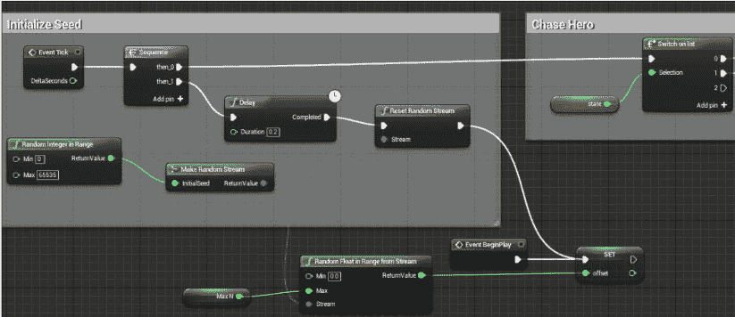

将 offset 设置为随机值

- 7. 现在，让我们通过从 Switch on Int 节点的 index 1 拉出线来创建一个新的 Sequence 节点。然后，将 Switch on Int 节点的 index 2 连接到之前的 Sequence 节点。

- 8. 现在，让我们从 Sequence 节点的 Then 1 拉出线并创建一个 Delay 节点。此节点将我们的 AI 转换回 Wandering 状态，从此处可以再次检测敌人。

- 9. 所以，让我们从 Stream 中创建 Random Float in Range 并将 Stream 连接到我们之前创建的 Random Stream。然后，将 Min 值设置为 3，Max 值设置为 5。

- 10. 在 Delay 节点之后，将 State 变量设置为 0。然后，将 Target 设置为 none：

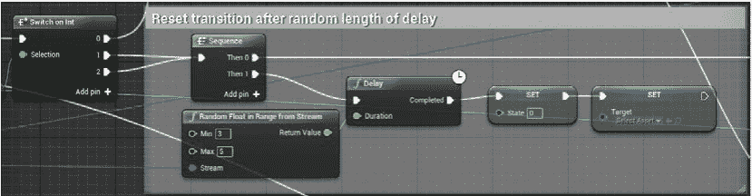

### 逃跑和攻击

所以，我们将从我们的旧部分获取并添加一个小变化，这将使角色远离 Target 而不是向它跑动。这基本上将演示你可以给 AI 各种刺激的反应的概率。执行以下操作：

- 1. 我们将获取我们的 State 变量。然后，我们想要从中减去 1，得到 0 或 1 索引。接下来，我们想要创建一个 Select 节点并将减法的结果插入该节点。

- 2. 从那里，我们想要 Option 0 为 1，Option 1 为 -1。这将使角色要么 Run 要么 Flee 远离 Target。现在，缩小到 Get Direction Vector 节点。

- 3. 让我们将 Return Value 乘以 Get Direction Vector 节点的结果。你必须首先将 Int 转换为 Float。然后，将此乘以向量。然后，将向量拉回 Make Rot from X：

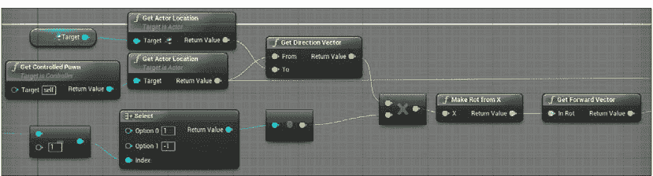


### Back to the action

让我们重新关注底部的Enemy EventGraph。我们想要实现一种让AI漫游的方法。执行以下步骤：

- 1. 首先搜索Get Controlled Pawn。
- 2. 接下来，我们要对受控pawn执行Get Actor Location。然后它返回的矢量将连接到Vector + Vector节点。
- 3. 然后，我们要创建一个Random Unit Vector节点，以在每个单独轴上生成0-1之间的随机矢量。
- 4. 我们必须再次从Stream变量拉取，并创建Random Float in Range from Stream。将Min值设置为-550，Max设置为550。然后，我们要将其返回值乘以Random Unit Vector。
- 5. 最后，将乘积矢量添加到第2步中创建的Vector + Vector节点：

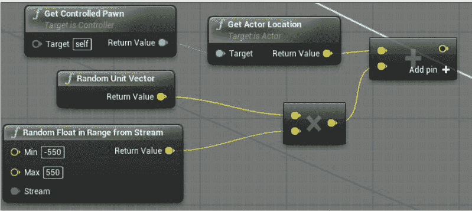

- 6. 现在，我们需要获取Vector + Vector节点的结果，并创建一个移动到位置节点，以指示被控制的pawn移动到该矢量所指定的位置。
- 7. 我们将回头查看我们的第一个状态，它会检查半径内的Actors。在ForEachLoopWithBreak完成后，我们希望它执行移动到位置。因此，从那里拉线，首先创建**执行一次**。
- 8. 我们这样做是因为我们不希望不断地让机器人移动到某个位置；我们宁愿在随机延迟后执行此操作。因此，现在将Completed引脚连接到移动到位置。
- 9. 然后，我们要分配一个新事件。该事件将在随机延迟后重置**执行一次**。因此，在**事件开始播放**之后，我们要创建**分配移动完成**。
- 10. 从**接收移动完成事件**创建一个**延迟**节点。从**持续时间**节点拉线，我们要查找**来自流的范围内随机浮点数**。我们要将**最小值**设置为**2**，**最大值**设置为**5**。
- 11. 创建**延迟**节点后，我们要将其连接到第7步中创建的**执行一次**节点的**重置**：

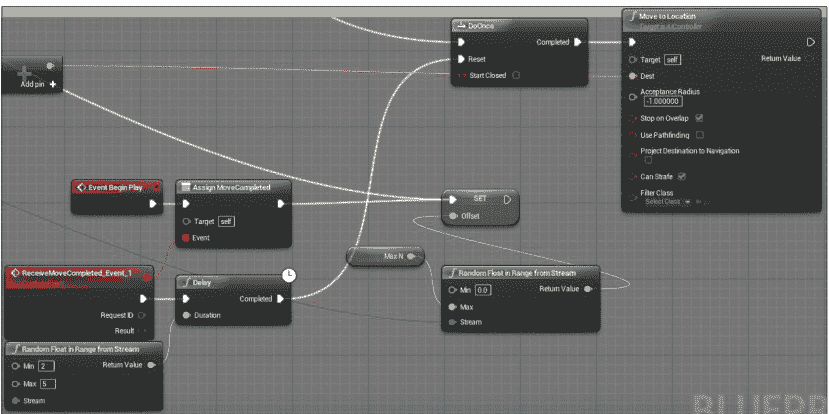

### The results!

现在，我们应该能够设置AI逃跑的概率。这个概率脚本通过概率范围的随机变量偏移变得不那么可预测。我们通过创建一个有限状态机来实现这一点，该状态机在任何给定时刻在必要的状态之间切换。场景是我们正在接近漫游的AI，一旦进入范围，AI将要么攻击，要么逃跑。我们默认给了它25%的逃跑几率。AI逃跑后，重置机器人状态的计时器开始。几秒钟后，AI返回到漫游状态。

### Summary

在本章中，你了解了随机性和概率及其量化方法。我们使用了Unreal Engine中的工具来应用这些理论。我们通过伪随机数生成器来理解这一点，并且从技术上讲，我们在由种子定义的有限光谱上计算了随机性。我们可以使用这些非均匀数字来创建概率函数，该函数告诉AI要么攻击，要么逃跑。你还学习了在设置过程中创建FSM以创建AI的状态。

在下一章中，我们将探讨向游戏中的pawn引入运动的不同技术。我们将介绍路径查找、导航网格、EQS以及其他直接影响运动的相关组件。
