## Introducing Movement

在本章中，你将学习如何在Unreal Engine 4中向我们的AI角色引入运动。我们还将介绍允许我们指示角色在2D平面上导航到某个点的基本算法。我们将使用其他工具来帮助我们的AI在指定路径上导航。

本章将涵盖的主题包括以下内容：

- 路径查找
- 导航网格
- 导航和导航修饰符
- Blueprint导航节点

### Overview

在本章中，运动将是主要目标。我们如何实现运动或使用其他工具引入运动是我们必须提出的问题。既然你对AI中使用的一些工具已经比较熟悉了，我们就必须让AI能够执行其最常见的动作：运动。我们用来向AI引入运动的系统称为路径查找。

路径查找的工作方式是获取指定为可遍历空间内的位置。这些起始和结束位置被输入到一个计算两个位置之间最短路径的函数中。该算法使用相对位置信息，例如是否被对象或角色阻挡，并阻止该位置被遍历。在尝试在具有动态移动对象的世界中生成路径时，这非常有用。

### Path Finding

我们将把路径查找的操作分解为协同工作的不同组件。第一个组件是NavMesh，它表示可遍历路径。这不是唯一的可导航网格生成组件，但也是可导航网格最常用的表示。另一个组件是NavMeshModifiers，可以服务于不同的目的。几个示例如下：

- * **影响映射**：这允许你根据AI在NavMesh上的位置向其提供输入信息
- * **空路径**：这些简单地允许你切除NavMesh的区域
- * **允许路径**：这些简单地允许你阻止任何未获授权在此NavMesh区域导航的AI

### The A* algorithm

路径查找系统的核心是一个计算NavMesh上两点之间最短可导航路径的算法。Dijkstra算法以计算机科学家Edsger Dijkstra命名，他最初在1956年创建了它，后来于1959年发表它来寻找两点之间的最短路径。有几个值得提及的路径查找算法，但在游戏中最常用的是Dijkstra算法的一个变体。该变体称为A*算法。A*的工作方式是拥有一个可遍历点列表。然后，从起始位置，我们想要在每个可用方向上搜索最短路径。我们可以通过启发式值来确定这一点。这些值将告诉我们基于某些预定义规则，遍历到下一个点的代价是多少。在A*中，我们从一个点遍历到另一个点以减少探索成本。两个算法之间的巨大区别在于A*中你有一个启发式值，它会影响你的路径决策。启发式值是前往下一个可能点的预测代价的障碍。当路径生成时，我们想要最低的启发式值。因此，这意味着通过将启发式值设置为0，该算法与Dijkstra算法相同。Dijkstra算法扫描更多节点，通常使其效率较低，因为它不预测遍历路径的代价。

让我们将以下网格作为示例：

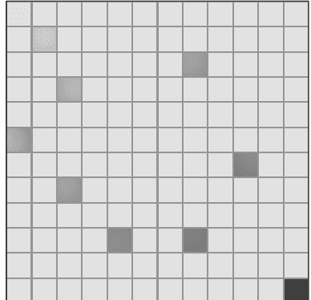

Dijkstra算法会考虑每个可用点。因此，在这个示例中，我们将从左上角开始，试图到达右下角，所有相邻节点都被视为相互连接且可以相互遍历。执行以下步骤：

- 1. 该算法扫描所有可用节点，保留找到的最短路径记录。不同灰度的节点表示算法必须探索不同位置来找到路径：

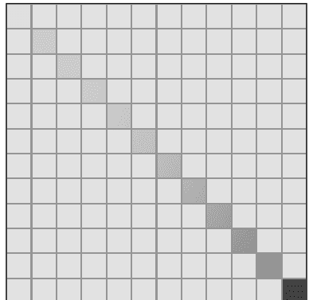

- 2. 一旦发现目标，将启动回溯序列，从而创建路径。

这可能需要很多步骤，这就是我们在A*中采用启发式的原因。我们不是搜索每个节点，而是将继续从当前最短路径向目标前进。

以下网格展示了A*的示例。算法将从第一个节点（左上角）开始，然后扫描相邻节点以计算移动代价。代价最小的节点将被选中，未被选中的节点将被放入已扫描节点列表中。这样就避免了我们为该查询再次访问这些节点：

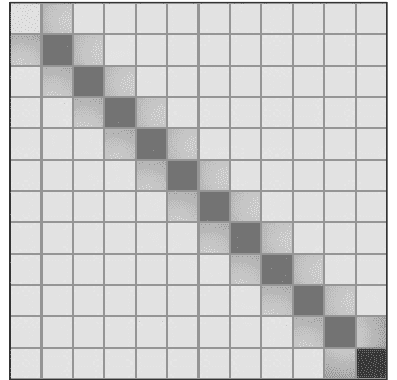

从步骤1开始，将扫描相邻节点并检查启发式值或路径代价，以确定下一个最佳步骤。结果是一条直接路径（如果无障碍）。

还有其他可用算法，但A*易于实现且不耗费资源，因此它通常在游戏引擎中作为在网格上在两点之间创建路径的一种方式实现。

### 导航网格

在虚幻引擎 4 中，导航网格允许我们告诉引擎可遍历路径应在哪里生成，我们可以优化它，以帮助为我们的 AI 生成更准确的路径。我们将简称为“NavMesh”，因为大多数游戏开发者都熟悉这个术语。如果你在虚幻引擎中，导航到 **Volumes** 下的 **Modes** 面板，你将看到 **NavMeshBoundsVolume**。这是一个你可以用来覆盖几何体并在其上生成导航网格的体积。我有一个示例，展示它的样子。如果你无法看到 NavMesh 生成的绿色网格，请确保在屏幕上的 **Show** 菜单中勾选 **Navigation** 选项（按 `P` 作为快捷键）：

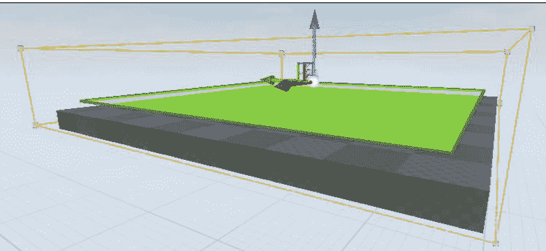

### RecastNavMesh

在每个关卡中，你会在世界大纲中看到名为 **RecastNavMesh-Default** 的节点。如果你点击它，可以探索影响关卡中导航网格的默认选项。

如果向下滚动到 **Generation**，这就是你将根据需求开始调整的内容。如果你在运行时重建时想要获得更多性能，或者想要代理移动的精度，请尝试优化这些值：

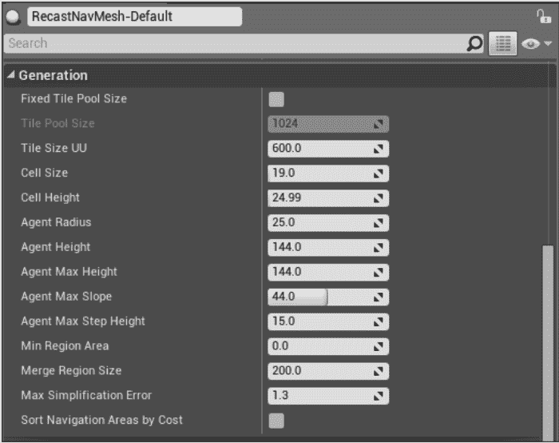

我将简要介绍一些属性，让你了解它们的作用以及如何影响性能。让我们看看 **RecastNavMesh** 中的一些最重要属性：

- **Cell Size**：这是体素的 2D 大小，基本上是一个 3D 像素，表示可导航的空间。这是体素的底面积。这与导航网格的分辨率直接相关。这里更小的尺寸会生成更多体素，从而获得更好的移动精度。不幸的是，由于这一点，导航网格生成期间性能会受到影响。
- **Cell Height**：这是体素的高度。此值与 **Agent Max Step Height** 相关联，建议将其保持在其一半的值。如果 **Cell Height** 值不比 **Agent Max Step Height** 至少少 .1，则不会生成导航网格。
- **Tile Size UU**：当此值较低时，会提高导航网格生成性能。尝试启用 **Draw Poly Edges** 以查看效果。
- **Agent settings (Radius, Height, Max Height, Max Slope, Max Step Height)**：特定于你的代理，应适当指定。
- **Min Region Area**：这会去除导航网格生成中看似无关紧要的碎片，这些碎片不足以进行导航。

如果你的导航网格中有任何障碍物，并且导航网格是在障碍物上方生成的，则该对象被视为几何体。为了更好的性能，你可以将网格设置为动态障碍物。这将防止导航网格在其上方生成。现在，要影响该区域，你还必须为 **Box Collision** 属性设置 **Offset** 和 **Extent** 值。请看下面的截图：

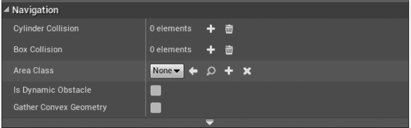

让我们逐步演示：

1. 让我们创建一个新的 **Box Collision** 元素。这将用一个包含两个值的元素填充数组。
2. 我们需要将 **Offset** 值设置为导航网格宽度、长度和高度一半的负值。**Offset** 值是碰撞开始的位置。
3. 接下来，将我们的 **Extent** 值设置为导航网格宽度、长度和高度的一半。**Extent** 值是它从导航网格中心点延伸的量。这意味着它与体积大小的一半相关联。

在这个导航网格中，例如，我已相应地设置了属性；请看：

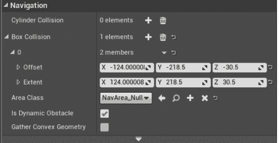

如下图在游戏中所示，正确位置受我们在 **Is Dynamic Obstacle** 选项上设置的 **NavArea_Null** 类影响：

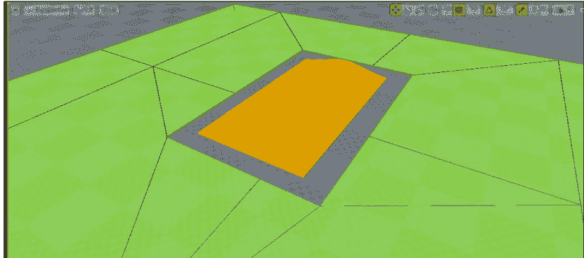

### 移动组件

移动组件是动画背后的驱动力。与其他类型的移动组件类似，例如车辆的移动组件，我们将提供输入，这些输入随后会与后端的其他组件通信，以正确模拟动画或齿轮比变化。这意味着其他功能也可以影响拥有移动组件的控制体。因此，如果我们的行为树告诉 AIController 关注另一个控制体，AIController 将影响其所控制控制体所面向的方向。这意味着不必显式地将这些信息告诉你的控制体，非常有用。

### AIController

我们在第 2 章“创建基础 AI”和第 3 章“添加随机性与概率”中曾使用 AIController 来移动我们的控制体，但从未花时间去了解虚幻引擎 4 内部发生了什么来实现这一点。有了这种理解，你就可以扩展移动组件，例如，当你想要创建移动组件的特殊扩展以支持接收诸如 Move to Location 之类的指令来用于车辆时。

AIController 是专为 AI 构建的控制器。与 PlayerController 类似，它控制当前拥有的控制体。主要区别在于 AIController 自带一些函数，允许你使用 Move to Location 之类的工具来移动 AI。使用 Move to Location 时，你可以指定 Acceptance Radius 值、是否使用路径查找（Path Finding）以及其他有用选项。还有一个 Move to Location 的简化版，它有时以牺牲无法更改选项为代价，提供更平滑的移动。这意味着所有选项都是默认值，如 Move to Location 节点所示。

它被称为 **Simple Move to Location**，位置如下图所示：

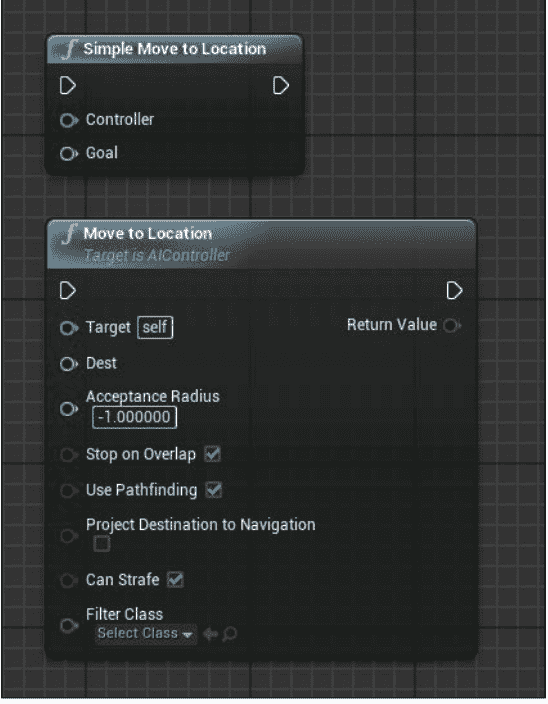

### 开始！

打开虚幻引擎 4，让我们创建一个新的第三人称模板项目。我们希望这样做，以便可以将第三人称控制体作为我们 AI 控制的控制体之一。因此，按如下截图选择设置并点击 Create Project：

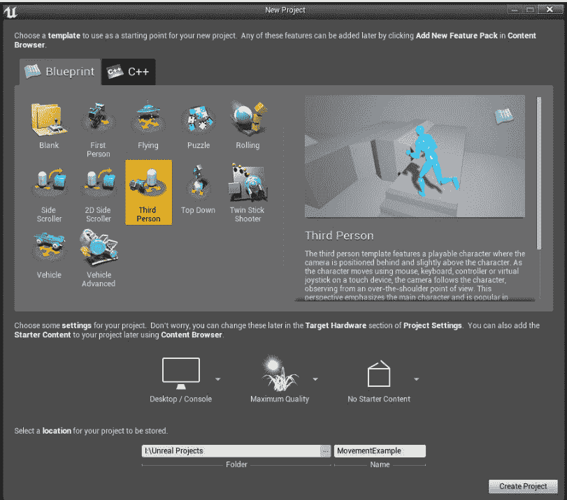

接下来，我们想要创建新的 AIController，它将负责指示我们的控制体在两个点之间移动。计划是引入一些障碍物，以查看我们可以对 AI 的路径产生的影响。执行以下步骤：

1. 首先进入 **Blueprint** 文件夹。右键单击以创建一个新的 AIController 类并将其命名为 `SoldierAI`。此 AIController 将负责导航初始内容提供的控制体。
2. 删除 Content Example 最初在关卡中设置的控制体。然后，我们想在关卡中面对面放置两个新的 **ThirdPersonCharacter** 控制体。接下来，我们想打开这个 **ThirdPersonCharacter** 蓝图并访问其默认值。
3. 从此处，找到此控制体的默认 AIController，并将此值更改为我们名为 `SoldierAI` 的新 AIController 类。这将确保我们的控制体始终与我们的 AIController 一起生成：

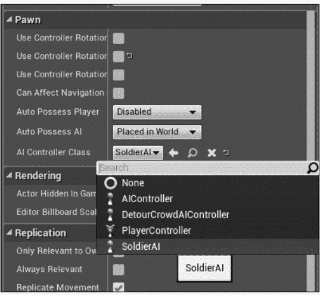

全部保存！让我们继续本章的下一部分！

### 路点

在本章中，路点表示机器人导航到的点。我们将对路点进行额外更改，以限制谁可以遍历这些点。这将通过在单个路点上创建一个演员数组来建立。当控制体访问可用路点列表时，它们只会添加它们被允许的路点。执行以下步骤：

1. 首先在与之前相同的 **Blueprint** 文件夹中开始。右键单击它并创建一个新蓝图。转到 **Custom Classes** 并选择 **Target Point** 演员。我们将使用它提供的精灵图。
2. 将这个新的 **Target Point** 子类命名为 `waypoint` 并点击 **Okay**。
3. 打开我们的新 `Waypoint` 自定义蓝图，创建一个名为 `Allowed Access` 的新公共 **ThirdPersonCharacter** 控制体数组变量。然后，选择 **Editable**，以便我们可以直接在虚幻编辑器中修改此值：

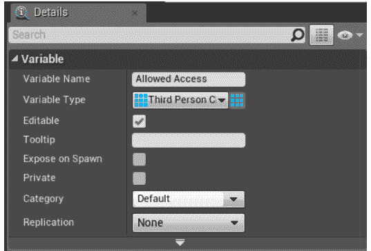

4. 现在，在世界中放置一些路点，我们想尝试使其随机化。这将允许我们在本章后面讨论其他主题时，对控制体的路径有更多控制。
5. 我选择在我的世界中放置七个路点，并让它们共享大约三个，以在路径中创造一些独特性。因此，在一个节点内，让我们添加先前在世界中放置的两个可用控制体。

### 导航

现在我们已在世界中拥有士兵，希望将它们导航到各自的路点。这将通过我们在士兵上设置的 AIController 完成。如果我们再次关注 Unreal Engine，就可以开始了！请遵循以下步骤：

- 1. Open the AIController class we created earlier and named `SoldierAI`.
- 2. Then, we want to navigate to the **事件图** section. From there, we want our AIController to begin navigating to its first route as soon as it possesses a worthy pawn. So, let's add an event to drive this action (I encourage the use of events). The one we are looking for is called **拥有时事件**. This will also return the pawn it possessed, which we can use to compare with the `Allowed Access` list from waypoints.
- 3. Pull from the exec pin, and let's assign a new event called **接收移动完成**. This event will continue the pawn to the next route as soon as it completes the previous one:

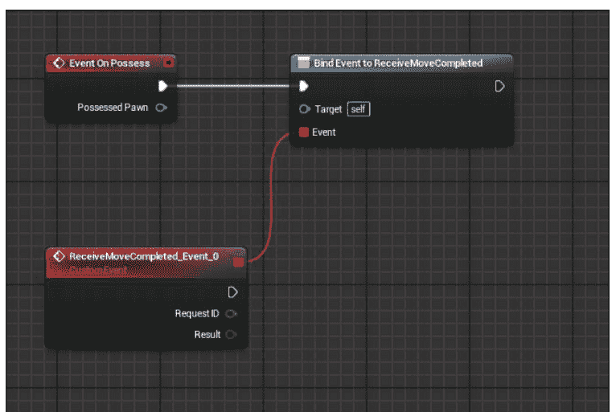

- 4. Now, after the **绑定事件** exec pin, let's put in **仅执行一次** to prevent this from being called twice.

- 5. Next, let's right-click, search for the **获取类的所有 actor** node, and select our custom blueprint called **路点**. We want to now search through the available list of waypoints and check whether we're allowed to navigate there.

- 6. So, create a **foreach 循环** node from the **输出 actor 数组** array and pull the **允许访问** array from **数组元素**. Then, we want to pull the pawn returned from the **拥有时事件** variable and cast it to the 第三人称角色 pawn.

- 7. From there, let's try to find the pawn in the **允许访问** array. The array will return -1 if nothing is found, which means that we do not have access!

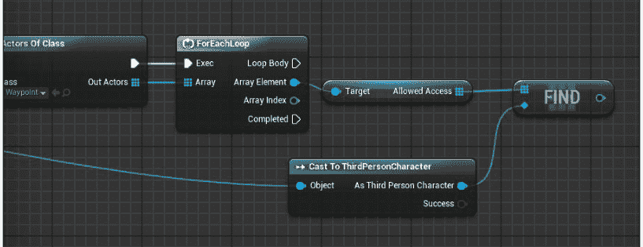

- 8. We need to pull a **整型不等于整型布尔值** operation and compare our results from **查找** with -1. This will then be pumped into a **分支** node.

- 9. Now, when this **分支** node returns **真**, this means that we are allowed to navigate to the current **数组元素** pin, and we should add it to our points to navigate to.

- 10. Now, let's create a new **路线** array on our pawn to hold the waypoints we can navigate. Then, we will pull this node to the **分支** node we just created and pull **添加** from the array node. This will allow us to quickly access the routes we have assigned to us.

- 11. Now, we need to tell the pawn to navigate to the waypoint after this operation is completed. This can be done by pulling another **路线** array out past the last nodes we placed.

- 12. We want to shuffle our **路线** array so that our next destination is random. You can do this by pulling from the array and searching for **洗牌**. This should be called last before our next operation:

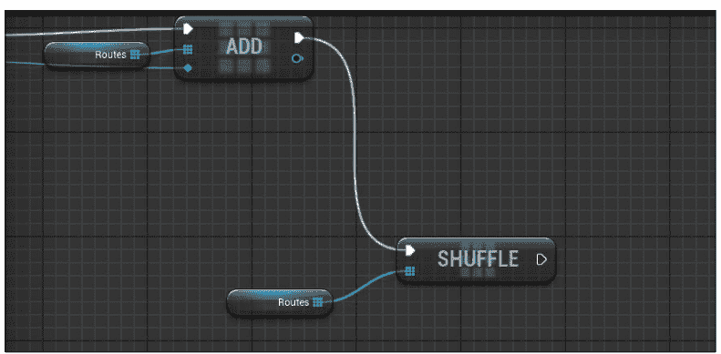

- 13. Next, we have the location that the pawn needs to go to, and we need to tell the pawn to move. We have two options: the first is to provide the **移动到位置** node with a location, and the second is to provide an actor and allow the engine to handle finding the destination. I will choose the latter for this example.

- 14. Right-click and search for the **移动到 actor** node, and we want to pump the first actor in the index from the **路线** array we created earlier:

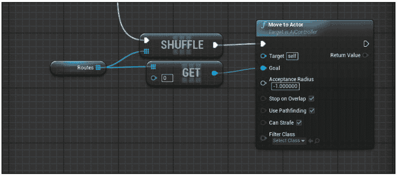

- 15. From there, let's track back to our **接收移动完成** event and pull from this to our **洗牌** node. Now that this is completed, we want to go back to the editor. Let's simulate and see what AI does!

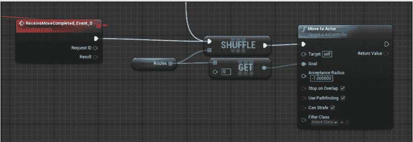

Now, let's get back!

### 导航修改器

Do you remember when we talked about heuristics? Navigation Modifiers allow you to directly affect the cost of navigating areas in which the modifier directly overlaps. You can also represent this affected area with a new color.

你还记得我们讨论过启发式吗？导航修改器允许你直接影响修改器直接重叠的区域的导航成本。你也可以用新颜色表示这个受影响的区域。

Now, in our example, we will analyze the behavior of AI as it traverses the different Navigation Modifiers we set up. What you want to understand from this is that heuristics help to find an optimal solution faster than Dijkstra's algorithm alone while utilizing the same method of discovery.

现在，在我们的示例中，我们将分析 AI 在遍历我们设置的不同导航修改器时的行为。你想从中理解的是，启发式比仅使用 Dijkstra 算法更快地找到最优解，同时利用相同的发现方法。

So, for example, if you have a cityscape and want your AI to stay on the sidewalks and out of the streets as much as possible, you could place Navigation Modifiers in the streets, which makes traversing the area highly costly. So, your AI will only ever traverse these areas if the appropriate path is blocked off by other high costs, such as obstacles.

例如，如果你有一个城市景观，并且希望你的 AI 尽可能待在人行道上而避开街道，你可以在街道上放置导航修改器，这使得穿越该区域成本很高。因此，你的 AI 只有在适当的路径被其他高成本（例如障碍物）阻断时，才会穿越这些区域。

Now, let's head to Unreal Engine 4 editor and get ready to create our own obstacles to see this behavior in action. We will also touch on **导航修改器体积** and how you can use it in Unreal Engine 4.

现在，让我们前往 Unreal Engine 4 编辑器，准备创建我们自己的障碍物来观察这种行为。我们还将涉及 **导航修改器体积** 以及如何在 Unreal Engine 4 中使用它。

### 回到编辑器

Let's navigate and look at the **模式** window. In the first tab, we want to click on **体积**. Now, within **体积**, you'll see 导航修改器体积, and this will need to be dragged into the level:

让我们导航并查看 **模式** 窗口。在第一个选项卡中，我们想要单击 **体积**。现在，在 **体积** 中，你会看到 导航修改器体积，这需要被拖入关卡：

- 1. Drag **多个导航修改器体积** into the level. We want these volumes to block the direct paths between the waypoints we created earlier.

- 2. So, after dragging the volumes out, we should have some nice separation between **导航修改器体积** and **路点**. The screen should look similar to the following screenshot:

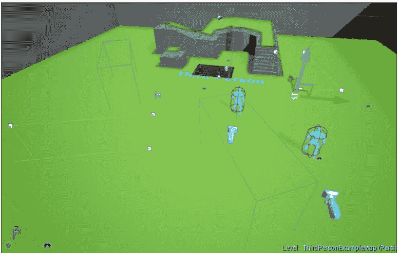

- 3. Next, we need to create **导航区域**, which will override the properties of the Navigation Mesh that **导航修改器体积** overlaps.

### 导航区域类

This class is responsible for applying the adjusted cost of NavModifierVolume. This also goes to say that NavModifierVolume is used to affect the Navigation Mesh.
NavArea classes are used explicitly to override properties or functions in the affected Navigation Mesh. Today, we will create two NavArea classes to represent two different types of environmental situations. One will be the representation of water and the other, mud. The theory behind this is that water would have a high entry cost because it is not as fast as stepping in mud, but mud would have a low travel cost increase because it's not easy to walk in.

这个类负责应用 导航修改器体积 的调整成本。这也意味着 导航修改器体积 用于影响导航网格。
导航区域类用于明确覆盖受影响的导航网格中的属性或函数。今天，我们将创建两个 导航区域 类来表示两种不同的环境情况。一个代表水，另一个代表泥浆。其理论是，水会有较高的进入成本，因为它不像踩在泥浆中那么快，但泥浆的行进成本增加较低，因为在泥浆中行走不容易。

With this in mind, let's move on to the next step, which is creating different NavArea classes to apply to our NavModifierVolume actors:

考虑到这一点，让我们继续下一步，即创建不同的 导航区域 类以应用到我们的 导航修改器体积 actor 上：

- 1. Right click on our Blueprint folder within Content Browser and go to Blueprint Class.
- 2. From there, we want to go to Custom Classes at the bottom of the window.
- 3. Search for NavArea, and let's create a new subclass from this.
- 4. After creating one more NavArea, let's name one AreaOfMud and the other, AreaOfWater.
- 5. Double-click on AreaOfMud, and let's go to Default Properties.
- 6. In there, you will see Default Cost and Fixed Area Entering Cost.
- 7. We want the Default Cost value to be 2.5, and this will affect the NavModifierVolume actor it belongs to.
- 8. For Fixed Area Entering Cost, we will leave this at 0.0 for mud. Lastly, change the Draw Color color so that we know what's affecting the Navigation Mesh. As we stated earlier, entering mud is relatively easy in comparison to water:

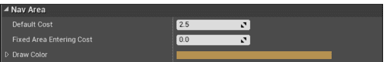

- 9. Let's close this and then open AreaOfWater.
- 10. We want to change **默认成本** to **1.5**, and let's change **固定区域进入成本** to **35**. These values could be tuned according to the specific game you are working on. And of course, change **绘制颜色** to something similar to light blue to represent water.
- 11. Save and close and then go back to the editor!
- 12. Now, let's go and apply these NavAreas to the NavModifierVolumes we placed on the level earlier.
- 13. Once you do that, you should now see **绘制颜色** updated. Let's hit **开始游戏** and now observe our AI!

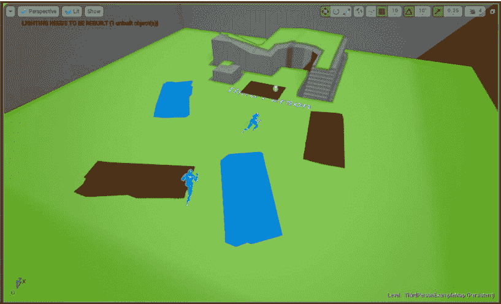

### 导航开销

由此可见，AI完全按照你的预期行动。它会避开泥地，因为在遍历NavModifierVolume时会应用开销，有时，水域的固定区域进入开销也会劝退AI，不过大多数情况下，AI仍会被发现穿越水域，因为一旦进入，一切就都没问题了！这通常就是我的诀窍。所以说这些，希望你已经理解了A*算法及其寻找最优路径的搜索过程。

### 总结

在本章中，我们介绍了用于控制和影响AI移动行为的不同工具，使用NavModifierVolumes和其他recast属性。我们还学习了如何指示受控AI的pawn导航到属于它们的航点。最后，我们介绍了更多基础知识，例如最初由Edsger Dijkstra创建的寻路算法。接下来，我们了解到可以优化他的原始算法以换取性能和资源，并通过启发式方法实现这一点。

在下一章中，我们将创建行为树，并运用前几章所学的知识来创建一些有趣的AI交互。我们还将利用虚幻引擎4提供的感官系统。
