## 5 赋予AI选择权

在本章中，你将学习如何使用行为树为角色引入自主行为。行为树是一种方法论，它允许你以可视化方式查看AI逻辑。行为树是一种分层任务网络，导致面向状态的设计。因此，每个状态将决定我们当前的任务，而不是目标。

本章将涵盖：

- 行为树
- 黑板
- 行为树的组件，包括选择器、装饰器、服务等
- 构建在狗角色上运行的行为树

### AIController中的行为树

在本章中，我们将使用行为树和脚本来创建我们的自主面向状态行为。然而，在实现对AI的更高级别控制之前，让我们先了解一些允许我们控制AI的基本组件。从一开始，我们就有AIController，它类似于PlayerController；这个控制器负责解释我们所有的AI输入。当我们请求移动时，这个输入由世界应用。

牢记这一点，我们可以通过代码中的多种途径引入影响。我们可以告诉AIController移动到某个位置，或者告诉AIController运行行为树。同样重要的是要理解，移动是通过CharacterMovement组件应用的。如果你从CharacterMovement创建了子类，你可以在理论上扩展并继续使用相同的行为树来引入移动。其中一个例子是我为虚幻引擎4开发论坛创建的汽车AI项目。

该链接为 https://forums.unrealengine.com/showthread.php?25073-UPDATED-5-16-A-I-Templates-Bot-Car-amp-Flying-AI。

内部移动组件负责从行为树获取移动到请求。因此，这让我能够告诉我的汽车前往特定位置，知道何时完成，并简单地重复该过程。如果你正在尝试创建AI，这非常强大，因为你需要做的大部分事情就是移动。

### 创建行为树

进入行为树部分，让我们开始构建我们的第一棵树！在本项目中，我们将创建类似社区狗行为的AI。它会不定期随机更改其行为状态，并继续搜索任何可能在其狗笼附近逗留的邮差。

这将涉及使用环境查询系统（EQS），它是虚幻引擎4中仍处于实验阶段但功能强大的特性。它将负责给狗提供一个新位置来搜索邮差。所以，如果你准备好了，让我们打开一个新的第三人称项目。

让我们为狗创建一些可在其间移动的点。具体步骤如下：

- 1. 首先，让我们创建一个新的自定义 **目标点** 类并将其命名为Foodbowl。

- 2. 接下来，让我们创建一个新的自定义 **目标点** 类并将其命名为DogHouse：

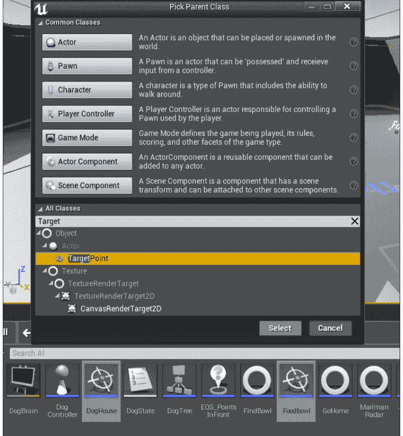

- 3. 在世界中相应地放置这两个Actor。我们将使用这些来引用狗在适当状态下应移动到的位置。基本上，我们将在以后的蓝图中使用目标点或航点来引用该Actor的向量位置。

- 4. 现在，我们需要一个名为 `DogState` 的新枚举类；它将保存狗的当前状态。这个值对于执行正确的树以发送给AI的适当响应非常重要，例如检测附近的邮差。

- 5. DogState类将拥有Hungry、Barking和Idle作为三个可用状态。Hungry状态负责指示狗导航到狗碗处进食。Barking状态会指示狗搜索邮差。Idle状态会指示狗前往它的狗屋。任何时候，如果邮差靠得太近，狗就会开始追逐邮差：

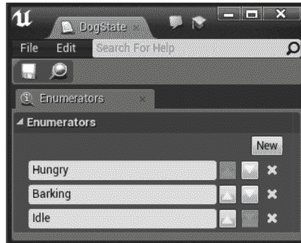

### 黑板

这存储了单个代理或多个代理的内存。它与行为树协同工作。它允许从任何任务节点轻松直接访问变量。想象你的行为树是你的事件图，而黑板是你在事件图中使用的变量。通过实例同步函数，你可以将变量复制到世界中黑板类的每个实例。现在，让我们开始创建我们的黑板：

- 1. 我们需要创建一个新的黑板（在内容浏览器中右键单击时位于AI资产下）并将其命名为DogBrain。这将为行为树分支以枚举DogState存储我们的状态，如果找到邮差则以ThirdPersonCharacter存储邮差，如果找到食物碗则将其本身作为食物碗，最后将最新搜索位置作为向量用于EQS。你可以看到我们创建的元素如下：

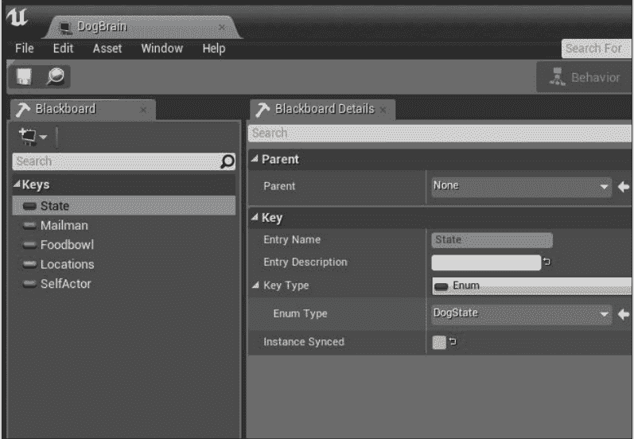

- 2. 让我们保存所有这些。现在我们有了构成行为树的基本组件，必须创建行为树。让我们快速过一遍：

  - DogState：这将存储我们的当前状态，因为这是一棵面向状态的树
  - DogHouse：这将表示狗屋的位置，供狗睡觉
  - Foodbowl：类似于DogHouse，当狗饥饿时，这将是食物碗的位置

### 设计行为树

让我们将我们的行为树命名为DogTree，并确保我们的DogBrain黑板资产已插入ROOT入口节点。此处设置的黑板资产拥有在执行期间可被树内函数访问的变量。当变量被实例化并同步时，你将拥有一个邮差的全局变量，所有使用相同黑板资产的其他狗都能看到它。我们的行为树将以视觉上相似的方式设置，如以下截图所示：

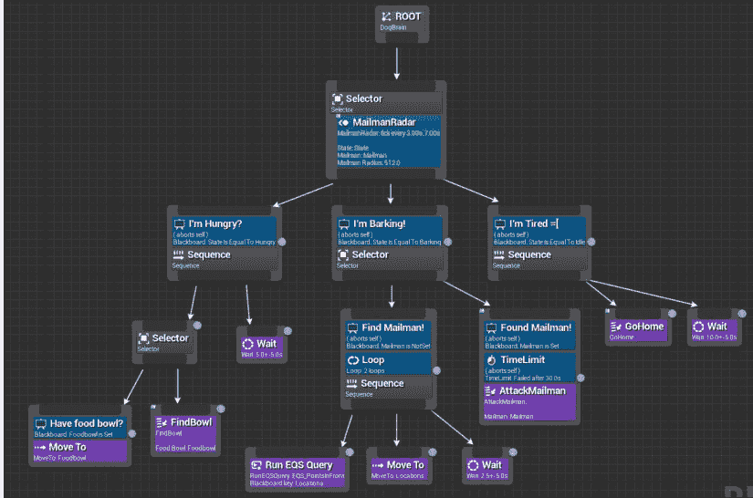

这里需要注意的是，我们将以 **选择器** 节点开始。这是因为如果子节点失败，我们不想退出树。如果失败，我们想继续到下一个节点，该节点最终将成功。在单独的树中，我们会做些不同的事情。现在我们处于某个状态，有时我们想控制事件序列以复制该状态的特定行为。因此，对于我们的 `Hungry` 状态，我们首先需要有一个碗。一旦我们有了碗，就可以去吃东西。我们还将包含一个等待节点，这会让我们的狗看起来像是在寻找它的狗碗。这仅第一次发生。下次，碗被设置的条件检查将为 `true`，我们将立即移动到我们的 `Foodbowl`。

在我们的 `Barking` 状态中，我们将立即进入 **选择器** 节点，因为我们想再次执行所有任务并等待其中一个成功。这意味着条件满足的任务将返回成功，并导致 **选择器复合** 节点失败。为此，我们需要执行几个函数，且全部必须返回成功。

理解这一点很重要，因为这种基本逻辑正是让你能够在行为树中构建所需执行行为的基础。因此，在以下分解中，我将按执行顺序概述流程，以及树的构建如何取决于执行流的方向：

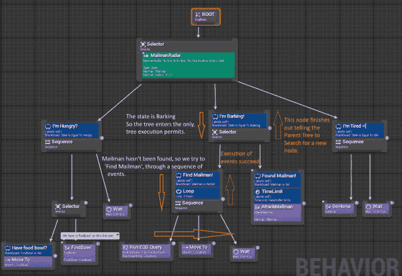

带有执行流的目标行为树

The **树搜索** 事件位于名为 **邮差雷达** 的 **服务** 中，我们将使用此事件来移动过渡状态。

Lastly, we have our `Idle` state, which simply makes the dog return to the dog house.

最后，我们有 `Idle` 状态，它只是让狗返回狗屋。

So with this, let's continue the preparation for our dog AI. We now need to create an AIController for our dog, and this is because the AIController is responsible for executing Behavior Tree. We will simply perform the following steps:

有了这个，让我们继续为我们的狗 AI 做准备。我们现在需要为狗创建一个 AIController，这是因为 AIController 负责执行行为树。我们将简单执行以下步骤：

- 1. So, let's create a new blueprint and select **自定义类**. Then, we will search for `AI Controller`.
- 1. 那么，让我们创建一个新蓝图并选择 **自定义类**。然后，我们将搜索 `AI Controller`。
- 2. Now, we can name it `DogController` and create it!
- 2. 现在，我们可以将其命名为 `DogController` 并创建它！
- 3. We also need to create **服务**, which will determine which state to be in. To do this, right-click and create a new blueprint. Under **自定义类**, we need to search for `BTService_BlueprintBase`. Let's name it `MailmanRadar`.
- 3. 我们还需要创建 **服务**，它将确定所处的状态。为此，右键单击并创建一个新蓝图。在 **自定义类** 下，我们需要搜索 `BTService_BlueprintBase`。让我们将其命名为 `MailmanRadar`。

### 行为树服务

What makes this node unique is that it is designed to run and monitor the branch it is attached to. It will execute at its defined frequency to make checks and update the Blackboard as long as its branch is executed. Today, we will utilize these functions. The first Event Receive Activation node notifies us that the Branch node is activated, and this is perfect for initializing variables within the Blackboard related to this branch. The next node we will use is Event Receive Search Start, and this notifies us when a branch is being chosen. We will take advantage of this and change our state, which tells our tree to choose a new path of execution. The following screenshot shows the overall blueprint for MailmanRadar service:

使此节点独特的是，它旨在运行并监视其附加的分支。只要其分支在执行，它就会以其定义的频率执行检查并更新黑板。今天，我们将利用这些功能。第一个事件接收激活节点通知我们分支节点已激活，这非常适合初始化与该分支相关的黑板内变量。我们将使用的下一个节点是事件接收搜索开始，当分支被选择时它会通知我们。我们将利用这一点并更改我们的状态，这告诉我们的树选择新的执行路径。以下屏幕截图显示了 MailmanRadar 服务的总体蓝图：

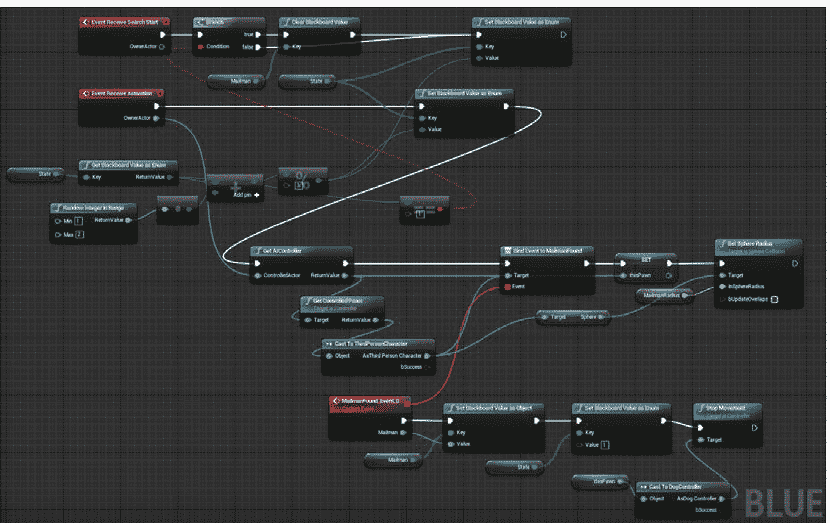

Mailman 雷达服务的总体蓝图

Now, for our radar to work, we have to set up the equipment on the pawn. It will be responsible for relaying information to Behavior Tree whenever another pawn overlaps it. So, let's find our ThirdPersonCharacter and open it up!

现在，为了让我们的雷达工作，我们必须在 Pawn 上设置设备。每当另一个 Pawn 与其重叠时，它将负责向行为树中继信息。那么，让我们找到我们的 ThirdPersonCharacter 并打开它！

- 1. We need to go to **视图** and create a new **球体碰撞** component. This component sphere radius will be updated by our radar function within the tree.
- 1. 我们需要进入 **视图** 并创建一个新的 **球体碰撞** 组件。该组件的球体半径将由树内的雷达函数更新。
- 2. Now, let's add the **OnComponentBeginOverlap** event in EventGraph.
- 2. 现在，让我们在事件图中添加 **OnComponentBeginOverlap** 事件。
- 3. Let's create **事件分发器** by adding in the **我的蓝图** pane. Drag it to EventGraph and select **调用**. This **事件分发器** will be responsible for notifying the tree of changes. Let's name this event `MailmanFound` and give it an input type of **第三人称角色** named `Mailman`.
- 3. 让我们通过在 **我的蓝图** 窗格中添加来创建 **事件分发器**。将其拖到事件图并选择 **调用**。这个 **事件分发器** 将负责向树通知更改。让我们将此事件命名为 `MailmanFound`，并给它一个名为 `Mailman` 的 **第三人称角色** 输入类型。
- 4. From our **重叠** event, we will cast **其他 Actor** to ThirdPersonCharacter, call `MailmanFound`, and supply the casted actor:
- 4. 从我们的 **重叠** 事件中，我们将 **其他 Actor** 强制转换为 ThirdPersonCharacter，调用 `MailmanFound`，并提供转换后的 Actor：

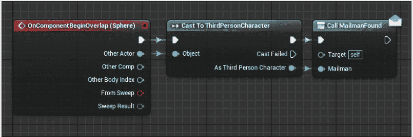

- 5. Now, let's head to `MailmanRadar` and set up some other variables to respond to this event. We need to add a few variables to hold references while this radar scans for possible mailman targets:

  - First, we need a Blackboard Key Selector variable named `State`, which is editable
  - 首先，我们需要一个名为 `State` 的黑板键选择器变量，它是可编辑的
  - Next, we need a Blackboard Key Selector variable named `Mailman`, which is also editable
  - 接下来，我们需要一个名为 `Mailman` 的黑板键选择器变量，它也是可编辑的
  - Next, we need a Float variable named `MailmanRadius`, which is editable and has a default value of 512
  - 接下来，我们需要一个名为 `MailmanRadius` 的浮点数变量，它是可编辑的，默认值为 512
  - Lastly, we need to create a type Actor variable and call it `thisPawn`
  - 最后，我们需要创建一个 Actor 类型的变量并将其命名为 `thisPawn`

The screen should look like the following screenshot:

屏幕应如以下屏幕截图所示：

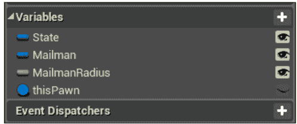

- 6. Start with our initializing event, 事件接收激活.
- 6. 从我们的初始化事件开始，事件接收激活。
- 7. We will use this to initialize our Blackboard variables. So, let's get our `State` variable so that we can set the initial state.
- 7. 我们将使用此来初始化我们的黑板变量。那么，让我们获取我们的 `State` 变量，以便设置初始状态。
- 8. Pulling from the 获取 State variable, we want to find 设置黑板值为枚举. Get state from the variables, and this time, we want 获取黑板值为枚举. We will choose a new random state for our AI. We will do this by incrementing our `State` variable randomly once or twice. So, let's pull from this, create 字节 + 字节, and then create a 模量 (%). This 模量 will take our results from the addition (+) node, but we want 3 to be put in the last position. So, we will have something similar to Input % 3 = Range (0-2) (which translates to 饥饿, 吠叫, and 空闲).
- 8. 从 **获取 State** 变量拉线，我们想要查找 **设置黑板值为枚举**。从变量中获取状态，这次，我们想要 **获取黑板值为枚举**。我们将为我们的 AI 选择一个新的随机状态。我们将通过随机增加一次或两次我们的 `State` 变量来实现这一点。所以，让我们从这里拉线，创建 **字节 + 字节**，然后创建一个 **模量 (%)**。这个模量将取自加法 (+) 节点的结果，但我们想要 3 放在最后一位。所以，我们将有类似于 Input % 3 = Range (0-2) 的内容（它翻译为 饥饿、吠叫和空闲）。
- 9. Now, let's create 范围内随机整数 and set the Min value to 1 and the Max value to 2. Then, we want to pump this into the 字节 + 字节 addition node. The False value from our previous 分支 node will pin into our 设置黑板值为枚举 node.
- 9. 现在，让我们创建 **范围内随机整数** 并将最小值设置为 1，最大值设置为 2。然后，我们要将其泵入 **字节 + 字节** 加法节点。我们之前 **分支** 节点的 **False** 值将连接到我们的 **设置黑板值为枚举** 节点。
- 10. Lastly, pin the results of our 模量 (%) to our 设置黑板值为枚举 node to update our current `State` variable:
- 10. 最后，将我们的模量 (%) 结果连接到我们的 **设置黑板值为枚举** 节点，以更新我们当前的 `State` 变量：

The screen should look like the following screenshot:

屏幕应如以下屏幕截图所示：

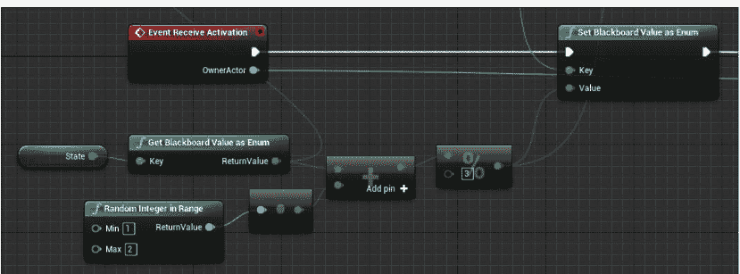

### 状态过渡

What we will do here is randomly increment our state forward. This simply demonstrates the state transition. This operation is important because how you handle transitions can create virtually coherent AI. This is established when you have goal-oriented AI. Instead of being purely reactive, it actively chooses the best scored state to achieve said goal. This makes it seem as though AI has a level of intelligence.

我们在这里将做的是随机向前增加我们的状态。这只是演示状态过渡。此操作很重要，因为你处理过渡的方式可以创建几乎连贯的 AI。当你拥有目标导向的 AI 时，就会建立这一点。它不是纯粹的反应，而是主动选择得分最高的状态来实现目标。这让 AI 似乎具有一定的智能水平。

Our AI randomly chooses its next state, but if the AI could make its new state decision based on the information we collected, it would make our AI appear intelligent. These examples will provide you with the knowledge to take on more challenging projects:

我们的 AI 随机选择其下一个状态，但如果 AI 能根据我们收集的信息做出新状态决策，它会让我们的 AI 显得智能。这些示例将为你提供承担更具挑战性项目的知识：

- 1. Looking back at **事件接收激活**, let's pull **获取 AI 控制器** from **拥有者 Actor**. Then, we want to pull **获取受控 Pawn** in order to assign the **事件分发器** node we created earlier.
- 1. 回顾 **事件接收激活**，让我们从 **拥有者 Actor** 拉取 **获取 AI 控制器**。然后，我们想要拉取 **获取受控 Pawn**，以便分配我们先前创建的 **事件分发器** 节点。
- 2. Cast the **获取受控 Pawn** node to ThirdPersonCharacter, and from the cast, assign **邮差发现**.
- 2. 将 **获取受控 Pawn** 节点强制转换为 ThirdPersonCharacter，并从转换中分配 **邮差发现**。
- 3. We also want to take **拥有者 Actor** and set it in our `thisPawn` variable. Lastly, we should update our pawn's **球体** variable to match our variable node's **半径**, which we want to check for:
- 3. 我们还想获取 **拥有者 Actor** 并将其设置在我们的 `thisPawn` 变量中。最后，我们应该更新我们 Pawn 的 **球体** 变量，以匹配我们变量节点的 **半径**，我们希望检查该半径：

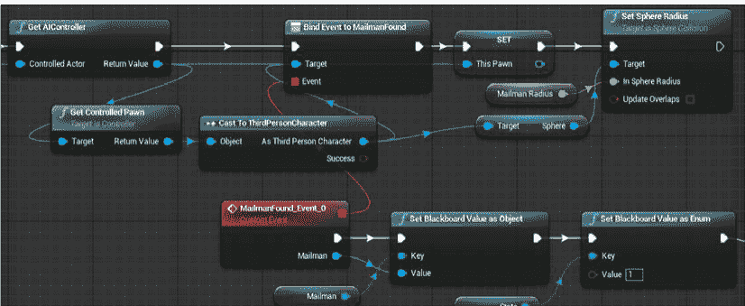

- 4. From our newly created **邮差发现** event, we want to set our **邮差** Blackboard selector. So, get it from variables, execute **设置黑板值为对象**, and set **值** from **邮差** returned through the event.
- 4. 从我们新建的 **邮差发现** 事件中，我们想要设置我们的 **邮差** 黑板选择器。所以，从变量中获取它，执行 **设置黑板值为对象**，并通过事件返回的 **邮差** 设置 **值**。
- 5. Next, set our **状态** variable to **吠叫** so that we immediately abort other states and continue with **吠叫**. Get the **状态** variable from the variables and **设置黑板值为枚举** node. We want to make this value 1, which represents our **吠叫** state.
- 5. 接下来，将我们的 **状态** 变量设置为 **吠叫**，以便立即中止其他状态并继续 **吠叫**。从变量中获取 **状态** 变量和 **设置黑板值为枚举** 节点。我们希望将此值设为 1，它代表我们的 **吠叫** 状态。
- 6. Lastly, let's get our **此 Pawn** variable from our variables node. Cast this node using **强制转换为 DogController** and then call **停止移动**. This will stop any current movement and begin the next requested movement:
- 6. 最后，让我们从变量节点获取我们的 **此 Pawn** 变量。使用 **强制转换为 DogController** 对此节点进行强制转换，然后调用 **停止移动**。这将停止任何当前移动并开始下一个请求的移动：

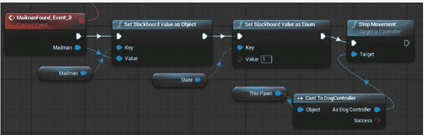

- 7. Now, with **事件接收搜索开始**, the tree will look for a new branch to begin. So, we will use this to set the new states. So, right-click on our graph and pull the event out. From here, we want to pull out the **获取 State** variable from the side, and while pulling from our pin, find **获取黑板值为枚举**.
- 7. 现在，通过 **事件接收搜索开始**，树将查找新的分支以开始。所以，我们将使用此来设置新状态。所以，在我们的图上右键单击并拉出事件。从此处，我们想要从侧面拉出 **获取 State** 变量，并在从引脚拉线时，查找 **获取黑板值为枚举**。
- 8. From here, we need to create an equal to 1 condition and then connect it to a **分支** node. What we did by comparing the state to **1** is that we said our **状态** variable is equal to *吠叫*, allowing us to perform specific operations to leave this state. This **分支** will be the next executed node.
- 8. 从此处，我们需要创建一个等于 1 的条件，然后将其连接到 **分支** 节点。我们通过将状态与 **1** 进行比较所做的是，我们说我们的 **状态** 变量等于 *吠叫*，从而允许我们执行特定操作以离开此状态。这个 **分支** 将是下一个执行的节点。
- 9. Now, we need to pull our variable, **邮差**, and call a function to reset the values of our Blackboard Key. We will do this by pulling from the **邮差** pin and searching for **清除黑板值**. This will be called if the **分支** node we created returns true.
- 9. 现在，我们需要拉取我们的变量 **邮差**，并调用一个函数来重置我们的黑板键值。我们将通过从 **邮差** 引脚拉线并搜索 **清除黑板值** 来做到这一点。如果我们创建的 **分支** 节点返回 true，将调用此函数。
- 10. We also want to set a new state if we get our **状态** variable and pull **设置黑板值为枚举**. We can update our current **状态** variable using the calculation we made on **事件接收激活**. So, pull from this modulo (%) and set it to **值** for our **设置黑板值为枚举** node:
- 10. 我们还想在获取我们的 **状态** 变量并拉取 **设置黑板值为枚举** 时设置新状态。我们可以使用在 **事件接收激活** 中所做的计算来更新我们当前的 **状态** 变量。所以，从此模量 (%) 拉线，并将其设置为我们的 **设置黑板值为枚举** 节点的 **值**：

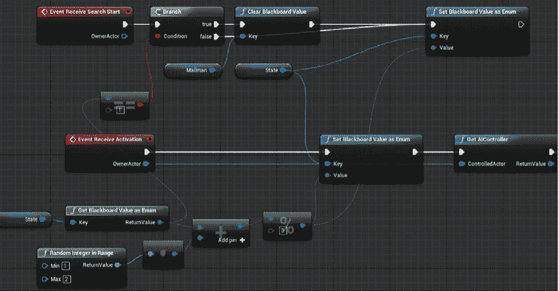

- 打开这个 `DogController` 类，查找 Event Begin Play 节点。

- 在图表上右键单击，查找 Run Behavior Tree 节点。

- 然后，在 BTAsset 引脚中，查找我们之前创建的 DogTree。然后，在游戏中，我们将把 DogController 类分配给我们的角色。它将与角色一起生成并立即运行 DogTree：

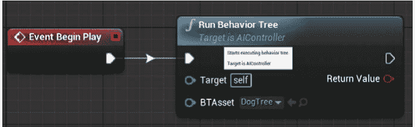

- 回到我们的行为树，拉出一条箭头并在图表中创建一个新的 Selector 复合节点。这是前面截图中显示的树的起始节点。它将运行我们专利的 MailmanRadar Service 节点。Service 节点的独特之处在于它们仅用于复合节点，并负责处理需要与树一起运行的任务。

- 现在，让我们在树中构建接下来的三个节点选项。这将是三个带有 Blackboard Compare 装饰器的序列节点。装饰器可以将条件应用到我们的复合节点或任务节点上。这些装饰器将检查适当的入口状态以开始执行。

- 因此，从这棵树的开头创建我们的复合节点。然后，在这个节点上右键单击，添加一个我们想要在黑板中查找的装饰器：

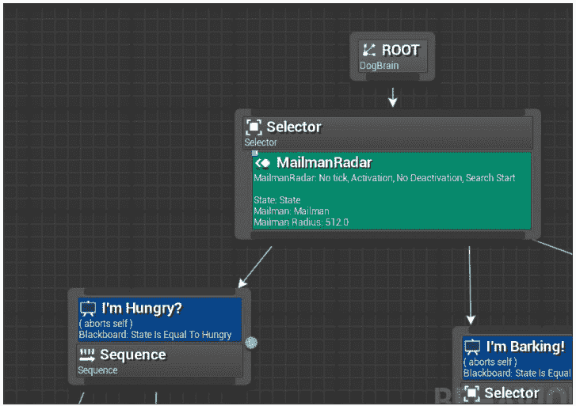

### 黑板比较装饰器

在窗格中有几个字段我们需要注意：

- 让我们从 Flow Control 开始。它有两个属性：Notify Observer 和 Observer aborts。Notify Observer 告诉 Flow Control 触发哪个操作。当进入此树的计算条件发生变化时，On Result Change 会触发。因此，如果我们最初在叫，但现在处于空闲状态，树的 Flow Control 将触发一个 Abort 事件。树中哪个部分被中止由 Observer aborts 控制。第一个选项是 Self。这很简单，即它中止此树内的进一步执行。第二个选项是 Low Priority。此选项基本上表示树的其余部分将被中止。如果你希望整个树重新开始，这很有用。最后一个选项只是我提到的前两个选项的组合。

- 下一个字段是 **黑板**，它负责告诉装饰器哪个条件返回 **真**。在此示例中，我们要将 **黑板键** 设置为 **状态**。注意属性会发生变化。将 **键查询** 值更改为我们应用到 **键** 值的条件。最后，将 **键** 值设置为我们正在检查条件的值。

让我们回到我们的行为树：

- Sequence 分支中的第一个节点是一个 **选择器** 节点。我们希望这种行为，因为我们有两个想要检查的条件，但我们知道同一时间只能满足一个条件。我们需要在这个 Sequence 分支中创建的下一个节点是一个 **等待** 节点。这将模拟我们的狗在嗅探或进食时寻找或播放动画。

- 我们 **选择器** 节点内的第一个节点是负责移动到我们碗边（假设我们有碗）的节点，使用 **移动到** 。**移动到** 节点接受一个黑板键参数，该参数与角色或向量兼容。这提供了一种从树中执行移动的有限但直接的方式：

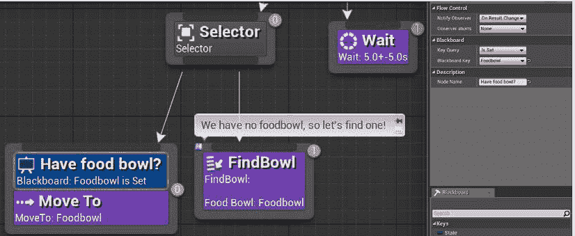

- 我们 **选择器** 节点内的下一个节点需要创建。因此，让我们回到内容浏览器，创建一个新的蓝图。在 **自定义类** 下，我们要搜索 **BT**，并将创建 **BTTask 蓝图基类**。它将被称为 **寻找碗** ，并负责为我们的狗寻找食物碗。

- 我们现在将保存这个新资源，回到我们狗树中的 **选择器** 节点下，并在 **移动到** 节点之后创建我们的新 **寻找碗** 任务。我们现在已说明，如果其他子条件（如 **食物碗** ）设置为 **假** ，则此节点将执行。

- 现在我们有了第一个状态树，应该更新树节点上的注释，以便了解其速记含义。请看我在下面的截图中所做的：

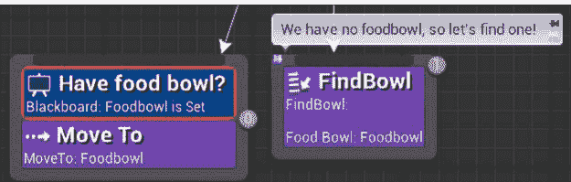

- 现在转到下一棵树，我们必须创建类似的设置，从 **选择器** 复合节点开始。我们想要右键单击，添加一个装饰器，并搜索 **黑板** 。这需要检查 **状态** 变量是否等于 `Barking` ，以执行此分支入口。

- 接下来，我们将创建一个负责告诉我们的 AI 去嗅探邮差的 **序列** 复合节点。这将在复合节点上带有一个黑板装饰器，用于检查 **邮差** 变量是否已设置。我们还想添加另一个 **循环** 装饰器，如果条件满足，负责调用两次。

- 设置好后，这个 **序列** 分支内的接下来三个节点将首先扫描区域，移动我们的狗，然后在地点等待并嗅探。因此，为了扫描我们的区域，我想使用 **EQS (环境查询系统)**。

### 环境查询系统

我将在下一章中更详细地介绍这一点，该章涵盖我们的 AI 如何感知环境，但我至少会在这里介绍这个想法以及我们今天将如何使用它。环境查询系统负责允许上下文对象调用查询请求，以基于应用于请求的过滤器和测试生成信息。查询将包含 EQS 运行的一组指令模板。因此，例如，如果你想扫描区域以寻找可能的藏身之处，可以扫描代表藏身之处的角色。然后，你可以对查询应用过滤器，以去除你不想评分的结果，并根据来自敌人的方向对结果进行评分，以获得最优的藏身位置。

在我们的情况中，我们想选择一个战略位置来嗅探我们的 Mailman。我们将通过创建环境查询来实现这一点。让我们按如下方式创建，在下一章中，我们将介绍使用 EQS 的其他方式：

- 记住这一点，让我们前往内容浏览器并选择我们的 AI 文件夹。在文件夹上右键单击，进入 杂项，然后进入 环境查询。将其命名为 EQS_PointsAround。

- 打开它并转到根。在这里，你会注意到与行为树类似的可视化界面。从根拉出并找到 SimpleGrid。这将在我们的角色周围生成一个要评分并返回给请求者的项目网格。

- 我们想将 Grid Size 值更改为 2048，Space Between 值更改为 512。其余设置将使用默认值；现在让我们按以下截图添加一个测试：

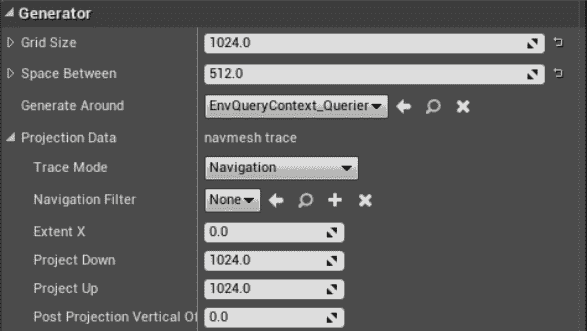

- 此测试将根据来自我们狗的方向过滤然后对结果进行评分。为了确定用于评分的 DOT 测试，我们必须告诉测试我们想要测试什么。因此，Line A 将是我们项目的 Rotation。Line B 将是我们与项目之间的方向。

- 最后，由于我们的狗需要搜索整个区域，我们需要让狗有机会查看整个区域。通过启用绝对值，我们可以在两个方向上获得评分结果。

- 我们想调整过滤器，通过选择 0 到 1 之间的范围来消除直接位于我们前面或右侧的项目。让我们将 过滤器类型 值更改为 范围 ，浮点值最小 值更改为 0.4，浮点值最大 值更改为 0.85。

- 这里最后一项是 **评分** ，我们将保留默认值。让我们保存此设置并返回我们的行为树：

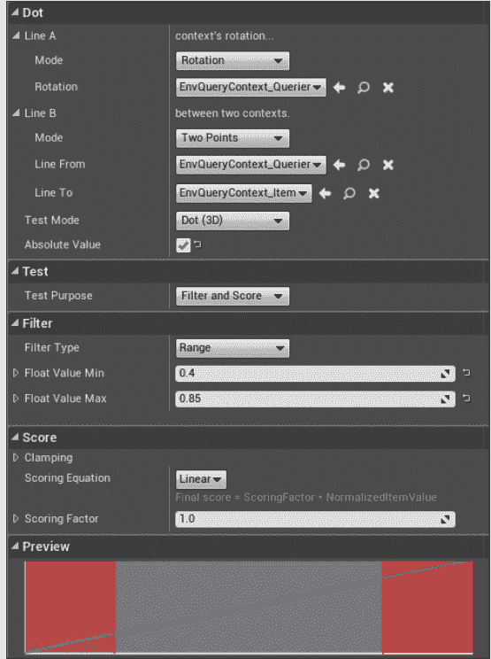

- 从我们带有 **邮差未设置** 装饰器的 **序列** 节点，我们现在想要运行我们的 EQS 查询，并将结果存储在我们的 **位置** 黑板键中。我们可以从该节点拉出并找到 **运行 EQS 查询** 。

- 然后，我们需要选择我们的 **EQS_PointsAround** 选项，并设置我们的 **位置** 黑板键。

- 10. 下一个节点将把我们的狗移动到 EQS 返回的位置。拉线并查找 Move To 节点。这个黑板键需要设置为我们的位置。

- 11. 这里的最后一个节点会让我们的狗在新找到的位置等待一段随机的秒数。因此，找到 Wait 节点，并将等待时间值设置为 2.5，随机偏差值设置为 5.0。Selector 节点的完整结构如下所示：

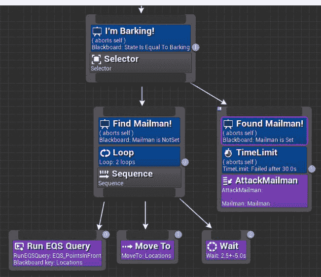

- 12. 回到“我正在吠叫”节点，我们将创建一个新节点，在变量设置后让狗追逐邮差。我们必须先创建自己的节点，该节点永远不会完成执行。因此，让我们前往内容浏览器。

- 13. 我们必须进入 AI 文件夹，右键单击并创建一个新蓝图。在自定义类下，我们需要找到任务蓝图基础行为树。这将被命名为 AttackMailman。

- 14. 打开它并前往 EventGraph。首先，我们需要获取位置，因此必须先创建对黑板资产的引用。在变量下，创建一个新的 Selector 类型黑板键并将其命名为 Mailman。这需要设置为可编辑。

- 15. 我们需要找到 Event Receive Execute，这将打开 Gate 节点。因此，创建一个 Gate 节点，并将我们的事件推入 Gate 节点的 Open 执行引脚。

- 16. 接下来，我们需要创建 Event Receive Tick，并将其推入 Gate 节点的 Enter 执行引脚。然后，我们需要从 Event Receive Tick 执行引脚提取 OwnerActor，并使用 Cast to DogController 进行转换。从此，我们可以指示 DogController 执行 MoveToLocation。

- 17. 现在，我们必须提供一个位置。提取我们的 Mailman 变量，接下来必须提取 Get Blackboard Value as Object。然后，这将被转换为我们的 ThirdPersonCharacter。从此，我们可以获取 Mailman 演员的位置，并指示我们的狗移动到该位置：

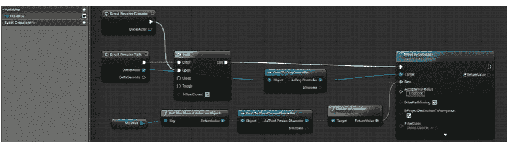

- 18. 最后，Idle 序列将仅表示狗疲倦并想要休息的时候。从主分支开始，我们将使用 Sequence 复合节点创建一个新的状态树。我们必须在 Sequence 节点上右键单击并添加一个黑板装饰器。这将检查当前 State 值是否等于 Idle。

- 19. 从主分支拉线，让我们创建一个 Sequence 节点。该节点将有一个黑板装饰器，其中 State 将设置为黑板键值，且键查询将设置为 Is Equal To。装饰器的黑板键值应为 Idle。

- 20. 在流程控制下，我们应确保 **通知观察器** 的值为 **结果变化时**，且 **观察器中止** 的值为 **自身**。

- 21. 将我们的 **描述** 字段更新为 **空闲/睡眠** 状态，以使我们的树更易于理解：

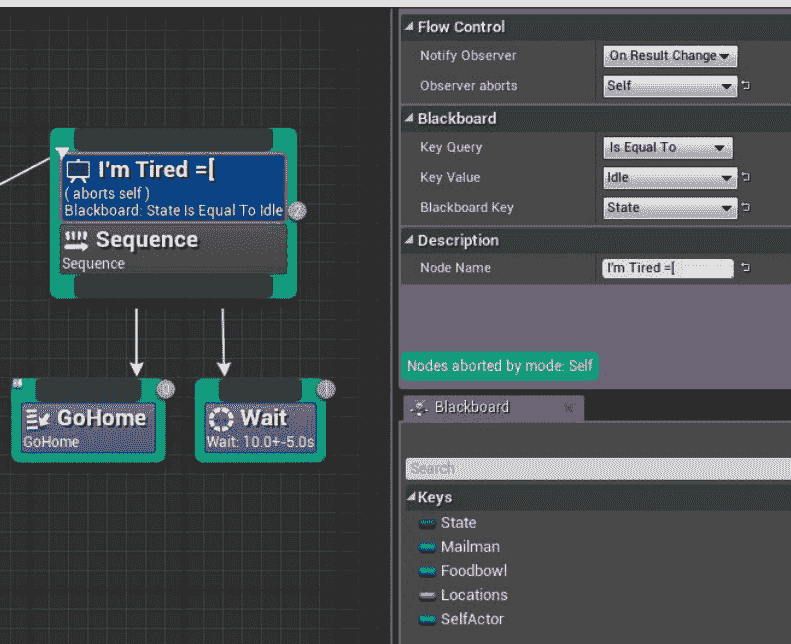

- 22. 我们需要一个新树，它将把狗送回家并让它在那里等待。

- 23. 让我们前往内容浏览器并导航到 AI 文件夹。右键单击并创建一个新蓝图类。这将是 **BTTask_BlueprintBase** 下的另一个自定义类。将此命名为 `GoHome`，并将其打开到 EventGraph。

- 24. 我们想要的事件是 **Event Receive Execute**，这将调用 **Get All Actors of Class**。

- 25. 演员类应为 **Dog House**，在一个关卡中我们只会有一个。**Get All Actors of Class** 返回 **OutActors**；从此数组中获取第一个索引项。

- 26. 让我们将 **Event Receive Execute** 中的 **Owner Actor** 转换为 **DogController**，然后执行 **Move To Actor**。

- 27. 我们最后想要调用的是 **Finish Execute**，并将 **bSuccess** 返回为 true：

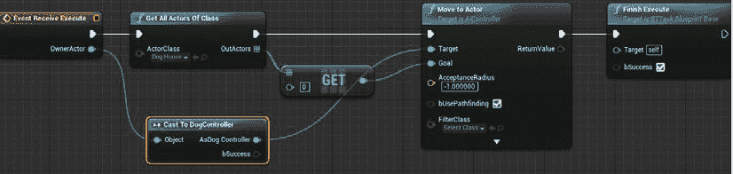

### 摘要

本章显然更加注重指导，接下来的章节也将如此。在本章中，我们揭示了如何有效地让我们的 AI 对其他棋子做出反应，以及如何移动到不同的目标位置。我们还简要使用了 EQS，以帮助我们的狗选择战略性的嗅闻位置。在下一章中，您可以期望进一步使用 EQS。虽然检测是基于事件的，但移动仍然由行为树完成。

在下一章中，我们将介绍 Unreal Engine 4 内置的用于感知其他 AI 的组件，这些组件可以帮助我们实现更灵活、更灵敏的 AI。
