## 我们的 AI 如何感知？

在本章中，您将学习如何使用 Unreal Engine 4 中可用的不同组件，使我们的 AI 能够感知我们放置在世界中的其他 AI 和棋子。我们将利用 Unreal Engine 中名为 AI Perception 组件的系统来实现这一点。这些组件可以自定义，甚至可以通过扩展当前感知接口来编写脚本以引入新行为。

本章将涵盖的主题如下：

- AI 组件
- 使用 AIPerceptionStimuliSource 注册可感知的演员
- 使用 AI Perception 感知对象
- 状态机

### 概述

AI Perception 是 Unreal Engine 4 中的一个系统，允许来源注册其感官以创建刺激，然后当系统中创建感官刺激时，其他侦听器会定期更新。这对于创建可重用系统非常有效，该系统可以响应一系列可自定义的传感器。因此，本章将重点介绍使用 AI Perception 组件，使我们的敌方 AI 在检测到我们时追击我们。我们将做的不同之处在于，这一切都将使用 Blueprint 进行脚本编写。因此，这次不需要使用行为树！

### AI 感官

让我们启动 Unreal Engine 4 并打开新建项目窗口。然后，执行以下步骤：

- 1. 首先，将新项目命名为 `AI Sense` 并点击 **创建项目**。

加载完成后，我们要先创建一个新的 AIController，它将负责向我们的 AI 发送适当的指令。

- 2. 让我们导航到 **Blueprint** 文件夹并创建一个新的 AIController 类，将其命名为 `EnemyPatrol`。

- 3. 现在，要分配 `EnemyPatrol`，我们需要将一个棋子放入世界，然后将控制器分配给它。

- 4. 放置棋子后，单击编辑器中的 **详细信息** 选项卡。接下来，我们要搜索 **AI Controller**。默认情况下，它是父类 **AI Controller**，但我们希望它是 `EnemyPatrol`：

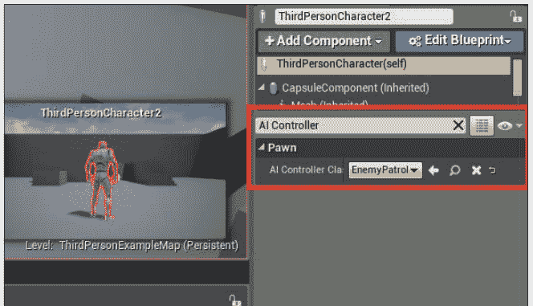

- 5. 接下来，我们将创建一个名为 `PlayerSense` 的新 PlayerController。

- 6. 然后，我们需要将 AI Perception 组件引入我们希望被看到或希望看到的对象中。先打开 `PlayerSense` 控制器，然后添加必要的组件。

### AI Perception 组件

当前有两个可用组件。第一个是您已经熟悉的：AI Perception 组件。另一个是 AIPerceptionStimuliSource 组件。后者用于轻松将棋子注册为刺激源，使其能够被其他 AI Perception 组件检测到。这在我们的情况中非常有用。现在，请按照以下步骤操作：

- 1. 在打开 PlayerSense 的情况下，让我们添加一个名为 AIPerceptionStimuliSource 的新组件。然后，在详细信息选项卡下，选择“作为源自动注册”。

- 2. 接下来，我们想要添加新感官以创建源。因此，查看“作为感官源注册”，那里有一个 AISense 数组。

- 3. 使用 AISense_Sight 蓝图填充此数组，以便被其他 AI Perception 组件通过视觉检测到。您会注意到还有其他感官可供选择——例如，AISense_Hearing、AISense_Touch 等等。

完整设置如下图所示：

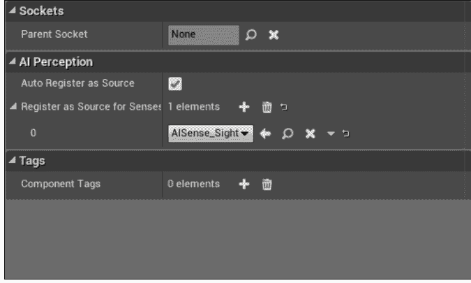

考虑到我们接下来的流程，这非常直观。这使得当我们进入敌方 AI 感官配置的范围时，我们的玩家棋子可以被敌方 AI 检测到。

接下来，让我们打开 `EnemyPatrol` 类，并将其他 **AI Perception** 组件添加到我们的 AI 中。此组件称为 **AIPerception**，包含许多其他配置，允许您为不同场景自定义和定制 AI：

- 1. 单击 **AI Perception** 组件后，您会发现 **AI** 部分下的所有内容都变灰了。这是因为每个感官都有特定的配置。如果您创建自己的 AI 感官类，情况也是如此。

- 2. 让我们关注此组件中的两个部分：第一个是 **AI Perception** 设置，另一个是此组件提供的事件：
  - 1. **AI Perception** 部分应该与 **AIPerceptionStimuliSource** 上的相同部分类似。区别在于，您需要注册自己的感官，并且还可以指定主导感官。主导感官在同一位置确定的其他感官之上优先。
  - 2. 让我们查看 **感官** 配置并添加一个新元素。这将用一个新的感官配置填充数组，您随后可以对其进行修改。
  - 3. 目前，让我们选择 **AI 视觉** 配置，然后可以保持默认值不变。在游戏中，我们可以可视化配置，从而对感官有更多控制。
  - 4. 还有另一个配置允许您指定隶属关系，但在撰写本文时，这些选项不可用。
  - 5. 单击 **按隶属关系检测** 时，必须选择 **检测中立者** 才能检测任何带有 **视觉感官源** 的棋子。
  - 6. 接下来，我们需要能够通知我们的 AI 新目标。我们将利用我们在 **AI Perception** 组件中看到的事件。通过导航到那里，我们可以看到名为 **OnPerceptionUpdated** 的事件。

当感官状态发生变化时，这将被更新，这使得感官跟踪变得容易且简单。让我们转到 **OnPerceptionUpdated** 事件并执行以下操作：

- 1. 单击 **OnPerceptionUpdated** 并在 EventGraph 中创建它。现在，在 EventGraph 中，每当调用此事件时，感官将发生变化，并且它将返回可用的被感知演员，如下图所示：

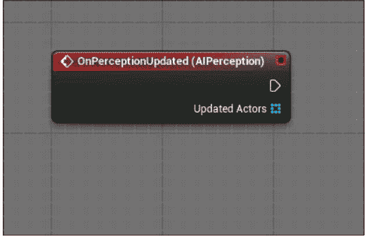

既然我们了解了如何获取引用的感知行为体，就应该为我们的棋子创建一种方式来维护不同的状态，这与我们在行为树中所做的类似。

- 2. 首先，为我们的棋子建立一个家位置，当 AI 不再检测到玩家时，棋子会跑向该位置。
- 3. 在同一个 **蓝图** 文件夹中，我们将创建 **目标点** 的子类。让我们将其命名为 `Waypoint`，并将其放置在世界中的适当位置。
- 4. 现在，我们需要打开这个 `Waypoint` 子类，并创建额外变量来维护可遍历的路线。我们可以通过在路点中定义下一个路点来实现这一点，这样我们就可以创建程序员所说的链表。这使得 AI 能够在到达当前路线的目的地后，持续移动到下一条可用路线。
- 5. 在 `Waypoint` 打开的情况下，添加一个名为 `NextWaypoint` 的新变量，并将其类型设置为与我们创建的 `Waypoint` 类相同。
- 6. 返回我们的内容浏览器。
- 7. 现在，在我们的 `EnemyPatrol` AI控制器 中，让我们关注 事件图 中的 **开始事件**。我们需要获取之前创建的路点的引用，并将其存储在我们的 AI控制器 中。
- 8. 因此，让我们创建一个新的路点变量类型，并将其命名为 `CurrentPoint`。
- 9. 现在，在 **开始游戏时** 上，我们首先需要的是 AI控制器，因为我们在 AI控制器 类中，所以它是此 事件图 的自身引用。
- 10. 接下来，我们想要创建一个 **获取所有指定类的行为体** 节点，并将 Actor 类设置为 **路点**。
- 11. 现在，我们需要将一些指令转换为宏，因为我们将在整个项目中使用这些指令。因此，让我们选择如下所示的节点并点击 **转换为宏**。最后，将此变量重命名为 **获取AIController**。您可以在以下截图中看到最终节点：
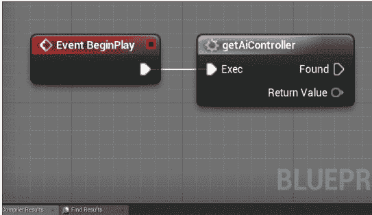
- 12. 接下来，我们希望我们的 AI 获取一条随机的新路线并将其设置为新变量。因此，让我们先获取返回的行为体数组的长度。然后，我们要从该长度中减去 1，这样就能得到数组的范围。
- 13. 从那里，我们要从 **减去** 拉出并连接 **获取随机整数**。然后，从我们的数组中，我们要获取 **获取** 节点，并将我们的 **获取随机整数** 节点输入到索引中以检索。
- 14. 接下来，从 **获取** 节点拉出返回的可用变量，并将其提升为局部变量。这将自动创建从引脚拖出的类型，我们想将其重命名为 `Current Point` 以了解此变量存在的原因。
- 15. 然后，从我们的 **获取AIController** 宏中，我们要分配 **接收移动完成** 事件。这样做是为了当我们的 AI 成功移动到下一条路线时，我们可以更新信息并告诉我们的 AI 移动到下一条路线。

### 状态机器

传统上，我们会默认使用 AI 行为树，任何使用 UE4 的人都可以使用它。但是，在我们的场景中，我们将把行为树的工作分解为直接在蓝图中编写的组件。因此，我们需要创建的下一件事是一种维护状态的方式。然后，我们可以通过更新变量本质上创建一个状态机，从而允许我们的 AI 通过控制执行流程在不同状态之间切换。

我们将使用一个事件来建立这个，当我们指定的条件满足时，该事件会更新我们的状态。要开始，让我们继续下一步！

- 1. 首先，让我们在我们的 AI控制器 中创建一个名为 **状态** 的新 Int 变量。这将维护我们状态机中的当前状态。
- 2. 我们现在需要一个新事件，我们将称其为 **下一路线**。因此，在 事件图 上右键单击并进入 **添加事件** 时，我们会注意到 **添加新事件**。让我们将这个新事件命名为 `NextRoute`。
- 3. 现在，在我们分配的事件 **接收移动完成** 之后，我们应该调用 **下一路线** 来启动或进入状态机：
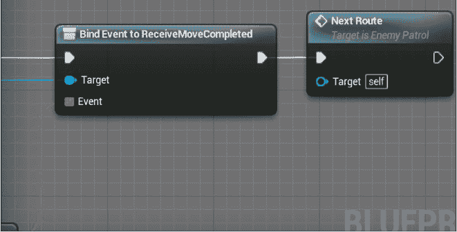
- 4. 接下来，专注于 **接收移动完成**，让我们切换到 **结果**。从开关节点中，拉出 **成功**。这意味着只有当我们的 AI 完成移动时，我们才会继续执行流程中的下一步。
- 5. 从 **成功** 开始，让我们创建一个新的 **分支** 节点并设置一个新条件。此条件将检查我们的 **状态** Int 变量当前是否等于 **0**。值 **0** 代表我们的默认状态。
- 6. 如果我们的 **状态** 变量值为 **0**，让我们创建一个 **可重新触发的延迟** 节点并将其设置为 **0.2** 秒。接下来，我们想检查我们的 **当前点** 变量是否有效；如果是，我们想获取之前创建的变量来定义链表中的下一条路线。
- 7. 从那里，我们要将这个新变量设置到我们的 **当前点** 变量中。这将允许我们在路点之间无限期地导航。
- 8. 接下来，我们想创建两个新变量，它们将负责延迟直到我们继续到下一条路线的时间量。
- 9. 因此，让我们创建一个名为 **路线暂停延迟** 的新 Float 变量，它将定义我们等待的时间。接下来，我们想创建偏差，使等待时间不总是相同。因此，现在创建一个名为 **路线暂停偏差** 的新 Float 变量。
- 10. 让我们将 **路线暂停偏差** 输入到 **范围内随机浮点数** 中，并将其添加到 **路线暂停延迟**。然后，这将被输入到 **延迟** 节点中。
- 11. 从 **延迟** 节点，我们想调用之前创建的 **下一路线** 事件。
- 12. 专注于新创建的 **下一路线** 事件，让我们检查我们的 **状态** 变量是否等于 **0**，并创建一个 **分支** 节点以在执行时检查结果：
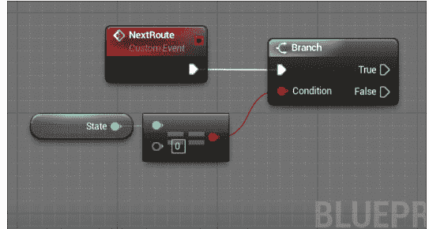
- 13. 接下来，我们应该从我们的 行为体 获取 AI控制器，并检查我们的 **当前点** 变量是否有效。
- 14. 接下来，如果我们的 **当前点** 变量有效，那么我们应该从 **获取AIController** 和 **移动到行为体** 节点的 **返回值** 拉出。
- 15. 从那里，拉出我们检查的 **当前点** 变量并将其放入节点的目标中。现在，当 AI控制器 获取其所属 行为体 的控制权时，它将调用此事件。一旦移动完成，它将更新路线并继续到下一条路线。

### 棋子检测

为了让我们的棋子获得最新信息，我们需要创建一个事件来捕获和响应 AI 感知组件的感官更新事件。我们将通过创建一个专门负责处理检测到的棋子的新事件来建立这一点。以下是步骤：

- 1. 让我们在任何位置右键单击并进入 **添加事件**。从那里，我们想添加一个自定义事件，并将新事件命名为 `Detected Enemies`。我们还必须创建一个名为 `Detected Actors` 的新 行为体数组 参数，以保存 **已更新的行为体** 的数组。
- 2. 现在，在下一步中，我们需要重新编译蓝图，以从我们的 **感知更新时** 事件调用 AI控制器 和 **检测到的敌人** 函数：
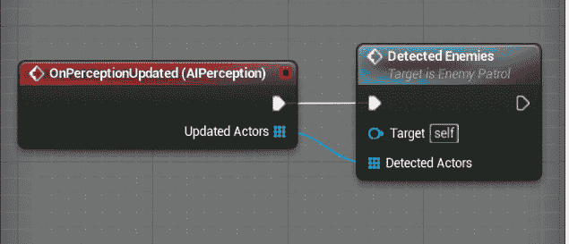
- 3. 在接下来的步骤中，我们将处理不同状态之间的转换。例如，我们可以处于默认状态并找到一个新敌人。从那里，我们需要停止当前移动并移动到检测到的敌人那里。如果我们丢失了正在追逐的特定时间的敌人的视线，我们可以取消移动并返回到在我们的路点之间导航。
- 4. 现在，我们想再次专注于我们之前创建的 **检测到的敌人** 事件。既然此事件由我们的 AI 感知组件调用，我们想要为每个状态适当地使用这些 行为体。
- 5. 让我们从此事件拉出并创建一个 **分支** 节点。接下来，我们想为这个分支创建条件。我们需要拉出我们的 **状态** 变量并检查它是否等于 **0**。如果为 **真**，我们将检查是否检测到任何敌人。

- 6. 因此，从 **True** 引出；让我们检查我们的 **Detected Actors** 数组长度是否大于或等于 **1**。如果是，我们就有敌人，可以继续向前进行流程。因此，从前一个 **Branch** 节点的 **True** 引出，然后创建一个新的分支。这将检查 **Detected Actor** 数组的长度。

- 7. 接下来，如果我们找到了敌人，将更改状态以改变执行路径。我们可以通过将 **State** 变量设置为 **1** 来实现：

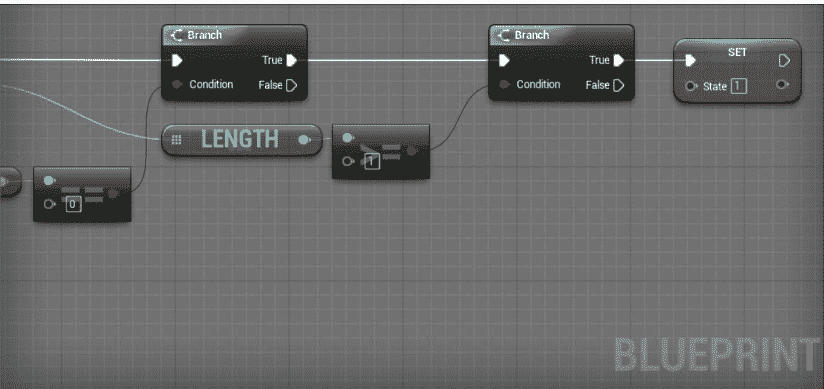

- 8. 接下来，我们为 **State** 变量创建一个新的开关语句。这将帮助我们控制执行流程。我们希望索引从 1 开始，并且没有默认引脚。

- 9. 现在，我们可以回溯到第一个 **Branch** 条件，在那里我们将检查状态是否等于 **0**。然后，当此语句为 **False** 时——意味着我们当前处于搜索敌人的状态——我们希望它也能通向开关语句。这样，如果我们在某个时刻丢失了敌人，我们的状态就可以从当前状态转换出来。

- 10. 聚焦于开关节点，让我们为索引 **2** 添加另一个中断分支。然后，从其中一个引出，调用 **GetAIController**。如果 **Found** 被执行，那么我们就准备好向前移动了。

- 11. 让我们从事件中提取 **Detected Actors** 参数并创建一个 **ForEachLoopWithBreak** 节点。从这个节点，让我们检查检测到的敌人是否在视线范围内。右键单击并搜索 **Line of Sight To**，保持 **Target** 为自身。然后，**Other** 应为 **ArrayElement** 变量。

- 12. 从返回值引出，我们将创建一个新的 Branch 节点。此分支条件需要检查我们是否有当前敌人；如果没有，我们将设置一个新敌人。从 Branch 节点的 True 值，让我们从数组元素设置一个敌人角色。

- 13. 从 GetAiController 引出，我们要将焦点设置到我们刚刚在敌人角色中设置的敌人上。

- 14. 接下来，我们要再次获取 AIController 并创建 Move To Actor 节点。然后，我们将把敌人角色设置为该节点的目标。这将导航我们的 AI 移动到新发现的敌人处。

- 15. 接下来，让我们基于 Move To Actor 节点的返回值进行开关。我们将获得一个在 Failed、Already At Goal 和 Request Successful 上进行切换的节点。让我们从 Request Successful 引出，并将我们的 State 变量设置为 2。

- 16. 从我们的 Set State 变量，我们想要中断 ForEachLoopWithBreak 节点。这样一来，一旦找到敌人，我们就不会继续搜索敌人了：

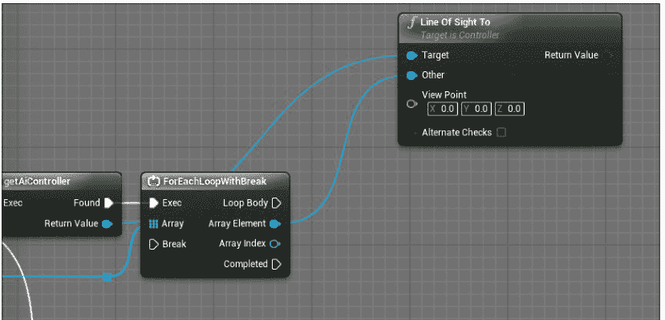

- 17. 让我们回到循环中的第一个 Branch 节点，并从 False 创建另一个分支。这将检查 Array Element 引脚（即我们刚刚为其选择 Line Of Sight To 但失败的敌人）是否是我们当前锁定的敌人。如果是，我们要清除敌人角色变量，并将焦点设置好，把 State 值重新设为 0。

### 状态转换

这就完成了退出状态 1 所需的全部内容。接下来，我们将执行状态 2 所需的操作，这将使我们能够在不再看到敌人时检测出必要的变化，从而退出该状态并回到状态 0。执行以下步骤：

- 1. 回到我们之前在 State 上创建的开关节点（在第 55 步中创建），并从 2 创建一个新连接，让我们创建 GetAiController。

- 2. 接下来，我们需要检查 Enemy Actor 变量是否有效。我们将通过拖出 Enemy Actor 变量，从引脚拉取，然后创建 IsValid 节点来完成。

- 3. 如果变量有效，我们希望将 AIController 移动到敌人处。我们可以通过在 GetAiController 上拉取返回值，然后创建 Move To Actor 来实现。然后，我们可以将有效的 Enemy Actor 变量连接到 Move To Actor 的目标输入。

- 4. 接下来，我们希望在 AIController 中使用 Tick 事件，以检查在状态 2 时是否拥有敌人的视线。我们可以通过聚焦 Tick 事件，从它拉取并创建一个 Branch 节点来实现。

- 5. 然后，拖放 State 变量并检查它是否等于 2。此等于节点的结果将被输入到 Branch 节点的条件中。

- 6. 查看 Branch 节点，从 True 引出并创建 getAiController 节点。然后，我们将从 Found 引出并创建一个 Branch 节点。

现在，我们需要创建两个新变量来维持对敌人的追逐。这将允许我们在指定的时间后超时追逐，或者让案例立即结束，强制 AI 返回到我们创建的航点之间的巡逻。

- 7. 因此，让我们创建一个名为 TimeoutChase 的新变量；它将是一个布尔值。接下来，创建一个 ChaseTime 变量，它将是一个浮点数。这将告诉我们的执行线，如果我们不想超时追逐，则在不同流程之间切换。

- 8. 再次聚焦于我们创建的最后一个 Branch 节点，我们要将新创建的 Timeout Chase 变量插入到条件中。

- 9. 如果此 **Branch** 节点为 **False**，我们要将其插入到先前开关语句中的 **getAiController** 节点。它应该看起来类似于以下截图：

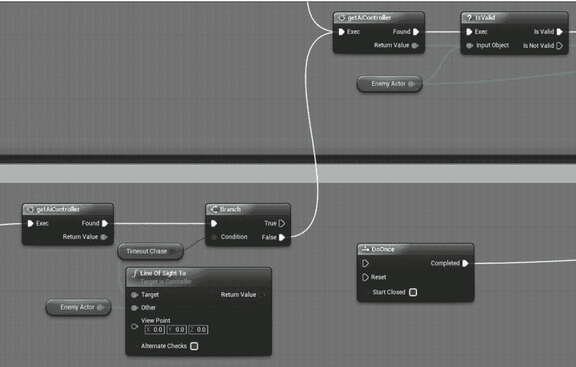

- 10. 现在，如果语句为 **True**，我们要创建一个新的 **Branch** 节点来检查敌人是否在视线范围内。从 **getAiController** 节点的 **Return Value** 引出，让我们创建一个名为 **Line Of Sight** 的新节点。

- 11. 然后，获取我们的 **Enemy Actor** 变量，我们将其插入到另一个输入中。然后，从返回值，我们可以创建一个条件已设置好的新 **Branch** 节点。

### 重置状态

现在，下一部分将允许我们在 **Retriggerable Delay** 节点中使用我们的 **ChaseTime** 浮点变量。基本上，当目标在视线范围内时，**Retriggerable Delay** 节点将继续被重置。一旦失去视线，另一条执行路径将执行 **DoOnce**，尝试重置我们 AI 的 **State** 变量。一旦 **Retriggerable Delay** 节点按指定的 **Chase Time** 值完成延迟，它将重置 **DoOnce**，从而允许我们的机器人重置其状态。执行以下步骤：

- 1. 现在让我们查看刚才创建的 **Branch** 节点，从 **False** 引出并创建一个新的 **DoOnce** 节点。我们可以将 **Start Closed** 保留为默认值。

- 2. 如果我们回溯到先前 **Branch** 节点的 **True**，我们可以从 **True** 引出，然后创建一个 **Sequence** 节点。

- 3. 从第一个 **Then 0** 执行引脚引出并创建一个 **Retriggerable Delay** 节点。接下来，让我们将 **Chase Time** 变量插入到 **Duration** 变量中。最后，让我们将 **Completed** 插入到我们先前创建的 **DoOnce** 节点的 **Reset** 输入执行中：

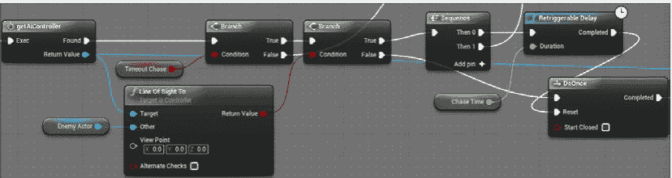

- 4. 回到 **Sequence** 节点，我们需要将 **Then 1** 路由到我们先前的 **Move To Actor** 节点，就像我们在 *状态转换* 部分所做的那样。

所以，当我们看到敌人时，我们将继续朝他们移动，直到失去敌人，届时它将切换到另一条执行路径。现在，如果你希望 AI 移动到敌人所在位置，你需要获取角色位置并执行此操作。这将导致 AI 向敌人的最后已知位置移动，然后才最终被重置。

- 5. 现在，聚焦于 **DoOnce** 节点，让我们从链中先前创建的 **getAiController** 节点引出。然后，在 **DoOnce** 节点之后创建一个名为 **Stop Movement** 的新节点。这将取消任何朝向敌人的移动。

- 6. 接下来，我们需要将 **Enemy Actor** 变量设置为 **null**。我们将把 **State** 变量设置为 **0**。最后，我们将调用 **Next Route** 事件。强制 AI 再次返回航点之间的路由，我们将等待敌人出现在视线中。

### 模拟与游玩

现在，如果我们点击 **Play**，应该能看到 AI 追逐你，直到你打破视线！

因此，机器人将像之前一样进行路由，直到敌人进入视线范围。如果机器人处于状态 0，一旦 AI 感知组件检测到敌人，它将进入状态 1。接下来，如果这些敌人之一在视线范围内且我们没有当前敌人，我们将把状态改为 2 并设置我们的敌人。最后，我们将继续朝敌人移动，直到失去对他们的视线，这会导致我们被重置回状态 0。下图说明了这些转换：

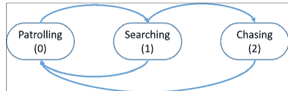

这就是在没有行为树协助的情况下创建 AI 的方法。最终，你仍然需要创建一个状态机，因为这是编程中用于创建基于函数间共享变量相互转换的函数的基本方法。通过直接在蓝图中执行此操作，我们可以更深入地理解基于状态转换的行为控制机制，这对于简单的 AI 行为很有帮助。

### 总结

本章关于 AI Sense 组件的内容到此结束。这个工具非常棒，可以轻松地将新的响应式传感器集成到 AI 的输入中，而你无需从 Ray Traces 之类的东西自己创建它们。

接下来，我们将专注于更高级的移动，例如使用 Unreal Engine 提供的一些工具让我们的 AI 避开障碍物，以及如何让我们的 AI 互相跟随，类似于小队的行为。

