## 更高级的移动

在本章中，我们将专注于群体行为和更高级的路径跟随行为。我们要实现的是实现群体行为，为我们的 AI 创建真实的移动效果，例如当你需要智能体在同一方向移动时相互避让。有时，你的智能体需要寻找领导者，以便创建不同的智能体编队。首先，我们要设置所需的一切，让一些 pawn 在关卡中四处移动。接下来，我们将为这些 pawn 添加一些蓝图，使它们能够发现新的领导者。最后，我们将介绍群体行为，以便我们可以看到我们的 AI 作为一个群体如何移动。

本章涵盖的主题如下：

- 设置用于移动的 actor 蓝图
- 实现跟随行为
- 实现具有分离、聚合和对齐等特性的群体行为
- 通过 UMG 添加行为控制

### 设置智能体

让我们使用 Physics Ball 模板创建一个名为 AdvancedMovement 的新项目。当前，我们使用的是 Unreal Engine 4.8.3。我们首先要做的是找到 PhysicsBallBP 类并打开 EventGraph。我们可以按照以下要点操作：

- 1. 项目加载后，进入 RollingBP 部分，然后进入 Blueprints 文件夹。
- 2. 在这里，你会找到 PhysicsBallBP，它将在本章中充当我们的智能体。让我们为这个 actor 打开 EventGraph。

> 我们要引入两个新的向量变量来保存智能体的当前方向。另一个将保存智能体生成的位置。

- 3. 现在，让我们从示例中删除任何不必要的逻辑。我删除了以下变量：
- **JumpImpulse** 变量
- **CanJump** 变量

EventGraph 中的所有蓝图代码均未显示在以下截图中：

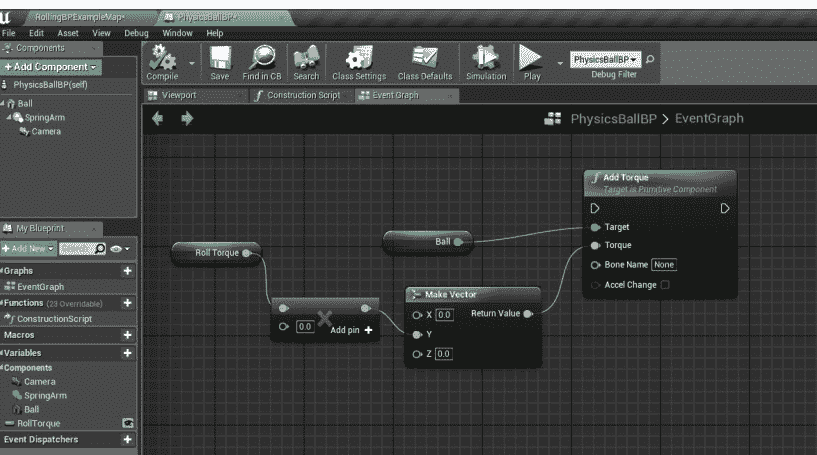

- 4. 好了，现在我们有了基础，让我们创建一个名为 **Direction** 的变量，并将其类型设置为向量变量。

- 5. 接下来，创建一个名为 **StartLocation** 的变量，同样将其设置为向量变量类型。

> **StartLocation** 将在课程后面用于我们需要实现的 **Reset** 按钮。

- 6. 现在，找到 **Event Begin Play**，并初始化我们的新向量变量。首先，在事件附近的区域右键单击并找到 **Random Unit Vector**。从 **Random Unit Vector** 节点拆分向量（通过右键单击引脚），因为我们只需要 **X** 和 **Y** 值。

> 我们只能向前或向后以及向左或向右移动。这些增量由 X 和 Y 处理。如果引入 Z，可能会使摄像机向前旋转，这对于观察可能并不理想。

- 7. 接下来，让我们右键单击并创建一个名为 **Get Actor Location** 的新节点。我们需要拉下 **StartLocation** 向量设置变量。然后，从 **Return Value** 设置我们的 **Start Location** 变量。注释 **Give random direction and save start location** 区域：

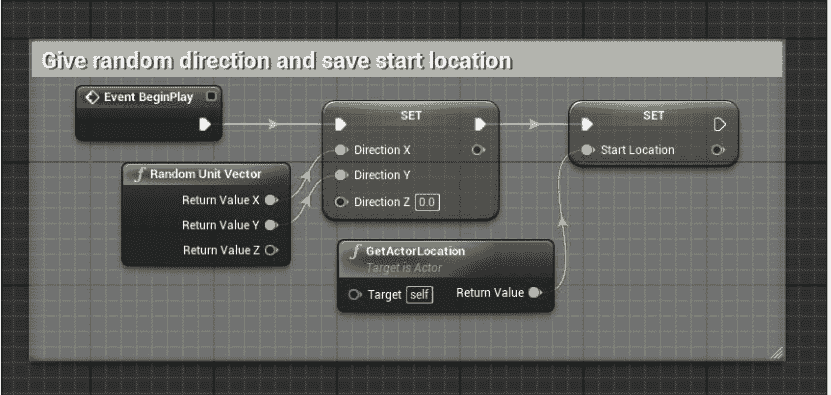

- 8. 现在，我们需要将 **Direction** 变量设置为 **SpringArm** 变量的方向。这样做的原因是确保摄像机始终朝向我们在世界中移动的方向。因此，当你修改不同的变量时，可以看到它生效。

- 9. 将我们的 **SpringArm** 变量拖入 EventGraph。接下来，从 **SetRelativeRotation** 变量拉出连线。

- 10. 然后我们要获取 **SpringArm** 变量的当前 **RelativeRotation** 值，以便在我们应当朝向的方向之间进行插值。这样在更新摄像机旋转时会产生平滑过渡。

- 11. 通过从 **SpringArm** 变量的当前 **RelativeRotation** 引脚拉出，我们要创建 **RInterp To** 节点。
- 12. 接下来，我们要获取 **Direction** 变量，并使用 **Make Rot from X** 将此方向转换为旋转。
- 13. 我们将通过一个偏移量更改此旋转器。我将其计算为弹簧的本地旋转偏移量。在 **A** 中放入方向后，我们应该将 **B** 设置为 **0.0 Roll**、**45.0 Pitch** 和 **90.0 Yaw**。
- 14. 现在，将 **Return Value** 引脚连接到我们的 **RInterp To** 节点的 **Target** 引脚。
- 15. 现在，右键单击，搜索 **Get World Delta Seconds**，并将其插入到我们的 **RInterp To** 节点的 **Delta Time** 引脚中。
- 16. **Return Value** 引脚现在必须插入到我们先前创建的 **SetRelativeRotation** 节点的 **New Rotation** 中。

> 因此，我们要在此处更新方向。这样做的原因是
> 我们将继续在此操作中添加内容，以归一化我们的方向
> 并获得我们预期范围内的值。

将此区域注释为 **Calculate Direction for Camera Spring Arm**：

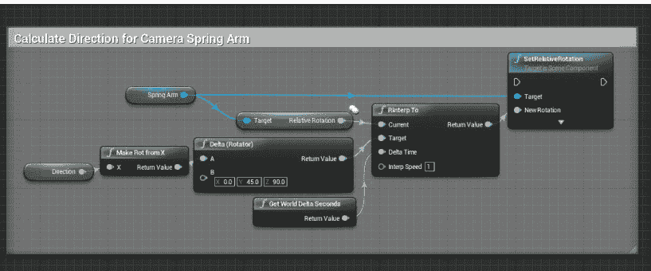

- 17. 为此，让我们拉下我们的 **Direction** 变量。从变量拉出并查找 Vector + Vector。从此处，我们要归一化向量。最后，让我们拆分向量。

- 18. 接下来，让我们拉出 **Direction** 变量并创建一个设置变量。让我们使用 **Break Vector** 拆分 **Direction** 设置变量。然后，将 **X** 和 **Y** 浮点变量都插入到 SET 节点的 **Direction X** 和 **Direction Y** 变量中。将此区域注释为 **Calculate Direction**：

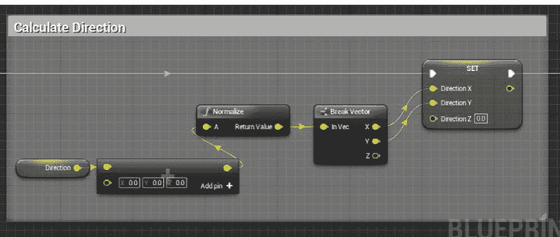

- 19. 我们需要拉出一个 **Ball** 变量并调用名为 **Add Torque** 的节点。
- 20. 要计算 **Torque** 值，我们要获取 **Direction** 变量。获取 **Roll Torque** 变量并将其乘以 **Direction** 向量。结果应插入到 **Add Torque** 节点的 **Torque** 引脚中。将此区域注释为 **Apply Torque to Ball**：

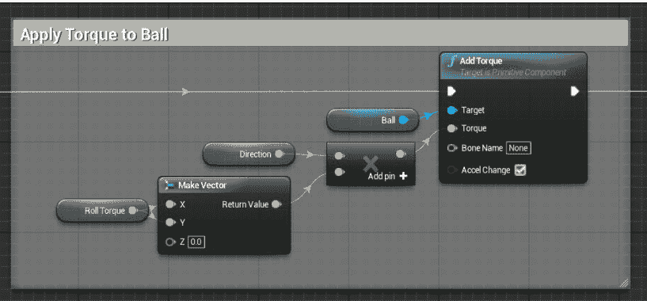

- 21. 下一步是创建一个函数，用于扫描 **Ball** 变量前方。如果射线命中，则意味着我们击中了一面墙。从此处，我们要使用 **Hit Result** 基于 **Hit Normal** 生成墙面反射。让我们看看实际操作。

- 22. 从我们上一个节点开始，创建一个名为 **LineTraceByChannel** 的新节点。从此处，我们要通过右键单击并搜索 **Get Actor Location** 来获取一个新节点。将 **Return Value** 插入到我们新建节点的 **Start** 引脚中。

- 23. 获取 **Direction** 变量的另一个副本并将其放置在图表中。从我们的 **Direction** 向量拉出并右键单击创建一个名为 **Make Rot from Y** 的新节点。从 **Make Rot from Y** 的 **Return Value** 右键单击创建一个名为 **Get Up Vector** 的新节点。

- 24. 获取我们的 **Ball** 向量变量，然后右键单击创建一个名为 **Get LocalBounds** 的新节点。现在，拆分 Max 向量，并从 **Max X** 右键单击创建一个新节点 **Float * Float**。

- 25. 现在，此变量将获取我们的大小，并用它来确定球体外部的前向距离。在我们的示例中，我们将按 **-3.5** 进行缩放。我们将反转缩放，因为我们要乘的向量相对于球体，而不是世界。

- 26. 在 **Float * Float** 节点中，让我们将另一个浮点数设为 **-3.5**，它未连接。

- 27. 从我们的 **Get Up Vector** 节点开始，将其与前一步的 **Float * Float** 结果相乘。现在，我们需要右键单击并找到一个 **Vector + Vector** 节点。将此向量添加到我们的 **GetActorLocation** 节点。然后，将结果插入到我们的 **LineTraceByChannel** 节点的 **End** 引脚中：

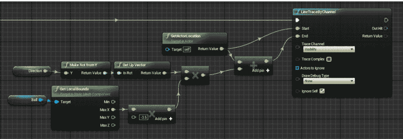

- 28. 从我们的 **LineTraceByChannel** 节点拆分命中结果。现在，找到 **Out Hit Blocking Hit** 并从布尔结果创建一个分支。让我们拉出我们的 **Direction** 向量并获取 SET 变量。这应该连接到先前创建的 **Branch** 节点的 **True** 输出引脚。

- 29. 从我们的 **Out Hit Normal** 引脚，右键单击并创建一个 **Make Rot from Y** 节点。现在，我们要从该返回值拉出，右键单击并创建一个 **Get Up Vector** 节点。这将世界中的法线转换为相对方向空间。最后，我们要获取 **Direction** 向量以获取变量。

- 30. 从我们的 **Direction** 变量拉出并释放以查找 **Mirror Vector by Normal**。让我们将前一步的 **Get Up Vector** 节点插入到 **Mirror Vector by Normal** 的 **In Normal** 中。此节点的结果固定在在 **True** 语句中执行的 **SET** 变量的 **Direction** 引脚上。

将此区域注释为 **Bounce current direction off wall closing in front of ball**：

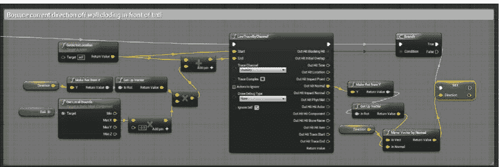

Bounce current direction off wall 的完整蓝图设置

现在我们的 **PhysicsBallBP** 类或智能体已更新以处理方向向量，我们将用随机值对其进行初始化。它应持续向前移动，并在 actor 靠近足够撞击时反弹墙壁。

### 查看代理

我们想要点击播放，并确保我们的代理会弹离墙壁。一旦点击播放，它应该开始运行，并且你生成的载具会不断向前移动。然后，一旦发生碰撞，我们将通过法线镜像方向：

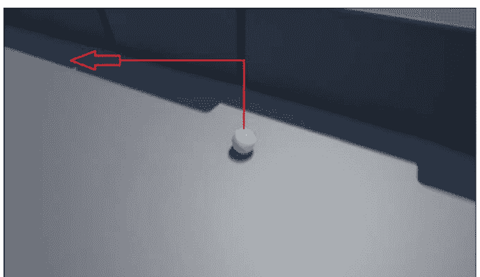

### 跟随代理

我们希望我们的代理跟随其领导代理，无论它向哪个方向移动。在继续遵循弹离墙壁的其他逻辑以及我们计划引入的移动行为的同时，我们将创建一个示例，展示这将如何影响代理的移动，如下所示：

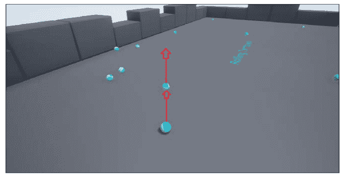

此步骤要求我们创建几个变量和一个函数。我们希望在自由设置中保存我们的追随者和领导者代理。我们还需要 `LeaderDirection` 来保存代理应该移动的方向。最后，我们可以通过启用或禁用名为 `isLeader` 的布尔值来标记代理是追随者还是领导者。

使用这些变量，我们可以跟踪并防止领导者追随追随者，这可以创造有趣的移动行为，但并非我们在本演示中希望发生的事情。

### 跟随或领导

让我们打开我们的 `FlockingBall BP` 类并查看事件图表。找到我们将为我们的 `Spring Arm` 变量更新 `RelativeRotation` 引脚的位置。在此和 `Calculate Direction` 之间，我们将添加这一新的指令集：

- 1. 首先，我们需要引用代理附近的任何角色。我们可以通过 `SphereOverlapActors` 节点来实现这一点。在图表上右键单击并搜索此项。
- 2. 现在，让我们获取 `Get Actor Location` 节点。右键单击，找到它，并将其插入到我们在上一步中创建的节点的 `Sphere Pos`。接下来，将 `Sphere Radius` 值设置为 `300`。现在，让我们从 `Object Types` 拉出并创建 `Make Array` 节点。因此，我们应该使用 `Physics Body` 填充 `Object Types`。接下来，我们希望将我们的 `Actor Class Filter` 节点设置为 `Flocking Ball` 以防止不想要的结果。最后，创建另一个 `Make Array` 节点，在图表上右键单击并搜索它。然后，用对 `Self` 的引用填充第一个元素。然后，将此数组插入到要忽略的角色中。将此区域注释为 `Search for nearby FlockingBalls`。
- 3. 现在，让我们关注 `Out Actors` 数组。在图表上右键单击并搜索 `For Each Loop`。让我们从 `Array Element` 拉出并将其转换为 `FlockingBall`。

我们必须知道我们尝试跟随的代理是否正在跟随我们。否则，我们可能会遇到不想要的移动行为。

- 4. 从转换变量中，让我们找到 **领导者** 变量，并使用等于 (==) 将其与 **自身** 进行比较。获取 **条件** 引脚并创建一个 **分支** 节点。如果它是 **假**，我们现在需要检查我们是否是领导者，以及我们是否拥有领导者或追随者。

在继续之前，用 **不要追随，追随者作为领导者** 注释此分支：

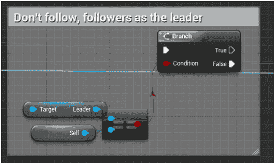

- 5. 因此，搜索 **是否为领导** 变量并创建此变量。接下来，搜索 **领导者** 并通过创建 **是否有效** 节点（这是一个函数）来检查它是否有效。我们必须对另一个名为 **追随者** 的变量做同样的事情。
- 6. 现在，将所有三个布尔条件连接到一个 **或** 节点。如果我们的任何条件返回 **真**，这将返回 **真**。如果这些条件中的任何一个返回 **真**，它们已经在跟随一个代理或领导另一个代理：

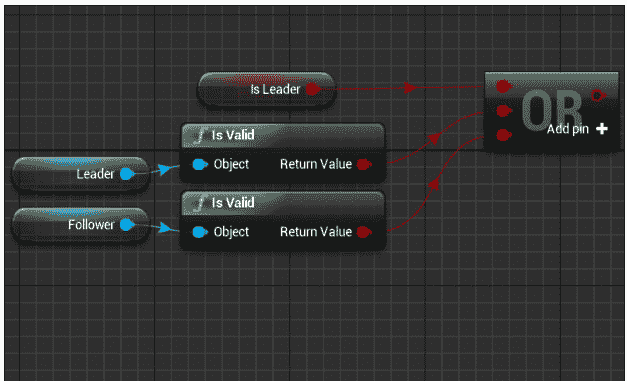

- 7. 从此 **或** 节点，让我们搜索一个新的 **分支** 节点并将其连接到 **条件** 引脚。现在，如果这个 **分支** 节点值是 **假**，让我们创建一个名为 **是否有效** (宏) 的节点。我们想要检查的对象是我们在第3步中进行的转换。将此内容拉出，并在 **是否有效** (宏) 节点附近创建一个重路由节点，以便其他节点可以轻松使用它。
- 8. 如果 **是否有效** (宏) 返回 **是否有效**，我们希望创建一个 **分支** 节点。我们希望在这个语句中使用 **与** 逻辑门检查两个条件都为 **真**。
- 9. 首先，让我们从重路由获取 **领导者** 变量。然后，我们将使用不等于 (!=) 将其与 **自身** 进行比较。创建一个 **与** 逻辑门并将第一个引脚连接到不等于 (!=) 条件的结果。
- 10. 接下来，让我们从重路由获取 **追随者** 变量。然后，使用等于 (==) 比较此节点。接下来，将此连接到上一步中的 **与** 逻辑门。
- 11. 最后，将这个 **与** 逻辑门连接到 **分支** 节点。如果此节点返回 **真**，那么让我们从重路由设置 **追随者** 引脚。将对 **自身** 的引用插入到 **追随者** 引脚中。然后，从重路由设置本地 **领导者** 变量。将此区域注释为 **如果我们没有领导者，并且我们也不是领导者。寻找一个：**

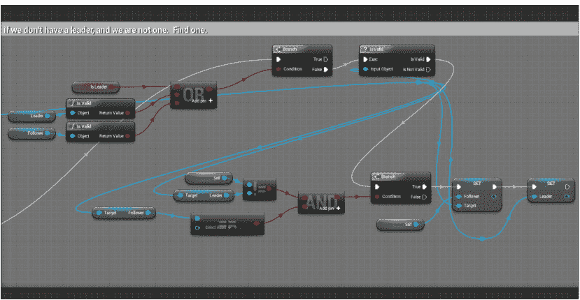

- 12. 现在，转到 **每个循环** 节点的 **完成** 引脚。让我们创建一个本地 **领导者** 变量，并使用 **是否有效** (这是一个函数) 检查它是否有效。现在，创建一个 **分支** 节点，并插入来自先前节点的 **条件** 引脚。
- 13. 如果 **分支** 节点返回 **假**，我们希望将 **设置** 变量的 **领导者方向** 值设置为 0.0、0.0 和 0.0。如果我们的 **分支** 节点返回 **真**，我们希望计算朝向我们 **领导者** 变量的方向。
- 14. 创建一个名为 **获取演员位置** 的新节点，并从返回值中，我们将创建 **获取方向向量**。现在，让我们在图表上右键单击并搜索本地 **领导者** 变量。然后，从 **领导者** 变量创建 **获取演员位置** 节点，并将其插入到 **获取方向向量** 的 **至** 引脚中。
- 15. 从 **获取方向向量** 节点，拉出 **返回值** 并创建 **从Y制作旋转**。接下来，我们希望从先前的旋转创建 **获取上向量**。然后，从 **返回值**，这将进入 **设置** 变量的 **领导者方向**。
- 16. 两个 **领导者方向** 本地变量都将通向注释为 **计算方向** 的区域。我们还必须转到 **计算方向** 并将 **领导者方向** 添加到最终方向计算中。将此区域注释为 **计算领导者方向**：

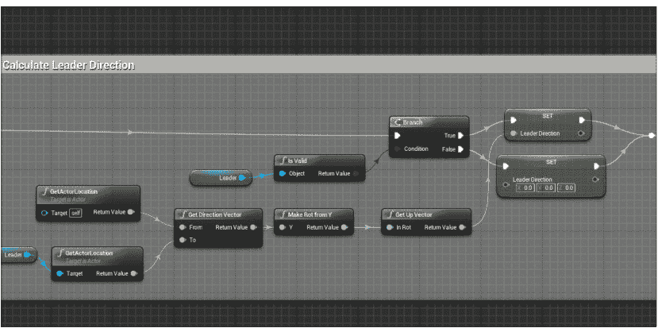

现在，如果我们点击 **播放**，我们可以看到会发生什么。小群组开始形成，因为追随者在彼此经过时寻找潜在领导者。

### 导航行为：群体

群体是一种结合了分离、聚集和对齐的导航行为。分离行为避开其他附近的代理。聚集行为使代理保持在一个群体中。对齐行为通过与附近代理对齐来平均前进方向。

我们在这里要做的是在蓝图中复制导航行为，群体。我们还将使用 UMG 来帮助操作每种行为的权重。现在就开始，创建我们在本章这部分需要的变量。

### 群体代理

我们必须首先开始创建计算单个行为所需的变量。然后，我们必须将结果相加，为我们的代理规范化一个最终前进方向。

让我们专注于我们的 RollingGameMode 游戏模式，并添加我们在本章稍后需要使用的三个新全局变量。与三个行为相关联，我们需要创建 GlobalAlignment、GlobalCohesion 和 GlobalSeparation，方法如下：

- 1. 打开 RollingGameMode 并关注事件图表。然后，从那里，创建三个变量，类型为 Float，默认值为 0.0。

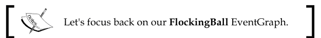
- 2. 我们需要创建三个向量变量：NCohesion、NAlignment 和 NSeparation。
- 3. 关注 ForEachLoop 之前的 SphereOverlapActors 节点。在这里，我们将清除我们刚刚创建的三个向量的任何先前值。我们将为我们的每种群体行为执行此操作，将其设置为 0,0,0。

注释此区域 清除任何值：

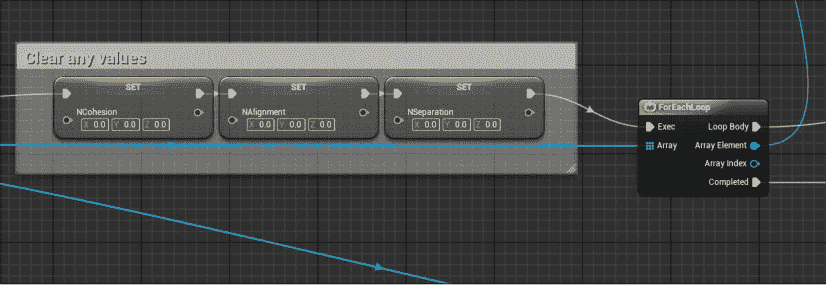

- 4. 接下来，在先前注释的名为 **Don't follow** 的部分之前，针对追随者 **作为领导者**，我们想在此处与 **ForEachLoop** 节点的 **Loop Body** 引脚之间添加间距。

- 5. 首先，我们需要计算 **NAlignment**，这是负责引导附近代理朝同一方向移动的行为。我们将获取附近代理的平均方向向量。

- 6. 现在，我们想要设置一个局部变量 **NAlignment**，方法是先从 **Cast to FlockingBall** 节点获取我们的 **Direction** 变量。现在，我们需要将 **Direction** 值乘以一个基于该代理与我们代理之间距离的强度。

- 7. 首先，我们需要计算我们与该代理之间的向量长度。我们将通过从其他代理的位置减去我们的位置来实现这一点。然后，我们将从结果中获取 **VectorLength** 值。接下来，我们将创建 **Map Range Clamped**，并将 **VectorLength** 节点的结果插入到 **Value** 引脚中。

- 8. 现在，要配置此 **Map Range Clamped** 节点，我们将 **In Range B** 设置为 **300.0**，然后将 **Out Range A** 设置为 **1.0**。这将导致在 0 单位时达到全强度，超过 300 单位则无强度。此返回值现在需要乘以 **Direction** 值。

- 9. 然后，我们将此结果添加到 **NAlignment**，并将其设置回局部 **NAlignment** 变量：

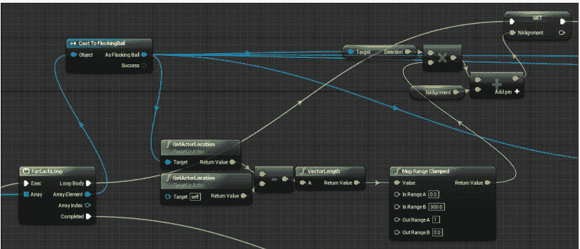

- 10. 现在，我们必须计算 Cohesion，这是负责引导代理朝附近代理中心移动的行为。这是指向代理质心的方向。

- 11. 首先，让我们创建一个 **GetActorLocation** (A) 节点和一个 **Lerp (vector)** 节点，将 **A** 引脚和来自重路由的 **GetActorLocation** (B) 节点连接起来。**Alpha** 值应为步骤 6 中 **Map Range Clamped** 的 **Return Value**。

- 12. 然后，我们想要将 **Lerp (vector)** 节点的 **Return Value** 添加到 **NCohesion**。接下来，我们将使用最终结果设置我们的局部 **NCohesion** 变量。这将为附近的每个代理更新我们的 **NCohesion** 变量：

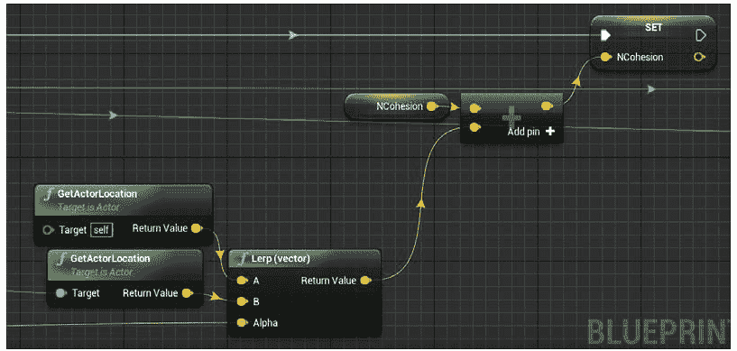

- 13. 最后要计算的行为是 Separation，它负责将代理从附近的代理中推开。这是从我们的代理指向其他代理的 **Direction** 向量。

- 14. 首先，我们想要从我们的代理的 **GetActorLocation** 节点中减去 **GetActorLocation** 节点。然后，这将作为 **Lerp (vector)** 节点上的 B。我们将返回到 **Map Range Clamped** 节点的 **Return Value**，并将其插入到 **Lerp (vector)** 节点的 **Alpha** 引脚中。我们将留空 A。

- 15. 然后，我们必须将 **Lerp (vector)** 的 **Return Value** 添加到 **NSeparation**。最后，我们将使用结果设置我们的局部 **NSeparation** 变量。注释此区域 **Calculate Each Behavior for nearby Agents**:

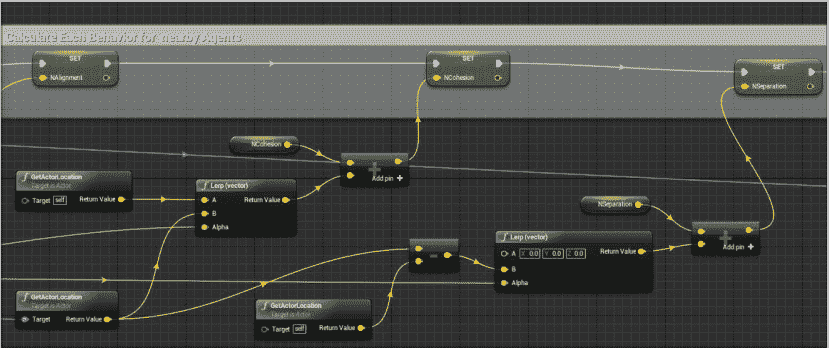

- 16. 关注 **Loop Body** 变量中的 **Completed**。现在，我们必须完成三种行为的计算。

- 17. 让我们获取 **SphereOverlapActors** 返回的数组长度，以便知道除以多少来创建平均值。然后，我们将此 Int 转换为 Float。从那里，我们可以除以 **NAlignment** 变量，并使用 **Normalize** 节点对结果进行归一化。然后，我们必须获取在 **RollingGameMode** 中定义的全局变量。

- 18. 创建一个 **Get Game Mode** 节点并将其转换为 `RollingGameMode` 以访问我们的变量。接下来，我们将从 RollingGameMode 转换中获取 **Global Alignment** 变量，并将其乘以前一步的 **Normalize** 结果。然后，此结果必须设置到局部 **NAlignment** 变量中：

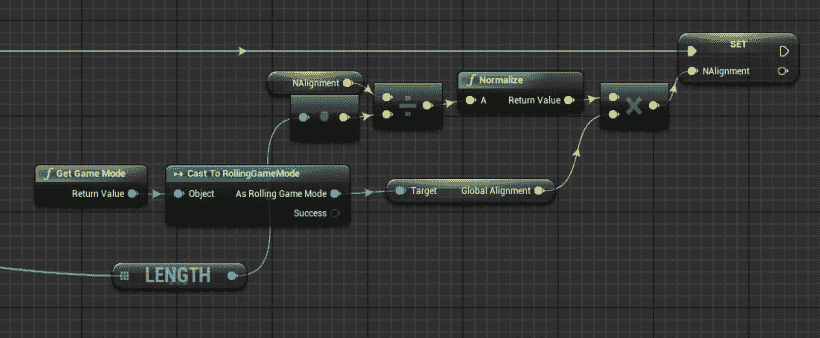

- 19. 接下来，我们必须计算 Cohesion。为此，我们必须将局部 **NCohesion** 变量除以数组长度，然后从我们的 **GetActorLocation** 节点中减去它。然后，我们将应用 **Normalize** 函数以获得我们需要的结果。

- 20. 接下来，我们将结果乘以来自 RollingGameMode 的 **Global Cohesion** 变量。然后，将此设置到我们的局部 **NCohesion** 变量中：

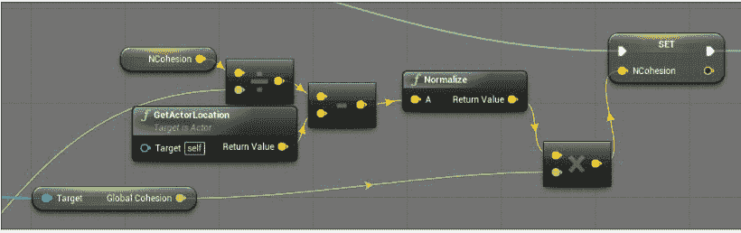

- 21. 类似于之前的过程，我们想要获取我们的局部 **NSeparation** 变量，并用之前的数组长度除以它。将结果乘以 -1。然后，将结果乘以全局 **Global Separation** 变量。

- 22. 最后，我们将获取结果并设置我们的局部 NSeparation 变量。注释此区域 Calculating Flocking Steering Behavior - outputs NCohesion, NAlignment, NSeparation:

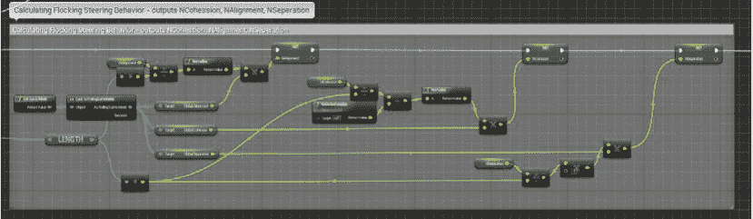

- 23. 然后，我们必须找到 Calculate Direction，并将我们的每个变量添加到此代理的 Direction 变量的最终计算中：

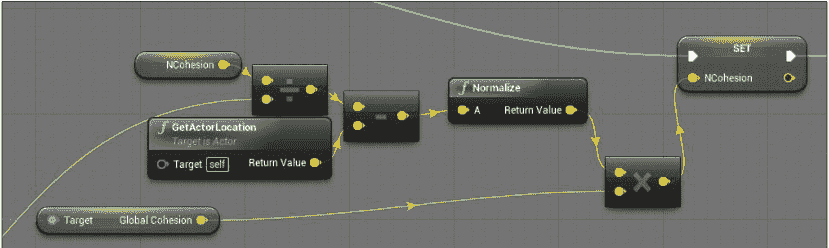

- 24. 我们需要做的最后一件事是为本课程的下一部分做准备。所以，让我们在蓝图左上方找一个空位置并添加一些新代码。

- 25. 添加一个名为 ResetBall 的新自定义事件。

- 26. 接下来，我们想要为此代理创建一个 SetActorLocation 节点，并将 New Location 设置为我们在开始时设置的 Start Location 变量。

- 27. 现在，我们想要设置一个新方向，方法是首先放置 **SET** 节点的 **Direction** 变量。然后，我们将拆分结构体，并仅将 **Random Unit Vector** 节点的 **Return Value X** 和 **Return Value Y** 应用过去：

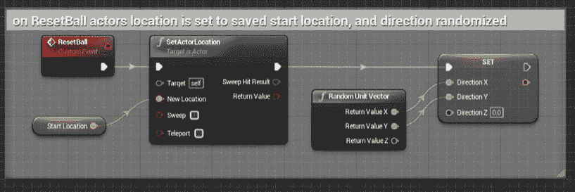

### 通过 UMG 控制行为

在本章的这部分中，我们想要涉及使用 UMG 来控制对我们的代理产生影响的行为。我们将通过首先创建一个带有适当控件的 UMG 小部件来操作我们的三个浮点变量来实现这一点。然后，我们必须将此用户小部件分配给拥有的 PlayerController。最后，我们将添加一个函数，将代理重置到其原始位置，重新开始模拟。

### 一个简单的 UI

让我们导航到内容浏览器，创建一个新的 Widget 蓝图，并将其命名为 `FlockingUI`。让我们打开它并转到 **Designer** 选项卡以开始，具体步骤如下：

- 1. 让我们将 **Vertical Box** 拖入我们的 **Hierarchy** 面板。
- 2. 接下来，设置插槽（**Canvas Panel**）属性：**Size X** 值为 350.0，**Size Y** 值为 600.0。
- 3. 然后，将一个按钮拖入 **Vertical Box** 下方的 **Hierarchy** 面板。将按钮重命名为 **ResetButton**。接下来，设置 **Vertical Box** 插槽的 **Padding** 属性为 75.0 和 25.0。

- 4. 最后，将 Text 拖入 ResetButton 下方的 Hierarchy 面板。接下来，设置文本属性 Text 为 "Reset":

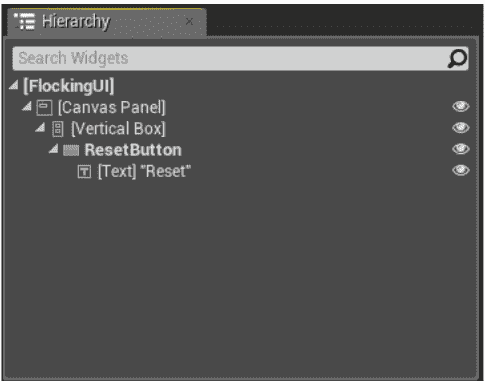

- 5. 现在，让我们将 Horizontal Box 拖入 Vertical Box 下方的 Hierarchy 面板。然后，在 Horizontal Box 内添加两个更多小部件，分别名为 Text 和 Slider。

- 6. 现在，我们必须在 Hierarchy 面板中再复制两次 Horizontal Box 及其子项。

- 7. 右键单击并复制 Horizontal Box，然后将其粘贴到 Vertical Box 中两次：

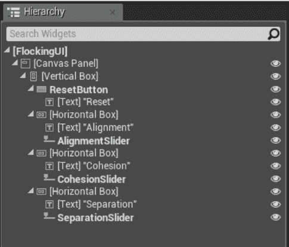

- 8. 之后，我们想要重命名将用于组织目的的小部件。按顺序，我们想要将第一个滑块命名为 AlignmentSlider，第二个命名为 CohesionSlider，最后一个命名为 SeparationSlider。

- 9. 现在，按顺序，让我们将我们的文本属性 Text 设置为这三个名称：Alignment、Cohesion 和 Separation。然后，我们将设置 Padding 文本属性为 7.5。

完成此操作后，您应该会得到类似于以下截图的内容：

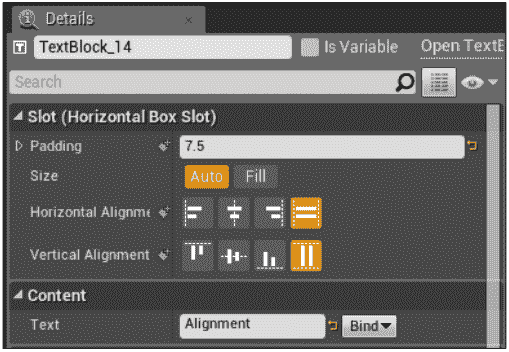

- 10. 要更新我们的全局变量，我们必须从三个滑块创建一个事件。我们可以从 AlignmentSlider 开始，然后转到 Events，并单击 OnValueChanged 上的 + 选项。然后，当此事件被调用时，我们将更新 RollingGameMode 中的 Global Alignment 变量。

- 11. 现在，我们必须对其他两个滑块——CohesionSlider 和 SeparationSlider——执行相同操作，使用相应的全局值：

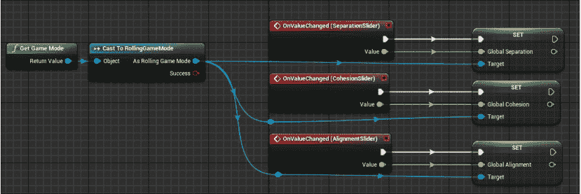

- 12. 让我们把注意力重新放回这个用户控件的 Designer 选项卡。然后，点击之前步骤中创建的 ResetButton 事件。

- 13. 我们要在 Events 中向下滚动，并点击 OnPressed 上的 + 选项。这将为我们提供刚才创建的事件。

- 14. 这里，我们要从引脚拉出并调用 Get All Actors Of Class。接下来，我们希望 Actor Class 值设为 Flocking Ball。从那里，Out Actors 将把世界中所有 Flocking Ball 的实例作为数组返回。

- 15. 最后要做的是从 Out Actors 拉出并调用 Reset Ball。这将通知所有代理重置模拟：

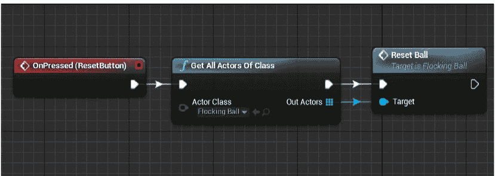

- 16. 现在，我们必须返回到 EventGraph 中的 Flocking Ball 以添加更多蓝图代码。在 Reset Ball 事件上方找一个空位置。

- 17. 右键点击并搜索 Event Possessed。将新控制器转换为 PlayerController，然后从 As Player Controller 拉出并搜索 Create Widget。将该节点的 Class 引脚设置为 FlockingUI。

- 18. 接下来，我们必须从 Return Value 拉出并调用 Add to Viewport。最后，我们需要向玩家显示鼠标，以便他们可以与控件交互。

- 19. 右键点击并搜索 Get Player Controller。从 Return Value 拉出并搜索 Show Mouse Cursor。将此区域注释为 Enable Flocking UI & Mouse Visibility：

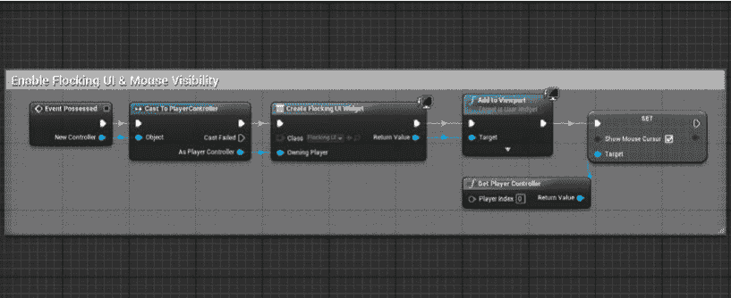

让我们编译所有内容。点击 Save All 并返回到我们的地图。如果你点击 Play，应该能看到代理撞到墙壁后弹开。然后，如果我们调高不同的行为，将看到它们开始影响代理的方向。

下面的截图显示了将所有内容组合在一起后关卡的样子：

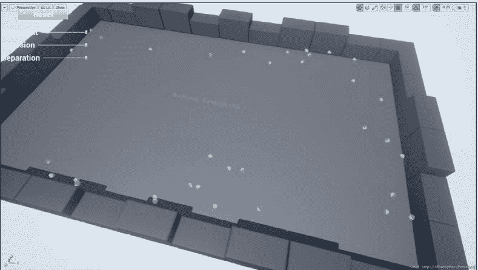

### 摘要

让我们花点时间简要讨论本章做了什么。首先，我们设置代理撞墙弹开。这让我们观察代理模拟移动以及四种行为如何影响它们。接下来，我们将实现 Follower 和 Leader 行为，这会在模拟期间在代理中创建群组。

我们做的最后一件事是实现群体移动，它分为三种不同的行为。第一种行为是 Alignment，负责使代理与附近代理对齐。第二种行为是 Cohesion，负责将代理引导向附近代理的中心。第三种行为是 Separation，负责将代理引导远离附近代理。

然后，我们仅仅创建了一个 UI 来控制在课程中创建的权重，并在模拟期间随时重置代理。

既然我们已经介绍完不同的移动行为，是时候将本书中关于 AI 的所有演示内容结合起来了。在下一章中，我们将创建一个 AI 角色，它将巡逻、追击并摧毁任何敌人。那么，让我们进入下一章开始吧！
