## 创建巡逻、追击和攻击 AI

在本章中，我们将结合之前章节中使用的一些组件，包括 AI Sense 和其他组件，以便 AI 进行导航。然后，我们将在超时时间中添加一些随机性，这将使 AI 追击其检测到的角色。现在，在本章中，我们可以使用 Behavior Tree 创建 AI，同时利用其他 AI 组件。这些组件的组合可以创建出响应迅速且可信的 AI 行为。

本章的目标是创建一个使用 Behavior Tree 向你开火的 AI；这个最后的 AI 组件将对你有帮助，因为没有完美的解决方案。因此，理解每个可用工具可以让你为自己的 AI 用途利用每个组件的优势。这些工具让你能够创建出响应迅速且可信的 AI。

### 创建黑板

黑板为行为树定义了局部变量空间。这些黑板还可以与同一黑板的其他实例同步。可以先创建黑板，因为你会发现自己经常修改它们，直到发现行为树所需的一切。

我们将先创建黑板数据，然后将其提供给行为树。现在，让我们开始！以下是步骤：

- 1. 在 Content 文件夹上右键点击，创建一个名为 AI 的新文件夹。

- 2. 现在，在文件夹内右键点击，向下滚动找到 Artificial Intelligence；然后，点击 Blackboard。我们将其命名为 EnemyData。

- 3. 我们将打开 EnemyData，然后创建两个供行为树使用的对象变量。将第一个命名为 TargetActor，下一个命名为 CurrentRoute。

> 如果你使用 Enumeration，可以像我们为这些对象定义演员那样定义枚举。

- 4. 点击 TargetActor，并在下拉菜单中选择 Key Type 选项。然后，将 Base Class 值更改为 Actor。我们希望对 CurrentRoute 也做同样的操作，如下面的截图所示：

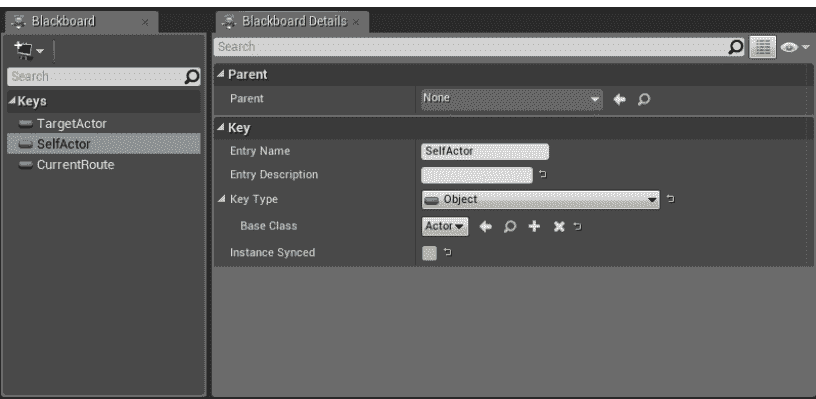

行为树是节点组成的树，其结构图决定流程控制，每个叶节点代表 AI 执行的实际代码。这导致 AI 根据其接收到的输入做出一系列适当的决策。要查看我们今天要制作的示例，以下是 Unreal Engine 4 中行为树的样子：

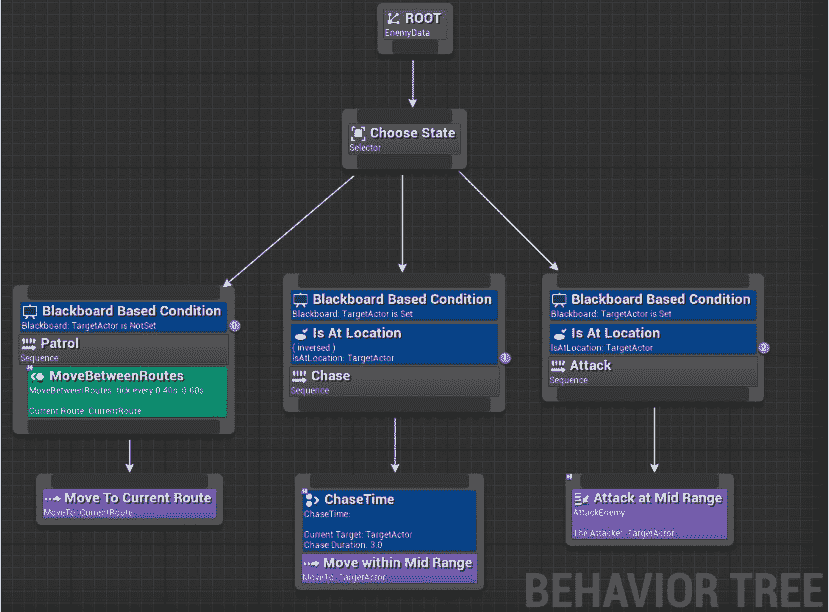

世界上有许多形式的状态机可用。行为树是一种具有子树节点的树形结构。它具有允许你进行流程控制的合成节点，从而导致叶节点的执行，叶节点也具有额外的流程控制。这种控制级别允许你创建具有大量控制力的深层行为树。

让我们开始创建我们自己的，并快速了解课程后期的预期：

- 1. 我们将在 EventGraph 上右键点击，并向下滚动到 Artificial Intelligence。现在，点击 Behavior Tree 并将其命名为 EnemyAI。

- 2. 打开 EnemyAI，你应该在 ROOT 节点中看到已填充的 EnemyData。如果没有，点击 ROOT 节点并将 Blackboard 资产设置为 EnemyData：

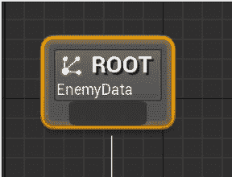

### 中距离攻击

这将是从我们眼睛中心进行的射线追踪。这就是你攻击 AI 的方式，也是 AI 攻击你的方式。我们将简单地运行射线追踪，然后在此绘制一条调试线，从玩家额头创造出一道酷炫的红色光束！我们将测试它是否有效，之后，我们将其集成到两个玩家中。

现在，要开始创建此功能，我们将做一些不同的事情来节省时间。我们将函数放入 Blueprint 函数库，以便在每个蓝图图表中共享。

为了使函数对 AIController 和 PlayerController 都有用，我们希望将控制器作为输入，然后输出一个角色。此函数还将在必要时处理绘制红色光束：

- 1. 让我们右键点击，进入 Blueprints，然后进入 Blueprint Function Library。将其命名为 EnemyLibrary 并打开它。

- 2. 在左侧，添加新函数。将其命名为 LaserFromController。将第一个输入设置为名为 theController 的控制器，然后输出名为 Hit Actor 的角色。最后，创建名为 foundActor 的局部变量。将类型设为 Actor。

- 3. 从控制器拉出并搜索 Get Controlled Pawn。然后，从这里，我们将基于角色的旋转创建射线追踪。从 Get Controlled Pawn 拉出并搜索 Get Actor Forward Vector。

- 4. 我们希望将 Get Actor Forward Vector 乘以 9999999。

- 5. 返回步骤 3 中的 Get Controlled Pawn。然后，将其转换为 ThirdPersonCharacter，现在我们可以访问 Mesh 变量。我们想要使用 Get Socket Location 获取头部骨骼的位置。

- 6. 然后，从 ReturnValue 拉出并找到 Vector + Vector；现在，在 Z 变量中添加 12.0：

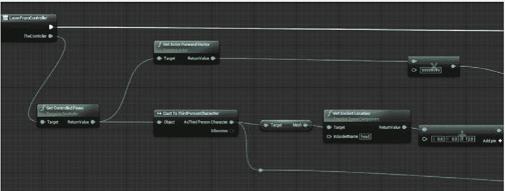

- 7. 现在，我们必须使用 Vector + Vector 节点将步骤 4 的结果与步骤 6 的结果相加。然后，我们将继续对多个对象进行射线追踪。搜索 LineTraceForObjects，然后将结果插入我们刚刚创建的节点的 End 引脚。

- 8. 现在，让我们将先前步骤中创建的节点的 Start 值设置为来自 Vector + Vector 节点的输出到起点。然后，我们应该看到一束光从他头部开始并在空间中向前绘制。

- 9. 从 Object Types 拉出并创建一个数组；然后，填充 Pawn。

- 10. 从 ActorsToIgnore 拉出并创建一个数组；然后，将 Cast to ThirdPersonCharacter 节点填充到第 0 个元素。

- 11. 从 LineTraceForObjects，拆分 OutHitResult。现在，从 OutHit bBlockingHit 拉出并搜索 Branch。

- 12. 右键单击并搜索 **应用伤害**；然后，将 **分支** 节点的 **真** 执行引脚连接到此节点。从 **命中角色** 拉出并将其放入 **应用伤害** 的 **受损角色** 引脚中：

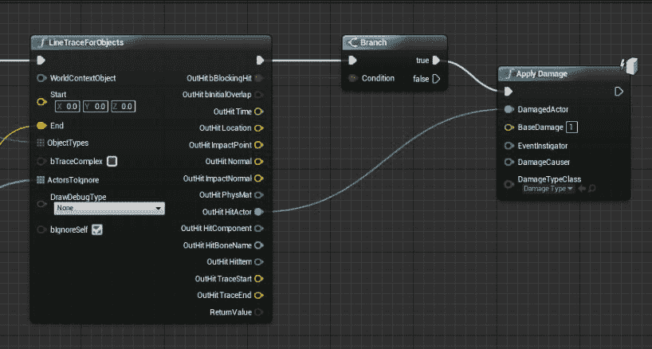

- 13. 接下来，右键单击并搜索 **绘制调试线**。我们希望 **线条起点** 引脚连接到步骤 6 的结果，即我们线条的起始点。然后，拉出 **命中位置**，它将插入到 **线条终点**。将 **线条颜色** 设置为红色，持续时间设置为 .2，**线条粗细** 设置为 3。

- 14. 最后，拉出本地 **发现的角色** 变量并设置它。从 **命中角色** 拉出并将其设置到我们的本地变量中。然后，将其发送到 **返回节点**。

- 15. 我们要复制 **绘制调试线** 以连接到 **分支** 节点的 **假** 执行引脚：

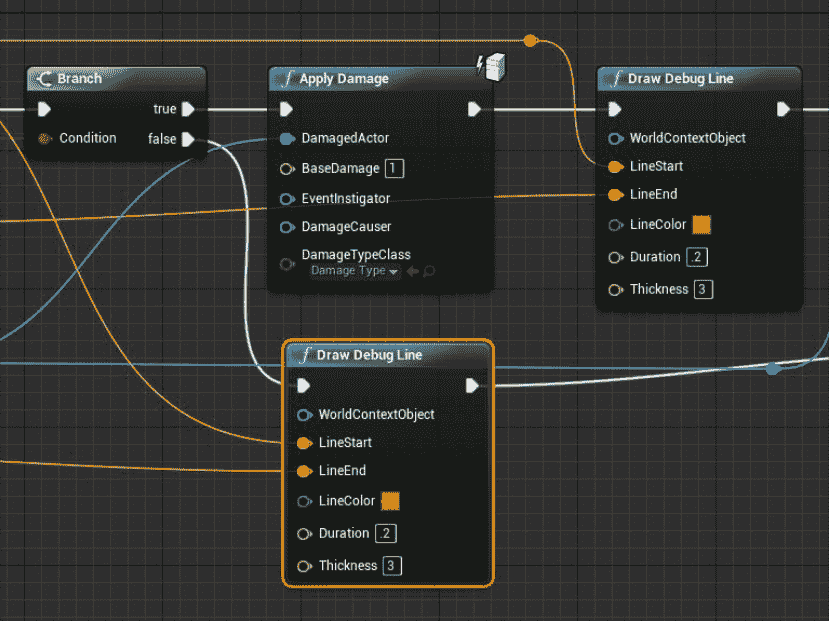

- 16. 不要为 **线条终点** 获取 **命中位置**，而是获取步骤 7 的结果。

- 17. 然后，将此端连接到 **返回节点**。 **返回节点** 中的 **命中角色** 引脚将填充我们的本地 **发现的角色** 变量：

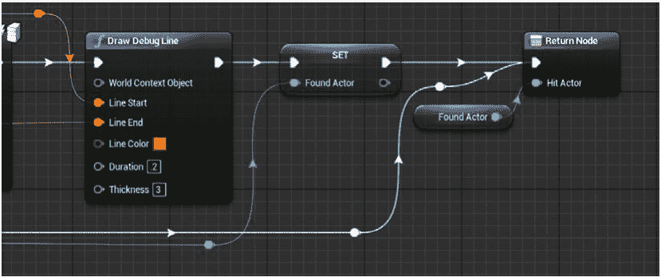

### 控制器

在本示例中，我们将赋予 **玩家控制器** 接收和造成伤害的能力。在 AI 完成后，您将能够与 AI 战斗。此外，由于本课程将使用 **AI 感知**，我们应该为控制器注册 **刺激源**。接下来，我们将设置 **AI 控制器**。我们将赋予其感知刺激的能力。然后，我们将创建一个 **角色** 组件，其中将包含更新 **行为树** 所需的功能。

让我们继续，开始创建这些基础组件，具体步骤如下：

- 1. 在 AI 文件夹中，右键单击并选择 **蓝图**。然后，从选项中选择 **玩家控制器**。然后，我们要将此命名为 `OutController`。
- 2. 打开 **事件图** 并查找 **事件 开始播放**。
- 3. 在附近右键单击并搜索 **获取受控 Pawn**。然后，从 **返回值** 拉出并搜索 **分配 受到任何伤害**。
- 4. 这将创建 **受到任何伤害** 事件并输出 **伤害**。
- 5. 我们需要创建一个变量来保存我们的 **生命值** 变量。单击 **添加变量** 并创建一个名为 **生命值** 的 Float 变量。将默认值设置为 5。
- 6. 查看 **受到任何伤害**，拉出 **伤害** 并从 **生命值** 中减去它。然后，将结果设置到我们的 **生命值** 变量中。接下来，我们将检查 **生命值** 是否小于或等于 0.0。
- 7. 从结果创建 **分支** 节点。从 **真** 拉出并右键单击搜索 **打印字符串**。用 **玩家死亡** 填充此项，右键单击，然后搜索 **销毁角色**。
- 8. 右键单击并搜索 **获取受控 Pawn**；然后，将其插入到上一步 **销毁角色** 的 **目标** 引脚中。现在，我们可以从 AI 对手那里受到伤害：

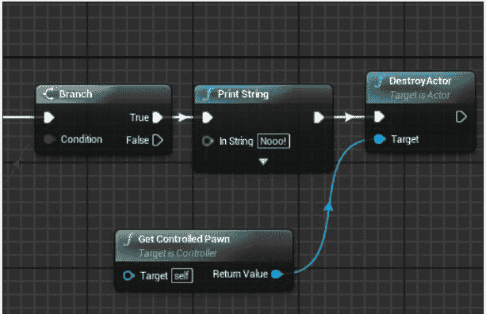

- 9. 右键单击并搜索 **E 输入** 事件。拉出 **按下** 并释放以搜索 **序列**。从 **然后 0** 拉出并释放以搜索 **仅执行一次**。从 **然后 1** 拉出，然后释放以搜索 **延迟**。现在，将 **持续时间** 设置为 0.75 并将 **完成** 插入到 **仅执行一次** 中的 **重置** 引脚中。
- 10. 查看 **仅执行一次**，从 **完成** 拉出并释放以搜索 **来自控制器的激光**。然后，从 **命中角色** 拉出并释放以搜索 **应用伤害**。将 **持续时间** 设置为 1.0 并将 **伤害造成者** 设置为 **自身**。
- 11. 现在，我们想将此控制器添加为 **刺激源**。在 **组件** 部分中，单击 **添加组件** 并查找 **AI 感知刺激源**。
- 12. 单击 **注册为感官源** 然后单击 **+**。让我们从可用选项中选择 **AI 感官_视觉**。

现在，编译此内容。我们已完成 **玩家控制器** 的设置。现在我们需要创建一个 **AI 控制器** 设置，以便我们的 AI 可以向我们开火：

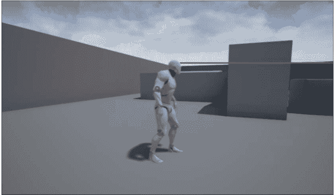

让我们按以下方式设置 **AI 控制器**：

- 1. 右键单击并点击 **蓝图**。在所有类中，搜索 **AI 控制器**。选择它并单击 **选择** 以创建它。将其命名为 `EnemyController` 并在 **事件图** 中打开它。
- 2. 让我们创建一个名为 **生命值** 的新 Float 变量。然后，将默认值设置为 **5.0**。
- 3. 这两个角色的开头部分相同，只有一个细微的更改。因此，我们可以从 `OurController` 复制代码，或从上一节的步骤 2 开始。我们将从 `OurController` 向 `EnemyController` 复制下面截图中显示的部分：

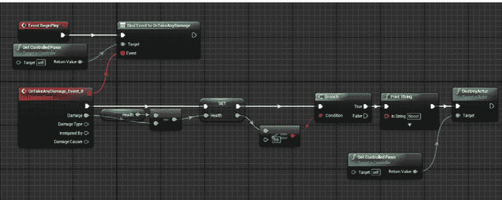

- 4. 在 **绑定事件到 受到任何伤害** 事件的末尾，拉出并释放以搜索 **运行行为树**。将 **行为树资产** 值设置为 **敌人 AI**，这是我们在本章前面创建的资产。现在，树中的代码将在此 **AI 控制器** 上运行。
- 5. 现在 AI 可以接收伤害了，我们需要它能够感知玩家。我们将使用 **AI 感知** 组件来实现。
- 6. 在 **组件** 部分中，单击 **添加组件** 并搜索 **AI 感知**。添加此项后，在右侧的 **AI 感知** 下，从下拉菜单中选择 **感官配置** 并单击 **+**。然后，将其设置为 **AI 视觉配置** 并从下拉菜单中选择 **感官**。
- 7. 展开 **按关系检测** 并勾选 **检测中立者**。
- 8. 转到 **事件** 下并单击 **感知更新** 以获取当前感知到的角色。
- 9. 从 **感知更新 (AI 感知)** 拉出并释放以搜索 **序列**。我们希望 **然后 0** 被绘制并释放以搜索 **仅执行一次**。然后，我们希望 **然后 1** 设置为 **延迟** 节点的 **持续时间** 引脚。将 **持续时间** 设置为 **1**。现在，将 **完成** 连接到 **重置**。
- 10. 关注 **仅执行一次**。我们将从 **完成** 拉出并释放以搜索 **停止移动**。右键单击并搜索 **黑板**。从 **黑板** 拉出并释放以搜索 **设置值为对象**。右键单击，搜索 **创建文字名称**，并将其插入到 **键名**。从 **更新的角色** 获取第一个元素并将其插入到 **对象值**：

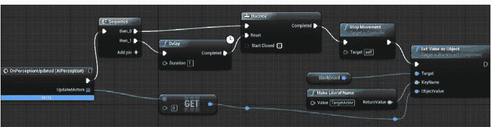

现在，AI 将立即将感知到的角色报告给 **行为树**，然后可以立即在我们的 AI 的下一个决策中使用。

### 路点

与 **AI 感知** 项目类似，这些路点将对下一个路点有一个引用。两个路点之间的这种简单链接允许我们为 AI 创建可导航的路径。

现在，我们应该开始制作这些路点；执行以下步骤：

- 1. 首先，让我们在 **文件夹** 部分内的空白处右键单击并进入 **蓝图**。在底部，在 **所有类** 中搜索 **目标点**。选择它并单击 **选择** 以创建它。然后，将其命名为 **路点** 并在 **事件图** 中打开它。
- 2. 在左侧 **我的蓝图** 下，添加一个名为 **下一个路点** 的路点变量。我们将使用它来查找下一个要遍历的路点。
- 3. 在关卡中添加四个路点，并使用 **下一个路点** 变量将它们相互链接。连接应类似于 A->B->C->D->。然后，**D** 应连接到 **A**，从而创建一个循环。

### 行为树组合节点、任务、装饰器和服务

任务由 **组合节点** 执行。**组合节点** 很重要，因为它们直接影响 **行为树** 内的流程控制。

在撰写本文时，**组合节点** 有三种形式：**序列**、**选择器** 和 **简单并行**。以下是各自的描述：

- **序列**：这将执行每个节点，在最后一个节点上返回成功；但是，如果任何节点失败，它将立即返回失败并中止其余叶子。
- **选择器**：这将执行每个节点，立即返回成功并中止其余叶子。如果一个节点返回失败，它将继续只在最后一个子节点返回失败时才返回失败。
- **简单并行**：这将同时执行一个任务和一个子树，这允许你行走，并允许另一个决策树位于行走任务的顶部，例如。

任务通常是被调用的最后一个节点，因为它们包含直接影响 AI 行为的代码。我们将制作自己的任务，并学习它如何与 **行为树** 通信。

**装饰器** 在 **组合节点** 或任务的入口处执行，它可以确定是否应该执行 **组合节点** 或节点。这些非常适合为特定任务创建自定义检查。例如，仅当具有 **门** 和 **野兽** 模式时才执行 **破门**。

**服务** 在子树处于活动状态时执行。这意味着它有一个可用的 tick。这使我们可以收集或更新信息以在游戏中立即进行更改。例如，射击服务将负责在玩家处于视线范围内时进行射击。这还允许您管理射击，并在不希望发生时防止中断。

在本节中，我们将使用除 **简单并行** 之外的所有内容。让我们开始吧！

首先，我们将创建一个装饰器，它负责在行为树超过时间限制时退出树。因此，在我们的情况中，这将在 3.0 秒后发生，如果移动状态不是空闲，我们将移除 **当前目标**，如下所示：

- 1. 右键点击图表并点击 **蓝图**。然后，向下滚动到 **所有类** 并搜索 **BTD**。点击 **行为树装饰器** 并点击 **选择** 以创建一个新的 BT 装饰器。将其命名为 **ChaseTime**。

- 2. 现在，打开 **ChaseTime** 并前往 **事件图表**。右键点击并搜索 **开始时接收执行事件**。

- 3. 我们应该创建两个变量。第一个将是 **黑板键选择器** 类型，命名为 **当前目标**。第二个将是 **浮点数** 类型，命名为 **追逐持续时间**。

- 4. 从 **开始时接收执行事件** 拉线，然后搜索 **延迟**。将 **追逐持续时间** 插入到 **延迟** 节点的 **持续时间** 引脚中。

- 5. 从 **拥有者角色** 拉线并将其转换为 **AI 控制器**。然后，获取 **AI 控制器** 并搜索 **获取移动状态**。从 **返回值** 拉线并搜索 **不等于**。从结果拉线并创建 **分支**。将 **完成** 连接到 **分支** 的输入。

- 6. 获取 **当前目标** 并在 **事件图表** 中放置一个变量。从引脚拉线并搜索 **设置黑板值为对象**。将 **分支** 节点的 **true** 拉入此节点。然后，从 **AI 控制器** 拉线并搜索 **停止移动**。这应在 **设置黑板值为对象** 之后：

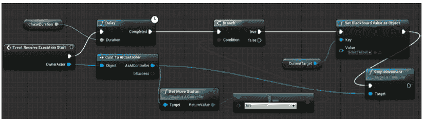

完成此操作后，让我们编译它。然后，我们将继续下一个组件。

其次，我们将创建一个服务，用于随机设置我们的第一条路线。然后，当我们到达当前路线时，将移动到列表中的下一条路线。这可以随时发生，而服务允许你拥有一个可以不断运行的函数，如下所示：

- 1. 右键点击图表并点击 **蓝图**。然后，向下滚动到 **所有类** 并搜索 **BTS**。点击 **行为树服务** 并点击 **选择** 以创建一个新的 BT 服务。将其命名为 **MoveBetweenRoutes**。

- 2. 打开 **MoveBetweenRoutes** 并导航到 **事件图表**。

- 3. 右键点击并搜索 **激活时接收事件**。从 **拥有者角色** 拉线并为 **AI 控制器** 进行纯转换。接下来，从 **AI 控制器** 拉线并搜索 **移动完成**。分配此事件以供后续使用：

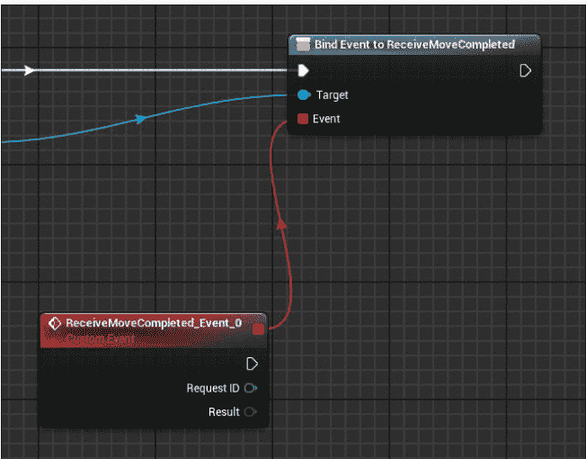

- 4. 让我们创建两个新变量。第一个将是 **黑板键选择器**，命名为 **当前路线**。第二个将是 **AI 控制器**，命名为 **此角色**。

- 5. 现在，我们想要设置 **此角色** 并将 **AI 控制器** 拉入 **此角色**。

- 6. 接下来，我们想要获取 **当前路线** 和 **获取黑板值为对象**；然后，我们想要创建一个 **是否有效** 节点来检查黑板值对象是否有效：

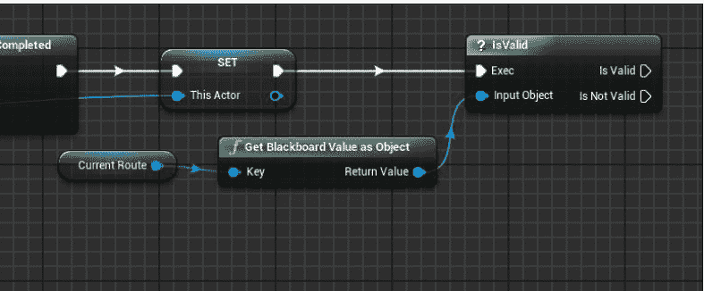

- 7. 从 **无效** 拉线并释放以搜索 **获取所有指定类的角色**。将角色类设置为 **路点**。

- 8. 从 **输出角色** 拉线并释放以搜索 **长度**；然后，减去 1。右键点击并搜索 **范围内随机整数**。然后，将减法结果插入到 **最大值** 中。接下来，从 **输出角色** 拉线，释放，并搜索 **获取**。

- 9. 将 **范围内随机整数** 的 **返回值** 插入到 **获取** 中。现在，从 **当前路线** 拉线。从此引脚拉线，释放，然后搜索 **设置黑板值为对象**。将 **获取** 拉入此节点的 **值** 中：

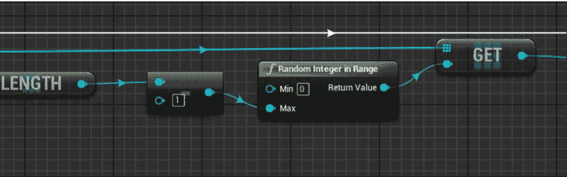

现在，开始时会选择一条随机路线。

- 10. 让我们重新关注先前创建的 **移动完成** 事件。切换到 **结果**，并从 **成功** 释放以搜索 **分支**。

- 11. 从 **此角色** 拉线并拉出引脚，然后搜索 **获取受控角色**。然后，从 **返回值** 拉出引脚并搜索 **获取距离到**。

- 12. 从 **当前路线** 拉线，拉出引脚，并搜索 **获取黑板值为对象**。接下来，转换为 **路点** 并将 **路点** 插入到 **其他角色** 中。

- 13. 检查 **返回值** 是否小于 125。将结果连接到先前创建的 **分支** 中：

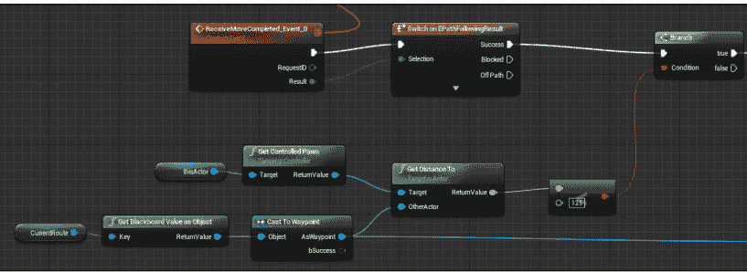

- 14. 从 **路点** 拉线并释放以搜索 **下一个路点**。

- 15. 然后，从 **当前路线** 拉线并放下。拉出引脚并释放以搜索 **设置黑板值为对象**。然后，将 **下一个路点** 的引脚拉入此节点的 **值** 中：

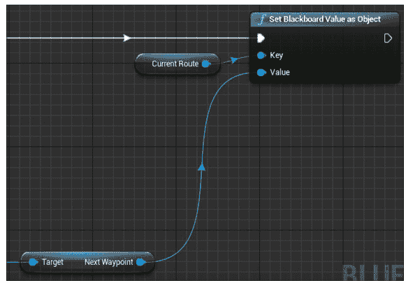

现在，一旦我们移动到离当前路线足够近的位置，就可以移动到下一条路线了。

我们要创建的第三项是任务，它在树中作为叶节点被调用。该节点将专门帮助 AI 在范围内时旋转并攻击玩家。执行以下步骤：

- 1. 右键点击图表并点击 **蓝图**。然后，向下滚动到 **所有类** 并搜索 **BTD**。点击 **行为树任务** 并点击 **选择** 以创建一个新的 **行为树任务**。将其命名为 `AttackEnemy`。

- 2. 打开 `AttackEnemy` 然后打开 **事件图表**。

- 3. 右键点击并释放以搜索 **执行时接收事件**。然后，创建此节点。现在，从 **拥有者角色** 转换为 **AI 控制器**。

- 4. 从 **转换为 AI 控制器** 创建一个 **分支** 节点。**False** 将流向 **完成执行**。这也会对 **成功** 返回 **False**：

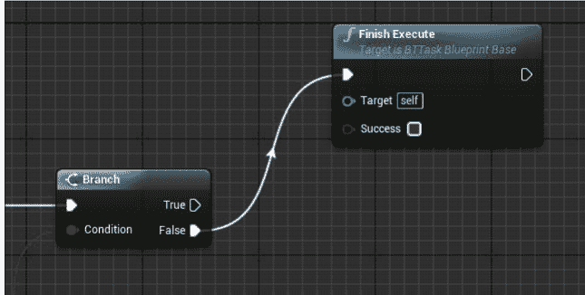

- 5. 从 **攻击者** 拉线，拉出引脚，并释放以搜索 **获取黑板值为对象**。然后，我们将拉出引脚并释放以转换为 **第三人称角色**。**成功** 然后插入到步骤 4 中创建的 **分支** 节点的 **条件** 中。

- 6. 然后拉出 **True** 并释放以搜索 **延迟**。在 **持续时间** 中，我们要搜索 **范围内随机浮点数**。在节点上将 **最小值** 设置为 .4，将 **最大值** 设置为 .75：

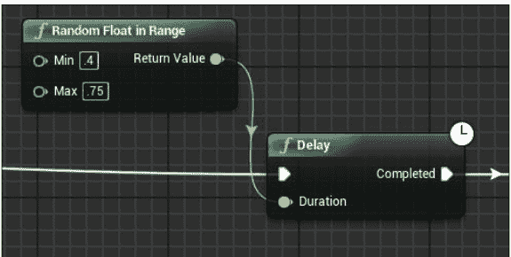

- 7. 从 **AI 控制器** 拉线，释放，然后搜索 **控制器射线**。现在，从 **命中角色** 拉线，释放，并搜索 **是否有效**。拉出 **无效** 并释放以搜索 **完成执行**。

- 8. 从 **是否有效** 拉线并搜索 **应用伤害**。然后，将 **命中角色** 插入到 **受伤害角色** 中。将我们的 **AI 控制器** 节点插入到 **伤害来源** 中。

- 9. 从 **应用伤害** 拉线并搜索 **延迟**。右键点击，搜索 **范围内随机浮点数**，然后将 **返回值** 插入到我们刚刚创建的节点的 **持续时间** 中。将 **最小值** 设置为 .5，将 **最大值** 设置为 1.0。

- 10. **延迟** 之后，拉线并搜索 **完成执行**。通过勾选将 **成功** 标记为 **true**：

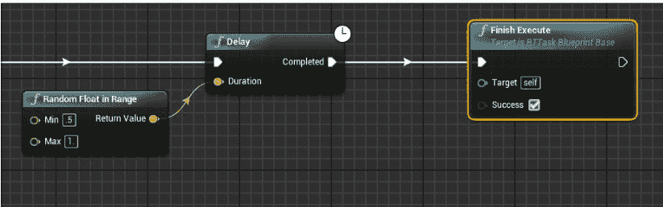

- 11. 现在，右键点击图表并搜索 **刻度时接收事件**。然后，将 **拥有者角色** 转换为 **AI 控制器**。从此处，我们可以从 **AI 控制器** 拉线并释放以搜索 **获取受控角色**。然后，拉出 **获取角色位置** 引脚并释放以搜索 **获取方向向量**。

- 12. 从 **第三人称角色** 拉线并释放以搜索 **获取角色位置**。然后，将 **返回值** 插入到前一步中创建的 **获取方向向量** 的 **目标** 引脚中。

- 13. 从 **获取受控角色** 的 **返回值** 拉线并释放以搜索 **获取角色前向量**。然后，从 **返回值** 拉线并释放以搜索点积 (.)。

- 14. 将 **获取方向向量** 节点的 **返回值** 插入到 **B** 中：

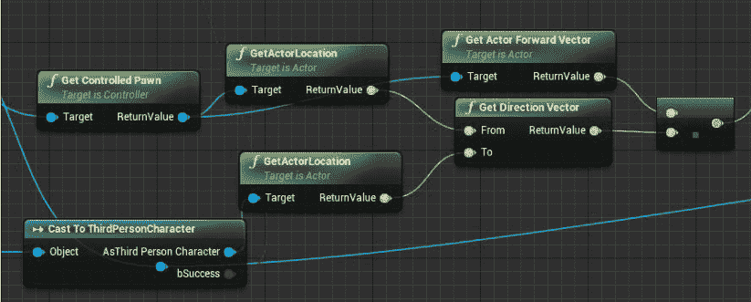

- 15. 获取点积结果并释放以搜索 **弧度转角度**。然后，拉线释放并搜索 **绝对值**。最后，拉出结果并释放以搜索 **几乎相等 (浮点数)**。将 **绝对值** 节点的输出插入到 **A** 中。

- 16. **B** 值为 **57.3**，**误差容差** 值为 **.1**。这意味着视野范围是 **B** 值的两倍。然后，拉出 **返回值** 并释放以搜索 **分支** 节点：

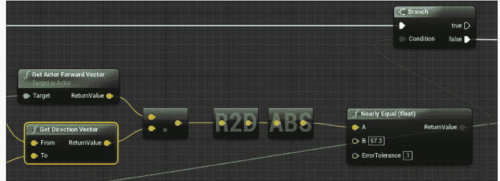

- 17. 现在，从 AsAIController 拉线并在 **分支** 节点后释放，然后搜索 **获取受控 Pawn**。接着，从 **返回值** 拉线并释放以搜索 **添加角色世界旋转**。右键单击并拆分结构体。

- 18. 从 **获取受控 Pawn** 节点的 **返回值** 拉线并释放以搜索 **获取角色位置**。

- 19. 拉下 **攻击者** 变量并释放以搜索 **将黑板值作为对象获取**，最后将其转换为第三人称角色。接着，从 **作为第三人称角色** 拉出引脚并释放以搜索 **获取角色位置**：

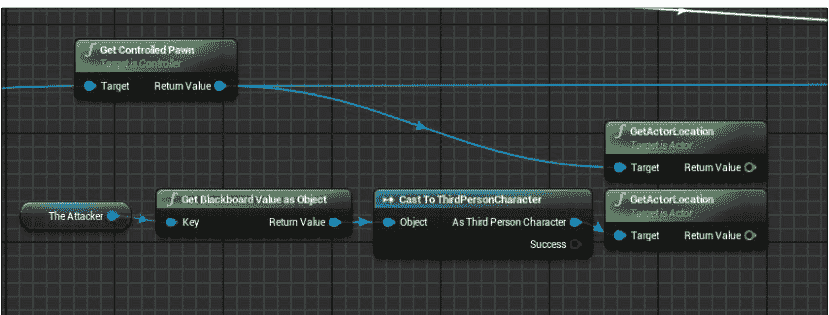

- 20. 从 **获取受控 Pawn** 的 **返回值** 拉线并连接到 **获取角色位置** 的 **目标**；然后，释放以搜索 **查找朝向旋转**。

- 21. 将步骤 19 的 **返回值** 插入到 **查找朝向旋转** 节点的 **目标** 中。

- 22. 从 **获取受控 Pawn** 拉线并释放以搜索 **获取控制旋转**。

- 23. 从 **查找朝向旋转** 的 **返回值** 拉线并释放以搜索 **增量（旋转器）**。

- 24. 将获取控制旋转的返回值插入到增量（旋转器）的 B 中：

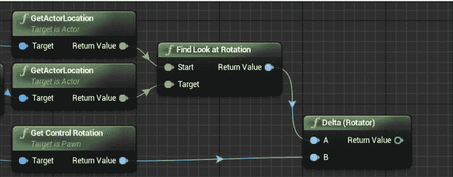

- 25. 从返回值拉线并乘以获取世界增量秒数值；进一步将其乘以 Float 值 55。然后，拆分旋转器并将 Z（偏航）插入到添加角色世界旋转节点的 DeltaRotation Z（偏航）中。

- 26. 从节点拉线并释放以搜索完成执行：

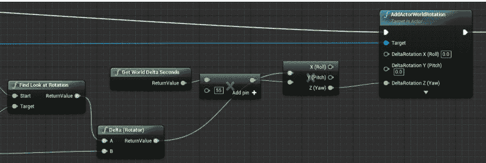

现在我们已经完成了，每当我们不在 AI 的视野内时，AI 就会转向我们。

### 创建逻辑

现在，我们的所有组件都已完成。我们配置了三个自定义节点。

现在，我们只需返回行为树。然后，我们需要为 AI 设置三种状态。第一种是巡逻，负责将 AI 移动到下一条路线。第二种是追击，负责将 AI 移动到玩家的半径范围内。最后一种是攻击，该状态会开火并旋转 AI，直到目标不再在距离范围内。

现在，让我们通过以下步骤打开 EnemyAI 行为树：

- 1. 从根节点拉下，搜索选择器，并将名称设置为选择状态节点。在这里，我们将定义三个不同的状态。

- 2. 拉取选择状态并搜索序列。现在，右键单击，选择添加装饰器，并查找黑板。

- 3. 单击黑板，将键查询设置为未设置，黑板键设置为 TargetActor。

- 4. 右键单击，单击添加服务，并查找在路线之间移动。

- 5. 单击在路线之间移动，将当前路线设置为 CurrentRoute。

- 6. 从序列拉线并搜索移动到。现在，将移动到设置为当前路线：

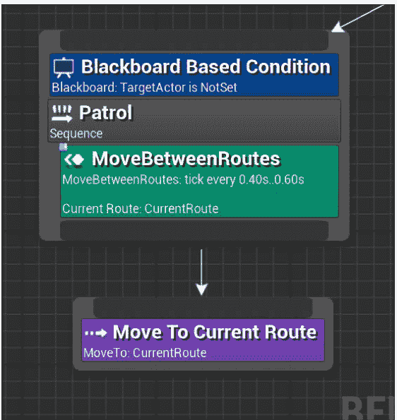

- 7. 拉取选择状态并搜索序列。现在，右键单击并选择添加装饰器以查找黑板。

- 8. 单击黑板，将键查询设置为已设置，黑板键设置为 TargetActor。

- 9. 右键单击并选择添加装饰器；然后，搜索是否在位置。

- 10. 单击是否在位置，将可接受半径设置为 600.0，反向条件设置为 True，黑板键设置为 TargetActor。如果我们位于可接受半径值之外，反向条件将返回 True。

- 11. 从序列拉线并搜索移动。单击移动并将移动到设置为目标角色。

- 12. 右键单击移动到节点，选择添加装饰器，并搜索追逐时间。

- 13. 单击追逐时间，将当前目标设置为目标角色，追逐持续时间设置为 3.0：

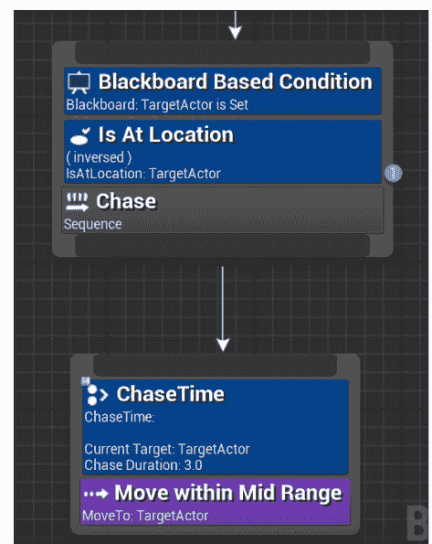

- 14. 从选择状态拉线并搜索序列。

- 15. 右键单击，选择添加装饰器，并搜索黑板。单击黑板，将键查询设置为已设置，黑板键设置为目标角色。

- 16. 右键单击，选择添加装饰器，并搜索是否在位置。单击是否在位置，将可接受半径设置为 599.99，黑板键设置为目标角色。

- 17. 从序列拉线并搜索中距离攻击：

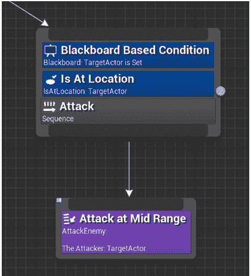

现在，有了所有这些节点，你就拥有了一个完整的敌人 AI，可以亲自去战斗和挑战！祝贺你走到这一步！

### 摘要

本章包含开始使用一些令人印象深刻的 AI 所需的一切。我们讨论了行为树，它可以根据 AI 遇到的情况帮助创建决策。然后，我们讨论了为你、玩家和 AI 创建中距离攻击。我们设置了控制器，并开始为更多功能设置控制器。在行为树中运行所有内容之前，要做的最后一件事是为 AI 设置巡逻点。最后，我们将所有内容集成到行为树中。

你刚刚学习了如何使用虚幻引擎 4 中可用的工具创建游戏 AI 的基本形式。

我们完成了！我们创建了一些有趣且具有挑战性的 AI。现在让我们为下一章做好准备。在学习了关于 AI 和虚幻引擎 4 以及它们如何结合的所有材料后，我们花一章来回顾所有讨论过的内容很重要。我还会指出我们本可以做得不同的地方。然后，我们将离游戏 AI 世界的新起点更近一步！
