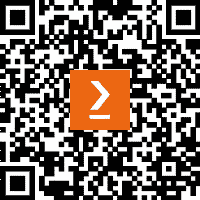

# NIST 网络安全框架 2.0 深度解析

> 献给我的妻子和女儿——言语无法表达我对你们二人的爱。能有你们在我的生命中，我万分感激。我非常非常爱你们。
>
> —— Jason Brown

## 贡献者

### 作者简介

**Jason Brown** 的热情所在是数据隐私、网络安全和持续教育。Brown 的职业生涯涵盖了从中小型企业到大型国际组织，致力于开发稳健的隐私和网络安全计划。Brown 曾担任首席信息安全官、虚拟首席信息安全官和数据隐私官等职务。

Brown 目前持有多项行业领先的认证，包括 ISC2 的 CISSP、ISACA 的 CDPSE 和 COBIT、以及 ITIL，他还拥有中央密歇根大学的理学学士学位和费里斯州立大学的理学硕士学位。

> *我想感谢每一位鼓励我追逐梦想、让我得以与世界分享经验的人。*

### 审稿人简介

**Soufiane Adil** 是一位杰出的信息安全和网络安全合规专家，专精于广泛的标准，包括 ISO 27001、ISO 31000、ISO 22301、PCI-DSS、ISO 42001、ISO 21434、NIST 800-171、CMMC、NIST 800-53、HIPAA、PIPEDA、SOC2、FedRamp、CIS、GDPR 以及 Law/Loi 25。凭借指导企业应对网络安全框架复杂性的卓越记录，Soufiane 确保组织达到并保持严格的合规标准。他的战略方法不仅满足监管要求，还增强组织的整体安全态势，使他成为网络安全合规领域的值得信赖的顾问。

**Thomas Marsland** 是一位网络安全领导者，专注于设计从基础就拥抱安全、同时保护可扩展性并最小化技术债务的系统和流程。他喜欢解决运营和技术问题，以使命为导向的思维为组织创造价值。作为拥有 22 年资历的美国海军老兵，他的工作经历涵盖核动力、信息技术、网络安全，以及在网络安全和信息技术领域的高管领导职务，包括美国海军和 Cloud Range 的技术副总裁。在业余时间，他领导着 VetSec，这是一个 501c3 非营利组织，其使命是“创造一个没有退伍军人在追求职业生涯时失业的世界”。

**Rajat Dubey** 是一位拥有 13 年以上经验的网络安全专家，致力于保护全球企业。他的专长包括风险评估、合规、威胁建模、事件响应、道德黑客、数字取证、云安全、人工智能、区块链、物联网和量子计算。他拥有美国 GWU 的网络安全政策与合规工程硕士学位和加拿大 Rotman UoT 的 MBA 学位。他为跨行业的财富 500 强客户提供服务。他是 IEEE 高级会员和 CSA 会士。他发表研究论文、文章和同行评审书籍。他是值得信赖的顾问，能驾驭复杂挑战并开发创新解决方案。

## 前言

随着网络安全的持续演变，您的对手也在不断进化。他们今天使用的战术和技术，明天可能就不一样了。如果发生事件，您知道如何抵御他们或如何响应吗？框架由行业专家开发，旨在帮助您和您的团队将网络安全计划与既定标准对齐。

本书将逐步指导您构建计划的各个方面。从识别插入网络的设备到建立治理，再到如何响应事件，框架旨在为如何为您的组织构建这些计划提供指导。

## 适读人群

本书适合网络安全新手，或从未接触过 NIST 网络安全框架的人员阅读。

## 如何充分利用本书

充分利用本书没有技术要求。您应具备基本的 IT 和网络概念知识与理解。

| 本书涵盖的软件/硬件 | 操作系统要求 |
| --- | --- |
| Angular 9 | Windows、macOS 或 Linux |
| TypeScript 3.7 |  |
| ECMAScript 11 |  |

## 约定用法

### 正文中的代码

表示正文中的代码词、数据库表名、文件夹名称、文件名、文件扩展名、路径名、虚拟 URL、用户输入和 Twitter 账号。例如：“如果我们将文件内容更改为 `This is a hashed file!`，新结果将为：`10b481d359a851de7efb58b1cc4f0b237014e37be60936ae22da52ac10eb7388`。”

### 粗体

表示新术语、重要单词或屏幕上显示的单词。例如，菜单或对话框中的单词以 **粗体** 显示。例如：“即使你知道必须点击 **下一步** 按钮 10 次才能安装一款软件，也要说明这一点。”

### 提示或重要说明

显示如下。

# 联系我们

读者的反馈一直是我们所欢迎的。

## 一般反馈

如果您对本书的任何方面有疑问，请发送邮件至 customercare@packtpub.com，并在邮件主题中注明书名。

## 勘误

尽管我们已尽一切努力确保内容的准确性，但错误难免发生。如果您在本书中发现错误，请向我们报告，我们将不胜感激。请访问 [www.packtpub.com/support/errata](http://www.packtpub.com/support/errata) 并填写表格。

## 盗版

如果您在互联网上发现我们作品的任何非法副本，请提供其地址或网站名称，我们将不胜感激。请通过 copyright@packt.com 联系我们，并附上相关链接。

## 如果您有兴趣成为作者

如果您在某个主题上有专长，并有兴趣撰写或参与编写书籍，请访问 [authors.packtpub.com](http://authors.packtpub.com)。

# 分享您的想法

读完 *Unveiling NIST Cybersecurity Framework 2.0* 后，我们非常期待听到您的想法！请 [点击此处直接前往亚马逊评论页面](https://packt.link/r/183546307X) 为本书留下您的反馈。

您的评论对我们和技术社区都很重要，将帮助我们确保提供高质量的内容。

# 下载本书的免费 PDF 副本

感谢您购买本书！

您喜欢在途中阅读，却无法随身携带纸质书吗？

您购买的电子书是否与您选择的设备不兼容？

别担心，现在购买每一本 Packt 书籍，您都可以免费获得该书的无 DRM 限制的 PDF 版本。

随时随地，在任何设备上阅读。直接从您喜爱的技术书籍中搜索、复制并粘贴代码到您的应用程序中。

福利不止于此，您还可以每天在收件箱中独家获取折扣、时事通讯和优质免费内容。

请遵循以下简单步骤以获取福利：

1. 扫描二维码或访问下方链接

[`packt.link/free-ebook/978-1-83546-307-9`](https://packt.link/free-ebook/978-1-83546-307-9)

1. 提交购买证明

2. 就这些！我们会直接将免费 PDF 和其他福利发送到您的邮箱。
