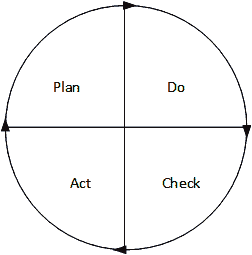

# NIST 网络安全框架基础

在上一章中，我们了解了什么是网络安全框架及其部分差异。我们知道网络安全框架有助于使我们和我们的组织与最佳实践保持一致。框架为复杂的架构和术语提供了分类法和通用语言。

我们简要介绍了 NIST `Cybersecurity Framework` (`CSF`)。NIST `CSF` 是一个强大、敏捷的框架，可在任何组织中实施。正如我们在上一章所见，有多个组织采用了其他框架，结果几个月或几年后才发现，所选框架并不满足其需求。

在本章中，我们将深入探讨该框架。我们将研究框架的 `Core`、`Tiers` 和 `Profiles`。我们将讨论这些各自的含义，以便您对所讨论的主题有一个总体了解。在后续章节中，我们将进一步深入 `Core`，并考察其六大功能中的每一个 — `Govern`、`Identify`、`Protect`、`Detect`、`Respond` 和 `Recover`。

本章将涵盖以下主题：

*   NIST 框架
*   `Tiers`
*   `Profiles`

让我们开始吧！

## NIST 框架

该框架由三个独立模块组成 — `Core`、`Tiers` 和 `Profiles`。`Core` 由六个功能组成，用于降低组织中的网络安全风险：

*   `Govern`
*   `Identify`
*   `Protect`
*   `Detect`
*   `Respond`
*   `Recover`

每个控制措施都有编号，以便我们轻松了解控制措施如何相互对齐。例如，物理设备清单将是 `ID.AM-01`，软件清单将是 `ID.AM-02`，依此类推：

`Function.Category-subcategory`

`ID.AM-01`

我们将在后续章节中进一步讨论各个控制措施；现在，让我们直接深入了解这六个功能各自的含义。

### Govern

`Govern` 旨在在整个网络安全项目中建立治理。这就是为什么 `Govern` 功能位于所有其他功能的中心。它用于设定风险管理策略、政策和标准，确保这些文档编写良好且沟通有效。在企业风险管理方面，`Govern` 尤为重要。

此功能还要求您开始与组织中的每个人讨论风险和风险管理。风险承受能力必须从高层的执行领导团队开始，逐级向下传递给中层管理人员，再到您的分析师。还应有一个反馈回路，允许风险缓解工作自下而上地传递。这有助于更好地了解已建立的任何风险承受能力是否仍按预期发挥作用。

### Identify

`Identify` 功能旨在帮助定位系统、软件和外部服务，例如 `Software-as-a-Service` (`SaaS`)。这包括贵公司采购软硬件的渠道以及第三方服务的使用情况。`Identify` 功能还涉及风险识别和管理，并有助于制定政策、标准和程序。这些类别用于协助突出显示整个组织中的风险。

互联网安全中心提供的 `Critical Controls` 的前两个控制系列也将硬件和软件的可见性列在首位。组织必须掌握所有资产的清单，无论是本地部署还是云端，以便充分保护它们。一旦识别出来，我们就可以扫描漏洞并应用安全补丁，以保障 IT 资源安全。

组织必须记录环境中不应存在的内容，原因如下：

*   有助于识别连接到网络的流氓设备
*   确保流氓设备的归属权
*   降低环境中的网络风险

`Identify` 功能还要求制定策略，规定如何识别和记录您的 `SaaS` 应用程序，原因相同。

### Protect

正如您可能猜到的，`Protect` 功能旨在保护身份、数据、系统基线化、维护、审计和日志记录。根据 NIST 的说法，`Protect` 功能还旨在限制或遏制网络安全事件。

在 BeyondTrust 于 2023 年进行的一项研究中，组织面临的主要基于身份的攻击如下 [1]：

*   网络钓鱼 (62%)
*   特权/特权身份管理不善 (37%)
*   第三方或供应链攻击 (37%)
*   内部攻击 (22%)
*   中间人攻击 (18%)

用户及其数字身份是网络安全中最薄弱的环节，这并不令人意外。`Protect` 功能详细介绍了如何通过实施强大的身份和访问管理系统，以及安全意识最终用户培训来保护用户。

此功能还确保数据安全。这是通过加密实现的，包括传输中加密和静态加密。静态加密意味着笔记本电脑、台式机、服务器、数据库等的硬盘应当加密。

这可以通过利用各操作系统内置的加密工具轻松实现。Microsoft 开发了 `BitLocker`，Apple 拥有 `FileVault`，而 Linux 则有 `Linux Unified Key Setup` (`LUKS`)。操作系统厂商使用的每种加密方案都有其优缺点。请密切关注如何存储每个已加密设备的备份密钥。如果不存储密钥，您可能会失去对驱动器上存储信息的所有访问权限。

### Detect

`Detect` 功能关注您和您的团队开发的流程，以突出显示威胁、漏洞和病毒，并监控用户行为。此功能还涉及创建系统和网络的基线以确定异常。

我们从异常和事件入手。这就是基线发挥作用发现异常活动的地方。为此，需要建立监控。通常使用 `Simple Network Monitoring Protocol` (`SNMP`) 执行此操作。`SNMP` 允许您的团队在给定间隔（通常每分钟）轮询使用统计数据，并将这些统计数据存储在某种平面文件或数据库中以供历史回顾。系统还可能允许您跟踪恶意流量并将其显示在图表上。

监控中的另一个关键步骤是日志聚合。这涉及收集环境中所有系统的日志，包括防火墙、IT 系统、网络设备和数据库。这将允许您监控系统和服务，以检测整个环境中的恶意活动。

最后，我们需要记录检测流程并建立角色和职责。这是必要的一步，用于确定如果发生事件，谁负责检测和修复。

### Respond

我们如何响应事件？谁负责什么？事件如何沟通？这将需要制定事件响应和沟通计划。并非所有事件都需要沟通；但是，您需要制定计划，明确与谁沟通以及何时沟通。


事件分析也是 `Respond` 函数的一部分。这需要了解现存的威胁类型，特别是那些在实际环境中执行的威胁。有大量的威胁情报列表可供选择。有些需要付费，有些通常可免费使用。**网络安全和基础设施安全局**（**CISA**）会生成一份在实际环境中被积极利用的已知漏洞利用列表，称为**已知被利用漏洞**（**KEV**）。这是一项免费服务，会发送电子邮件通知并在其网站上发布已知漏洞利用列表。

文档记录是该功能成功的关键。你不仅需要记录应对事件的政策和标准；还需要记录事件发生期间的一切。这涉及记录事件响应过程，以便下次能更快地响应，这通过事后复盘来执行。

# 恢复

`Recover` 函数中只有两个类别——`Incident Recover Plan Execution` 和 `Incident Recovery Communication`。虽然 `respond` 函数也包含一个通信类别，但该控制项处理的是与外部利益相关者的沟通。

当事件发生时，你必须遵循响应计划中规定的步骤。如果你或你的团队没有遵循这些步骤，为什么？计划是否不适合该事件？是否缺少步骤？所有这些都会在事后复盘中讨论，以改进计划本身。

事后复盘或经验教训总结活动被用作持续改进过程的一部分。事件发生后，团队会聚在一起举行此类会议之一。这是事件响应的最后一步。事后复盘允许**安全事件响应团队**（**SIRT**）相互表扬工作出色。然而，这也是发泄对事件中出错之处不满的时刻。

事后复盘是一个“*什么发生在拉斯维加斯，就留在拉斯维加斯！*”的场景（这句著名口号用于许多拉斯维加斯的广告中）。发泄不满同样重要，因为这是团队从错误中吸取教训的唯一途径。

后续章节将更多地讨论功能及其控制族。理解功能、类别和子类别如何分组为控制族非常重要。框架中确实存在一些控制重复——例如，`communication` 在功能中被引用了两次。必须理解每个控制项在两个功能中的区别。

下一节将介绍如何将层级应用于这些控制项，以便你有办法衡量你的网络安全计划。

# 层级

在推出新计划时，我们必须首先了解其当前所处的位置（当前状态）以及打算达到的位置（未来状态）。虽然框架概况用于确定当前和未来状态，但我们首先需要评估当前状态。本章后面将重点介绍如何执行这些类型的评估。我们首先必须了解如何根据框架对我们的计划进行排名。

审计公司倾向于利用**能力成熟度模型集成**（**CMMI**）按成熟度等级对 NIST CSF 进行排名。这改变了框架评估和降低风险的初衷。框架层级与 CMMI 之间存在一些相似之处。大多数相似之处体现在文档记录和正式组织政策上。然而，这并非框架的初衷。

事实上，框架明确声明不打算将其作为成熟度模型进行评估。这并不是说成熟度不应成为评估的一部分；它应该是。事实上，你会看到框架层级与 CMMI 之间的相似之处。然而，我们将尽可能忠实于框架的初衷，因为其初衷是降低整体网络风险。

评估当前环境及其与框架层级的契合度涉及大量标准。框架评分值在层级 1（`partial`）和层级 4（`adaptive`）之间。这将有助于直观地显示缺少哪些控制项，并突出显示需要改进的地方。

要评估你的计划以达到下一层级，必须满足某些要求。这些标准在以下子类别中提及。

## 层级的应用

让我们看看这四个不同的层级以及它们如何降低风险：

*   **层级 1** - `partial`（部分）：
    *   **网络安全风险治理**：风险策略以及目标和威胁的优先级排序充其量只是临时性的。
    *   **网络安全风险管理**：组织没有建立必要的流程，而是逐个案例地处理风险。组织也缺乏对其在供应链中角色的理解，以及第三方如何影响它。组织也没有用于共享网络风险相关信息的标准化方法。

*   **层级 2** – `risk-informed`（风险知情）：
    *   **网络安全风险治理**：风险管理经管理层批准；但可能未覆盖整个组织。网络项目的优先级排序直接与组织、政策、标准或业务需求相关。
    *   **网络安全风险管理**：对网络风险有部门级的视角，但这是局部的，而非全组织范围的。威胁信息在内部共享但不一致。组织也意识到与第三方相关的网络安全风险，但工作流程不一致。

*   **层级 3** – `repeatable`（可重复）：
    *   **网络安全风险治理**：风险管理经管理层批准，但不一定针对整个组织。网络需求的优先级排序直接由外部风险情报和业务需求决定。
    *   **网络安全风险管理**：组织层面理解网络风险；但没有全组织范围的政策来规定如何应对。网络风险信息按不定期共享，组织知晓其合作的第三方；但缺乏一致的交互方法。

*   **层级 4** – `adaptive`（自适应）：
    *   **网络安全风险治理**：存在全组织范围的方法来管理网络风险。应对网络风险的政策与程序之间的关系得到一致实施。网络风险管理融入了组织文化。
    *   **网络安全风险管理**：组织在当前威胁形势下实施其网络风险计划。这允许采用自适应方法来管理网络风险。经验教训总结活动持续执行，以确保计划是最新的，且团队能适应新威胁。

正如我们所见，框架层级与 CMMI 模型之间存在相似之处。然而，虽然有相似之处，也有大量差异——以网络安全风险管理场景为例。这些涉及组织如何与其上游和下游供应商开展业务。了解和理解组织在行业生态系统中扮演的更大角色同样关键。这有助于增强业务运营的韧性。

层级将在你执行评估时进行自我评分中发挥重要作用。此评估用于了解你当前的安全态势，并制定未来状态或战略路线图。该路线图用于规划将降低组织网络风险的未来项目。概况是了解风险当前状态以及你打算如何降低风险的一种方式。

接下来，我们将探讨如何构建概况，并了解它们如何降低风险。


# 持续改进

持续改进对于任何网络安全计划都是必不可少的。正如您从层级概览中所见，要在层级结构中改进或进阶，您还必须改进组织流程。为此，我们将回顾 `Deming cycle`（戴明循环）。

在 20 世纪 50 年代，一位名为威廉·戴明的质量控制工程师创立了 `Plan, Do, Check, and Act`（计划、执行、检查、处理）的概念，即 `PDCA`。尽管 `PDCA` 最初用于改进业务流程，但我们也可以用这一理念来改进我们的网络安全计划。在 `图 2.1` 中，您可以看到处于持续循环中的 `戴明循环`。该循环允许您为即将到来的项目做计划，经历实施阶段，然后收集关于哪些有效、哪些无效的信息。一旦收集到这些信息，我们便再次进入规划阶段：



图 2.1 – 戴明循环

`戴明循环` 的阶段包含以下内容：

1.  **计划**：这是新项目的规划阶段。我们召集正确的利益相关者共同设计旨在降低网络风险的解决方案。我们评估并发现当前状态与未来状态之间的差距（稍后详述），并规划我们如何降低网络风险。在此阶段，您可能还需要开始采购软硬件，或安排可信第三方协助实施。

    您还应记录测试计划，以便您和团队了解项目的范围内外。这也可用作项目章程，以实施或修改系统资源。

2.  **执行**：在此阶段，您开展实际工作。这是您开始实施新系统和流程或修改现有系统的地方。我们审查测试计划，以确保既定控制措施已按要求安装和配置。

3.  **检查**：我们现在必须检查已实施的改进或缓解措施是否按预期工作。团队开始测试新控制措施，以确保期望状态符合预期。我们测试 `Key Performance Indicators`（`KPIs`，关键绩效指标），以确保产生的指标完全在运营和服务级别协议范围内。

    虽然检查阶段在给定周期内执行，但应持续检查安全控制措施，以确保其满足特定指标。您应持续检查控制措施，确保其正常运行，且在预期完成时间内顺利结束。

4.  **处理**：在处理阶段，您收集所有指标并确定后续步骤。如果实施的缓解措施按预期工作，太棒了！继续下一个问题，再次运行该循环。如果没有，则我们需要了解实施了什么、如何实施的，并重新评估我们的网络风险状况。

    这可能意味着缓解措施将风险降低了 75%，但您的目标是降低 85%，从而产生 10% 的差距。您现在回顾实施了什么、什么未按预期工作，制定新的缓解计划，循环再次开始。

`PDCA` 可用于改进计划的许多方面——从评估新 IT 系统和网络安全控制措施到制定政策、标准和程序。此方法可在计划的任何地方使用。

# 概况

我们需要一种方法来评估组织的整体风险状况。要成功做到这一点，我们必须了解网络安全计划的当前状态，并确定我们打算将计划引向何方。这有时很简单，特别是当您目前就在该组织工作时。然而，如果您是新入职员工，您将需要先自行执行评估或委托他人执行评估。

风险评估提供多项益处。首先，它有助于您与新同事建立关系。进入新组织时，建立关系应是首要目标。这使您能够熟悉高管领导团队、IT 团队和事件响应团队。这也是您通过交谈更好地了解公司 IT 和安全历史的时候。

其次，执行评估将为您提供当前已实施控制措施的背景情况。这些交谈将深入了解技术栈、实施方式以及针对 IT 资源所采取的缓解控制措施。评估还可以回答风险如何计算以及整体风险偏好是什么等问题。

## 执行评估

执行评估有多种方式。我们可以自己做，称为第一方评估；也可以委托他人做，称为第三方评估。两者各有优劣。

### 第三方评估

我们从第三方评估开始。第三方评估机构是受雇代表您执行风险评估的公司。这有时是最容易的选择；然而，这是成本最高的选项。针对 CSF 的影响评估有时可能花费数万甚至数十万美元。这完全取决于组织的范围和规模。

如果您从未执行过评估，这可能是最佳选择。在执行第三方评估时，您将与一支 `governance, risk, and compliance`（`GRC`，治理、风险与合规）分析师团队合作。这些分析师将审查您的所有文档，如政策、标准、程序、网络和应用流程图，并收集证据以支持您的流程。

除了收集证据外，您、您的团队和高管领导还将被问及一系列关于人员、流程和技术的问题。这些问题结合提供的证据，用于更好地了解您安全计划的成熟度。这些问题将围绕已实施的控制措施，以及它们如何与业务需求和框架本身保持一致。

第三方评估机构将在评估结束时提供报告。该报告将根据您的当前状况提供评分。在许多情况下，评估公司还将提供一份删减版报告，可发送给您的第三方，使他们也能更好地了解组织的安全状况。

第三方还提供无偏见的评估。在执行第一方评估时，倾向于给自己实施的控制措施打分比实际应得的分数高。我们都难免犯此错误。然而，如果您评估自己的组织，请记住从评分中去除这些偏见。

如果您渴望学习新技能，或过去执行过评估，您可能想自行执行评估。这称为第一方评估。

### 第一方评估

第一方评估成本最低，且可能有趣、令人兴奋，如果您从未执行过，可能还有些令人生畏。执行第一方评估有许多好处。例如，您可以控制时间、问题或评估过程的任何其他方面。

然而，您应了解关键成功标准。例如，一个关键方面是倾听。当您处于提问评估问题的位置时，要留意环境和周围的人。特别注意旁谈和肢体语言。这有时会带来有助于您评估的额外信息。


该过程可能会有所不同，具体取决于您是新员工还是在公司工作了一段时间。例如，如果您是长期员工，则可能无需先执行评估即可自行评分。如果您是组织的新成员，我会建议先执行评估，然后再进行自评并创建当前状态概况。

要执行评估，我建议遵循以下步骤。

## 委托函

首先，您需要一份委托函。这授予您执行评估的权限。信函应说明委托意图以及收集信息所需的任何扫描，并应请求执行评估职责的许可。

有时扫描可能不会按您预期的方式执行。这可能会影响系统性能或导致系统无法运行。委托函也是您的*免责金牌*，意味着一位高管成员允许您执行扫描和评估。

## 项目启动

一旦您获得了由高管团队成员签署的委托函，就可以开始评估并着手收集证据。这包括策略、标准、程序、网络图和其他供审查的内部文档。收集这些信息将帮助您了解业务，还将提供对所用技术的洞察，以便您将对话引导至特定的安全和 IT 相关系统。

这也是开始扫描的时候。有许多付费和开源工具可用于扫描。互联网安全中心（`CIS`）有多个基准可用于加固系统。运行 `CIS` 扫描有助于确定 IT 资源的配置设置。扫描完成后，工具将生成一份通过/失败报告，您可以用它来确定环境的正确设置。

如果您精通技术，可以使用多种开源工具。例如，您可以从域名系统（`DNS`）获取大量信息。通过 `DNS`，您可以发现他们的电子邮件提供商是谁、他们的 `DNS` 记录位于何处，以及基于 IP 地址的 IT 资源地理位置。许多 SaaS 提供商要求客户在其 `DNS` 中放置一条 `TXT` 记录。这也可以提供对组织可能正在使用的其他服务的洞察。

`DNSEnum` 是另一个开源工具，可用于发现特定域的 `DNS` 条目。然后您可以确定公司正在使用的各种 IT 资源。例如，您可以通过捕捉 `vpn.example.com` 等线索来确定公司使用的防火墙类型。

网络映射器（`NMAP`）是一种可用于发现网络上 IT 资源的工具。`NMAP` 允许您跨网络执行 `ICMP` 或 `PING` 扫描以发现活动主机。您还可以用它来发现服务器上运行的开放端口和服务。

`NMAP` 还将尝试检测 IT 资源上的设备类型和操作系统。例如，扫描 Microsoft Windows 2019 服务器时，您将收到以下消息：

```
Service Info: OS: Windows; CPE: cpe:/o:microsoft:windows
```

反之，如果您扫描 Linux 系统，将看到以下内容：

```
OS CPE: cpe:/o:linux:linux_kernel:2.6.32
```

不过，您也可能遇到此消息：

```
Too many fingerprints match this host to give specific OS details
```

当无法确定操作系统或其版本时，会出现此消息。

这些扫描并不总能获得正确的操作系统版本。例如，Linux 系统扫描认为系统运行的是 2.6.32 内核，而实际上系统运行的是 6.1.0。虽然不一定准确，但它确实能确定总体操作系统类型。

我理解这些技术可用于善意或恶意目的。然而，我相信当它们用于善意时，这些工具能为您正在评估的环境提供宝贵的洞察。

现在我们已经审查了策略文档，研究了网络图，并运行了扫描，是时候进行问卷调查了。

## 执行评估

现在，是时候执行评估的问卷部分了。许多第一方和第三方问卷都是通过面谈或虚拟会议进行的。不过，您也可以发送问卷让对方填写。这种方式参与度较低，可能无法获得您想要的结果。

在进行面谈评估时，在询问组织如何满足控制目标时要给予人性化关怀。我通常会写出问题，并以对接收方讲得通的方式提问。例如，`PR.DS-01` 指出：“*静态数据的机密性、完整性和可用性受到保护。*” 这是什么意思？防范什么？

这是一个非常开放式的问题！重述它以使其讲得通，例如：“*您如何保护数据？数据是否加密？您是否绘制了数据流图并知道敏感数据驻留在何处？*” 这些只是与该控制相关的几个问题。您可能会问自己：“*我怎么知道该控制涉及所有这些问题？*” 如果您需要澄清，最好的查阅地点是该控制的信息参考资料。

`PR.DS-01` 引用了 `CIS` 控制 13 和 14。控制 13 涉及数据保护，而控制 14 涉及如何控制数据访问。`CIS` 中的每个控制族也都有子控制。不过，如果您对来自 `CSF` 的控制有任何疑问，请查看参考文档以获取更多清晰度。

## 完成评估

一旦评估的问卷部分完成且您收集了所有证据，就可以进行评分了。在汇总分数时，请记住将答案和证据与我们之前讨论的层级对齐。在评估答案时，请考虑风险概况、组织如何计划降低网络风险，以及业务如何就该控制与其上游和下游提供商互动。

这些分数有助于了解您的整体网络风险以及将精力集中在何处。例如，请查看 `表 2.1`：

| 功能 | 类别 | 子类别 | 分数 |
| --- | --- | --- | --- |
| 响应 | `RS.AN` | `RS.AN-03` | 25 |
|  |  | `RS.AN-06` | 50 |
|  |  | `RS.AN-07` | 25 |
|  |  | `RS.AN-08` | 75 |
| 平均子类别分数 |  |  | 43.75 |

表 2.1 – `NIST CSF` 分析类别

`RS.AN` 类别的平均分为 43.75。这使您的总体层级处于第 2 级。您应该以什么分数为目标？嗯，这取决于您的组织以及您愿意接受的风险水平。在我看来，最佳平衡点是第 3 级。这意味着组织拥有经管理层批准或全组织范围内实施的策略、标准和程序，业务了解其在更大生态系统中的角色，且已具备弹性。

## 结束面谈

结束面谈是评估过程的最后一步，用于报告发现。发现是指在 IT 资源、策略文档或图表中发现的缺失或不充分的控制。作为首席评估员，您有责任创建报告并向组织内的关键利益相关者汇报。


报告应详细记录调查结果、收集的证据以及员工对问题的回答。调查结果可以是缺失的控制措施，或不符合预期或标准的控制措施。例如，在评估过程中，您可能确定六个 IT 资源中有四个安装了防病毒软件，而另一个资源虽然安装了但未接收更新。这些调查结果随后会被纳入**行动计划与里程碑**（或项目计划）中以进行整改。

调查结果不仅针对 IT 资源上设置的配置项；它们也可能来自书面文档。策略文档难以编写，编写优秀的策略更难。策略文档的编写应使新分析师或工程师能够阅读文档并确切知道该做什么以及如何做。您还需要建立 IT 策略文档生命周期，以审查和批准 IT 策略文档。

策略文档中的调查结果不像查找 IT 资源问题那样容易。阅读并理解文档意图并找出漏洞需要技巧。也许您在程序中遗漏了关键步骤，或者存在一项要求使用传统协议的加密标准。这些应被视为可报告的调查结果，并在离场面谈过程中重点强调。

随着离场面谈流程的结束，我们现在可以创建当前状态概要和未来状态概要。当前状态是您网络安全计划目前所处的阶段，而未来状态是您预见组织在不远的将来所要达到的阶段。

## 当前状态

当前状态概要基于组织在特定时刻与 CSF 的契合度。这种契合度考虑了 IT 资源配置、策略文档和实践。这是您整体计划的当前快照。当前状态还描绘了组织的整体网络风险态势。相关工作已通过您在离场面谈过程中的汇报完成。现在，是时候制定您的战略路线图了。

## 未来状态

我们在评估阶段投入了所有艰苦努力，并向高管领导团队报告了调查结果；现在，是时候制定我们的未来状态了。未来状态概要描绘了您计划在未来两到五年内将网络安全计划推向何方。这是您将组织网络风险降低到可接受水平的策略。

现在是制定项目计划或**行动计划与里程碑**（**POA&M**）的时候了。这是您打算制定的用于整改报告中调查结果的计划。您需要与领导团队坐下来，更好地了解他们的目标以及他们认为有风险的事项。这是您评估环境并决定什么是“易解决的问题”（低垂的果实），迅速消除它们，同时为重大项目制定更大规模 POA&M 的时机。

## 总结

NIST CSF 包含丰富的信息，可用于建立您的网络安全和风险管理计划。框架核心由六大功能、其类别和子类别控制措施组成，用于降低组织中的网络风险。该框架将协助您和您的团队提升态势并使计划成熟。

虽然许多人根据成熟度模型对 NIST CSF 进行评分，但它应根据风险进行评估。这是 CSF 的真实意图，也适用于其他框架。风险进一步在三个单独类别中进行评估——风险管理流程、综合风险管理和外部参与。在根据框架层级评估组织时，请记住我们是针对风险及其在更大生态系统中的地位进行评估。

弹性是否内置于设计中？策略文档是否与业务目标保持一致？文档是来自组织层面，还是局限于部门内部？这些都是评估期间应提出的问题。

在评估这些问题时，请确保它们符合框架层级的要求——从几乎不存在任何措施的第 1 层，到一切均可适应并针对效率进行优化的第 4 层。请记住，第 3 层才是您计划真正的“最佳平衡点”。虽然第 4 层可能是效率的巅峰，但有时由于其成本无法实现。成本不仅可能由货币价值定义，还可能涉及人力资源。

概要用于了解您目前在计划中的位置，以及您在未来三到五年内努力争取达到的位置。当前状态概要描绘了特定时间点网络安全计划的状态。未来状态概要是您关于计划发展方向的策略。随着您继续推进策略，请记住制定 POA&M 以规划您的项目。

在接下来的章节中，我们将回顾这六大功能，以及如何利用它们来调整您的网络安全计划。

## 参考资料

1.  [`www.beyondtrust.com/blog/entry/the-state-of-identity-security-identity-based-threats-breaches-security-best-practices`](https://www.beyondtrust.com/blog/entry/the-state-of-identity-security-identity-based-threats-breaches-security-best-practices)
