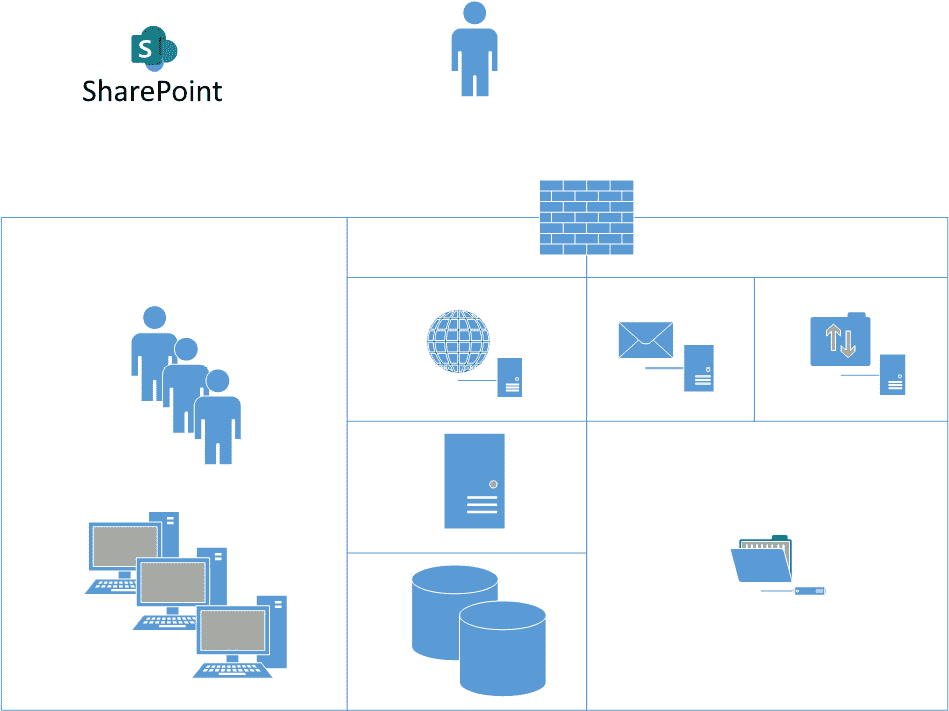

## 第 9 章：如何应对网络风险

现在我们已经涵盖了所有 CSF 功能，让我们专注于如何应对网络风险。NIST CSF 提供了与最佳实践保持一致所需的指导。它通过文档编制、SLA（服务级别协议）制定、职责矩阵和沟通来实现这一点。所有这些都被视为管理控制的一部分。

CSF 提供的管理控制旨在降低组织的网络风险。它们不涉及风险管理的职责归属，即究竟由谁对其负最终责任。我们已经讨论了风险，评估了管理控制，并实施了政策。这些都是为了降低风险；然而，*谁*来负责这一点仍然不太明确。

您可能会说**首席信息安全官**（**CISO**）负责所有网络风险。这对吗？责任是否落在 CISO 的上级身上，可能是**首席信息官**（**CIO**）或**首席财务官**（**CFO**）？谁拥有最终决策权？在许多情况下，CISO 只是就网络风险向高管领导团队和**董事会**（**BoD**）提供建议。这将使他们对整体风险承担接受责任，但我们如何达到这一步？

在本章中，我们将介绍 NIST **风险管理框架**（**RMF**）。它包含一份来自 FIPS 的文件以及几份 NIST **特别出版物**（**SPs**），例如以下内容：

*   **FIPS 199** – 联邦信息和信息系统安全分类标准
*   **SP 800-37** – 信息系统和组织的风险管理框架
*   **SP 800-39** – 管理信息安全风险

虽然还有许多其他 SP 涉及风险，但本章我们将深入探讨其中三份。这些文件旨在为您的整体风险管理计划建立组织架构。

这是一个计划，就像网络安全是一个计划一样。它不能是一次性的工作，也不能是“设置后就不管”的过程。它需要维护和投入，才能接近其应有的有效性。在本章中，我们将涵盖以下三个主要主题：

*   探索 IT 风险
*   NIST RMF
*   如何将风险管理应用于 IT 资源

现在我们知道将要深入什么内容了，让我们开始吧！

### 探索 IT 风险


我们每天都会经历各种类型的风险。你今早醒来了，干得好！做早餐，等等——牛奶变质了吗？喝咖啡——希望它不至于烫伤你。然后你拿起钥匙跳进车里，在上午 8 点前刚好赶到打卡上班。你是怎么到的？你超速了吗？有人强行插队吗？我不妨猜猜，你本可以坐公交或乘火车。等等，你仍然可能遭遇事故。

你看，你今早仅仅是起床就冒了风险。你可能喝了变质牛奶，抿了滚烫的咖啡，或者为准时上班而超速。这些风险全是第二天性，你可能根本不曾在意。它们看似寻常；简直让你麻木了，几乎忘了万物皆可危险。

面对网络风险，我们有时也会采取同样的态度。针对基于 IT 的系统，危险多得让你恨不得把系统裹在混凝土里扔进大海中央，还要拔掉所有网线！然而，采取这种态度可能意味着你得另谋高就，因为没人能开展工作。

网络风险有时让人感觉主观，的确如此。一家公司对网络风险的看法不同于另一家。它们可能是同一城镇、从事相同职能、市值相同的两家独立公司，却对网络风险持有截然不同的看法。分散的 IT 团队让情况更糟——他们在同一公司工作，却对风险有完全不同的认知。为何如此？经验？公司愿在风险缩减上投入多少资金？组织能否提供足够人手完成所有必要工作？

让我们从如何评估风险入手。你会花 100 美元保护 50 美元的资产吗？不会。反过来，你会花 50 美元保护 100 美元的资产吗？有可能。资产有若干考量因素，如使用年限或可升级性。虽仅举例，但它们揭示了我们对资产及其上驻留信息的价值判断。资产价值可能仅 100 美元，并不代表资产上的信息价值不远超此数。既然我们知道应对风险的方式截然不同，不妨深入一探？

应对风险主要有四种方式，旨在风险识别后执行相应任务：

*   **缓解**：这是我们针对风险采取行动的地方。可能只是应用软件补丁或为网络采购新防火墙，也可能是退役遗留系统。
*   **转移**：我们将风险转嫁给另一方。风险转移通常指购买网络保险。转移也可能意味着将网络安全托管给第三方，如 AWS 或 Microsoft Azure。
*   **规避**：规避风险指因风险过高而取消项目。你环境中有遗留系统；你不缓解风险，而是决定将其移出生产环境。这也可能意味着因项目风险过高而不予承接。
*   **接受**：这通常是应对风险的最后手段，因为它可能让你面临重大问题。接受风险意味着你不打算实施任何缓解措施，不打算向保险公司转移风险，也无法规避。此时，你只能最终接受风险。这可能导致系统被攻陷，务必谨慎行事。

以上是应对风险的四种主要方式，但它们未说明风险源头或责任归属。下一节我们将讨论网络风险的三个层级。

# NIST RMF

NIST RMF 采用简明方法评估全组织的网络风险。金字塔顶端是第 1 层，主要由董事会和**高管领导团队 (ELTs)** 组成。他们负责定义风险及其阈值。第 2 层将定义落实为策略、标准和流程，由企业架构团队推行，确定组织使用的标准。最后，第 3 层是 IT 系统所在层级：


图 9.1 – NIST SP 800-37 RMF

## 第 1 层

组织风险首先由董事会和 ELTs 定义。他们声明风险水平或风险容忍度。我前文说网络风险具有主观性，指的就是此。没有标准规定必须在一天内修补漏洞，也没有法规强制要求像车险那样购买网络保险。

主观性体现在：他们基于经验和对公司最佳利益的判断，告知公司该做什么、不该做什么。作为网络安全专业人员，你须确保执行（或不执行）某任务的风险成本由公司承担。公司可能称安全邮件网关不在今年预算内。虽你表达过担忧，但最终决定权在他们。现在你必须用现有工具确保邮件防护。

## 第 2 层

在涵盖 NIST CSF 功能的章节中，我们讨论了文档。第 2 层是文档的创建与执行层。第 1 层定义组织风险。现在我们可将定义落笔成文。下一章将讨论如何创建**策略、标准和流程 (PSP)** 框架，本章简述其含义。

策略是显示意图的声明文档。这些文档为高层级，你可随意分享给亲友，无须担心泄露核心机密。例如，策略文档可规定“所有硬盘必须加密”；很好！但策略文档不应规定加密如何实施、使用何种算法、密钥存放何处。这些属于标准和流程范畴。

**企业架构 (EA)** 团队负责制定标准。EA 接收第 1 层需求并在环境中落地。除实施标准外，还负责编写标准文档。例如，董事会和 ELT 要求加强防范来自互联网的攻击。现有防火墙仅阻断 `source/\\destination/port/and protocol`，虽曾适用，但组织需要更强防护。为阻止新型攻击入网，EA 决定部署 IDS/IPS 能力。

组织已部署一套防火墙并标准化于某厂商。现在实施 IDS/IPS 配置需评估现有设备能否利用该功能。若不能，则需寻找新硬件。你过去可能标准化使用 Cisco，新防火墙可能仍是 Cisco，也可能是其他品牌。关键在于：一旦选定防火墙，EA 的职责是确保新品牌在全组织统一使用。


在一组防火墙上进行培训并成为 SME（主题专家）的成本可能很高。成为多家防火墙制造商的 SME 可能会进一步大幅增加这一成本。这就是标准如此重要的原因。我见过分散的 IT 团队孤岛化严重，导致部署成本增加了两倍多。例如，我曾与一个组织交谈，他们有一组用于数据的交换机、另一组用于语音的交换机，还有一组用于无线的交换机。所有这些交换机均由不同的制造商提供，采用不同的技术。你能想象如果将所有内容都包含在一个产品中，将节省多少成本吗？

# 第 3 层

第 3 层要求在 IT 资源层面进行风险审查。这将包括负责 IT 系统工程和维持运行的人员。与第 3 层相关的风险通常涉及评估和监控环境的网络风险。例如，SOC 分析师可能负责审查给定系统中的漏洞，并评估如何修复它们。他们可能还负责确保在预定间隔内执行漏洞扫描，以确保提供足够的保护。

第 3 层还负责获取 EA（企业架构师）提供的需求文档，并确保其得到适当的实施和配置。如果 EA 规定 IDS/IPS 应配置以下特征码并将 IPS 置于阻断模式，则工程团队有责任确保其得到适当实施。第 3 层还执行以下功能：

*   **准备**：准备在组织和系统层面执行 RMF
*   **分类**：确保您已对系统和信息进行分类
*   **选择**：用于保护环境的初始控制集
*   **实施**：实施控制措施
*   **评估**：确保控制措施按预期工作
*   **授权**：授权官员已在项目上签字，以便项目可以继续进行
*   **监控**：监控已实施的控制措施，确保其按预期工作

`图 9.1` 中所示分层的重要性在于，虽然需求从第 1 层向下传递到后续各层，但它也有能力从第 3 层向上流动到第 2 层，最后到达组织层。重要的是要注意，既然需求向下流动，问题就必须向上流动。为什么？如果你持续向下推送，如何知道这些需求是否按预期工作？流程中必须建立一个持续的循环。

# 风险管理框架

我们在第 3 层职责的讨论中简要讨论了框架步骤。现在让我们将这些步骤付诸实践。在评估 IT 系统或环境并确保其已实施足够的控制措施时，将使用以下步骤。

## 准备

这是我们收集项目需求的地方。该系统仅用于我们的网站，还是会有信用卡数据流经它？它会存储 ePHI（受保护的电子健康信息）或知识产权吗？所有这些问题都应在您着手搭建系统之前经过深思熟虑。如果您没有为公司（和监管）需求做好适当规划，从长远来看，这将花费您更多的成本。

## 分类

一旦我们准备好所有需求，我们需要对系统进行分类。为此，我们将使用 **机密性、完整性和可用性 (CIA)** 三要素。CIA 缩写代表以下内容：

*   **机密性**：保护信息不被未经授权的人员访问
*   **完整性**：确保信息未以任何方式被篡改
*   **可用性**：为负责文档的人员维持正常运行时间

我们现在将使用 FIPS 199 来确定 CIA 三要素的水位阈值。水位包括低、中、高风险分类，并由以下标准确定。

### 低

低水位涉及 CIA 三要素对组织几乎没有或没有影响。系统或货币价值的损失对组织的利润影响很小。网络威胁属于侦察性质，不对网络的整体稳定性构成威胁。

示例包括：

*   高可用集群中一台服务器的丢失
*   Ping 扫描
*   一个人收到垃圾邮件

### 中

中等水位指示可能对组织及其整体功能产生重大影响。CIA 的中等损失可能导致重大货币价值损失、高影响系统的丢失或知识产权被盗。中等影响可能严重影响系统以正常水平运行的能力，并导致其长期处于降级状态运行。

示例包括：

*   影响多个系统的病毒爆发
*   第 1 层系统长时间宕机
*   导致账户接管的钓鱼邮件
*   资金转移

### 高

高水位保留给那些被认为对业务造成灾难性后果的事件。灾难性事件可能是整个数据中心宕机，或发生勒索软件事件。这也可能意味着因故障导致人员伤亡。由于工作职责的性质，与医院和执法部门相关的计算机系统将包含高水位。

示例包括：

*   勒索软件攻击
*   针对医疗机构的攻击
*   可能导致重大发现的资金损失

### 计算安全分类

现在我们已经定义了分类水位，让我们将其投入使用。计算资产网络风险的方法有很多。我们行业中的许多人习惯使用以下计算：

```
风险 == 威胁 * 可能性 * 影响
```

这在网络安全教科书中被广泛用作提供与 IT 资源相关的风险定量计算的一种方法。这被用来评估风险并定义哪些系统对风险计算影响最大。NIST FIPS 199 提供的安全分类用于使用定性手段评估风险。

在上一节中，我们只展示了低、中、高风险水位。值得注意的是，您也可以将 **不适用 (N/A)** 作为水位。您看，IT 资源不能将 N/A 作为水位。为什么？它们必须维持一定级别的机密性、完整性和可用性。另一方面，数据由于其公开性质，可以具有 N/A 水位。例如，如果您有一个面向公众的网站，包含——您猜对了——公开信息，它会被认为是低吗？并非如此。低意味着数据本身仍有一定程度的审查。如果是公开的，我们真的在乎吗？如果呈现公开信息的 Web 服务器被攻破，我们会在乎数据吗？不，因为它是公开的。然而，我们确实在乎的是服务器被攻破，并可能呈现误导性信息，损害我们维持可信度的能力。

安全分类公式如下：

```
SC 数据/IT 资源 == {(机密性, 影响), (完整性, 影响), (可用性, 影响)}
```

我们如何分解这一点？等号左边的输出是等号右边计算的结果。例如，我们有一个呈现公开可用信息的公共 Web 服务器。IT 资源的计算如下：

```
SC Web 服务器 == {(机密性, 低), (完整性, 低), (可用性, 中)}
Web 服务器 == 中
```


## 分类

既然我们已经定义了构成每个影响的值，我们该如何进行计算？这很简单！我们采用应用的最高水位线，并将其作为我们的安全分类。在这种情况下，Web 服务器的安全分类将被视为中等。

我们也可以对驻留在 IT 资源上的信息执行此操作。下一个示例针对公开可用的信息：

- `SC public data == {(confidentiality, N/A), (integrity, low), (availability, low)}`
- `Public data == low`

## 选择

既然我们已经对数据及其所在的 IT 资源进行了分类，我们必须选择控制措施来保护系统。通常，这是为了将安全分类与另一个网络安全框架——NIST SP 800-53 保持一致。NIST SP 800-53 是一个大规模的网络安全框架，主要由联邦和州政府使用。该控制框架由数千个控制措施组成，涵盖 20 个控制族。虽然我们专注于 NIST CSF，但重要的是要知道 CSF 并不是他们开发的唯一框架。如果你想了解 CSF 和 SP 800-53 如何对齐，只需查看 CSF 中的信息参考即可。大多数控制措施都源自 SP 800-53。

你也可以在保护 IT 资源时选择自己的控制措施。也许你有通用控制，例如 **Active Directory 域服务** (**AD DS**) 或通用的 **端点检测和响应** (**EDR**) 平台。通用控制为你的部分甚至所有 IT 基础设施提供安全保障。重要的是要知道，你实施的通用控制也必须满足合规要求。

## 实施

既然我们已经准备好环境、对基础设施进行了分类并选择了安全控制措施，现在是实施控制措施的时候了。实施控制措施可以采取多种形式。它可能仅涉及实施控制措施以缓解网络风险，也可能意味着实施一个将风险转移给第三方的工作流。实施不仅仅是配置控制措施；我们还需要评估与该特定控制措施实施相关的风险。

实施并不意味着你必须手动将每个控制措施部署到给定系统上。你也可以通过自动化手段来实现。以 Microsoft Windows 为主的环境极有可能使用 Active Directory 的 **组策略对象** (**GPO**) 将安全配置推送到整个环境。基于 Linux/UNIX 的环境可能会使用 Ansible 等自动化工具下发配置。关键是你必须实施上一阶段选定的控制措施。

## 评估

我们现在验证环境是否已按预期设置。这种验证对于确保已正确实施适当的安全控制措施至关重要。还需要有一种方法来检查必要的配置是否已完成，以及它们是否保持原状。这意味着如果你检测到偏移，则必须有办法纠正它。

RMF 的 *评估* 阶段用于验证配置是否按企业架构 (EA) 的规定实施。EA 将收集所有必要的策略和标准，包括任何合规要求。在进行配置时，重要的是这些内容要在 **系统开发生命周期** (**SDLC**) 的设计阶段得到覆盖。

收集配置偏移信息可能很棘手，这就是我建议使用自动化配置服务的原因。Puppet 是一种可以检测此类偏移信息并自动纠正的服务。Terraform 和 **基础设施即代码** (**IaC**) 等其他服务也可以检测某些类型的偏移，并在必要时进行纠正。

我们还应该评估系统环境中已实施的通用控制。通用控制是指在整个环境中通用的控制，例如杀毒软件 (AV) 或 **身份与访问管理** (**IAM**)。这些控制最初可能是在很少或根本没有考虑控制机制的情况下设置的。你必须评估这些控制，以确保它们也满足或超过了公司的策略和程序，以及任何合规要求。

## 授权

所有这些中的另一个关键环节是授权新系统或服务的运行。这份 **运行授权** (**ATO**) 是系统投入生产环境前的最后一个必要步骤。它旨在让授权官员（通常是业务人员）审查并批准系统上线生产。**系统安全计划** (**SSP**) 是授权官员签署安全控制措施所需的文件。

SSP 是一份动态文档，详细记录了与新系统相关的安全控制措施、范围和风险。该文档描述了环境中的所有内容，并提供信息，以便授权官员做出周密的决定，判断系统是否可以投入生产。

SSP 中的细节对服务的成功至关重要。SSP 不仅需要记录已实施的安全控制措施，还需要记录与服务相关的任何风险。然后授权官员可以决定该服务及其相关风险是否可接受，或者是否需要转移或完全规避风险。

一旦做出系统投入生产的决定，授权官员就会在风险文件上签字，这标志着可以运行新系统。SSP 应包含授权官员的签名，声明业务方已接受与该服务相关的风险。

## 监控

最后，我们监控服务以确保其成功。我们可以通过多种不同的方式监控系统。例如，我们需要监控与服务相关的通用控制。这包括确保病毒定义相应更新，或审查用户访问权限。我们需要监控配置偏移，以确保拥有标准化的环境。监控还应包括 SNMP，以确定系统和环境的整体健康状况。

最重要的是，我们需要监控服务的整体健康状况和安全性。虽然资源紧张时自动化手段很有帮助，但你也应该定期执行手动扫描，以确保自动化手段配置得当。自动化很棒，应纳入环境中。然而，它也应受到监控。自动化偶尔会失败，在你审计自动化流程之前，你可能会有一种虚假的安全感。

# 如何将风险管理应用于 IT 资源

SDLC 与 RMF 有相似之处。在讨论 SDLC 和 RMF 时，一个话题是识别与 IT 资源相关的网络风险。在识别风险时，必须将其记录在文档中，并提交给授权官员。

SSP 的一个关键组成部分是风险登记册。风险登记册是记录所有已识别风险的地方，然后将其纳入项目计划以进行补救。当我们评估 IT 资源时，我们会识别与环境相关的风险。然后我们评估如何解决这些风险，无论是接受、规避、缓解还是转移它们。如果我们决定缓解或转移风险，则必须创建 **行动计划与里程碑** (**POA&M**) 来记录补救进度。

POA&M 是用于跟踪补救工作的项目计划。POA&M 应包含以下内容：

- 风险 ID
- 风险描述
- 完成补救所需时间
- 涉及的资源，如人员、时间和成本
- 补救任务的优先级


*   识别出向人员发出风险警报的系统
*   谁负责补救任务
*   不修复漏洞的风险
*   开始和结束日期

另一个讨论话题是，当 IT 资源达到其生命周期终点时，我们该如何处理它。

生命周期终点资源，以及你如何处理相关风险，将非常重要。很多时候，我们只是备份所有信息，然后处理掉硬件。在决定如何处理已备份的信息时，需要仔细考量。例如，如果我们在未先擦除驱动器的情况下处理硬件，而驱动器上存在敏感信息，这可能被视为重大违规。为什么？答案很简单：从一台机器中取出硬盘并将其挂载到另一台机器上是轻而易举的。

我们必须确保安全地处置信息。这包括使用驱动器级别的加密，或您备份可用的任何机制。在备份完成后安全擦除驱动器也是必需的。您需要确保存储在驱动器上的所有信息都已被尽最大能力清除。

我们之前提到过，SSP 是一份详细记录 IT 资源和环境的活文档。SSP 应反映 IT 资源是如何从网络中退役的。该文档应说明信息是如何从一个系统备份到另一个系统的、如何受到保护、存储在何处，以及万一以后需要时如何检索。一旦系统完成备份并最后一次关闭，便应归档信息，并将系统的 SSP 存档以备史参。

我们也绝不从 SSP 或风险登记册中删除信息。同样，为了历史记录，SSP 应反映您和您的团队为保护资源所付出的所有努力。当风险被识别并修复后，应将其从列表中标记为已完成，但绝不删除。了解并理解风险是如何被识别的，以及采取了哪些行动将每个风险从环境中移除，这很重要。

# 框定风险

在识别网络风险时，为 SSP 框定风险也是必需的。框定风险与环境中包含和不包含的内容密切相关。例如，当我们对三层应用程序进行评估时，我们会包含表示层、逻辑层和数据层。这三个（或更多）系统可以是单个独立系统，也可以集群在一起。该应用程序可能需要防火墙或 `Web Application Firewall` (`WAF`) 来处理所有传入连接。

理解如何框定环境非常重要，以确保 SSP 正确识别所有系统及其组件。图 9.2 将有助于阐明这一点：



图 9.2 – 框定风险

图 9.2 展示了一个典型的小型企业环境；左侧是员工及其桌面，右侧是服务器环境。它还展示了基于云的服务的使用，例如 SharePoint。本地环境受防火墙保护，并提供电子邮件、FTP、文件和打印等服务。中间部分展示了一个用于信用卡交易的三层环境。

当我们为信用卡环境创建 SSP 时，我们将要求文档涵盖 Web 服务器、逻辑层和数据库。这不包括 FTP、电子邮件、文件和打印。然而，我们也需要为那些环境编写 SSP。SSP 将讨论这些系统的安全控制、其配置，以及它们如何协同工作以向我们的员工和客户提供服务。

文件和打印的 SSP 应包含可能驻留在服务器本身上的敏感信息类型。它应包含谁有权访问文件和打印服务器，以及用于强制执行安全策略的通用控制。SSP 还应讨论如何对其进行审计和记录日志，以确保符合公司政策和标准以及法规要求。它还需要展示人员如何获得对文件和打印服务器的访问权限。外部员工是只能在内部访问它，还是也可以通过 VPN 连接访问？一旦获得此信息，我们就可以进一步加强其安全性，因为我们已经识别出了所涉及的风险。这只是第 10 章将涵盖信息的一个抢先预览。

# 摘要

在本章中，我们了解到识别和修复风险只是应对网络风险总体方法的单一组成部分。在决定是接受、规避、减轻还是转移网络风险时，我们需要让整个公司参与进来。风险评估和处理源自高层，并向下贯穿整个组织。

我们还了解到，网络风险评估必须首先由 ELT 和 BoD 确立。他们必须声明其风险承受水平是什么。一旦定义了这些，EA 将制定政策和程序，确保新的或现有的 IT 资源以反映组织所需可接受安全态势的方式进行架构设计。

我们了解到，确保存在反馈回路非常重要，以防特定控制未按预期实施。这可能是一次性的配置错误，也可能本质上更具灾难性。这会导致环境中存在未实现的网络风险，可能会带来虚假的安全感。如果控制措施不足，必须尽快向 EA 和 ELT 标记，以便组织能够了解情况并做相应规划。

正如我们所见，开发 SSP（即一份用于展示环境如何设置的活文档）也很重要。SSP 必须包含有关环境的所有配置信息、相关风险，以及 IT 计划如何修复这些风险。一旦文档定稿，系统准备投入生产，它就需要授权官员的正式签署，由其提供 ATO。

在下一章中，我们将讨论对政策、标准和程序的需求。这些文件对于满足多项不同要求是必要的，包括教育员工什么是技术的适当使用、什么不是，以及审计要求。
