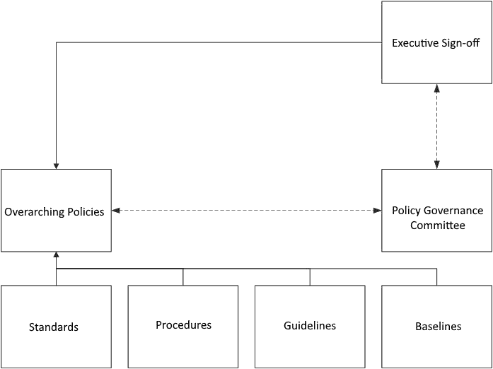
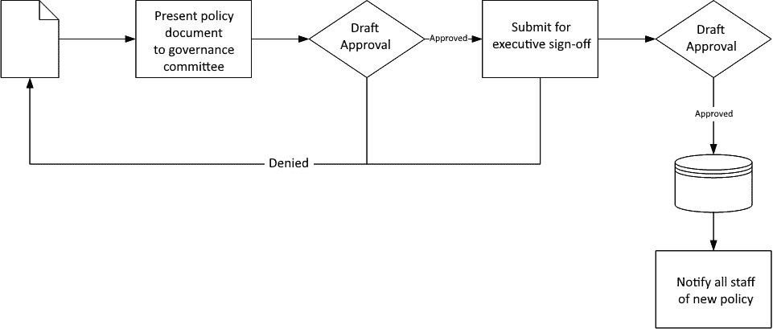
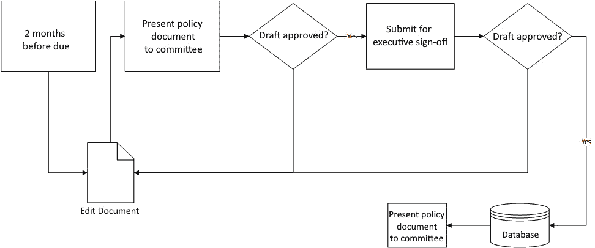

# 第 10 章：政策、标准和程序

NIST CSF 的目标是降低组织的整体网络风险。我们在上一章回顾了 CSF 核心的六大功能和 NIST RMF。虽然我们可能认为 CSF 仅用于 IT 风险，但它也旨在降低组织风险。RMF 通过深入组织网络风险的结构来体现这一点。

NIST RMF 由几份 NIST `Special Publications` (`SP`) 和 `Federal Information Processing Standard` (`FIPS`) 组成。这一系列文件帮助组织创建涵盖风险降低、事件响应和研究的网络安全计划。在此例中，我们专门查看了 SP 800-37、SP 800-39 和 FIPS 199。考虑到这些，我们学习了如何实施，或至少启动风险管理计划。

在本章中，我们将探讨政策、标准和程序的制定与执行。`Policies, Standards, and Procedures` (`PSP`) 可能是世界上最乏味的东西。你永远不会看到有人拍电影来演绎 CISO 编写政策的场景。然而，它们是必需的，因为它们执行着重要功能。PSP 驱动您的管理控制。

本章将介绍什么是策略、标准和程序及其功能。我们将创建一个文档结构，以便您轻松找到所需内容。最后，将讨论审批流程，使文档获得高层管理人员的签署和批准。本章将涵盖以下主题：

*   治理的重要性
*   框架结构
*   策略
*   标准
*   程序
*   策略审批

让我们开始吧！

# 治理的重要性

治理用于设定公司的方向及其运营方式。它为您的员工和公司建立了一种运作的职能方式。治理绝非易事。员工往往陷入常规，不寻求改变。治理可能会阻碍员工执行工作职能，也可能引导整个组织朝着共同目标前进。

组织治理与组织风险管理非常相似，源自高层并向下贯穿整个组织。董事会和高管领导层设定组织内治理的方向。随后，您有责任将这些要求应用到某种类型的策略中。但请记住，必须有一个持续的反馈循环，允许分析师和工程师报告故障并将其提交给高层管理人员审查。

虽然技术控制为控制风险管理提供了许多益处，但管理控制阐述了实施这些技术控制的*意图*、*内容*和*方法*。包括 NIST CSF 在内的控制框架要求每项技术控制都必须有某种类型的管理控制作为支撑。包括 PCI-DSS 在内的其他监管框架也要求您为拥有的每项控制编写策略或标准。

例如，在审计期间，评估员要求查看通用控制，如漏洞管理。工程师声称 IT 资源上的漏洞每日更新，并可展示支持这一点的配置设置。虽然这很棒，但这只是全貌的一部分。要有效，您必须拥有书写规范的文档来支撑该控制设置。这远不止截取控制设置的屏幕截图并认为这就足够了。

治理和管理控制也不能在真空中开发。管理控制的有效性取决于高管领导团队（ELT）的支持力度。例如，您可能编写了三十份策略文档（包含策略、标准和程序），但由于从未获得管理层批准，它们均无法强制执行。除了开发之外，必须有一个审批工作流。

应建立治理结构和工作流，规定如何批准策略文档。这将在策略文档未被遵循时提供所需的强制力。对于未按预期遵循策略文档的行为，必须有相应后果。然而，没有标准方式规定这些后果是什么；这由管理层决定。

接下来的几节将讨论策略治理、策略如何批准以及结构。

## 策略工作流

我们的第一个示例是为任何编写的策略文档建立的策略工作流和高管签署，如下所示：

图 10.1 – 策略工作流

图 10.1 描绘了一个标准的策略工作流。在开发策略文档时，请记住它们应向上汇聚到已编写的总体策略。这包括标准、程序、指南和基线。当它们与策略对齐后（稍后详述），将由策略治理委员会进行审查。该委员会应为负责审查和批准任何正在开发的策略文档的初步小组。然而，委员会不负责签署文档的执行，这保留给高管管理层。请记住，风险缓解和响应自上而下，必须由高管或高管团队强制执行。

高管签署也有一个箭头指向总体策略。这是为了说明高管领导团队（ELT）应影响策略制定的决策。策略应影响标准，依此类推。策略与委员会之间的双向箭头表明，策略可能被退回重工，以确保其满足 ELT 陈述的总体目标。这对策略委员会和高管签署同样适用。委员会和 ELT 均可否决签署，直到文档符合业务目标。

## 策略创建

无论策略文档是新建还是已存在，它总是以草稿开始。策略应起草完成，然后提交给策略治理委员会。该委员会负责草稿策略文档的审查和批准。一旦所有成员批准了草稿策略文档，它随后应由您的 ELT 审查和批准。一旦获批，策略文档必须驻留在某种文档存储库中，无论是 Microsoft SharePoint 还是 Atlassian 的 Confluence。它必须以所有员工均有权阅读策略的方式呈现。

图 10.2 – 新策略开发

如果文档在任何时候被拒绝，它必须完全退回草稿格式并进行编辑，以满足业务目标。一旦文档满足这些要求，它必须再次经历相同的流程：由治理委员会审查，然后提交高管审查和批准。

## 审查策略和程序

每份策略文档也应有审查周期。这些审查周期通常每年进行一次；但不应超过两年。审查周期对于根据上次审查以来发布的新标准来审查和潜在更新文档是必要的。

每份文档应有页脚，注明文档上次更新经高管管理层批准的时间以及下次更新应发生的时间。这都是文档生命周期管理的一部分，必须执行以确保文档与文档中陈述的业务目标保持一致：

图 10.3 – 策略审查周期

我们将以批准日期作为策略准备好进入审查周期的指南。我们在续期日期前几个月启动审查，以确保其在过期前获得批准。与新策略一样，策略审查至少每 2 年进行一次，如果需要可更早。审查策略文档时，确保其流向治理委员会，然后提交高管正式签署。完成后，草稿将回到数据库存储库供所有人审查。最后，别忘了向所有员工发送通知，告知新策略文档已存在供他们审查。

策略审查和批准对项目的整体成功至关重要。如果没有定期审查流程，您的文档可能变得陈旧，无法用于审计目的。确保您遵循某种周期来处理所有正在创建的策略。

# 框架结构

创建策略时必须有结构化的格式；否则，您如何知道在找什么？结构不必难以实施，我们也不是在实施杜威十进制分类法。但是，应该有条不紊。

# 策略、标准和程序文档结构

## 文档框架

当我们审视策略、标准和程序应如何布局的整体结构时，了解文档中应包含的内容也很重要。策略应是阐述任务意图（即*为什么*）的高层级文档。标准是阐述*是什么*的中低层级文档。程序应说明*如何*配置某事项。如果我们的目标是高层级的，那么编写文档的意义何在？第三方评估机构或您的战略合作伙伴可能希望查看您的策略内容。其意图是能够在无需签署**保密协议 (NDA)** 的情况下共享信息。事实上，您编写策略的方式应当允许将其发布在公开网站上，而无需担心泄露过多信息。

您需要建立一套结构，以便能在策略文档中轻松找到所需内容。*图 10.4* 描绘了您如何构建策略文档结构：

图 10.4 – 策略文档框架

策略结构非常重要，特别是当您必须管理大量策略文档时。如前所述，策略是阐述特定任务背后意图的高层级文档。这些文档可在无需对方签署 NDA 的情况下与第二方和第三方共享。

标准支撑策略，因为它们说明了*如何*执行某事。例如，您可能有一个加密标准，规定了必要的加密要求。在此例中，我们决定仅允许使用 **传输层安全性 (TLS)** 1.2 版或更高版本。这是因为低于该版本的协议存在问题。您可能还想说明应使用哪种类型的哈希算法，例如使用 SHA256 而非 MD5。

重要的是要注意，虽然策略应是高层级的，但标准和程序不是。因此，在向组织外部任何人提供此类信息之前，您应要求签署 NDA。在许多情况下，标准和程序陈述了低层级的配置和事件响应措施，如果落入坏人之手，将对组织造成损害。多方之间通常会有可签署的共同 NDA；但在推进之前，请咨询您的法律顾问。

标准至关重要，因为它们规定了*需要配置什么*、与谁开展业务，或如何响应事件。标准也可用于团队或任务的结构。您可能已制定事件响应计划，规定如何构建团队。在标准中，您可以放置事件响应团队呼叫树或显示职责的 RACI 图表。

程序说明*如何*做某事，并支撑标准。在前面的示例中，我们讨论了加密。我们指出低于 TLS 1.2 的任何版本均不可用于生产环境。这固然很好，但如何配置它？这就是程序发挥作用的地方。程序支撑标准，说明既然我们已确定 TLS 1.2 可接受，那么这就是我们配置系统以防止低于该版本的任何内容在生产系统上运行的方法。

## 控制族与编号

将与策略、标准和程序相关联的每个数字视为一个控制族。控制族 101 可以说明如何保障软件开发安全，而控制族 102 可能侧重于网络安全。103 可处理人力资源职能，依此类推。关键在于将控制族适当拆分，以便您能轻松找到所需的确切内容。

每个控制族随后由最初在策略中陈述的标准列表提供支撑。同样，策略可能声明您打算加密硬盘驱动器，而标准则讨论加密这些硬盘驱动器时应使用的适当加密算法。例如，您将 100.00 作为加密控制族，声明打算对任何和所有内容进行加密。100.01 规定要使用的适当加密算法。100.02 规定 TLS 连接的适当密码套件，而 100.03 规定适当的数据库加密技术。100.03.01 说明如何在您的系统中实施数据库加密技术。每家数据库公司的做法都不同。例如，Oracle 数据库可能使用 **透明数据库加密 (TDE)**，而 Microsoft SQL Server 可能使用不同的技术。这些将被拆分为两个单独的程序以便适当配置。

## 策略框架布局

布局可能如下所示：

| **策略编号** | **策略名称** | **标准编号** | **标准名称** | **程序编号** | **程序名称** |
| --- | --- | --- | --- | --- | --- |
| 100.00 | 加密 | | | | |
| | | 100.01 | 加密算法 | | |
| | | 100.02 | TLS 加密 | | |
| | | | | 100.02.01 | Apache |
| | | | | 100.02.02 | Microsoft IIS |
| | | 100.03 | 远程连接 | | |
| | | | | 100.03.01 | SSH |
| | | | | 100.03.02 | RDP |

表 10.1 – 策略框架布局

此结构仅为示例；但也可填充其他多个主题，如可接受使用或应用安全。所有文档应遵循相同结构。这样，您就能准确找到所需内容。

# 策略

组织往往往往会将策略与标准或程序合并。当您试图提供正确信息时（尤其是在审计期间），这可能会带来麻烦。策略是提供实施控制或控制族意图的总体文档。策略是用于建立治理的高层级文档，旨在实施行政、技术和物理控制，以降低组织风险。

策略不应深入细节说明员工或某项技术应使用的配置或流程。这是标准和程序的工作。策略是高层级的，意味着您编写文档的方式不应泄露过多信息。

如前所述，策略陈述执行特定任务的意图。例如，如果您打算在大楼的每个出入口安装智能卡读卡器，这应在策略中说明。但这并不意味着您要说明使用标准化技术进行读卡器访问。也不应详述其配置方式或所用的加密级别。

您通常在策略中看到的其他主题是词汇和职责。您可以在策略中说明团队成员负责系统维护；但我们不详述维护的类型。例如，策略可以说明服务器团队负责所有 IT 系统和服务的补丁管理，而网络团队负责网络设备的维护。

我们不说明何时打补丁。这会泄露过多信息。如果对手知道您在微软“补丁周二”后的周末打补丁，这意味着对手在补丁发布后有一周时间利用已知漏洞攻击您的基础设施。在未签署 NDA 的情况下提供此级别的详细信息，将使您面临额外的不必要风险。

# 标准

# 标准

标准是我们许多人都熟悉的文档。它们是中低层级文档，阐述配置、设置和预期结果的*内容*。它们用于从组织层面描述什么是可接受的，什么是不可接受的。标准还用于支持政策的意图，并提供足够的细节，以便某人编写执行该任务的程序。

标准文档不详细说明如何实施某事；那是程序的工作。标准是一份文档，陈述针对特定工作职能或配置设置何种方法是可接受的。在前一个示例中，我们讨论了加密的适当配置设置。对于我们的 `100.02` 加密标准，我们可以陈述如下：

*   禁用 `TLS 1.1` 及更低版本
*   必须使用 `FIPS 140-2` 加密标准
*   当密钥被签发或因过期而重新签发时，必须新生成密钥
*   非对称加密算法：
    *   `RSA` 必须使用 2,048 – 4,096 位强度
    *   `ECDSA` 必须使用 256 – 521 位强度
*   所有遗留协议必须在投入生产前禁用
*   无线网络必须使用 `WPA2-PSK` 或 `WPA2-Enterprise`

正如你所见，此类标准会陈述 IT 资源上项目的适当配置。标准当然可以更详细地说明不可接受的加密算法示例或使用遗留协议的危险。

创建具有此详细程度的文档时必须小心，因为它可能提供比公开发布预期更多的细节。这就是为什么你应该建立 `NDA` 以防止敏感信息泄露。你可以为 Web 服务做例外以允许使用较弱的协议，但同样，请将此信息尽可能保密。

标准在程序如何开发方面也将发挥关键作用。下一节将详述。

# 程序

编写程序是一门艺术。为什么？程序的编写必须让初级分析师在没有先验知识的情况下也能理解如何配置一项技术。很多时候编写程序时，会遗漏配置 IT 资源所需的关键信息。这会让被要求配置某物或修复问题的员工感到沮丧。

如果你或资深员工去度假了，你的团队会知道如何解决问题吗？编写程序的要点是写得足够详细，以至于不留任何疑问。程序应讨论每一个步骤，直到做什么和怎么做完全明确无歧义。

我过去在社区大学教 Linux 课程，以为一切都计划妥当了。我们允许学生借出外部硬盘在学期中使用。这些硬盘用于安装一个版本的 Ubuntu Linux，以便学生熟悉软件并完成作业。然而有一个问题：如果学生以前从未执行过安装，他们如何将 Ubuntu 装到硬盘上？

我写了一个作业，演示将操作系统安装到外部硬盘的过程。然而还有个问题——启动后安装到哪个硬盘上？对我的来说这是理所当然的：不要选台式机的内部硬盘。有些学生懂了，而有些意外地将 Ubuntu 安装到了错误的驱动器上。

虽然这对学生是学习曲线，对我也是个教训。我遗漏了一个关键步骤，即说明安装操作系统的正确驱动器。这不仅让学生不高兴，因为他们得重来一遍；也让 IT 部门不高兴，因为他们得在下一节课前重新镜像电脑！

你投入程序的详细程度非常重要。如果需要重启，写在文档里。如果有需要配置的注册表设置，也写进文档。即使你知道安装软件要点 10 次 `Next` 按钮，也要写上。不留任何侥幸。否则会发生什么呢？要么你在度假时接到电话说系统挂了得你去修，要么有人配置错误却直到太晚才发现。

标准中规定的配置内容会延续到程序中。程序引导你完成标准中定义的系统或设置的安装。程序旨在支持标准。例如，政策 `100.00` 陈述了你加密一切的意图。标准 `100.01` 旨在定义要使用的适当加密算法，而 `100.02` 讨论适当的 TLS 配置。现在我们进入程序部分。`100.02.01 Apache` 旨在引导你如何为 `TLS 1.2/1.3` 配置 Apache 服务器，而 `100.02.02` 讨论如何在 Microsoft Server IIS 上注册相同的 TLS 协议。

标准 `100.03` 讨论连接远程计算机时使用的适当协议，而相关程序讨论如何配置 `secure shell` (`SSH`) (`100.03.01`) 和 `remote desktop protocol` (`RDP`) (`100.03.02`)。这通过直接定位到你要找的信息源，简化了文档的分解。

# 政策文档格式

文档的对齐、编号和内容应使每份生成的政策文档都具有熟悉的格式。这些文档至少应包含以下内容：

*   **目的**：生成该文档的目的是什么？旨在确立什么？
*   **所有者**：将政策文档与所有者关联时，确保不绑定特定人名。文档应引用该人的职位或部门。这是为了在人员流动或部门变更时使文档经久适用。
*   **范围**：该文档旨在涵盖的总体范围是什么？是仅包含内部员工还是外部第三方？也许两者都有？是否也包含本地部署或基于 SaaS 的应用程序？
*   **政策声明**：政策声明应清晰、简练、切中要害。这里陈述特定控制的意图（针对政策）、什么或何处应被实施或配置（针对标准），或实施控制的过程（针对程序）。
*   **信息参考**：此部分非强制，但应视为政策文档的一部分。*信息参考*部分应显示政策文档与给定框架的对齐情况。例如，如果你将政策文档与 `NIST CSF` 对齐，应说明与哪些控制或控制族对齐。如果你编写涵盖事件响应的政策文档，文档中应有参考说明该文档与哪些控制对齐。如果你决定也包含 `NIST CSF` 之外的其他框架，也应将它们包括在内。

如前所述，政策、标准和程序的结构很重要。政策旨在高层级，允许任何人查看而不提供过多细节。这就是为什么单独列出标准和程序很重要，以便在没有 `NDA` 的情况下不提供高风险信息。

# 政策控制族

# 创建您的策略框架

创建您的策略框架可能会让人望而生畏。*表 10.1* 仅展示了策略文档应考虑内容的一小部分，更不用说框架在起步时应包含详尽的控制清单，因为您最初可能只有少数几个控制措施。

在开始创建自己的框架时，有几个清单可以为您提供帮助。开放策略框架是一个旨在协助决策者的开源项目。它列出了几个控制家族，您可以用它们来启动自己的框架。这些包括以下内容：

## 控制家族

### 信息安全

信息安全控制家族旨在实现数据保护和合理使用。标准文档可包括合理使用策略、加密、数据销毁和**信息生命周期管理 (ILM)**。信息安全控制家族旨在控制和保护组织的敏感信息。

### 资产管理

互联网安全中心将资产管理列为最重要的控制措施，这是有原因的。*您无法保护您看不见的东西！* 组织应对资产管理建立完善的控制，包括识别在 IT 资源上运行的软件和服务。如果您不知道资产或软件的存在，您会有计划去修补或缓解任何风险吗？

### 人力资源

该控制家族旨在说明在员工任职期间如何处理其访问权限和公司拥有的财物。当新员工入职时，经理必须完成一系列步骤，以确保新员工拥有履行工作职能所需的一切。这可能包括领取新电脑、公司配备的手机或外设。

当员工调岗时，您需要制定标准，说明如何处理这些财物或对 IT 资源的访问权限。您要确保不会因允许员工保留对先前 IT 资源的访问权限（而其新工作并不需要这些权限）而将“权限蔓延”引入环境中。

我们还需要制定标准，规定员工离职时该怎么做。如果员工被解雇或自愿离职，该怎么办？所有这些都在必须编写的离职标准中进行了规划。这些标准也可以与人力资源部门协调编写，以确保两个部门对标准中所述内容保持一致。

### 物理安全

本节可讨论大量物理安全控制，例如**闭路电视 (CCTV)**、物理屏障、人员闸、门禁卡访问系统等。这些控制应拥有自己的控制家族以便跟踪。多个框架在其文档中也提到了物理安全。这些控制应体现在为您的组织编写的策略文档中。

### 访问控制

最小权限和职责分离、密码标准、**多因素认证 (MFA)** 的使用以及身份验证都属于访问控制范畴。访问控制不仅仅是控制用户在特定设备上的访问级别。虽然最小权限和职责分离很重要，但还应制定其他一些标准。

我们应该着手制定环境中允许的 MFA 类型标准。例如，多家 MFA 厂商提供不同级别的访问方式，如推送通知、U2F、**一次性密码 (OTP)**，甚至固定电话回呼和短信。每种方式都有不同级别的认证风险。某些 MFA 机制涉及额外风险，例如在担心 SIM 卡交换攻击时使用短信，或在使用移动应用时出现的推送疲劳。

### 事件管理

事件管理可包括 NIST CSF 核心中的“恢复”和“响应”功能。控制措施应包括建立安全事件响应团队、事件发生时的呼叫树、如何进行调查、记录事件以及记录经验教训。

这也是您将 IR（事件响应）运行手册与控制措施对齐的地方。例如，如果您有克服账户接管的响应计划，还应有运行手册来协助流程并可视化响应过程。

### 业务连续性/灾难恢复

我们已讨论如何响应给定事件以及如何从中恢复。用于指导如何执行这些操作的策略、标准和程序应归属于此控制家族。该家族应包含的标准包括备份与测试、业务连续性规划与测试、向热站点或冷站点切换，以及恢复与文档记录。

### 安全意识与培训

您可能认为安全意识和培训是同义词；然而，它们并非如此。根据 NIST 的定义，安全*意识*是通过观察进行的，而*培训*则更侧重于安全主题。这是全年持续进行的工作，而不仅仅是为安全意识月单独设立的一个项目。

安全意识可以通过横幅展示或电视上播放的视频来实现。这些旨在供路过的员工观看。安全培训也旨在突出网络安全；然而，它是通过更深入和结构化的方式进行的。安全培训侧重于工作角色或职能，而不仅仅是被查看的高层级横幅。例如，安全意识会强调在处理钓鱼邮件时需要额外审查，而培训可能是配置安全邮件网关的邮件管理员所必需的。

### 安全网络配置

该控制家族旨在突出安全网络配置的必要性。这应包括站点到站点 VPN 连接、客户端到站点 VPN，以及强化防火墙或其他安全设备（如 IDS/IPS）。这也强调了 VPN 设置所需的配置。例如，许多组织已从基于客户端的分隧道 VPN 连接迁移至全隧道。如果您允许一种但禁止另一种，这也应写入标准中。

安全网络配置还应包括防火墙配置。您是否在规则库中采用“默认拒绝、例外允许”策略？防火墙是否应要求 MFA 进行身份验证？哪些协议绝不允许通过防火墙？所有这些都应进行讨论。

### 安全配置与管理

所有 IT 资源和软件都应依据标准进行加固。有多个标准强调了系统加固的必要性；然而，最知名的标准是互联网安全中心基准文档。加固意味着您要移除或更改系统上的所有默认设置和凭据。从系统中移除任何不需要或未使用的服务，并确保已执行适当的安全配置。

### 风险管理

我们在全书中已多次讨论风险。现在我们必须将所学到的一切应用到策略和标准中。NIST 有多份文件涵盖组织风险：NIST SP 800-30、800-37 和 800-39。国际标准化组织也制定了 ISO 27005，该标准同样介绍了应对风险的战略方法。

