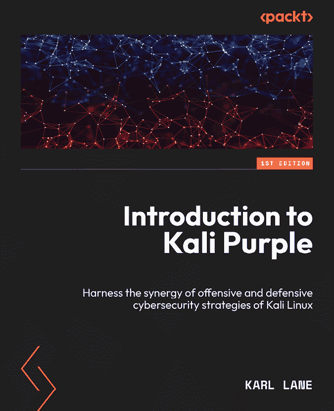
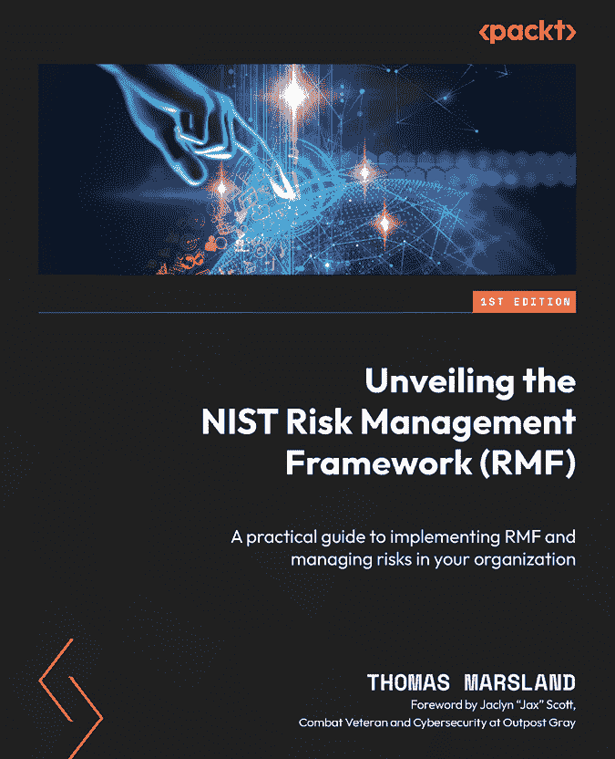

# 索引

由于此电子书版本没有固定的页码，下面的页码均为超链接，仅供参考，基于本书的印刷版。

## A

访问控制列表 (ACLs) 80

Active Directory 域服务 (AD DS) 118

不利事件分析 (`DE.AE`) 86

`DE.AE-02` 86

`DE.AE-03` 87

`DE.AE-04` 87

`DE.AE-06` 88

`DE.AE-07` 88

`DE.AE-08` 89

事后复盘 (AAR) 106

允许列表 77

应用程序编程接口 (`APIs`) 138

认证扫描供应商 (ASV) 58

评估

第一方评估 22, 142, 143

执行 21, 142, 146

第二方评估 143

自我评估，执行 145

第三方评估 21, 144

资产管理 (`ID.AM`) 52

`ID.AM-01` 52

`ID.AM-02` 53

`ID.AM-03` 53, 54

`ID.AM-04` 55

`ID.AM-05` 55, 56

`ID.AM-07` 56, 57

`ID.AM-08` 57

基于属性的访问控制 (`ABAC`) 70

澳大利亚信号局澳大利亚网络安全中心 (ASD's ACSC) 4

运行授权 (ATO) 119

意识与培训

`PR.AT-01` 72

`PR.AT-02` 72, 73

## B

生物科学部 (BSD) 10

BitLocker 73

董事会 (BoD) 111

应急访问流程 68

## C

能力成熟度模型集成 (CMMI) 17

资本支出 (CapEx) 35

互联网安全中心 (CIS) 7, 8, 22

互联网安全中心关键安全控制 (CIS Controls) 5

变更咨询委员会 (CAB) 76

首席财务官 (CFO) 111

首席信息官 (CIO) 111

首席信息安全官 (CISO) 111

# C

## 闭路电视 (CCTV)
136

## 云服务提供商 (CSPs)
33, 54

## COBIT 5

### 治理和管理控制
8

## 计算机应急响应小组 (CERTs)
59

## 机密性、完整性和可用性 (CIA) 三要素
8, 33, 81, 116

### 高水位线
117

### 低水位线
116

### 中等水位线
116

## 配置管理数据库 (CMDB)
52, 67

## 持续监控 (DE.CM)
83, 84

### DE.CM-01
84

### DE.CM-02
84

### DE.CM-03
85

### DE.CM-06
85

### DE.CM-09
86

## 信息及相关技术控制目标 (COBIT)
5, 8, 39

## 危机沟通计划 (CCP)
98, 106

## C-SCRM (GV.SC)
38

### GV.SC-01
38, 39

### GV.SC-02
39, 40

### GV.SC-03
40, 41

### GV.SC-04
41

### GV.SC-05
41

### GV.SC-06
42

### GV.SC-07
42

### GV.SC-08
43

### GV.SC-09
43, 44

### GV.SC-10
44

## 当前状态
141

### 捕获
148

## 当前状态概况
25

## 网络安全和基础设施安全局 (CISA)
16, 58

## 网络安全框架 (CSF)
3, 29

### 与其他框架的对比
7

# D

## 静态数据
74

## 传输中数据
74

## 数据安全

### PR.DS-01
73

### PR.DS-02
74

### PR.DS-10
74, 75

### PR.DS-11
75

## 国防联邦采购条例补充 (DFARS)
4

## 戴明循环
19, 29

## 目录即服务 (DaaS)
55

## 域名系统 (DNS)
22

## 国内安全联盟委员会 (DSAC)
59

# E

## 端点检测与响应 (EDR)
118

## 委托函
145

## 企业架构 (EA)
114

## 企业风险管理 (ERM)
7

## 高管领导团队 (ELTs)
32, 55, 103, 113

# F

## 快速在线身份认证 (FIDO)
69

## 联邦信息处理标准 (FIPS)
33, 125

## 联邦信息安全管理法案 (FISMA)
9

## 联邦风险和授权管理计划 (FedRAMP)
4

## 文件传输协议安全 (FTPS)
74

## FileVault
73

## FIPS 199
33

## 第一方评估
22, 142, 143

### 评估，执行
23, 24

### 评估，收尾
24

### 委托函
22

### 结束面谈
24, 25

### 项目启动
22, 23

## 专项培训
72

## 框架
3, 4

## 框架结构
129–132

## 未来路线图

### 创建
148

## 未来状态概况
25

## 未来状态评分模型
150, 151

# G

## 差距分析

### 执行
146

## GC.OC-01
30

## GC.OC-02
31

## GC.OC-03
32

## GC.OC-04
32, 33

## GC.OC-05
33

## 通用数据保护条例 (GDPR)
4, 32

## GNU 隐私卫士 (GPG)
79

## 治理

### 政策和程序，审查
128, 129

### 政策制定
128

### 政策工作流
127

### 重要性
126

## 治理、风险与合规 (GRC)
21

## 治理职能
29

## 组策略对象 (GPOs)
119

## GV.OV-01
48

## GV.OV-02
48

## GV.OV-03
49

## GV.PO-01
47

## GV.PO-02
47, 48

## GV.RM-01
34

## GV.RM-02
34, 35

## GV.RM-03
35

## GV.RM-04
36

## GV.RM-05
36

## GV.RM-06
37

## GV.RM-07
37

## GV.RR-01
45

## GV.RR-02
45

## GV.RR-03
46

## GV.RR-04
46

## GV.SC-01
38, 39

## GV.SC-02
39, 40

## G

### `GV.SC-03` 40, 41

### `GV.SC-04` 41

### `GV.SC-05` 41

### `GV.SC-06` 42

### `GV.SC-07` 42

### `GV.SC-08` 43

### `GV.SC-09` 43, 44

### `GV.SC-10` 44

## H

### 硬件安全模块 (`HSM`) 74

### 《健康保险流通与责任法案》 (`HIPAA`) 4, 32

### 供暖、通风与空调 (`HVAC`) 80

### 高可用性 (`HA`) 33

### 人力资源 (`HR`) 32

## I

### 身份与访问管理 (`IAM`) 119, 151

### 身份管理、认证与访问控制

#### `PR.AA-01` 68

#### `PR.AA-02` 68

#### `PR.AA-03` 69

#### `PR.AA-04` 70

#### `PR.AA-05` 70

#### `PR.AA-06` 70, 71

### 身份提供商 (`IdP`) 70

### `IDS/IPS` 设备 72

### 实施组 (`IGs`) 7

### 改进 (`ID.IM`) 63

#### `ID.AM-02` 64

#### `ID.AM-03` 64

#### `ID.AM-04` 65

#### `ID.IM-01` 63

### 事件分析 (`RS.AN`) 95

#### `RS.AN-03` 95

#### `RS.AN-06` 95

#### `RS.AN-07` 96

#### `RS.AN-08` 96

### 事件管理 (`RS.MA`) 92

#### `RS.MA-01` 92

#### `RS.MA-02` 93

#### `RS.MA-03` 93

#### `RS.MA-04` 94

#### `RS.MA-05` 94

### 事件缓解 (`RS.MI`) 98

#### `RS.MI-01` 98

#### `RS.MI-02` 98, 99

### 事件恢复沟通 (`RC.CO`) 106

#### `RC.CO-03` 106, 107

#### `RC.CO-04` 107, 108

### 事件恢复计划执行 (`RC.RP`) 102

#### `RC.RP-01` 102

#### `RC.RP-02` 102, 103

#### `RC.RP-03` 103, 104

#### `RC.RP-04` 104, 105

#### `RC.RP-05` 105

#### `RC.RP-06` 106

### 事件响应 (`IR`) 60, 91

### 事件响应报告与沟通 (`RS.CO`) 97

#### `RS.CO-02` 97

#### `RS.CO-03` 97, 98

### 信息生命周期管理 (`ILM`) 136

### 信息安全管理体系 (`ISMS`) 9

### 信息共享与分析中心 (`ISAC`) 31, 59

### 信息技术 (`IT`) 3

### 基础设施即代码 (`IaC`) 119

### 知识产权 (`IP`) 73

### 临时纠正措施 (`ICA`) 98

### 国际标准化组织 (`ISO`) 4

### 互联网犯罪投诉中心 (`IC3.gov`) 97

### 互联网服务提供商 (`ISP`) 80, 84

### `ISO/IEC 27001` 8, 9

### IT 资源

#### 应用风险管理 120, 121

### IT 风险

#### 探索 112

## K

### 关键绩效指标 (`KPIs`) 20, 48

### 已知被利用漏洞 (`KEV`) 16, 58

## L

### 轻量级目录访问协议 (`LDAP`) 68

### Linux 统一密钥设置 (`LUKS`) 15, 73

### 科罗拉多河下游管理局 (`LCRA`) 10

## M

### 托管安全服务提供商 (`MSP`) 64, 86

### 托管服务提供商 (`MSP`) 92

### 中间人攻击 83

### 移动设备管理 (`MDM`) 79

### 多因素认证 (`MFA`) 3, 69, 136, 149

## N

### 美国国家标准与技术研究院 (`NIST`) 3

### 网络映射器 (`NMAP`) 23

### `NIST CSF`

#### 历史 6, 7

#### 需求 5

### `NIST CSF 2.0`

#### 功能 5

### `NIST 框架` 13

#### 检测功能 16

#### 治理功能 14

#### 识别功能 14

#### 防护功能 15

#### 恢复功能 16, 17

#### 响应功能 16

### `NIST RMF` 113

#### 第 1 层 114

#### 第 2 层 114, 115

#### 第 3 层 115

### `NIST SP 800-53` 9, 10

### `NIST SP 800-53` 控制族 138

### NIST 特别出版物 (`SP`) 125

### 保密协议 (`NDAs`) 46, 130

### 作为水印的不适用 (`N/A`) 117

## O

### 一次性密码 (`OTP`) 69, 136

### 开放策略框架 136

### 开源情报 (`OSINT`) 146

### 运营技术 (`OT`) 10

### `OpEx` 35

## O

### `organizational context (GV.OC)` 30

- `GC.OC-01` 30
- `GC.OC-02` 31
- `GC.OC-03` 32
- `GC.OC-04` 32, 33
- `GC.OC-05` 33

### `oversight (GV.OV)` 48

- `GV.OV-01` 48
- `GV.OV-02` 48
- `GV.OV-03` 49

## P

### `Payment Card Industry Data Security Standard (PCI DSS)` 4, 32

### `Permanent Corrective Action (PCA)` 99

### `permissions creep` 70

### `personally identifiable information (PII)` 4, 54, 73

### `Plan, Do, Check, and Act (PDCA)` 19, 20

### `Plan of Action and Milestones (POA&M)` 25, 61, 120, 151

### `platform security`

- `PR.PS-01` 76
- `PR.PS-02` 77
- `PR.PS-03` 77
- `PR.PS-04` 78
- `PR.PS-05` 79
- `PR.PS-06` 79

### `policies` 132, 141

### `Policies, Standards, and Procedures (PSP)` 114, 125

### `policy control families` 135\-139

### `policy document format` 135

### `Policy (GV.PO)` 47

- `GV.PO-01` 47
- `GV.PO-02` 47, 48

### `power distribution units (PDU)` 81

### `procedure` 134, 135, 141

### `profiles` 20

- `current state profile` 25
- `future state profile` 25

### `push fatigue` 69

## R

### `remote desktop protocol (RDP)` 135

### `responsible, accountable, consulted, and informed (RACI)` 39

### `risk`

- `dealing, ways` 112, 113
- `framing` 121\-123

### `risk assessment (ID.RA)` 58

- `ID.RA-01` 58
- `ID.RA-02` 58, 59
- `ID.RA-03` 59
- `ID.RA-04` 60
- `ID.RA-05` 60, 61
- `ID.RA-06` 61
- `ID.RA-07` 61
- `ID.RA-08` 62
- `ID.RA-09` 62, 63
- `ID.RA-10` 63

### `risk management`

- `applying, to IT resources` 120, 121
- `Risk Management Framework (RMF)` 111, 116
  - `assess phase` 119
  - `authorize` 119, 120
  - `categorize` 116
  - `controls, selecting` 118
  - `implementation` 118
  - `prepare` 116
  - `service, monitoring` 120

### `risk management strategy (GV.RM)` 34

- `GV.RM-01` 34
- `GV.RM-02` 34, 35
- `GV.RM-03` 35
- `GV.RM-04` 36
- `GV.RM-05` 36
- `GV.RM-06` 37
- `GV.RM-07` 37

### `roles, responsibilities, and authorities (GV.RR)` 44

- `GV.RR-01` 45
- `GV.RR-02` 45
- `GV.RR-03` 46
- `GV.RR-04` 46

## S

### `second-party assessment` 143

### `secure shell (SSH)` 135

### `Secure Shell (SSH) keys` 79

### `Securities and Exchange Commission (SEC)` 97

### `Security Assertion Markup Language (SAML) 2.0` 70

### `security awareness` 72

### `security categorization`

- `calculating` 117, 118

### `Security Incident Response Team (SIRT)` 17

### `Security Information and Event Management (SIEM)` 59, 85

### `security training` 72

### `self-assessment`

- `closeout` 147, 148
- `engagement letter` 145
- `gap analysis, performing` 146
- `performing` 145
- `project kick-off` 145

### `service-level agreements (SLAs)` 40, 91

### `service provider (SP)` 69

### `Shared Assessments` 42

### `SIG Lite` 39

### `Simple Network Management Protocol (SNMP)` 78

### `Simple Network Monitoring Protocol (SNMP)` 16, 53

### `SIM swapping` 69

### `single-factor authentication` 69

### `SMART goals` 149

### `Software-as-a-Service (SaaS)` 4, 14, 54

### `software bill of materials (SBOM)` 41, 53

### `Special Publication (SP)` 4, 111

### `SSH File Transfer Protocol (SFTP)` 74

### `standard` 133, 141

### `subject matter experts (SMEs)` 10, 145

### `System Development Life Cycle (SDLC)` 119

### `systems security plan (SSP)` 60, 119

## T

# 索引

## T

战术、技术与流程 (TTPs) 59

技术基础设施弹性

PR.IP-01 80

PR.IP-02 80

PR.IP-03 81

PR.IP-04 81

第三方评估 21, 144

层级 17

应用 18, 19

持续改进 19, 20

交通灯协议 (TLP) 107

传输控制协议 (TCP) 54

透明数据库加密 (TDE) 131

传输层安全 (TLS) 131

传输层安全 (TLS) 卸载 75

## U

芝加哥大学 (UoC) 10

## W

Web 应用防火墙 (WAF) 121

---

# Packt Publishing

[packtpub.com](http://packtpub.com)

订阅我们的在线数字图书馆，即可完全访问超过 7,000 本书籍和视频，以及行业领先的工具，帮助您规划个人发展并提升职业生涯。更多信息，请访问我们的网站。

## 为什么要订阅？

*   通过来自 4,000 多位行业专业人士的实用电子书和视频，减少学习时间，增加编码时间
*   通过专为您打造的技能计划提升学习效果
*   每月免费获取一本电子书或视频
*   全文搜索，轻松访问关键信息
*   复制粘贴、打印和书签内容

您知道吗？Packt 为每本出版的书籍提供电子书版本，包含 PDF 和 ePub 文件。您可以在 [packtpub.com](http://packtpub.com) 升级到电子书版本，作为纸质书客户，您有权享受电子书副本的折扣。如需更多详情，请联系 customercare@packtpub.com。

在 [www.packtpub.com](http://www.packtpub.com)，您还可以阅读免费技术文章合集，订阅多种免费新闻通讯，并获得 Packt 书籍和电子书的独家折扣和优惠。

## 您可能喜欢的其他书籍

如果您喜欢这本书，可能对 Packt 的以下其他书籍感兴趣：

### Kali Purple 入门

 

**Kali Purple 入门**

Karl Lane

ISBN: 978-1-83508-898-2

*   搭建并配置一个功能齐全的微型安全运营中心
*   探索并实施政府开发的 Malcolm 工具套件
*   使用 Arkime 和 CyberChef 理解流量和日志分析
*   对比入侵检测和预防系统
*   通过 Cortex、TheHive 和威胁情报源集成探索事件响应方法
*   利用紫队技术进行社会工程学和漏洞利用开发

### 揭秘 NIST 风险管理框架 (RMF)

 

**揭秘 NIST 风险管理框架 (RMF)**

Thomas Marsland

ISBN: 978-1-83508-984-2

*   了解如何根据组织需求定制 NIST 风险管理框架
*   掌握安全控制和评估程序，以维持强大的安全态势
*   通过真实案例探索云安全，增强检测和响应能力
*   掌握合规要求和最佳实践，涵盖相关法规和行业标准
*   探索风险管理策略，确定安全投资和资源分配的优先级
*   制定强大的事件响应计划并高效分析安全事件

## Packt 正在寻找像您这样的作者

如果您有兴趣成为 Packt 的作者，请访问 [authors.packtpub.com](http://authors.packtpub.com) 立即申请。我们已与数千名开发人员和技术专业人士合作，就像您一样，帮助他们与全球技术社区分享见解。您可以提交通用申请，申请我们正在招募作者的特定热门主题，或提交您自己的想法。

## 分享您的想法

既然您已读完 *《揭秘 NIST 网络安全框架 2.0》*，我们非常想听听您的想法！如果您在 Amazon 购买了本书，请 [点击此处直接前往该书的 Amazon 评论页面](https://packt.link/r/183546307X) 并分享您的反馈，或在您购买的网站上留下评论。

您的评论对我们和技术社区至关重要，将帮助我们确保提供卓越的高质量内容。

## 下载本书的免费 PDF 副本

感谢您购买本书！

您是否喜欢随时随地阅读，却无法随身携带纸质书？

您购买的电子书是否与您选择的设备不兼容？

别担心，现在购买每本 Packt 书籍，您都可以免费获得该书的无 DRM 限制的 PDF 版本。

随时随地，在任何设备上阅读。直接从您喜爱的技术书籍中搜索、复制和粘贴代码到您的应用程序中。

福利不止于此，您还可以获得独家折扣、新闻通讯和每日收件箱中的精彩免费内容。

请遵循以下简单步骤获取福利：

1.  扫描二维码或访问下方链接

    

    [`packt.link/free-ebook/978-1-83546-307-9`](https://packt.link/free-ebook/978-1-83546-307-9)

2.  提交您的购买凭证

3.  就这些！我们会将您的免费 PDF 和其他福利直接发送到您的邮箱

---

# 目录

1.  揭秘 NIST 网络安全框架 2.0
2.  贡献者
3.  作者简介
4.  审阅者简介
5.  前言
    1.  适读人群
    2.  本书内容
    3.  如何充分利用本书
    4.  联系我们
    5.  分享您的想法
    6.  下载本书的免费 PDF 副本
6.  第 1 部分：为什么选择 NIST 网络安全框架？
7.  第 1 章：网络安全框架简介
    1.  什么是框架？
    2.  为什么选择 NIST CSF？
    3.  NIST CSF 背后的历史
    4.  将 CSF 与其他框架进行比较
        1.  CIS
        2.  COBIT
        3.  ISO/IEC 27001
        4.  NIST SP 800-53
    5.  NIST CSF 成功案例
        1.  下科罗拉多河管理局
        2.  生物科学部 – 芝加哥大学
    6.  总结
    7.  参考文献
8.  第 2 章：NIST 网络安全框架基础
    1.  NIST 框架
        1.  治理

# 第 1 部分：NIST 网络安全框架核心

## 识别

## 保护

## 检测

## 响应

## 恢复

## 层级

### 层级的应用

### 持续改进

## 概况

### 执行评估

### 当前状态

### 未来状态

## 总结

## 参考资料

# 第 2 部分：NIST 网络安全框架功能

## 第 3 章：治理

### 技术要求

### 组织背景 (`GV.OC`)

#### `GV.OC-01`

#### `GV.OC-02`

#### `GV.OC-03`

#### `GV.OC-04`

#### `GV.OC-05`

### 风险管理策略 (`GV.RM`)

#### `GV.RM-01`

#### `GV.RM-02`

#### `GV.RM-03`

#### `GV.RM-04`

#### `GV.RM-05`

#### `GV.RM-06`

#### `GV.RM-07`

### 网络安全供应链风险管理 (`GV.SC`)

#### `GV.SC-01`

#### `GV.SC-02`

#### `GV.SC-03`

#### `GV.SC-04`

#### `GV.SC-05`

#### `GV.SC-06`

#### `GV.SC-07`

#### `GV.SC-08`

#### `GV.SC-09`

#### `GV.SC-10`

### 角色、职责和权限 (`GV.RR`)

#### `GV.RR-01`

#### `GV.RR-02`

#### `GV.RR-03`

#### `GV.RR-04`

### 策略 (`GV.PO`)

#### `GV.PO-01`

#### `GV.PO-02`

### 监督 (`GV.OV`)

#### `GV.OV-01`

#### `GV.OV-02`

#### `GV.OV-03`

### 总结

### 参考资料

## 第 4 章：识别

### 资产管理 (`ID.AM`)

#### `ID.AM-01`

#### `ID.AM-02`

#### `ID.AM-03`

#### `ID.AM-04`

#### `ID.AM-05`

#### `ID.AM-07`

#### `ID.AM-08`

### 风险评估 (`ID.RA`)

#### `ID.RA-01`

#### `ID.RA-02`

#### `ID.RA-03`

#### `ID.RA-04`

#### `ID.RA-05`

#### `ID.RA-06`

#### `ID.RA-07`

#### `ID.RA-08`

#### `ID.RA-09`

#### `ID.RA-10`

### 改进 (`ID.IM`)

#### `ID.IM-01`

#### `ID.IM-02`

#### `ID.AM-03`

#### `ID.AM-04`

### 总结

### 参考资料

## 第 5 章：保护

### 身份管理、认证和访问控制 (`PR.AA`)

#### `PR.AA-01`

#### `PR.AA-02`

#### `PR.AA-03`

#### `PR.AA-04`

#### `PR.AA-05`

#### `PR.AA-06`

### 意识与培训 (`PR.AT`)

#### `PR.AT-01`

#### `PR.AT-02`

### 数据安全 (`PR.DS`)

#### `PR.DS-01`

#### `PR.DS-02`

#### `PR.DS-10`

#### `PR.DS-11`

### 平台安全 (`PR.PS`)

#### `PR.PS-01`

#### `PR.PS-02`

#### `PR.PS-03`

#### `PR.PS-04`

#### `PR.PS-05`

#### `PR.PS-06`

### 技术基础设施韧性 (`PR.IP`)

#### `PR.IP-01`

#### `PR.IP-02`

#### `PR.IP-03`

#### `PR.IP-04`

### 总结

### 参考资料

## 第 6 章：检测

### 持续监控 (`DE.CM`)

#### `DE.CM-01`

#### `DE.CM-02`

#### `DE.CM-03`

#### `DE.CM-06`

#### `DE.CM-09`

### 不利事件分析 (`DE.AE`)

#### `DE.AE-02`

#### `DE.AE-03`

#### `DE.AE-04`

#### `DE.AE-06`

#### `DE.AE-07`

#### `DE.AE-08`

### 总结

### 第 7 章：响应 (摘要)

#### 事件管理 (`RS.MA`)

## 第 7 章：响应

### 事件管理 (RS.MA)
#### RS.MA-01
#### RS.MA-02
#### RS.MA-03
#### RS.MA-04
#### RS.MA-05

### 事件分析 (RS.AN)
#### RS.AN-03
#### RS.AN-06
#### RS.AN-07
#### RS.AN-08

### 事件响应报告与沟通 (RS.CO)
#### RS.CO-02
#### RS.CO-03

### 事件缓解 (RS.MI)
#### RS.MI-01
#### RS.MI-02

### 总结
### 参考资料

## 第 8 章：恢复

### 事件恢复计划执行 (RC.RP)
#### RC.RP-01
#### RC.RP-02
#### RC.RP-03
#### RC.RP-04
#### RC.RP-05
#### RC.RP-06

### 事件恢复沟通 (RC.CO)
#### RC.CO-03
#### RC.CO-04

### 总结

## 第 3 部分：应用框架

## 第 9 章：如何应对网络风险

### 探索 IT 风险
### NIST RMF
#### 第 1 层级
#### 第 2 层级
#### 第 3 层级

### 风险管理框架
#### 准备
#### 分类
#### 选择
#### 实施
#### 评估
#### 授权
#### 监控

### 如何将风险管理应用于 IT 资源
### 风险构架
### 总结

## 第 10 章：策略、标准与程序

### 治理的重要性
#### 策略工作流
#### 策略制定
#### 审查策略与程序

### 框架结构
### 策略
### 标准
### 程序
### 策略文档格式
### 策略控制族
### 总结
### 参考资料

## 第 11 章：评估

### 执行评估
#### 第一方评估
#### 第二方评估
#### 第三方评估
#### 执行自我评估

### 获取当前状态
### 制定未来路线图
#### SMART 目标
#### 未来状态评分模型

### 总结

## 索引
### 为什么要订阅？

## 您可能喜欢的其他书籍
### Packt 正在寻找像您这样的作者
### 分享您的想法
### 下载本书的免费 PDF 副本

## 地标
### 封面
### 索引

