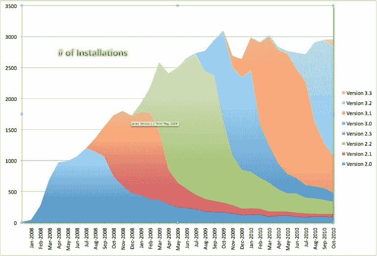
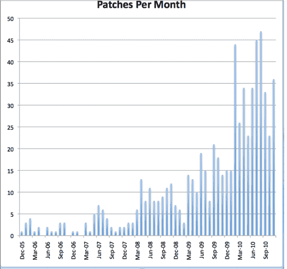
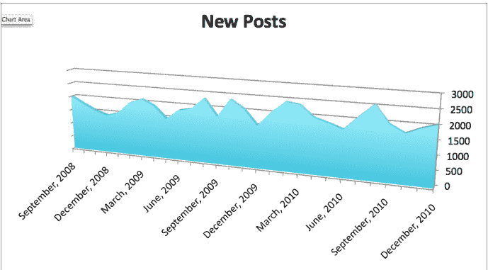
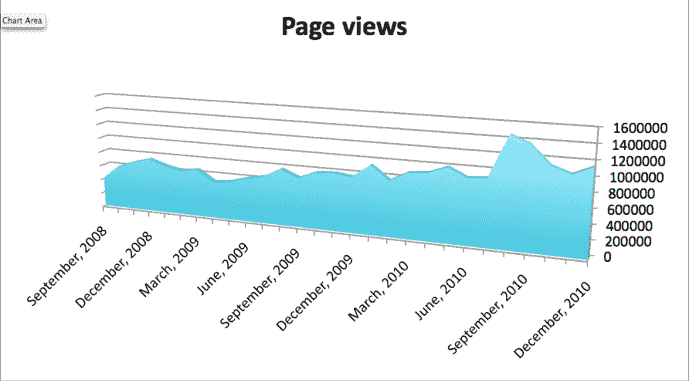

# 1 使用 CiviCRM 实现您的使命

在非营利部门工作的大多数人都会希望自己的组织能够用现有的员工和志愿者资源做更多的事情。我们经常对自己的工作充满热情，但 lament 我们不得不以浪费的方式做事。浪费的时间，浪费的金钱，浪费的联系人，浪费的机会！我们厌倦了对现状感到沮丧。我们想要有所改变，更大的改变。

### 为什么您的组织需要关系管理

如果您的组织制定并执行了完善的关系管理 CRM 策略，将更好地实现其使命。如果您像大多数非营利、倡导和会员制组织一样，CiviCRM 是实现成功的最佳工具。

您的组织是否缺乏用于管理联系人的集成系统？这是非营利组织的常见问题，无论大小，组织程度如何。您能否在以下任何一种情况中认出您的组织？

- 贵办公室的人是否都有自己用于筹款、志愿工作或邮件合并的个人 Excel 联系人表？
- 您是否有一个用于在线新闻通讯电子邮件订阅者的系统，另一个在线系统记录参加过您活动的个人，另一个包含调查回复的系统，以及一个用于节日贺卡标签的桌面系统？

### 什么是关系管理

关系管理是用于启动和改善与利益相关者关系的一套流程和支持技术。重要的是要认识到，CRM 不仅仅是引入组织的某种技术。与利益相关者管理关系涉及组织为实现其使命而做的事情所使用的所有工作流程、流程和报告，以及随后展示其使命实现程度的方式。

*利益相关者*关系管理是非营利领域中商业世界*客户*关系管理的等价物。通过比较和对比这两个概念，我们将更好地理解本书的目的和范围。

### 客户关系管理与利益相关者关系管理

在商业世界中，客户关系管理系统用于通过将资源集中在可能购买的人身上来优化公司的销售。它们还用于通过提供自助服务选项来提高客户满意度并降低成本。

为了正确做到这一点，这些系统跟踪、自动化和个性化所有通信渠道中客户交互的各个方面，包括网站、电话、店内、电子邮件和社交媒体，如 Twitter、论坛和博客。每当客户以任何方式与组织接触时，交互都会被记录下来。这些信息用于更好地了解与客户的关系，并确保所有交互都是从一个角度设计的，即最大化客户对企业的长期盈利能力。通常，客户关系管理系统侧重于跟踪和增强营销和销售漏斗工作流程中新客户和回头客的客户交互，并改善售后支持。根据行业和公司，CRM 系统和技术也可能用于跟踪和增强与其他利益相关者的关系，例如监管机构、股东或媒体。

## 使用 CiviCRM 实现您的使命

商业世界中为客户关系管理系统开发的理念已根据非营利世界的需求改编为关系管理系统。虽然增加的捐赠与更高的业务销售额相平行，但在术语和流程上存在细微但重大的差异。例如，良好的关系管理系统旨在核算承诺、定期捐赠、软额捐赠以及票价中符合政治或慈善税收收据的部分。媒体、董事会成员和资助基金会等非营利利益相关者的关系也可能通过关系管理系统进行管理。

非营利组织除了增加收入和降低成本之外，还有额外的关键非货币成功衡量标准。这些可能包括教育、服务、倡导，或与非营利使命相关的其他成果。非营利 CRM 可能需要跟踪此类一条或多条非货币目标。例如，除了希望增加捐赠以支持其使命外，一个倡导组织可能希望其 CRM 帮助其实现影响立法者或选民的目标，通过撰写更多读者来信、电子邮件、拜访立法者或转发给朋友等方式。同样，一个直接服务非营利组织可能旨在利用其 CRM 系统的案例管理功能改善其客户案例的结果，或一名立法者可能旨在帮助更多选民获取政府资源。

尽管存在这些差异，*利益相关者关系管理*系统与*客户关系管理*系统在旨在支持组织联系人数量和参与度的增长方面是相似的。

在商业世界中，这通常是通过让现有客户满意来避免高昂的客户获取成本来实现的。在非营利世界中，类似的策略和技术也适用，因为获取新捐赠者、活动人士、志愿者或会员的成本通常高于保留现有者。

商业中的一个良好总体策略是旨在增加其现有客户带来的业务量。例如，这可以通过识别潜在买家并更好地与他们沟通为何他们想要更昂贵的产品来实现，即向上销售，或为何他们想要额外的相关产品，即交叉销售。也可通过专注于增加客户更频繁地返回购买相同产品的重复业务来实现，例如更频繁地观看电影。

非营利组织从这一策略中受益，无论是在筹款还是非货币呼吁方面。筹款人旨在增加捐赠者的近期性，即每个捐赠者最近一次捐赠的时间，频率和礼物金额。

对于非货币性捐助，非营利组织通过关注增加现有行动者采取行动的数量而受益，例如发送的呼吁、参加的教育项目，或自愿探访的居家者。他们还受益于让他们承担需要更多合作且产生更大影响的行动，例如在签署请愿书之外还拨打热线节目，或在给民选代表写信之外还拜访他们，等等。

增加互动的数量和深度通常涉及针对具有共同特征的客户，例如那些最近进行了几次低成本购买或为特殊待遇（如优惠、特别请求或其他后续沟通）做出小额捐赠的人。

另一个目标可能是确保最适合某产品或服务的人在与公司互动时获得极佳的体验，以至于他们会向他人推荐。

在营利部门，这可能涉及销售人员或系统根据个人或公司的购买历史做出更合适的回应，提供适当的折扣、交叉销售或追加销售建议等。例如，长期客户在访问网站时可能会获得折扣，电脑买家在结账时可能会被提供小件商品，包括为之前购买的游戏系统提供的游戏，或做出过高端购买的客户可能会获得更昂贵的商品系列。售后支持人员将获得个人为解决问题所做尝试的完整记录，这通常有助于缩小问题范围并避免令人恼火的重复操作请求。完整的客户记录可能显示，一个有棘手问题的人正在考虑重大购买，或他们曾有对产品进行未经授权的技术更改的历史，这可能损害其功能并使保修失效。

在非营利世界中，其对应做法可能是鼓励：
- 定期参加活动的参与者以折扣价参加即将举行的早餐研讨会
- 签署请愿书的用户做出捐赠
- 过去一年志愿服务超过两次的人考虑成为董事会成员

同样，技术支持在非营利案例管理中也有对应之处。想象一下，一家为“高风险”青少年服务的非营利组织，如果能够轻松调出一位因抑郁而致电的人的记录，而这些记录显示该来电者有自杀未遂的历史，将会受益多少。

在上述所有商业和非营利示例中，一个只有一名工作人员服务少量客户的微型组织将难以识别个人、记住与其互动的历史，并通过提供折扣等做出适当反应。更困难的挑战包括致电已停止来访的人、为需要帮助的人付出额外努力，或削减与组织使命无关的关系所投入的资源。技术有助于将这些适当的行为扩展到许多工作人员和志愿者参与与客户或顾客互动的情况。它可以在某些工作人员或志愿者记忆力不佳，且可能缺乏对如何应对情况做出最佳判断时提供帮助。

## 你的利益相关者是谁？

到目前为止，我们假设你对利益相关者有清晰的概念，但值得花时间为你的组织明确定义这一点。利益相关者是指与你的组织有某种关系的人、家庭或组织。根据你的组织，这可能包括：
- 捐赠者
- 资助者
- 你寻求接触、教育或影响的民选官员
- 新闻通讯订阅者
- 电子新闻通讯和行动警报订阅者
- 你的组织成员
- 联盟成员
- 参与你的请愿、电子邮件和写信活动的参与者
- 参与你面对面活动的参与者
- 志愿者
- 客户
- 网站访问者
- 董事会成员
- 员工
- 组织或个人，他们不是员工，但帮助你提供项目和服务（例如，为公益法律服务诊所提供志愿服务的律师）
- 你的产品或服务的用户或购买者
- 你联系的媒体机构和/或人员
- 你的组织、其活动或出版物的广告商或赞助商
- 影响你的组织的政策的政府机构

在某些情况下，你与一个利益相关者的关系可能需要通过另一个人来建立。例如，父母可能是为孩子报名参加项目的利益相关者，或员工可能是其所在组织的联系人。

你的组织需要关注哪些利益相关者——个人捐赠者、志愿者、资助机构、新闻通讯订阅者——取决于你的使命和情况。通常要记住的是，一个人往往戴着多顶帽子，可能属于多个利益相关者类别。

当利益相关者能够理解收集信息的原因，并且提供信息是有意义时，收集关系信息通常很有效。例如，解释在捐赠时需要邮寄地址以提供慈善税收收据，仅在有人购买晚餐票时询问饮食偏好，或在订阅新闻通讯时请求政策兴趣，有助于减轻每次互动的负担，并使关系的深化更自然。

在设计你的 CRM 策略时，你需要平衡拥有与利益相关者关系信息的收益与获取、维护和使用它的成本。随着策略的发展，你应确保其专注于收集有助于组织有效行动的数据，并知道其在最重要的利益相关者关系中有效行动，这些关系对于实现其使命至关重要。这些通常是与组织有最多交易性接触的利益相关者——捐赠者、志愿者、会员、活动参与者等。然而，有时，少数利益相关者可以提供突破性价值——改变游戏规则的、质的提升。例如，投资一些研究并争取几位关键媒体联系人、潜在联盟伙伴或摇摆立法者，可能比在其他层面上在数量和效率上取得巨大进展更有助于组织实现其使命。

## 何时 CiviCRM 是最佳 CRM？

到目前为止，我们已笼统讨论了 CRM，比较了它们在商业世界与非营利部门的使用方式。然而，实施 CRM 有许多选择，那么何时 CiviCRM 是最佳 CRM？CiviCRM 对于需要处理大量联系数据的组织来说很棒，尤其是那些希望使用为常见非营利交易用例预先构建的复杂功能的人，包括以下内容：
- 捐赠和承诺
- 活动管理
- 会员管理
- 案例管理
- 批量电子邮件

如果你的组织需要在这些领域的几个方面具备功能，那么你很可能将从 CiviCRM 中受益。CiviCRM 与 Joomla! 和 Drupal（流行的开源内容管理系统，非常适合运行你的网站）的集成也使其区别于许多竞争对手的 CRM。

我们将解释 CiviCRM 在非营利技术用户调查中表现优异的诸多原因。尽管如此，我们仍想提前承认，CiviCRM 并不是每个非营利组织管理其利益相关者关系的合适工具。这取决于你的需求和资源，这可能使其过大或过小，功能过于丰富，或不够灵活或强大。本节提供了一些一般性指导，说明在何种情况下你可能想要考虑 CiviCRM 的替代方案。我们倾向于排除一些案例，因为人们可以并且已经成功且愉快地使用 CiviCRM，而不是包含那些人们的期望可能无法得到满足和超越的案例。

作为低端门槛，你的组织需要有资源来设置、托管和维护 CiviCRM，要么通过支付托管提供商和顾问，要么使用内部员工资源。没有预算或 IT 资源的小型社区团体将无法承担这些成本，即使 CiviCRM 是免费的开源软件，没有任何前期或持续的许可费用。虽然面向公众的页面易于使用，但管理 CRM 也需要一定的技术熟练度来构建搜索、设置将与联系数据合并用于电子邮件群发的模板、决定在表单上放置哪些字段等类似活动。更高级的技能对于某些初始设置任务是必要的，例如配置电子商务连接以连接到支付处理商，以及设计如何在表示联系人、其捐赠、活动参与、会员资格、与其他联系人的关系等的字段中存储信息等。并非所有组织在内部都有这些技能，或能负担外包。

## 权衡各种替代方案

如果贵组织不需要超过一种类型的 CRM 功能，尤其是如果该方面的需求很简单，那么使用单一用途的工具可能更好，无论是免费的、购买的，还是通过付费订阅提供的。最佳的单一用途工具可以提供卓越的可用性、理想的灵活性、更低的成本、更低的管理负担，以及针对该特定功能的更高端特性。Google、Yahoo! 以及众多提供免费群组电子邮件广播和讨论软件的提供商就是一个例子。Eventbrite 是活动管理领域的例子；像 ExactTarget 这样的电子邮件管理系统对于批量邮件来说是很好的。许多单一用途工具已在其他领域构建了一些功能，但主要集中在一个领域。相比之下，CiviCRM 在这些大多数功能领域都非常出色。其在非营利组织、倡导组织和会员制组织所需的许多领域中的卓越能力，通常使其优于具有中等 CRM 功能的竞争对手。

许多组织的弊端在于，他们开始使用其中一项服务来满足一种需求，然后为不同领域的需求采用第二项服务，很快就会出现多个数据孤岛、系统无法相互通信，或复杂的数据同步协议和问题。此时迁移到 CiviCRM 很常见，但迁移和工具及流程变更带来的额外麻烦可以通过从一开始就选择 CiviCRM 来避免。

另一种类型的难题困扰着那些具有显著且定义明确的需求的组织，而这些需求无法通过开箱即用的 CiviCRM 或通过配置来满足。在这些情况下，问题通常是在内部构建应用程序和获取像 CiviCRM 这样的外部开发的应用程序来完成工作之间做出选择。在这些场景中的许多情况下，以 CiviCRM 为基础的定制解决方案是有意义的。其中一些具体列出如下：

- 当所开发的功能将被集成到核心中时（即每个人下载的 CiviCRM 软件），类似于为不列颠哥伦比亚省医师健康计划开发的案例管理功能
- 当你拥有解码用于构建 CiviCRM 的各种技术的技能，或有预算聘请能够做到这一点的人时
- 当你愿意在更通用和可定制的软件上初期投入更多，以换取其他用户报告错误、改进文档、提交补丁并增强你所贡献的功能的服务时
- 当你能有效地与核心团队和社区合作时，这通常需要更多的时间和愿意考虑其他观点和利益的意愿，这通常包括他人分担开发成本的好处

有一些场景，使用 CiviCRM 作为定制解决方案的基础并不合理。例如，在 Drupal 或其他 CMS 中构建单个 CRM 功能可能更便宜、更简单，特别是如果你不需要 CiviCRM 的其余功能时。

构建功能到成熟的 CRM 中的强大优势有时也需要与扩展 CiviCRM 的高成本相平衡。它是用 PHP、Smarty 模板以及 jQuery 等其他技术编程的，使用企业导向的 n 层架构。库和技术的多样性以及代码库的大小为希望修改或扩展 CiviCRM 团队分发和维护的软件的开发人员带来了障碍。与在 Drupal 等快速应用开发框架中构建相同的定制功能相比，在 CiviCRM 项目中开发通常会导致更长的时间框架、更高的成本，以及在开发和维护人员来源方面更大的困难。

虽然让你的组织重新实现 CiviCRM 功能可能没有意义，但扩展 CiviCRM 使用 Drupal 模块（或也许是 Joomla! 扩展）通常是有意义的，特别是考虑到可用于自定义内容、视图和访问控制的各种现有 Drupal 集成模块。值得注意的是，CiviCRM 功能的几个领域最初是作为 Drupal 模块开发的。然后，随着用例变得更清晰以及与其他 CiviCRM 功能集成的需求增长，它们被重新实现在 CiviCRM 本身内部。

CiviCRM 是一个开源项目，对社区需求和为解决其当前未涵盖的领域而做出的贡献反应迅速。事实上，该项目通常通过与能够赞助新功能或将新功能贡献回来的组织密切合作来扩展其功能。与其仅为自己的实现而 hack 核心，你可以改进核心代码，使其满足你自己的需求以及具有类似需求的其他人的需求。

如果你搜索 CiviCRM wiki（http://wiki.civicrm.org）和论坛（http://forum.civicrm.org），并通过论坛与核心团队和社区沟通，你可能会发现有其他人对相同的功能感兴趣，并且可能能够为其构建做出贡献。即使你的需求是独特的，也可能有方法将其概括化，以便可以用同时满足他人需求的软件来满足。2010 年秋季的 Make It Happen 倡议取得了一些早期成功，该倡议帮助汇总了许多用户和顾问对几个新功能块的支持。

或者，你的论坛帖子可能会导致提出简单或巧妙的变通方法建议，这些方法足以解决阻碍你的组织采用 CiviCRM 的需求中的异常情况。

虽然保持你自己的代码与核心更改同步的负担是显著的，但资源充足的组织有时会发现，最合理的做法是开发包含不与社区共享的功能的开源软件的定制版本。通常，这是因为需求非常独特，例如与定制的内部遗留应用程序集成。

## 其他 CRM

在决定 CRM 工具时，有许多现有的 CRM 供应可供考虑。非营利技术网络（http://NTEN.org）定期调查非营利部门的技术使用情况并发布结果。尽管他们主要关注北美非营利组织，但他们提供了对这一庞大且有影响力的地区中常见解决方案的 CRM 市场渗透率和用户满意度的良好指标。

CiviCRM、Salesforce 和 Convio 是最近调查中最常用的三个系统。其他在这些调查中广泛使用或可接受评级的提供商或工具包括 Antharia、Blackbaud、SugarCRM、Kintera Sphere、DemocracyInAction 和 Organizer's Database。尽管成本和功能差异很大，AmDocs 和 Microsoft CRM 是非营利部门中其他值得注意的 CRM 系统，而 Salsa 有时从其对中小型企业的关注中跨界而来。

从一个使用 CRM 的组织到另一个组织的需求各不相同。这会影响哪个 CRM 最适合他们。例如，Salesforce 一直倾向于在大型组织（预算超过 300 万美元的组织）中表现更好，尽管 2011 年的 CiviAccount 增强可能会改变这一点。当你为你的组织评估 CRM 工具时，你应考虑组织当前和预期的需求，以及可能 CRM 的当前和预期功能。鉴于此警告，下一个部分将概述采用 CiviCRM 而非其他替代方案的常见原因。

## 为什么选择 CiviCRM？

每个组织都应使用适合其特定需求的标准自行评估 CRM 选项，适当权衡以提供正确的整体平衡。本节总结了 CiviCRM 为何适合许多非营利、倡导和会员制组织的几个原因。

## 专注于非营利组织的需求

最重要的是，CiviCRM 与其他竞争程序的不同之处在于，它专为非营利组织的需求而设计，并提供了一个高度集成的平台，满足其所有基本需求。这避免或减轻了为捐款、电子邮件、活动和会员资格等运行独立系统，或试图以编程方式集成它们所带来的复杂性、问题、时间和费用。

CiviCRM 非常适合满足各种类型和规模组织的需求：

- 非营利组织
- 非政府组织
- 政府机构和民选代表办公室
- 会员制组织
- 倡导组织
- 资助组织
- 服务提供组织
- 社区协会
- 政治竞选活动和组织
- 商业协会
- 政府实体
- 工会
- 体育俱乐部
- 舞蹈工作室

许多 CRM 都是围绕营利性企业的常见工作流程构建的，而这些流程并不总能很好地映射到非营利领域。例如，销售漏斗模型和销售自动化背后的术语，可能无法很好地映射到提高认知度活动的场景中。像 Convio Common Ground 对 Salesforce 所做的那样，替换一些术语并增加一些非营利特定的内容，并不总能解决底层模型的问题。

## 用户满意度

NTEN 2007 年 CRM 满意度调查得出了以下结果：

> 在所有组织中最常用的三个系统——CiviCRM、Salesforce 和 Convio——在推荐意愿方面分别排名第一、第二和第六。

NTEN 2009 年数据生态系统调查进一步证实了这一结果，发现各组织的整体满意度相似，排名前三的工具 CiviCRM、Salesforce 和 Convio 分别获得 B+、B 和 B- 的评级。

## 无供应商锁定

许多专有 CRM 的一个重大问题在于，组织在迁移到其他供应商时会面临困难。作为一个免费开源软件系统，CiviCRM 始终允许使用它的组织在需要迁移到其他系统时导出自己的数据。直接访问和处理数据以进行定制、高级数据库查询、数据迁移等的能力往往非常重要。

一些专有系统仅由单一供应商提供。服务中断、帮助响应时间过长或不实用的技术支持响应，可能会让您的组织别无选择，只能为了应对供应商问题而切换至另一款 CRM。相比之下，CiviCRM 日益壮大的集成商、培训师和顾问群体（http://civicrm.org/professional）使组织能够在无需更换 CRM 的情况下从一个服务提供商转移到另一个。

与某些专有系统不同，CiviCRM 不存在供应商锁定问题。

## 与 Drupal 和 Joomla! 的集成

Drupal 和 Joomla! 是非营利领域常用的 CMS（内容管理系统）。CiviCRM 与两者都能很好地集成。这一点很重要，因为它能让您的 CRM 轻松地在网上展示面向公众或员工的表单和列表。捐款和活动报名表单的轻松配置，以及会员注册和续费的自主服务功能，对许多组织来说都非常重要。

每个内容管理系统提供的功能之间存在显著差异。其中对 CiviCRM 来说最显著的是，与 Drupal 集成时，它拥有更高级的访问控制功能，以及更灵活的内容再利用能力。

Drupal 作为开发定制网站的框架，尤其是它能够将众多现有模块的数据和功能整合在一起，可以利用 CiviCRM 对重要核心模块和贡献模块的大量且不断增长的支持。这包括在 Views 中展示 CiviCRM 数据、用于 CiviCRM 联系人的 Drupal 6 CCK 字段，以及以各种方式同步角色、组、会员资格和有机组。这使得您网站上的用户权限、电子邮件特权、会员状态、小组协作空间以及表达的主题兴趣，能够以有趣且有用的方式进行组合搭配。

在 Joomla! 方面，可用的扩展列表不断增加，这些扩展利用 CiviCRM 资源在模块中显示内容，限制内容编写的访问权限，并根据会员资格状态控制用户身份验证和账户创建。

在这两种情况下，CiviCRM 都能让您利用强大的开源内容管理系统，将联系人数据库直接集成到组织的网站中。CiviCRM 一直紧跟两大 CMS 的发展步伐，而且种种迹象表明，随着 CiviCRM 4.0 对 Drupal 7 和 Joomla! 1.6 的支持，这种集成将继续并深化。

## 总成本

“免费开源软件就像小猫一样免费，而不像免费啤酒一样免费”这句常言同样适用于 CiviCRM。软件系统的总拥有成本是决定哪种方案更合适的重要指标。像 CiviCRM 这类开源软件的成本与专有系统不同。没有前期购买成本并不意味着结束。还需要计算系统整个生命周期内的维护成本。除了一次性购买成本或年度/月度软件许可费用外，还可能在安装、培训和支持方面产生额外支出。根据组织的 CRM 需求、CRM 用户数量和员工能力，CiviCRM 可能比其他替代方案更便宜，有时甚至便宜得多。

## 动态开源开发

“免费开源软件”中的“免费”主要指修改软件以满足自身需求的自由（参见 http://wiki.civicrm.org/confluence/display/CRM/Developing+with+the+CiviCRM+team）。对于许多拥有资源、但无法让专有系统按自己的要求进行定制，或不愿让其他组织主导其企业 CRM 系统功能开发路线图和时间表的组织来说，这无疑是一个优势。

CiviCRM 拥有一个强大且不断壮大的开源社区和软件生态系统。2010 年，CiviCRM 平均每月下载量超过 8,000 次。自 2.0 版本以来，安装次数已超过 12,000 次，2010 年秋季约有 3,000 个活跃的 CiviCRM 安装（见下图，该图统计了在一个月内更改或审查过管理设置的大多数网站）。请注意，2.0 期间的表面增长被大大夸大了，因为无法反映从早期版本升级的情况。还要注意，活跃网站的数量并非直接测量；因此，在升级期间，由于新旧网站都被计数，会出现峰值，而且系统可用性和管理便捷性的持续改进可能会增加活跃网站的数量，但下图中并未计入这些网站：

在开发投入方面，2010 年秋季有超过 90 名个人和顾问捐赠支持 CiviCRM 的改进。除了这些 **Make It Happen** 贡献外，社区还通过为新功能提供代码补丁等方式贡献了大量力量，论坛建议也促成了主要的新功能，包括：

- BC 医生健康计划
- 前线国际人权捍卫者基金会
- 大曼彻斯特志愿组织中心
- 国际山地自行车协会
- 美国公共利益研究集团
- Quest 学者计划
- Alpha 国际
- 纽约州参议院
- 进步技术项目

多年来，社区报告的问题和提交的补丁数量显著增加。

虽然有些人可能认为社区报告更多问题是个麻烦（人们发现产品有缺陷），但从另一个角度来看，这非常健康。例如，最近一次社区问题激增发生在 3.0 大版本发布之前的 alpha 和 beta 测试期间。社区成员被鼓励下载、安装和测试预生产版本，以便在新版本发布前提供有关功能、可用性、升级便捷性以及缺陷的反馈。这一举措非常成功，并导致提交的补丁数量激增，如下图所示，使该版本变得更好、缺陷更少。2010 年期间，他们一直努力让顾问和资源更充足的用户贡献补丁，以便核心团队专注于新版本的增强功能。

2010 年，论坛每月新增帖子超过 2,000 篇，延续了该指标此前数年的逐步增长趋势。

这些相关的全新内容支撑了页面浏览量的稳定且更大的增长，如下图所示：

CiviCRM 与许多其他开源项目相比的一个独特之处在于，存在一个全职从事项目开发的核心开发团队。虽然社区参与是项目健康状况的良好标志，但核心开发团队的存在确保了稳定的发布、积极规划的项目路线图，以及更及时的错误修复和用户支持。

## 文档

可在 http://wiki.civicrm.org 获取的详尽管理员、用户和开发者文档会在 CiviCRM 每个版本发布前进行更新。此外，《Understanding CiviCRM: A Comprehensive Guide》可在 http://en.flossmanuals.net/civicrm 免费获取。经常在出现问题时，其他人也曾尝试解决同样的挑战，关于他们如何获得帮助解决问题的记录，可通过在 http://forum.civicrm.org 的社区论坛中搜索找到。

## 响应式的社区支持

与专有软件相比，一些开源软件用户面临的挑战之一是难以保证在需要时能够获得支持。除了前面提到的众多专业 CiviCRM 顾问提供的付费支持服务外，CiviCRM 社区和核心团队以在论坛中对问题快速且慷慨地回复而闻名。对于在 CiviCRM 中进行开发的人员，还有一个 #civicrm irc 频道位于 http://freenode.net，在那里通常可以找到核心团队和其他有知识的社区成员对更具挑战性的询问做出回应。

## CiviCRM 将如何帮助您的组织

良好的 CRM 实施能够促进更好的成果并改善与利益相关者的关系，例如捐赠和志愿者时间的增加。它还能提高员工效率并自动化工作流程，减少与利益相关者互动的平均成本和时间。这使您和您的组织能够做得更多。CiviCRM 将通过以下各种功能改善您的利益相关者与您组织的联系，包括：

- 更简便的在线活动注册
- 自助式会员续费
- 整个合格员工均可访问的更完整的互动历史记录
- 案例管理的自动化工作流程改进
- 个性化电子邮件
- 反垃圾邮件选项以确保所有电子邮件通信均基于许可
