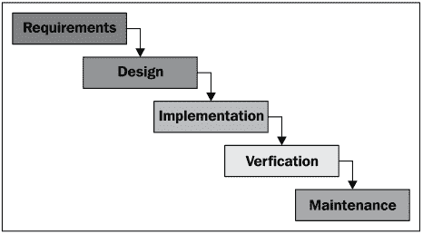
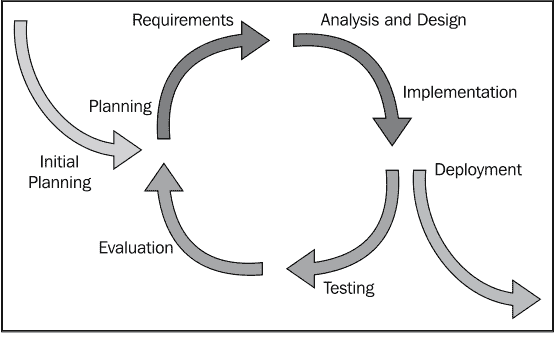

# 第2章：实施方法论
规划您的 CRM 实施

因此，您认为您的组织将借助 CiviCRM 更好地实现其使命。本章将帮助您规划 CiviCRM 的实施，以便您的 CRM 计划有最佳机会实现更大的组织成功。

在本章中，我们将执行以下操作：

- 识别成功的潜在障碍并学习如何克服它们
- 选择合适的开发方法
- 组建平衡的团队
- 通过衡量基线指标、创建愿景和制定计划开始
- 首先将您的 CRM 战略聚焦于您的利益相关者和使命，然后再聚焦于运营效率
- 审查收集需求的有效方式
- 识别 CiviCRM 功能主要领域中每个领域需要检查的特定类型需求
- 列出良好的实施计划的要素
- 审查如何计算 CRM 系统及其替代方案的总拥有成本
- 为成功做好规划

本章面向负责启动、确定范围和管理 CRM 战略的开发和实施的人员。本章的初始部分尤其以管理为导向。关于改善利益相关者关系的材料通常是非技术性的，并且不特定于 CiviCRM。我们撰写它主要是针对中型和大型组织的执行官、董事和经理。小型组织的人员也应受益，即使他们可能需要缩小建议规模。对于技术人员和/或没有管理或执行责任的读者，本节应为您的工作提供良好的背景，并可能帮助您为没有 CRM 战略开发和实施经验的管理人员和执行官提供建议。

本章后半部分重点关注识别您组织在通信、会员、筹款和活动等不同领域的 CRM 功能需求。这些部分旨在帮助头脑风暴技术，这些技术可能是您组织整体 CRM 战略的一部分。虽然这些领域的执行官和经理负责决定他们将使用哪些技术，但希望从他们那里获取需求的技术人员将找到大量建议性问题。

当然，您可能是一个半技术人员，正在尝试解决一个由三名员工组成的小型非营利组织的数据库问题。如果这听起来更像您的情况，那么本章的初始部分可能会提供您希望达到的目标的灵感，而后半部分将提供有用的想法和建议，这些想法和建议在您规划工作时将更直接、更实用。

如果您已经在内部运行 CiviCRM 或其他 CRM，但没有 CRM 战略，现在开始采用更系统的方法也不算晚。以下步骤可用于规划重新振兴和重新聚焦您组织内 CRM 的使用，而不仅仅是规划首次实施。

## 成功的障碍

利益相关者关系管理计划可能很困难。在最佳情况下，它们涉及改变外部关系和内部流程和工具。在外部，利益相关者对您组织的体验需要改变，以便提供更多价值和更少的参与障碍。在内部，业务流程和支持的技术系统需要改变，以便打破部门运营的壁垒、提高效率、实现更有效的定位、改善响应能力并开展新举措。CRM 项目的成功往往取决于改变组织内个人行为和态度，并替换、更改和/或整合组织内使用的许多 IT 系统。

- **过度定制，导致：**
  - 系统成本飙升
  - 基础功能中包含的最佳实践在某些情况下被覆盖
  - 用户表单变得过于复杂
  - 用户体验变得令人反感
- **没有应对与开发、扩展和/或集成 CRM 软件系统相关的技术挑战的策略，导致：**
  - 成本超支
  - 设计和构建的软件质量低下
  - 用户体验不佳
  - 数据不完整或无效

然而，这并不意味着项目失败是不可避免的或常见的。这些明显可识别的失败原因可以通过有效的项目规划来克服。

## 完美是好的敌人

CRM 系统及其功能组件，如筹款、票务销售、与订阅者和其它利益相关者的沟通、会员管理以及案例管理，对于大多数非营利组织的核心运营至关重要。这可能导致在更改它们时出现项目失败的合理恐惧。然而，这种恐惧很容易造成完美主义心态，项目团队试图通过创建过多的监督、过多的应急计划和过多的项目发现时间来过度补偿，以避免遗漏任何可能集成到项目中的潜在有用功能。虽然规划是好的，但完美可能并不好，因为完美往往是好的敌人。

CRM 实施有风险地偏向于人们戏称的 MIT 方法。MIT 方法相信，并试图从一开始就设计、构建和部署“正确的事情”。其大局观的问题解决方法导致设计上的正确性、完整性和一致性。它更重视用户界面的简洁性而非实现设计的简洁性。光谱的另一端则被“少即是多”、“KISS”（Keep it simple, stupid，即保持简单）和“Worse is Better”等格言所概括。这种替代观点愿意接受设计上偏离正确性、完整性和一致性，以换取整体简洁性，或实现简洁性优于用户界面简洁性。之所以出现这种反直觉的解决方案开发方法并受到尊重和欢迎，是因为从一开始就力求完美所可能导致的问题和失败。

Neither end of the spectrum is healthier. Handcuffing the project to an unattainable standard of perfection, or over-simplifying in order to artificially reduce complexity will both lead to project failure.

There is no perfect antidote to these two extremes. As a project manager it will be your responsibility to set the tone, determine priorities, and plan the implementation and development process. Although it is not a perspective on project management, one rule that will help achieve balance and move the project forward is "Release early, release often." This is commonly embraced in the open source community where collaboration is essential to success. This motto:

- Captures the intent of catching errors earlier
- Allows users to capture value from the system sooner
- Allows users to better imagine and articulate what the software should do through ongoing use and interaction with a working system early in the process

## Development methodologies

Whatever approach your organization decides to take for developing and implementing its CRM strategy, it's usually good to have an agreed upon process and methodology. Your processes define the steps to be taken as you implement the project. Your methodology defines the rules for the process, that is, the methods to be used throughout the course of the project. The spirit of the problem solving approaches just reviewed can be seen in the **Traditional Waterfall Development** model and in the contrasting **Iterative and Incremental Development** model.

> Projects naturally change and evolve over time. You may find that you embrace one of these methodologies for initial implementation, and then migrate to a different method or mixed-method for maintenance and future development work. By no means should you feel restricted by the definitions provided, but rather adjust the principles to meet your changing needs throughout the course of the project. That being said, it's important that your team understands the project rules at a given point in time, so that the project management principles are respected.

### The conventional Waterfall Development methodology

The traditional Waterfall method of software development is sometimes thought of as "big design upfront". It employs a sequential approach to development, moving from needs analysis and requirements, to architectural and user experience, detailed design, implementation, integration, testing, deployment, and maintenance. The output of each step or phase flows downward, like water, to the next step in the process, as illustrated by the arrows in the following figure:

The Waterfall model tends to be more formal, more planned, includes more documentation, and often has a stronger division of labor. This methodology benefits from having clear, linear, and progressive development steps in which each phase builds upon the previous one. However, it can suffer from inflexibility if used too rigidly. For example, if during the verification and quality assurance phase, you realize a significant functionality gap resulting from incorrect (or changing) specification requirements, then it may be difficult to interject those new needs into the process. The "release early, release often" iterative principle mentioned earlier can help overcome that inflexibility. If the overall process is kept tight and the development window short, you can justify delaying the new functionality or corrective specifications for the next release.

### Iterative development methodology

Iterative development models depart from this structure by breaking the work up into chunks that can be developed and delivered separately. The Waterfall process is used in each phase or segment of the project, but the overall project structure is not necessarily held to the same rigid process. As one moves farther away from the Waterfall approach, there is a greater emphasis on evaluating incrementally delivered pieces of the solution, and incorporating feedback on what has already been developed into the planning of future work, as illustrated in the loop in the following figure:

This methodology seeks to take what is good in the traditional Waterfall approach — structure, clearly-defined linear steps, a strong development/quality assurance/roll out process — and improve it through shorter development cycles that are centered on smaller segments of the overall project. Perhaps the biggest challenge in this model is the project management role, as it may result in many moving pieces that must be tightly coordinated in order to release the final working product.

### Agile development methodology

Agile development methodologies are an effective derivative of the iterative development model that moves one step further away from the Waterfall model. They are characterized by requirements and solutions evolving together, requiring work teams to be drawn from all the relevant parts of the organization. They organize themselves to work in rapid one to four-week iteration cycles. Agile centers on time-based release cycles, and in this way, differs from the other methodologies discussed, which are oriented more toward functionality-based releases.

The following figure illustrates the implementation of an Agile methodology that highlights short daily Scrum status meetings, a product backlog containing features or user stories for each iteration, and a sprint backlog containing revisable and re-prioritizable work items for the team during the current iteration.

## 敏捷开发方法

金工实习是机械类专业学生必修的实践课程，安全操作是保证实习顺利进行的前提。本培训材料旨在帮助同学们了解金工实习中常见的安全隐患及应对措施，牢固树立安全意识。

### 一、经典安全事故案例

以下是实习过程中曾发生过的典型案例，希望能引起大家的高度警惕：

- 1. **手套卷入事故**：某学生在操作车床时未严格遵守规程，戴手套进行旋转件加工，手套瞬间被卷入主轴，导致手指严重受伤。
- 2. **铁屑飞溅伤人**：某学生在未佩戴护目镜的情况下进行铣削作业，高速飞出的铁屑击伤眼部，造成视力永久损伤。
- 3. **触电事故**：某学生在检查电气设备时，因手部潮湿且未关闭电源，导致触电，幸得同学及时切断电源，避免更严重后果。
- 4. **焊接灼伤**：某学生在进行电弧焊操作时未正确使用面罩，弧光灼伤面部，造成皮肤脱落。

### 二、金工实习安全操作规程

进入车间必须穿戴好规定的防护用品，严禁穿拖鞋、凉鞋、高跟鞋，女生必须戴好工作帽，长发不得外露。

- 1. **防护用品穿戴规范**：必须穿工作服，袖口扎紧，戴好安全帽及护目镜。
- 2. **设备检查与维护**：操作前检查设备防护装置、夹具及砂轮等是否完好，确认无误后方可操作。
- 3. **规范操作流程**：严禁用手或棉纱直接清理铁屑，应使用专用工具；操作旋转机床时严禁戴手套。
- 4. **用电安全**：电器发生故障时不得私自检修，应拉闸断电并报告指导老师。
- 5. **防火安全**：易燃物品应远离热源，焊接区域周围不得放置易燃物，消防器材存放位置必须熟悉。
- 6. **实习纪律**：实习期间严禁追逐打闹，不得擅离工作岗位，不得私自操作未经允许的设备。

> 安全无小事，责任重于山。多一点安全意识，少一分生命危险。

FPAGM envisions a community where no one suffers from hunger. Its mission is to provide cost-effective shared services to food pantries in the region. Operationally, FPAGM does the following:

- Provides wholesale food pickup from business donors, storage at a depot, and regular delivery of needed supplies to pantries
- Shares best practices amongst food pantries and food pantry donors
- Begins assisting pantries in dealing with problematic individuals who abuse the system or staff
- Represents the concerns of the pantries to local and state advocacy efforts, often by undertaking research and developing policy submissions

The FPAGM Board of Directors consists of four officers and five members-at-large. Your boss, the Executive Director, oversees the work of five full-time staff. In addition, the organization receives regular volunteer support to assist with daily operations.

As before, most staff resources are taken up with providing food distribution services for the pantries. Affiliate members and other food providers contact the FPAGM when they have surplus food available for pickup. The association owns three vans for transporting food from the providers to a warehouse attached to the FPAGM offices, and then distributing it to the pantries.

The FPAGM staff also handles distribution. The pantries place requests for food and the costs (measured by weight) are tracked against their accounts.

This system allows the pantries in the region to focus on providing food and services to clients, poor members of the community, without much need to identify food supply sources. The association also benefits from economies of scale, particularly with warehouse space, staff, and vehicles required to distribute food to the pantries.

The association hosts two training events and an annual conference that draws attendees from the entire state who are involved in food pantry support.

## 合理配置流程

确保你为 CRM 计划所采用的流程和方法适合组织的文化和规模、现有系统的复杂性以及 CRM 工作的规模非常重要。将流程“合理配置”以满足你的需求这一目标至关重要，无论是对你作为项目经理/决策者而言，还是对你在流程中聘请的任何顾问而言。除了熟悉你选择的 methodology 外，项目团队（组织领导、员工和顾问）应理解并认同你如何对项目进行了合理配置。例如，如果你代表一个拥有两到五名员工、志愿者董事会和委员会结构、以及 3,000 条联系人记录的小型组织，在项目中构建过多的结构和流程会阻碍高效进展，而非促进进展。你需要足够的结构来确保项目定义清晰、管理工作有效、测试充分，并在规定时间和预算内实施；但结构不能太多，以至于你花费所有时间管理方法而非实施 CRM。

其他条件相同的情况下，规模更大、历史更久、层级更分明、更正式和官僚的组织通常需要更正式的方法，伴随更多文件、更多审批等等。规模更小、更新、更扁平、矩阵管理且更灵活的组织将更容易沿着光谱向敏捷方法移动。

微型组织或计划可能不需要迭代，因为工作范围太小。旨在用 CiviCRM 替换单一现有 CRM 系统的项目可能发现一次性产品发布更有利，以减少并行运行旧系统和新系统所涉及的工作量。相比之下，用 CiviCRM 替换多个独立的孤立系统可以按被替换的每个系统分组为一次或多次迭代。

有时，在重要、紧急或容易的领域试点 CiviCRM 是有用的。你可能希望抓住低垂的果实，例如首次实现活动注册自动化。另一种策略是先攻最难的领域，这样你就不会在转换到新 CRM 的过程中走到一半才意识到你的需求中有一些方面需要比最初设想更多的定制。通过先解决房间里的大象，你可以重新分配资源以确保你的关键功能领域得到充分解决。

## 组建团队

决定谁在你的战略和实施团队中将是 CRM 计划成功的一个关键因素。团队规模显然会因组织而异；拥有三名员工的组织必须与拥有 300 名员工的组织不同地运作。虽然本节面向较大组织，但原则适用于任何规模。

实施团队包括那些将在持续项目开发中发挥直接作用的人。并非 CRM 计划中受影响的每个人都需要加入这个负责推动战略和实施的核心团队。一个良好的工作组很少超过六到八人，而且通常更小的团队会更有效。最重要的是，这个团队应代表项目的不同声音——组织、领导层、终端用户、开发人员/实施者、重要利益相关者等等。

通常，某些个人在组织中的参与和合作对计划的成功是必不可少的。此外，团队中拥有代表不同角色的多样化人员也很重要。团队成员必须为项目带来合适的专业知识和经验组合，愿意共同工作以有效完成所需工作，并确保组织中所有受影响部分的观点和需求得到听取和适当权衡。如果你与外部利益相关者有紧密联系，在推出前让他们参与你的 CRM 战略开发和测试，可以极大地提高计划的成功率。

从人力资源角度来看，这样的变革性计划是为新兴领导者提供伸展任务以发挥其才华和雄心、接触超出其当前工作职责的事务、以及在组织内获得曝光的绝佳机会。高层团队成员可以在他们展翅时对其进行评估和反馈。

作为组织内部和外部的计划代表，团队成员处于理想位置，目标是为其各自的子群体倡导和宣传，以支持整体 CRM 愿景。我们是什么意思？团队中的每个成员都应代表你组织中的一种声音——管理层、一线员工、沟通、会计/记账、活动协调、倡导、终端用户群体、开发人员、不同类型的外部利益相关者等等，每种声音都有其对 CRM 实施的期望、目标和关切。视角的多样性对于实现平衡且有效的团队至关重要。

你需要判断那些可能对变革或对计划总体上持抵制态度的人应尽早还是较晚被纳入进来。他们的反对或不情愿可能源于其性格、与团队成员的冲突模式、制度因素如数据或预算控制的丧失，或感知到的批评，因为在其负责领域内的系统和工作被针对改进。我们的经验是，通常最好尽早让他们参与进来，以便在实施过程中听取他们的声音并解决他们的关切。尽早获得他们对项目的认可，以降低他们在全组织推广时毒化认知的可能性。这也使得他们不太可能从旁进行攻击，并且无法在最后合法地声称他们的关切未得到应有考虑。承认并纳入尽可能多的现有工作方式的积极方面，并确保有足够的熟悉和培训机会来使用新系统，以鼓励这种认可。怀疑的声音在帮助对乐观的雄心进行现实检验时是有价值的，但如果偏向不合理的负面情绪，就会变得有毒。

理想的团队可能包括：

- 计划的执行或董事会赞助人，能够：
  - 阐述愿景
  - 分配充足资源
  - 解决部门之间可能出现的问题
- 一个或多个关键职能经理，承担以下职能：
  - 沟通，包括通讯
  - 活动，可能包括组织的不同部分，如负责年度会议、教育项目、外联活动、演讲人事务局和筹款晚宴的人员
  - 志愿者招募和管理
  - 案例管理，包括接收、分配和跟进
  - 会员管理
- 一个或多个关键员工用户，尤其是行政人员，他们操作现有系统并了解正常交易和例外情况是如何实际处理的。其中包括对流程和工作流如何以及为何发展有深入机构知识的人，这将特别有帮助。
- 技术专业知识，内部和/或顾问，涵盖：
  - CiviCRM
  - 你的 CMS，即 Drupal 或 Joomla!
  - 如有，将集成到 CiviCRM 中的软件系统
  - 如有，将被 CiviCRM 取代的遗留软件系统
- 外部利益相关者，尤其是在他们对你组织成功有重大利益时。

FPAGM 的执行董事 Mojan Ahmed 在任职三个月后对组织及其流程进行了系统审查。六个月的练习包括董事会、员工、食品储藏室（也称为食品银行）的关键人员、食品捐赠者、志愿者、地方政客办公室的工作人员以及市政府的一名官僚。审查的一个关键成果是决定投资于新的信息系统。她审慎选择利益相关者代表的结果是，市政府和一个当地慈善基金会将提供资助，涵盖 CRM 实施和相关培训的预期成本。

虽然不一定在核心团队中，但在流程的各个阶段让代表用户参与会非常有用：

- 就现有系统提供反馈，以及如何改进
- 就新系统的设计提供反馈
- 作为用户体验的测试者
- 作为系统功能的测试者

在选择用户时需要考虑的因素是确保：

- 通过选择扮演多样化角色的用户来确保系统功能的良好覆盖，例如：
  - 普通公众
  - 组织成员
  - 活动管理员
  - 志愿者
- 由技术熟练程度不同且界面与其角色预期相符的用户进行测试：
  -  technophobes

## 入门指南

在 CRM 项目开始时，你需要进行一些规划，无论这意味着为敏捷流程的发现阶段创建功能待办清单，为迭代流程进行预规划，还是为瀑布流程的规划阶段进行初始工作。你应该做什么规划以及何时进行，将取决于为你的 CRM 项目采用的流程、组织中批准和分析项目的一般管理实践，以及可能外部资助方（如基金会和其他提供资助的组织）的要求。

以下初步活动的概要包括一些可能不被较不正式和较不结构化的组织所要求的项目。即使，违背我们的建议，你将 CRM 项目视为仅限于一个或多个 CiviCRM 组件的技术实施，例如在线捐赠处理，我们仍鼓励你查看本节以寻找使其成功的方法。

虽然列表是按照应执行的一般顺序排列的，但你应预期并计划迭代。后续章节将扩展某些项目，特别是与 CiviCRM 特定组件需求相关的项目，但最好从更宽泛、更高层次开始。

## 创建基线

假设需要改进，开发你组织中客户关系管理的当前状态清单：

- 创建与你的组织互动的主要类型联系人的列表，例如志愿者、捐赠者、参会者、董事会成员、员工、网站访客等。
- 对于每种类型的联系人，列出可能与你的组织发生的重要的互动类型。
- 确定衡量关系数量和质量的可操作指标。在可能的情况下，收集每个指标的信息或建立收集信息的方式，以便创建有关联系人关系的基线信息。理想情况下，这些指标应提供有意义的想法，说明你应该做什么。通过每周新增推特粉丝数量显示的趋势优于推特粉丝总数，因为前者能更清晰地让你感知峰值，从而帮助你识别有效的信息语言或需要联系的关键影响者。
- 创建与联系人互动的所有系统的技术清单。在更详细的层面上，也许在后期阶段，创建与联系人信息、交易和互动相关的所有表、字段及其含义的数据字典。

## 规划你的 CRM 实施

- 列出当前做事方式中已知的需要解决的痛点，既包括内部资源如员工或关键志愿者，也包括外部联系人如案例客户或网站访客。
- SWOT 分析（内部优势、内部劣势、外部机会和外部威胁）是这项工作的一个好工具。

> FPAGM 会员
> 
> 一个收集良好的基线信息类型的例子是会员。
> 
> FPAGM 正以各种方式简化其组织结构，包括将九个会员类别减少到三个。小型农村教堂食品储藏室与大型城市、世俗、非营利组织之间，以及小型餐馆与大型食品分销商之间的历史差异，将通过董事会代表、项目运营和费用来处理。新的会员类别是：
> 
> - **Regular:** 地区内的食品储藏室有资格成为协会的普通会员，几乎所有储藏室都已加入。加入协会的储藏室同意遵守行为准则，其中包括有关非歧视性做法的声明以及愿意与其他储藏室合作，公平且慈善地满足该地区贫困人口需求的意愿。FPAGM 目前有 43 名普通会员。年费为 250 美元。
> - **Affiliate:** 向地区内储藏室捐赠食品的组织有资格成为协会的附属会员。127 家已加入，包括一个农产品分销中心、两家食品批发商、一家超市连锁店、几家其他当地杂货店以及大量餐馆。这些企业通过参与组织以及为储藏室提供分发的剩余食品来支持协会。年费为 100 美元。
> - **Supporting:** 认同协会使命并通过金钱捐赠以及服务或实物支持的个人或组织可以选择成为支持会员。FPAGM 目前有 56 名支持会员。虽然最低年费为 50 美元，但有些人捐赠了更多。
> - 普通和附属类别的会员期为一年，从 1 月 1 日到 12 月 31 日。支持会员默认按一年滚动期运作，尽管礼物规模可能会根据执行董事和董事会决定的自由裁量权决定更长的会员期。任何会员组织的员工通过母组织继承会员福利。

## 制定愿景

为你的 CRM 的期望状态及其在组织中的地位制定共同愿景：

- 愿景可以作为规划目标和衡量成功的指标的基础。
- 在这项工作中，关注组织的使命，以及它如何通过与联系人的关系得以实现。
- 列出有助于推动该项目的 CRM 功能和特性，例如在线活动注册，包括付款。
- 列出克服当前痛点的可能方式，例如员工或部门之间的数据孤岛。
- 关注你的组织在联系人与你进行典型互动时的用户体验。在整体识别和联系人细分段的检查之间交替进行（无论是通过数据分析的分析方式，还是通过员工和专家的阐述的轶事方式），以及对特定用户和事件的细节的深入检查。
- 注意高价值类型联系人的潜在客户漏斗。取决于你的组织和使命，这些可能是志愿者、活动人士、捐赠者、新成员，或其他人，如你的组织试图对其进行教育的大众。明确这些类型联系人的参与阶梯上的步骤（例如，网站访客、新闻通讯订阅者、在线活动人士、活动参与者、捐赠者、现场志愿者或董事会成员），以及每一步的价值主张。考虑新的业务活动，例如创建免费的月度新闻通讯以获取潜在客户，或为会员提供仅限会员的活动前见面聚会以帮助志愿者招募。
- 投入具体的精力进行头脑风暴：
  - 减少员工和志愿者的耗时且重复性任务的方式，例如使更多流程在线自助
  - 如果任务不能充分帮助组织实现其使命，则完全消除某些任务
  - 设想实现使命的新方式，例如开始使用病毒式营销和社交媒体
  - 在自动化之前，为外部体验、内部效率和一般实用性优化业务流程
- 你可能希望考虑使用 SMART（具体、可衡量、可实现、相关、时限）项目管理标准来表述期望的目标和指标，以适用于更受控制和更正式的组织，或使用 DUMB（可行、可理解、可管理、有益）标准适用于管理负担较轻的组织（访问 http://en.wikipedia.org/wiki/SMART_criteria）。

过去几年，大都会社区对食物银行的需求显著增长。FPAGM 致力于在提高运营效率的同时，为其成员提供更优质的服务。

此外，您的成员表达了加强彼此之间联系与合作的愿望。特别是，他们希望从共同经验中学习，并找到阻止人们滥用所提供的服务（即跨食物银行重复领取）的方法。最近来自市政府的阻力迫使该协会在州和地方倡导中发挥更积极的作用，例如确保支持组织使命的法律法规得以落实。这意味着 FPAGM 必须设法以更加公开的方式展示其问题、关切、愿景和服务对象。

所有这一切促使您的组织开始重建网站并实施客户关系管理软件。您选择 Joomla! 作为网站的內容管理系统，因为它易于管理员使用，并且有丰富的扩展可用于构建网站功能。您选择了 CiviCRM 来满足联系人管理需求，因为它将提供多样化的工具集，既可用于当前的联系人、成员、活动管理需求，也可用于未来的目标，以开始案例管理跟踪。

您预计将使用在线会员表单来招募成员，使用个人资料来管理成员联系详情，使用活动注册表单来报名培训活动和年度会议，并使用捐赠表单让成员向组织下单订购食品配送。他们还计划开设在线捐赠页面，并可能开始定期开展更集中的筹款活动。

作为制定 FPAGM 的 CRM 计划的下一步，您计划制定适当的度量指标。

## 创建项目计划

创建初步项目计划，如下所示：

- 1. 确定项目范围。
- 2. 估算软件发布、主要利益相关者沟通、培训和其他项目里程碑的时间表。
- 3. 估算所需的资金、人力和技术资源，为项目所有阶段的总拥有成本提供初步预算基础，包括实施成本和持续的年度成本。

## 总拥有成本

我们刚刚在上一节中提到，需要计算总拥有成本，以便了解 CRM 计划的预期投资回报。获取和部署软件系统的初始成本通常只是其总拥有成本的一小部分。对于像 CRM 这样往往具有较长有效生命周期的企业系统尤其如此。

尽管 CiviCRM、Drupal 和 Joomla! 是免费的开源软件项目，但它们确实也伴随着相关成本。除了对用户、管理员以及您可能拥有的任何内部开发人员进行培训外，还需要对您的软件和数据进行持续的维护和支持。

需要定期对您的 CMS 软件应用安全升级或补丁。CiviCRM 在其常规版本中包含安全修复。我们建议在新版本发布时每年至少升级几次（例如 3.2），但不一定每个点版本都需要升级（例如 3.2.2）。这样做的一个好处是能够利用新发布的功能。如果您自定义或覆盖了 CiviCRM 功能，则应预期在升级期间修改您站点上的自定义模板和软件会产生一定成本。

组织的软件成本持续存在的一个主要原因是组织不是一成不变的。您的组织做什么以及如何做，都会随着您实施 CRM 计划以及在其落地后而发生变化。工作流程与软件系统的相互关联性意味着，只要您的组织使用 CiviCRM，您就需要持续进行调整、重新配置和重新定制。

组织需要为 CRM 系统规划持续资源的第二个领域是保持数据整洁。根据您服务对象的性质以及您直接收集数据的方式，您可能会遇到服务对象信息不完整、不正确和重复的问题。自动合并和消除重复可能导致有问题的结果。人工审查潜在重复记录非常耗时，但必不可少。

一个构思得当的 CRM 计划将带来的收益将超过系统的总成本，体现在改善与服务对象的关系以及通过节省人力的自动化实现的成本效益上。

理想情况下，业务流程的设计应使组织或其服务对象中的任何一方发起互动时，这种互动对双方都具有价值。例如，时事通讯应在可用资源的限制内进行编辑，为目标受众提供有用且有趣的信息。通过提供这些信息，组织会在与其使命相关的各个方面获得信任，例如，在值得支持的倡议上明智地支出。这有望使足够大比例的订阅者更深入地参与组织活动，例如参加其活动之一或为其某个项目或计划捐款。作为回报，服务对象可从活动内容以及感受到自己帮助支持了一项有价值的倡议中获益。

在许多情况下，服务对象的兴趣不会如此整齐划一地一致，但这仍应是理想状态。例如，基于许可的营销试图确保人们不会收到他们不想要的电子邮件、电话或信件。虽然不道德的营销人员可能会发送垃圾邮件，并且不尊重“请勿来电”请求和名单，但遵循最佳实践的人会发现效率有所提高：从列表中剔除可能前景不佳的联系人可以提高相对收益率并降低边际成本。

## 警告

在刻意设计流程，使其难以让服务对象做他们想做的事情——但组织不希望他们做的事情时，务必非常小心。旨在让服务对象难以从组织获取某物（通常是昂贵的，如员工时间）的流程，在您的商业模式下需要有意义。语音信箱地狱，以及它对组织品牌及其向服务对象和合作伙伴提供服务的能力造成的损害，是降低信息提供成本时误入歧途或执行不力的一个例子。相比之下，一个纯在线服务，通过在线论坛和联系表但不声称提供电话支持，或许能在提供“较低”服务水平的同时更好地满足服务对象的期望。如果您的组织将大量资源投入到不能显著推进其核心使命的活动上，请考虑如何利用该活动更好地实现其使命，重新设计以减少资源需求，甚至将其淘汰。通过使服务难以获取来配给服务，不是首先考虑的替代方案，而是最后的选择之一。

## 重新思考组织流程

我们已经强调了将业务流程的分析和讨论导向实现组织使命的核心地位。我们也强调了在思考业务流程时以服务对象为中心。在整个过程中，我们试图传达集思广益寻找新方法做同样事情，以及跳出框框思考新想法所带来的好处。我们还触及了一个重要但痛苦的话题：停止做某些一直在做的事情。当现有流程被移除时，对变革的阻力最大；而当新流程仅仅是对旧流程的补充时，阻力最小。

本书没有足够篇幅来充分涵盖组织设计和业务流程再造中的所有问题。我们只想在流程和内容层面简要探讨几个主题。首先，组织变革的成本意味着在决定继续之前需要有显著的好处。在任何重组中，都会出现混乱，因为人们担心变革对自己意味着什么，团队需要处理所有细节，人们被重新分配以学习新的职责。

其次，在评估备选方案并选择解决方案之前，请确保您设定了目标——响应能力、成本效益、满足新需求等等——以及评估组织变革的标准。在预算和理想任务分配方面，总会有赢家和输家。这些会影响过程中参与者的看法和行为，即使是在那些初衷最好的人中也是如此。

旨在设计组织，使业务部门能够负责交付 CRM 战略的重要部分，并对其控制下的指标负责。每个组织设计都有其优点和缺点。当跨组织单位边界的职能部门之间缺乏良好协调时，问题往往就会出现。这里的流程需要特别关注。边界任何一侧不匹配或不适当的指标都可能导致潜在客户漏斗中出现不必要的摩擦，服务对象会因糟糕的体验而脱离参与阶梯。

例如，注册表单上每增加一个字段，每增加一个必填字段，都会减少完成它的用户数量。如果一个部门为了优化注册数量而设计了仅包含姓名和电子邮件字段的注册表单，就可能会出现紧张关系。这将无法为负责将联系人映射到城市或地区，或消除数据库中重复项的员工提供足够的信息。沿着这些思路的组织间紧张关系很常见；不幸的是，建立一套清晰的系统来处理相互竞争的利益却不那么常见。

第二个与内容相关、值得关注的问题，是在转型过程中需要对角色、培训、薪酬等进行调整。具体而言，可能会出现一些新的在线组织以及 CRM 管理职责，这些职责所需的技能组合目前组织内并不具备。管理 CiviCRM 各个方面的能力与其他信息管理系统所需的能力差别不大。然而，用于筹款、活动、会员、志愿者招募或仅仅是群发邮件等广播式传播的在线组织方式，与这些活动的传统形式有所不同。如果社交媒体推广是您 CRM 战略的一部分，那么它对有效且及时的决策有着非常特定的要求，同时还需要具备既传达个人风格又体现组织主题的技能。您的组织计划不仅应包括初期培训，还应包括持续培训，以便在技能投入使用后加以巩固。

计划落实之后，您需要关注 CRM 战略中更偏组织层面的事务执行。我们不会详细讨论这部分内容，但一些要点包括：需要清晰且反复地传达计划及其背后的意图。还需要讨论并回应棘手的问题，并将有价值的建议纳入计划。

在努力让支持者成为 CRM 战略核心的同时，我们刻意只间接讨论了 CiviCRM 所提供的技术。诚然，技术解决方案通常应当跟随而非引领业务，但同样正确的是，组织的成熟度和资源限制可能意味着，您的组织最好能受益于使用那些 CiviCRM 支持良好的流程。

在许多领域，CiviCRM 在使用方式上提供了极大的灵活性。它支持各种各样的业务流程，而挑战更多在于简化和标准化其使用方式，而非设计新的定制方法。CiviCRM 的流程基于领先的公民部门组织的需求，通常是大规模社区协商的结果。这并不是说没有改进空间，或者说您的组织需求不会要求替代性的流程结构。然而，CiviCRM 工作流经过时间考验的有效性，值得您在考虑自身组织流程时予以参考。

如果您在查阅 CiviCRM 文档后发现某个业务流程没有得到很好的支持，通常最好是到 http://forum.civicrm.org/ 上合适的 CiviCRM 论坛中发帖提问。您可能会发现自己只是忽略了某个显而易见的地方，或者存在另一种但更优的方式来实现目标。另外，如果您有可用资源，也可能会得到建议采用变通方案，或帮助开发新功能。

## 确定您的需求

根据您的流程——敏捷式，还是更传统的方式——您会以较不正式或较正式的方式来确定需求。无论采用何种流程，有些方法始终是适用的。

首先，有必要审查现有系统中的功能、数据结构和数据。功能是最容易讨论的。它能让人了解新系统中可能需要哪些字段集合——用 CiviCRM 的术语来说就是自定义数据和配置文件。在分析现有系统时，不要仅限于您主要的联系人数据库。例如，如果您在活动中使用纸质签到表，或者有其他不属于主系统的纸质、电子邮件或基于网页的数据收集表单，请务必将其纳入发现分析中。通过数据结构，您将能够开始规划如何将数据从现有系统迁移到新系统。在此过程中，您将能够识别可能需要哪些自定义字段，以及哪些字段不再需要。像支持者兴趣这类长期信息值得保留，而像他们在活动中的饮食偏好这类短暂信息则价值不大。

要克制住把所有东西直接倾倒进新系统、想着以后再整理的冲动。杂乱数据会随时间在每个系统上累积，拖慢系统、其界面及其用户的速度。现在是削减不必要复杂性的好时机，让系统更易于使用，也更易于培训用户。同时，这也有助于缩小数据迁移工作的范围，而数据迁移通常是 CRM 项目中成本较高的部分。

查看数据通常会让人对清理工作所需的范围有所了解。您需要进行一些清理才能将数据导入新系统（例如，日期必须采用统一格式），而在这一过程中顺便清除系统中的垃圾数据通常是个好主意。您会发现，在查看数据并决定如何清理时，制定一些标准是很有用的。例如，地址如何录入，是否使用“女士”或“夫人”等敬称，以及标准化某些自由文本字段中的值，以便数据更容易通过选择控件检索和录入。为减少工作量，最好先决定哪些表和记录可以丢弃。

对数据录入、运营报告和高管三个层面的人员进行访谈，能对最重要的数据和流程需求提供有益且多元的洞察。了解执行总监头脑中的战略、报告中重要与不必要的元素，以及一线员工目前在使用和数据录入方面采用的变通方法，都会让您受益匪浅。当有 CiviCRM 经验的人员进行这些访谈时，还可以协商出良好的取舍，例如在功能实现难易程度与用户相对重要性之间取得平衡。

以现有系统作为参照，有助于将其他需求的征集落到实处。我们喜欢询问用户：新系统应当做哪些重要的新事情、他们希望新系统包含什么，以及旧系统有哪些真正麻烦且令人恼火的地方。一些“锦上添花”的功能可以轻松纳入 CiviCRM。找出使用现有系统时的“痛点”，能为新系统将如何被评估提供宝贵信息。

为了获得组织对 CRM 项目的认同并创造项目动能，请规划提供短期交付成果。这可以包括线框图、截图和流程图，以展示在发现和规格说明阶段讨论的功能将（大致）如何转化为表单、页面和工作流。重要的新功能、锦上添花的功能以及消除的痛点，都是丰富的速赢领域，您可以借此展示对改善用户体验的承诺。

同时，征求每个人对可能实施时间表的反馈也很有用——但要小心，不要在尚未全面了解项目范围的情况下，无意中做出隐含的时间承诺。向资助方报告截止日期、为某些活动准备好相应功能，以及了解并行运行新旧系统会比较棘手的高峰期，这些需求都应在您的计划中得到反映。

## 功能需求

在本节中，我们将更深入地探讨 CiviCRM 支持的功能领域。我们将审查需要提出的各种问题，这些问题通常更具技术性，有助于规划实施。

### 联系人记录管理

CiviCRM 有三种基本类型的联系人：个人、家庭和组织。可以创建的字段和关系类型可能因联系人类型而异。例如，个人有名字和姓氏、当前雇主和职位，而组织有组织名称、法定名称和当前雇员。CiviCRM 用于存储地址、电话和电子邮件信息的丰富模型，由这三种类型的联系人共享。

## 电子通讯和批量电子邮件

您的组织可能发送或可以从发送群发或批量电子邮件中受益，例如通讯和募捐呼吁。CiviCRM 擅长向列表发送电子邮件并跟踪哪些邮件被打开、点击和转发。针对您的批量电子邮件需求，请提出以下问题：

- 存在哪些批量电子邮件列表以及计划有哪些？
- 联系人如何被添加到列表中？确保为发送给每个电子邮件地址的每封批量电子邮件获得适当的授权。同时，确保在网站上有醒目的区块和订阅诱因等适当机制，以便您拥有足够的列表增长来支撑您的联系人漏斗。
- 每个电子邮件列表需要多少个带图形的自定义模板？有时不同的通信产品会发送给同一列表，每个产品都需要自己的模板。
- 每个列表有多大以及发送频率如何？这可能会影响服务器资源方面的选择，例如 CPU 资源、带宽或可能电子邮件上限。
- 高送达率和白名单的重要性如何？CiviCRM 中未包含的付费服务可以设置以协助监控各种主机和域名（如 AOL、Hotmail、Gmail 或 Sympatico）是否正在阻止您的电子邮件。问题可以通过使用工具来帮助使您的电子邮件内容更符合其不断变化的反垃圾邮件规则来解决，和/或通过与他们进行讨论来解决。监控您的域名或服务器是否被列入各种垃圾邮件黑名单并及时处理该领域的问题，对您的组织也可能很重要。

## 募捐

您的 CiviCRM 安装是否需要接受在线付款？如果您想接受活动、会员或捐赠的在线付款，您需要与 PayPal、Google Checkout 或 Authorize.net 等在线支付处理商建立安排。其中一些要求您的用户前往不同网站上的页面。这些通常更容易设置，并且可能降低您的风险和责任，尽管它们提供的用户体验较差，并且会降低您网站的感觉。CiviCRM 还支持完全集成的处理方式，用户在处理付款时无需离开您的网站。虽然对最终用户来说通常体验更好，但使用这些方法时您需要承担额外的成本和 PCI 合规责任。

让捐赠者设置定期月度付款可提供更稳定且通常更大的捐赠收入流。并非每个支付处理商都支持此功能。一些处理商的折扣套餐排除了该功能。如果您需要定期支持功能，请务必研究可用的处理商选项是否提供此功能。您还需要检查您所在地区流行的付款方式是否受支持（例如，一些支付处理商不支持 Amex 和 MasterCard）。

不同的支付处理商采用了多种不同的服务费模式。如果您知道平均处理的交易数量和金额，您将能够更好地比较和选择。您可能可以通过将支付处理集中到单一提供商来获得更好的交易。例如，包含已使用的 PoS（销售点）终端以及可能处理支票的信用合作社或银行可能会带来显著节省。

> 如果您刚刚开始使用电子支付处理，请明确您在活动现场接受付款的需求。如果没有互联网连接，您可能需要 PoS 终端。

开发和筹款人员会很高兴知道 CiviCRM 支持未来礼物的承诺。在向员工征求 CRM 需求时，请务必确定他们如何看待其潜在客户漏斗以及他们对将联系人细分到不同群组的需求。他们在这些领域的需求可能在您的组织中最为复杂，并且可能拥有可成功用于志愿者招募和活动营销的技术。

规模较大且历史较久的组织更有可能进行直接邮件和电话营销活动。收集其系统和外部提供商的数据导出和导入需求的信息。

## 会员和订阅

会员可以定义为对组织福利的时限访问。在传统的会员制组织中，联系人通过会员资格展示对组织的支持和与组织的联盟，并通常因此获得福利和服务。然而，CiviCRM 会员模型也可以用于销售订阅或其他服务类型产品的组织，其中“会员”在限定时间内获得访问权限。

Drupal 或 Joomla！供活动注册者使用。

## 补助金管理

您的组织是否向个人或组织提供补助金或拨款？示例可以是为无家可归者提供稳定住房而提供的首月和末月租金补助、艺术家奖学金，或向从事环境政策工作的组织的项目补助。CiviGrant 组件通过记录何时收到申请、批准或拒绝申请的决定、何时付款以及是否收到补助金的后续报告，帮助像您这样的组织。

您需要知道关于补助金的哪些信息被跟踪。申请表中的字段是最好的起点；它们由内部表格补充，例如记录评审员评分的字段。

尽管 CiviGrant 组件并非设计用于跟踪您组织申请补助金的情况，但一些 CiviCRM 用户发现它只需稍作调整字段名称即可用于此目的。如果您的组织需要跟踪其补助金申请，请审查通常跟踪的典型字段，从申请截止日期开始。其中一些可能需要通过自定义字段来支持。如果您的需求超出 CiviGrant 中提供的结构，请考虑为此目的使用 CiviCase 工具。

## 活动

CiviCRM 使用“活动”一词表示与利益相关者发生的任何通信或与联系人互动相关的其他操作。CiviCRM 会自动记录许多活动，包括收到的捐赠、活动注册、购买的会员资格和发送的电子邮件。您也可以用它来记录诸如会议、电话通话以及从您的正常电子邮件客户端发送的电子邮件等互动。虽然充分使用活动可能会增加一些行政负担，但好处是显著的，因为您将创建与联系人的互动历史记录，可供以后查阅。能够调出几个月前由另一名员工接听的电话的详细信息，可以帮助快速解决问题，而不必从头开始处理。

除了系统中预配置的类型外，您是否还想记录有关利益相关者的其他类型的活动？例如，您是否会使用活动来跟踪邮件通信，或立法者就您组织关注的话题发表的演讲，或特定记者或媒体发布媒体报道，或创建与 Twitter 的集成以记录包含感兴趣哈希标签的推文？

## 角色和权限

角色和权限，也称为访问控制列表（ACL），决定谁可以在您的系统中做什么。它们对数据完整性、保密性和隐私至关重要。执行操作的特权或权限并非直接授予个人用户。相反，执行操作的权限授予或撤销给角色（例如员工或志愿者协调员），并将用户分配给角色

在 Drupal 下运行的 CiviCRM 具有丰富的模型来控制向不同角色用户公开的功能，以及对联系人的读取、更新和删除权限。这些权限可以针对字段集和联系人集进行配置。不幸的是，Joomla 当前稳定版本的限制不支持与 Drupal 相同的访问控制级别。在该领域，经常有方法可以绕过 Joomla! 的限制，以便近似 Drupal 可用的强大功能和灵活性。然而，如果精细的权限控制对您的组织很重要，您在选择与 CiviCRM 搭配使用的 CMS 时应特别注意此因素。Joomla! v1.6 将包含改进的访问控制，目前预计 CiviCRM v4.0 将集成支持。

为了创建适当的角色，需要确定具有在 CiviCRM 中执行特定操作权限的用户组；例如，您可能希望将编辑财务信息的权限限制为簿记员，并将查看财务信息的权限授予其他员工。志愿者组织者可能需要执行诸如添加活动之类的操作，而教育项目员工可能需要添加新事件的能力。请记住，个人可以属于多个组，并将获得其任何组可用的所有权限。这一领域的一般指导原则如下：

- 为角色命名以反映用户在 CiviCRM 中的工作职能。例如，将其命名为“活动协调员”而不是“Jake 和 Sandra”或“可以编辑活动信息”。
- 不要不必要地增加组的数量，因为这会使管理更困难。例如，如果每个人获得相同的权限，请使用单一的“员工”角色，而不是组织结构图上的全部八个职位。
- 使用权限根据您的隐私政策保护个人信息的隐私。确保您的隐私政策反映不同用户可用的权限。例如，如果您的隐私政策说明个人信息不会被共享，就不要向普通用户授予任何联系人信息的“查看”权限。
- 保护您的数据免受可能犯下无意错误或恶意删除和更改的用户修改。

## CMS 集成

CiviCRM 与 Drupal 或 Joomla! 之间的集成涉及人员和内容。

并非所有 CiviCRM 中的联系人都需要在用于驱动您网站的 CMS 中拥有用户账户。例如，您的 CRM 可能包含某个司法辖区内的所有选民，而您的网站可能除了站点管理员之外不提供需要登录的额外功能。然而，在许多情况下，CiviCRM 中的操作，例如购买会员资格，将导致在您的 CMS 中获得登录访问权限和额外权限，例如获得访问仅限会员的内容页面或讨论论坛的权限。

尝试识别具有不同权限的联系人组。这些联系人需要在您的 CMS 中拥有用户账户，并成为分配了不同角色的组成员。

您应预见到 CMS 与 CiviCRM 之间可能存在的内容交叉。最常见的情况是使用 CiviMail 发送包含 CMS 文章摘要的新闻通讯，并通过链接引导人们访问您网站上的完整文章。已有一些尝试将此流程标准化，以便使用 CiviCRM Smarty 模板或 Drupal 内容模板实现自动渲染新闻通讯。虽然手动剪切和粘贴目前仍是最佳方法，但您可能希望考虑利用 CRM 中的信息，例如利益相关者兴趣，并将其与 CMS 中的数据关联，例如与他们的兴趣相关的标记内容。

CRM 系统擅长管理联系人和关系。CMS 擅长管理内容。在少数情况下，CMS 内容管理的优势需要应用于 CRM 联系人。例如，视觉艺术、音乐或视频艺术组织的成员可能需要与这些联系人关联丰富的媒体内容，同时还需要跟踪其所有会费和资助申请交易。在这些情况下，CRM 联系人将需要 CMS 用户账户，并且这些账户将具有与之关联的包含丰富媒体的 CMS 个人资料。

与 CiviCRM 集成的 Drupal 模块和 Joomla 扩展的数量不断增加，特别是那些将 CiviCRM 数据暴露给 CMS 的模块，为基于联系人和关系数据开发具有成本效益的定制网站提供了越来越多的机会。例如，一个活动组织可能希望展示联系人信息的拼贴，例如他们的照片、关于某个主题的引语或地图，在这种情况下，信息全部来自 CRM，而驱动它的功能则来自 CMS。内部或外部顾问资源将能够协助收集这些领域的定制 CRM 需求。

来自更多并发用户的负载增加可以通过迁移到专用服务器、将数据库实例移至不同服务器、将前端更改为 Web 服务器集群以及升级数据库服务器来处理。添加故障转移从属数据库服务器也有助于提高性能，因为读取可以针对从属服务器进行，而写入则发送到主服务器。报告处理繁重的场景很可能从此拓扑中显著受益。

随着数据库中联系人数量从数千增加到数十万，CiviCRM 的 MySQL 数据库实例在 CPU 和 RAM 方面将需要显著更大的资源。建议将其移至与 Web 服务器不同的 VPS 或服务器上。

云计算技术和技术在商业 Web 主机和内部托管中变得越来越普遍。运行 CiviCRM 在可以轻松快速重新配置的虚拟机镜像上变得相当容易和常见，可以在几分钟内重新启动并使用不同数量的处理器核心和不同的内存分配。在组织面临使用量大幅变化时，例如在选举活动期间，这可能特别具有成本效益。

**支付卡行业数据安全标准**也认识到，出于安全和性能考虑，将邮件服务和数据库服务移离 Web 服务器是一个好主意。

## 实施计划

在对关键用户和利益相关者进行访谈并通过调查和其他方式征求意见后，您应该处于一个良好的位置，可以制定分阶段的实施计划，该计划在 CRM 计划的生命周期内安排功能块的交付。根据您的流程和方法，您可能会开始与某一领域的用户一起处理一些容易取得成效的低垂果实，而其他领域的范围和需求仍在简要的一页计划中模糊陈述。或者，您可能会选择制定一份多年计划，其中包含一套文件中所有阶段的重大规范。

无论如何，您的组织应认识到其 CRM 计划不仅仅是一个技术项目。对于每个利益相关者群体，CRM 计划应具有针对所涉及的利益相关者数量、他们的参与程度、他们在组织中的体验质量以及这将如何帮助实现组织使命的明确认识的策略。理想情况下，它将指定 10 到 15 个指标，用于衡量该计划在帮助实现组织目标方面的效果。

作为此过程的一部分，应检查组织结构并考虑可能的组织重组计划和流程。每个利益相关者群体的参与策略将被转化为通讯、会员、活动、筹款、志愿者组织、资助管理和案例管理的业务流程。在流程实现自动化的地方，用例将确保在优化用户体验的同时保持组织战略目标的关注。

项目的[content]

## CMS 集成

CiviCRM 与 Drupal 或 Joomla! 之间的集成涉及人员和内容。

并非所有 CiviCRM 中的联系人都需要在用于驱动您网站的 CMS 中拥有用户账户。例如，您的 CRM 可能包含某个司法辖区内的所有选民，而您的网站可能除了站点管理员之外不提供需要登录的额外功能。然而，在许多情况下，CiviCRM 中的操作，例如购买会员资格，将导致在您的 CMS 中获得登录访问权限和额外权限，例如获得访问仅限会员的内容页面或讨论论坛的权限。

尝试识别具有不同权限的联系人组。这些联系人需要在您的 CMS 中拥有用户账户，并成为分配了不同角色的组成员。

您应预见到 CMS 与 CiviCRM 之间可能存在的内容交叉。最常见的情况是使用 CiviMail 发送包含 CMS 文章摘要的新闻通讯，并通过链接引导人们访问您网站上的完整文章。已有一些尝试将此流程标准化，以便使用 CiviCRM Smarty 模板或 Drupal 内容模板实现自动渲染新闻通讯。虽然手动剪切和粘贴目前仍是最佳方法，但您可能希望考虑利用 CRM 中的信息，例如利益相关者兴趣，并将其与 CMS 中的数据关联，例如与他们的兴趣相关的标记内容。

CRM 系统擅长管理联系人和关系。CMS 擅长管理内容。在少数情况下，CMS 内容管理的优势需要应用于 CRM 联系人。例如，视觉艺术、音乐或视频艺术组织的成员可能需要与这些联系人关联丰富的媒体内容，同时还需要跟踪其所有会费和资助申请交易。在这些情况下，CRM 联系人将需要 CMS 用户账户，并且这些账户将具有与之关联的包含丰富媒体的 CMS 个人资料。

与 CiviCRM 集成的 Drupal 模块和 Joomla 扩展的数量不断增加，特别是那些将 CiviCRM 数据暴露给 CMS 的模块，为基于联系人和关系数据开发具有成本效益的定制网站提供了越来越多的机会。例如，一个活动组织可能希望展示联系人信息的拼贴，例如他们的照片、关于某个主题的引语或地图，在这种情况下，信息全部来自 CRM，而驱动它的功能则来自 CMS。内部或外部顾问资源将能够协助收集这些领域的定制 CRM 需求。

来自更多并发用户的负载增加可以通过迁移到专用服务器、将数据库实例移至不同服务器、将前端更改为 Web 服务器集群以及升级数据库服务器来处理。添加故障转移从属数据库服务器也有助于提高性能，因为读取可以针对从属服务器进行，而写入则发送到主服务器。报告处理繁重的场景很可能从此拓扑中显著受益。

随着数据库中联系人数量从数千增加到数十万，CiviCRM 的 MySQL 数据库实例在 CPU 和 RAM 方面将需要显著更大的资源。建议将其移至与 Web 服务器不同的 VPS 或服务器上。

云计算技术和技术在商业 Web 主机和内部托管中变得越来越普遍。运行 CiviCRM 在可以轻松快速重新配置的虚拟机镜像上变得相当容易和常见，可以在几分钟内重新启动并使用不同数量的处理器核心和不同的内存分配。在组织面临使用量大幅变化时，例如在选举活动期间，这可能特别具有成本效益。

**支付卡行业数据安全标准**也认识到，出于安全和性能考虑，将邮件服务和数据库服务移离 Web 服务器是一个好主意。

## 实施计划

在对关键用户和利益相关者进行访谈并通过调查和其他方式征求意见后，您应该处于一个良好的位置，可以制定分阶段的实施计划，该计划在 CRM 计划的生命周期内安排功能块的交付。根据您的流程和方法，您可能会开始与某一领域的用户一起处理一些容易取得成效的低垂果实，而其他领域的范围和需求仍在简要的一页计划中模糊陈述。或者，您可能会选择制定一份多年计划，其中包含一套文件中所有阶段的重大规范。

无论如何，您的组织应认识到其 CRM 计划不仅仅是一个技术项目。对于每个利益相关者群体，CRM 计划应具有针对所涉及的利益相关者数量、他们的参与程度、他们在组织中的体验质量以及这将如何帮助实现组织使命的明确认识的策略。理想情况下，它将指定 10 到 15 个指标，用于衡量该计划在帮助实现组织目标方面的效果。

作为此过程的一部分，应检查组织结构并考虑可能的组织重组计划和流程。每个利益相关者群体的参与策略将被转化为通讯、会员、活动、筹款、志愿者组织、资助管理和案例管理的业务流程。在流程实现自动化的地方，用例将确保在优化用户体验的同时保持组织战略目标的关注。

项目的[content]

## CMS 集成

CiviCRM 与 Drupal 或 Joomla! 之间的集成涉及人员和内容。

并非所有 CiviCRM 中的联系人都需要在用于驱动您网站的 CMS 中拥有用户账户。例如，您的 CRM 可能包含某个司法辖区内的所有选民，而您的网站可能除了站点管理员之外不提供需要登录的额外功能。然而，在许多情况下，CiviCRM 中的操作，例如购买会员资格，将导致在您的 CMS 中获得登录访问权限和额外权限，例如获得访问仅限会员的内容页面或讨论论坛的权限。

尝试识别具有不同权限的联系人组。这些联系人需要在您的 CMS 中拥有用户账户，并成为分配了不同角色的组成员。

您应预见到 CMS 与 CiviCRM 之间可能存在的内容交叉。最常见的情况是使用 CiviMail 发送包含 CMS 文章摘要的新闻通讯，并通过链接引导人们访问您网站上的完整文章。已有一些尝试将此流程标准化，以便使用 CiviCRM Smarty 模板或 Drupal 内容模板实现自动渲染新闻通讯。虽然手动剪切和粘贴目前仍是最佳方法，但您可能希望考虑利用 CRM 中的信息，例如利益相关者兴趣，并将其与 CMS 中的数据关联，例如与他们的兴趣相关的标记内容。

CRM 系统擅长管理联系人和关系。CMS 擅长管理内容。在少数情况下，CMS 内容管理的优势需要应用于 CRM 联系人。例如，视觉艺术、音乐或视频艺术组织的成员可能需要与这些联系人关联丰富的媒体内容，同时还需要跟踪其所有会费和资助申请交易。在这些情况下，CRM 联系人将需要 CMS 用户账户，并且这些账户将具有与之关联的包含丰富媒体的 CMS 个人资料。

与 CiviCRM 集成的 Drupal 模块和 Joomla 扩展的数量不断增加，特别是那些将 CiviCRM 数据暴露给 CMS 的模块，为基于联系人和关系数据开发具有成本效益的定制网站提供了越来越多的机会。例如，一个活动组织可能希望展示联系人信息的拼贴，例如他们的照片、关于某个主题的引语或地图，在这种情况下，信息全部来自 CRM，而驱动它的功能则来自 CMS。内部或外部顾问资源将能够协助收集这些领域的定制 CRM 需求。

来自更多并发用户的负载增加可以通过迁移到专用服务器、将数据库实例移至不同服务器、将前端更改为 Web 服务器集群以及升级数据库服务器来处理。添加故障转移从属数据库服务器也有助于提高性能，因为读取可以针对从属服务器进行，而写入则发送到主服务器。报告处理繁重的场景很可能从此拓扑中显著受益。

随着数据库中联系人数量从数千增加到数十万，CiviCRM 的 MySQL 数据库实例在 CPU 和 RAM 方面将需要显著更大的资源。建议将其移至与 Web 服务器不同的 VPS 或服务器上。

云计算技术和技术在商业 Web 主机和内部托管中变得越来越普遍。运行 CiviCRM 在可以轻松快速重新配置的虚拟机镜像上变得相当容易和常见，可以在几分钟内重新启动并使用不同数量的处理器核心和不同的内存分配。在组织面临使用量大幅变化时，例如在选举活动期间，这可能特别具有成本效益。

**支付卡行业数据安全标准**也认识到，出于安全和性能考虑，将邮件服务和数据库服务移离 Web 服务器是一个好主意。

## 实施计划

在对关键用户和利益相关者进行访谈并通过调查和其他方式征求意见后，您应该处于一个良好的位置，可以制定分阶段的实施计划，该计划在 CRM 计划的生命周期内安排功能块的交付。根据您的流程和方法，您可能会开始与某一领域的用户一起处理一些容易取得成效的低垂果实，而其他领域的范围和需求仍在简要的一页计划中模糊陈述。或者，您可能会选择制定一份多年计划，其中包含一套文件中所有阶段的重大规范。

无论如何，您的组织应认识到其 CRM 计划不仅仅是一个技术项目。对于每个利益相关者群体，CRM 计划应具有针对所涉及的利益相关者数量、他们的参与程度、他们在组织中的体验质量以及这将如何帮助实现组织使命的明确认识的策略。理想情况下，它将指定 10 到 15 个指标，用于衡量该计划在帮助实现组织目标方面的效果。

作为此过程的一部分，应检查组织结构并考虑可能的组织重组计划和流程。每个利益相关者群体的参与策略将被转化为通讯、会员、活动、筹款、志愿者组织、资助管理和案例管理的业务流程。在流程实现自动化的地方，用例将确保在优化用户体验的同时保持组织战略目标的关注。

项目的人性化方面应确保在您组织文化的基础上，有效地与员工和志愿者进行沟通。应使用参与和参与机制来应对不可避免的恐惧、不确定性和怀疑，并协助解决初始和持续的动机问题。在工作职责发生变化且人们需要开始使用 CiviCRM 等新系统时，应计划适当的初始培训和持续强化培训。您长期的目标应是鼓励一致地使用系统的最基本区域，并随着更高级和特定场景的需求而逐步增长。

项目的技术方面将包括或多或少正式的计划，涵盖：

- 安装
- 配置
- 定制
- 数据迁移
- 图形设计
- 主题
- 测试
- 部署
- 新系统验证

部署计划可能涉及新功能的分阶段推出或对新工作方式的大爆炸式引入。特别是在财务系统的情况下，应考虑在报告期或两个报告期内同时运行旧系统和新系统，以确保新系统正常运行，并确定旧报告和新报告在所呈现数据方面的差异。

## 总结

本章概述了如何创建成功的 CiviCRM 实施项目。

它列出了 CRM 计划成功的常见障碍，这些障碍源于组织中的人员问题或技术问题，导致支持不同业务功能的系统和工具无法提供集成功能。

我们提倡对组织实施 CRM 战略采取务实的方法。我们鼓励采用适合您组织的变化方法以及相关的流程和方法论：不同组织中结构、正式程度和规划的广泛范围都有效。您的实施计划应包括时间表和现实的预算，包括持续成本。

为团队选择合适的人对项目的成功至关重要。理想情况下，您将包括一名高管或董事会赞助人、一名或多名关键职能经理、一名或多名关键员工用户以及团队所需的适当技术专业知识，所有人员都具有良好的个人效能和相处能力。

通过将您的利益相关者细分为群体，列出每个群体与您组织的重要互动，并确定衡量这些互动的可操作指标来开始您的规划。创建涉及这些互动的现有系统的清单及其数据。制定组织的共同 CRM 愿景，然后阐明它将如何转化为高价值利益相关者潜在客户漏斗各层级用户体验。

对于需求，在广泛和紧密的关注之间迭代。使用现有系统和纸质表格从高管、管理和员工的角度在访谈中征求反馈。用户调查也提供了良好的定量结果。

在每个职能领域，列出已知的痛点、重要的新功能、需要消除的冗余或累赘，以及可能的快速胜利。反复出现且重要的功能需求包括自定义字段、组织特定的邮件列表和访问控制组、不同流程中表单所需的字段、用户权限以及自定义活动和工作流。花时间集思广益，如何在内部流程中提高效率并以新的方式实现您的使命。

在下一章中，我们将开始深入研究 CiviCRM 的安装和维护方面的技术问题。

