# 5 收集、整理和导入数据

一切都是关于数据的，对吧？你可以拥有最新、最强大的软件工具，并根据组织的需求量身定制；但如果你的数据不完整、几乎不存在或糟糕透顶，那么所有这些出色的工具都将毫无意义。

在上一章中，我们详细了解了 CiviCRM 界面的方方面面，理解了将附加到联系人上的不同类型记录。但是，我们如何收集数据、组织数据并将其导入系统呢？

在本章中，我们将：

- 创建自定义数据字段以存储数据
- 在配置文件中组织数据字段，用于创建在线表单和其他工具
- 将配置文件表单与会员资格、事件和贡献页面集成
- 一次更新多个联系人记录
- 从外部来源导入联系人记录和活动

## 自定义数据字段

开箱即用（更准确地说，从网站下载后），CiviCRM 中包含的用于存储数据的字段非常基础。这些字段包括标准的通信字段（电话、电子邮件、网站等）、地址字段（街道、城市、州/省、国家）、人口统计字段（性别、出生日期等），以及一些额外的杂项字段。

无论您是从现有数据库迁移，还是从零开始，都不可避免地会有需要存储在字段中的额外数据。CiviCRM 通过其自定义数据工具满足了这一需求。

自定义数据由**数据组**和**字段**组成。您首先定义一个数据组，并将其分配给现有的数据对象；然后在该数据组内创建字段。

所谓数据对象，我们指的是现有类型的记录。您的自定义字段将扩展系统中的某些记录类型，例如个人联系人、会员记录或群组。在创建自定义数据组时，您需要配置要扩展的记录类型，以及任何关联的子类型或选项。

让我们看一下自定义数据界面，并逐步创建新的自定义字段，以更好地理解其工作原理。我们可以通过**管理 | 自定义 | 自定义数据**访问自定义数据。

首先单击**添加自定义字段集**。为数据组输入名称，并选择其用途（将扩展哪种记录类型）。这是过程中最重要的一步——一旦您开始在这些字段中收集数据，您将无法更改其连接的数据类型。许多可用选项还会提供额外的子选项。例如，如果您创建附加到事件的自定义数据组，则可以随后指定该数据集将用于的一个或多个事件类型（选择 **-任意-** 以向所有事件类型公开自定义字段）。

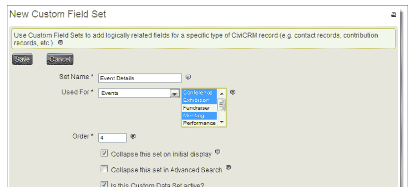

让我们简要回顾一下可用的用途：

- **活动**：在创建或编辑活动记录时可用。您可以进一步将其用途限制为一种或多种活动类型。
- **联系人**：可用于所有联系人类型。如果您希望字段仅对单一联系人类型或子类型可用，请使用**个人/家庭/组织**选项。
- **贡献**：附加到贡献记录，可限制为一种或多种贡献类型。
- **事件**：在创建事件时可用，可限制为一种或多种事件类型。请注意，这用于跟踪*关于*事件的信息，而不是从注册者那里收集信息。注册数据请使用参与者选项之一。
- **拨款**：在处理拨款记录时可用。
- **群组**：在处理群组时可用。
- **家庭**：用于**家庭**联系人类型，如果系统中定义了**家庭**子类型，则可限制为一个或多个**家庭**子类型。
- **个人**：用于**个人**联系人类型，如果系统中定义了**个人**子类型，则可限制为一个或多个**个人**子类型。
- **会员资格**：附加到会员资格记录，可限制为一种或多种会员资格类型。
- **组织**：用于组织联系人类型，如果系统中定义了组织子类型，则可限制为一个或多个组织子类型。
- **参与者**：可用于所有参与者（即注册）记录。
- **参与者（事件名称）**：可用于所选事件的参与者记录。
- **参与者（事件类型）**：可用于所选事件类型的参与者记录。
- **参与者（角色）**：可用于所选角色的参与者记录。
- **认捐**：附加到认捐记录。
- **关系**：附加到关系记录，可限制为所选的关系类型。

尽管这可能显得重复，我们仍要强调：在创建自定义数据集之前，务必仔细思考您的数据将如何被使用以及应附加到何处。一旦定义并投入使用，您就无法更改自定义数据组的使用方式。

> 请注意，每种用途类型不限于一个自定义数据集。您可以根据需要创建任意数量的自定义数据集，并且可以为同一记录类型创建多个数据集，以便将字段组织到不同的选项卡或内联可折叠集合中。

在命名您的组并选择其用途后，您可以设置顺序（如果您有多个组用于同一记录类型，这将很有帮助），在字段前后添加描述性文本，并从几个配置选项中进行选择。这些选项包括：

- 首次打开记录时，字段集是应折叠还是展开以显示字段
- 在高级搜索中查看时，字段集是应折叠还是默认展开
- 该组是否处于活动状态

如果您的组附加到联系人记录选项之一（**联系人**、**个人**、**家庭**或**组织**）：

- **显示样式**：字段可以内联（**内联**）显示，出现在联系人的摘要和编辑屏幕中，或者在联系人记录中显示在自己的选项卡（**选项卡**）中。
- **多条记录**：用于为联系人收集多组记录。默认情况下，您创建的字段将与联系人记录建立一对一的关系。选择此选项允许为联系人保存多条记录。例如，如果您想跟踪个人的教育记录，其中每条记录将包含单个教育经历的详细信息，这将非常有用。一个联系人可能有多个记录，分别表示其中学、本科和研究生教育。

> 使用多条记录选项目前存在一些限制，最明显的是，如果不进行自定义编码，就无法将这些字段暴露给网站表单（个人资料）。多条记录集必须显示在选项卡中，而不能内联显示，并且多条记录中只有第一条会被导出。此外，请注意，一旦您将自定义组标记为用于多条记录，就无法撤销该设置并改回单条记录结构。这是因为您可能已经添加了多条数据记录，而CiviCRM无法确定多条记录中的哪一条应保留为单组数据。

保存您的自定义数据集，然后进入用于创建与此数据集关联的第一个自定义字段的表单。您可以随时返回调整组的设置，或添加/删除/修改字段的设置。

- **整数**：可存储的数字大小取决于您的服务器，但在32位操作系统上可能约为正负20亿，在64位操作系统上约为正负9E18。
- **数字**：此类型应用于需要小数的值。
- **货币**：用于货币值。它将根据您在全局设置中选择的默认货币显示。
- **备注**：此字段用于较长的文本字符串，例如冗长的描述或评论。
- **日期**：您可以选择使用哪种日期和时间格式，包括仅使用日期的部分。例如，如果您只想使用年和月，可以从多个显示这些值的选项中进行选择。配置日期时，您还可以决定日历组件将提供未来和过去多少年。
- **是或否**：虽然字母数字复选框字段可用于是/否功能（选中即表示“是”），但当您需要轻松搜索明确的“否”值时，此字段可能更有用。您可以将此字段设为必填，并将默认值设置为0（即“否”），以确保所有记录都记录了值，从而更好地控制通过此字段进行的搜索。
- **省/州**：此字段将填充您站点中启用的州和省列表。
- **国家**：此字段将填充您站点中启用的国家列表。

> CiviCRM会将超出允许范围的整数值静默舍入为最小值或最大值，而不会显示错误。

> 目前，所有日期字段都使用弹出窗口组件来选择日期。虽然这有助于确保准确的数据存储（该组件根据选择构造值并将其放入所需的数据库格式），但这意味着部分日期字段（例如仅选择年份）仍将通过选择特定的月/日/年来操作。遗憾的是，从数据录入的角度来看，这并不直观。它还会影响对这些自定义日期字段的搜索，并可能产生意外结果。如果您需要仅包含月份或年份的字段，您可能会发现使用字母数字选择框字段更容易，因为它可以更好地控制显示和搜索。

- **文件**：用于上传文件的浏览按钮。文件将存储在全局设置中定义的上传目录中。访问文件的链接将显示在自定义数据展示中。当您返回编辑已附加现有文件的记录时，您可以选择用另一个上传文件替换该文件或删除现有文件。
- **链接**：超链接，在查看模式下将变为热链接。
- **联系人引用**：用于链接到另一个联系人记录。该字段将呈现为自动完成字段，允许您开始输入以在数据库中查找另一个联系人。

> 默认情况下，联系人引用类型字段将从整个数据库中提取匹配的联系人。在大多数情况下，您不会希望这样做，因为这将把您所有的联系人记录暴露给使用该表单的任何人。CiviCRM提供了一个钩子，用于自定义自动完成字段可用的记录列表：`hook_civicrm_contactListQuery`。有关使用钩子自定义CiviCRM的更多详细信息，请访问`http://wiki.civicrm.org/confluence/display/CRMDOC/CiviCRM+hook+specification`。

选择字段类型后，选择您偏好的显示格式。可用的选项取决于字段类型，某些字段类型只有一个选项值。我们将列出并描述所有可能可用的显示类型。

当选择包含选项列表的显示类型（如选择框/复选框/单选按钮）时，将为您提供一个用于创建选项标签和值的表单。您最初最多可以输入10个选项；保存后，您可以添加更多。您还可以选择复用先前为另一个字段创建的列表。标签是显示在表单中的内容；值将记录在数据库中并从系统导出。

> 标签文本应具有描述性，并对填写表单的人有意义。大多数情况下，您会为标签和值输入相同的值，除非有充分的理由让它们不同。

出现的显示类型如下：

- **文本**：基本文本字段。
- **选择框**：下拉框；选择一个选项。
- **单选按钮**：单选按钮允许您从可用列表中选择一个选项。如果该字段不是必填项，显示中将包含一个取消选择任何选项的链接。您可以决定每行列出多少个选项。
- **复选框**：复选框列表允许您选择或取消选择任何选项。您可以决定每行列出多少个选项。请注意，复选框选项的一个弱点是难以轻松搜索未选中的值。如果该选项对您很重要，请考虑为每个选项创建是/否类型字段并将其设为必填。这将为两个选项都产生明确的值。
- **多选**：选项列表，允许用户选择一个或多个选项。使用*Shift*键选择多个连续选项，或使用*Ctrl*键选择多个独立选项。这对于较大的选项列表非常有用，因为复选框需要太多空间。
- **高级多选**：显示两列选项——左列显示所有可用选项，右列显示所选选项。使用两列之间的箭头将选项移入或移出所选列表。这克服了标准多选框的主要弱点——在操作字段时意外取消选择选项的倾向。
- **自动完成选择**：这与**选择框**下拉框类似，但您可以开始输入一个值，让它在选项列表中搜索可能的匹配项。这对于具有大量选项的单选字段非常有用。
- **文本区域**：显示一个多行框，用于输入较长的文本。它将内容存储为纯文本，不含HTML。您可以决定框的高度和宽度，但用户可将其展开。
- **富文本编辑器**：显示一个多行框，用于输入较长的文本，带有WYSIWYG编辑器工具栏，按**全局设置**中的配置显示。
- **选择日期**：用于选择特定日期的弹出日历组件。
- **选择省/州**：从**管理 | 配置 | 全局设置 | 本地化**中启用的列表中选择一个州或省。
- **多选省/州**：选择一个或多个州或省。
- **选择国家**：从**管理 | 配置 | 全局设置 | 本地化**中启用的列表中选择一个国家。
- **多选国家**：选择一个或多个国家。
- **选择文件**：提供浏览/上传文件字段。
- **链接**：超链接URL字段。

继续完成字段创建表单，输入默认值（如需要且可用），提供帮助文本，并确定该字段是否必填。请注意，如果将字段指定为必填，它将影响所有管理表单——不仅仅是向站点前端公开的表单。在创建前端表单时，您将在构建配置文件期间有另一个机会指定哪些字段是必填的。

如果您希望此字段包含在高级搜索工具中，请将其指定为可搜索。通常您希望大多数字段都是可搜索的，尽管值得考虑这个问题。对于不太可能被搜索的字段，关闭此选项可以简化高级搜索界面。

字段创建表单上的最后一个选项是将字段标记为只读。有两种情况这会很有帮助：

- 如果您从旧系统导入数据，您可能有一些字段希望在新系统中保留，但不想持续维护。最常见的情况是旧字段在 CiviCRM 中有不同的表达方式，例如成为标签或组结构的一部分。创建字段并导入数据后，您会返回并将此字段标记为只读。这样可以确保数据可供参考，但用户不会添加或编辑它。
- **只读**字段在您希望使用钩子或其他代码填充字段值时也很有帮助。我们将在本书末尾讨论钩子，但就目前而言，请理解它们是开发人员在特定时间运行自定义代码的一种方式。例如，您可能会创建一个名为“age”的自定义字段，该字段根据出生日期（标准字段）和当前日期计算联系人的年龄。您希望该值在每次显示时通过代码自动更新，而不是依赖用户手动记录该值。

> 请注意，您不能使用**导入联系人**工具将数据导入到指定为**只读**的字段。您应将字段保持为可编辑状态，导入数据，然后返回并将其标记为只读。

关于导入旧数据的主题，您可能还会发现最初导入然后完全隐藏某些字段（不仅仅是标记为只读）很有用。与 CiviCRM 中的大多数工具一样，您可以轻松禁用自定义字段。这样做会保留存储在字段中的任何数据，但会将其完全从界面中移除。

您是否有兴趣了解 CiviCRM 如何在 MySQL 数据库中处理自定义字段？在 phpMyAdmin、SSH 或您首选的数据库管理工具中打开您的数据库。创建自定义组会在 `civicrm_custom_group` 表中添加一条记录，其中包含您的配置选项，并创建一个名为 `civicrm_value_[基于组名称和 id 的唯一文本]` 的新表。每个自定义字段都会在 `civicrm_custom_field` 中添加一条记录，并在适当的表中创建一个新列。

自定义组创建的表将始终具有 `entity_id` 列，该列是扩展其的对象表的外键。例如，用于个人的自定义组将使用 `entity_id` 将自定义数据记录链接到 `civicrm_contact` 表的 ID 字段。

如果您将来需要对数据运行自定义查询，了解这一点会很有帮助。该结构使构建自定义数据表与其扩展的记录之间的关系图和查询变得非常容易。

自定义数据集和字段是您 CRM 策略中的强大工具。在初始实施期间以满足定义的数据记录需求、导入旧数据以及在系统持续使用过程中数据需求不断演变时，您可能会发现需要构建它们。

FPAGM 将使用自定义字段收集有关其服务的食品储藏室和向组织供应食品的企业的信息。由于收集这两种类型联系人的信息差异很大，因此该协会将定义两个自定义字段集，并分别指定它们用于每个联系人子类型。这是通过选择 **Organization** 作为 **Used For** 值并在出现的多选框中选择适当的联系人子类型来完成的。

与自定义字段对数据库结构的影响相关的一个重要事项是，如果您将站点迁移到新服务器，您需要确保由自定义组创建的附加表已迁移。换句话说，仅导出您的数据是不够的；您还必须导出数据库结构。仅将数据导入新服务器上 CiviCRM 的干净安装是不够的，因为您将缺少旧数据库中的自定义数据表。

## 使用配置文件创建在线表单

到目前为止，我们的大部分注意力都集中在了解 CiviCRM 的管理界面以及自定义/配置系统以满足您组织的需求上。然而，直到您开始收集数据并将其公开到您的网站，CiviCRM 的强大功能才得以充分发挥。

组织拥有非常分散的系统来收集和维护其组成员数据的情况并不少见。也许您有一个中央数据库，例如 MS Access，由员工用来跟踪会员或捐赠者，并存储在您的办公网络上。几名员工可能维护着与他们的工作职能相关的信息电子表格，并且在旅行时（无法连接到办公网络时）需要访问这些信息。也许您当前的网站有一个数据库，其中存储了用户登录访问帐户，并且会员列表会定期更新以拥有在线目录。

CiviCRM 提供了将这些不同的数据源整合在一起的机会——那些在办公网络上内部使用的、必须远程访问的以及应在公共或用户访问网站上公开的。在此过程中，您可以简化工作流程并提高数据完整性。

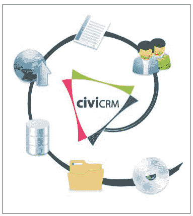

在 CiviCRM 中，您使用配置文件收集和公开数据。配置文件基本上是一组字段。您根据计划如何使用它来为配置文件及其字段选择设置。配置文件可用于：

- 创建表单以从用户收集信息，作为独立表单或作为捐赠或活动注册表单的一部分
- **搜索结果**：用于高级搜索结果和批量更新
- **Drupal 用户注册**：字段将被添加到用户帐户注册表单中（仅限 Drupal）
- **查看/编辑 Drupal 用户帐户**：字段将被添加到用户帐户表单中（仅限 Drupal）

您可以在任何时候返回以调整这些设置。如您所见，单个配置文件可能用于多种用途。为了减少系统混乱，最好最初只选择您知道会使用的选项。

单击此表单底部以展开 **高级设置** 面板。此处列出的选项显著扩展了配置文件的功能。请记住，并非所有选项都适用于配置文件的每种用途。CiviCRM 只会忽略不适用于站点上配置文件特定实例的选项。

在此，我们所说的“实例”是指配置文件用于特定目的的使用。例如，您可能会创建一个包含联系人地址字段的配置文件，该配置文件用于站点上的配置文件查看页面，也用作管理侧的搜索结果视图。与搜索相关的设置，例如结果列表中将包含哪些列，将被此配置文件的第一次使用所忽略。通常，您是为单一用途创建配置文件，通常这是一种很好的思考方式。然而，软件在单个配置文件可用于的方式数量上实际上没有任何限制。

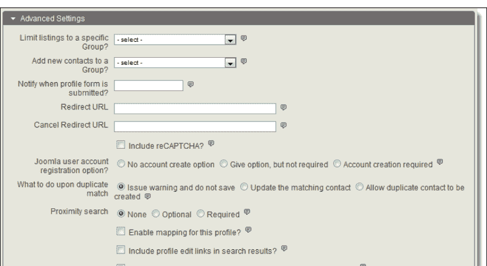

让我们回顾一下选项：

- **Limit listings to a specific Group?**：这仅适用于用作搜索表单的个人资料。 从此列表中选择一个组将限制搜索的联系人仅限于该组中的联系人。 例如，如果你要创建一个在线会员目录，你将首先为当前会员创建一个智能组，然后将搜索个人资料限制为该组，这样使用该个人资料进行的任何搜索都只会返回名下良好的会员。
- **Add new contacts to a Group?**：这适用于用作联系人报名或编辑表单的个人资料，包括与捐款页面和活动注册一起使用的表单。 当用户完成表单后，他们将被添加到你选择的组中。 这提供了一种很好的方式来追踪联系人的来源或管理邮件列表。
- **Notify when profile form is submitted?**：你可以选择在个人资料**Create**或**Edit**表单提交时通过电子邮件通知一个或多个人员。 对于多个电子邮件，用逗号分隔每个电子邮件。
- **Redirect URL**：表单提交后，你可以选择用户将被重定向到的位置。 要使用此字段，请输入完全限定的 URL（包括 `http://`）。 如果该字段为空，用户将被导回个人资料表单，并显示一条成功提交的消息。
- **Cancel Redirect URL**：与上一个字段类似，此字段用于在用户取消表单时重定向人员。 留空该字段将使用户返回个人资料表单并清除字段。
- **Include reCAPTCHA?**：Captcha 是一种阻止垃圾邮件和机器人完成你的在线表单的方法。 该工具会显示字母和数字的图形表示，要求用户在表单提交前成功输入字符。 在个人资料表单上启用 captcha 之前，你必须先在 `http://www.recaptcha.net` 获取一个帐户（你将被引导通过 Google 创建帐户）。 在设置帐户并获得私有和公钥后，将这些值输入到：**Administer | Configure | Global Settings | Miscellaneous**。 一旦你在全局设置中配置了 reCAPTCHA，它将可用于任何个人资料表单。

- **Joomla/Drupal user account registration option?**：在本节前面我们提到个人资料可以插入到 Drupal 用户帐户表单中。 反向操作也适用于 Drupal 和 Joomla！——你可以创建并公开一个个人资料表单，并包含用户帐户字段（用户名和密码）。 你可以根据需要使用户注册为可选或必需。 这对于包含在捐款页面和活动注册中特别有用。 例如，你可能希望鼓励注册年度会议的人创建用户帐户以便将来访问网站。 请注意，你的个人资料表单必须包含电子邮件地址字段，并且你的 CMS 设置中必须启用用户帐户注册（Joomla!/Drupal）。
- **What to do upon duplicate match**：如果网站上已有数据库中的某人完成表单会怎样？ 是否应创建新的联系人？ 如果已有数据，是否应忽略字段，还是应使用新数据更新并覆盖现有数据？ 使用此选项来决定重复联系人应收到警告、使用现有记录更新，还是应创建新的重复记录。 请注意，CiviCRM 将使用在查找和合并重复联系人工具（Administer | Manage）中为适当联系人类型定义的默认 Strict 规则来识别匹配的联系人。 还请注意，CiviCRM 将始终更新嵌入在捐款和活动注册页面中的个人资料表单的现有联系人记录。
- **Proximity search**：如果个人资料用于搜索，你可以启用从中基于联系人与地址的接近程度（接近）进行搜索。 如果设置为必需，用户必须完成邻近搜索字段才能使用该工具。
- **Enable mapping for this profile**：如果启用了映射并且 CiviCRM 已成功对联系人的地址进行地理编码，则搜索结果和记录的详细视图中将包含一个链接以在地图上查看位置。
- **Include profile edit links in search results?**：此选项是一种强大（但危险）的方式，使具有足够权限的用户能够通过个人资料编辑系统中的其他记录。 由于对联系人的编辑访问是通过个人资料进行的，因此你可以轻松控制用户可以编辑哪些记录和哪些字段。 在 Drupal 中，你需要适当授权用户以访问和编辑此个人资料的记录。 在 Joomla！中，用户必须是管理员用户。 启用后，搜索结果列表将在每条记录的行中添加一个 Edit 链接。

- **Include Joomla/Drupal user account links in search results?**：启用此选项会在搜索结果中插入指向用户网站帐户页面（仅查看）的链接。 对于寻求建立社交社区的网站，这可以帮助人们与其他用户建立联系。

完成 **Settings** 表单后，你将被引导至一个表单，在其中可以为个人资料定义字段。 请记住，你对 **Profile** 字段的选项在某种程度上独立于原始自定义字段定义。 例如，你可以将个人资料中标记为 **Required** 的字段，而在原始定义中该字段不是必需的，或者你可以在字段前后添加自定义文本以帮助解释其在此特定上下文中的用途。

个人资料字段设置可能有点令人困惑，因为选项会根据你对个人资料的使用情况显著影响字段显示。

首先要掌握的概念是，你可以根据计划的使用情况将哪些类型的字段组合在一起在个人资料中使用。 与 CiviCRM 的其他部分一样，字段选择过程涉及选择类型、字段，然后与该字段相关的任何子选项。 你可以将联系人、活动、参与者（活动注册者）、会员和捐款字段添加到你的个人资料中。 然而，你对个人资料的使用将决定允许的字段类型组合。 特别是，有两条主要规则决定了使用方式：

- **Different contact type fields cannot be mixed**。 这是新用户最常见的错误。 该限制意味着你不能构建一个包含个人和组织特定字段或此类其他组合的个人资料。
- **Participant/Membership/Contribution fields may only be used in profiles used within the associated type of page**。 换句话说，你不能将这些字段与个人资料视图/创建/编辑/搜索页面一起使用。 包含这些字段的个人资料只能在活动注册或捐款页面中使用。

如果你未能遵守这些规则，你的个人资料页面将呈现错误，指出你混合了类型字段，你需要在继续之前更正它们。

> 字段类型列表包含一个 **Contacts** 选项，以及特定联系人类型和子类型的选项（**Individual**、**Organization** 等）。 **Contacts** 选项包括所有联系人类型共有的字段，例如 **Address**、**Phone** 和 **Communication preference** 字段。 联系人类型字段仅特定于该类型。

选择字段后，你可以继续完成其他字段，例如字段标签、字段是否必需、只读以及帮助文本。 请注意，**View Only** 字段将不包含在个人资料搜索页面中。

一个非常重要的字段需要配置的是可见性字段，它决定了字段数据将如何被控制。 有三个选项可用：

- **User and User Admin Only**：这是默认选项，可用于所有个人资料创建/编辑/查看和组件页面（活动和捐款）中的字段。 它本质上说明使用表单的唯一联系人将是当前用户（无论是否登录），或在组件和个人资料创建表单的情况下，为表单正在代表其完成的人员。 对于个人资料编辑和查看页面，在你可能访问系统中的现有数据时，此选项说明登录用户只能查看自己的信息（而不是其他联系人记录）。 因此，此选项是最严格的，也是最安全的。 通常没有必要更改此字段值，除非你的个人资料将用作搜索表单。
- **Public Pages**：如果要将此字段公开给搜索个人资料，无论是通过搜索表单本身还是作为结果记录的详细视图的一部分，都应选择此选项。 这包括用于管理页面和批量更新的搜索结果的个人资料。 顾名思义，它表示联系人记录数据可以被除登录用户之外的联系人查看。 例如，John Doe 可以使用个人资料搜索表单查找 Janis Smith 的地址。
- **Public Pages and Listings**：此选项的工作方式与前一个选项相同，但还包括在详细视图中热链接值的能力。 这是鼓励从结果记录进行后续搜索的好方法。 例如，假设你有一个名为“service types”的自定义字段，附加到组织记录。 该字段显示为复选框列表，用户从中选择一个或多个。 进行搜索并查看记录后，你会看到它们与其中三项服务相关联。 在个人资料表单中，此字段被分配了 **Public Pages and Listings** 可见性，这意味着该记录的三个服务在详细页面上显示并超链接。 单击其中一项服务会基于该值生成后续搜索。 这样用户可以轻松进行多次后续搜索。 本章后面我们将构建一个使用此字段的个人资料，并指出其显示和用法。

个人资料字段的可见性选项并不是你通过网站控制数据访问的唯一方式，但它是限制个人资料字段使用的重要方式之一，应在构建个人资料时仔细考虑。 作为一般规则，除非你将个人资料用于搜索功能，否则可以将设置保留为 **User and User Admin**。

如果你在可见性选项中选择了**公共页面**或**公共页面和列表**，你会在表单中看到两个额外的选项：

- **可搜索**：勾选此选项表示该字段应出现在搜索表单中。在构建搜索表单时，请考虑你正在处理的字段类型。通常你只希望在搜索表单中放置少量字段，并在个人资料中包含更多字段以在详情视图中显示。
- **结果列**：进行个人资料搜索后，用户会得到一个分页列表，列出所有符合所选搜索条件的记录。用户可以从该列表中点击查看记录详情或定位联系人（如果启用）。选择此选项可将该字段包含在结果列表表格中。请记住，基于你使用的网站模板/主题，屏幕的横向空间可能有限。你只希望在搜索结果视图中包含少量字段。

完成表单后，你可以保存并返回个人资料字段列表，或点击**保存并新建**以添加更多字段。

添加完个人资料字段并返回字段列表后，你可以编辑、预览、禁用、删除或重新排列字段顺序。返回列出所有可用个人资料的主个人资料页面时，你会注意到可以对其执行多项操作。除了提供访问个人资料字段和个人资料设置链接之外，你还可以：

- 在创建视图中**预览**个人资料。
- 使用**个人资料创建模式**，该模式会将你带到实时个人资料页面的**创建**模式（用于从用户那里收集新信息）。
- **禁用**或**删除**个人资料。
- 访问**HTML 表单片段**，该片段提供了通过传统方式之外的方式在**创建**视图中使用个人资料的代码。生成的代码完全独立于你的网站，这意味着它可以在其他网站上使用。假设你的行业协会设立了一个姊妹基金会，用于向对该组织研究领域感兴趣的学生发放奖学金。这两个实体（协会和基金会）是独立的，但关系密切。你每周发布一封电子邮件通讯，并希望通过两个网站鼓励订阅，因此你为此创建了一个个人资料，并使用**HTML 表单片段**代码将注册表单插入基金会网站，同时在你的主要协会网站上创建指向该表单的标准菜单链接。
- **复制个人资料**，当需要创建与现有个人资料结构相似的新个人资料时，这可以简化配置过程。

如果你是第一次通读本节，对于如何使用个人资料还没有清晰的构想，你可能会感到不知所措。个人资料的挑战在于它们非常灵活，可以通过许多不同的方式使用，而当你刚开始接触该系统时，并不是所有方式都能立即一目了然。在设置个人资料时，如果需要在构建和测试不同用途时多次返回个人资料设置来调整选项，不必感到惊讶。

## 实际应用中的个人资料

现在让我们花些时间来了解实际应用中的个人资料。我们将回到我们的食品储藏室案例研究（FPAGM），看看他们如何利用个人资料来满足多项数据收集和管理需求。

### 使用户能够更新信息

与许多组织一样，FPAGM 选择实施基于网络的成员关系管理系统的原因之一是向成员展示实时数据，并允许他们在无需工作人员干预的情况下编辑这些详细信息。

食品储藏室和食品供应商的员工将拥有网站用户帐户，使他们能够访问一般公众无法访问的资源。这些员工中的每一位还将在 CiviCRM 中拥有一个联系记录，其中记录了他们的联系信息和活动报名信息。

一旦用户登录网站，FPAGM 希望提供一个链接，允许他们查看和更新他们的联系信息，包括地址、电话和通讯订阅。他们首先构建一个包含所需字段的个人资料。每个字段都将从联系人字段列表和个人字段列表中提取，并将可见性设置为用户和用户管理员，因为访问这些字段的唯一人将是登录用户。

FPAGM 将多个字段设置为只读，因为他们不希望用户能够修改其值。这将包括名字和姓氏字段。锁定这些字段可确保联系人不会将记录转移给另一个用户（例如，如果一名员工离开供应商并将登录详细信息交给接替他们的新员工），并有助于确保每条记录为保持历史完整性而保留。如果新员工取代现有员工，我们希望保留旧记录并创建新记录，而不是重命名现有联系人。

### 收集、整理和导入数据

一些字段也将被指定为必填，以确保协会收集并维护尽可能完整的数据。生成的字段列表如下面的截图所示。我们会注意确保字段顺序呈现出逻辑性的信息展示。

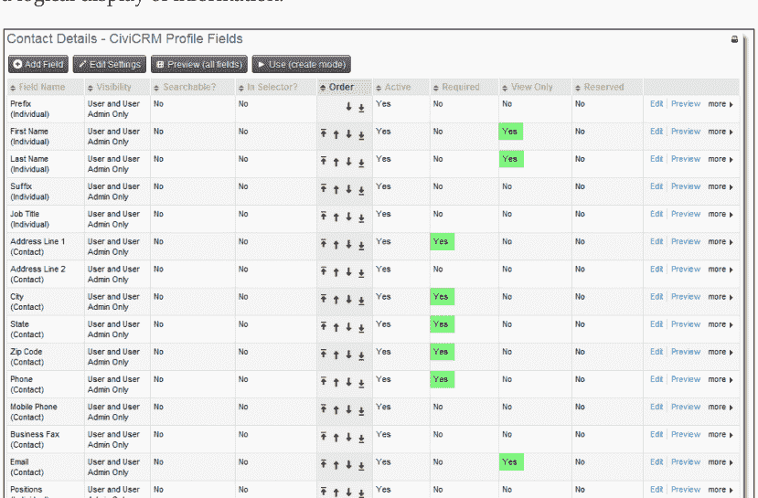

请注意“必填”和“只读”列中突出显示的值。另请注意，在许多情况下，我们修改了字段的默认标签，使其更加用户友好且符合上下文。例如，将“Postal Code”改为“Zip Code”，地址字段不包含选择字段时默认插入的位置值。邮件列表字段实际上是群组列表。你可能还记得，群组通常用于管理邮件列表订阅。当此个人资料显示时，任何被分配了“公共页面”可见性的群组都将被列出。

在继续之前，FPAGM 花一点时间预览个人资料，确保其配置符合预期。请注意，预览会在创建模式下显示个人资料，这将排除只读字段（创建模式显示一个干净的表单，没有填充现有数据，因此没有只读信息可显示）。

FPAGM 的网站基于 Joomla! 构建，因此他们将把此个人资料的链接添加到登录用户可见的现有用户菜单中，并将访问级别设置为**已注册**，以确保只有经过身份验证的用户才能访问它。我们将在本章后面讨论公开个人资料页面的各种选项。

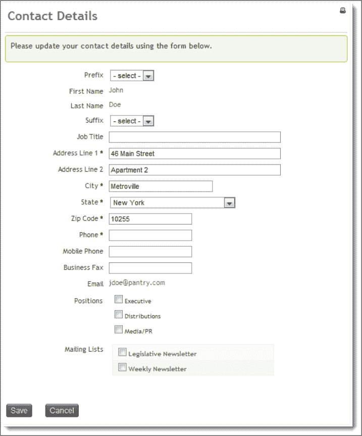

这里显示的特定用户（**John Doe**）缺少一些必填信息（**电话**）。通过使用此表单以及必填字段，我们将能够鼓励他（以及其他联系人）为其记录提供完整的联系信息。

### 搜索在线目录

作为 FPAGM 的成员，食品储藏室主要寻求两件事：支持和曝光。该协会的存在是为了满足食品储藏室的需求，充当信息交换所和将食品储藏室与彼此及其供应商联系起来的社区。食品储藏室还希望整个社区更多地了解它们是谁、位于何处以及服务对象。FPAGM 将通过一个可搜索的在线目录来帮助实现这一目标。

该目录应仅列出信誉良好的食品储藏室成员。它应允许用户根据地址和服务字段进行搜索。为确保个人资料搜索当前成员，我们首先创建一个智能群组来检索当前的食品储藏室成员。在创建个人资料时，我们使用**高级设置**将个人资料限制为此群组。

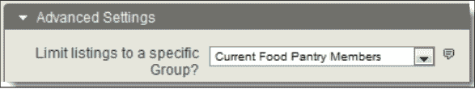

然后我们继续定义和配置个人资料字段。创建以下字段列表：

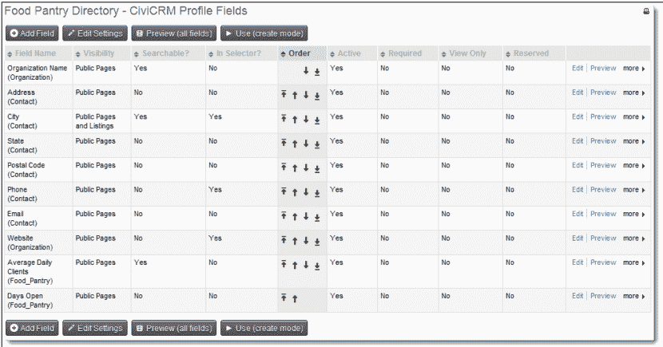

请注意，只有少数字段被指定为**可搜索？**，只有少数字段被配置为**公共页面和列表**可见性（创建带热链接的结果）。

在进行了一些测试后，FPAGM 将目录链接添加到主菜单中，作为一个公开可访问的搜索工具。

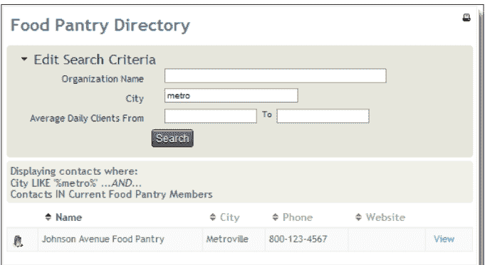

请注意，平均每日客户字段是可以按值范围进行搜索的。这是在自定义字段定义中可用的选项。

进行搜索后，我们点击 View 查看搜索结果中其中一条记录的联系人详情：

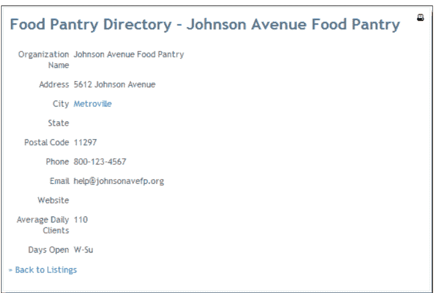

花一点时间回顾一下此示例的原始字段设置，并比较所选选项如何导致不同的可搜索字段、结果列表列和详细视图。例如，注意到 **City** 字段的 **Public Pages and Listings** 可见性导致了详细视图中的超链接值。点击该链接将触发基于该值的新搜索——所有位于 Metroville 的联系人。在使用该选项时，请仔细考虑启用后续超链接的实用性。例如，你通常不会为电话号码或电子邮件地址创建超链接，因为它们很可能对每个联系人记录都是唯一的。诸如城市、州和邮政编码之类的通用地址字段是该功能的良好候选，而街道地址则不是（因为它只会返回具有完全相同地址的联系人）。

## 在组件页面中包含个人资料

如本节前面所述，个人资料的一个重要用途是与活动注册和捐赠页面（包括会员注册页面）结合使用。默认情况下，这两种类型的页面在注册/捐赠过程中仅需要电子邮件地址。通常，你希望包含其他重要字段，例如个人的姓名、地址和通信详情。

我们不会逐步介绍为此目的创建个人资料的过程，但在创建时请记住，除了 **Contact Details** 之外，你还可以包含 **Participant**、**Membership** 和 **Contribution** 字段（取决于其用途）。

在配置活动或创建捐赠页面时，你将有机会在页面中插入两个个人资料表单；一个将出现在页面顶部，另一个出现在页面底部。如果你已为活动注册启用了多个联系人注册功能，你可以为这些额外注册者分配不同的个人资料，以帮助简化并简化最终用户的注册流程。

## 搜索结果视图和批量更新

大多数情况下，你对个人资料的使用将在网站的公共端产生某种形式的表单或其他显示。然而，有两种重要用途会影响网站的后端管理。

在 CiviCRM 中进行联系人搜索时， resulting 联系人列表默认包含联系人姓名、地址、电子邮件和电话号码。有时你可能希望在搜索结果列表中显示不同的字段集。你可以通过创建一个用作搜索结果视图的个人资料来实现这一点。

你可以在进行高级搜索时选择一个个人资料，或通过访问 **Administer | Configure | Global Settings | Search Settings | Default Contact Search Profile** 将其选为默认搜索视图。在使用 **Advanced Search** 时，使用 **Search Views** 下拉菜单选择所需的个人资料。

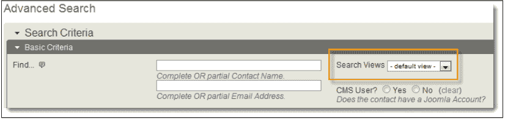

请注意，为了作为搜索视图可用，你的个人资料必须在个人资料设置中选中 **Search** 选项。

FPAGM 希望有一个替代搜索视图，该视图删除 **Country** 列并包含 **Current Employer** 字段。在为此目的创建个人资料时，他们必须选择 **Public Pages** 可见性并指示应包含在结果列中的字段。在为位于 Metroville 城市的个人进行搜索并选择此个人资料视图后，用户会看到以下内容：

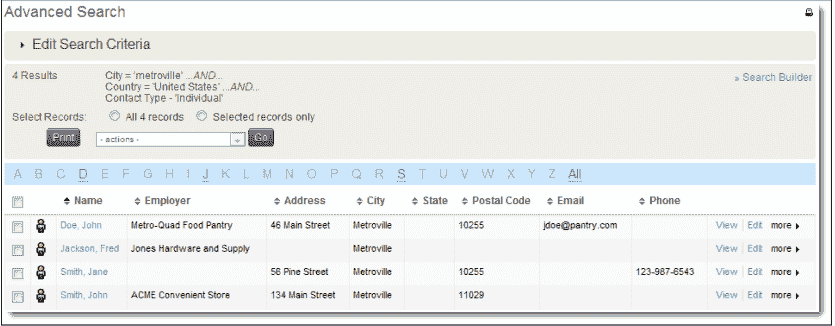

FPAGM 还希望利用个人资料进行地址字段和通信偏好的批量更新。批量更新让你一次编辑多个记录的选定字段（每次最多 100 条），并包括将第一个记录的值复制到所有后续记录的功能。

## Joomla!

如果你已经是 Joomla! 用户，你知道创建页面链接的主要方法是通过菜单项。除了提供用于选择页面各种配置选项的界面外，菜单项还提供对模块配置的访问。模块是页面周围（按模板定义的位置）找到的内容和功能块。它们可能包括菜单、页脚文本、登录表单、最近内容项目列表等此类工具。

由于菜单项与模块之间的连接，你通常希望通过菜单创建指向 CiviCRM 资源的链接。要执行此操作，请从管理导航栏中选择所需的菜单并点击 New 以创建菜单项。在选择 CiviCRM 后，你会得到多个子选项，用于你希望创建的页面类型。我们的重点将放在 Profile 选项上。

> 如果你希望通过菜单构建指向 CiviCRM 资源的链接的好处，但实际上并不希望菜单在你的网站上可见，请创建一个名为“Link Setting Menu”的新菜单，并在 Joomla 模块管理器中禁用相应的模块。在 Joomla! 中，菜单配置与其在网站上的可见性/显示是分开的——后者通过模块管理器处理。你的菜单可能存在并且具有有效、可访问的链接，但实际上并不在你的网站上可见。以这种方式，菜单管理器更像是一个内部链接管理器。

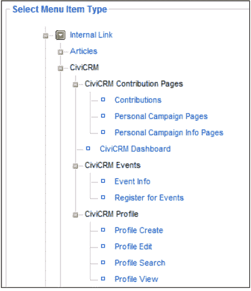

- **Edit:** `index.php?option=com_civicrm&task=civicrm/profile/edit&reset=1&gid=N`
- **Search:** `index.php?option=com_civicrm&task=civicrm/profile&reset=1&gid=N`
- **View:** `index.php?option=com_civicrm&task=civicrm/profile/view&reset=1&gid=N`

例如，我们的 FPAGM 目录搜索页面可以通过 http://fpagm.usingcivicrm.com/index.php?option=com_civicrm&task=civicrm/profile&reset=1&gid=8 访问。

构造链接后，请务必在你的网站上测试它并确认其按预期显示。

Joomla! 原生的 **search engine friendly (SEF)** 选项将正确处理对 CiviCRM 资源的初始链接（后续页面重建为标准 URL 字符串）。如果你使用第三方 SEF 扩展，请务必彻底测试你的 CiviCRM 页面以确保兼容性。

## Drupal

Drupal 中对 CiviCRM 个人资料的链接将始终通过 URL 链接到 CiviCRM 构造。这些可以作为菜单项添加，也可以作为节点内容中的链接添加。你可以使用绝对或相对寻址进行链接。对于绝对链接，将以下相对 URL 附加到你的 Drupal 站点的基 URL 包括尾部斜杠（例如，http://yourdomain.org/），将“N”替换为你的个人资料的 ID（在个人资料列表中可见）：

- **Create:** `civicrm/profile/create&reset=1&gid=N`
- **Edit:** `civicrm/profile/edit&reset=1&gid=N`
- **Search:** `civicrm/profile&reset=1&gid=N`
- **View:** `civicrm/profile/view&reset=1&gid=N`

Drupal 用户还可以配置访问个人资料的权限。使用 Drupal 的 **Access Control** 工具来确定哪些角色可以访问个人资料页面和其他 CiviCRM 表单（例如捐赠页面和活动注册）：

- 如果你希望 **Anonymous**（未登录）访客访问个人资料页面，请向 **Anonymous** 角色授予个人资料列表和表单权限
- 如果你在个人资料中使用自定义字段并且希望匿名访客访问表单或页面，你还需要向 **Anonymous** 角色授予 **Custom Data Access**

如果您使用配置文件进行用户账户注册，您将需要按之前所述配置权限。然而，如果您不需要匿名访问，您可以根据需要将配置文件限制为特定角色。

您可以使用 CiviCRM 的 **访问控制列表 (ACLs)** 进一步控制用户子集对特定配置文件的访问。

可以通过添加到 Drupal 主题中的函数实现额外的细粒度访问控制（例如，默认情况下将配置文件公开给匿名用户，但限制特定配置文件的访问）。访问 CiviCRM 在线文档以获取更多示例和示例代码：`http://wiki.civicrm.org/confluence/display/CRMDOC/Linking+Profiles`。

## 通过 URL 变量的附加选项

CiviCRM 提供了使用 URL 变量来细化配置文件显示的多个附加选项。这些参数应附加到您选择的创建/编辑/搜索/查看 URL 上。

- `&force=1`：如果您的配置文件配置为将结果限制为某个组，此选项将在首次打开配置文件搜索页面时显示组列表（默认情况下，搜索页面仅打开搜索表单）。此选项仅适用于搜索配置文件。
- `&search=0`：此选项将隐藏搜索页面配置文件的搜索表单。与上一个选项结合使用时，您可以创建一个配置文件页面，以显示组的成员且不提供搜索选项。
- `&field_name=value`：将此选项与 `&force=1` 选项结合使用，以返回搜索和列表页面的过滤结果列表。如果需要，可以应用多个过滤器。例如，要返回纽约的记录列表，请附加：`&state_province-Primary=1031`。请注意，该字段必须作为公共用户和列表字段存在于您的配置文件定义中。如果您不确定要过滤的字段名称是什么，请在浏览器中查看搜索页面源代码并识别表单字段名称。您还可以检索选择/复选框/单选按钮字段的字段值，例如上述示例中各州的数值。
- `&map=1`：使用此选项可默认显示结果集的地图。请注意，您必须将配置文件配置为启用映射（在 **高级设置** 下）。

如果您使用 CiviMail 从系统中发送群发电子邮件，则在发送配置文件页面的链接时可以使用特殊的 `checksum` 令牌。令牌在 CiviMail 中用于在发送电子邮件时替换每个联系人记录特有的值。实质上，它们允许您使用电子邮件进行合并邮件。校验和令牌是在发送邮件时为每个联系人创建的唯一值。通过将校验和令牌附加到您的配置文件 URL 字符串，收件人可以点击链接并在未登录网站的情况下加载已预填其联系信息的配置文件表单。我们将在本书后面更详细地介绍 CiviMail 的功能。

使用校验和功能时，应将以下内容附加到配置文件 URL：`&id={contact.contact_id}&{contact.checksum}`。当 CiviMail 发送电子邮件时，它会插入用户的联系人 ID 和唯一的校验和值。

如果您发现您的联系人并不习惯登录您的网站通过配置文件编辑表单更新其联系信息，您可能会发现通过电子邮件向他们发送编辑表单链接很有用。他们无需登录即可访问页面并可直接与其联系记录交互。请注意，出于安全原因，校验和值在发送电子邮件后七天到期。虽然这提高了安全性，但使用此功能仍存在某些风险。校验和构建的链接提供了访问用户数据的网关（由配置文件控制），而无需他们登录。这意味着如果他们将电子邮件转发给他人，收件人将在七天的访问窗口期内获得其联系记录的访问权限。

## 导入联系人和活动数据

配置文件为授权联系人处理自己的记录或为组织员工构建简化的<|message|> 数据录入表单提供了出色的工具。然而，很常见的是您需要将大量联系人记录添加到系统中，这可能太多而无法通过配置文件表单高效手动输入。

您的 CiviCRM 实施项目也非常可能涉及从现有旧系统迁移数据。即使您是一家初创非营利组织，您也可能拥有从外部来源获得的一些联系人记录，这些记录将作为您的 CRM 数据库的种子。

CiviCRM 提供了一些强大的界面工具，可从逗号分隔值 (CSV) 文件、文件或由 SQL 查询指定的记录集中导入记录。即使拥有非常强大的界面，您仍需要对现有数据进行一些工作以准备导入。

## 收集、组织和导入数据

让我们花点时间回顾导入界面，然后重新追溯我们的步骤，以了解导入中涉及的数据准备问题。CiviCRM 提供了导入联系人、活动、捐赠、会员和活动注册记录的工具。本节我们关注的是联系人和活动。

### 联系人导入

要访问联系人导入工具，请浏览到 **Contacts | Import Contacts**。该工具由四步向导组成，您将在其中上传文件、将导入文件映射到现有的 CiviCRM 字段、查看映射并选择将联系人添加到组或标签，然后完成导入并处理有关数据的后续通知。

在第一步中，您可以选择上传 CSV 文件或通过 SQL 查询连接到数据库。在大多数情况下，您将使用 CSV 文件。如果您选择构建 SQL 查询来检索数据，数据库必须位于同一服务器上，并且 CiviCRM 安装中配置的数据库用户必须对该数据库具有足够的权限。在任何一种情况下，CiviCRM 都会检索数据并允许您将字段映射到 CiviCRM 字段。

如果您从 csv 文件导入，有几点需要注意：

- 最大上传文件大小取决于服务器的 PHP 设置配置。文件大小限制将在上传框下的注释中列出。
- CiviCRM 通过此工具能够上传和处理记录的数量在很大程度上取决于服务器的资源和设置。如果您使用的是共享主机或资源较低的 VPS，您可能需要将导入文件拆分为较小的块（少于 1000 条记录）以便处理导入。如果您拥有自己的服务器或资源充足的 VPS，您可能需要大幅增加 PHP 超时和内存限制。如果网站尚未上线或您没有经历太多网站流量，您可以考虑将超时值设置为零，这将完全防止其超时。请务必在进行导入后将其恢复到适当的设置。
- 导入数据的最佳格式是 UTF-8。如果您的数据包含特殊字符，则需要此格式。如果您需要从不同格式导入数据，您应访问 **Administer | Configure | Global Settings | Localization**，在其中可以配置替代的 **Legacy Encoding**。默认情况下，CiviCRM 将为此设置配置 Windows-1252 格式（由 MS Excel 使用）。在可能的情况下，使用 UTF-8，因为它提供了最大的数据完整性。

在继续导入过程之前，请备份您的数据。如果导入脚本出现问题、超时或您不小心将数据分配到错误的字段，您将希望拥有可靠的备份来恢复现有数据并重新实施导入：

1. 在浏览选择上传文件后，指示您的数据第一行是否包含列标题。尽可能使用列标题，因为它将极大地帮助您的字段映射步骤。然后查看导入选项。
2. 导入联系人时，您一次只能导入一种联系人类型。换句话说，您的导入文件不允许混合组织和个人记录，或个人和家庭记录。如果您的数据包含混合联系人类型，您需要将记录分离到每个类型表示的不同文件或查询中。
3. 选择导入时应如何处理重复记录。CiviCRM 将使用在 **Contacts | Find and Merge Duplicate Contacts** 中找到的适当联系人类型的默认 **Strict** 规则。有四个选项可用；在选择选项之前请考虑您现有的数据和导入数据。选项如下：
   - **Skip**：默认行为 **Skip** 将提醒您任何匹配的记录，生成可下载的报告，并在处理记录时完全跳过匹配的记录。

- **更新：** 当找到重复匹配时，导入文件中的数据将更新（覆盖）现有数据，如果不存在现有数据则填充字段。更新选项不影响导入文件中未包含的字段。请注意，此选项不会用导入文件中的空白数据覆盖现有数据——在这种情况下会保留现有数据。
- **填充：** 仅当字段中没有现有数据时，导入数据才会写入该字段。如果字段已有值，则在导入期间跳过。
- **不进行重复检查：** 无论是否存在匹配记录，都会导入记录。

4. 如果导入文件包含日期字段，请选择这些字段的格式。请注意，导入文件中的所有日期字段必须以相同方式格式化，并且整个文件中的数据必须保持一致。这通常是导入前需要对现有数据进行清理的地方。

5. 对于配置了地理编码映射的站点，您可以选择在导入时执行映射查找。此选项仅适用于小型数据集，因为服务器与映射提供商就每个导入地址进行通信需要花费大量时间。如果要导入大型数据集，则需要在导入后从命令行或 URL 运行 `/civicrm/bin/UpdateAddress.php` 脚本。该脚本更适合大规模映射查找。

6. 在 **导入** 向导的第二步中，您将把导入字段映射到 CiviCRM 字段，并可以选择保存导入映射以供将来使用。如果您为了处理导入而必须将数据文件拆分成更小的块，如果您定期从常用来源导入记录，或者如果数据不干净且导入可能失败或需要重新运行，使用已保存的映射尤其有用。一旦系统中保存了一个映射，您将在导入向导的第一步看到可用于选择该映射的选项。不用担心；如果导入文件与之前的映射略有不同，您仍然有机会在继续导入之前查看和修改映射。

## 收集、整理和导入数据

7. 填写此表单后，进入第二步，您将在其中将导入字段与 CiviCRM 字段进行映射。以下屏幕截图演示了一个示例映射：

8. 当 CiviCRM 首次加载文件时，它会尝试为您映射字段。您需要查看并完成映射。在下一步中，您将有机会检查映射，如果导入文件中存在任何初始错误，系统会通知您。如果有错误，CiviCRM 将提供一个链接，用于下载包含错误行和错误描述的 CSV 文件。在大多数情况下，错误是由于无效值引起的，例如格式错误的电子邮件地址或与字段选项不匹配的值。

9. 查看错误文件后，您可以选择更正错误、返回第一步、重新加载并继续，或者继续导入并单独处理错误。此步骤还提供将联系人添加到新组或现有组，或新标签或现有标签的选项。

## 导入联系人

✓1. 选择数据源   ✓2. 匹配字段   ×3. 预览   4. 摘要

## 预览（步骤 3，共 4 步）

以下信息预览了将您的数据导入 CiviCRM 的结果。查看总计，确保它们符合您的预期结果。如果准备继续，请单击“立即导入”。

<< 上一步   立即导入 >>   取消

| 总行数 | 3 | 导入数据中的总行数 |
| 有效行数 | 3 | 将要导入的总行数 |

## 已保存的字段映射：基本导入

| 列名 | 导入数据（第 1 行） | 导入数据（第 2 行） | 匹配的 CiviCRM 字段 |
| Fname | John | Janis | 名 |
| Lname | Markhardt | Jones | 姓 |
| City | Metrotown | Metrotown | 家庭 - 城市 |
| State |  |  | 家庭 - 州/省 |
| Zip | 10257 | 10257 | 家庭 - 邮政编码 |
| Phone | 123-123-4567 | 123-234-5678 | 家庭 - 电话 - 电话 |

- > 将导入的记录添加到新组
- > 将导入的记录添加到现有组
- > 创建新标签并将其分配给导入的记录
- > 标记导入的记录

<< 上一步   立即导入 >>   取消

10. 将导入的记录添加到标签或组中，是跟踪导入时间或数据来源的绝佳方式。它还可用于导入后的数据完整性比较，或识别部分/失败导入期间导入了哪些记录。

11. 如果准备好继续，请单击“立即导入”开始导入并监控其进度。根据您为重复记录设置选择的选项，您可能会收到一条消息，指示导入期间跳过了重复记录。系统将提供一个可下载的 CSV 文件，您可以在其中查看重复记录。

## 活动导入

活动导入通过“联系人”菜单访问，并将引导您完成类似的四步向导。最显著的区别是，您导入的记录必须与现有的联系人记录关联。换句话说，您不能在活动导入过程中创建相关联的联系人记录；活动必须导入到现有的联系人记录中。

可以通过在活动导入文件中包含内部联系人 ID 或外部标识符来建立与现有联系人的连接。使用这些字段可确保与联系人记录最可靠地连接，因为两者都必须是系统中的唯一值。CiviCRM 也可以使用默认的严格去重规则（默认情况下为电子邮件地址）来连接记录。

> 外部标识符字段用于存储您迁移来源数据库系统中的唯一 ID。当您从旧系统导入核心联系人数据以及相关记录数据（如活动）时，它尤其有用。

导入的活动数据还必须包含一个包含活动类型的列，该类型必须与 CiviCRM 中配置的类型之一相对应。如果尚未完成，请访问 管理 | 选项列表 | 活动类型 查看现有类型并根据需要添加新类型。

活动导入必须使用 CSV 文件完成（我们在联系人导入中看到的 SQL 选项不适用于活动导入），并且不会进行任何去重处理。如果返回导入错误文件，该文件很可能包含不匹配的记录和无效值。不匹配记录是指在现有联系人记录中找不到匹配联系人的记录。

## 数据准备提示

虽然 CiviCRM 可以简化实际的导入过程，但真正的工作在于准备要导入的数据。

您应该首先花时间清理数据。这包括删除不想让新系统变得杂乱无章的旧记录，确保电子邮件和网站等字段具有有效值，为任何使用选项值的字段创建一致的值，并全面检查数据以确保其尽可能干净、有序。

根据旧系统处理个人、家庭和组织的方式，您可能需要做一些工作，将数据按联系人类型划分为记录子集。请记住，使用 CiviCRM 导入工具时，一次只能导入一种联系人类型。话虽如此，这条规则也有一些例外，或者更确切地说是澄清。

在映射联系人导入时，请注意字段列表底部的一系列 **相关联系人信息** 字段。通过这些字段，您可以将数据导入主要联系人类型（例如 **个人**），同时将数据插入相关记录。如果相关记录不存在，CiviCRM 将创建它，然后建立关系。

这不是处理导入的最有效方式，如果不小心，可能会无意中创建非预期的相关记录。但是，对于只需要在相关记录中插入几个字段的导入，这可能很有用。另请注意，如果导入数据的相关记录字段值为空，CiviCRM 仍可能会创建相关记录（数据为空）。这需要在导入后对系统进行一些清理。

更可取的方法是先导入一种联系人类型的记录，然后再导入相关记录。例如，您可以先导入所有组织记录，然后使用相关字段按组织名称匹配来导入个人。

完成联系人导入后，您可能需要运行去重搜索并合并重复记录。尽管您尽了最大努力，重复记录仍必然会出现，尤其是在导入之后。CiviCRM 合并功能的优点在于，您可以轻松合并相关记录。例如，如果 ACME Company 和 ACME Co. 是同一家公司，它们可能在旧系统中各有相关记录（例如捐款、活动和关系）。合并这两条记录时，这些相关记录将合并到最终的联系人中。在 CiviCRM 内部处理数据合并可以减少在旧系统中寻找和合并各种相关记录的痛苦和烦恼。

如上所述，在开始导入之前以及整个过程中定期进行数据库备份。您需要一条在出现问题时回退到先前数据集的途径。

## 迁移到生产服务器

一个常见的问题是如何最好地将数据从开发或暂存服务器迁移到生产服务器。不幸的是，对这个问题没有“一刀切”的答案。你的内部工作流程和系统的总体性质将决定最佳可用方法。

请理解，目前没有方便的方法来合并两个 CiviCRM 数据库。如果你正在向暂存服务器进行大量导入，在从暂存服务器部署之前，你需要识别并导出对生产数据库的任何更改。版本 3.3 中引入的更改日志可能会为这类需求提供一些支持。

你在数据库中找到的 CiviCRM 表非常便携。实际上只有两个表在移动数据库时可能需要重置或清空：包含目录和 URL 设置的 civicrm_domain 表，这些设置在迁移到新服务器后可能会发生变化，以及将你的 CMS 用户连接到 CiviCRM 联系人的 civicrm_uf_match 表。对于域表，你可能需要将 config_backend 字段设置为 null 以强制 CiviCRM 重置值，并且 uf_match 表可能需要清空以强制与现有 CMS 用户进行新的匹配。此外，你应该截断各种缓存表，以确保从新位置生成新内容。

有关迁移步骤和故障排除提示的完整讨论，请参阅：http://wiki.civicrm.org/confluence/display/CRMDOC/Moving+an+Existing+Installation+to+a+New+Server+or+Location。

## 摘要

在本章中我们：

- 配置了自定义数据集/字段并开始了解其多种用途
- 创建了配置文件以收集用于各种用途的字段
- 实施了配置文件搜索和编辑表单，展示了向网站访客和用户公开 CiviCRM 数据的能力
- 回顾了联系人和活动导入流程，帮助你将数据从之前的旧系统迁移到你的 CiviCRM 数据库
- 涉及了从一台服务器迁移到另一台服务器时的关键注意事项

展望下一章，我们将使用 CiviMail，即 CiviCRM 的群发电子邮件系统，更有效地进行沟通，并从整体上审视管理联系人的可用工具，以便更好地与他们沟通。
