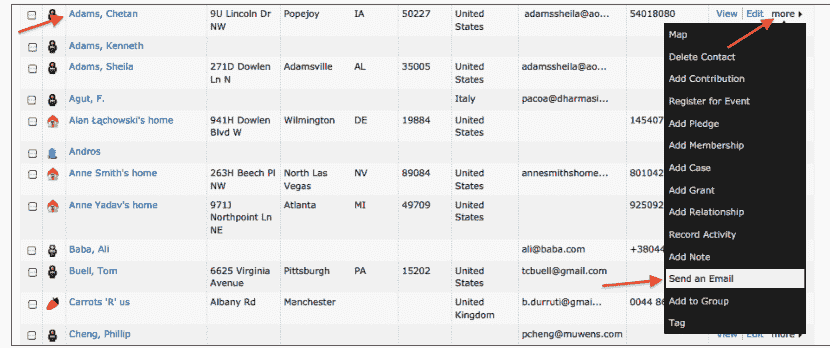
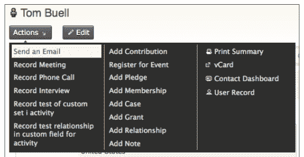
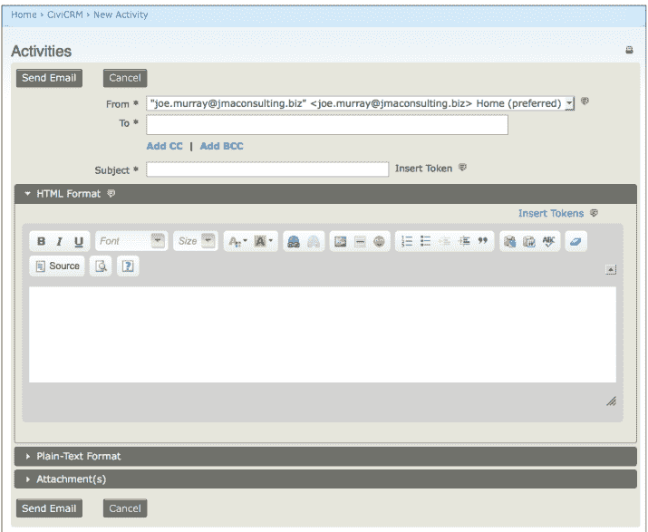
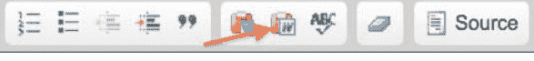
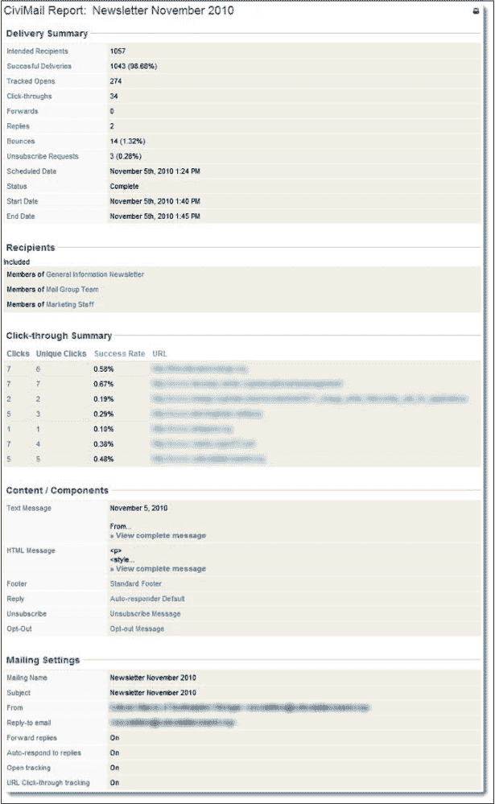
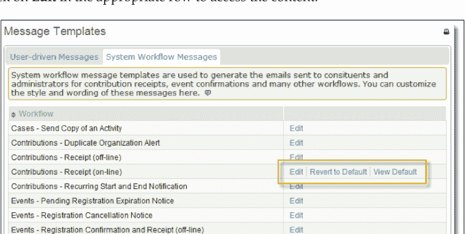

# 第6章：更好地沟通
### 更好地沟通

组织成功的核心在于其有效沟通的能力。虽然 CiviCRM 不能替代制作内容和策略的艰苦工作，但它确实提供了强大的工具来促进你的沟通工作。本章首先简要回顾你的沟通工作如何改善与支持者的关系。然后我们概述如何：

- 更好地沟通
- 向一个或多个支持者发送电子邮件
- 打印地址标签
- 将支持者组织成用于批量邮寄的组
- 发送批量电子邮件
- 为批量电子邮件设置模板
- 自定义系统工作流消息的模板
- 记录从你的普通电子邮件客户端发送给支持者的电子邮件

如果你只对 CiviCRM 用于与支持者沟通的机制感兴趣，可以随意跳过下一节，我们在其中讨论有效沟通的原则和概念。

### 如何更好地沟通

CiviCRM 可以帮助你的组织发送、接收和跟踪在线和离线通信，但制定适合你的 CRM 策略的适当沟通计划由你决定。理想情况下，你将以以下方式进行沟通：

- 有效且高效地实现组织的使命
- 根据主题、处理方式、语气和时机等因素回应不同类型支持者的兴趣

非营利组织今天最常见的沟通形式之一，也是本章的重点，是支持者可能订阅的批量电子邮件产品。这些可能是月度通讯、每日更新、时效性强的沟通，如紧急行动警报、新出版物通知，或用户感兴趣的其他内容。随着支持者提升参与度，你的 CiviCRM 系统将更了解他们，为你提供更有效地定位联系人细分并个性化他们收到的沟通内容和行动号召的工具。

你分发的内容类型将决定谁会订阅并留在你的名单上。确保你的沟通内容及其“声音”合适：它是分析性的还是轶事性的？是权威的还是随意的？你可能会为劳动法变更的清算组织发布枯燥的公告，为无家可归者收容所发布有个人观点的叙述，或为创意行业协会发布古怪的八卦专栏。每一种都以可能与目标受众产生共鸣的语气和内容说话。

重新利用内容用于不同渠道有助于进一步发挥你的资源。假设你的组织每年发布几份主要研究报告。你可能希望：

- 分发新闻稿
- 就此撰写博客文章
- 在你自己的社交媒体渠道上提及
- 发布到盟友渠道
- 在你的通讯中包含摘要或几段摘录
- 举办活动，让作者展示作品并进行讨论

所有这些都可以除了向那些专门要求接收新出版物通知的人发送公告之外进行。找到通过多用途内容扩展工作影响力的方法。

利用自动化通信来交叉推广你的组织的活动、服务和新闻。CiviCRM 会在用户采取行动时自动发送多条消息，例如活动注册确认电子邮件或捐赠收据。你可以自定义用于生成自动消息的模板。这些包括确认活动报名、感谢人们的捐款，以及在收到志愿者报名偏好时通知他们并表示感谢。

令牌，即联系人数据的合并字段占位符，可用于确保个性化信息如姓名和地址包含在收据中。通过将这些消息制作得超出随 CiviCRM 一起提供的默认版本，你可以利用它们讲述你的组织故事，寻求进一步参与，或争取更多支持。确保这些消息中的声音和语气合适。这些自动消息的主要目的应该是继续直接响应支持者的行动提供详细信息（例如收据）。在不劫持其主要目的的情况下，你可以将次要信息构建到这些消息中，以建立品牌并传达你的故事。例如，你可以将组织的标语或本月特色行动号召放入所有自动消息的页脚。

如上所述针对所有沟通，这些自动消息的写作风格或声音应适合你的组织的形象。例如，专业的商业语气可能会导致：“感谢您的捐款。您今年收到的所有慈善捐款的正式税务收据将在一月份发出。”对于面向青年的组织，更随意的风格可能更好：“感谢你帮助装饰大象公司。用 #deckdumbo 在推特上分享其他古怪的活动创意。”

CiviCRM 为在线病毒式传播的几种经过验证的最佳实践提供了支持。例如，“转发给朋友”功能可以启用，并在支持者报名参加活动或完成捐赠后立即出现。通过提供邀请他人的机会，你利用了“动机-惯性”并通过支持者网络扩展组织的覆盖面。此外，大多数人如果同事或朋友能和他们一起参加活动会很高兴，或者想告诉他人他们刚刚捐赠给的事业。同样，在他们完成自己的捐赠后邀请人们为你的组织发起自己的个人筹款活动是一个很好的时机。

我们要表达的本质是需要有意且战略性地考虑你说什么、何时说、如何说，同时保持警惕以捕捉将沟通联系起来并扩展你的信息的偶然机会。

### 行动号召

许多营利性营销和销售技巧在非营利部门请求捐赠、志愿者时间、活动出席、签署请愿书等方面效果很好。一种简单但重要的沟通技巧来提高响应率是拥有清晰、有说服力的行动号召。


将行动与具体的理想结果联系起来可以提高响应率。例如，一家紧急救援组织可能会传达，每一美元的捐款都能为地震灾区的一个孩子提供一天的食物。提高呼吁的紧迫性也能提高响应率：“如果你现在行动，那么[填入理想的结果]”或“如果你不现在行动，那么[填入不理想的结果]”。

通过图文并茂的图片、轶事和个人故事来调动受众的情感通常能极大地提高响应率。它们是演出中的主角。相比之下，使用统计数据和事实轶闻构建令人信服的理性论据则像是配角。它们最好用来丰富演出并帮助主角发光。

周围的沟通——文本、图形、音乐和视频——都应共同为采取行动构建论据。多次以视觉上吸引人且不同的方式重复行动呼吁会有帮助，例如粗体文本链接以及按钮。通过让完成行动变得更容易，你可以提高响应率。“点击这里”比让人们打印表格、找到支票簿、拿信封和邮票、然后寄出包含捐款的信件要有效得多。

## 强化你的品牌

无论你是否意识到，你的组织在与世界互动时所做的一切都会影响其声誉。人们是否信任你的研究是扎实的，会向你寻求创新政策建议，或向你推荐志愿者？他们是否担心你会把捐款浪费在行政开销上？他们能否指望你为该议题争取媒体关注？他们是否对你的做法感到不舒服，因为它过于对抗或与反派过于亲近？你的品牌就是所有这些认知的总和。

了解人们如何看待你只是故事的一部分，更重要的部分是尚未发生的事情。你的组织希望被如何看待？改变组织的品牌能否提高其实现目标的效果？更明亮、更活泼的视觉形象会有帮助吗？更粗犷、低成本的形象呢？更保守、更精致的形象呢？

沟通活动是品牌的重要组成部分。通常会有更多人接收批量或广播式沟通，而不是直接通过你提供的项目和服务与你的组织互动。

代表你的组织与利益相关者沟通的每个人都应了解他们的工作如何契合组织的整体目标。这样，他们就能在信息使用的语气、词语、图像、颜色和风格上把握好分寸。通过 CiviCRM 与利益相关者沟通，无论是一对一还是广播式，都应始终与组织的整体品牌和视觉形象保持一致。

## 向一个或多个利益相关者发送电子邮件

CiviCRM 提供了直接从系统中发送电子邮件的工具，既可发送给少量联系人（单个利益相关者或少量利益相关者），也可发送给大量联系人。本章后面我们将更详细地介绍使用 CiviMail 广播电子邮件。简单、低量电子邮件与批量、大规模或广播电子邮件之间的界限并不总是清晰。广播电子邮件在你定期向数千名收件人发送信息时显然是合适的，因为你需要了解打开率和点击率，并根据该行为进行细分，而且你不希望手动处理列表中的无效电子邮件或处理暂时不可用的账户。

为了保持相对清晰，我们将非广播式电子邮件发送称为电子邮件发送，并遵循 CiviMail 的术语，即将广播电子邮件称为邮件发送，并且在处理批量或广播式电子邮件时始终明确指代 CiviMail 而非 CiviCRM。

## 使用外部客户端发送电子邮件

使用 CiviCRM 协助沟通最简单的方法就是直接点击它显示的任何电子邮件链接。例如，联系人摘要页面会将联系人的电子邮件显示为可点击的链接。这将启动你的电子邮件客户端，并将联系人的电子邮件填入收件人行。虽然这允许你在查看联系人记录时轻松发送电子邮件，但从整体 CRM 角度来看可能并不理想，因为电子邮件不会保存在 CiviCRM 中。幸运的是，CiviCRM 提供了多种工具来提高你在系统中直接记录电子邮件的能力。

系统内保留什么、不保留什么的问题对你的整体 CRM 策略很重要。并非所有与所有利益相关者的沟通都需要进入 CiviCRM。你必须权衡收集和拥有过多信息与过少信息之间的利弊。前者可能会造成额外的存储工作，并在系统中产生大量需要筛选的材料。后者可能导致使用其他脱线的离线数据源来存储和检索关键信息，或缺乏与利益相关者互动的历史记录。一旦你理清了这些问题，就制定政策和程序声明来指导员工，其中应包含明确的示例，说明什么应 definitely 从系统中包含或生成，什么不应包含。

许多 CiviCRM 网站，也许是大多数，只跟踪发送给利益相关者的自动生成消息和广播电子邮件。有些可能会选择将少数手动生成的官方沟通记录到系统中，例如在 CiviGrant 中通知获奖者的电子邮件。其他人可能会尝试通过 CiviCRM 将所有电子邮件、面对面会议和电话记录汇集在一起，特别是案例管理领域。

制定只跟踪重要且有用的电子邮件的适当政策可能具有挑战性。我们都见过为安排会议的时间、日期和地点而产生的 14 条电子邮件往来。这些沟通可能内容庞大且没有持久的兴趣或意义。文件保留政策通常会区分不同类型的沟通，根据其是否具有持续的相关性或法律责任，规定适当较短或较长的保留期限。

你的关于将什么放入 CiviCRM 的政策不必因为相对容易捕获而包含所有电子邮件，也不应因为记录这些互动的工作量较大而排除电话和面对面交谈。利益相关者是否期望组织“记住”一次互动？如果是，它很可能属于 CiviCRM。

为了使系统有用，并避免因本应存在于系统中却不存在而浪费大量时间，政策需要清晰且始终如一地执行。

## 使用 CiviCRM 发送电子邮件

如前所述，除了提供可点击以在首选电子邮件客户端中打开的热链接电子邮件地址外，CiviCRM 还提供了直接从系统中向一个或多个利益相关者发送电子邮件的工具。假设你即将向应保存在 CiviCRM 中的利益相关者发送某物，有几种方法可以在不使用其广播电子邮件组件 CiviMail 的情况下调用 CiviCRM 中的联系人电子邮件。

要在显示电子邮件的搜索结果页面上向单个联系人发送电子邮件，请在该行的最右侧的更多链接上选择发送电子邮件。



要从搜索结果页面向多个联系人发送电子邮件：
- 1. 选择一个或多个联系人，或选择全部记录单选按钮。
- 2. 从 - 操作 - 按钮上的字母列表中选择向联系人发送电子邮件。
- 3. 点击前往按钮。

第三，从联系人摘要页面，你可以点击操作 | 发送电子邮件。请注意，如果联系人没有电子邮件或其隐私选项表明不应向其发送电子邮件，则发送电子邮件操作不会显示为选项。



最后，从系统中的任何页面，你都可以点击左侧边栏（默认块位置）中的新建按钮，然后选择电子邮件。


All four approaches will bring up the following form for e-mailing via CiviCRM:



While it seems like a fairly standard e-mail form, let's go through it field-by-field to learn about its special features:

- **From**: This defaults to the primary e-mail of the currently logged in user but also allows you to select from other e-mails set up in **Administer | Configure | FROM Email Addresses**. This is particularly useful for situations where there are departmental or functional e-mails (for example, `info@example.org`, `volunteering@example.org`, `events@example.org`) or where one staff member sends e-mails on another's behalf (for example, `ExecutiveDirector@example.org`). The e-mail will be logged as an activity for all contacts specified in the **From, To, CC, and BCC** fields.
- **To**: The primary e-mail address of the contact(s) to be e-mailed. If you arrived at this form through the contact record or search results, the field will be populated with the originating contact(s) e-mail address. If you arrived using the **Create New** button, you will need to search for the contact(s) you wish to send to. You can add additional e-mails using the standard auto-completion search functionality (name and e-mail).
- **Add CC | Add BCC**: These links provide auto-completion search fields and ensure that the e-mail activity is added to the record of the relevant contacts.
- **Subject**: In addition to providing text that will appear unchanged on the subject line in people's inboxes, you can use the Insert Token link to include information from a contact's record that should be looked up and inserted into the subject line. This can include either core fields such as a person's first name, or contact-type custom fields that are specific to your installation of CiviCRM. The latter are included in the alphabetized drop-down list of field names as **Custom Field Name :: Custom Data Group Name**.
- **Use Template**: E-mail templates are used in slightly different ways in different parts of CiviCRM:
  - Unlike automated message templates generated from event signups, contribution pages, and other public facing forms, templates selected when manually sending an e-mail will pre-populate the content field and provide you an opportunity to manually edit the content before it is sent out. As a result, the process is more like making and editing a copy of a Word file than auto-generating a letter from a Word mail merge template.
  - Since it populates the field and then provides access to further edit the content, you can take advantage of the tool by creating e-mail templates containing just your design/layout branding, and also use it to create standardized responses for common queries received by phone or mail. When creating your template, take the time to test it thoroughly and ensure cross-client compatibility, including reviewing how it will appear in web-based e-mail tools (Gmail, Hotmail, and so on). It can take significant fiddling to get HTML-formatted e-mails to look consistent in different e-mail clients, especially when you are trying to do sophisticated formatting. By investing the time to create a well-constructed template, you will save time for end users creating the e-mails and help ensure effective visual branding.
- **HTML Format**: CiviCRM ships with two popular WYSIWYG (what you see is what you get) editors which support standard formatting tools when constructing your e-mail. We find that Drupal users will typically use **CKEditor**, and Joomla! users will select **TinyMCE**, as they are more commonly used in those respective CMSs. Note that in CiviCRM v3.3, Joomla! users will be able to use the default or user-specified editor installed in Joomla! and selected in **Global Configuration**, which will significantly extend the options available. The following screenshot refers to CKEditor. Some standard caveats apply:
- While visually well-designed HTML e-mails tend to improve readability, click-through, and response rates, it is important to test and periodically retest how the e-mails are appearing in popular desktop and web-based e-mail clients. Invalid HTML markup, such as unclosed tags are red flags to spam checking software; so beware of inadvertently creating deliverability problems by having someone who is not familiar with HTML doing anything fancy in the HTML source view.
- CSS used in your e-mail should always be inserted directly in the HTML tags. Most e-mail clients don't support style declarations inserted in tags through class and ID values.
- Don't cut and paste directly from Microsoft Word because it uses non-standard markup code. Invisible to you when pasting, this markup code will often prevent your messages from appearing correctly in your recipients' inboxes because it references Microsoft-specific elements that are not widely supported. If you need to copy something from a Word document, the easiest way to remove the problematic markup code is to paste using the special Paste from Word or the Paste as Text icon. Paste as Word will attempt to retain structural elements, such as bullet lists, whereas Paste as Text more thoroughly strips all design and layout elements.



- For an image to appear in your constituents' browsers properly, it needs to be available on the Web somewhere. Generally, it is best to upload any image you need in your e-mail to a publicly accessible part of your website, making note of the URL that displays the image.
- When referencing pages on your website or inserting images, be sure to use the full URL (http://...), not a relative path. Remember that the e-mail received by your constituents will not be directly connected to your website, so relative path resources will be meaningless.
- There are a number of good resources (many of them free) for obtaining e-mail templates that are compatible with most e-mail clients. Consider obtaining some as the basis for your template and then modify to suit your organizational branding.

- 3. Select **Mailing Labels** on the **- actions -** button.
- 4. Click on the **Go** button, and then configure mailing label options as follows.
- 5. Beside **Select Label**, choose the Avery label type that you will be printing on (typically indicated on the packaging). If you are not using an Avery product, look for an indication showing which Avery number the labels are compatible with, as many companies use the same dimensions. You can also look up the dimensions for the available labels on the Avery site for your country (for example, http://www.avery.com site does not list the A4-sized products that begin with L, and http://www.avery.fr does not list the North American 8.5 x 11 ones).
- 6. Choose the mailing **Location** for each contact. Every contact must have one of its addresses marked as **Primary**.
- 7. Choose whether you want to remove contacts with the "Do Not Mail" communication preference selected.
- 8. Depending on how you have decided to enter and store your data in CiviCRM, you may want to reduce postage charges either by choosing to merge labels for contacts belonging to the same household, or by choosing to merge labels for all contacts with the same address (a common need for organizations that do not use **Household** contacts).
- 9. Click on **Make Mailing Labels** and save the resulting PDF download file to your hard drive.
- 10. Print the file. If you have a big printout, you might want to initially print only one page to check the alignment of the text with the labels.

## Recording a postal mailing

Normally, when you print a list of mailing labels, you're about to communicate with those contacts. The process of generating mailing labels does not automatically record the fact that you will be using it for a mailing. As a best practice, we recommend creating an activity for your mailing recipients after generating mailing labels as an effective way to retain a history of communication. The default installation of CiviCRM does not include an activity type appropriate to postal mailings, so the first step is to create such a type. Here are the steps to record mailings at the same time mailing labels are printed:

- 1. Create a Postal Mailing Activity:
  - Click on Administer | Option Lists | Activity Types
  - Click on Add Activity Type
  - Enter a suitable **Label**, such as **Postal Mailing**
  - Enter a suitable **Description**, such as **Postal Mailing**


- 选择 **Contact** 作为 **Component**
- 点击 **Save** 按钮

2. 为每个包含的联系人记录一次 **Postal Mailing** 活动：

   - 使用与创建邮件标签时完全相同的方法和标准查找联系人。如果您刚刚运行了邮件标签，可以点击面包屑中的 **Cancel** 按钮或 **Search Results** 立即返回结果列表并执行后续操作。
   - 在 **- actions -** 按钮上选择 **Record Activity for Contacts**。
   - 选择 **Postal Mailing** 作为 **Activity Type**。
   - 在 **Subject** 字段中输入邮件的名称，也许还在 **Details** 字段中添加描述。
   - 打开 **Attachments** 字段集，并 **Browse** 上传您寄出的文件，例如 Word 文档信件。
   - 如有必要，打开 **Schedule Follow-up** 字段集并输入后续活动，例如 10 天后的一次电话。

## Printing a PDF letter

大多数组织都熟悉合并信件的概念。与其创建一封写给“尊敬的支持者”的通用信件，您希望有一个个性化的问候语，其中包含个人的名字，例如“尊敬的 Sofia”。

当成百上千封信件被制作时，发送一封带有个性化问候语和其他个性化内容、并装在上面有正确地址的信封中的信件绝非易事。大型直邮公司通常会有专门的机器同时打印个性化信件及其个性化信封，然后插入包含的内容并密封信封，所有这些都在严格定义的流程中进行，以消除元素不匹配的可能性。小型组织可能会举办信封填充“派对”，在那里信件被折叠，地址标签被贴上，折叠好的信件被装入信封，也许还有回邮信封或明信片，然后包装被密封并寄出。在所有这些活动进行的同时，如果没有大量的检查，很容易出现单个信封或信件被遗漏或不匹配的情况。

一种更容易处理且不易混淆的方法是使用窗口信封。信件以这样的方式排版和折叠，使得邮寄地址可以通过窗口显示。

当标记插入到您的文档中时，它们将以方括号显示，并包含实际的数据类型和字段名称。您可以移动文档中的标记，但请确保不要更改方括号内的文本，否则字段引用将被破坏。

插入后，带有标记的页面可能如下所示：

```
Dear {contact.first_name},
I want to invite you to our ...
```

经过 CiviCRM 处理后，标记将在信件的每份副本中被接收信件的每个联系人的名字所替换。例如：

```
Dear Josephine,
I want to invite you to our...
```

以下是一些在组装信件时将具有特定用途和意义的标记：

- Display Name：为每个联系人记录生成，具体取决于记录类型。对于组织和家庭记录，组织/家庭名称用作显示名称。对于个人，显示名称默认计算为“first_name last_name”。如果您的邮件包含多种联系人类型，则可以使用此字段来引用联系人而不管其类型。
- Postal Greeting：这也是一个构造字段，旨在作为信件中的问候行。每个联系人类型都存在默认公式，并且会自动为每条记录创建并保存。您可以通过通信偏好面板逐个记录地更改此值。最常见的值是“Dear name”。
- Addressee：这也可在联系人的通信偏好面板中找到，表示联系人在地址块中将如何列出的计算值。
- 以下标记允许您根据需要自定义信件的地址块：

  ```
  {contact.addressee}
  {contact.street_address}
  {contact.supplemental_address_1}
  {contact.supplemental_address_2}
  {contact.city}{, }{contact.state_province}{ }{contact.postal_code}
  {contact.country}
  ```

无论您是创建将多次使用的标准信件，还是想要一个带有标准字段的布局框架，很可能在某个时候您会想要将内容保存为可重用的模板。

您需要通过 Mailings | Message Templates 或 Administer | Configure | Message Templates 创建模板。使用 User-Driven Messages 选项卡创建新模板。一旦在此处创建，它们将可用于 PDF Letter 工具。

完成信件内容的撰写后，点击 Make PDF Letters 按钮生成 PDF 文件。务必彻底检查它，并确保您的标记已按预期呈现字段值。如果它们没有正确显示，请访问搜索结果中的其中一条记录，并确保这些字段实际上包含数据。然后，尝试使用弹出工具重新插入标记。

## Organizing groups for communication

我们在本章中多次提到，为定期用于不同目的的联系人集合构建组是多么方便。第 5 章 Collecting, Organizing, and Importing Data 解释了静态组和智能组之间的区别。对于静态组，成员要么由管理员明确添加或删除（例如董事会组），要么由他们自己添加或删除（例如选择加入的邮件列表）。对于智能或动态组，搜索标准定义了该组。随着与联系人相关的数据发生变化，它可能会根据定义的标准被添加到组中或从组中移除。智能组可能包含所有在下个月到期的会员，或在过去两年中总捐赠超过 $2500 的联系人。

创建组的主要目的之一是轻松管理您正在沟通的记录段落。从功能上看，可以将此视为思考通信人员需要反复查找和选择的联系人。如果您的通信工作围绕定期发布的产品，例如月度新闻通讯，您将围绕接收这些产品的联系人列表来构建组。CiviCRM 中存储的每个此类列表都是成为组的良好候选者。

组织的其他部分也可能与一组利益相关者进行沟通，并且需要自己的 CiviCRM 组。志愿者管理、发展/筹款、会员、教育或活动都需要为他们处理的每个列表设置 CiviCRM 组。

组对于 CiviMail 也是必不可少的，CiviMail 是 CiviCRM 的批量电子邮件工具。我们强烈建议批量电子邮件只能发送给选择加入该特定邮件的联系人，这使得这些列表的成员资格必须是自管理的。在某些司法管辖区，这正在成为法律。在从搜索生成智能组时，您可以轻松地适应移除选择退出联系人。其他形式的通信，如直邮和电话营销，也正朝着至少允许退出的许可模式发展。

## Communicating Better

关于如何在 CiviCRM 中为通信实施组，有两个一般的经验法则。首先，使用选择加入的静态组订阅常规通信产品，如新闻通讯效果很好。这些自助订阅非常适合将人们带入漏斗的宽端。

其次，使用基于细分标准的智能组来针对某些利益相关者进行从漏斗一层到另一层的转化工作效果很好。例如，针对主要捐赠者的高接触、高成本方法应针对一组严格筛选的潜在客户。

要查看组当前是否已设置以便可用于电子邮件发送，或人们可以查看和控制其成员资格，请按照以下步骤操作：

1. 点击 **Contacts | Manage Group**。
2. 在 **Group Type** 下，查看组是否设置为 **Mailing List**。只有配置为 **Mailing List** 的组才会显示在 CiviMail 批量电子邮件界面中。
3. 在 **Visibility** 下，查看组是否配置为出现在 **Public Pages** 上。此可见性选项决定了该组是否会出现在包含组(s) 字段的个人资料页面中，以及是否会出现在 **Mailing List Subscription** 页面中。
4. 如果您想更改现有组的其中一个参数，请点击其行右侧的 **Settings** 按钮并进行所需更改。

偶尔，为通信目的创建组层次结构会很方便。例如，一个按章节管理的组织在本地级别管理新闻通讯订阅，可能有一个发送给所有本地订阅者订阅者的中央通信产品。如果有数百个本地分会，例如政党中的选民协会，那么如果选择加入消息表明将向订阅者发送中央和本地新闻通讯，则将每个本地新闻通讯订阅者组设置为中央组的子组将非常优雅。用户将能够选择单个列表，员工无需担心列表不同步。

在如上所述编辑组的设置时，可以一次添加一个父组，方法是选择 **Add Parent** 字段中的组并点击 **Save**。同样，可以通过在 **Remove Parent** 下选择组然后点击 **Save** 来删除父组。


# 分页情况说明

| 单位名称 |  |
| --- | --- |
| 毕业设计/专题名称 |  |
| 分页情况说明 | 请说明分页情况及原因 |

要在CiviCRM中创建一个简单的新闻通讯订阅配置文件，并将其显示在Drupal或Joomla!网站的页面或区块中，请按照以下步骤操作：

- 1. 按照上一小节的说明，创建公开可见的**群组**。
- 2. 点击**管理 | 自定义 | CiviCRM配置文件**。
- 3. 点击**添加配置文件**。
- 4. 输入适当的**配置文件名称**。
- 5. 在**用途**中保持勾选**配置文件**。
- 6. 如果需要，输入帮助文本。
- 7. 点击打开**高级设置**。

> 请注意，可以使用**将新联系人添加到群组？**功能将注册用户添加到邮件列表群组。但是，这样做将绕过双重选择加入功能。如果你选择使用此选项，请务必在页面帮助文本中说明用户将被添加到你的邮件列表中。

- 8. 将**Drupal用户账户注册选项？**更改为**不创建账户选项**。
- 9. 将**发现重复匹配时如何处理**更改为**更新匹配的联系人**。
- 10. 点击**保存**按钮。
- 11. 查看浏览器地址栏中的URL，并记下`gid=N`键值对中N的值。这是该配置文件的群组ID。
- 12. 在**添加字段**表单中，对于**字段名称**，选择**联系人、电子邮件**和**主要**。
- 13. 我们倾向于将**字段标签**从**电子邮件（主要）**更改为**电子邮件**。
- 14. 点击**必填？**复选框，使其处于勾选状态。
- 15. 将**可见性**从**仅限用户和用户管理员**更改为**公开页面**。
- 16. 点击**保存并新建**按钮。
- 17. 在新的**添加字段**表单中，对于**字段名称**，选择**联系人、群组**。
- 18. 将**字段标签**从**群组**更改为**订阅**。
- 19. 将**可见性**从**仅限用户和用户管理员**更改为**公开页面**。
- 20. 点击**保存并新建**按钮以添加其他字段，如**名字、姓氏**和**邮政编码**，或点击**保存**按钮完成表单。
- 21. 点击**管理 | 自定义 | CiviCRM配置文件**。
- 22. 在新创建的配置文件所在行的最右侧，点击**更多**链接，然后选择**使用配置文件-创建模式**。此表单的URL可以添加到菜单中，以提供新闻通讯订阅页面。
- 23. 在Drupal中，确保**管理 | 用户管理 | 权限**中为**匿名用户**启用了**配置文件列表和表单**。
- 24. 在Drupal中，如果你已向配置文件添加了自定义字段，请确保**管理 | 用户管理 | 权限**中为**匿名用户**启用了**访问所有自定义数据**。
- 25. 在Joomla!中，创建一个新的CiviCRM菜单链接，选择**配置文件创建**选项，并从参数下拉列表中选择你的配置文件。

要创建一个小型表单区块而不是整页表单，请执行以下操作：

- 1. 返回**管理 | 自定义 | CiviCRM配置文件**。
- 2. 在新创建的配置文件所在行的最右侧，点击**更多**链接，然后选择**HTML表单代码片段**。
- 3. 点击**选择HTML代码**按钮，然后将所选内容复制到剪贴板。

然后，如果你使用的是Drupal，请执行以下操作：

- 1. 点击**管理 | 站点构建 | 区块**。
- 2. 点击表单顶部的**添加区块**。
- 3. 将剪贴板中的内容粘贴到**区块正文**文本区域。
- 4. 可选：删除此区块中不需要的订阅相关HTML。
- 5. 可选：通过将隐藏的**postURL**输入字段的**值**更改为另一个有效的URL，来更改用户成功提交表单后跳转到的页面。
- 6. 可选：通过向代码片段中添加`<input type="hidden" name="errorURL" value="http://www.example.com/subscription_errors.html">`，将错误显示位置从同页面的区块内更改为其他页面。
- 7. 提供适当的**区块描述**和**区块标题**。
- 8. 点击打开**输入格式**。
- 9. 选择**完整HTML**。
- 10. 可选：更改**可见性设置**。
- 11. 点击**保存区块**按钮。
- 12. 在**已禁用**部分，找到你刚创建的区块所在行，然后将其区域从**<none>**更改为适当的区域。

或者，如果你使用的是Joomla!：

- 1. 在上面**选择HTML代码**按钮生成的文本中，将操作URL更改为**使用配置文件-创建模式**表单的URL。
- 2. 可选：删除此区块中不需要的订阅相关HTML。
- 3. 如果你使用**省/州**字段，请将`<option value="">- select -</option>`更改为在值中包含零：`<option value="0">- select -</option>`。
- 4. 在插入代码之前，确保将编辑器切换到查看源代码模式。
- 5. 根据需要在你Joomla!网站中使用该代码片段，例如在自定义HTML类型模块中。

> Joomla!用户还可以使用Joomla!扩展目录（http://extensions.joomla.org/extensions/extension-specific/civicrm）中的CiviNews模块扩展。该模块包含新闻通讯（群组）注册所需的核心字段。

## 发送批量电子邮件

既然我们已经设置了一个可以发送群发邮件的群组，并为网站访问者提供了订阅我们的新闻通讯和其他批量电子邮件订阅的方法，那么是时候使用CiviMail向所有已订阅的群组成员发送批量电子邮件了。

构建批量电子邮件消息涉及一个五步向导，你可以选择收件人、邮件选项、开发内容、预览/测试，然后安排邮件发送。在我们逐步完成这些步骤之前，先看看你可能需要审查和配置的一些额外工具和选项。

## 配置页眉和页脚

CiviCRM支持创建多个页眉和页脚，用于插入到你的邮件中。它们可以与消息模板结合使用，也可以替代消息模板。尤其是页脚，在邮件中可能非常有用。

为了遵守美国CAN-SPAM法案，并遵循全球公认的邮件发送惯例，使用CiviCRM发送的每封邮件都必须包含两个特殊的邮件令牌：域名地址和选择退出（opt-out）URL或电子邮件令牌。我们还建议你包含群组取消订阅URL或电子邮件令牌。

理解“选择退出”（opt-out）和“取消订阅”（unsubscribe）之间的区别非常重要：选择退出意味着用户选择完全不再接收来自你组织的所有电子邮件；取消订阅则意味着他们选择不再接收某一特定的新闻通讯（他们将从相关群组中移除）。如果你的电子邮件中包含这两个链接，请务必精心准确地编写措辞。尽可能鼓励人们简单地从某个列表中取消订阅，而不是完全退出所有电子邮件。如果选择了后者，你可能在法律上有义务尊重联系人的请求。

页脚的作用在于提供一种有用的方式来收集这些必需的令牌，并确保它们一致地插入到你的邮件中。我们建议构建一个单一的默认页脚，其布局足够通用，可以与任何模板结合使用。页脚通常应包括组织名称、域名地址令牌、电话/电子邮件/网站以及选择退出/取消订阅令牌。

本章前面提到的可选元素包括你组织的标语/使命，以及可能定期更改的精选行动号召。请注意，选择退出/取消订阅令牌可以以URL链接的形式包含（将人们引导到你的网站，让他们确认操作），也可以以电子邮件地址的形式包含，由CiviMail的EmailProcessor脚本处理（更多详情请参见*第3章“安装、配置和维护”*）。我们建议使用URL形式，除非有明确的理由不这样做。通过使用URL，你可以强制人们在采取行动之前访问你的网站，这提供了一个机会来提醒他们你是谁、你做什么，并可能促使他们重新考虑退订请求。

要构建和编辑页眉和页脚，请执行以下步骤：

- 1. 点击**管理 | CiviMail | 页眉、页脚和自动消息**或**邮件 | 页眉、页脚和自动消息**。
- 2. 点击**邮件页眉**行右侧的**编辑**链接（你也可以点击**新建邮件组件**按钮）。
- 3. 根据需要自定义**正文 – 文本格式**和**正文 – HTML格式**字段的内容，特别是为后者包含视觉格式。
- 4. 如果你使用页眉/页脚对来布局整个页面，请在页眉的**正文 – HTML格式**字段中包含`<html>`、`<head>`、`</head>`和`<body>`标签。然后在关联的页脚中关闭这些标签（`</body>`和`</html>`）。这样做将使用适当的HTML标签来框架你的电子邮件，并允许你将正文区域用于内容。
- 5. 考虑在正文中定义`<style type="text/css" media="screen">`，以定义用于格式化的内联CSS。


+   6. 要在电子邮件中包含图片，请使用指向公开可访问位置的绝对路径，例如：
+   ```
+   td.footer {
+   background-image:url( 'http://example.org/sites/example.org/themes/example/images/newsletter-footer-bg.gif');
+   }
+   ```
+   7. 单击 **Save**。
+   8. 单击 **Mailing Footer** 行右侧的 **Edit** 链接（你也可以单击 **New Mailing Component** 按钮）。
+   9. 视情况自定义 **Body – TEXT Format** 和 **Body – HTML Format** 字段的内容，特别是为后者添加视觉格式。
+   10. 页脚是放置文本和令牌以允许用户退订邮件列表和/或您所有通讯的最佳位置。
+   11. 对于 **Body – HTML Format**，不要忘记 `</body>` 和 `</html>` 标签。
+   12. 单击 **Save**。

## Configuring and sending bulk e-mails

如前所述，实际构建群发电子邮件的过程是按照以下五步向导进行的：

+   1. 单击 **Mailings | New Mailing**。
+   2. 在 **Name Your Mailing** 中输入值。
+   3. 使用高级多选工具根据需要包含/排除组以及包含/排除过去邮件的收件人。该工具通过双击或选择后单击附近的 **Add** 按钮，将选择项从左列移动到右列来工作。
+   4. 单击 **Next**。

> 看不到您确信系统内存在的组？请记住，只有在组设置中标记为邮件列表的组才会在邮件界面中可用。

+   5. 可选地更改 **Tracking** 和 **Responding** 选择。这些选项涵盖了多个重要功能。启用 **Track Click-throughs?** 将重写电子邮件内容中发现的任何网站链接，并将其路由通过 CiviCRM。系统随后可以记录用户何时访问链接，并在邮件报告中提供详细信息。这对于确定邮件的有效性是一个重要指标。**启用 Track Opens?** 将记录收件人是否打开了电子邮件。请注意，这是一个不完美的指标，但在衡量邮件工作的整体成功方面仍有帮助。启用 **Track Replies?, Forward Replies,** 和 **Autorespond to Replies?** 将同样跟踪收件人采取的后续操作。
+   
+   6. 单击 **Next**。
+   
+   7. 选择 **From Email Address**。这些可以在 **Mailings | From Email Addresses** 或 **Administer | CiviMail | From Email Addresses** 中添加或更新。
+   
+   8. 如有需要，从下拉列表中选择一个模板。执行此操作将填充主题和内容字段，您可以按需编辑。
+   
+   9. 在 **Mailing Subject** 字段中输入电子邮件中将出现的主题行。
+   
+   10. 要么通过在 **HTML Format** 和 **Plain-Text Format** 字段中输入内容来在屏幕上撰写，要么单击 **Upload Content** 并 **Browse** 上传文件。
+   
+   11. 如前所述，请确保在内容中包含 `{domain.address}` 和 `{action.optOutUrl}` 或 `{action.optOut}` 令牌之一。CiviCRM 要求这样做，以确保 CiviMail 不会被无意中以一种肯定会让您的网站被列入垃圾邮件黑名单，从而无法交付大部分电子邮件的方式使用。如果您未将其包含在推荐的标准页脚中，则它们必须出现在正文内容中（通常在 HTML 和文本版本中）。在 HTML 版本中，您可能希望将退订 URL/电子邮件令牌嵌入到带有用户友好文本的超链接 (a) 标签中。

> 请注意，跟踪回复和转发功能需要 CiviCRM 的 `EmailProcessor` 脚本正常运行。请参阅 *Chapter 3, Installation, Configuration, and Maintenance*，以全面了解随 CiviCRM 提供的 cron 作业脚本以及如何将其配置以满足您的需求。另请注意，您可以通过更改 `civicrm.settings.php` 文件中定义的常量，将这两个选项设为默认启用。如果您计划定期使用这些选项，您将希望这样做，以避免为每次邮件手动打开它们。

> 对退订令牌构建的 URL 和电子邮件为何显示为长而看似毫无意义的值感到困惑？当 CiviCRM 生成电子邮件时，它会为退订令牌分配一个唯一值。这在用户选择退订时提供了回溯到电子邮件和联系人记录的连接。

+   12. 如果您计划将此电子邮件的布局/结构或内容用于未来的通讯，您可以将其保存为新模板。如果电子邮件基于现有模板，您可以通过单击相应选项来更新它。向导的此步骤也是您选择页眉/页脚和任何附件的位置。
+   13. 单击 **Next**。
+   14. 强烈建议您始终发送 **Test Mailing** 并在群发前仔细检查。测试可以发送到单个地址或预定义的组。例如，您可能希望创建一个电子邮件测试组，由人员定期在发送前审查电子邮件。当首次使用新的或更改的群发电子邮件格式时，特别有用进行检查。这些检查应包括在各种电子邮件客户端和基于浏览器的电子邮件服务中查看消息的 HTML 和文本版本，如直接来自 CiviMail 的那样（例如 Outlook、Gmail、Hotmail 等），以及转发后查看。
+   15. 在 **Send to This Address** 字段中输入您的电子邮件地址，和/或从 **Send to this Group** 列表中选择适当的测试组。
+   16. 单击 **Send a Test Mailing**。
+   17. 当您对测试邮件满意时，单击 **Next**。
+   18. 选择立即发送或安排邮件在稍后的日期/时间发出。在这两种情况下，都必须运行 cron 作业才能发送邮件。
+   19. 请注意，您必须取消选择 **Send** 才能注意到计划的邮件发送时间。
+   20. 单击 **Submit Mailing**。

此时，邮件进入 CiviMail 队列。它不会在邮件脚本 (`civicmail.cronjob.php`) 运行之前实际发送。通常，这将作为服务器上的 cron 作业设置，并安排在定期间隔轮询队列并启动邮件。理解邮件的处理需要时间。最初会有延迟，因为邮件不会在下一次 cron 作业运行之前开始。此后，CiviCRM 将根据您的托管环境和资源允许的速度处理邮件。

## Managing mailings in process

启动邮件后，您可以通过以下方式监控其状态：

+   1. 单击 **Mailings | Scheduled and Sent Mailings**。
+   2. 单击感兴趣的邮件行右侧的 **Report** 链接。

您可以通过以下方式取消或删除正在交付过程中的邮件：

+   1. 单击 **Mailings | Scheduled and Sent Mailings**。
+   2. 单击感兴趣的邮件行右侧的 **- more -** 链接，然后单击 **Cancel** 或 **Delete**。
+   3. 取消将停止进一步发送。无法召回已发送的电子邮件；它只是在您取消时停止邮件进程。
+   4. 删除会停止进一步发送并从 CiviCRM 中删除有关邮件的现有数据。

一旦实际邮件进程启动，您就可以开始查看邮件报告。它会随着邮件的进行定期更新新信息。点击打开和点击通过的指标通常会在邮件发送后几天内发生变化。组成员可能会收到电子邮件，注意到它，但在收到几天后才可能通过点击其中的链接进行后续操作。

报告本身提供了邮件的关键指标和详细信息的快照。这包括成功投递数、退信数、点击打开数、点击通过数（包括每个链接的列表以及是否为唯一点击），以及发送邮件的联系人列表的链接。它还提供了消息的副本和您选择的邮件选项记录。


## 沟通更佳

以下截图来自一封实际的邮件（部分组织特定信息已做模糊处理）。请注意，**Delivery Summary** 部分中的分类项目全部是超链接。例如，你可以点击点击链接查看在你的邮件中至少点击了一个链接的邮件联系人列表。



## 创建批量电子邮件模板

如果你已经安排或发送过一封与你需要发送的类似的批量电子邮件，那么你可以复制并修改它。这实际上将其用作邮件设置和消息内容及格式的模板。方法是点击 **Mailings | Scheduled and Sent Mailings**，然后点击感兴趣的邮件所在行右侧的 **Re-use** 链接。

你可以在邮件流程的第三步中根据消息内容和格式创建模板，如前所述。模板也可以独立于邮件向导构建，方法是访问 **Mailings | Message Templates**。请注意重用过去的邮件与从模板创建邮件之间的区别。前者会复制所有设置，包括收件人选择和邮件设置，而后者仅预填充邮件主题和正文区域。

开始创建批量电子邮件模板，可以通过重用现有的批量邮件或使用上述步骤创建新的邮件。然后按如下操作：

- 1. 在向导第 3 步 **Mailing Content (step 3 of 5)** 中，确保已选择 **I want to Compose On-screen**。
- 2. 在 **Compose On-screen** 字段底部，点击选择 **Save As New Template**。在出现的 **Template Title** 字段中，输入模板的适当名称。如果你的电子邮件基于现有模板，你也可以选择更新它而不是创建新模板。

你可以使用 **Mailings | Message Templates** 工具管理现有模板。请注意，这些模板将同时可用于 CiviMail 批量电子邮件和基本发送电子邮件活动。

## 自定义系统工作流消息

在 *Chapter 3, Installation, Configuration, and Maintenance* 中，我们概述了如何设置 CiviCRM 发送电子邮件。一旦完成，CiviCRM 会作为其工作流程的一部分自动发送大量消息。标准安装中提供的这些消息的文本和格式基本且可用。在初始配置期间，你应考虑自定义这些消息以符合你组织的沟通风格。或者，虽然更不专业但更容易的做法是等到出现问题后再更改默认的自动消息模板。当你或你的用户开始看到工作流消息的语气或润色与组织其余通信不完全一致时，你可以找到有问题的消息模板并对其进行修改。

流程始于记录有问题的文本，确定应替换的内容，找到适当模板中的文本，然后将其替换为新文本。

我们本书记载了基本工作流模板工具。然而，在此节点上再次回顾是值得的，因为这些自动消息无疑是你的整体沟通策略的一部分。一方面，它们的主要目的是提供有关活动注册、在线承诺或案例记录等事件的详细信息，因此内容自然主要集中于传达必要细节。然而，正如前面所述，这些消息也提供了与对组织明显有承诺的人以不同方式分享你的信息机会。此外，品牌的核心是一致性。如果从系统中生成的所有电子邮件都有某种外观和感觉，除了自动回复电子邮件，你就有损耗你所建立的品牌的风险。

工作流消息模板通过 Mailings | Message Templates，从 System Workflow Templates 选项卡访问。模板的标题非常清晰；点击相应行的 Edit 以访问内容。



编辑并保存模板后，该行将多出两个操作选项：Revert to Default 和 View Default。由于这些模板的自动化功能，它们应构建正确并包含必要的字段非常重要。如果你编辑模板后发现它不再正常工作，你可以查看默认版本（以便比较）或恢复到它并重新实施你的编辑。

我们即将描述的编辑需要比本书大多数其他材料更高的技术专业知识。好消息是，通过恢复到默认设置，很容易修复你破坏的任何东西。尽管如此，如果你想进行比我们描述的更复杂的更改，你可能希望让一名沟通文字润色者、平面设计师和技术熟练的 HTML 编码员共同合作。

模板内容乍一看可能令人不知所措，因为它包含许多条件语句（{if/else}）、HTML 和字段变量。工作流电子邮件使用 Smarty 模板系统来呈现字段值并对内容执行操作和计算。

Smarty 的功能远超我们在用户驱动电子邮件中看到的基本令牌替换。这些系统模板在许多情况下利用了这种功能。为了编辑更复杂的系统模板，了解如何识别安全更改的内容、更改可能破坏系统模板的内容以及如果出现问题如何恢复到默认模板是有帮助的。我们的目标不是学习如何在 Smarty 中使用更具编程性的功能，而是学习如何编辑编程结构中混合的文本字符串。

让我们简要查看一个经常受益于编辑的常用消息模板：**Contributions – Receipt (on-line)**。如果我们点击其 **Edit** 链接，我们可以使用 **Plain-Text** 格式字段中的前 15 或 20 行内容来说明如何定制这些文件。我们看到以下内容：

```
{if $receipt_text}
{$receipt_text}
{/if}
{if $is_pay_later}
==================================================
{$pay_later_receipt}
==================================================
{else}
{ts}Please print this receipt for your records.{/ts}
{/if}
{if $amount}
==================================================
{ts}Contribution Information{/ts}
```

一旦确认电子邮件处理正确，你应设置一个 cron 作业定期处理该 URL。一旦就位并测试通过，任何人只需抄送或密送 activefiler@example.com 电子邮件地址，即可让其电子邮件自动归档到 CiviCRM。

> 当脚本处理电子邮件时，联系人的匹配是基于电子邮件地址进行的。如果电子邮件地址在系统中不存在，将创建新的联系人记录。这很容易在你的系统中创建不完整的联系人记录。因此，你应仅将此电子邮件地址用于员工；切勿公开暴露该电子邮件地址，以免风险将不良记录填充到你的数据库中。

## 总结

本章概述了如何使用 CiviCRM 改善你与组织利益相关者的沟通方式。第一部分关注的是沟通应如何与组织的整体 CRM 战略保持一致的更广泛主题。

后续部分逐步从向一个或少数几个利益相关者发送电子邮件，到向数百或数千人发送批量电子邮件。重点并非全部在于电子邮件沟通。我们还研究了如何使用 CiviCRM 打印邮寄用的标签、将这些邮件记录为所有收件人的活动（包括信件的软拷贝），以及打印个性化信件。

我们随后研究了使用 CiviCRM 配置文件构建列表的策略，以使用户能够订阅批量电子邮件产品，如报纸。在以食谱式格式实施配置文件时，我们考虑了 Drupal 和 Joomla! 安装中存在的差异和选项。

随着列表的建立和与利益相关者的沟通，CiviCRM 分组的角色变得更加清晰。为此，我们回顾了将利益相关者组织成用于沟通工作的群组的基本策略。

本章以一些对整体沟通品牌和有效性很重要的松散主题结束。我们回顾了 CiviCRM 生成的自动消息，并简要介绍了 Smarty 模板如何用于构建它们。

使用随 CiviCRM 提供的脚本，我们设置了一个电子邮件邮箱，可由系统轮询并将电子邮件作为联系人记录中的活动处理（基于 FROM、To 和 CC 字段）。这是一种将员工的桌面电子邮件客户端软件（以及日常沟通）与 CRM 连接起来的强大方式。

在下一章中，我们将研究使用 CiviCRM 支持非营利部门筹款的多种方式。


