# 7 筹款：为您的使命筹集资金

为了完成其使命，非营利组织需要资金来支付运营费用（工资、租金、办公室及其他费用），并支持推动组织宗旨的项目和计划。本章将重点介绍如何使用CiviCRM通过捐款筹集资金以支持这项工作。此外，我们还将涉及其他形式的收入来源，例如撰写拨款申请、会员发展和产品或服务的销售。

积极筹集资金的需求对于非营利和倡导领域的许多人来说，是希望可以忽略的。他们在非营利领域工作或志愿服务的原因是这一领域以使命为导向，而非以利润为底线。尽管如此，您的组织需要资金来实现其使命，而通过捐款筹集部分或全部资金通常至关重要。幸运的是，CiviCRM擅长帮助组织筹款。

本章面向筹款人、为其提供IT、通信和其他服务支持的人员，以及他们的上级如执行董事。为了帮助您更好地使用CiviCRM筹款，本章大量穿插了有关筹款方法以及如何使用CiviCRM的章节和提示。在为筹款目的而营销您的组织及其服务和产品时，您也会发现其他章节很有用，尤其是那些讨论联系人定向、沟通和外联技术的章节。

在本章中，我们将介绍：

- 制定筹款计划
- 选择在线支付处理器
- CiviContribute和CiviPledge的初始配置
- 手动记录捐款和认捐
- 查找、检查和处理捐款及认捐
- 实施筹款呼吁

在本章的第一节中，我们概述了如何制定筹款计划以及CiviCRM在制定和执行该计划中的作用。如果您只对了解如何在筹款活动中管理和操作CiviCRM感兴趣，可以跳过开头部分。如果您希望快速让在线捐款上线运行，请从选择支付处理器的部分开始，然后直接进入关于创建在线捐款页面的最后一节。创建并获批支付处理器账户可能需要几天或几周的时间，而其余配置只需几分钟或几小时。如果您仅将CiviCRM用于线下筹款，则不需要支付处理器，但仍需按照第三节中的讨论配置CiviCRM进行筹款。

### 制定筹款计划

较大的非营利组织可以受益于聘请一两名拥有筹款与发展学位或文凭的员工，他们知道如何制定和实施适合组织的筹款计划。较小的组织则可能受益于聘请筹款专家作为顾问来帮助进行规划。不幸的现实是，许多中小型非营利组织将这一责任交给未受过专门培训的人员，并且由于优先事项相互竞争，往往无法为他们提供足够的培训预算。如果这正是您组织的写照，那么请计划购买一本筹款书籍，或花几个晚上在谷歌上搜索如何制定筹款计划。

筹款计划的模板会因作者和组织类型而异。常见要素包括：

- 组织使命的一个版本
- 对组织历史和当前筹款情况的分析
- 一份总结捐赠理由的陈述
- 筹款的短期和长期目标，通常按捐赠类型或筹款计划细分

为期一到三年的高层计划将被转化为工作计划，通过布置任务并设定具体时间表，在不同的渠道实施项目和呼吁。

CiviCRM的报告和分析工具可以帮助您进行分析。捐赠的理由将支撑为各种计划开发的创意材料（如文本、图形等），这些材料将包含在CiviCRM面向公众的筹款页面中。

### 按类别细分

市场细分是根据某些特征和属性将潜在捐赠者受众进行划分的过程。这样做使您能够定制信息和沟通方式，从而更有效地触达市场的每个细分群体。用筹款术语来说，按（略有重叠的）类别划分捐赠收入的常见方式有：

- 一次性捐赠
- 预先授权的每月捐赠
- 大额捐赠和计划性捐赠
- 遗产或遗赠捐赠
- 纪念性捐赠（悼念或致敬）
- 活动（通常按活动细分，例如“Run for the Cure”、拍卖会或晚宴）
- 会员资格和订阅
- 企业赞助、会员资格和合作伙伴关系

其他形式的筹款对您的组织可能也很重要，包括向基金会或政府撰写拨款申请，或举办竞赛。此外，一些非营利组织还通过销售品牌商品（如T恤或杯子）获得筹款收入。

本章重点介绍为非营利组织筹集最多资金的筹款细分领域，并涉及如何使用CiviCRM支持其他筹款类别。

资本募捐活动和特别募捐呼吁可能会收到属于上述任何类别的捐款。然而，将这些活动的收入在筹款计划和账户中单独列项通常很有用，因为筹集这些资金的方法及其既定目的通常与正常运营的持续筹款不同。

在“使用高级搜索统计潜在支持者”一节中，我们将探讨在现有捐赠者和联系人数据库中统计潜在支持者的实用方法。

### 按渠道细分

筹款的主要渠道（方式）有：

- 直邮
- 电话营销
- 在线
- 直接对话或面对面

CiviCRM可以在所有这些渠道中提供帮助。这些渠道中会用到CiviCRM的不同活动，我们将逐一用专门章节介绍。

培养潜在支持者对于良好的CRM和筹款策略至关重要。线下世界存在着优秀的潜在支持者发展渠道，包括媒体活动、广告和宣传册留件。您应该考虑在CRM和筹款计划中赋予其他渠道重要角色。CiviCRM可以协助通过这些渠道进行定向。但是，请确保您的CRM和筹款计划不是以如何使用CiviCRM为核心，而是以根本的发展战略为核心。

一些次要渠道，如直接响应电视和自助服务终端，将不予讨论。用CiviCRM支持它们可以被理解为电话营销（呼入而非呼出）和直接对话的变体。短信消息将作为在线筹款的延伸进行简要介绍。

### 项目

筹款项目通常定义为让某一细分捐赠者群体采取某种行动的主要目标。每个项目可能包含一个或多个活动，其中一项活动可能围绕单一呼吁展开多次沟通，例如通过电子邮件、直邮和电话营销在会员资格到期前提醒续费。

您可能希望在筹款计划中包括的常见项目类型如下。只有拥有庞大人员的大型发展办公室才能在许多独立项目上做得很好。较小和较新的运营机构应该少一些项目。我们认为，潜在支持者发掘项目对于所有筹款计划都至关重要，并且我们鼓励那些已有续费项目但没有月度捐赠项目的机构考虑启动后者。

在每种项目类型下方，我们缩进列出了典型的战略考虑或建议方法，用于拟定或改进项目。这些建议并不适用于所有人，但可能有助于您集思广益，找到适合您组织筹款计划的方法：


- **开发潜在捐赠者**（获取新捐赠者，通常最多只能收支平衡）：通过特别的“感谢”以及额外沟通，告知组织如何使用捐赠款项，有助于培养这些关系。
- **首次续捐**：首次捐赠者应得到额外关注，以鼓励第二次捐赠并巩固持续捐赠关系。
- **持续续捐**（从去年捐赠者处获得新的捐赠）：鼓励捐赠者升级捐赠金额，超过上次的捐赠。
- **将一次性捐赠者转化为月捐者**：多次捐赠者（过去一年内捐赠超过一次）和多年捐赠者是此类项目的良好潜在对象。
- **升级月捐者**：在一年月捐和定期沟通组织如何使用捐赠款项之后，可考虑请求升级到更高级别。
- **开发大型捐赠者俱乐部潜在对象**（例如，为每年捐赠超过 1000 美元的人设立的总统俱乐部）：投入时间和资源设立大型捐赠者俱乐部，为 VIP 提供特殊访问权限、活动等，是奖励和激励更高捐赠水平的好方法。过去的年度总捐赠额以及关于捐赠能力的情报是创建此潜在对象细分的好方法。
- **在大型捐赠者俱乐部之间升级**：年底为额外一次性捐赠发起的呼吁，将接近下一俱乐部级别的联系人提升至该级别是有效的。利用俱乐部福利鼓励更大额的月捐也是标准做法。
- **特别呼吁**：当有事件得到广泛新闻报道或有机会应对重要机会/威胁时，特别呼吁可能很有用。如果使用过于频繁，它们会变得无效。
- **资本项目**：这些项目应经过研究和规划，以确保项目成本得到覆盖并达到筹款目标。资本项目通常是多年、多方面的努力。
- **续捐流失的月捐者**：这是一项高收益活动，有助于解决信用卡到期和捐赠者变更银行账户等问题。
- **续捐流失捐赠者**：另一项长期收益良好的项目。您可能会发现按最近捐赠年份顺序电话营销流失捐赠者是划算的，直到每位续捐捐赠者的成本达到获取新捐赠者的成本为止。
- **致谢项目**：通过感谢电话和礼物表达对捐赠的感激，可能是一项良好的投资。

## 资金、捐赠者和潜在对象

根据筹款项目的目标金额，可使用行业标准来制定不同层级的捐赠者数量和所需的潜在对象数量。这形成了一个金字塔，顶端少数捐赠者提供大部分资金，底端众多捐赠者提供总量的较小部分；通常，活动中 80% 的资金由 20% 的捐赠者提供。这种反向曲线在许多组织和捐赠层级中都存在，并且很可能体现在您组织中按捐赠者计算的总捐赠中。例如，加拿大 25% 的慈善捐赠者提供了 82% 的总捐赠额（http://www.statcan.gc.ca/daily-quotidien/090608/dq090608a-eng.htm）。

在 Google 上搜索“gift range calculator”会得到前 10 个结果中几个不错的结果。单笔最高捐赠额可能是活动筹集总金额的 10% 到 25%。通常，随着捐赠额减半，预计捐赠次数会翻倍或增加三倍。将捐赠额减少四分之一或三分之一而不是减半来划分层级，并相应减少预计捐赠次数，是一种方便的做法。

成熟的筹款项目可以预期从较大捐赠中获得更高比例，而较新的项目可以预期更依赖较小捐赠来满足其目标的更大比例。

在传统的资本和主要礼物筹款中，您需要大约四名潜在对象（您有理由相信他们可以在该层级捐赠的联系人）对应于某一层级的每笔捐赠。更复杂的礼物范围计算器会考虑潜在对象在某一层级最终以较低层级捐赠的可能性；这会降低礼物范围金字塔中较低层级预计所需的潜在对象数量。

一系列沟通和外联活动被部署以将活动潜在对象转化为捐赠者，例如电子邮件、信件、电话、会议等。这些呼吁的转化率都远低于 25%。沟通的类型、数量和顺序计划通常因细分而异，高价值细分会获得更高接触的沟通方式，如个人拜访、会议和电话营销。从低价值捐赠中筹集大量资金通常需要更多自动化和更少的人力投入。志愿者时间对于非营利组织来说往往是宝贵的资源，最好用于更高价值的活动。

## 基准测试

在制定筹款计划或审查现有计划时，将其与基准和调查进行比较很有用。直接邮件仍然是大型成熟非营利组织筹款的主力，根据最近的一项研究，带来了超过 80% 的捐赠（http://www.slideshare.net/artzeinteractive/artez-interactive-from-donor-acquisition-to-fundraising-performance-benchmarks-for-nonprofits）。然而值得注意的是，平均在线捐赠额以及在线捐赠者对组织的五年价值都大于直接邮件捐赠者。

关于需要联系多少名单以产生一定数量捐赠的计划假设，可以根据基准进行校准。通常，低接触/低成本的沟通渠道转化率较低。例如，一项最近的调查发现，电子邮件筹款转化率为 0.13%（http://www.e-benchmarksstudy.com/2010.html），而向以前捐赠者名单发送的直接邮件捐赠征集的转化率平均约为一到两个百分点。好的调查提供可操作的建议，例如该调查建议专注于提高点击率以加入表现最佳的电子邮件筹款者行列。

到目前为止，本节主要关注筹款规划的自上而下方法，从筹款目标向下推算到每个细分所需的潜在对象数量。CiviCRM 有许多报告可分析贵组织在筹款方面的表现，正如我们将在下面的 *Reporting* 部分以及本书其他部分所述的报告中看到的那样，例如活动、会员和沟通章节中的章节。这些报告提供了贵组织历史数据的自下而上分析，应以两种方式与自上而下规划的结果相结合：

- 首先，您应将贵组织的指标与上述提到的基准进行比较，以帮助识别优势和劣势领域。规模较大的调查往往数据更可靠，而针对您所在行业和地区的调查尽管样本较小，但可能提供更合适的比较。这些比较应有助于提供更一般的 SWOT 分析（内部优势和劣势，以及外部机会和威胁）的要素，以指导您的筹款计划。我们过去在标准指标上表现更好或更差了吗？我们知道原因吗？我们如何解决我们的弱点并利用我们的优势？
- 其次，您应按细分审查现有捐赠者基础，以确定计划中假设的潜在对象数量是否可行。您的计划可能需要调整，以包括通过名单租赁、潜在对象开发活动（如要求董事会成员审查他们的联系人名单）或研究您所在地区或对您所在行业感兴趣的高净值个人来改善潜在对象名单规模的行动。在考虑所有这些选项后，您可能会决定需要提高或降低特定细分或项目的筹款目标。

本章的其余部分将解释如何使用 CiviCRM，特别是其 CiviContribute 组件来实现您的筹款计划。由于通过活动和会员及订阅筹集资金的特殊性，以及 CiviEvent 和 CiviMember 组件提供的特殊支持，后续章节将专门讨论如何使用 CiviCRM 进行这些类型的筹款。

## 选择支付处理器

CiviCRM 可用于有或无在线捐赠处理的筹款。例如，您可以使用 CiviCRM 支持直接邮件和电话营销运营，并要求在线捐赠者邮寄支票。您也可以在不设置支付处理器的情况下在线接受实物捐赠。然而，当您实施完全集成的在线支付系统时，软件的强大功能和潜力才能更好地实现。

一些组织在开始使用 CiviCRM 时继续使用外部在线捐赠系统，这涉及将交易转移到 CiviCRM，以便将其用作细分和报告的集中式 CRM。鉴于使用 CiviContribute 处理在线捐赠的便捷性，这种方法很麻烦。

大多数进行在线捐赠、活动注册以及会员和订阅付款的组织都会发现，在 CiviCRM 中设置在线支付处理是值得的。

支付处理器，有时称为支付网关，有助于将付款从付款人转移到您，收款人。CiviCRM 依赖处理器完成将银行和信用卡/借记卡公司连接起来的复杂工作，以确保资金从捐赠者账户正确转移到您的账户。CiviCRM 核心团队和 CiviCRM 社区已为约十几个支付处理器创建了插件。每个处理器的信息以及其中一些的配置页面链接可在 http://wiki.civicrm.org/confluence/display/CRMDOC32/CiviContribute+Payment+Processor+Configuration 上找到。为了使用 CiviCRM 进行在线财务交易，您需要选择其中一个支付处理器，为其开设账户，并配置 CiviCRM 与其配合使用。


如果你刚开始入门，正在尝试在多个可用的支付处理器中做出选择，选择支付处理器时需要考虑的因素之多可能会让人感到困惑。我们建议从确定哪些处理器在你的国家可用开始做出决定。对于大多数 CiviCRM 用户来说，你会有多种选择。

你也可能会发现没有任何处理器在你的国家可用，或者你想使用一个尚未得到支持的处理器。例如，你可能正在使用支付处理器用于你的销售点终端或支票处理，并希望将在线支付处理添加到你与他们的现有账户中。开发新的 CiviCRM 支付处理器插件的说明是可用的（访问 http://wiki.civicrm.org/confluence/display/CRMDOCT2/Creating+Additional+Payment+Processor+Plugins）。

大多数支付处理器都会提供技术文档来帮助开发人员为 CiviCRM 等软件包创建插件，因为这会增加他们的业务量。有各种顾问可以帮助你和社区为其他支付处理器创建和支持插件（http://civicrm.org/professional）。如果你发现使用不同的处理器有令人信服的理由，其他人也可能想使用它。

电子商务网站，包括接受非营利组织捐赠的网站，以以下两种图表所示的两种常见方式与支付处理器交互：

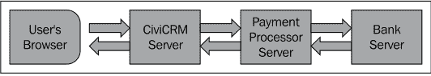

在第一种架构中，电子商务网站本身通过在后台与支付处理器通信来安全地处理信用卡或其他财务账户信息，同时用户等待付款处理。

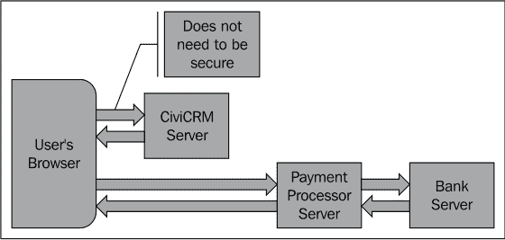

## 筹款：为你的使命筹集资金

第二种方法是一种低端方法，其中电子商务网站与提供自己的用户[content]

如果你刚开始入门，正在尝试在多个可用的支付处理器中做出选择，选择支付处理器时需要考虑的因素之多可能会让人感到困惑。我们建议从确定哪些处理器在你的国家可用开始做出决定。对于大多数 CiviCRM 用户来说，你会有多种选择。

你也可能会发现没有任何处理器在你的国家可用，或者你想使用一个尚未得到支持的处理器。例如，你可能正在使用支付处理器用于你的销售点终端或支票处理，并希望将在线支付处理添加到你与他们的现有账户中。开发新的 CiviCRM 支付处理器插件的说明是可用的（访问 http://wiki.civicrm.org/confluence/display/CRMDOCT2/Creating+Additional+Payment+Processor+Plugins）。

大多数支付处理器都会提供技术文档来帮助开发人员为 CiviCRM 等软件包创建插件，因为这会增加他们的业务量。有各种顾问可以帮助你和社区为其他支付处理器创建和支持插件（http://civicrm.org/professional）。如果你发现使用不同的处理器有令人信服的理由，其他人也可能想使用它。

电子商务网站，包括接受非营利组织捐赠的网站，以以下两种图表所示的两种常见方式与支付处理器交互：


在第一种架构中，电子商务网站本身通过在后台与支付处理器通信来安全地处理信用卡或其他财务账户信息，同时用户等待付款处理。


## 筹款：为你的使命筹集资金

第二种方法是低端方法，其中电子商务网站与提供自己面向用户页面的外部支付处理器交互。在这种方法中，你的电子商务网站计算需要支付的金额，然后将用户发送到支付处理器的安全网站，在那里处理付款，之后支付处理器网站将用户发送回电子商务网站。

如果配置正确，两个系统都会以安全加密的方式传输信用卡号码等敏感信息。由于 CiviCRM 不存储有关交易的敏感信息，因此这两种方法都提供了良好的电子商务安全性。

虽然两种方法都可行且有效，但两者各有利弊：

| | 外部托管 | 内部托管 |
|---|---|---|
| 需要购买和设置 SSL 证书 | 否 | 是 |
| 信用卡数据存在潜在安全风险 | 极低 | 很低 |
| 可在低端共享主机上使用 | 是 | 否 |
| 需要保持服务器安全 | 高 | 很高 |
| 失去你的视觉品牌 | 是 | 否 |
| 捐赠者可能暴露于可能令人讨厌的支付处理器信息 | 是 | 否 |
| 易用性 | 较差 | 更好 |

我们建议除最低交易量网站外，使用提供内部托管的支付处理器。如果你是在线支付新手，还不知道你的支持者会产生多少交易量，请考虑在你能够评估响应并确定内部托管是否值得额外成本之前实施更简单的外部托管解决方案。

内部托管要求你获得并设置 SSL 证书，因为你的网站必须与用户的浏览器安全通信以处理他们的信用卡详细信息。外部电子商务托管，即将用户转移到支付处理器的网站以处理交易，使用他们的 SSL 证书进行保护。

SSL 是一种通信协议，允许用户的浏览器与你的服务器通信而无需任何人窃听。它通过使用特殊密钥安全地加密往返的信息来实现这一点。互联网用户越来越熟悉这样一个事实：地址开头为 `http://` 的页面不安全，而以 `https://` 开头的页面可以是安全的。浏览器在显示安全页面时也会显示一个小锁图标：


随着 SSL 证书商品化，SSL 证书的成本继续下降，安装的便捷性也在不断提高。像 **RimuHosting** 这样的托管提供商重新销售 **RapidSSL** 证书，最低仅为 40 美元，包括安装。安全公司继续努力创造对具有更多功能的高价 SSL 产品的需求，例如用于你网站的动态“由...认证”徽标、在浏览器地址栏中显示你的组织名称，以及更高级别的担保。尝试为你选择的证书物色一个好价格（http://www.namecheap.com/ssl-certificates 在撰写本书时是一个不错的来源）。

在考虑不同的支付处理器时，还有其他因素需要考虑，例如支持哪些信用卡、不同选项的成本，以及是否支持诸如定期捐款等高级功能。我们认为，以牺牲可用性为代价来节省支付处理器的费用很少有意义，因为仅仅几个丢失的捐款通常比节省的费用更“昂贵”。然而，提供相同可用性水平的支付处理器的成本往往存在显著差异。这些差异高度取决于捐款的数量和规模以及使用的是哪种信用卡或其他支付工具。

可能在成本中发挥重要作用的一个因素是支付处理器是否要求你拥有商户账户。这些通常涉及银行的单独费用，尽管有时它们可能捆绑到支付处理器的费用中。自动将资金转入你的商户账户，而不是要求定期手动干预从支付处理器的账户中取出资金，对于交易量较高的组织来说可能很有用且物有所值。

以下是比较不同选项成本时应询问的一些费用，即使对于某些处理器和/或商户账户来说它们可能很小：

- 初始支付处理器账户设置费
- 初始商户账户设置费
- 设置和批准支付处理器和商户账户所需的咨询或员工时间
- 支付处理器和商户账户的固定月费和/或年费
- 支付处理器和商户账户按收费金额百分比收取的佣金，有时对更高交易量有折扣
- 支付处理器和商户账户的每笔交易费用
- SSL 证书第一年的费用和年度续费费用
- 新证书和续订证书的 SSL 安装费用

声称具有非营利或慈善地位的组织似乎会受到额外的安全审查。此外，如果你的银行账户名称与你的 PayPal 账户名称不完全匹配，你可能难以提取资金，因为 PayPal 不会将以 John Smith 名义的 PayPal 账户中的资金释放到 Judy 和 John Smith 名下的银行账户。显然，资金被冻结或在不确定的时间内无法使用可能会对你的正常运营造成重大问题。

我们建议尽早开始设置支付处理器账户和商户账户（如有必要）。这可能需要几天或几周才能完成，并且可能需要提供组织的成立文件，这些文件可能存放在保险箱中，以及非营利地位的官方认证。

### 初始筹款配置

CiviCRM 中有两个组件专门用于筹款事务：CiviContribute，处理捐款；以及 CiviPledge，设计用于预授权付款或承诺未来付款。本节描述如何配置它们。

由于 CiviContribute 支持 CiviEvent 和 CiviMember 组件的财务方面，因此你需要配置它以记录或接受活动注册、会员资格和订阅的付款，即使你的组织不接受纯捐款而只接受作为此类事项交换的付款。

### 配置 CiviContribute

配置 CiviContribute 的第一项任务是如果尚未启用则打开该组件：

1. 点击 **Administer | Configure | Global Settings | Enable CiviCRM Components**。
2. 如果 **CiviContribute** 出现在左侧列中，突出显示它，然后点击 **Enable**。
3. 点击 **Save**。

接下来，确保有关捐款的信息在整个系统中的适当位置显示：

1. 点击 **Administer | Configure | Global Settings | Site Preferences**。
2. 确保 **Contributions** 已为 **Viewing Contacts**、**Contact Search** 和 **Contact Dashboard** 选中。
3. 点击 **Save**。


CiviCRM 目前还存在一个限制：它只能将会员资格或活动报名归因于单笔贡献付款。不过，目前正在扩展数据模型，以支持部分付款以及其他簿记和会计增强功能。这有可能用于针对单个“购买”（例如活动报名）记录多笔不同付款，每笔付款都有自己的贡献类型。随着该功能的开发，请关注 CiviCRM 博客以获取更多信息。

## 配置付款工具

CiviCRM 将有关付款方式的信息存储为付款工具信息。付款工具即支付方式，例如支票、现金、EFT（电子资金转账）、信用卡和借记卡。您的组织很可能不会支持所有这些默认工具来接收付款。

要查看和调整付款工具：

- 1. 点击 **管理 | CiviContribute | 付款工具**。
- 2. 要**禁用**或**删除**某个付款工具，请点击相应付款工具右侧的对应链接。
- 3. 要编辑付款工具，请点击其名称右侧的**编辑**链接，然后在各字段中输入或调整值，并点击**保存**。

## 配置可接受的信用卡

有一个单独的界面用于指定可接受的信用卡（例如 Visa、Amex）。不要将付款工具与个别信用卡类型混淆。尤其是，不要为每种信用卡创建单独的付款工具。相反，请执行以下操作：

- 1. 点击 **管理 | CiviContribute | 可接受的信用卡选项**。
- 2. 要**禁用**或**删除**某个信用卡选项（如 Amex），请点击相应信用卡选项右侧的对应链接。
- 3. 要添加类型，请点击**添加可接受信用卡**按钮并输入相关信息。

在设置系统时，请务必查看您的支付处理器的选项和限制，以确认他们接受哪些卡类型。

## 配置支付处理器

为了在线接收付款，CiviCRM 要求您配置一个支付处理器，如本章前面所述。不同的支付处理器具有不同的参数、选项和设置说明。要确定如何使用特定的支付处理器设置和测试您的账户，请访问 http://wiki.civicrm.org/confluence/display/CRM_DOC32/CiviContribute+Payment+Processor+Configuration，点击您的支付处理器的名称，并按照相关说明操作，或联系处理公司以获得更多指导。

> 在未来版本中，支付处理器集成将通过扩展机制来处理。随着该系统的实施，您可能需要在 http://wiki.civicrm.org 上的其他地方搜索您的支付处理器的名称。

要配置 CiviCRM 以配合支付处理器工作，请按照以下步骤操作：

- 1. 点击 **管理 | 配置 | 全局设置 | 支付处理器**。
- 2. 根据您的支付处理器的说明，为**在线**和**测试付款**输入**名称**，或许还有**描述**和**处理器详细信息**。
- 3. 点击**保存**。

如果您选择的支付处理器要求您的网站拥有 SSL 证书，您需要购买并安装一个。如果您使用的是托管服务提供商，他们很可能会推荐首选证书并提供收费的安装服务。如果您没有提供此项服务的托管安排，您需要让具备系统管理技能和足够服务器访问权限的人员来安装它。技术流程因操作系统和证书颁发机构而异，对于缺乏系统管理经验的人来说并非易事。

低端和中端 SSL 证书仅支持单个域名或子域名。这包括区分域名的根形式和 www 形式。例如，用于 https://www.mydomain.org 的证书不适用于 https://mydomain.org，反之亦然。您可以购买并安装两个域名的证书，或者购买价格更高、涵盖两者的通配符证书。

- 1. 在一个贡献页面上运行一两笔小额测试付款，该页面可以按照本章末尾*创建在线贡献页面*部分所述进行配置。
- 2. 确保付款被支付处理器接收。
- 3. 验证资金是否正确存入您的银行账户，无论是自动还是手动方式（视情况而定）。

请注意，PayPal 和其他一些支付处理器的沙盒环境比其生产系统更难使用，因此直接在其真实服务器上使用真实付款进行配置和测试可能更快、问题更少。

此时让您的簿记员检查相关事项也是个好主意，以确保他们能够将在线付款正确整合到您的会计流程中。有时，支付处理器将在线付款与销售点终端的付款进行批处理的方式可能会存在问题，从而难以跟踪。您可能需要审查如何将 CiviCRM 中存储的特定交易与银行账户中的存款可靠地关联起来，反之亦然。要查看可能对此有所帮助的报告，请点击**报告 | 簿记交易报告**。

## 配置赠品

赠品是可以提供给捐助者以鼓励他们捐款的感谢礼物。它们通常被用作激励更多人捐款的手段。例如，任何捐赠 50 美元的人都可以获得一个带有您组织标志的咖啡杯，而捐赠 100 美元的人可以选择获得一件带有标志的 T 恤。所有赠品都在站点范围内指定，然后才能在特定的 CiviContribute 页面上启用。通过启用赠品的贡献页面捐款的捐助者始终可以选择不接受赠品。通过使这些礼物成为可选项，您可以减少在不想要的赠品上浪费资源。

使用 CiviCRM 进行筹款并不需要配置赠品，如果您刚刚开始，您可能应该专注于更基本的核心功能。当特定的募捐活动开始使用赠品或新的赠品时，您需要配置或重新配置站点范围内的赠品选项，然后才能为特定页面启用它们。以下是添加赠品的方法：

- 1. 点击 **管理 | CiviContribute | 赠品（感谢礼物）** 或 **贡献 | 赠品（感谢礼物）**。
- 2. 点击**添加赠品**。
- 3. 在各字段中输入应显示给潜在捐赠者的信息，从**名称**开始。
- 4. **描述**可以是促销文字，也可以只是解释性说明。
- 5. 如果该商品在您网站的其他地方有售，**SKU** 会很有用。
- 6. 对于**赠品图片**，使用“从以下网址使用显示图片和缩略图”选项来显示您自己网站上的产品图片（例如，在 Drupal Ubercart 商店中），这样可以防止商店图片更新时这些图片不同步。
- 7. **最低捐款金额：** CiviCRM 将在启用赠品的任何地方强制执行此最低金额，如果有人索取赠品但捐款未达到此金额，则会显示错误消息。如果您想在不同的贡献页面上为同一商品设置不同的最低捐款金额，您可以为该商品创建另一个赠品。
- 8. **市场价值：** 某些司法管辖区要求仅对排除所提供任何赠品的公平市场价值后的金额开具可抵税的慈善收据。如果这适用于您的组织，并且此赠品将用于接受可抵税付款的页面，请在此处输入一个值。
- 9. **产品实际成本：** 在此处输入一个值，以改进对提供赠品的净回报以及整体吸引力的计算。
- 10. **选项：** 提供逗号分隔的选项列表，例如尺寸或颜色。逗号分隔的列表会忽略换行符，因此一行中最后一个逗号之后的文本会与下一行开头的文本连接在一起，直到遇到逗号。如果您想为产品的两个方面（例如颜色和尺寸）提供选项，则必须将每个组合作为单独选项输入，或者进行一些自定义编程。
- 11. **订阅或服务设置。** 自定义编程可以利用此处收集的信息，在您的 CMS 中提供对可下载文件（如报告或歌曲）的临时访问权限，或提供对 CiviCRM 管理的会员资格或订阅的访问权限。或者，工作人员可以在收到捐赠的电子邮件或其他通知后手动管理此类福利。
- 12. 点击**保存**。

您可以随时返回添加、修改、禁用或删除赠品。如果赠品在多个贡献页面之间共享，请务必在开始编辑之前了解任何修改的影响。

## 配置价格集

价格集用于构建更复杂的捐赠级别选项集。在大多数情况下，您将创建简单的捐赠级别列表，并包括让捐赠者输入自己自定义金额的选项。但是，如果您需要多组选项或基于数量的购买，则可以使用价格集。


## 配置 CiviPledge

CiviPledge 是 CiviCRM 的一个组件，用于支持对定期付款的非强制性承诺。这与 CiviCRM 也支持的定期捐款不同，后者实际上会在支付处理商处创建授权记录，以便按定期自动转账资金。相比之下，承诺是承诺通过多次定期付款支付固定金额的承诺。

例如，您的组织可能会鼓励现有捐赠者通过承诺每月付款来增加其年度总捐款，您将该付款与相应的月度需求相关联。无家可归者收容所可能会发起一项为期一年的“每月提供五顿饭”的活动。总年度捐款为 240 美元，由 20 美元的月付款组成。

当创建承诺记录时，它包括承诺的捐款总额和付款条款，即付款次数和频率（12 次 20 美元付款）。然而，它只是付款的承诺。CiviCRM 提供了用于跟踪付款、发送提醒以及提供在线付款表单的有用工具。随着捐赠者在定期捐款中履行其承诺，您将付款记录在承诺记录中并跟踪其进度。一旦所有付款都收到，承诺记录可以关闭。

在实施承诺注册之前，您必须启用该组件（默认情况下处于禁用状态）。点击 Administer | Configure | Global Settings | Enable CiviCRM Components 并将 CiviPledge 从左侧列移动到右侧。

您可以通过 Contribution Page 设置来配置将发送给捐赠者在下次付款到期日前提醒捐赠者的自动承诺提醒电子邮件，在此您也可以指定用于承诺的表单。但是，您还必须配置 cron 作业以定期检查各个承诺记录的状态和到期日期，并触发电子邮件。请参阅第 3 章，安装、配置和维护，了解配置 cron 作业的完整讨论。

## 手动记录捐款

现在我们已经配置了 CiviContribute 并对关键功能选项有了工作知识，我们可以开始查看如何记录捐款记录。学习如何在此阶段手动记录捐款的部分原因是，它将提供有关捐款存储的丰富信息的更好认识。这将为更好地理解在线捐款页面自动记录捐款时发生的自动化奠定基础。

记录离线捐款最简单的方法是手动记录。“离线”一词可能有点误导或令人困惑；它用于区分直接在线接收和处理的付款（例如，信用卡付款）和通过其他离线方式接收的付款。这包括任何未由在线支付处理商处理的捐款类型。示例包括在办公室收到的现金、实物商品和服务、通过邮件收到的支票、通过呼叫中心收到的网站外的信用卡和借记卡捐款，这些捐款通过销售点（POS）设备处理，或在银行分行进行的电子资金转账（ETFs）。

要手动记录捐款，请从主菜单点击 **Contributions | New Contribution** 或 **Create New** 按钮。从联系人记录中，您可以点击 **Actions | Add Contribution**，或点击 **Contributions** 选项卡然后点击 **Record Contribution (check, Cash, EFT...)**。如果为您的网站配置了集成的支付处理商，您将看到 **Submit Credit Card Contribution** 的选项。该表单几乎相同，只是它将包含所需的信用卡相关字段并触发实际的付款交易。

按如下方式填写字段：

- 1. 如果添加捐款的方法没有在 **Contributor** 旁边产生只读名称，则开始在 **Select Contact** 字段中输入姓名或电子邮件的一部分。从自动填充的结果列表中选择一个联系人。
- 2. 如果无法从联系人搜索中找到做出捐款的联系人，请点击 **Create new contact** 并选择其中一个联系人类型选项。这将打开一个弹出表单，您可以在其中输入有关联系人的基本信息并保存记录。
- 3. 选择适当的 **Contribution Type**。
- 4. 输入 **Total Amount** 和货币类型。如果您之前创建了价格集，您将有选择它的选项以从可用选项中进行选择。
- 5. 可选输入 **Source**。这旨在帮助您追踪捐赠者/捐款的来源。如果留空，CiviCRM 将用一些相关数据填充它，例如谁输入了捐款。

> 当您选择联系人类型时出现的模态弹出表单由保留配置文件控制。您可以在 CiviCRM 中每当选择此 **Create New** 联系人选项时修改您希望收集的字段。转到 **Administer | Customize | CiviCRM Profile** 后，点击 **Fields** 旁边的 **New Household**、**New Individual** 或 **New Organization** 之一。

- 6. 在 **Received** 旁边输入日期和 **Time**。要删除收到日期，请点击 **Time** 字段右侧的 **Clear** 链接。如果留空，CiviCRM 将用当前日期填充该字段。
- 7. 选择适当的 **Paid By** 值，或留空表示实物捐赠。
- 8. 如果 **Paid By** 设置为 **Check**，请输入 **Check Number**。
- 9. 在 **Transaction ID** 中，如果存在唯一的交易标识符，例如银行转账号码，则输入；否则留空。
- 10. 如果捐赠者档案中存在电子邮件，您将有通过电子邮件向其发送收据的选项。如果未选中，或如果没有电子邮件存档，您可以输入 **Receipt** 日期和 **Time**。如果通过电子邮件发送收据，这些值会自动填写。
- 11. 选择适当的 **Contribution Status**，例如如果承诺的支票尚未收到，则为 **Pending**。
- 12. 在 **Soft Credit To** 中，输入姓名或电子邮件的一部分或全部并从结果列表中选择一个联系人。软记分的概念是承认另一位捐赠者在争取和获得此捐款方面的作用。例如，如果您知道 John Doe 是通过与 Jane Johnson 的交谈决定向您的组织捐款，您可以使用此字段为 Jane 记分。如果联系人应为捐款获得软记分且尚未在数据库中，请在另一个选项卡中创建联系人，然后返回并在此字段中进行搜索。

此时，您已完成了捐款记录的最基本要素。如果您为捐款创建了任何自定义字段，它们将出现在这些初始字段下方，可以通过点击标题面板进行展开。点击 **Additional Details** 以打开其他字段选项。

- 1. 输入有关捐款的 **Notes**，如有。例如，“**在十二月再次联系他，看看他是否想在年底前再做一次可抵税捐款**”。
- 2. 输入捐款的 **Non-deductible Amount**。例如，如果您输入的是价值 350 美元的葡萄酒拍卖付款 500 美元，在加拿大不可抵扣金额为 350 美元。
- 3. 输入 **Fee Amount**，如有。例如，处理 ETF 的 $-1.25 银行费用。
- 4. 输入 **Net Amount**，按 **Total Amount – Fee Amount** 计算得出。
- 5. 输入 **Invoice ID**，如有。这可能是您会计软件生成的发票号码。
- 6. 输入 **Thank-you Sent** 的日期和大致 **Time**。

CiviCRM 支持致敬/纪念捐款。点击 **Honoree Information** 以打开字段集。当捐款是为另一人致敬或纪念时，会为受赠者创建联系人记录，并且捐款将显示在其记录中（作为致敬/纪念他们）。

- 1. 点击 **In Honor of** 或 **In Memory of** 之一。如果选择错误，请点击 **Clear** 以将其删除。
- 2. 输入受赠者的 **First Name, Last Name, Email** 和 **Prefix**。

如果您创建了奖励，您将有一个可以打开的 **Premium Information** 面板：

- 1. 如适用，选择捐赠者请求的 **Premium**。
- 2. 如果 **Premium** 有选项，请选择捐赠者偏好的选项。
- 3. 如果奖励已运送或交付给捐赠者，请输入其 **Fulfilled** 日期。

完成表单后，点击 **Save** 保存捐款，**Save and New** 保存后立即调出同一表单以输入另一笔捐款，或 **Cancel** 放弃记录而不保存。

## 导入捐款

与 CiviCRM 的其他区域一样，您可以通过界面直接将捐款数据导入系统。通过主菜单访问此工具 **Contributions | Import Contributions**。我们不会花时间逐步讲解该过程，因为它与我们在 *第 5 章，收集、组织和导入数据* 中导入联系人时概述的步骤非常相似。但是，在导入捐款时，您应该了解一些细微差别：

- - 导入模式允许两个选项——**insert** 捐款或 **update** 捐款。这些是互斥的——如果插入，所有记录都将是新的；如果更新，您必须在 .csv 文件中包含一个捐款 ID 列，该列与系统中的现有记录匹配。更新选项不会在未找到匹配项时简单地创建新记录。
- - 如果插入新记录，您应该在导入文件中提供足够的联系人数据，以确保联系人尽可能与现有联系人记录匹配并合并。
- - 与捐款相关的某些字段是必需的，包括捐款类型和总金额。


与联系人导入类似，我们建议先导入少量数据并仔细检查，然后再导入非常大的数据集。字段映射可以保存并重复使用，从而简化导入、测试和完整导入流程。还要注意服务器资源限制，这可能会限制单次导入的记录数。如果导入文件非常大，您可能需要将其拆分为较小的部分进行导入。

## 手动创建承诺

如前所述，CiviCRM 中的承诺是对未来进行一次或多次付款的承诺。承诺在收到第一笔付款前处于待处理状态，收到后状态变为进行中。一旦所有付款都已收到，其状态将变为已完成。如果其中一笔或多笔承诺付款逾期，承诺的状态不会发生变化。因此，可以将承诺视为多个承诺的捐赠记录的容器。

如果某人承诺支付 360 美元，分 12 个月等额支付，每月间隔一个月，CiviCRM 会将其视为一个承诺，包含十二笔 30 美元的付款（捐赠）。

要手动创建承诺，请点击 CiviContribute | Pledges | New Pledge，或使用 Create New | Pledge。或者，从联系人摘要页面，点击 Actions | Add Pledge，或点击 Pledges 选项卡并点击 Add Pledge 按钮或链接。

- 1. 如果添加承诺的方法未在 Select Contact 旁显示只读姓名，请在该字段中开始输入姓名或电子邮件的一部分。从自动填充的结果列表中选择一个联系人。
- 2. 如果承诺的联系人无法通过联系人搜索找到，请点击 Create new contact 并选择其中一种联系人类型选项。这将打开一个弹出表单，您可以在其中输入联系人的基本信息并保存记录。
- 3. 在 Total Pledge Amount 字段中输入所有付款总额的值。
- 4. 输入付款期数（承诺分期）和每个期间的长度（每日、每周、每月或每年），例如，每 1 个月、每 2 周。输入总承诺金额和分期付款期间后，CiviCRM 将计算出每笔分期付款的金额。
- 5. 如有需要，将 Payments are due on the [] day of the period 的值更改为 1 以外的其他值，例如，如果每月付款将在月中进行，则更改为 15。
- 6. 如果承诺是在记录之前做出的，请相应地回溯 **Pledge Made**。
- 7. 如果付款开始日期与记录承诺的日期不同，请调整 **Payments Start** 日期。
- 8. 如果联系人留有电子邮件，点击 **Send Acknowledgement** 向其发送承诺详情的电子邮件。如果您选择通过邮件发送确认，请使用 **Acknowledgement Date** 字段记录发送时间。如果使用电子邮件选项，日期将自动填写。
- 9. 点击 **- select -** 旁边的 **Self-service Payments Page** 并点击可用的适当捐赠页面。如果选择，链接到该捐赠页面的链接将包含在承诺提醒电子邮件中。用户随后可以使用该页面提交在线付款，并将捐赠归属于承诺。这非常有价值且重要，因为它为终端用户提供了一种直接将付款与承诺关联的方式。

与捐赠记录一样，捐赠者可能会为某人提供承诺以示尊敬或纪念。与捐赠记录一样，与承诺关联的任何自定义字段都将在此时在其自己的字段集面板中显示以供填写。

点击 **Payment Reminders** 标题展开字段集面板并配置提醒电子邮件。请记住，此功能取决于 cron 作业的配置，该作业应每晚运行并管理承诺状态更新和电子邮件提醒。

- 1. 配置何时发送初始提醒：**Send Initial Reminder [] Days prior to each scheduled payment due date.**
- 2. 如果您希望发送多次提醒，请将 **Send up to [] reminders for each scheduled payment** 设置为大于 1 的值。
- 3. 将 **Send additional reminders [] days after the last one sent** 设置为不超过最大提醒次数。

只有在可以向承诺捐赠的人发送邮件时，才会发送承诺提醒。如果联系人没有电子邮件、电子邮件无效，或他们已被管理员或自己标记为 **Do not e-mail**，则不会发送提醒。

在您审阅并完成记录后，点击 **Save** 或 **Save and New**。点击 **Cancel** 可在不保存的情况下退出记录。

保存后，花点时间查看 CiviCRM 如何构建和显示承诺记录。如前所述，承诺本身是单个承诺付款的容器。这在联系人的 **Pledges** 选项卡中有所体现，单个承诺行会展开以显示各个计划和已完成的承诺付款。

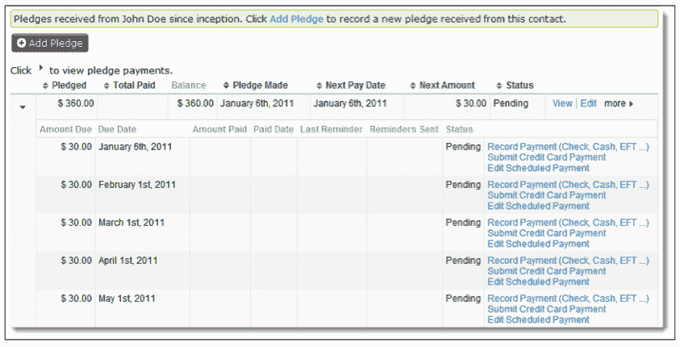

在您收到与承诺相关的捐赠时，重要的是通过此界面记录它们，而不是通过主捐赠选项卡（CiviCRM 在 **Contributions** 选项卡上放置了提醒以提供指导）。由于跟踪承诺进度和状态的本质涉及查看承诺付款记录的实际收款，因此您需要确保捐赠与承诺适当关联。

如果捐赠者逾期付款、提交的付款与计划不同，或请求更改付款条款（例如延长付款期限），请使用 **Edit Scheduled Payment** 链接修改记录。

## 搜索、检查和处理捐赠

到目前为止，我们主要集中精力了解与筹款相关的关键配置选项，以及在联系人记录中处理单个联系人和承诺记录。在本节中，我们将批量处理捐赠记录，并回顾通过 CiviCRM 实施筹款技术的“配方”。在学习本节的过程中，我们还将突出显示值得注意的功能或如果处理不当可能会出现意外结果的地方。

## 查找捐赠

虽然您经常会直接通过联系人记录处理捐赠，但您很可能会花费大量时间搜索和报告批量捐赠记录。例如，您可能需要定期了解一段时间内收到的捐赠数量，例如上个月或年初至今。您可能需要导出所有类型为“Donations”的捐赠，以便为税务目的发送年末对账单。或者，您可能希望筛选出捐赠金额超过特定阈值的捐赠者，并将他们归类为主要捐赠者，通过邮寄和电子邮件以独特的方式针对他们。

与 CiviCRM 中的其他功能区域一样，您可以使用组件搜索 **Contributions | Find Contributions** 或通过 **Advanced Search** 中的 **Contributions** 面板进行这些搜索。字段选项相同，但结果却大不相同。组件搜索始终返回组件记录，而 **Advanced Search** 默认返回联系人记录。这意味着如果 John Doe 有三笔符合我标准的捐赠，我将在 CiviContribute 组件搜索中看到三条记录（因为返回的是不同的捐赠记录），而在 **Advanced Search** 中只会看到一条（代表联系人记录）。此外，操作，例如使用配置文件导出和批量更新将反映来源。例如，在 **Find Contributions** 工具中，您将能够导出捐赠详情。


> 在 CiviCRM v3.3 中，**Advanced Search** 工具扩展为允许您通过此界面检索相关记录。使用 **Display Results As** 下拉菜单，您可以选择检索联系人（默认）、活动、捐赠或活动注册记录。与使用组件搜索相比，其优势在于能够在多种类型的数据中添加标准，但检索联系人的相关记录在不同区域。例如，我可以检索所有具有 **Employee of** 关系的个人自 2004 年起成为会员的捐赠。


以下截图展示了查找贡献工具中可用的选项：

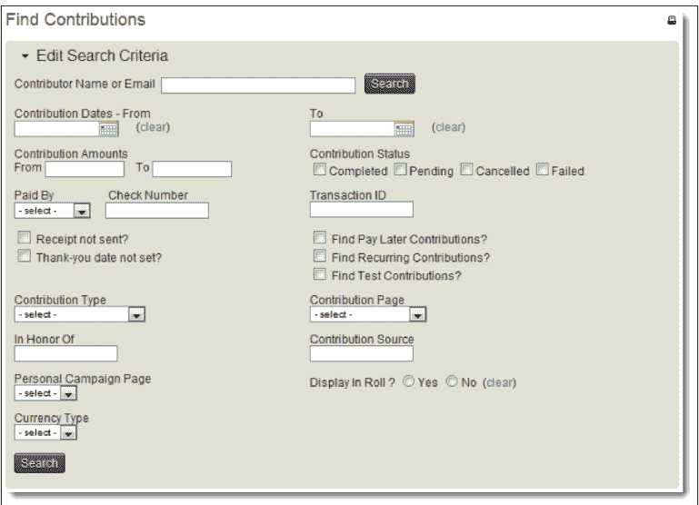

在很大程度上，这些选项都相当直观且不言自明。我们将简要介绍它们：

- **贡献者姓名或电子邮件**：可以是部分匹配。
- **贡献日期 – 从和至**：这将搜索收到贡献的日期（通常是记录的日期）。
- **贡献金额从和至**：在“从”字段中视为大于或等于，在“至”字段中视为小于或等于。
- **贡献状态**：选择已完成、待处理、已取消和失败中的一项或多项。
- **支付方式、支票号码或交易ID**：如果为“支票号码”指定了值，请确保“支付方式”字段留空或选中“支票”；否则将不会返回任何结果。
- **未发送收据？**：这在生成要接收收据的贡献者列表时很方便。
- **未设置感谢日期？**：如果选中，则将不会返回已设置**感谢日期**的贡献，从而提供需要发送“感谢信”的结果。如果未选中，则无论**感谢日期**中的值如何，都会返回结果。
- **查找稍后付款的贡献？**：如果选中，仅返回“稍后付款”的贡献。如果未选中，则无论**稍后付款？**中的值如何，都会返回结果。
- **查找定期贡献？**：如果选中，仅返回定期贡献。如果未选中，则无论贡献是否为定期贡献，都会返回结果。
- **查找测试贡献？**：如果选中，将返回通过贡献页面测试表单生成的任何贡献。默认情况下，所有测试记录都将从搜索结果中排除。选择此选项是查找这些记录的唯一方法。
- **贡献类型**：提供了一种便捷的方式来搜索活动、会员资格、捐赠或其他已配置的贡献类型的付款。
- **贡献页面**：提供了一种便捷的方式来搜索特定组织（或订阅）的会员资格，或对使用专门贡献页面（活动）的募捐呼吁的捐赠。
- **纪念**：提供了一种按姓名搜索被纪念人的方式。

> 与CiviCRM中大多数联系人的自由文本搜索不同，**纪念**搜索字段默认情况下*不会*根据联系人的部分或完整姓名或电子邮件地址来查找联系人。要绕过此限制，您可以在搜索内容中显式包含通配符（%）。无论您将其放在哪里，它都将匹配任何文本。例如，%John% 将匹配 John Doe 以及 Jane Johnson。

- **贡献来源**：必须精确匹配，除非使用通配符。
- **个人活动页面**。可用于确定活动者的表现如何。
- **在光荣榜中显示？**：如果选择**是**，则仅返回在公共光荣榜中勾选了“显示我的贡献”的个人活动页面的贡献。如果选择**否**，则仅返回在公共光荣榜中未勾选**显示我的贡献**的个人活动页面的贡献。如果既未选择**是**也未选择**否**，则无论此设置如何，都会返回贡献，无论它们是否通过个人活动页面进行。
- **货币类型**：如果您的CiviCRM实现具有多种可用货币（请参阅**管理 | 配置 | 全局设置 | 本地化、可用货币**），则用户可以选择他们希望用来贡献的货币。在此处指定货币类型将仅返回该货币的贡献。
- **贡献的自定义数据字段**：您可以按自定义数据字段过滤搜索结果。

## 检查贡献

在执行贡献搜索后，您会得到一个包含关键详细信息的列表。从此列表中，您可以直接访问联系人或贡献记录。

搜索结果中的每一列——名称、金额、类型、来源、收到日期、感谢信已发送、状态和赠品——都可以按升序或降序排序。您还可以在每行右侧看到熟悉的查看/编辑/删除操作链接。

点击任何贡献行中的联系人姓名，即可进入其摘要记录。我们可以看到贡献和认捐的数量以及其他选项卡项目。通过点击“贡献”选项卡，我们可以获得其捐赠历史的良好概要摘要，其中包含三行：最近捐赠时间、频率和金额。第一行显示当前年度至今的总金额、贡献数量和平均金额。所有年份的总计在第二行。具体捐款按时间倒序排列。请注意，这些总计仅考虑已完成的贡献（待处理、已取消等不包括在内）。同样，这些列可以排序，便于以多种方式快速访问捐款。

在匆忙离开之前，还需要指出的是，筹款人可以使用页面上的链接记录线下付款的接收情况，或查看、编辑或删除该联系人的贡献。

## 对贡献执行操作

在搜索贡献后，您可以选择部分或全部记录并对其执行批量操作。可用的选项与我们在联系人搜索操作列表中看到的不同，因为它们是针对贡献记录的需求而量身定制的。

在本节中，我们将回顾这些批量操作，考虑它们的典型用例，并逐步说明如何更好地利用可用功能。

首先执行搜索，选择部分或全部记录，然后选择操作下拉菜单以查看您的选项。选择要对所选记录执行的操作后，单击“执行”以启动它。以下小节说明了各种操作。

### 更新待处理贡献状态

此工具是更新在线“稍后付款”贡献、或由管理人员接收并手动录入的线下直邮/电话营销活动贡献的一种方式。

“稍后付款”贡献将保持“待处理”状态，直到收到贡献（例如在表单提交后邮寄来的支票）。在某个时候，如果不再有希望收到付款，它们也可能被视为失败的捐赠。“更新待处理贡献状态”操作提供了一个针对这种情况优化的批量更新表单。它可以比逐一查找和编辑这些字段更快地更新费用金额、支付方式、支票#、交易ID和交易日期。一旦您为这些字段输入数据并为显示出的记录选择了新的贡献状态，请单击“更新待处理状态”以保存所有更改。

请注意，要使用此工具，您搜索选择的所有贡献都必须具有“待处理”状态；否则将显示错误消息。

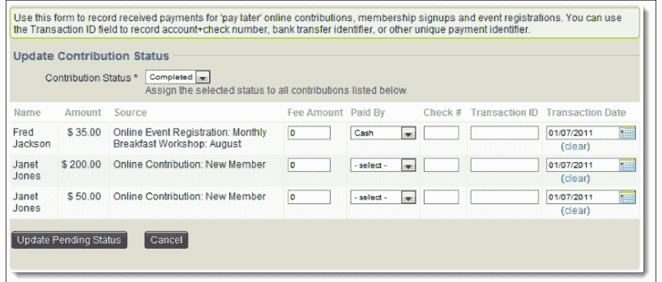

### 打印或电子邮件发送贡献收据

此操作的一个绝佳用途是跟进那些刚刚将其贡献状态从“待处理”更新为“已完成”的记录。在任何操作后单击“完成”，您将返回到搜索结果，并可以继续执行其他操作。从列表中选择“打印或电子邮件发送贡献收据”，然后单击“执行”。

### PDF或电子邮件收据

**PDF收据**会生成一个可打印和邮寄的收据PDF文件，而**电子邮件收据**则通过电子邮件将收据发送给所有选中记录的捐赠者。点击**处理收据**后，您将返回到搜索结果（如果您通过电子邮件发送了收据），或提示您保存PDF文件（如果您正在生成PDF收据）。请注意，收据是使用**贡献 - 收据（在线）**模板生成的（有关更多详细信息，请参阅**管理 | 配置 | 消息模板，系统工作流消息**）。

### 向联系人发送电子邮件

与相应的联系人搜索操作相同，此工具允许您生成电子邮件活动并发送给搜索结果。此操作的一个可能的用途是向捐赠者发送感谢电子邮件，这些捐赠者将收到签名的纸质收据，因为某些司法管辖区不承认电子邮件收据用于税务目的。

填写标准的**发送电子邮件**活动表单，选择适当的**发件人**电子邮件、**抄送**和**密件抄送**；输入**主题**行；并提供电子邮件内容。与使用此工具的其他情况一样，您可以选择**使用模板**，并根据需要提供**HTML格式**和/或**纯文本格式**内容。电子邮件内容可以保存为新模板，或者如果使用了现有模板，则可以更新它。如果您已在**全局设置**中启用附件，则可以在此处添加附件。

### 通过配置文件批量更新贡献

此选项也基于联系人搜索的等效工具，允许您使用预定义的配置文件来定义将编辑的列/字段，在网格式布局中一次更新最多100条记录。为了说明此操作的实用性，我们将创建一个包含贡献字段的配置文件，然后使用它来更改状态和其他几个贡献字段。与对其他记录执行的批量更新操作一样，您将能够比逐一查找和编辑每条贡献记录更快地编辑贡献配置文件中暴露的字段。

在**管理 | 自定义 | CiviCRM配置文件**处创建一个配置文件，并选择一些贡献类型字段，例如感谢日期、支付工具和支票号码。不需要添加与联系人相关的字段，因为仅包含贡献字段的配置文件会自动显示捐赠者的姓名、电子邮件和地址。保存配置文件后，返回您的搜索结果或重新初始化它们，选择一个或多个贡献，然后选择**通过配置文件批量更新贡献**操作。您将看到可用于此目的的配置文件列表。选择您刚刚创建的配置文件，然后单击**继续**。


然而，我们强烈不建议删除财务数据交易，并且会建议一些方法来防止任何用户拥有删除财务交易的权限。更好的做法是记入冲销交易或使用状态来传达原始交易为何发生变化（例如，通过标记为已取消并提供操作说明）。

一个例外可能是当你清理系统中的测试记录时。通常，测试记录在界面中是隐藏的。你必须明确选择在“查找捐款”工具中包含它们（勾选“查找测试捐款？”）；否则，它们默认会被排除。

然而，定期搜索这些测试记录并使用批量“删除捐款”操作将它们从系统中移除是合理的。请确保在执行任何此类批量删除之前，已备份数据库的最新版本。

正如你所见，CiviCRM 提供了许多强大的工具来批量处理捐款记录。花时间探索可用功能，以便在处理记录时了解你的选项，并清楚地理解它们的作用。

## 搜索、检查和对认捐进行操作

与捐款相比，可用的认捐管理选项较少。如前所述，认捐是一组捐款记录（认捐付款）的集合，由包含的认捐选项定义。

### 搜索认捐

要搜索认捐，请点击 搜索 | 查找捐款 或 捐款 | 认捐 | 查找认捐。搜索认捐时可用的条件如下。我们将在使用条件时指出任何特别有用、有趣或可能意外的行为：

- **认捐者姓名或电子邮件**：使用部分字符串搜索认捐者姓名或电子邮件。
- **付款计划 – 起始和结束**：输入范围，或仅输入开始或结束日期。与其他字段一样，此处不输入值将返回与该字段值无关的记录。
- **认捐付款状态**：一个或多个 已完成、待处理、已取消、逾期。

- **认捐金额 – 起始和结束：** 这些金额范围是包含的——它将包含大于或等于 **起始** 且小于或等于 **结束** 金额的认捐金额。在使用任何基于范围的字段时，你不需要为两者都提供值。例如，在 **认捐金额起始** 字段中输入 **50** 将返回所有大于或等于 50 的认捐。
- **认捐状态：** 一个或多个 **已完成、待处理、已取消、进行中** 或 **逾期** 状态。了解 **认捐付款状态** 与 **认捐状态** 之间的区别，前者跟踪单个付款记录，后者跟踪认捐记录的整体状态。
- **认捐创建 – 起始和结束：** 这些是包含的——认捐金额大于或等于起始且小于或等于 **结束**。
- **付款开始日期 – 起始和结束：** 这些包含大于或等于 **起始** 且小于或等于 **结束** 的认捐金额。
- **付款结束日期 – 起始和结束：** 这些包含大于或等于 **起始** 且小于或等于 **结束** 的认捐金额。
- **捐款类型：** 输入一个或多个捐款类型。
- **捐款页面：** 请注意，此列表可能包含当前未配置为允许认捐的捐款页面。例如，可能曾经允许认捐并且已针对其做出认捐。
- **纪念/致敬：** 请注意，它会搜索名字和姓氏的全部或部分，但不会搜索电子邮件地址。
- **查找测试认捐？** 如果选中，仅返回测试认捐。如果未选中，仅返回非测试认捐。
- **认捐频率 每 [时长] [频率]：** 检索由所选频率选项定义的认捐。

搜索结果返回“容器”认捐记录，但你可以点击记录左侧的箭头展开并查看关联的认捐付款计划。

### 检查认捐

认捐比单个捐款记录更复杂。从本质上讲，它们是作为一个整体单元（具有不同元素）绑定和管理的捐款组。认捐的创建定义了捐款记录；单个认捐付款的状态控制整体认捐记录的状态。

进行搜索后，认捐搜索结果页面允许轻松钻取访问构成认捐记录的待处理和已完成付款计划。除了 查看/编辑/删除 链接外，还提供 取消 操作。取消与删除不同，不会删除已收付款的记录。它是管理已在付款中途停止的认捐记录的首选方式。

钻取中显示的每个付款在右侧都有操作链接，允许管理员记录付款并在付款出现问题时轻松编辑付款计划。例如，如果需要减少付款或延长到期日，可以调整单个认捐付款记录，剩余付款将相应调整。

### 对认捐进行操作

在搜索认捐结果上可用的操作有两种：可以导出或删除认捐。界面和工作流程与上面描述的捐款以及其他对象（如联系人、活动和会员资格）非常相似。进行搜索后，选择一个或全部认捐记录，选择操作，然后点击 Go。

#### 导出认捐

选择 导出主要字段 并点击 继续，将包含主要联系人和捐款字段的 .csv 文件保存到本地硬盘。导出可用于导入到你的会计系统、发送邮件或满足其他需求。

如果你想要更多控制导出的字段，请选择 选择导出字段 并点击 继续 进入字段选择页面。从此页面，你可以指定要导出的字段，如果需要，还可以保存字段映射以供将来使用。选择字段后，点击 导出 生成并下载导出文件。请参考你的会计系统文档，了解其通过 .csv 导入功能可使用的字段。

如果你之前保存了导出字段映射，在选择 选择导出字段 选项时它将可供选择和重用。选择现有字段映射并点击 继续 后，你将能够查看和修改导出的字段列表，并提供 更新此字段映射 或另存为新字段映射 的选项。选择前者将在点击 导出 时更新字段映射。选择后者允许你提供名称和描述，然后在点击 导出 时保存映射并导出数据。你也可以两者都不选择，直接点击 导出 以导出数据而不修改现有字段映射。

#### 删除认捐

正如操作标题所示，在认捐搜索结果上启动此选项将连同其关联的捐款记录一起从系统中删除它们。这是一个危险的功能，尤其是在处理具有某些数据完整性和保留义务的捐款记录时。

重申一下，我们强烈不建议删除财务数据交易，甚至建议方法来防止任何用户拥有删除财务交易的权限。如果已做出付款（或认捐），最好取消记录（保留其历史）或记入冲销交易（表明资金已退回），而不是从系统中删除它。完全删除会导致历史数据丢失——关于交易发生情况的细节和信息。这是不良的商业实践，可能不符合公认的会计原则。

此规则的唯一例外是仅为测试功能目的而生成的测试记录，并且其财务费用（如有）已冲销。在认捐搜索工具中，选择 查找测试认捐 以检索它们并使用 删除认捐 操作将其移除。

## 报告

你可以创建捐款和认捐、管理现有记录、进行强大的搜索并对结果进行批量操作；但你如何将系统中的大量数据转化为组织领导层有意义的报告？你如何将原始数据转化为讲述组织现状和未来方向的故事？在本节中，我们将把上面描述的一些搜索工具转化为有意义的示例，说明你如何使用它们来提取重要统计数据和报告摘要。

### 使用高级搜索统计潜在客户

在尝试确定不同细分市场的潜在客户数量时，你需要确保统计联系人而不是捐款。例如，如果你想找到捐赠金额在 100 美元到 500 美元之间的人数，你不会使用 捐款 | 查找捐款 或 搜索 | 查找捐款，因为如果联系人在该范围内捐赠了不止一次，它可能会返回重复的联系人记录。


**高级搜索**默认返回联系人记录，而不是相关记录（如捐赠），并包含其数量的计数，因此它是统计筹款细分潜在客户的一种有用方法：

- 1. 点击 **Search | Advanced Search**。
- 2. 点击 **Contributions** 面板以打开它。请注意，此表单几乎与 **Find Contributions** 工具相同（它排除了联系人姓名/电子邮件字段，该字段在 **Basic Criteria** 面板中处理）。
- 3. 选择所需的条件并运行搜索。

此时，你的搜索将返回所有至少有一笔符合所选条件的捐赠的捐赠者。使用 **Advanced Search** 的另一个额外优势是可以添加贡献面板之外的条件。例如，如果你想将搜索限制为同时也是良好会员资格的联系人，你可以展开 **Membership** 面板并添加条件。

下表概述了某些构成细分将如何转化为特定的搜索条件：

| Segment | Field | Enter the following value |
|---|---|---|
| 捐赠了一笔或多笔金额大于或等于 $100 且小于或等于 $500 的捐赠 | **Contribution Amounts From** | 100 |
|  | **Contribution Amounts To** | 500 |
| 在 2009 年捐赠的人 | **Contribution Dates - From** | Jan 1, 2009 |
|  | **Contribution Dates - To** | Dec 31, 2009 |
| 定期捐赠者 | **Find Recurring Contributions?** | Checkmark |
| 致敬捐赠者 | **In Honor Of** | %（百分号字符是一个通配符，告诉 CiviCRM 匹配任何非空值。在本例中，我们只是想要所有为他人捐赠的捐赠者） |
| 付费活动参与者 | **Contribution Type** | **Event Fee**（假设你的活动使用标准的 **Event Fee** 捐赠类型） |

| Segment | Field | Enter the following value |
|---|---|---|
| 付费会员或订阅者 | **Contribution Type** | **Member Dues**（假设你的会员资格使用标准的 **Member Dues** 捐赠类型） |
| 捐赠给特定在线活动的捐赠者 | **Contribution Page** | 选择接受该活动捐赠的页面。 |

在你输入条件并点击 **Search** 后，你会看到一个页面，其中包含符合条件的捐赠者总数，以及结果的第一页（默认情况下为前 50 条）。在你查看结果后，你可以通过点击 **Edit Search Criteria** 来轻松更改搜索条件并重新运行搜索，以展开条件面板。

请注意，如果你输入多个条件，结果会更少，因为所有条件都必须为真才能返回结果；换句话说，搜索条件是限制性的（条件之间使用 AND 连接）。如果你有兴趣返回匹配其中一个或另一个条件的记录，你可以使用其他工具，例如下面描述的 **Search Builder**。另一种方法是运行你的各个限制性条件集并将其保存为组，然后进行一个组合组的搜索（通过 **Advanced Search** 选择多个组是包含性的——搜索将返回匹配任一组组的记录）。

由于 **Advanced Search** 页面上指定的条件是限制性的，我们提醒你不要同时为捐赠和承诺输入条件。如果你不小心，你可能会要求那些既完成捐赠又做出承诺的人，而这两者通常是截然不同的群体，处理方式也非常不同。

**Advanced Search** 是一个非常强大的工具，但它有几个限制。最值得注意的是，界面不允许你指定 NOT 条件。例如，没有办法说“搜索每个使用捐赠类型不是 **Event Fee** 的联系人。”

## 额外的细分建议和工具

CiviCRM 的搜索和报告机制，可能辅以自定义搜索和报告，可以为你提供：

- 初始礼物现有潜在客户的数量（例如，订阅了新闻通讯、参加了活动、通过电子邮件表达了关注、签署了请愿书等的人数）。

与其他搜索工具一样，你可以进行搜索并对批量结果采取行动。可用选项将取决于返回记录的性质。

## 使用个人资料问卷进行研究

对于许多组织而言，调查和个人资料问卷为了解现有和潜在的构成者提供了重要基础，并可能有助于形成你的筹款策略。

CiviCRM 的自定义字段和个人资料可用于进行调查（请参阅第 5 章《收集、组织和导入数据》，以全面讨论自定义数据和个人资料）。关于对你的使命和捐赠理由的市场态度的总体结果，在制定筹款计划期间最为重要。然而，在制定计划期间对调查问题的个人回答可能会提供有助于针对筹款呼吁的数据。你可能会发现你的联系人基础中有不同的群体，他们对使命的不同要素做出不同的反应。例如，有些人可能主要对支持即时救济工作感兴趣，而另一些人则主要对支持系统性和预防性变革工作感兴趣。

> CiviCRM v3.3 引入了一个新的 Campaign 组件，该组件使用活动作为调查和请愿的结构。虽然这些工具最初是为政治和议题导向的活动开发的，但也可以用于基于使命和筹款的调查。如果你使用的是此版本，请调查这些工具的结构，看看它们是否能为你的需求提供有效的途径。

## 捐赠报告

CiviCRM 具有内置的报告工具，其中包含许多出色的报告模板，面向捐赠者/捐赠/筹款信息需求。以下是当前可用的报告模板列表。你应该预计该列表将在未来的版本中得到补充：

- **Donor Report (Summary)**
- **Donation Summary Report (Organization)**
- **Donation Summary Report (Household)**
- **Donor Report (Detail)**
- **Donation Summary Report (Repeat)**
- **SYBUNT Report**：这意味着“在某一年捐赠但今年未捐赠的捐赠者”
- **LYBUNT Report**：这意味着“去年捐赠但今年未捐赠的捐赠者”
- **Soft Credit Report**：软积分代表联系人招募但未亲自做出的捐赠
- **Top Donors Report**
- **Pledge Summary Report**
- **Pledged But not Paid Report**
- **Bookkeeping Report**

关于 CiviCRM 报告工具的完整讨论，请参阅 *第 12 章，讲述你的故事：构建报告*。我们不会在这里花时间讲解概念和可用功能，因为它们在后面的章节中已深入介绍。花时间回顾核心概念和可用报告，以便你在需要开始组装报告时知道去哪里寻找。

## 实施呼吁

正如我们所见，筹款计划通常包括几种不同的筹款项目，例如将一次性捐赠者转化为预授权月度捐赠者、举办筹款晚宴或寻找新捐赠者。在本节中，我们将使用 CiviCRM 通过多种渠道传递呼吁：在线、直接邮件、电话营销和直接联系。

## 规划

呼吁是对构成者的有针对性的信息，鼓励他们为特定目的捐赠——例如项目或新举措。简单筹款呼吁计划的标准要素可能包括：

- **Segment**：谁将被要求捐赠？
- **Goal**：呼吁旨在筹集多少总捐赠金额，以及资金将用于什么？
- **Case**：应提供哪些捐赠理由？这应是对整体筹款计划中捐赠理由的细化。通常最好在沟通中包含情感成分和紧迫感。
- **Ask**：要求的是什么具体内容？（例如，比去年更大的一次性礼物、任何礼物、每月承诺的增加等等。）
- **Face**：谁是活动的形象？信件和电子邮件将以什么名字发出？


- **Message:** 诉求的核心信息是什么，用一句话或两句话概括？
- **Creative:** 诉求所使用的材料的文本、图像、平面设计和版式，包括制作。这包括电子邮件、落地页、感谢页和感谢邮件、直邮套件和响应机制、电话脚本、小册子、报名表等等。不要忘记为志愿者或工作人员提供培训和支持材料，以便他们帮助实施诉求。
- **Team:** 谁将负责规划诉求、准备材料、进行募捐、跟进等？
- **Events:** 是否会有启动、结束或其他活动？
- **Schedule:** 诉求中的任务和活动何时开始和结束？
- **Closing:** 诉求的募捐何时结束，以及诸如网页和海报等支持材料何时被撤下，以及募捐者收到的电话记录表和离线捐款何时被收集以供审查？
- **Appreciation:** 捐赠者、志愿者和工作人员的贡献将如何得到认可和感谢？除了感谢邮件和信件外，是否会举办聚会？
- **Follow-up:** 关于诉求目标的达成情况如何报告，未来工作有哪些经验教训，是否发送认捐提醒，以及如何与捐赠者和其他人沟通资金的使用情况。

有了这份计划和创意材料后，您就可以开始使用 CiviCRM 工具来构建在线元素。

## 创建在线捐款页面

CiviCRM **Contribution Pages** 是用于收集捐款的在线表单。
它们包含大量可供选择的配置选项。
要创建一个捐赠者可用于在线认捐或捐款的新页面，请点击 **Administer | CiviContribute | New Contribution Page** 或 **Contributions | New Contribution Page**。您可以通过访问 **Administer | CiviContribute | Manage Contribution Pages** 或 **Contributions | Manage Contribution Pages** 查看现有的捐款页面，并可以点击 **Add Contribution Page** 从此页面创建新表单。

这会弹出一个九步向导，引导您设置与捐款页面相关的所有选项。每个步骤将特定类型的设置分组在一起。您可以通过查看代表不同阶段的九个文本框中的哪一个为粗体来知道您处于哪一步，当前页面的标题有时与步骤列表中使用的简短文本略有不同。向导允许您使用方便地位于每页顶部和底部的按钮随时向前、向后移动或取消。请注意，在通过第一页后，您的捐款页面将以部分完成状态保存。在后续向导步骤中点击取消会将您返回到捐款页面对话框，并且不会保存您当前所在表单的设置。但是，捐款页面已经创建，并且对向导中其他步骤的更改将被保存。

如果您在完成向导之前导航离开，您可以通过以下方式完成页面的配置：

1. 点击 **Administer | CiviContribute | Manage Contribution Pages** 或 **Contributions | Manage Contribution Pages**，并点击所需页面的 **Configure**。这会弹出一个页面，列出向导中的九个步骤以及每个步骤配置的内容，以及我们将在下面处理的另外两个选项：**Test-drive** 和 **Live Contribution Page**。
2. 从此页面您可以跳转到任何需要配置或重新配置的步骤：
  - **Title and Settings**
  - **Contribution Amounts**
  - **Membership Settings**
  - **Include Profiles**
  - **Thank-you and Receipting**
  - **Tell a friend**
  - **Personal Campaign Pages**
  - **Contribution Widget**
  - **Premiums**

每个页面都显示与向导中相同的配置。在填写或编辑字段中的值后，您会看到 **Save** 或 **Cancel** 选项。两者都会将您返回到该捐款页面所有配置选项的列表页面。

让我们依次回顾每个配置步骤。

## Title and settings

您的捐款页面的 **Title** 应与诉求的信息相关。如果您打算在网站上使用单个页面进行捐款，您应该使标题与网站页面和菜单项的风格相符，例如 **Donate** 或 **Help the Children!**

为页面选择合适的 **Contribution Type**。如果其名称不够清晰，您可能需要通过打开另一个浏览器标签页来验证您选择的类型的免税状态和会计代码是否正确。如果您使用的是带有右键鼠标的 Firefox，您可以点击 **Administer | CiviContribute**，将鼠标悬停在 **Contribution Types** 上，右键单击然后选择在 **New** 标签页中 **Open Link**。

如果您希望允许组织在当前页面上进行捐款，请点击选择 **Allow individuals to contribute and/or signup for membership on behalf of an organization?** 这会在捐款页面上添加字段，允许用户指定其代表其捐款的组织的名称和联系信息。这些字段会在用户点击一个选择框时出现，该选择框的标签为 **On behalf of Label** 中输入的文本。启用此选项将以组织联系人的名义记录捐款记录。如果系统中不存在联系人，表单完成后将创建一个新的组织和新的个人联系人，并在它们之间建立雇主/雇员关系。

如果您配置的页面用于企业活动，您可以勾选 **'Required' to force ALL users to contribute/signup on behalf of an organization**。捐款页面功能用于会员注册以及捐款，在这种情况下，该功能通常用于只有组织才有资格在特定页面购买会员的情况。

在 **Introductory Message** 和 **Footer Message** 字段中输入您希望在页面顶部或底部显示的任何创意材料，例如文本和图像。

如果诉求有筹款目标，您可以填写它，它将被用来计算您接近目标的程度。如我们下面将看到的，CiviCRM 提供了温度计样式的小部件，可用于推广您的目标型活动。这些进展指示是激励线下和线上活动参与的经过时间考验的方法。

这些 CiviContribute 小部件是关于捐款页面诉求的小内容块，可以放置在网站的其他位置或由您的支持者在他们的网站上放置。它们解释了诉求并显示当前接近目标的进展。它们还允许在支持者网站上显示小部件的用户点击进入您网站上的捐款页面进行捐款。我们将在下面看到它们的外观。此时，重要的是您在此处设置筹款目标决定了小部件温度计的最高水平。

使用小部件时需要注意的一个问题是，如果您鼓励支持者在自己的网站上集成它们，您可能无法控制它们。一旦与诉求相关的活动结束且诉求关闭，小部件可能仍存在于支持者的网站上。**Start Date** 和 **Time**，以及 **End Date** 和 **Time** 字段可用于使小部件指向显示“活动已结束”消息的页面，这有助于防止对已完成的活动进行非预期捐款。

某些类型的筹款活动受益于让捐赠者表明捐款是为某人致敬或纪念某人。例如，为抗击乳腺癌筹集资金的组织可能会鼓励人们为癌症幸存者的亲人致敬捐款，或为与疾病斗争结束的人纪念捐款。然后可以追踪因葬礼通知指示将捐款代替鲜花捐给该组织而收到的捐款，如果需要可以显示此类捐款的公开列表，并在适当时通知家属以便他们表达感谢。

如果需要，请点击选择 **Honoree Section Enabled**。您可以选择为页面的致敬人部分提供标题，并在致敬人字段上方放置说明。后者可能会解释此类礼物如何得到特殊处理。

默认情况下，新创建的捐款页面处于活动状态。这意味着导航到正确的 URL 将以其配置状态显示页面。如果您希望在页面完全配置好、筹款计划中的其他元素准备就绪或其计划的发布日期到来之前禁用页面，请点击取消选择 **Is this Online Contribution Page Active?**。

## Contribution amounts

此页面包含与付款方式以及捐款预定义级别相关的设置。

如上所述，并非所有捐款页面都需要向在线支付处理商提交实时交易。也许您想设置一个仅处理实物捐赠的页面，并使用适用于该用例的自定义配置文件字段，或者也许您刚刚开始使用 CiviCRM，虽然您尚未完成所有商家和支付处理商的审批，但您希望开始接受稍后通过支票付款的认捐。在这些情况下，您应该取消勾选 **Execute real-time monetary transactions**。


如果您配置了多个支付处理器，勾选 **执行实时货币交易** 会出现一个 **支付处理器** 选择框。如果您的网站代表拥有各自账户的子组织收款，或为了对慈善和非慈善捐赠的会计进行完全分离，您的组织可能拥有多个支付处理器账户。版本 3.2 要求通过一个页面进行的所有捐赠（包括即时和定期承诺付款）必须使用相同的处理器（会员注册表单除外，如前所述）。从下拉选择框中选择合适的支付处理器。

在 *第 8 章，发展会员并与会员互动* 中，我们将讨论在购买会员资格或订阅时关闭捐赠能力的选项。对于标准的捐赠页面，请确保已勾选 **启用捐赠金额部分**。

在某些国家，可能不清楚为什么在线捐赠表单上要提供稍后通过支票付款的选项。人们要么在线捐赠，要么寄支票，要么电话捐赠。为什么有人会想把交易的一部分放在网上，另一部分放在线下？组织为什么要促进这种做法？原因是有些人无法或不愿在线使用信用卡或 PayPal 账户付款，也许是因为他们没有（例如，富有的老年捐赠者），或因为他们不信任在线支付系统的安全性。他们会响应电子邮件呼吁并填写有关自己和捐赠的所有信息，但付款本身将在稍后通过邮件、电话或亲自进行。他们也可能想捐赠但没有足够的可用资金。组织从减少数据录入和鼓励捐赠承诺中受益，这使得他们能够在捐赠在合理时间内未收到时进行跟进。也可能存在组织的基础设施不支持在线支付的情况——例如，使用某些支付处理器的持续月度付款。在新西兰和欧洲的部分地区，电子资金转账很常见，可以通过提供在银行网站上付款时使用的银行详细信息来促进。

如果您发现其中一种情况适用于您，请启用 **稍后付款选项** 并在 **稍后付款** 标签中输入要显示给希望稍后付款的用户的信息。然后在 **稍后付款说明** 中提供地址、电话号码和付款宽限期等说明。此文本显示在感谢页面上，也包含在发送给捐赠者的电子邮件中。

如果您配置了一个想要使用的价格集，请从 **价格集** 下拉菜单中选择它。如果您未选择价格集，则可以通过勾选 **承诺** 来允许用户承诺捐赠。按如下方式配置显示给捐赠者的承诺选项：

1. 选择一个或多个支持的承诺频率。

> 在许多情况下，通过仅提供月度捐赠的选项来优化您的回报。作为经验法则，填写的字段越多，完成前的放弃就越多。不必要的选项可能会降低用户体验。

2. 勾选允许频率间隔将向用户呈现一个字段，以便他们输入所选承诺频率导致捐赠的次数。例如，他们可以输入 3，如果他们希望每三个月捐赠一次。

> 如果您认为用户确实需要此选项，请尝试测试两个捐赠页面，一个启用此功能，一个未启用，以查看哪种效果更好。

3. 定期付款的自动付款提醒可以使用 发送付款提醒、发送最多 和 发送额外提醒 字段设置。对于月度承诺，良好的数字可能是付款到期日前两天或不提前，总共三次提醒，提醒间隔 10 天。对于年度付款，由于金额可能更大且更出乎意料，提前 14 天通知和间隔 14 天的三次提醒可能是合适的。确保在未付款情况下进行人工跟进的程序通常能提供良好的投资回报。

根据您使用的支付处理器，您可能有启用定期捐赠的选项。如果启用，您可以选择用户可用的频率选项（单位和间隔），与承诺的构建方式类似。

承诺和定期捐赠提供相似但不同的功能。了解区别很重要：

- 承诺是对在固定、定期间隔内支付总额的承诺。但这只是一个承诺。捐赠者必须通过电话/邮件或使用在线支付表单在每次计划的承诺付款到期时发送付款。
- 定期捐赠是实际的付款授权。您的支付处理器将接收并记录定期授权。当下一笔付款到期时，他们将自动发起交易并将通知发送回您的 CiviCRM 安装（以便生成捐赠记录）。

总体而言，定期捐赠是首选，因为您（和您的捐赠者）无需做任何事情即可触发未来的付款。捐助者将从您的 CiviCRM 安装和支付处理器处收到收据，其中包含一个链接，他们可以访问并取消定期捐赠。

尽管承诺需要更多工作（跟进逾期付款）并且更容易被放弃（因为捐赠者每次承诺付款到期时都必须采取行动），但它在您的筹款策略中仍可能占有重要地位，例如在多年期资本 campaign 中。

请注意，许多支付处理器不支持定期捐赠。如果您的不支持，承诺工具可能成为您筹款计划中更重要的元素。

如果您希望为潜在捐赠者提供输入自选捐赠价值的选项，而不是被迫从价格集或简单的捐赠级别列表中选择，请勾选 **允许其他金额**。您可以为此字段输入接受的最低和最高金额。输入 **最低金额** 的一个原因可能是为了确保您不会因处理捐赠的成本而亏损。我们认为，鉴于新捐赠者的终身价值和获取新捐赠者的成本，这可能是短视的。在对政治竞选捐赠有限制的司法管辖区，输入 **最高金额** 可以提高合规性，同时降低合规遵守成本。

**固定捐赠金额** 是以单选按钮选项形式向用户展示的建议捐赠级别。您可以为每个级别提供 **金额** 或同时提供金额和 **捐赠标签**。如果需要，可以在用户进入页面时选择默认金额。

这些选项的数量、金额和默认值会显著影响您的收入，因为它们引导捐赠者捐赠更少/更多或放弃捐赠决定。考虑使用多个页面来改变这些金额和默认值，并在同一细分市场内进行比较测试。考虑在尝试将捐赠者升级到更高捐赠级别时设置具有适当建议金额的额外页面。改变直接邮件和电子邮件消息中插入的链接，以便捐赠者根据其细分情况进入适当的页面。

## 会员设置

对于捐赠页面，请将 **启用会员部分** 保持未勾选。*第 8 章，发展会员并与会员互动* 将解释如何为会员注册和续订配置捐赠页面。

默认情况下， **向捐赠者发送电子邮件收据？** 已被勾选。一般来说，您将始终使用此功能作为自动发送收据并为感谢捐赠者提供额外渠道的方式。您可能希望用组织名称或与捐赠最相关的个人填写 **收据发件人姓名**。最好 **收据发件人电子邮件** 反映 **收据发件人姓名**。来自 `info@ mydomain.org` 的感谢信影响力不大。确保 FROM 地址得到监控是良好的做法，因为有些人会回复电子邮件。您还可能希望在 **收据消息** 中包含行政人员的电子邮件地址和电话号码，以便在有任何问题时联系。捐赠的详细信息会自动插入到电子邮件正文中。构建它的模板可以通过访问 **管理 | 配置 | 消息模板** 进行查看。

使用 **抄送收据给** 和 **密送收据给** 字段输入一个或多个用逗号分隔的电子邮件地址以接收收据消息的副本。这在存在需要手动履行的赠品或价格集选项时很有用，例如设置会员资格或订阅，或寄送感谢礼物。

## 告诉朋友

刚刚向您的事业捐赠的人是您鼓励朋友和同事捐赠的最佳倡导者。他们可以有力地谈论捐赠，并且他们通常动力十足，因为他们刚刚完成了自己的捐赠。

为了鼓励您事业的病毒式营销，CiviCRM 包含功能以使捐赠者可以通过电子邮件告诉朋友捐赠。勾选 **启用告诉朋友？** 以显示可用选项。

前两个字段， **标题** 和 **介绍**，控制用户从捐赠感谢页面转到 **告诉朋友** 表单时显示的内容。 **建议消息** 是这些用户可以修改的文本，以便他们想要发送给朋友或同事的文本。也可以在发送给这些朋友的消息中包含 **信息页面链接**。这提供了对 campaign 给予的更长论证以及有关您的组织及其使命的更多信息。 **感谢标题** 和 **感谢消息** 是将显示给告诉朋友的人的标题和文本。

## 个人 campaign 页面

比 **告诉朋友** 更强的病毒式网络类型适用于捐赠者做出或愿意做出比仅仅几次点击和几美元更多的承诺和牺牲的情况。如果您的支持者群体包括高度积极和投入的个人，例如愿意参加跑步或自行车马拉松的人，那么您可能希望为这些志愿者 campaign 者启用并投入精力建设个人 campaign 页面。


勾选 **Enable Personal Campaign Pages (for this contribution page)?**。这将显示一系列可配置的设置。前两个设置有助于保护您的组织免受垃圾邮件机器人和恶意用户的侵害。勾选 **Approval required?** 以要求在新的个人募捐页面激活前必须经过管理员审批。输入一个 **Notify** 电子邮件地址，以确保管理员在网站上出现待审批页面时立即收到通知。一旦页面获批，其创建者将被通知，并且他们可以开始自己的募捐活动。

您和系统需要知道谁在设置募捐页面。使用一个资料档案来收集捐助者的关键信息，例如他们的姓名和联系方式。“一旦在 **Supporter profile** 中指定了此资料档案，它将在支持者创建其募捐页面时使用。我们建议允许已批准的支持者使用 **Tell a friend** 功能，方法是勾选该字段，并将“**Tell a friend**” **Maximum recipients limit** 设置为 **5** 或 **10**。后者设置可在给予个人募捐者足够灵活性的同时，避免过度占用系统资源或使其被标记为垃圾邮件发送者。

您的呼吁信息应被参考，以帮助您确定在 **Create Personal Campaign Page** 链接文本中输入的内容。此文本将出现在捐赠者感谢页面以及每个个人募捐页面上，以鼓励捐赠者和个人募捐页面的访客创建自己的页面。良好的沟通政策是，对同一功能的任何菜单或其他链接使用相同的文本。例如，如果您网站上有一篇关于筹款活动的文章，请在文章中链接到捐赠页面的文本与您网站菜单系统中的文本保持一致。

当人们创建个人募捐页面时，他们可以选择允许向其页面捐赠的捐赠者留下信息，这些信息将在其个人募捐页面的荣誉榜上滚动显示。

虽然个人募捐页面可以成为传播您网站捐赠页面信息的有效方式，但它们也可能很危险，因为陌生人可以在您的网站上创建内容并从您的网站发送电子邮件，其中包含指向该内容的链接。我们看到，可以要求在个人募捐页面被允许激活之前必须先获得管理员的预先批准。管理员也可以点击 **Contributions | Personal Campaign Pages** 或 **Administer | CiviContribute | Personal Campaign Pages** 进入管理这些页面的界面。

要查看个人募捐页面的内容并确认其是否（仍然）合适，请点击其 **Page Title**。如果页面内容不合适，请返回个人募捐页面并点击 **Reject** 或 **Delete**。

促使他人捐赠的募捐者对您的组织极其宝贵。CiviCRM 会自动为通过个人募捐页面筹集的所有资金向其创建者授予软信用。

## Contribution widget

如前几节所述，捐赠小部件是代码片段，可以轻松添加到任何网页中，以帮助激励潜在捐赠者并引导他们访问捐赠页面。捐赠小部件是与个人募捐页面或 Tell a Friend 不同的病毒式营销形式。与支持者通过电子邮件一对一联系朋友不同，它使拥有自己网站或网页的支持者能够轻松地向其网站访客宣传捐赠页面。捐赠小部件也可以在您自己的网站上使用。它们可以放置在 Drupal 区块或 Joomla! 模块中，以引起人们对您正在进行的筹款活动的关注。

要为捐赠页面启用捐赠小部件，请勾选 **Enable Widget**？这将显示可配置的设置，以影响小部件的外观。以下屏幕截图显示了示例小部件的两个选项卡：

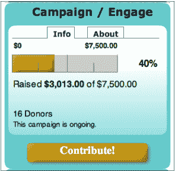

**Info** 选项卡显示图形温度计以及指示目标金额、迄今为止筹集总额和当前捐赠数量的文本。

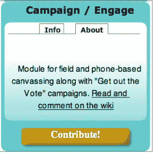

**About** 选项卡显示一段简短的文字。请注意，由于这是一个小部件而不是完整页面，可用内容空间有限。您应使用活动呼吁或诉求的简短、提炼版本，而不是对活动内容的客观描述。

您必须在相应字段中输入 **Title** 文本和 **About** 文本。您还可以通过提供 **URL to logo image** 来指定徽标图像。您可以为 **Button Title** 输入 **Contribute!** 或其他合适的文本。您必须输入您的 **URL to home page**。您可以通过点击打开 **Widget Colors** 面板来选择性地调整小部件每个视觉元素的颜色。十六进制颜色代码可在 `http://en.wikipedia.org/wiki/Web_colors#Color_table` 找到。

输入这些信息后，点击 **Save and Preview**。对小部件的外观满意后，点击 **Select Code**，将其粘贴到任何所需网页中，并通过您的 CMS 使其可供访客复制到自己的网站（如果需要）。如果您有一份对您组织使命感兴趣的网站管理员名单，那将是发布使用代码请求的理想场所。

### Premiums

Premium 是鼓励捐赠者捐赠超出原本意愿金额的一种方式。它通过在不同捐赠水平提供礼品来激励捐赠。

Premium 必须在特定捐赠页面上使用之前进行配置。请查看本章前面找到的 Configure Premiums 部分。要为捐赠页面启用 Premium 部分，请点击 **Premium Section Enabled?**

与捐赠页面的所有其他文本和内容一样，Premium 部分的 **Title** 和 **Introductory Message** 应在开发中以支持捐赠理由和呼吁的整体信息。标题作为捐赠页面上的部分标题出现，介绍性信息（可包含图像和其他 html 图形元素）出现在其下方，但在页面上可供捐赠者选择的 Premium 列表上方。

我们建议为任何有关 Premium 兑现和运输问题的捐赠者提供办公室管理员的 **Contact e-mail** 和 **Contact phone** 号码。

您可以通过取消勾选 **Display Minimum Contribution Amount?** 来禁用在每个 Premium 描述后自动显示最低捐赠金额。

## Test-drive

完成捐赠页面的配置后，我们强烈建议您使用 Test-drive 功能测试新的捐赠页面。尝试测试所有选项，这可能需要多次浏览确认、感谢和其他可选启用的页面。查看生成的电子邮件以及屏幕上的内容。在您自己完成此操作后，应让另一位员工或朋友在您启用页面之前进行审查。

## Live Contribution Page

一旦您对使用测试驱动模式配置的新捐赠页面感到满意，我们强烈建议测试实时捐赠页面。如果这是第一个配置为使用新的或更改的支付处理器的页面，或使用新的可选功能的页面，这是必不可少的一步。

如果您拥有组织信用卡或 PayPal 账户，页面金额上的服务费不应构成太大问题。您可以尝试配置 1 美元或 10 美元或其他小额测试捐赠，以减少处理商产生的任何费用。不要忘记在将页面放入菜单系统或通过电子邮件群发广告之前禁用或删除小额测试金额选项。

很多时候，我们希望在启用新捐赠页面后立即向大量群体发送广播呼吁。为了避免尴尬，更重要的是避免收入损失和捐赠者群体的尊重丧失，请确保您首先向一小群人发送消息，让他们审查和测试您活动的各个元素，包括自动电子邮件。

## Publicize the page

CiviCRM 为捐赠页面生成的 URL 相当难看且难以记住。它可能看起来像 https://mydomain.org/civicrm/contribute/transact?reset=1&id=1。

Drupal 和 Joomla! 都提供创建搜索引擎友好链接的工具，这些链接会隐藏标准的 CiviCRM 链接，将其转换为类似 https://mydomain.org/donateNow 的形式。


## 筹款：为您的使命筹集资金

在Drupal中，您可以启用核心的Path模块，然后在Drupal中导航到**站点构建 | URL别名 | 添加别名**。在Joomla!中，您可以通过**站点 | 全局配置**启用原生的SEF重写工具，并选择站点选项卡。在右侧的**SEO**字段中，在**搜索引擎友好URL**旁边选择**是**，最好同时启用`htaccess`选项（务必按照提供的说明修改Joomla!随附的文件名）。然后使用**菜单管理器**创建链接，并在**菜单项详细信息**组的**别名**字段中输入一个友好的URL。请注意，启用SEF URL将对您的整个站点产生更广泛的影响。虽然相比非SEF URL，这是一个重要且强烈推荐的改进，但在生产环境中启用之前，您应确保进行彻底测试。

为了避免因同一页面存在两个链接而导致搜索引擎统计数据分散，建议在Drupal中设置并配置**Global Redirect**模块，确保每个页面始终只有一个唯一的URL。

### 发送直邮

CiviCRM中支持线下捐款管理的功能大多已在本书其他部分介绍过，这里几乎没有需要补充的筹款特定内容。因此，接下来的几节将以简短的摘要形式，介绍如何以协调一致的方式使用这些功能来实现筹款目标，而不是提供在CiviCRM中管理和使用各种表单及页面的详细操作说明。

一次直邮活动涉及准备邮件包裹、处理无法投递的退信以及录入回复。最简单的邮件包裹是在信封外部贴上地址标签，内部放入未写收件人姓名的"亲爱的支持者"信函。另一种方式是使用带窗口的信封，通过窗口可以看到信函首页顶部的收件人和地址。即使是最小的非营利组织，也可以利用CiviCRM对标签和个性化信函的支持，在内部制作这些邮件包裹。

当邮件量不再小时，将制作工作外包可能更具成本效益。到了一定规模，那些只有在大规模下才具成本效益的不同技术就会变得适用。特别是，将地址和个性化称呼打印在同一张纸上，经过裁切、折叠、装入插页或不同纸张材质的回复装置，然后密封成信封及其内容物——这些都可以通过大规模服务更高效地完成。

当邮件量较小时，您可以直接从CiviCRM打印标签和信函。随着邮件量的增加，CiviCRM的联系人信息将被导出为文件，交付给邮件处理中心进行处理。

邮政部门提供的大宗折扣及其他优惠会显著影响直邮筹款项目的回报率。如果组织能够证明邮件中无法投递地址的比例足够低，就可以获得优惠费率。如果组织能够确保邮件按照投递路线进行分组捆绑，同样可以获得折扣。目前，CiviCRM支持美国邮政服务的地址验证软件。除此之外，CiviCRM用户需要通过外部服务处理从CiviCRM导出的文件，才能有资格获得邮政投递折扣。

一些邮政服务和私人服务机构提供地址变更文件，可用于更新直邮数据库中的地址。虽然邮件仍然可以投递到格式正确但已过期的地址，但这既浪费了宝贵资源，也失去了与重要捐赠者的沟通机会。定期使用国家地址变更（National Change of Address）或类似文件来清理捐赠者数据是值得的。

处理无法投递的退信和大量积极回复的一种经济高效的方式，是在信封和回复装置上印上条形码。这样，条形码扫描器可以快速录入信息，无需重新输入或进行耗时的人工查找。CiviCRM中已有添加条形码支持的初步规范，但仍在等待社区资金支持（http://wiki.civicrm.org/confluence/display/CRM/CiviCRM+for+Canvassing+and+GOTV）。在此期间，将联系人ID打印在信封地址和回复材料上可以降低数据录入成本。

### 开展电话营销活动

最简单的呼出式电话营销活动需要活动人员与潜在对象通电话，记录他们是否愿意捐款，讨论捐款金额，并记录付款方式及信用卡信息等细节。

要实现这一点，您首先需要获取一份带有电话号码的合格潜在对象名单。这可能涉及通过数据经纪人附加电话号码。电话劝导员的培训质量和能力对回复率和收到的捐款水平有重大影响。低端呼叫中心技术可以通过预测式拨号来提高人工呼叫的效率。使用IP语音（VoIP）电话可以降低长途费用，而不会显著损失通话质量。基于互联网的解决方案从呼入式点击通话开始，这已与虚拟呼叫中心技术紧密相关。在这种设置中，基于互联网的电话劝导员通过网站或Web服务与合格的潜在对象建立连接，他们无需看到或拨打电话号码，直接将收到的回复输入网站表单。

前面引用的链接中包含了一些在CiviCRM中实施大部分此类功能的粗略成本估算。更简单的方法也随时可用。

最简单的做法是搜索具有合适电话号码的潜在对象。打印出来的名单可以作为通话单的基础，回复数据可在稍后录入。

没有电话号码或号码已停机（NIS）的潜在对象名单可以导出并发送给数据经纪人，然后将导入的结果覆盖现有的陈旧数据。

再进一步，可以为活动设置自定义字段，以表示电话劝导中的典型活动，例如对脚本中问题的回答（例如，您是否愿意捐赠50美元？）以及通话处理结果（无人接听、不在家等）。这可以用于筛选尚未联系到的潜在对象，并锁定那些已承诺捐款但尚未收到款项的目标对象。

CiviEngage是一个新的Drupal模块，旨在通过对CiviCRM的自定义字段、分组和活动等功能进行定制，来处理大量基层组织活动。它旨在实现一种在多种情境下取得成功的特定组织模式。其中部分功能正是面向上述类型的呼叫名单支持。如果您不习惯设置自定义字段和指定搜索条件，但又想在电话营销中使用CiviCRM，那么这将是一个非常不错的起点。您仍然需要修改CiviEngage创建的字段和通用回复，才能使其发挥实际作用。不过，修改一个已经完成了大部分期望功能的模块，通常比从零开始要容易得多。CiviEngage的安装流程可在http://wiki.civicrm.org/confluence/display/CRMDOC/CiviEngage+Installation查看。请注意，CiviEngage和CiviCampaign未来可能会合并。

### 直接接触

直接接触式筹款涉及在繁忙街道上向路人募捐等活动。它也包括在会议或商场设置摊位。选择街道人流量可能对您的事业持好感、有能力且愿意捐款的地点非常重要。劝导员的个性和技巧至关重要。

来自该渠道的捐赠者可以通过剪贴板上的卡片或表格录入CiviCRM。他们往往不像其他渠道的捐赠者那样频繁地续捐。

另一种取得一定成功的传统方式是逐户上门劝导。同样，目标社区的选择将极大影响这种开发潜在对象的方式能否收回成本并在长期内带来回报。


如果你的组织的合格潜在客户名单在某些区域足够密集，那么使用上门走访名单供拉票者使用是合理的。CiviEngage 在这方面提供了一些支持。它依赖 CiviCRM 核心的地址解析功能，从公民地址中提取街道号码，以生成走访名单报告。一旦公寓号和套房号能被可靠解析，它就能更有效地满足城市需求。

## 其他类型的捐款

大额一次性捐款和遗产捐赠往往来自与你的组织或其关键个人建立了长期良好关系的联系人，他们与你的使命或其部分内容高度一致，相信你的组织能够成功履行承诺，并且拥有足以进行大额捐赠的资源。CiviCRM 中的自定义字段可用于跟踪与捐赠能力相关的特定兴趣和人口统计信息。在关系培养过程中，通过 CiviEvent 和董事会活动建立的个人面对面关系可能非常重要。跟踪高净值人士之间的关系，或与其他组织董事会成员的交叉关联，对于识别大额捐赠活动的潜在对象以及确定最合适的联系人可能至关重要。在提出请求后，跟踪有关捐赠条款、税务影响等方面的会议和电话沟通会很有用。这些可以存储在通用活动中，也可以使用 CiviCase 创建更结构化的流程。

## 权限

虽然权限的更广泛问题在其他地方有介绍，但我们想花点时间再次强调在处理捐款时的一个重要关切。我们强烈不建议删除财务数据交易，因为这些记录涉及税务和财务审计。Drupal 安装可以通过禁用所有角色中的“在 CiviContribute 中删除”和“在 CiviPledge 中删除”权限来防止有意或无意的删除。

Joomla 1.6 将具备访问控制功能，并且已经着手将这些工具与 CiviCRM 的权限系统集成。如果访问控制对你的组织至关重要，并且你正在使用 Joomla!，请首先研究将你的网站升级到 Joomla! 1.6 并实施 CiviCRM 需要什么。

## 总结

在本章中，我们学习了如何使用 CiviCRM 进行筹款。具体来说，我们讨论了：

- 制定筹款计划的基础知识
- 选择在线支付处理商时需要考虑的因素
- 如何配置 CiviContribute 和 CiviPledge
- 手动记录捐赠和认捐
- 查找、检查和操作捐款与认捐
- 实施筹款呼吁

在下一章中，我们将讨论你的组织如何使用 CiviCRM 跟踪会员资格和订阅，以及如何使用贡献页面让你的支持者在线购买和续订。

## 定义会员类型

会员类型等同于你的组织所维护的不同会员类别。每种类型都会有一个关联的金额和会费周期。因此，如果你的会员结构有子级别，或者你允许不同的支付周期，你可能需要为每个子级别或支付安排定义一个类型。

例如，考虑一个“关联会员”类别，它分为三个子级别——小型、中型和大型，其中会员公司产生的年销售额决定其会员子级别。要实现这一点，你可以创建三种会员类型——关联（小型）、关联（中型）、关联（大型），或类似的命名约定。

在命名类型并输入可选的描述后，你需要搜索并确定会员所关联的组织。这意味着，你的数据库至少必须包含一条代表你组织的组织记录，这些会员类型将附加到该记录上。

这种定义会员的结构附加到组织记录上，有助于支持更复杂的系统，例如你可能同时拥有与州组织和地区分支机构，或其他子实体的会员关系。会员资格也是实现付费订阅（如月度杂志）的好方法。同时拥有会员资格和付费订阅产品的组织，可以将会员类型附加到不同的组织实体（如部门）上，以便进行管理和报告。

继续填写表单；输入会员金额以及款项应分配到的贡献类型。如果你的会员类型是免费的，只需在金额字段中输入 0。

接下来，你确定会员期间。期间是从起点到终点的会员时长。CiviCRM 支持两种模式——固定期间和滚动期间。滚动会员类型从注册日期开始，并持续到配置的会员时长。固定期间，顾名思义，有一个固定的起始点，例如 1 月 1 日。

按月计算的固定会员总在人们注册的那个日历月的月初开始。例如，如果一个人在 7 月 7 日注册了一个为期六个月的固定会员，他的会员期从 7 月 1 日开始，到 12 月 31 日结束。如果你选择了为期一年或多年的固定期间，你必须选择期间的开始日期和滚动日期。滚动日期是指在该日期之后，新的会员记录将覆盖当前和即将到来的一年。考虑以下示例。

FPAGM 在系统中配置了三种会员类型：**常规**和**关联**均为固定会员期间，从 1 月 1 日开始持续一年；而**支持**会员则是一年滚动会员。对于两种固定期间会员类型，他们设置了 11 月 1 日的滚动日期。这意味着在任何 11 月 1 日至 12 月 31 日之间创建的新会员将从创建之时起有效，直到次年 12 月。此功能认识到，只享受两个月的福利却收取一整年的会员费是不合适的。

CiviCRM 会员工具最强大的功能之一是通过关系配置会员继承。如果在会员类型配置中选择了某种关系，任何与该“主要”会员具有该关系的联系记录都会自动获得会员资格。

此功能的一个常见用途是自动将组织的员工视为会员。为此，请在关系类型字段中选择**雇主为**。当某组织成为会员时，将为该组织的每位员工生成相应的会员记录。相关或继承的记录将不可编辑；只有会员的主要所有者才会拥有可编辑的记录。

确定应选择关系的哪一侧可能有些棘手。例如，在前面的示例中，你应该选择**雇主为**还是**雇员为**作为关系类型？如需帮助选择正确的关系类型并查看继承如何工作的示例，请单击此字段旁边的帮助图标。

其他常用于会员继承的关系包括**家庭成员为**、**父母为**和**配偶为**。

FPAGM 的常规和关联会员类型都基于组织（会员由组织拥有，例如食品储藏室和向其供货的企业）。协会将配置两者都具有“雇主为”继承。通过这种方式，组织可以开发用于邮件和群发电子邮件的当前会员保存搜索。

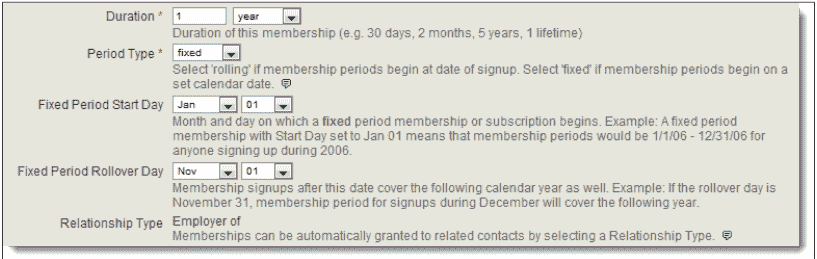

## 查看状态规则

在任何给定的时间点，你都会将成员视为具有某种状态。例如，当他们首次加入时，你可能将他们视为新成员。如果当前日期在其会员期内，他们就是当前成员。在某个时候，如果他们选择不续费，他们将被视为过期或前成员。

CiviCRM 提供了一种机制，用于定义确定成员状态的规则，并且可以配置为根据这些规则定期计算成员状态。导航到“管理 | CiviMember | 会员状态规则”以查看和修改它们。

在查看规则本身之前，让我们先了解一些重要概念，并回顾默认规则的预期用途。

首先要理解的概念是状态规则顺序的重要性。当 CiviCRM 根据这些规则处理会员记录时，它会基于显示的顺序分配第一个匹配的规则。这很重要，因为某些会员记录可能匹配多条规则。

例如，在大多数状态配置中，新成员也会匹配当前成员规则。由于“新”状态规则（在默认配置中）排在第一位，因此将被分配该状态。


CiviCRM 自带七个预配置规则。让我们简要回顾它们的预期用途：

- **新成员**：这些是刚刚加入组织的成员。也许您想通过向他们发送特别通信来表彰他们，或者在他们的会议名牌上标记“新成员”以示认可。无论您的用途如何，此状态都将帮助您快速识别新成员。
- **当前成员**：这些成员的当前日期落在其会员资格期开始日期和结束日期之间。
- **宽限期**：此状态提供了一种方式，如果成员在结束日期之前没有续订会员资格，可以给他们一些灵活性。说实话——大多数成员等到结束日期之后才续订会员资格。您不一定想立即切断他们；因此您可以配置一个宽限期，在此期限内他们的会员福利继续有效，但他们不再被视为**当前**成员。这对您的会员总监或会员委员会也有帮助。您可以使用**宽限期**状态快速生成尚未续订当年会员资格的成员列表，并开始联系他们以鼓励续订。
- **已过期**：一旦成员超过结束日期并超过宽限期，其会员资格即过期。**已过期**状态告诉您，他们让会员资格失效而未续订。
- **待处理**：**待处理**状态是在允许会员注册时使用“稍后付款”选项的特殊用例。“稍后付款”选项可以在会员注册页面上启用，作为收取实时信用卡付款的替代方案。实际上，它是通过支票、现金或您提供给成员的任何其他方式付款的承诺。当通过稍后付款生成会员记录时，会员记录和捐款记录都会被标记为**待处理**。收到付款后，您将在捐款记录中记录并标记为**已完成**。保存已完成的捐款记录后，对应的待处理会员资格将更新为**新**或**当前**状态。
- **已取消**：前四种状态类型都是基于日期的规则。根据当前日期和配置的规则，会员记录将被分配第一个匹配的状态。第五种（**待处理**）是基于付款的规则。相比之下，**已取消**状态通常仅手动处理。例如，某人可能加入了您的倡导组织，但后来发现自己不同意该组织采取的某些立场，于是联系您并取消其会员资格。没有基于日期或付款的计算触发取消；您只需在会员记录中将其状态更改为**已取消**。

## 发展您的会员并与之互动

- **已故**：最后一种默认状态类型**已故**可以手动应用到记录，或将由联系人的“已故”字段触发。

大多数组织会发现这些默认规则提供的基本功能足以满足其需求（尽管他们当然会想要审查这些规则，并可能发现需要调整规则配置，例如调整宽限期的时长）。如果默认规则不能满足您的需求，您可以根据需要添加、编辑、删除或重新排序规则。例如，您可以在成员过期之前构建一个多层级宽限期结构——宽限（一个月）、限制（两个月）、最后机会（三个月）——在此过程中逐渐限制用户享受某些会员福利，并以不同方式与他们沟通。

在创建新规则或编辑现有规则时，您可以使用多个配置选项。这些选项容易被误解或错误配置，因此让我们花点时间来审查它们：

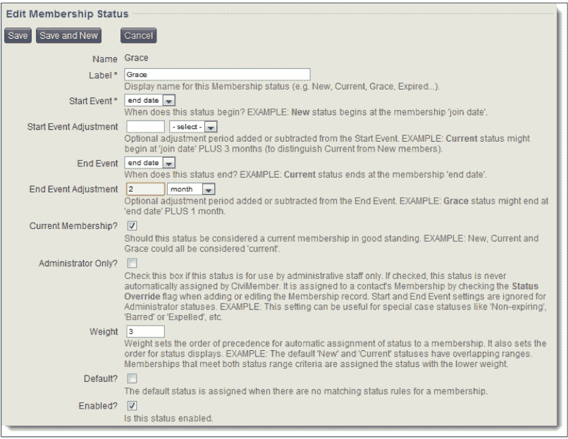

每个状态规则将定义一个触发点（**开始事件**），指示规则何时激活，以及一个可选的结束点（**结束事件**）。每个事件都可以通过调整值进行偏移。这两个事件均从三个日期之一测量——加入日期（个人加入组织的初始日期）、开始日期（会员资格期开始的日期）和结束日期（会员资格期将结束或已经结束的日期）。

思考开始/结束事件如何与加入/开始/结束日期关联并转化为您期望的状态可能会有点令人困惑。一种思考方式是构建一个简单的时间线来表示每个状态：

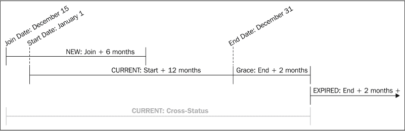

让我们仔细看看上图中的时间线网格如何影响宽限期状态设置。您还记得，宽限期状态旨在表示会员资格结束日期之后、但在我们将记录视为已过期之前的期间。

- **开始事件：** 结束日期，无调整
- **结束事件：** 结束日期，2个月

这意味着什么？从会员资格结束日期开始，该记录将被标记为宽限状态两个月。之后，它将更改为已过期状态，或任何其他适用的规则。

> 💡 请务必指定一个状态为默认状态。当没有其他匹配规则时，它将被分配给会员记录。

除了设置开始和结束事件外，您还可以考虑在**仅限管理员？**标志中将状态标记为“仅限管理员”。如此标记意味着该状态永远不会通过规则匹配分配。它只能由管理员覆盖计算出的会员状态并分配。例如，您可以创建一个**暂停**状态，管理员用它来标记那些必须提交证件或其他文件才能被视为**当前**成员的成员。

**当前会员？**标志指示在显示会员总数的仪表板网格中，哪些状态类型应计为当前成员。

设置好规则后，您可能想要运行一些测试记录，更改加入日期、开始日期和结束日期，以匹配您期望分配的各种状态。

> 请务必按照*配置计划任务*部分所述设置计划任务，以触发自动会员状态更新。当每晚或定期运行时，它将根据状态规则审查所有会员记录，并根据需要更改它们。如果您不设置计划任务，您的会员状态将仅在创建或手动更新会员记录时更新。

## 设置续订提醒

到目前为止，您应该已经设置了会员类型，并计划创建会员加入和续订表单，以鼓励新老成员通过您的网站直接与系统交互。此外，您还需要生成定期的会员续订发票以留住现有成员。

如果 CiviCRM 能在会员记录接近结束日期时向成员发送提醒电子邮件，鼓励他们续订，那岂不是很棒？好消息是，CiviCRM 确实提供了这种能力！您可能已经注意到会员类型配置页面底部有一个名为**续订提醒**的区块。我们使用它来设置提醒电子邮件选项。请注意，此功能是特定于会员类型的——您可以选择不为某些会员类型启用续订提醒，或者为不同类型配置不同的电子邮件模板。

要使用此功能，必须执行两个非常重要的步骤——您必须创建消息模板，并且必须设置计划任务脚本（详见*配置计划任务*部分）。假设您是第一次配置这些选项，您可能会看到一个黄色消息框，提示当前不存在消息模板，并引导您到相应的页面进行设置。您可以通过菜单访问它们：**管理 | 配置 | 消息模板。**

消息模板，顾名思义，将包含发送给成员的提醒电子邮件的正文文本，并且可能包含令牌——联系人记录数据的占位符。**消息模板**页面有两个选项卡——**用户驱动消息**和**系统工作流消息**。后者用于系统与核心功能一起发送的电子邮件，例如捐款的收据电子邮件。我们此时关注的是**用户驱动消息**。


创建一条新消息，并提供合适的标题、主题行和正文。请记住，您的消息应具有足够的通用性，适用于将发送到的会员类型中的所有成员。

> 请直接了当。续订消息发送给那些已经对您的组织表现出一定兴趣和承诺的支持者。虽然您需要说明继续会员资格的理由，但主要目的是提醒他们续订。保持消息直接且简洁。

请注意，正文区域上方右侧有一个用于插入令牌（token）的链接。令牌是代表系统中某个字段的占位符。当电子邮件被处理时，令牌将被替换为每个收件人该字段的值。使用令牌可以让您为每位支持者定制电子邮件，例如将每封电子邮件的称呼设为“亲爱的[名字]”。

完成创建续订提醒电子邮件模板后，返回 **管理 | CiviMember | 会员类型**，选择要启用续订提醒的会员类型，并滚动到表单底部。现在您可以选择所需的提醒电子邮件模板，并指定发送时间（以会员期结束日期之前的天数计算）。

> 您必须按照下一节中的详细说明设置 cron 作业，才能完成续订提醒工具的配置。

您起草的电子邮件模板不仅限于在自动提醒功能中使用。您还可以选择使用 CiviMail 将该电子邮件的额外副本发送给个别成员或成员组。该模板的功能与任何其他电子邮件模板相同，并可在整个系统中使用。

## 配置 cron 作业

在刚刚介绍的章节中，我们回顾了两个需要自动功能的功能——一种并非由用户触发，而是由定期、基于时间的计划触发的系统操作。要实现这一点，我们必须设置一个 cron 作业。

顾名思义，cron 作业是由服务器执行的基于时间的操作（时序作业）。它基本上由对脚本的引用以及脚本应运行的频率组成。有关 CiviCRM 附带的 cron 脚本的完整讨论，请参阅*第 3 章，安装、配置和维护*。

我们当前关注的是位于 `civicrm/bin/` 子目录中的 `UpdateMembershipRecord.php` 脚本。此脚本在安装文件中最初以 `UpdateMembershipRecord.php.txt` 形式存在。在设置 cron 之前，您必须将其重命名以去掉 `.txt` 扩展名。这样做也是为了提醒您检查文件内容，因为脚本中有一个必须手动配置的变量。用您喜爱的文本编辑器打开该文件，找到文本 `EMAIL@FIXME.ORG`。正如文本所示，必须将其更改为您希望的 FROM 电子邮件地址，该地址将在发送续订提醒消息时使用。

> 从 3.3 版本开始，此文件不再带有 `.txt` 扩展名，并且无需直接在文件中配置 FROM 地址，因为它现在使用系统中配置的默认 FROM 地址。

在设置 cron 之前，让我们回顾一下前面讨论过的此脚本的两个用途。该脚本首先遍历所有会员记录，将现有状态与会员状态规则进行比较，并适当地更新状态。其次，脚本检查会员类型和结束日期，以判断是否已配置续订提醒电子邮件以及是否应发送。如果是，它将发送续订电子邮件并重置提醒日期。

鉴于该脚本的性质，将 cron 作业配置为每天运行一次就足够了。根据您的会员规模，该脚本可能需要大量服务器资源才能完成。因此，最好将其安排在站点流量的正常低谷期，例如午夜。

根据您的服务器设置，您可以通过控制面板界面配置 cron 作业，也可以通过 `ssh` 连接到服务器使用命令行 `crontab` 命令，或者将脚本放在 `/etc/cron.daily/` 目录中调用 `UpdateMembershipRecord.php` 脚本。有关您的选项详情，请参阅托管服务文档。

在 cron 作业中的 `wget` 或类似命令中引用 `UpdateMembershipRecord.php` 脚本的位置时，您必须附加三个用作身份验证机制的 URL 变量。这有助于防止未经授权的用户运行该脚本。

```
?name=<username>&pass=<password>&key=<sitekey>
```

有关这些变量的完整讨论，请参阅*第 3 章，安装、配置和维护*中的*设置 cron 作业*一节。

设置 cron 时，请务必在 Web 浏览器中使用配置的变量测试脚本，以确认其正常工作。您还应该启用 cron 日志记录或配置基于电子邮件的日志记录，以确保 cron 正确运行。

成功运行后，您将看到会员记录随着其状态从一种类型转变为另一种类型而更新。

## 使用会员资格和日常管理工具

在处理会员记录时，您需要轻松访问成员趋势的快照，按特定类型、状态或其他条件搜索成员，并处理单个联系人和他们的会员详细信息。CiviCRM 提供了大量工具来完成这些工作。

在主导航栏中，快速查看“会员”菜单：

- **仪表板**：按类型和日期范围提供当前成员的摘要
- **新建会员**：让您快速创建新的会员记录
- **查找成员**：提供用于搜索成员记录的工具
- **导入会员**：允许您将之前在旧系统或其他来源中创建的记录导入系统

我们不会深入审查每个工具，但会花一些时间强调关键功能和注意事项。

仪表板是快速获取成员系统快照的好方法。还记得我们在配置会员状态规则时，有一个选项可以将状态标记为“当前”吗？好，这个选项就在这里发挥作用——仪表板页面上的网格将显示由该选项定义的当前成员，并按过去两个月和本年迄今的当前/续订情况细分。

请注意，该摘要网格的大部分内容都是超链接。例如，您可以点击快速查看在特定类别或所有类别中，上个月或本月续订或加入的成员。

“新建会员”菜单项可快速创建新的会员记录。使用此选项，您进入新成员表单，然后搜索选择联系人（或创建新联系人）。大多数情况下，您会先搜索并查看联系人记录，以确保是正确的联系人，然后再在其中生成会员资格。然而，这种“替代”工作流在 CiviCRM 中很常见。

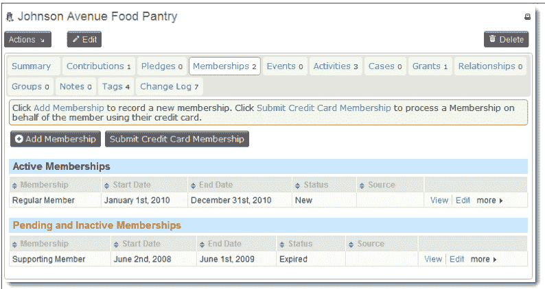

请注意，会员列表可能分为两个部分：有效会员资格和待处理及不活跃会员资格。后者将包括已过期、已取消或待处理的会员记录。

添加会员按钮位于会员列表上方。如果您的站点配置了信用卡支付处理器，您将看到第二个按钮，用于创建会员并处理信用卡付款（提交信用卡会员）。

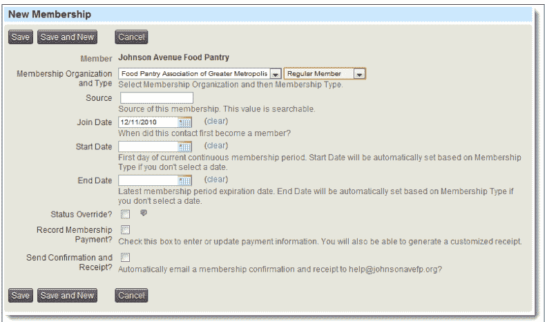

选择所需的会员类型后，查看其他字段并根据需要填写。请注意，除非开始和结束日期应与**会员类型**配置部分中所述的默认计算值不同，否则您无需手动设置它们。

**状态覆盖？** 标记用于手动强制记录上的某个会员状态。应谨慎且少用此选项。一旦您表示某个状态已被覆盖，定期会员更新脚本和对记录的任何编辑都不会再计算状态。此选项通常仅用于以下情况：系统中有特殊联系人，他们应在现有会员类别中处理，但不收取相关费用或不需要续订。在将会员标记为已取消时，也应使用此选项，因为此时您有意将其从状态规则结构中移除。请谨慎使用此选项，因为您将失去通过基于规则的状态类型来管理联系人的能力。

> 如果您使用状态覆盖将某个会员标记为永久当前（因为他/她是终身会员），请考虑设置一个为期一生的终身会员类型，因为这可能是管理此类联系人更合适的方式。

**记录会员费**提供用于输入与会员相关的付款详细信息的字段。填写这些字段将导致创建关联的捐款记录。尽可能使用此选项很重要，而不是单独处理捐款记录，因为它会在会员和捐款记录之间建立连接，供日后引用。它还能显著简化流程，因为您可以在一个表单中同时处理会员资格和付款。

正如标签所示，**发送确认和收据**将生成一封发送给用户的电子邮件，其中包含所创建的会员和捐款记录的详细信息。

回到会员选项卡列表，让我们了解 CiviCRM 如何处理会员记录和续订。如前所述，会员资格有三个相关日期：加入日期、开始日期和结束日期。**加入日期**是首次创建会员记录的日期。**开始日期**是会员期开始的日期。对于固定期限会员类型，开始日期实际上可能早于加入日期。例如，如果某个会员类型以固定一年为期限，从 1 月 1 日开始，那么 2 月 12 日创建的新会员的加入日期为 2 月 12 日，但开始日期为 1 月 1 日。滚动期限会员类型的加入日期和开始日期字段通常相同。**结束日期**根据会员类型配置和开始日期值计算。

续订会员记录的概念涉及将会员期结束日期延长。如果某个会员资格从 2009 年 1 月 1 日到 2009 年 12 月 31 日，续订一年后，结束日期将改为 2010 年 12 月 31 日。


许多组织习惯于将会员历史视为一系列独立的记录。以前面的示例为例，你会看到 2009 年的记录，以及 2010 年的第二条记录。如果你习惯了这种结构，请花点时间思考这种替代格式如何影响你的工作流程。与其将会员记录视为不同的时期，你必须将其视为持续的、线性的记录。在调整你对会员的思考方式以适应此模型后，你会发现该结构在寻求对会员历史进行有效搜索时非常强大。

CiviCRM 通过在 **More** 下拉菜单中包含 **Renew** 和 **Renew-Credit Card** 选项来促进续费流程。

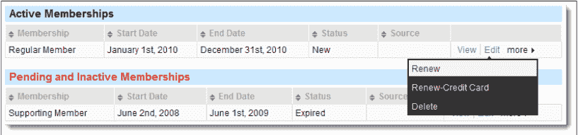

续费表单仅请求有关续费日期、付款和收据的信息。由于续费延长了现有记录，因此所有其他值都是固定的或根据现有数据计算得出的。

请注意，通过关系继承的会员记录将没有可用于编辑或续费记录的选项，而是有指向主要或所有者会员记录的链接，在该记录中可以进行这些功能。


一个常见的困惑领域是关于已过期会员的会员续费。如果某条记录存在，但已过期，如果触发续费，应如何处理该记录？CiviCRM 通过保留原始加入日期，但根据续费发生的日期将开始和结束日期重置为新值来处理这些记录。

根据你希望跟踪会员历史的方式，此结构可能并不理想，因为你会丢失部分旧数据。例如，你可能更愿意为已过期的会员创建新的会员记录，以便将较旧的历史数据与新记录分开保存。这样做可以让你注意到旧记录和新记录之间发生的会员中断。

到目前为止，我们已经涵盖了通过管理工具配置和处理会员记录所涉及的主要功能。让我们看看这如何转化为你网站的前端。

## 表单用于招募新会员并保留现有会员

拥有出色的管理工具很棒，但我们也希望能够在网站上展示会员注册和续费页面，以便招募新会员并保留现有会员。在 CiviCRM 中，我们通过捐赠页面来实现这一点。

捐赠页面用于向网站访问者征集资金。这可能是用于一般捐赠、赞助、承诺、活动，或在我们的例子中，会员资格。开始时，请访问 **Contributions | New Contribution** 页面。

CiviCRM 将引导你完成九步向导来配置你的页面。我们不会回顾所有可用选项，而是重点介绍与会员注册页面相关的关键要素。

在向导的第一步，你会看到一个 **Contribution Type** 字段。它的用途对于我们的目的来说可能有点误导。正如你回忆的那样，当我们定义会员类型时，我们为每个类型分配了一个捐赠类型。通过捐赠页面处理会员资格时，将使用分配给会员类型的捐赠类型进行相应的交易。然而，你可以构建你的捐赠页面，以便收集会员资格并允许额外捐赠。在这种情况下，你选择的捐赠类型将用于额外的非会员捐赠。

请注意，有一个选项允许个人代表组织注册。默认情况下，CiviCRM 会将与你的网站交互的用户视为个人类型联系人。毕竟，使用计算机的是人，而不是组织。但是，如果你的会员类别与组织相关联，你应该选择此选项并指示“代表”功能应为可选还是必需。请注意，你仍然可以收集填写表单的个人的信息；注册表单将把此个人视为会员组织的关联联系人（员工）。

在第二步中，你配置与付款相关的选项，例如使用哪个处理器，是否允许“稍后付款”功能，以及用户是否可以在会员费之外捐款。仔细考虑最后一个选项——你希望你的注册表单完全专注于会员选项，还是你的会员结构与更广泛的捐赠征集活动密切相关？

> 如果启用了“稍后付款”选项，访问者将有机会点击一个框以表示有意在稍后日期提交付款。表单提交后，他们的会员资格和相应的捐赠记录将被标记为待处理。当你收到付款时，只需更新捐赠记录——输入付款方式、详细信息并将状态标记为完成。这样做也会将会员资格标记为完成，并将加入日期设置为收到付款的日期。

第三步是启用和配置会员注册功能的地方。此单一捐赠页面可用于会员注册和续费表单，因此包含标题和描述字段供两种用途使用。续费标题和描述仅在用户登录网站并且 CiviCRM 识别出现有会员记录时显示。否则，将使用会员加入文本。

然而，这并不意味着 CiviCRM 总是会将会员记录视为新的。如果未通过身份验证的用户（未登录网站的人）在其会员加入版本中完成此表单，CiviCRM 仍会尝试将其与系统中的现有记录匹配。如果它找到匹配项并且联系人有现有会员记录，它将续订记录而不是创建新记录。

在此表单的底部，你确定哪些会员类型将可用（你可以选择将会员类型组织到多个表单中），会员注册是否必需，如果在上一屏幕配置，会员费是否应与收到的其他捐赠分开处理，以及是否应显示会员费。

请注意，对于 Google Checkout 和 PayPal Standard 支付处理，单独的会员费选项不可用，因为它们不支持单个提交过程中进行多笔交易。如果您希望与会员资格相关的捐赠和额外捐赠金额分配不同的捐赠类型，如前所述，应选择此选项。例如，您可能希望将会员费处理为会员会费捐赠类型，而将任何额外金额处理为捐赠捐赠类型。

向导的下一步提供了配置感谢屏幕和联系人将收到的电子邮件收据的选项。第五步配置 Tell-A-Friend 功能，这对于筹款活动比会员注册更常见。如果启用，完成会员表单的联系人将被鼓励使用您提供的建议文本向朋友宣传您的组织。如果您依靠口碑网络来传播您的信息，此功能可能对您有用。

在第六步中，您可以选择最多两个配置文件以包含在表单中。请记住，配置文件是一组字段。默认情况下，会员注册表单将只有一个必填字段——电子邮件地址。大多数情况下，您希望收集有关会员的更多信息，例如姓名、地址、电话等。您可能首先需要创建自定义配置文件或编辑现有配置文件，例如 **Supporter Profile** 或 **Name and Address**，位于 **Administer | Customize | CiviCRM Profile.**

如果您到此步骤时尚未创建自定义配置文件，请不要担心——您可以继续进行捐赠页面向导，并在稍后返回以选择所需的配置文件。

> 如果您启用了允许个人代表组织注册的选项，则在此步骤中分配给表单的任何配置文件只能用于个人字段。目前，组织收集的信息无法通过界面配置。

Premium（第七步）是您在会员捐赠达到一定门槛时提供的礼物。例如，您可能会宣传 50 美元的捐赠将获得印有您组织标志的旅行雨伞。这通常面向捐赠页面而不是会员注册表单，但如果您将会员分级以鼓励更高水平的捐赠并提供额外福利，则仍可能适用。在配置此步骤之前，您必须已创建了 Premium 集合（可通过 **Contributions | Premiums (Thank-you Gifts)** 或 **Administer | CiviContribute | Premiums (Thank-you Gifts)** 访问）。

如果您的会员表单是更大活动的一部分，您可以在第八步中创建一个温度计样式的小部件来跟踪捐赠。例如，假设您发起了一项会员招募会员活动，旨在在年底前筹集 20,000 美元。在启用和配置小部件选项后，您将生成的代码添加到网站主页，鼓励人们加入。通过此捐赠页面加入的任何会员，其费用都将添加到活动总额中并反映在小部件中。这种以目标为导向的活动模式对于基于捐赠的征集更常见，但仍可创造性地用于基于会员的目的。

向导的最后一步是个人活动页面，这也可能与非会员捐赠页面更相关。个人活动页面，或 PCP，使您的利益相关者（例如现有会员）能够代表您的组织征集资金。在此过程中，他们会因其在筹集资金中的作用而获得“软积分”。使用小部件讨论中的示例，您可以更进一步，让每个现有会员创建和自定义自己的会员推广页面，以便用于与朋友和同事的通信。


> FPAGM 很高兴提供在线会员注册和续费表单。他们将此视为简化会员注册流程的机会，以便更多企业和组织愿意加入。

网站管理员创建了一个会员捐赠页面，主要关注会员的关键配置元素。由于他们的 **Regular** 和 **Affiliate** 会员类型是基于组织的，他们选择要求代表组织进行注册，并且仅展示这两种会员类型。稍后，他们将为 **Supporter** 会员类型创建另一个捐赠页面，该类型更侧重于个人捐赠。

虽然会员是基于组织的，但他们希望收集有关他们将在企业或组织中对接的主要联系人（个人）的详细信息。以现有资料为基础，他们使用 **Copy Profile** 选项并调整字段以收集姓名、地址和其他关键信息。完成配置后，他们测试该页面并将其作为菜单项启用到其网站上。

## Searching and reporting

我们之前提到过 **Membership** 菜单上的 **Find Members** 工具。让我们花几分钟时间探索可用的选项并查看会员报告。

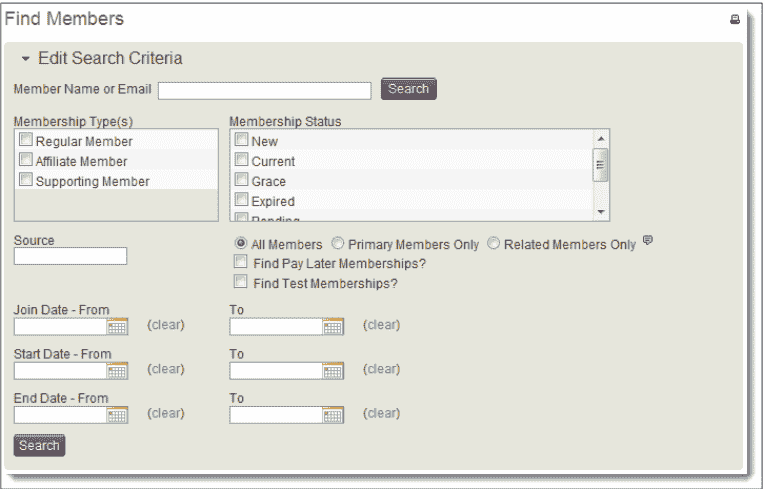

这里的大多数搜索选项都是不言自明的——您可以按联系人姓名或电子邮件、会员类型和会员状态进行搜索。对于这些类型和状态，选择多个选项是包含性的：结果将产生匹配任何所选内容的记录。

会员状态字段下方有一组重要选项，如果您通过关系使用会员继承。回想一下，您可以配置会员类型以根据所选关系将会员资格扩展到其他联系人。如果 ACME Corp. 是会员，并且为其会员类型选择了雇主/员工关系，则该企业的员工也将获得会员记录。

虽然此功能很有用，但了解如何计算会员可能会令人困惑。如果 ACME 有三名员工，会员搜索将为此一个会员记录产生四个结果。当您发送群发电子邮件并希望所有会员都能收到时，这可能很有用，但如果您希望统计实际购买的会员记录数量，您的数字将不准确。

此表单上的三个选项可帮助您控制与会员继承相关的搜索。您是想查看所有会员、仅会员记录所有者（主要会员），还是仅通过继承成为会员的人？

正如预期的那样，与会员记录关联的三个日期字段可按日期范围搜索。通过一些创造性思考，这些日期范围搜索字段可以生成一些强大的工具来了解您的会员。考虑以下示例：

- 您想知道在上一年（2010 年）未续费的人员，该会员类型固定期限为 1 月 1 日至 12 月 31 日：将 **End Date – From** 和 **End Date – To** 字段设置为 2010 年 12 月 31 日。所有在 2010 年加入或续费但未续费 2011 年的会员都将被包含。
- 您想要一份在过去几年加入的会员名单：将 **Join Date – From** 设置为 2008 年 1 月 1 日。任何在此日期之后发生的加入日期都将在结果中提供。
- 您想要一份在 2006 年至 2010 年间某时加入但未在 2011 年续费的会员名单：将 **Join Date – From** 设置为 2006 年 1 月 1 日，并将 **End Date – To** 设置为 2010 年 12 月 31 日。

这些示例搜索说明了会员记录中日期结构的优势。

generated。换句话说，您必须至少完成一次会员注册。如果在点击预览后报告没有结果，请在 **Memberships | New Membership** 为自己创建一个测试会员。

- 5. 根据需要查看和调整 **Report Criteria**。进行更改后，点击 **Preview Report** 以刷新结果。

- 6. 对报告结果满意后，点击展开 **Create Report** 面板。此部分中的选项分为三个区域：

  - 在第一个中，您为报告命名并可以修改如果报告发布为 PDF 时将生成的页眉和页脚区域。

  - 在第二个中，将报告配置为通过电子邮件发送给所需联系人。

  > 为了使通过电子邮件发送报告的功能正常工作，您必须创建 cron 作业来触发邮件发送。有关安装和配置的更多详细信息，请参阅 *Chapter 3, Installation, Configuration, and Maintenance.*

  - 最后部分控制权限（仅限 Drupal）并允许您将报告添加到菜单项或使其可用于 CiviCRM 仪表板页面。为查看报告选择适当的权限，例如 **access CiviMember**。

- 7. 点击 **Create Report**。

保存后，可以使用您选择的设置检索报告以供查看、打印为 PDF 或导出为 CSV 文件。有关报告概念和工具的完整详细讨论，请参阅 *Chapter 12, Telling Your Story: Building Reports.*

## Big Picture and other tools

会员管理很少单独进行。很可能您的会员也将是经过身份验证（已登录）的网站用户、活动注册的主要目标，以及您通过 snail mail、电子邮件或其他方式进行的大多数通信的接收者。

让我们考虑一下您的会员资格如何影响 CiviCRM 的其他领域，并回顾一些可与您的网站和会员一起使用的第三方扩展。

## Common functions in CiviCRM

会员制组织在其网站上拥有“仅限会员”部分的并不少见。此安全访问区域需要 Joomla! 或 Drupal 用户登录帐户。如果您为会员注册创建了捐赠页面，您可以包含一个启用了用户帐户创建选项的资料。当联系人完成会员申请表时，他们将能够创建用户帐户以访问网站。

当您与会员合作时，您可能主要关心的是在任何给定时间点的当前会员。虽然访问 Membership | Dashboard 页面并查看按类型划分的当前会员快照很有用，但更有可能的是，您通过其他方式对当前会员进行邮件、电子邮件或其他工作。快速访问当前会员名单的一种简单方法是创建智能组。

使用 Search | Advanced Search，展开 Memberships 面板并选择您想要的会员类型以及 new、current、grace 状态，或您自定义的当前状态。运行搜索后，选择所有联系人并使用操作下拉菜单创建新的智能组。

回想一下，智能组是保存的搜索。它们是基于标准的，这意味着当新会员加入组织或现有会员记录过期时，您刚刚创建的智能组将始终显示该时间点的当前会员名单。

现在您有了此保存的搜索，您可以轻松导出该列表用于邮件发送或将该组用于群发电子邮件。此外，该组可以形成在线目录的基础。

## Membership directories

值得花一点时间思考设置会员目录所需的步骤，因为这是许多会员制组织的常见目标和功能。

在线会员目录的实用性和价值是无可争议的。如果您是行业协会，您很可能部分存在是为了帮助会员更有效地接触潜在客户。如果您是专业协会，您很可能希望促进会员之间的关系以进行专业发展和网络建设。


也许你过去通过发布印刷目录来满足这些需求。这个过程包括收集成员的最新信息，输入数据库，导出信息并在设计软件中排版，招揽广告，校对，发送给印刷商，最后通过邮件分发给成员，结果一收到邮件和电话就提醒你，其中相当一部分成员的信息已经过时。听起来很有趣吧？

虽然在线目录并不能消除工作需求，也不能以任何方式保证数据100%准确，但它确实显著简化了流程。由于你的目录将实时从数据库提取数据，因此没有延迟；一旦你收到成员的最新联系信息并在CiviCRM中更新，它就会出现在目录中。此外，如果你向成员公开一个允许他们更新自己联系信息的配置文件，你可能会减少数据录入（在一定程度上也减少了责任）。

构建在线目录的步骤相当简单。首先按照上一节所述，构建当前成员的智能组。这样做可以确保只有信誉良好的成员才会出现在网站目录中。一旦有人未能及时续费并转为过期状态，他们将从目录列表（及其提供的成员福利）中移除。

回想一下第5章“收集、组织和导入数据”中的内容，我们研究了如何将配置文件用作搜索工具，并且配置配置文件时的高级选项之一是将搜索结果限制在选定的组内。我们使用此选项将目录限制为仅显示当前成员组。

接着为配置文件添加和配置字段。添加字段时，你将确定哪些字段可搜索，哪些应显示在“结果”列中（请记住，列可能占据有限的屏幕空间），以及哪些应显示在详细视图中。目录页面将首先向用户提供搜索表单，通过该表单，用户可以查找并查看成员的详细信息。

配置文件完成后，Joomla! 用户可以通过菜单系统添加“配置文件搜索”菜单项，并选择相应的配置文件。Drupal 用户可以通过访问 http://yourdomain.org/civicrm/profile/search&gid=#&reset=1 来访问搜索页面，其中“#”代表配置文件 ID。

默认情况下，配置文件搜索打开时仅显示搜索表单本身。在 URL 中添加 &force=1 将导致页面打开时显示表单和联系人列表（如果限制为某个组，则仅显示该组中的联系人）。添加 &search=0 将只显示列表（无搜索表单）。添加 &map=1 将包含一个地图，并标记地理编码记录（你必须在系统中启用地址地理编码）。

## 第三方扩展

Joomla! 和 Drupal 都有几个第三方扩展，用于扩展 CiviCRM 与网站的集成。其中一些扩展对会员制组织很有吸引力。

三个 Joomla! 扩展扩展了会员相关功能。你可以在 http://wiki.civicrm.org/confluence/display/CRMDOC/Joomla!+Extensions+for+CiviCRM 阅读摘要并找到下载。你也可以在 Joomla! 扩展目录中找到它们。

- **CiviAuthenticate：** 此插件为 Joomla! 核心身份验证添加了第二层验证，要求尝试登录的用户拥有信誉良好的会员资格。插件配置包括允许访问的状态级别阈值，以及针对各种可能结果（会员过期、未找到联系人记录或密码错误）的重定向链接。
- **CiviUser：** 此扩展将 Joomla! 核心用户账户创建过程替换为与 CiviCRM 交互的过程。使用此扩展，只有信誉良好的会员才能创建用户名和密码账户。此扩展附带一个模块，可以替换标准的 Joomla! 登录模块。
- **Gloriant CiviCRM：** 此扩展提供了多种功能，但会员组织感兴趣的是基于 CiviCRM 会员资格创建前端文章权限的能力。例如，如果你有某个会员类别应具有创建文章的能力，此扩展可以提供该级别的访问控制。

每个 CiviCRM 会员类型都可以与一个或多个 Drupal 角色关联。首次使用此模块时，我们建议为每个关联规则选择一次每个会员状态，无论是在“**当前**”还是“**已过期**”状态部分。可以在 Drupal 的“**用户管理 | 权限**”中为关联角色设置 Drupal 权限。创建或更改关联规则后，用户的新权限默认将在他们下次登录时生效。如有必要，可以在“**用户管理 | 角色**”中创建新的 Drupal 角色。使用此工具，可以为成员授予访问、创建或删除各种内容的权限，并以极其细粒度的方式使用 Drupal 功能。

这些只是可用的模块和扩展中的一部分示例，可帮助你在整体网站实施中利用 CiviCRM 结构。

## 总结

在本章中，我们了解了 CiviCRM 如何为管理员提供强大的会员管理和报告工具，以及如何向网站公开会员注册和续费表单。具体而言，我们已：

- 完成了 CiviCRM 会员管理启动和运行所需的基本配置步骤，并花时间理解了 CiviCRM 处理会员记录的核心概念。
- 审查了可用于监控和跟踪会员记录的工具，并了解了如何在联系人记录中处理单个会员记录。
- 设置了一个网站表单，允许联系人加入或续费会员资格，同时讨论了贡献活动可用的更广泛选项。
- 理解了如何使用会员搜索工具查找成员子集，尤其是涉及各种日期字段时。
- 逐步完成了从三个会员报告模板之一创建会员报告的过程。
- 退一步来理解会员资格如何与更广泛的网站目标相关联，并审查了其他可用于增强会员相关功能的工具。

在下一章中，我们将探讨事件管理，并了解 CiviCRM 如何让你构建复杂的事件程序并设置在线事件注册。
