# 9

管理事件

对许多组织而言，活动提供了与成员、支持者和其他相关方直接或面对面互动的最佳机会之一。当相关方参加你的活动时，他们会接触到你的组织，并与组织及其他参与者建立更深的联系。无论你是举办大型会议和展览、培训讲习班、网络研讨会、政治集会、用户组聚会、支持圆桌会议、专业认证项目，还是任何其他类型的活动，它们在整体CRM战略中都扮演着重要角色。

注册者处理和活动推广通常是管理过程中最具挑战性、最耗时且最重要的部分。CiviCRM 提供了灵活的活动管理工具，用于定义活动性质、确定必须收集的数据和费用、跟踪在线注册的参与者或通过管理工具由工作人员输入的参与者，并制定清单、名牌和其他资源，以呈现出色的专业活动。

本章将重点介绍事件管理涉及的主要任务和职责，包括：

- 配置活动并了解可用选项
- 通过信息、注册和参与者列表页面推广活动
- 通过管理界面处理注册者
- 审查注册进度并跟踪状态
- 确保注册者良好的簿记做法
- 搜索参与者并运行报告

## 为什么要举办活动？

在深入研究之前，值得花点时间思考一下：为什么要举办活动？以及在与 CiviCRM 相关的语境下，“活动”到底是什么？

许多非营利组织是人们捐款、加入会员或以其他方式支持的机构。除了活动之外，许多组织提供的宗旨和服务并不以“随到随办”的支持或其他与支持者面对面的互动为主。

活动提供了与支持者、会员以及致力于组织使命和愿景的其他人士进行重要（通常是唯一）的面对面互动的机会。因此，组织的外在形象和声音在活动期间最为清晰地展现和体现。

那么，“活动”到底是什么？在 CiviCRM 中，活动管理工具允许你执行以下操作：

- 发布和宣传包含日期、时间和地点的活动描述
- 注册参与者
- 计算并收取费用
- 收集参与者的相关数据
- 跟踪报名者的状态
- 使用更高级的功能，例如你网站上的自助注册表单以及自动候补名单

你不大可能将活动工具用于非常小型的团体会议，例如与支持者的一对一会面、董事会会议、委员会会议，以及其他此类无费用的基本活动。对于这些活动，使用 CiviCRM 的活动（Activity）功能会更简单方便，既可以使用预先配置的会议活动类型，也可以通过你自己的自定义活动类型。

## 构建和推广你的活动

活动管理的第一步是在系统中配置你的活动。配置完成后，你就可以开始收集报名信息并跟踪参与者。活动工具都位于导航栏的“活动”（Events）菜单下。与 CiviCRM 的其他领域一样，活动管理工具并非总是以简单的、面向任务的流程形式提供。你很可能会发现创建、配置、注册、跟踪、报告和管理是以一种更迭代的方式进行的，而不是线性的。我们将从梳理活动创建流程开始，介绍可用的各种选项，稍后可能会再回来深入探讨各个领域。

使用**新建活动**选项开始设置活动。这将打开一个初始信息和基本设置表单。保存后，你将进入一个带选项卡的界面，在其中可以选择配置另外四个设置区域（或返回调整第一个表单）。

在初次熟悉活动工具时，你应该以循序渐进的向导式方式仔细浏览每个选项卡。

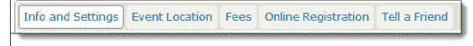

## 信息和设置

第一个表单定义活动的基本信息，包括其类别（类型）、标题、描述、日期等。你可能会注意到，此表单的第一个字段是用于选择活动模板。如果不存在活动模板，页面顶部将出现相应提示。

如果你的组织举办许多非常相似的活动，例如每月一次的早餐研讨会系列，或每两个月一次的培训工作坊，那么活动模板非常有用。从一个活动到下一个活动，结构、费用、地点，甚至基本描述都可能保持相似。在这种情况下，你可以在“活动 | 活动模板”下设置活动模板，从而节省时间并减少错误。模板创建工具与我们接下来要介绍的五个选项卡表单几乎完全相同，只是移除了一些字段（例如活动日期），这些字段被认为是每个活动独有的。

创建模板时，只需填写此类型所有（或大多数）活动共有的字段。例如，如果你的月度早餐研讨会每次有不同的演讲者和主题，你可能会希望让摘要和描述字段留空。

在为新建活动填写**信息和设置**表单时，如果选择了先前配置的模板，活动将预先填充模板中存储的所有数据。你将有机会审查、调整和填写活动中的任何字段。一旦为新活动选择了模板，它就不再与模板存在关联。换句话说，日后更改模板设置不会对使用该模板的现有活动产生任何影响。模板的唯一用途是预先填充活动，并借此简化活动创建流程。

## 管理活动

回到初始活动创建表单，我们看到活动类型和参与者角色字段。活动类型用于对活动进行分类，这在分析和管理活动时非常有用。例如，你可以为年度秋季会议定义一个活动类型，之后基于该活动类型进行搜索，比如显示过去五年中参加过任何一次秋季会议的所有支持者。活动类型选项在**管理 | CiviEvent | 活动类型**下进行管理。

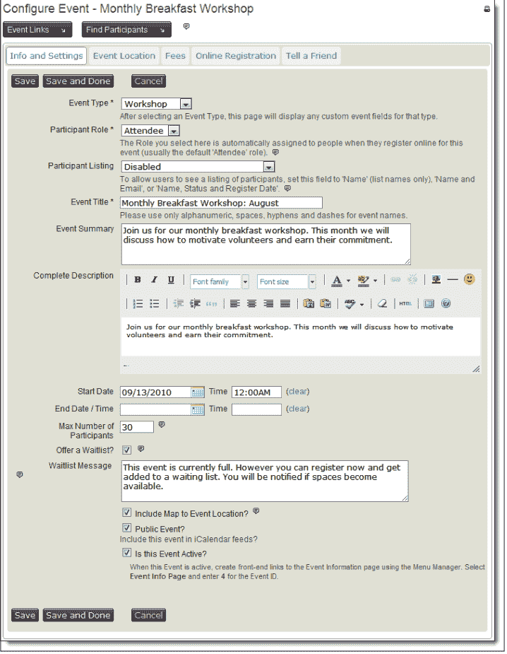

> > 尽管参与者列表页面可能是有效的同侪压力推广工具，但你的参会者也可能会认为这侵犯了隐私。请确保活动的性质（以及支持者的性质）允许显示此类列表。尤其要注意姓名和电子邮件模板的使用，因为有些联系人可能不希望他们的电子邮件信息以这种方式传播。

输入活动的标题，请记住它将在活动信息和注册页面中公开可见。你还希望活动拥有唯一名称，以避免与其他活动混淆。例如，如果你举办年度会议，可以将其命名为：2010年度会议、2011年度会议，以此类推。

使用**活动摘要**和**完整描述**字段来描述活动，例如涵盖的主题、演讲者、受众等。顾名思义，**活动摘要**字段应简短扼要。它将包含在系统生成的 RSS 和 iCal 源中，你可以将其用于推广。**完整描述**字段应更加完整，并显示在活动信息页面上。

> > 你的 RSS 源允许其他网站自动从你的网站获取内容并在其网站上显示。活动源包含你的活动信息，例如将访问者引导至你的注册页面的链接。iCal 源是另一种发布活动信息的类似格式。人们可以将 Google 日历、Outlook 和其他类似的日历应用程序设置为自动读取这些源，并在正确的日期和时间显示你的活动。

定义活动的开始和结束日期/时间。对于单日活动，只需填写开始日期字段即可。

稍后我们会花一些时间介绍候补名单选项。接下来进入活动向导第一步中的最后一组字段，点击启用或禁用以下选项：

- **包含活动地点地图？** 在信息页面上插入带有活动地点标记的 Google 或 Yahoo! 地图。要使用此功能，你必须在向导第二步定义地点，并且必须在**全局设置**中配置地理编码。
- **公开活动？** 决定活动是否显示在 RSS/iCal 源、HTML 活动列表页面以及 Drupal 的 CiviCRM **即将举行的活动**区块中。如果你有不想通过自动化方法公开的“仅限邀请”活动，请关闭此选项。

## 管理活动

在任何情况下，报名者都会留在候补名单中，直到有名额空出，此时他们会收到一封邀请他们注册的电子邮件。我们将在**在线注册**表单中看到一个影响此过程的额外选项——即为其**待定**状态定义有效期（过期期限）的功能。让我们通过一个示例来回顾这个过程：

- 1. 当个人尝试注册时，系统会告知已达到最大报名人数。
- 2. 此人选择加入候补名单，然后输入他/她的姓名和电子邮件地址。
- 3. 三天后，你的组织决定将活动移至一个新场地，该场地可多容纳 10 人。更改系统中的设置后，候补名单中的前 10 人（先到先得）会收到一封邀请他们注册的电子邮件。CiviCRM 会自动将他们的注册状态从**候补中**更改为**候补转待定**。如果超过有效期后他们仍未注册，则其注册状态将变更为**已过期**。
- 4. 在这 10 个报名状态为**候补转待定**的期间，只有这些候补联系人可以注册。你网站的新访客将无法注册，因为优先权给予候补人员。前 10 名（被邀请注册者）之后的候补人员仍在名单上。随着这些候补人员对注册邀请做出响应，或允许邀请窗口过期，新人员会被邀请注册（如果候补名单上还有其他人员），或者注册表单会转为公开可用。

虽然假设候补名单上那 10 位被邀请者会及时注册，但实际情况并非总是如此。其中一些人可能会拖延或干脆对活动失去兴趣。无论哪种情况，你成功使活动满员并给予候补名单上其他人公平参加机会的能力都会受到影响。

有效期选项通过限制为候补受邀者保留活动注册名额的时间窗口来改善这种情况。我们将在**在线注册**一节中介绍如何配置它。使用此功能时需要注意以下几点：

- 其他类型的待处理注册，即**来自“稍后付款”的待处理**、**来自不完整交易的待处理**和**来自审批的待处理**，也会根据相同的到期期限过期。“稍后付款”交易通常需要几周时间才能通过邮件收到支票，因此您为“稍后付款”事件设置的到期期限可能需要平衡长短不同的适当期间。您也可以决定不为预计会达到容量上限的事件提供“稍后付款”选项。或者，如果您在仔细监控事件，您可以先启用“稍后付款”，然后在达到初始容量上限时禁用它。
- 当您在事件设置中定义到期时间时，cron 作业会触发脚本来分析您的记录，并确定是否以及何时应发送电子邮件。如果您的 cron 作业配置为每晚运行，则少于几天的到期期限可能会产生不良影响，因为个人实际可以注册的时间窗口可能过短。还要注意，许多人周末不会阅读电子邮件，更不用说回复了。如果您的到期期限短于 72 小时，这会对候补名单上的用户产生不良影响。

如果您是 CiviCRM 的新手但对这个功能感兴趣，那么建立一个测试事件并使用测试记录运行各种场景来了解行为如何运作是值得的。

填写此表单后，单击**继续/保存**。现在，单击**位置**选项卡以继续下一步。

如果您正在创建新事件，请注意，填写此表单后，您只能选择继续或取消。继续后，完整的五步选项卡界面将出现，您可以根据需要浏览各个表单页面。请注意，您必须在完成或编辑每个页面时单独保存它。例如，如果您进入第二步并想返回第一个选项卡，则必须先保存第二个表单，然后再进入第一个选项卡。换句话说，**保存**按钮仅影响您所在的表单；它不影响其他选项卡。在初始保存后，您将有以下选项：**保存**（保存信息但保留在事件配置表单中）、**保存并完成**（保存并返回到事件管理屏幕）和**取消**（不保存而返回到事件管理屏幕）。

### 事件位置

第二个选项卡用于输入事件的位置。请注意，这里指的是事件的实际物理位置，而不是您组织的位置。它将包含在事件信息页面中，如果您在第一步中启用了映射，它将包含 Google 或 Yahoo! 地图。

一旦您创建了第一个事件并输入了位置，该位置将作为未来事件的选择选项可用。表单顶部将有一个选项，用于输入新位置或使用现有位置。如果您的组织定期使用各种培训或活动地点，这将非常有用。但请注意，对位置的任何更改都会影响使用该位置的所有实例。

您可以输入与事件关联的一个或多个电话号码和电子邮件地址。接听此号码的人应了解该事件、如何注册以及如何到达。在某些情况下，它可能是您组织中的号码，而在其他情况下则可能是与场地相关的号码。例如，电话号码可能是您举办大会的酒店的电话号码，与会者应致电该号码以预订过夜住宿。

最后一个字段控制事件位置是否应在面向公众的页面上可见。

输入信息后，单击**保存**并前进到下一个选项卡。

### 费用

如果您的事件要求参与者支付费用，请启用此选项并开始填写字段。

如果您已在站点中设置支付处理器来处理实时信用卡交易，则可以从下拉列表中选择该处理器。如果您不在您的站点上接受信用卡付款，或者不希望为这个特定事件启用它，您仍然可以通过单击**启用“稍后付款”选项？**来收取费用。“稍后付款”背后的想法是要求人们承诺付款，而付款将在注册过程的实时环境之外进行。例如，您可以允许人们用支票付款、打电话用信用卡付款，或现场用现金付款。

“稍后付款”可以与信用卡付款结合使用，或者每个选项可以独立使用。但是，如果您为事件启用了费用，则必须至少激活一个选项。如果同时启用了信用卡和“稍后付款”选项，注册人将可以选择“稍后付款”，这会在面向公众的注册表单中隐藏并禁用信用卡字段。

启用“稍后付款”后，您必须完成两个附加字段。**稍后付款标签**是注册表单上**稍后付款**复选框旁边显示的文本。**稍后付款说明**是一个字段，可以包含一两句关于如何稍后付款的说明。它将包含在感谢页面和发送给注册人的收据中。我们建议在您的说明中包含：支票应支付给谁、付款应发送到哪里以及何时需要收到。例如：

> *付款应支付给“FPAGM”，并邮寄至 123 Main St, Metropolis, ThisState, 12345。必须在 30 天内或大会之前（以较早者为准）收到付款，否则您的注册可能会被取消，恕不另行通知。*

**贡献类型**字段决定创建贡献记录时如何对费用进行分类。您的选择用于面向公众的注册表单，并将为通过管理界面创建的注册设置默认值。输入**费用标签**以确定面向公众的信息页面和注册页面上显示的文本。

此时，您必须配置您的费用。有两种构建费用选项的方法——**价格集**或**常规（基本）费用**。**常规费用**提供一个基本的费用选项列表，注册人可以选择其中一个选项。**价格集**允许构建更复杂的系列选项。**价格集**是费用字段的集合，可以包括单选按钮选项（用户从列表中选择一个）、复选框选项（用户可以从列表中选择多个）、选择字段（用户从列表中选择一个）或文本字段（用户输入数量，该数量根据配置的每项费率计算以确定总成本）。

虽然**价格集**在构建费用选项时为您提供更多的控制权和灵活性，但只有使用**常规费用**才能获得两个好处——结构的简单性使其更易于使用（在搜索和报告事件时），并且**常规费用**可以通过界面配置基于日期的折扣。

让我们先回顾一下带折扣的**常规费用**，然后再回来讨论**价格集**的配置。

使用**费用标签**和**金额**列来定义您的费用选项。您可以选择一个选项作为**默认**选项。配置好费用后，单击启用**按报名日期折扣**。基于日期的折扣工具由一个或多个带相关费用的折扣集组成。因为您可以定义多个折扣集，所以您可以为折扣创建分层结构。例如，假设您的活动将于 3 月 15 日举行。您可以构建以下内容：

- **早期注册：** 现在至 1 月 15 日
- **标准注册：** 1 月 16 日至 2 月 15 日
- **晚期注册：** 2 月 16 日至 3 月 14 日

我们定义为晚期注册的内容将作为您的**常规费用**选项输入。然后您将创建两个具有适当日期范围的折扣集来处理早期和标准注册费用。在命名折扣集并输入日期范围后，单击**将折扣集添加到费用表**以创建这些集。

保存后，两个新的费用选项表将添加到该表单中，并预先填充您在**常规费用**网格中定义的**费用标签**。在大多数情况下，您的费用选项将保持不变；只有费用金额会发生变化。但是，您可以根据需要重构折扣费用。例如，您可能有一个仅在 1 月 15 日之前注册的人才能参加的会前计划注册，您只将其添加到第一个折扣集中。

访问您的网站进行注册的最终用户只会看到与其注册时间相对应的费用。CiviCRM 负责确定列出哪些选项，确保不会有人在相关日期窗口结束后仍尝试以折扣价注册。

> **优惠券折扣**
>
> 虽然尚未完全通过界面提供，但 CiviCRM 已为处理优惠券类折扣做好了“准备”。在此模型中，您将代码分发给选定的联系人，他们可以在活动注册表中输入该代码以应用折扣。使用此功能需要实现一些自定义代码，但这对于初学者程序员来说并非遥不可及。有关更多信息，请参阅在线博客文章，其中概述了如何在 `http://civicrm.org/node/566` 进行设置。

如上所述，价格集允许更高级的事件费用配置选项。使用价格集的一个缺点是，它们目前不能通过界面支持基于日期的折扣。

价格集必须先通过价格集管理工具创建，然后才能分配给特定事件。当我们仍在事件费用配置页面上时，请注意有关价格集的消息。如果您已经配置了至少一个价格集，将显示一个选择框，允许您选择一个。这样做将隐藏**常规费用**部分，因为在配置费用时您必须选择其中一种系统。

要构建一个价格集，请访问 事件 | 新建价格集，或 管理价格集 以查看现有集合。每个集合将由一系列费用字段组成。该集合可以无限次重复使用，因此您可能希望名称足够通用，以便在多个活动中都能使用。例如，如果您的组织每月举办一次标准费率的早餐研讨会系列，请将价格集命名为“月度研讨会费用”，而不是“2011年3月研讨会”。请务必注明价格集将用于活动。

> 价格集功能可同时用于活动和捐赠页面。在捐赠页面的上下文中，它允许您拥有不同级别和类型的捐赠选项。

每个费用字段将使用以下显示/格式类型之一：

- **文本/数值数量**：注册人会获得一个文本字段，在其中输入数量值。单价由您设定，总额在注册过程中计算。您可能会在会议上出售宴会门票时使用此功能，注册人可能会邀请其配偶或同事参加。
- **选择**：在选择表单字段中显示的选项列表。
- **单选**：在单选按钮列表中显示的选项列表，用户只能选择一个选项。
- **复选框**：在复选框列表中显示的选项列表，用户可以选中/取消选中任何可用选项。

对于每个字段，您可以选择费用金额是否可见以及该字段是否必填。必填字段选项意味着注册人必须从该字段中选择一个选项。它不会影响该字段与其他字段的关系。单选和复选框类型的字段将额外提供一个选项，您可以在其中指定单行上应显示多少个选项。

您可以选择性地允许价格集字段影响 CiviCRM 计算的注册人数总数，以确保活动的最大参与人数未被超过。例如，假设您的费用选项之一是复选框，表明注册人将带其配偶。您不会对配偶收取全额注册费，这就是为什么它作为主注册人的费用选项处理的原因。然而，您的活动场地有严格的容量限制为 250 人，您需要确保参加的任何配偶都不会导致超出该限制。您在 最大参与者 字段中输入 250（活动创建向导的步骤 1），并在 参与者计数 字段中输入 1。如果注册人选择此选项，将在最大参与者值中记录 2 的计数（一名注册人，一名配偶）。此功能也很有用，如果您销售批量选项，例如在宴会上购买一张桌子（可容纳八人）。

> 版本 3.3 将最大参与者概念扩展到价格集字段选项，可用于管理会议出席。例如，您可以创建一个名为“下午分会场”的价格集字段，其中包含三个选项。这些分会场将在不同的房间举行，空间容量不同。您可以为每个选项设置最大值，从而控制每个会议的报名人数。

在此表单的末尾，有一个选项可使字段公开可见或仅限管理员。如选项所述，公开可见的字段将出现在面向公众的注册表单上，而仅限管理员的字段仅在您通过后端管理工具注册人员时出现。仅限管理员的字段可用于构建只有管理员可以应用的折扣费率，或用于注册演讲者和嘉宾，这些人员有特殊费率。

> 价格集字段可使用负值进行配置，可用于提供折扣选项。例如，您的组织可能会在人们同意提前一小时到达并提供活动布置的志愿者协助时提供 25 美元的折扣。

下图显示了一个包含两个字段的价格集——注册费的单选按钮（必填）和 FPAGM 会员的 10 美元折扣：

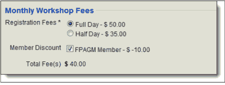

配置完所有字段并保存后，您可以返回活动配置并选择价格集用于您的活动。保存表单并继续到下一个选项卡以继续您的活动设置。

## 在线注册

**在线注册** 是 CiviCRM 在活动管理领域实现其强大功能的地方。不再需要仅依赖处理纸质注册或将数据从第三方活动注册系统迁移到您的联系人数据库。所有操作都在实时进行，直接与您的捐赠者管理软件集成。随着人们注册活动，您可以随时查看当前统计数据，按状态和角色汇总与会者。

此页面中的前几个字段控制表单功能的各种选项。在输入注册表单在活动信息页面访问时应如何标记的文本后，您指定表单可用的时间段。例如，您可能希望在活动前几天关闭在线注册，以便计算总注册人数，与餐饮商确定最终人数，并开始准备与会者资料包。一旦结束日期过去，尝试访问注册表单的网站访问者将被重定向回活动信息页面，并显示通知告知他们注册已关闭。

接下来的两个字段控制多注册人功能。当启用 **注册多个参与者？** 时，注册人可以选择除自己之外希望注册的人数。根据所指示的人数，他们将获得单独的表单来完成每个注册人的信息。确认页面将详细介绍每个注册人，所收取的总金额将反映所有注册人。这对于其捐赠者由企业组成且可能向会议、展览会发送多人的组织特别有用，或政治党派允许每个地区从每个地区派遣一定数量的代表参加大会。第二项选项可使附加注册人表单上的电子邮件字段变为可选（默认情况下，每个注册人必须具有唯一的电子邮件地址）。

**需要参与者审批？** 用于您希望管理员在注册人完成注册和付款前对其进行审查的情况。启用此功能会将每个注册人标记为参与者状态字段中的待审批，并显示审批消息字段，您可在其中就此功能向注册人提供指导。

在使用参与者审批功能之前，您需要在 **管理 | CiviEvent | 参与者状态** 中启用 **等待审批**、**待审批** 和 **已拒绝** 状态，并按 *Waitlisting* 部分所述配置 `ParticipantProcessor.php` cron 作业。

如果您使用等待名单或审批功能，您可以可选地配置 **待处理参与者过期时间（小时）** 时长，如前所述。此值决定经批准/接受的等待名单注册人在 CiviCRM 向其发送邀请注册的电子邮件后，有多长时间完成注册。有关此功能的更多讨论，请参阅 *Waitlisting* 部分。

此表单的其余部分处理将在注册流程的三个步骤中显示的页面标题和文本——注册表单、确认页面和感谢页面。请注意，注册表单部分能够在注册表单顶部和/或底部包含一个资料。

**资料** 是字段的集合，包括基本系统字段（名字、姓氏等）和您在系统中配置的自定义字段。没有配置资料的标准活动注册表单将仅包括活动费用和电子邮件地址字段。这是 CiviCRM 完成注册的最低要求。然而，在几乎所有情况下，您都希望为注册人收集额外的字段，包括姓名、地址、电话、传真，以及可能与活动相关的一些选项（餐食选择、特殊需求、会议出席等）。这些需要集中在一到两个资料中并包含在您的表单中。

如果您启用了多注册人功能，您可以选择为附加注册人使用不同的资料集。假设您正在举办一个展览会，企业经常派遣多名代表。您的第一个注册人表单应包括有关展览展示的详细信息，例如展示尺寸、特殊需求（如电力）和首选位置。然而，您只需要后续所有注册人的姓名和联系信息。因此，您为第一个注册人创建一个包含展览相关细节的资料，另一个用于所有附加注册人，包含姓名和联系信息。

资料是活动注册工具的重要组成部分。如果您不熟悉其使用方式，请参阅 *第 5 章，收集、组织和导入数据*，以全面了解其配置方式。还请查看该章节中的自定义数据部分，特别注意为活动参与者创建自定义字段的不同方式。例如，您可以创建特定于角色、特定于活动类型、特定于活动或适用于所有活动参与者的自定义参与者字段。请记住，创建自定义字段本身并不会影响其在注册表单中的可见性；您还必须将所需字段添加到将用于表单的资料中。

您还应审查与资料相关的另一个考虑因素，即 CiviCRM 如何在人们注册活动时与联系人记录交互。当未经身份验证的人注册活动时（即他们在完成表单时未登录网站，而是匿名用户），CiviCRM 将尝试使用 **联系人 | 查找并合并重复联系人** 中定义的默认严格 **个人** 规则，将他们与系统中的现有联系人进行匹配。请务必审查该规则，以确保其足以满足您的目的。

因此，请确保默认严格 **个人** 规则中的字段包含在您的资料中，否则您可能会发现创建的重复联系人比预期更多。例如，如果您的规则匹配名字、姓氏和电子邮件地址，但您未分配包含名字和姓氏的资料，每个注册人将被输入为新联系人，因为数据不足以确保可靠的匹配。

当然，你可以要求用户登录网站才能为你的活动注册。这样做可以确保你始终与正确的联系人记录进行交互。然而，你的组织模式和网站结构可能不支持该选项，并且要求人们在注册前登录不可避免地会导致一些注册被放弃。

本表单的最后一部分控制基于电子邮件的确认和收据。当注册者完成表单时，你通常希望他们收到一封电子邮件，确认他们已注册，详细说明他们选择的选项，并作为付费活动的付款收据。在本节中，你可以添加一个活动特定的消息，该消息将出现在电子邮件顶部，指定电子邮件的发件人（姓名和电子邮件），并指示是否应抄送/密送给任何人（如你的工作人员活动总监）。

事件和收据相关字段由 CiviCRM 插入，可通过 Administer | Configure | Message Templates 配置。请注意，默认情况下那里存在多个活动相关模板。影响在线注册表单的模板标题为 Events - Registration Confirmation and Receipt (on-line)。根据你选择的选项，也可能使用其他模板。一般来说，默认模板很基础但足够使用，以表格网格格式排列字段。

完成此表单的配置后，点击 Save 并通过点击 Tell a Friend 进入最后一个标签。

## Tell a Friend

最后一个标签启用社交网络功能，为注册者提供工具，让他们告诉他人有关你的组织和活动。当启用时，注册者将在活动感谢页面上获得一个按钮，邀请他们与他人分享活动。该按钮引导他们进入一个表单，在那里他们可以自定义默认消息并输入他们希望邀请的人的姓名和电子邮件地址（最多三人）。

你可以配置页面标题、感谢页面上提供给注册者的鼓励他们告诉他人的消息、注册者可以随后自定义的建议（默认）消息，以及提供给收件人的链接。通常，你会将人们引导至活动信息或注册页面，但你有灵活性将他们发送到任何地方。

注册者完成 Tell a Friend 表单后，他们将被引导至一个感谢页面，你可以根据本表单的最后两个字段按需进行配置。

点击 **Save** 或 **Save and Done** 完成活动配置。以下屏幕截图显示了 **Tell a Friend** 配置中呈现的选项：

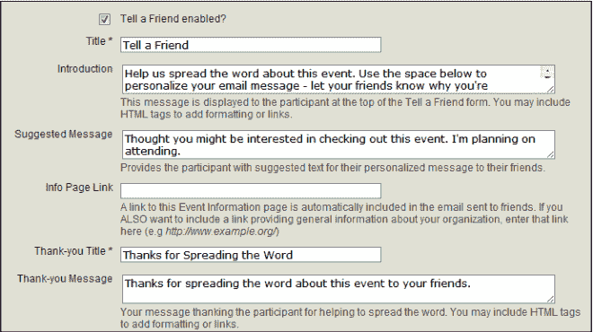

## Testing and promoting

此时，你的活动已配置完成并准备就绪。下一步非常重要，即测试你的注册表单。当你首次使用活动且不完全熟悉各种功能时，这一点尤其重要。测试信息页面和注册表单；确保你对费用和字段的结构以及流程每个步骤中消息的显示方式感到满意。务必完成一次完整的注册，以便你可以接收并查看收据电子邮件。如果你同时启用了信用卡和稍后付款选项，请执行两种工作流程，以确保你为所有页面和电子邮件精心制作了文本。

要访问用于测试和推广的活动相关链接，请从活动配置表单内使用 **Event Links** 按钮或 **Event Management** 列表中的弹出链接。你将查看三个链接选项：

- **Event Info:** 显示有关活动的实时信息页面。
- **Registration (test-drive):** 以试用模式显示注册表单。试用模式不会实际处理信用卡，并且注册将被标记为测试记录，以便在注册者计数中排除。

> 在 **Events | Find Participants** 中搜索测试注册时，如果你的测试交易没有显示出来，你可能会感到困惑。请确保勾选 **Find Test Participants?** 以明确将测试注册包含在结果列表中。

- **Registration (live)**: 显示实时的注册表单：

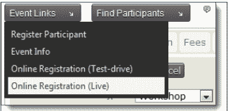

> 尽管 CiviCRM 确实提供了试用选项，但我们建议在你对配置选项感到满意之前使用实时注册链接进行测试。你可能希望临时添加一个小额注册费用选项用于使用信用卡进行实时测试，以避免退款成本。

上述实时链接（**Event Info** 和 **Registration (live)**）可用于你的网站内容、电子邮件和其他推广方式。Joomla! 用户还可以通过创建 CiviCRM 菜单项来构建指向这些页面的链接。

除了直接链接到你的活动页面外，你可能还希望提供访问即将举行的活动列表的方法。有几种方法可以使用原生 CiviCRM 方法来实现。从 **Manage Events** 页面，你将在 **Find Events** 块的右上区域找到四个图标：

- HTML listing of events
- RSS feed of events
- iCalendar file download of events
- iCalendar feed of events

每个链接都会发布被指定为公开的当前和未来活动的列表。请回忆在活动设置过程的第一页，我们有将活动设为公开的选项；该功能的主要用途是控制在这些列表页面中显示的内容。

CiviCRM 为 Drupal 提供了一个块来显示活动。你可以在 **Site Building | Blocks | List | ThemeName** 中通过为 **CiviCRM Upcoming Events** 块指定一个区域并点击 **Save blocks** 来启用它。通过从 http://drupal.org/project/civicrm_eventblock 下载并启用 CiviCRM Event Block 模块，可以获得 **Link name to display** 和 **Max number of events to display** 的额外配置选项。

对在 Drupal 中格式化和显示 CiviCRM 活动信息有更多控制需求的高级 Drupal 用户应使用 Views。Views 提供了对如何在页面、块和订阅源上显示活动信息的广泛自定义。在 Drupal 中，点击 Site building | Views | Add，提供视图名称，选择 CiviCRM Events 作为视图类型，然后点击 Next。你可以通过点击 Fields 旁边的“加号”符号，然后在 Groups 选择器中选择 CiviCRM Events 来查看可用于显示的 CiviCRM Events 字段。有关使用视图的更多信息，请参阅你网站上的高级帮助，或使用该主题的优秀 Drupal 书籍。

Joomla! 的活动列表模块也在 CiviCRM 网站和 Joomla! Extension Directory http://wiki.civicrm.org/confluence/display/CRMDOC/CiviEvent+Joomla+Module 上提供。该模块有众多选项来控制活动列表中显示的内容，包括是否链接到信息页面或注册页面，是否包含 Register now 链接，活动摘要，以及你希望如何过滤列表（活动类型、日期范围、所有当前/未来、特定活动等）。对于 Joomla! 用户，这提供了许多推广活动的有用选项。

现在你已经构建了活动并对其进行了测试，出去告诉人们吧！

## Breakfast seminar example

FPAGM 今年的目标之一是为该地区的食品储藏室提供更多培训资源。这些储藏室中的许多都是由志愿者运营和管理，由教堂、社区组织和其他小型地方团体管理，他们希望支持他们的社区。为了实现这一目标，他们组织了一系列早餐研讨会，让志愿者和储藏室工作人员可以聚在一起讨论预定义主题。FPAGM 将邀请演讲者就财务管理、志愿者招募和协调、食品储存和分发以及客户支持资源等主题进行讨论。

每个早餐研讨会将收取少量费用以支付提供的食物费用。FPAGM 希望所有注册都通过网站进行（不接受邮件或电话注册），尽管他们将启用“稍后付款”选项，供希望现场现金付款的人使用。

由于他们预计将举办其他类型的活动，他们首先创建了一个“Breakfast Seminar”活动类型来对这些月度会议进行分类。他们还构建了一个活动模板，因为这些会议几乎完全相同。由于费用结构非常基础且模板将从一个活动复制到下一个活动，他们选择不构建价格集。他们将提供两种基本费用选项：标准和支持者。标准费用将涵盖早餐和举办活动相关的杂费，而支持者将额外增加一笔金额，作为鼓励人们超越基本成本并帮助支持协会的一种方式。

由于会议将在协会可容纳约30人的会议室举行，空间有限。FPAGM设置了最大参与人数，并启用了候补名单功能。他们还加入了一个个人资料字段，用于获取个人姓名、组织名称和电话号码等基本信息。他们选择不启用多参与者选项，因为他们更希望每个人自行报名。完成后，他们通过博客式公告推广活动，并提供报名表的直接链接。

## 处理和管理参与者

你已经配置好活动、完成测试，并公开推广了在线信息页面和报名表。转眼间，活动报名就开始陆续涌入。接下来该怎么办？

与 CiviCRM 的许多其他领域一样，这些记录可以通过搜索工具集中查看，也可以按单个联系人查看。在本节中，我们将通过联系人的记录来逐步了解活动报名，然后简要回顾导入参与者记录。

## 处理活动报名

联系人的活动参与历史将显示在其**活动**标签页中。在此标签页中，你可以查看、编辑或删除现有报名记录，或为该联系人创建新的报名记录。

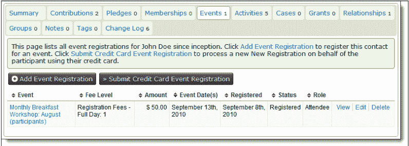

## 管理活动

请注意，活动历史列表上方有两个按钮：**添加活动报名**和**提交信用卡活动报名**。前者用于不涉及系统实时信用卡处理的报名，可能包括免费活动、支票、现金、EFT 付款，或在系统外处理的信用卡。后者应用于你直接通过 CiviCRM 处理信用卡时。如果你尚未配置支付处理器，或者你的支付处理器不支持集成支付（例如 PayPal Standard 或 Google Checkout，会重定向到外部网站处理支付），则不会显示该按钮。

新的报名表允许你选择要为该个人注册的活动、该活动特定的费用和字段、支付选项以及收据选项。以下截图显示了表单的上半部分：

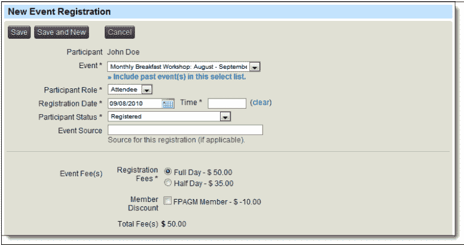

关于此表单，有几点需要注意：

-   活动下拉列表只会显示当前和未来的活动。如果你想为某人报名过去的活动，必须点击**在此选择列表中包含过去的活动**链接，这会重新加载表单并显示完整活动列表。这样做是为了减少混淆并简化活动选择过程。

-   如果你创建了任何附加到参与者的自定义数据字段，它们只会在选择与其“用于”条件匹配时出现并可用。例如，如果你为参与者角色**嘉宾**创建了自定义字段，那么只有当你在此表单中更改角色时，它们才会出现。如果你为活动类型**会议**附加了自定义字段，那么只有当选中的活动与该活动类型关联时，它们才会出现。如果你期望看到某个自定义字段但没有看到，请确保你的选择与该字段的配置用途相匹配。

在活动费用块的正下方，有一个用于记录此报名付款的选项。勾选该复选框将显示一系列与贡献相关的字段，如下面截图所示：

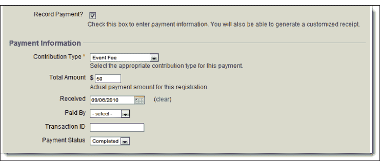

需要重点理解的是，收取费用的活动报名会同时生成活动参与者记录和关联的贡献记录。虽然你可以分开处理它们，但我们强烈建议你通过这个单一界面进行管理。除了比单独录入更容易（因为你可以同时处理两条记录），这样做还能在两条记录之间建立链接。如果你日后返回查看此活动报名，你会看到下方汇总了相关的贡献记录。同样，如果你进入关联的贡献记录，你会看到下方汇总了活动记录。报告中该活动的收入总计也会反映这些关联记录。分开录入则无法建立这种连接。

## 处理预期付款

你难免会通过邮件、传真或电话收到活动报名，而付款并未随报名一起提交。虽然你尚未实际收到付款，但存在一笔*预期*付款，因此最佳做法是将该付款录入为**待处理**贡献。使用**记录付款**选项记录贡献，但不要填写**付款方式**字段，并将**付款状态**字段更改为**待处理**。

为什么会这样建议？原因有二：第一，它能更好地反映数据实际情况。你收到的报名隐含着付款承诺。这与为嘉宾、演讲者或其他你计划不收费用的VIP参与者报名不同。第二，它提供了更好的工具来跟踪到期付款。如果上述情形中的每个报名者都有一笔待处理的贡献付款，你可以轻松地进行搜索，找出总到期金额，并相应地处理发票或后续沟通。从根本上说，它能让你更好地了解实际财务状况，并为那些欠你付款的人提供清晰的数据路径。

通过你的公开活动报名页面收到的报名，也会同时创建活动记录和贡献记录。后付费报名会生成状态为**待处理**的贡献记录，表示尚未收到付款。当你收到付款时，首先在贡献记录中记录详情，并将状态更改为**已完成**。这样做会自动更改关联的活动报名记录状态，以反映付款已收到。请注意，反向操作不会产生相同效果：将*报名*状态更改为已完成，并不会同样更改关联的*贡献*记录状态。这适用于此类情况：你想允许人们参加活动（标记为已完成），即使他们会在活动后付款（标记为待处理）。

在结束查看联系人记录中显示的活动记录之前，我们想指出一个附加功能。在活动标签页中，点击**查看**以显示报名详情。在此屏幕上，你会注意到一个创建名牌的按钮。点击此选项将引导你进入一个表单，你可以在其中选择要使用的模板，并触发生成包含名牌的PDF文件。

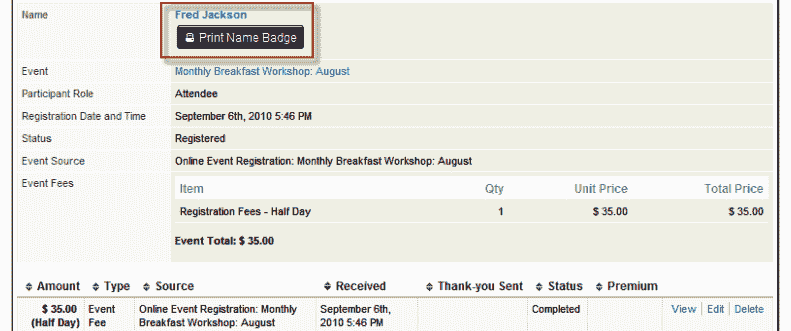

在接下来的“跟踪、搜索和报告”部分，我们将回顾如何为所有活动参与者批量创建名牌。现在，了解一下如何创建单个名牌会很有帮助。

## 导入参与者记录

与 CiviCRM 的其他领域一样，活动功能包含一个用于导入活动报名的工具。当你最初从外部数据库（如 MS Access 或 MS SQL Server）迁移数据时，这尤其有用。根据你的组织结构和 CiviCRM 的使用方式，它有时也会派上用场。

假设你的组织由五个分会组成，按地域分布覆盖整个州。每个分会举办本地活动，并通过志愿者处理所有现场管理。报名流程通过使用 CiviCRM 的州级组织集中处理，因此会在活动前一天生成联系人参与者列表并通过电子邮件发送给分会协调员。

假设其中一些活动允许现场报名，另一些则包含继续教育学分，而这些学分必须经过出勤验证才能获得。换句话说，组织不仅需要跟踪人们是否报名，还需要跟踪他们是否实际出席。

你选择通过在活动前一天晚上向分会协调员发送 .csv（逗号分隔）导出文件来处理此事。协调员在人们到达活动现场时欢迎他们，并使用电子表格软件在 .csv 文件中标记每位出席者。他们为现场报名者添加新行。该文件在活动结束时发回主办公室，并分两步导入 CiviCRM：使用更新选项导入已有报名者，其中参与者状态值反映谁出席了；使用插入选项导入新报名者，然后通过其姓名和电子邮件与现有记录进行匹配。

## 管理事件

导入工具与我们在其他区域看到的非常相似。四步向导包括加载文件并配置导入设置、将文件的字段映射到 CiviCRM 字段、预览结果以及完成导入。如果发现任何记录存在问题，将生成错误文件，可供下载。

要访问导入工具，请访问 **Events | Import Participants**。导入事件时需要注意以下几点：

- 参与者导入仅接受 `.csv` 文件。你无法像联系人导入那样连接到 MySQL 数据库。
- 导入参与者与导入联系人之间最显著的区别在于处理重复项时 **Update** 选项的行为。Update 选项 *要求* 存在现有的参与者记录，且 *必须* 使用唯一的参与者 ID 值进行识别。因此，你只会在与我们刚才讨论的类似场景中使用它，即参与者列表从系统中导出、进行更改，然后再导入回系统。如果使用 **Update** 选项，CiviCRM 将不会处理新的注册记录。在这方面，它与联系人导入不同，后者会匹配并更新现有记录 *并* 为不匹配的记录创建新记录。
- 正如预期的那样，参与者导入可用的字段映射选项包括许多与注册相关的字段。请注意其中标红的字段，因为成功导入这些记录需要它们。其中包括 Event ID 和 Participant Status。前者可以从 **Manage Events** 页面获取。其中几个标红的字段用于与联系人记录进行匹配。并非全部都是必需的；只有足以进行有效匹配的字段才需要。例如，你不需要内部联系人 ID 和名字/姓氏。两者中任一即可进行匹配。

## 跟踪、搜索和报告

在上一节中，我们使用单个联系人记录来了解注册是如何与关联的捐赠记录一起创建的。在本节中，我们将开始处理多个参与者记录。

## 使用仪表板跟踪注册

作为活动管理员，你最重要的一项能力之一是能够快速查看特定活动已注册了多少人。CiviCRM 在 **Events | Dashboard** 页面上为你提供了这些详细信息的快照。

与 CiviCRM 的其他区域类似，**Dashboard** 以汇总的方式提供关键数据的快照。对于活动而言，这包括即将举行的活动列表，其中注册人数按各种类别细分，以及最近收到的注册列表。

注册人数非常有用，值得解释一下。请查看以下屏幕截图：

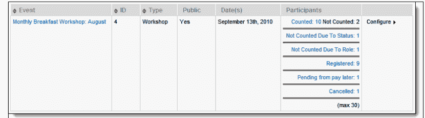

CiviCRM 通过将其分解为类别来帮助你 *理解* 参与者记录。我们首先从 **Counted** 注册人数开始，与 **Not Counted** 形成对比。已计数的参与者包括已注册的人员，包括已付款和将稍后付款的人员。**Not Counted** 按状态和角色细分。默认情况下，状态为 **no-show**、**cancelled**、**pending from incomplete transaction**、**on waitlist**、**rejected** 和 **expired** 的注册者都将被排除在注册人数之外。为什么？因为他们预计不会参加或已确认未参加。同样，参与者角色也可以配置为包含或排除在总计数之外。在我们之前看到的示例中，我们创建了一个名为“Staff”的参与者角色，该角色不应计入计数。

参与者状态和角色的设置可以通过 **Administer | CiviEvent** 进行配置，并在本章前面讨论过。我们在此看到的是这些设置的影响以及它们如何帮助你了解参与者的情况。

屏幕截图中显示的 **Registered**、**Pending from Pay Later** 和 **Cancelled** 计数反映了记录所代表的各种参与者状态。如果存在其他状态，也会列出。

请注意，这些计数中的每一个都是实时超链接；选择链接会显示该计数中的相关注册者。这是查看和处理参与者记录片段的最快方式。

## 管理事件

## 搜索参与者

虽然仪表板提供了对单个活动的快速窗口，但你无疑希望根据更精细的标准或跨多个活动搜索记录。我们通过 **Events | Find Participants** 来实现，如以下屏幕截图所示：

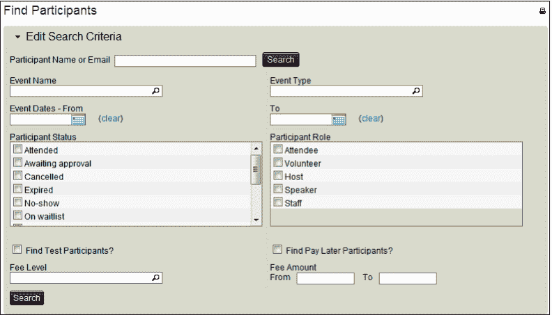

通过此工具可用的字段相当不言自明。你可以选择在单个活动内搜索、在活动类型类别内的多个活动、按日期范围或费用范围搜索。搜索字段具有限制性；所有条件都必须匹配才能返回结果。输入大量条件将导致返回的记录更少。两个例外是多选字段 **Participant Status** 和 **Participant Role**。该字段内的多项选择是包含性的，但其与其他字段的交互仍然具有限制性。

与 CiviCRM 的其他搜索工具类似，运行搜索后你可以对批量记录执行操作。首先选择所有记录或选择选定记录，然后从下拉菜单中启动操作。

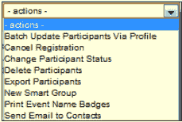

*Managing Events*

- Event Income Report (Detail)
- Attendee List

**Event Participant Report** 和 **Attendee List** 都基于相同的模板，基本上提供根据角色、状态、活动、活动类型或日期范围检索注册者的选项。它非常适合为工作人员在活动期间随身携带的参会者名单，或发布供参会者分发的参会者名单。该报告的一个独特之处在于，你可以在数据列之前或之后包含空白列。这可用于通过在注册者签到时在名单上勾选来跟踪出席情况，或收集稍后导入的其他信息。

**Event Income Report (Summary)** 显示活动收入明细，并在活动中分解参与者状态类别。使用此报告，你可以了解注册者与取消或其他未计入状态如何影响你的净收入。

**Event Income Report (Detail)** 生成活动所有主要类别的详细分解，包括状态和角色，并为每一行生成计数和收入总额。它为你的活动文件提供了出色的“最终报告”工具。

## 将活动整合到你的 CRM 策略中

撰写关于 CiviCRM 这样软件的书籍的一个挑战是，很容易保持模块化——因此，你很容易以纯粹模块化的方式来使用该软件。这在很大程度上是可以的；你自然会围绕这些功能模块，如活动、会员、捐赠、案例管理等进行思考和结构化。然而，每隔一段时间，跳出这些模块化“框框”思考并超越它们，以实现软件的全部潜力是很有益的。

你创建了一个活动，发布了注册表单，收集了注册信息，提取了出席名单，打印了姓名标签，并向董事会提交了报告。简而言之，你经历了一个成功的活动管理流程。

但你做了什么来邀请与会者采取进一步行动？你是否鼓励他们加入委员会、订阅电子新闻通讯，或加入组织成为会员？

在构建活动并准备发布时，请思考应收集哪些信息字段，这些字段未必对活动本身有直接影响。例如，你可以在注册表单中加入新闻通讯订阅选项；可以提供兴趣领域复选框列表，以更深入地了解活动参与者及其参与原因；还可以询问他们是否有兴趣通过捐款或志愿服务机会来以新方式支持组织。

你是否会询问参会者这是否是他们第一次参加你的会议或展览？如果是，他们是否有兴趣参加首次参会者晚宴？请记住，活动为人们提供了看到组织“面貌”的独特机会。要利用这个机会在新加入者心中建立承诺感。

活动结束后，你会获得一份新名单，这些人显然对你的会议、例会、研讨会、培训班等感兴趣并积极参与。虽然这些联系人中很大比例可能早已存在于你的系统中，但不可避免地会有一些新联系人，值得进一步跟进。你是否会在活动结束后发送会议评估调查，邀请人们提供反馈和意见，供未来活动参考？这可以通过 CiviCRM 配置文件完成，使你能够将回复直接保留在个人记录中（前提是你不需要提供匿名回复选项）。

实现这些行动号召和承诺建立的工具尽在掌握：使用会员工具鼓励人们加入；从活动注册“感谢”页面链接到捐款页面以寻求资金支持；扩展你在活动注册配置文件中收集的信息，以更深入了解你的支持者及其兴趣领域；并利用 CiviCRM 的广播邮件功能来推广和跟进你的注册者。

超越单纯的活动管理工具，利用 CiviCRM 的其他功能，以拓宽和深化你组织与活动参与者之间的关系。

## 摘要

对许多组织而言，活动是支持者看到组织“面貌”的唯一机会。你如何管理活动，以及你用什么工具有效跟踪和报告活动的成功，最终都会影响你的底线。CiviCRM 提供了强大的工具，既能生成简单和复杂的结构，也能在项目的每个阶段管理注册者。

## 管理活动

在本章中，我们：

- 逐步介绍了活动的配置，并详细讨论了众多可用选项
- 回顾了活动注册如何影响联系人记录
- 以管理员身份注册联系人，并了解了在后端环境中操作的最佳实践
- 探索了 CiviCRM 如何计算参与者数量，以及如何有效利用这些数据跟踪注册进度
- 对参与者进行搜索，并对搜索结果批量执行操作
- 生成报告，汇总活动收入详情并制作出席者名单

在下一章中，我们将把注意力转向 CiviCRM 的案例管理工具，并探讨如何在推进案例解决的过程中跟踪与支持者的沟通。
