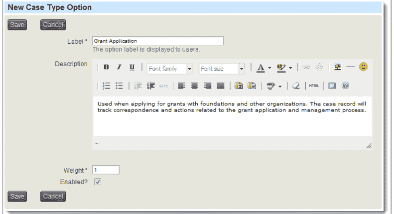
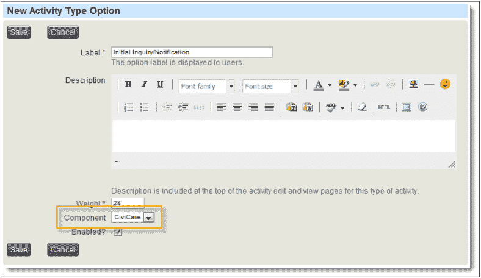
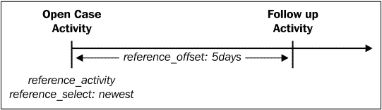
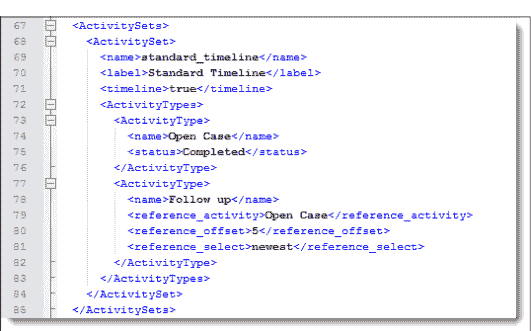
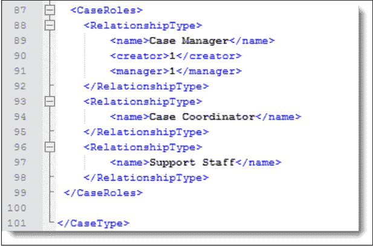
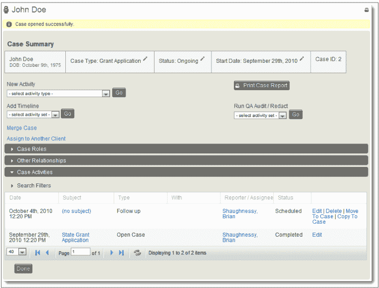
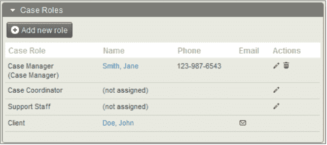
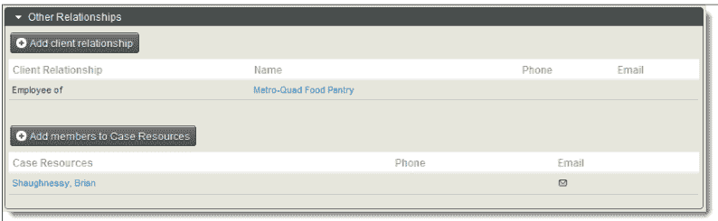
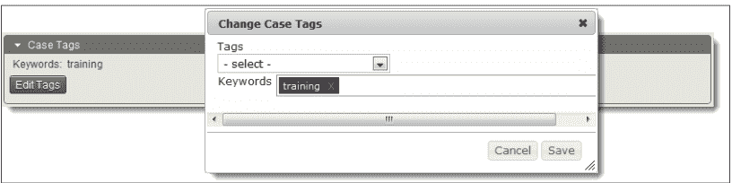
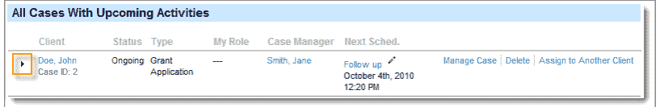

# 10
与支持者互动：
管理案例

我们即将进入的这一章，乍看之下可能并不适用于许多非营利组织。“案例管理”的概念通常用于人类服务机构，例如医疗保健行业内的机构。事实上，这正是 CiviCRM 案例工具最初功能的诞生之处。

然而，案例管理的概念也延伸到了许多其他行业和组织。从根本上说，它是对围绕单一主题、问题或项目的多步骤流程的管理。

在本章中，我们将：

- 思考你的案例管理系统
- 配置案例
- 跟踪、管理和解决案例

即使你最初认为 CiviCRM 的案例管理工具并非你的组织所需，也请考虑阅读本章，以更好地理解核心概念和潜在用例。你可能会对案例工具所提供的可能性感到惊讶。

这两种工具非常相似。事实上，案例记录的主要构成是一系列持续的案例活动。然而，联系人的基本活动列表会从多个来源增长和创建（既包括手动创建的活动，也包括自动生成的活动），而案例记录则通过将与共同主题相关的多条沟通信息分组，帮助你管理这些沟通。从这个意义上说，可以将案例视为一种升级版的活动。

案例不会取代活动。你仍然会定期与支持者进行一般性沟通，并以活动形式直接记录在他们的联系人记录上。但是，如果你与支持者围绕单一问题、难题、项目或其他事项的关系开始涉及多个步骤、多条沟通信息或不同角色的多个人时，那么就该升级为案例了。

## 落到实处

如果你仍然难以看到它在你的组织中的潜在应用，请考虑以下用例：

- **人类服务/服务交付**：这是案例工具最初诞生的领域，也是最明显的应用场景。如果你通过与支持者互动来帮助他们解决问题（如辅导员、顾问或倡导者），或为他们提供直接支持（现场照护、配送服务、交通等），你可以使用案例来管理这些服务和支持请求/工单。
- **会员/附属流程**：如果你的会员或附属申请流程涉及多个步骤，申请人必须填写表格和参加面试、提供证明材料，并经过正式的审批流程，你可以使用案例来管理这些步骤。虽然案例记录不会直接连接到会员记录，但申请和审批所涉及的流程和记录保存可以在此处处理。
- **捐赠者培育**：低端捐赠者可能仅通过捐款页面与你的组织保持一次性接触，而高端捐赠者通常涉及更长的“培育”过程，组织中的关键负责人会会见捐赠者、讨论具体需求，或许还会就捐赠或赞助所获得的认可进行协商。围绕特定捐赠或赞助请求的持续沟通可以归入案例记录中。
- **拨款申请**：CiviCRM 内置的拨款工具面向的是发放拨款并与受助者沟通的组织。然而，如果你所在的组织经常*申请*拨款，则可以构建一种案例类型来管理该流程，包括拨款撰写、内部审查、申请提交、回复、报告跟踪和付款安排。

这些示例只是 CiviCRM 案例管理工具当前的一些使用方式，可能会启发你思考如何在你的组织中使用它。

然而，是否存在不应使用案例记录的情况？也许更好的问题是：与简单的活动记录或其他工具相比，使用案例工具有哪些潜在缺点？

在考虑使用案例时，应当理解它确实会为记录增加一个流程层。当然，这正是该工具的全部意义所在。这额外的一层意味着各个活动——你围绕某个问题的沟通和互动记录——与联系人记录之间隔了一步。如果我访问 John Doe 的记录，我需要先进入相关的案例记录才能查看这些活动。

CiviCRM 提供了一些出色的工具，可以将案例详情和活动展示在系统仪表板上，因此信息并非被掩盖。但是，你确实增加了一层“中间管理”，如果你记录保存的量和性质不值得这样做，那么它可能弊大于利。

## 配置案例

此时，你应该已经对案例管理工具的方向有了清晰的想法，并准备好开始配置过程。如前所述，CiviCRM 的案例配置比其他组件更复杂（也更麻烦一些）。这是因为每种案例类型都针对解决过程中涉及的活动类型、工作流程和角色而高度定制。这种定制以及 CiviCRM 提供的灵活性，增加了复杂程度。

你的第一步将是定义一种案例类型，并为此特定类型构建相应的配置文件。每种案例类型都会有自己的配置文件，彼此各不相同。

通过进入 **管理** | **CiviCase** | **案例类型** 来定义你的案例类型。




请仔细记下你为案件类型指定的标签（Label）。在构建配置文件时，你需要确保标签与之完全匹配。

> FPAGM 定期申请拨款，用于资助资本采购、培训项目或为该地区的食品救济站提供直接支持。该协会决定使用 CiviCRM 的案件管理工具，在内部将申请和拨款跟踪流程正式化。虽然他们本可以重新标记 CiviGrant 工具以反映拨款申请需求（而不是其通常的拨款分发用途），但他们的工作流程需求和多步骤流程更适合通过 CiviCase 来处理。
> 他们首先构建了一个“拨款申请（Grant Application）”案件类型，用于收集围绕拨款流程的所有沟通记录和其他活动记录。

你可能已经注意到，在导航到“管理 | CiviCase”菜单时，还有另外两个菜单选项：“案件状态”和“修订规则”。你的案件记录总会有一个指定的状态。默认情况下，CiviCRM 预置了三种状态：“进行中”（即打开）、“紧急”和“已解决”（即关闭）。如果你需要为工作流添加其他状态，可以在此处创建。

修订（redaction）是对数据进行的更正或更改。修订规则的匹配和替换方式类似于“管理 | 选项列表 | 词语替换”中的系统级词语替换工具。不同之处在于，这些修订仅在案件的上下文中生效，并且匹配定义可以使用正则表达式来构建。

## 与联系人互动：管理案件

你的许多通用活动类型可能会应用到案件记录上，而且有一些标准的案件管理活动类型应该包含在所有案件中（例如“更改案件状态”）。除此之外，你还需要创建专门用于一种或多种案件类型的活动类型。请通过访问**管理 | 选项列表 | 活动类型**来创建这些类型。



请注意，如果此活动是案件专用的，并且你不想让它作为标准活动可见和可用，则应从**组件**下拉字段中选择**CiviCase**。

> 别忘了，特定的活动类型可以通过自定义数据来扩展。你可能需要考虑在创建某些类型的活动时收集额外的信息。

一旦在系统中定义了这些类型，你就可以将它们添加到配置文件中。完整列表将位于 `<ActivityTypes>` 标签内，每种类型则位于各自的 `<ActivityType>` 标签内。在其中，你需要添加一个 `<name>` 标签，用于放置你在系统中创建的准确名称。

作为其“拨款申请”案件类型的一部分，FPAGM 预计会有多种该案件类型独有的活动类型。它在系统中创建了以下活动类型：

- Initial Inquiry/Notification
- Permission to Submit/Application Received
- Scope Definition
- Internal Draft Submitted for Review
- Final Internal Approval
- Grant Proposal Submitted
- Denied/Case Closed
- Accepted
- Thank You Letter
- Report

这些案件活动类型与若干通用活动类型相结合，应能涵盖拨款申请流程中的各个步骤或决策结果。

每种类型都可以有一个可选的 `<max_instances>` 值，用于限制该活动可以添加到案件记录中的次数：

```
<ActivityTypes>
  <ActivityType>
    <name>Open Case</name>
    <max_instances>1</max_instances>
  </ActivityType>
  <ActivityType>
    <name>Follow up</name>
  </ActivityType>
  <ActivityType>
    <name>Change Case Type</name>
  </ActivityType>
```

请注意，“Open Case”活动类型的 `max_instance` 为 1。这是合理的，因为一份案件记录只能被打开一次，因此该活动在单个案件中只能出现一次。

在构建配置文件时，请尽量保留示例文件和前面截图中所示的缩进结构。这样做有助于确保每个标签都能正确闭合，并使你不会在结构层级中迷失方向。

在定义活动类型时，你可能希望保持配置文件处于打开且可编辑状态，以便将浏览器中的值复制粘贴到 XML 文件中，或者反过来操作，从而确保值完全匹配。

在添加完适用于该案件类型的所有活动类型后，请务必在 XML 文件中添加一个闭合的 `</ActivityTypes>` 标签。

下一个配置块是定义时间线（timeline）的地方。在配置文件中，它被标记为 `ActivitySets`。在构建它之前，让我们回顾一下时间线到底是什么，以及它的作用。

时间线的目的是建立一系列活动，这些活动按既定顺序发生，并针对相对于其他活动（依赖关系）的一段时间。此外：

- 时间线是可选的。如果你的案件类型主要用于对活动进行分组，而不是建立明确的工作流，那么除最初的 Open Case 活动外，你可能不需要定义时间线。
- 时间线可以在案件打开时自动实施，也可以作为选项应用于已打开的案件。在第一种情况下，时间线中定义的活动会在案件打开时自动添加到案件中。在后一种情况下，添加时间线的选项在“管理案件”屏幕中可用。
- 单个案件类型可以定义多个时间线。由于时间线可以是可选的并手动应用，这可以实现相当复杂的工作流分支。例如，在我们的拨款申请用例中，我们可以构建一个贯穿申请流程的初始时间线，然后根据决策树（申请是被接受、拒绝还是需要更多信息）创建手动应用的时间线来满足相应的工作流需求。
- 时间线可用于审计报告。审计报告的概念是跟踪案件解决进度与既定标准的对比。例如，如果你定义了流程中的某个步骤需要在五天内完成，你可能需要对实际完成日期进行分析，以判断该时间窗口是否太短（案件工作人员长期延迟完成任务），并对工作流进行调整。

让我们来看看 XML 配置文件的构建方式以及可用的选项，以便更好地理解时间线是如何工作的。

时间线将集中在 `<ActivitySets>` 标签内，每条时间线将位于一个 `<ActivitySet>` 标签内（注意使用复数与单数来定义包含组和单个集合）。每个集合由以下标签组成：

- `<name>`：时间线的唯一名称。名称中不应包含空格或其他特殊字符。例如，你可以将初始时间线命名为 `standard_timeline`。

请考虑下图，以更好地理解引用相关字段是如何定义的。在本例中，Follow up 活动被定义为在 Open Case 活动后偏移五天开始。在我们的配置文件中，我们引用 Open Case 活动的最新实例。由于 Open Case 只出现一次，引用最新或最早都会产生相同的结果。



FPAGM 不确定其拨款申请流程是否需要一个完整定义的时间线。由于该流程涉及外部组织，他们无法可靠地为每一步设定严格的截止日期。不过，他们确实希望确保工作人员能够掌握申请流程的进展，尤其是在识别到拨款机会并打开案件记录的早期阶段。因此，他们创建了一个标准时间线，其中只有一个 Follow up 活动，安排在案件打开后的第五天。这将有助于确保在相对较短的时间内对申请采取某些行动。他们的 XML 文件中的 `<ActivitySets>` 块显示在下面的屏幕截图中。



至此，你应该对时间线构建所涉及的概念有了较好的了解，并理解定义相隔一定天数的多个步骤的基本思想。然而，你可能仍不清楚这在系统中将如何实现。


本章后面，我们将打开并操作一个案例记录。进入案例后，您会看到与该案例关联的所有活动列表。如果您已定义了案例时间线，打开案例时，活动列表将预先填充这些使用您偏移值定义的到期日期安排的活动。这有什么作用？它创建了您的案例任务清单——即您和其他工作人员必须采取的行动列表，以开始调查和解决案例记录的过程。

## 您的关键参与者是谁？

使用案例的另一个好处是可以为解决和管理案例的关键参与者定义案例角色。案例角色代表直接参与案例解决的个人（通常是您的员工），而单个活动记录可能有指派人；案例角色功能更进一步，通过定义个人在案例中的参与性质（角色）。通过将它们附加到案例本身（而不仅仅是单个活动），我们为案例流程提供了另一层管理控制。

案例角色是关系类型，您的配置文件将其定义为适用于特定案例类型。为了实现它们，您必须首先通过以下方式创建关系类型：**Administer | Option Lists | Relationship Types**。创建类型的方式与其他类型相同，但请注意 **Relationship Label-B to A** 所使用的文本，因为该文本将在您的配置文件中被引用。

创建案例角色关系类型时，请问以下问题：

- 谁将参与案例解决流程？
- 是否存在可以明确定义的责任分工？
- 我将如何跟踪和报告案例？例如，我是否需要提取报告来确定哪些员工参与了哪些案例以及以何种身份？
- 不同角色是否转化为不同程度（和时间量）的参与，以至于我可以根据他们的角色确定员工资源分配？

> FPAGM 确定在案例管理方面存在三个明确的角色——**Case Manager**，负责监督案例进展和管理资源，**Case Coordinator**，是负责具体案例日常工作的首要人员，以及 **Support Staff**，将根据其专业知识和案例性质偶尔被指派到案例。他们使用 **Relationship Types** 工具构建这三个案例角色。

## 与利益相关者互动：管理案例

创建关系类型后，返回配置文件将其添加为案例角色。它们将位于 `<CaseRoles>` 标签内，每个角色都在 `<RelationshipType>` 标签中定义。在该标签内，您定义以下内容：

- `<name>`：使用前面所述的 **Relationship Label-B to A** 的关系类型名称
- `<creator>`：如果设置为值 1，则当前登录并打开案例的用户将被分配此角色
- `<manager>`：如果设置为值 1，则该角色将被指定为案例经理

上面第三个选项 `<manager>` 可能有点令人困惑。如果我将一个案例角色（关系类型）定义为 **Case Manager**，在配置文件中将一个角色标记为 **Manager** 有什么意义？CiviCase 假设无论定义了哪些关系类型或如何标记，每个案例始终有一人主要负责监督。您将适当的关系标记为案例经理，以便在案例列表和其他视图中轻松显示。

您的 XML 文件将包含类似以下内容：



此时，您已完成案例类型 XML 配置文件的配置。如前面的屏幕截图所示，请确保包含 `</CaseType>` 关闭标签。

## 涉及哪些外部关系？

除了案例角色（直接参与案例解决的人员）之外，您通常还会有额外联系人，这些联系人*间接*参与案例流程。这些可能是外部机构、政府机构、顾问或其他协助您并作为您组织一般资源的组织。我们称它们为 **Case Resources**，并将其收集为案例可用的联系人目录。

要在系统中设置它们，首先复制 `configuration.sample` 目录中包含的 `Settings.xml` 文件到您的配置目录，打开它，并找到包含 `<group name="Case_Resources" />` 的行。名称对应于您必须在系统中创建的组，该组将包含资源目录。使用 **Contacts | New Group** 创建您的 `Case_Resources` 组。当然，您也可以使用不同的名称命名。如果这样做，请确保相应地更改 `Settings.xml` 文件，用下划线替换标签中的任何空格，如前例所示。

您添加到此组的任何联系人都会出现在案例管理页面中，以便在人们处理案例时便于参考。

当我们开始查看案例记录时，我们还会看到联系人已有的任何关系（雇主、配偶、家庭等）将在案例关系面板中列出。这都是为了在您处理案例时将最相关和有用的信息放在您的指尖。

## 其他选项和测试

此时，您的案例类型已配置完成，您已创建案例流程中将包含的任何活动和关系类型，并创建了 **Case Resources** 组并按需填充。在测试配置之前，让我们再看一次 `Settings.xml` 文件。

在处理此文件配置 **Case Resources** 组时，您可能已经注意到此文件中列出了其他几个设置。让我们回顾一下它们：

- `<RedactActivityEmail>`：如果设置为 **1**，案例活动中的 **send copy of activity via email** 功能将被删改。换句话说，在活动发送之前，您的删改规则将运行于活动之上。
- `<AllowMultipleCaseClients>`：默认情况下，每个案例都与单个联系人记录相关联。如果您可能需要将多个联系人与单个案例关联，请启用此选项。
- `<ActivityTypes>`：如果需要，您可以列出希望设为不可编辑的活动类型。正如随 CiviCRM 发货的默认文件所示，更改案例状态和更改案例开始日期活动被标记为不可编辑。为什么要这样做？主要原因是提供案例的可审计记录。案例记录代表为解决案例而采取的一系列行动。如果状态在任何时候发生变化，应将其记录为一个时间点（活动记录）。如果案例生命周期中状态更改五次，我们预计会有五个带时间戳的活动，以便保留已发生事件的历史。因此，这些活动类型通常不应可编辑，以免历史被操纵或丢失。

在您审阅并对 Settings.xml 文件做出任何更改后，是时候测试您的案例类型并确认它们已正确配置。

输入一个联系人记录，导航到 Cases 选项卡，并创建一个新案例。或者，您也可以使用联系人 Actions 按钮或 Create New 按钮创建新案例。

> 您应为系统中定义的每种案例类型创建一个新记录，以确保每种类型都已正确配置。

如果配置正确，您会立即知道。如果有任何拼写错误或配置错误的元素，CiviCRM 将显示错误消息，指出无法成功创建案例。如果案例成功打开，您仍应查看可用活动列表、案例角色以及通过时间线自动生成的任何活动，以确保其按预期构建。

如果您收到错误，请查看以下故障排除提示和常见问题：

- 确保配置文件中定义的所有活动类型都存在于您的系统中。
- 确保配置文件中定义为案例角色的所有关系类型都存在于您的系统中。
- 仔细检查拼写。
- 确保您的案例配置文件标题和标签准确。记住它们必须与系统中定义的案例类型匹配，使用标题大小写且无空格。
- 如果您在创建后重命名了活动或关系，配置文件可能难以识别新名称。与其重命名类型，更安全的做法是删除并重新创建它们，以确保数据库中记录的名称与 XML 文件中的配置相匹配。


如果您仍然遇到问题，请专注于单个个案类型的配置文件，并删除一些部分以隔离问题。例如，您不需要 CaseRoles 和 ActivitySets 部分也能拥有一个可正常运行的个案类型。尝试删除它们，运行个案，然后逐一添加回来并重新测试，以隔离问题。

## 跟踪、管理和解决个案

经过全面测试后，您就可以开始处理个案了。这将涉及创建个案记录、在其中推进解决，以及搜索/报告这些记录。

## 创建和管理个案记录

当您首次打开一个新个案时，CiviCRM 会收集一般详细信息，包括您正在创建的个案类型、状态、主题以及将存储在未结个案活动中的各种详细信息。创建个案后，您将进入“管理个案”屏幕，您大部分个案管理时间都将花在这里。



## 与联系人互动：管理个案

该屏幕大致分为五个部分：

- **个案摘要**和管理工具
- **个案角色**
- **其他关系**
- **个案标签**（未出现在前面的截图中）
- **个案活动**

摘要包括个案案主、类型、状态、开始日期和参考 ID。在此部分中，您可以创建新活动、为个案添加时间线、将个案与另一个个案记录合并、将其分配给另一位案主、打印摘要报告，或运行 QA 审计/修订报告。

这些工具中的大多数都不言自明，或者在前文中已有描述。但是，QA 审计/修订报告值得进一步解释。双重标题表明同一工具具有多种用途。所谓“QA 审计”，是指运行一份报告，将定义的目标时间线与记录的活动进行比较。如果您的工作流按持续时间定义，并且希望了解解决过程是否跟上了各项活动的目标期限，这将非常有用。

该报告的修订方面意味着在生成报告时会处理个案修订规则。由于修订规则可用于在涉及隐私问题时移除或混淆敏感信息，因此可以创建一份“净化”报告，并分发给主要个案管理者之外的人员。

正如人们所料，**个案角色**面板显示您在个案中定义的角色列表，并允许您将人员分配到这些角色或创建新的角色关系。请注意，虽然列表会预先填入配置文件中定义的角色，但您可以根据需要添加其他角色。例如，您不限于只将一个人分配到**个案协调员**角色。



**其他关系**面板包含两项信息：附加到记录上的任何现有关系列表（如雇主、配偶等），以及在您的`Settings.xml`文件中定义的**个案资源**组中找到的联系人列表。如前所述，为了方便起见，这些内容都包含在**个案管理**屏幕中。



一旦您在**联系人 | 新建标签**中创建了标签，并将**用于**设置为**个案**，或者构建了一个用于个案的标签集，就会出现一个**个案标签**面板和用于将其添加到记录的按钮。然后，一个弹出窗口会让您从下拉列表或标签集字段中选择一个或多个标签并附加到个案，如下面的截图所示：



最后一个面板**个案活动**可能是您花费大部分时间的地方。由于个案主要是按时间线排列的活动集合，因此您在个案上的大部分工作都涉及创建和编辑活动，这是合情合理的。

您在解决个案过程中所做的所有事情都应作为活动进行跟踪。无论是打电话、接收电子邮件、更改状态，还是仅仅查看个案历史，花时间在系统中跟踪每项活动都会让您受益。如果其他人也参与到个案的解决中来，他们将拥有与该个案相关的所有沟通历史。这将使他们能够迅速加入并开始推进解决。

这些个案列表可以展开以显示已安排和已完成的活动。此外，**所有个案**和**我的个案**列表可作为特殊的仪表盘组件报告显示在网站**仪表盘**上。如果您负责监督个案管理，那么在您的仪表盘上配置这些组件将非常有用，这样您每次进入系统时都能快速了解个案活动的概况。



**查找个案**工具非常简单。您可以按案主姓名、电子邮件、个案类型、状态、登录用户是否参与该个案（**搜索所有个案**或**仅我的个案**）以及标签进行搜索。

请注意搜索已删除个案的选项。与存储已删除联系人记录的回收站功能类似，删除个案并不会永久移除该记录，而是将其移至回收站。如果选择搜索已删除的个案，当您确定它们是被误删时，可以将其恢复。

除了可以在**管理个案**屏幕中生成的单一个案详细报告外，CiviCRM 还包含三个与个案相关的报告，可在**报告 | 从模板创建报告**中访问。这些报告包括：

- **个案摘要报告**：显示个案摘要，列出案主、开始/结束日期、状态、持续时间及其他详细信息。
- **个案时间花费报告**：用于跟踪与个案相关的活动，并总结花费在个案上的总时间（持续时间）。该报告还可用于报告非个案活动。
- **联系人人口统计报告**：显示联系人的人口统计数据，并可访问自定义联系人字段。

借助仪表盘、搜索和报告工具，您可以轻松地保持对个案的监督，随着个案的处理逐步得到解决。

## 总结

在本章中，我们首先了解了什么是个案，回顾了可能不太明显的潜在使用场景，并与标准活动对比了其优点/缺点/用途，从而对个案进行了探讨。随后我们：

- 定义了与个案相关的关键术语和概念，即个案活动、时间线、个案角色和个案资源
- 逐步讲解了个案配置 XML 文件的构建
- 测试并开始使用新配置的个案类型，并回顾了配置未能完全生效时可能采取的故障排除步骤
- 回顾了通过仪表盘、搜索和报告工具监控和管理个案的可用工具

在下一章中，我们将关注 CiviCRM 的拨款管理工具，这些工具可用于分发拨款的组织以及需要跟踪受助者详细信息的组织。
