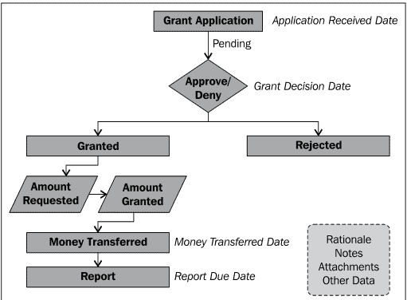
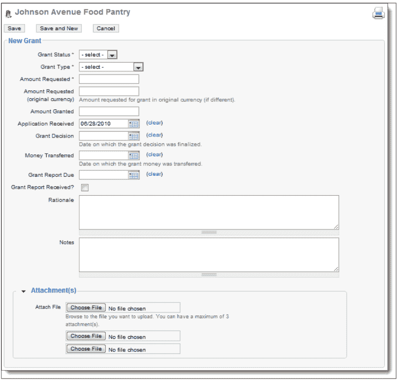
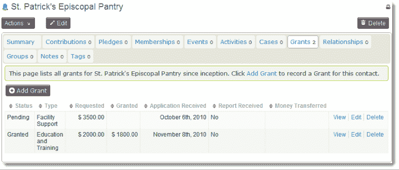
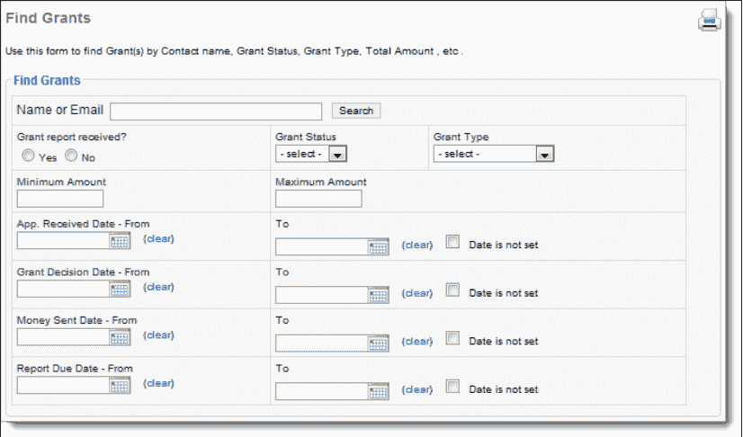

# 11
提供支持：拨款管理

到目前为止，我们已经涵盖了很多内容，现在来到了直接处理联系人记录数据工具的最后一章。在本章中，我们将讨论拨款管理。如果您的组织负责管理和分发拨款，CiviCRM 提供了一些基本工具来帮助您收集和跟踪与拨款管理流程相关的详细信息。如果您的组织通常处于另一面，即申请拨款而非分发拨款，那么您仍然可能会发现 CiviGrant 工具对于管理该流程很有用。在本章末尾，我们将提供一些建议，以几种小方式重新配置 CiviGrant 组件，以便您可以使用它来跟踪您正在申请的拨款。

在本章中，我们将介绍：

- 定义拨款申请流程
- 管理受助者
- 跟踪拨款申请
- 申请拨款

使用这些工具可以帮助您将此流程与其他联系人管理活动整合在一起，使您的组织成为更高效、更有生产力的资金提供方和/或接收方。

## 定义拨款申请流程

CiviCRM 的拨款管理工具无可否认是基础的。然而，在 CiviCRM 其他联系人管理工具的更广泛背景下，它们提供了一组非常实用的功能。

在配置拨款工具之前，让我们先了解一下CiviCRM在拨款工作流程中所假设的基本流程。下面的图表有助于直观地展示组织发放或接收拨款的流程：

拨款申请流程基本上包括接收申请、处理申请以确定是否批准或拒绝（即发放或接受），然后在资金转移和收到受助人报告时跟踪进度。

与CiviCRM的大多数其他领域一样，拨款记录可以创建自定义字段并附加到记录上。这样，您可以根据需要设置任意数量的额外字段，以帮助拨款发放或拨款申请过程。在CiviCRM中将文档附加到记录的功能在拨款申请文件方面尤其有用。它对于附加官方信函的扫描副本也很有用。

拨款按类型分类，使您能够按类型搜索和跟踪不同拨款的状况。在开始拨款管理流程之前，您应该审查默认配置的现有拨款类型，并根据需要添加/编辑/删除。您可以在“管理 | CiviGrant | 拨款类型”中访问它们。

如果看不到CiviGrant子菜单，请确保已启用CiviGrant组件。访问“管理 | 配置 | 全局设置 | 启用CiviCRM组件”。默认情况下，CiviGrant组件是禁用的。启用它将恢复“管理”下的CiviGrant子菜单，以及（位于“其他”下的）主要“拨款”子菜单。

一旦您考虑好拨款类型，创建了希望与拨款关联的自定义字段，并审查了总体拨款工作流程，就可以开始管理您的拨款申请了。

## 管理受助人

与CiviCRM的大多数领域一样，您的拨款管理工具将通过主菜单提供，并且联系记录上会显示相应的选项卡。默认情况下，“拨款”菜单是“其他”下的一个子菜单。如果您预计会大量使用拨款工具，您可能希望将其移到主菜单。访问“管理 | 自定义 | 导航菜单”来编辑顶部水平菜单。

让我们先访问一个联系人并创建一条新的拨款记录。

如您所见，拨款记录非常贴近流程图中的工作流程。您选择所需的状态、类型，并填写其他适当的字段。

## 提供支持：拨款管理

拨款记录与CiviCRM的其他领域略有不同，因为在拨款过程中，您可能会多次返回编辑记录。随着拨款经历申请、批准、资金分发和报告阶段，您将返回并编辑记录以更新日期、记录备注或添加与拨款相关的附件。

与其他相关记录领域一样，联系人可能关联不止一条拨款记录。

> FPAGM收到了当地一位慈善家的一笔可观捐赠，用于帮助食品银行开发新的健康饮食项目。这些项目将教育客户有关健康饮食的知识，并提供使用食材而非加工食品或预制食品的简单食谱指导。
> 这笔捐赠将支持该地区食品银行的五个项目。FPAGM决定使用CiviCRM来跟踪拨款申请和管理流程。他们首先通过CiviCRM向常规成员发送了一封包含申请指南的电子邮件。收到申请后，就会创建一条新的拨款记录。
> 申请要求食品银行报告其地理人口统计的详细信息，并描述他们计划通过该项目覆盖多少人。所有这些数据都使用自定义字段进行跟踪，纸质申请会被扫描并附加到拨款记录上。通过这种方式，FPAGM确保流程的所有细节都存储在一个集中位置。

以下截图显示了通过联系人的“拨款”选项卡查看的拨款记录：

## 跟踪拨款申请

让我们看看**拨款**子菜单中可用于跟踪拨款记录的工具。正如您所料，**拨款**遵循与其他领域类似的模式：有一个拨款统计的仪表板摘要、一个**查找拨款**工具，以及一个快速创建新拨款记录的链接。

仪表板按状态汇总了拨款数量（每个单元格都带有超链接，可显示筛选后的记录列表），并列出最近创建的拨款记录。

**查找拨款**提供对每个相关数据字段的访问，包括拨款金额和日期字段的范围，如下截图所示：

日期范围字段提供了按空值搜索的额外选项。例如，如果您想查看尚未收到资金拨付的申请人更新列表，您可以选择状态为**已批准**、“资金发送日期”为“未设置”，然后运行搜索。

运行搜索后，拨款记录可以导出为CSV文件。

## 另一面：申请拨款

尽管CiviGrant组件主要面向拨款管理流程（假设实施CiviCRM的组织是发放资金的拨款方），但值得注意的是，拨款工具也可以轻松调整，用于管理您所在组织向其他实体申请拨款的过程。

在这种替代情况下，您所操作的联系人记录是拨款方，而不是拨款申请人和潜在受助人。您使用CiviGrant来跟踪您向该组织提出的申请，以及在此过程中发生的后续沟通。

由于无论您在该过程中处于哪个方向，工作流程基本相同，我们只需更改界面中的术语，以更好地传达您作为拨款申请人的角色。有两种方式可以实现这一点——修改CiviCRM模板文件，或使用单词替换工具。一般来说，尽可能使用单词替换工具更好，因为它更加动态，并且避免维护自定义版本的模板文件。使用该工具定义现有文本和替换文本；系统中所有出现现有文本的地方都会被替换。有时您可能会发现某些文本不易隔离（例如，它过于通用或在系统其他地方使用），无法进行全局替换。CiviCRM使用Smarty模板系统来呈现内容，并提供了定义覆盖目录的功能，可在其中存储替换模板文件。使用模板覆盖，您可以完全控制页面的文本和布局。有关以这种方式定制界面的更多技巧，请参阅*第3章，定制、社区与合作*。

- 使用单词替换，我们会在界面中看到几处需要更改的地方，以更好地传达这种替代性的拨款申请视角。访问**管理 | 选项列表 | 单词替换**，然后输入以下内容：

## 单词替换

使用单词替换来更改CiviCRM屏幕中某个单词或短语的所有出现位置（例如，将“Contribution”的所有出现位置替换为“Donation”）。

| 启用 | 原始 | 替换 | 精确匹配？ |
| --- | --- | --- | --- |
| ☑ | 申请已收到 | 申请已提交 | ☑ |
| ☑ | 已收到拨款报告？ | 已提交拨款报告？ | ☑ |
| ☑ | 申请收到日期 | 申请提交日期 | ☐ |
| ☑ | 拨款报告已收到？ | 拨款报告已提交？ | ☑ |

- 输入更改后，点击“保存”。通过导航到“其他 | 拨款 | 新建拨款”和“其他 | 拨款 | 查找拨款”，检查界面是否正确更改。

如果您定期向不同组织申请拨款，并觉得拨款组件提供的工具过于局限，可以考虑使用CiviCRM的“案例管理”工具，通过创建案例类型来跟踪与拨款方的沟通。

正如本书前面所述，案例记录由围绕共同问题分组的一组活动记录组成。由于拨款申请主要是拨款方和受助方之间传递的一系列沟通和报告，因此案例可以很好地替代拨款组件。

## 总结

通过财务援助支持其他组织的机会，同时也伴随着认真管理这些资金和申请细节的责任。您的资助者会期望您在管理资金时，与受助人使用资金时一样谨慎。使用CiviCRM，您拥有有效的工具，可以将这一过程作为整体选民管理计划的一部分来处理。

在本章中，我们：

- 回顾了拨款管理工作流程，并讨论了它如何转化为CiviCRM模型。
- 创建了新的拨款记录，并了解了流程中每一步的跟踪方式。
- 搜索了拨款，并注意到这些记录特有的各种字段选项。

- 我们讨论了将拨款管理工具重新用于贵组织向其他实体提交拨款申请的可能性。我们还简要考虑了使用CiviCRM的案例管理工具处理拨款申请的备选方案。

在下一章中，我们将把注意力转向 CiviCRM 的报表功能，看看我们如何利用存储的数据来生成列表和信息的图形表示。
