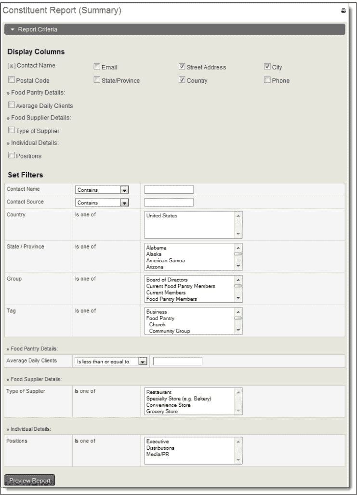
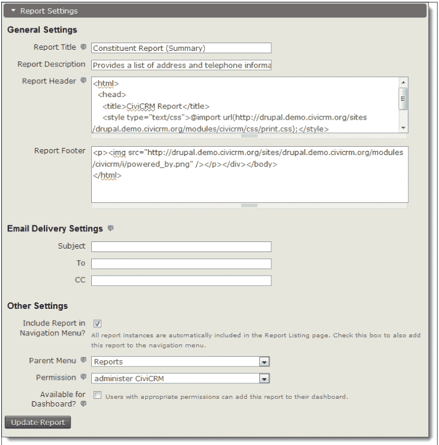
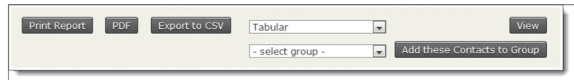

# 12 讲述你的故事：构建报表

在过去的11章中，我们探索了许多方法来捕获和存储有关联系人的信息、处理联系人记录、对记录执行批量操作、创建表单并在网站上公开数据，以及构建组织数据的多维度深度。

随着信息广度的不断增加，我们的下一个目标是通过报表检索和显示数据。在本章中，我们将：

- 讨论 CiviCRM 报表的目的、术语和基本概念
- 回顾可用于生成和发布报表的工具
- 将这些工具放在你的组织环境中加以应用

### 核心要点

什么是报表？

好吧，这可能看起来是一个老生常谈的问题。然而，我们是真诚地提出这个问题：什么是报表？当执行董事、会员委员会主席、筹款顾问、董事会秘书或隔壁工位的员工主管向你索要报表时，他们期望得到什么？报表与从搜索结果中导出的记录集有何不同？

报表呈现的是*承载着信息的数据*。报表不仅仅是原始数据，也不仅仅是记录的子集，它旨在讲述一个故事。我们可以通过将报表与搜索结果进行比较来理解其目的。两者相似，但在几个重要方面有所不同：

- 报表在可过滤的数据类型以及数据的呈现方式上更为专门化。
- 报表更注重可视化用途，而搜索结果提供的是简单的数据列表，可用于导出或以其他方式操作。报表可以带有页眉、页脚和更具视觉吸引力的布局来呈现结果，这些结果可以打印、发布为 PDF、通过电子邮件发送或以其他方式分发。
- 报表可以对数据进行分组，并显示汇总计算（合计、计数等）或结果的图形表示（如饼图和柱状图）。
- 有时，报表更像是供操作使用的数据，例如联系人走访清单，或者提供给簿记员的、列出某段时间内每笔在线交易的报表。

这些实际差异有助于我们更好地理解报表，并将其与原始数据集区分开来。然而，报表的根本驱动力在于其传递知识和传达信息的目标。

从这个意义上说，报表的核心在于最终结论。当我们构建报表时，我们希望看到随时间的变化、联系人的参与深度、各活动的影响广度，以及其他指标，这些指标告诉我们我们在服务联系人、触达受众、建立网络和获得支持方面的表现如何。

当我们开始研究具体工具时，不要只见树木，不见森林。工具是达到目的的手段；它们旨在帮助你向利益相关者（会员、捐赠者和积极参与者）以及决策者（董事会、管理层和委员会）传达信息。然而，你所要传达的核心是信息本身，而不是我们称之为“报表”的 PDF 文件或打印文档。

### 工具集与使用时机

报表可从主导航菜单访问。在报表工具中，我们有报表**模板**和报表**实例**：

- **报表模板**：定义报表的功能。包括报表可用字段、分组和过滤选项、显示选择（表格、条形图/饼图）以及任何其他可用选项。
- **报表实例**：选择并保存你希望查看的特定条件和选项。例如，你可能希望查看显示 A 组中所有联系人的联系人汇总报表。稍后，你可以创建联系人汇总报表的第二个实例，显示 A 组和 B 组中的所有联系人。

一个模板会随着不同条件和显示选项的选择而被多次重用，以满足特定需求。生成报表后，你可以打印、导出为 `.csv` 或发布为 `.pdf`。通常人们会把报表实例简称为报表，但你应该确保模板和实例之间的区别是清楚的。

CiviCRM 附带了许多报表模板，涵盖了你所期望的所有主要数据类型和用途。构建模板确实需要编程技能，尽管模板的结构、设计以及在系统中的注册方法都是为可扩展性而设计的。如果你创建的报表可能对更广泛的受众有价值，或者通过编程扩展了更多功能，请考虑将其回馈给项目并纳入核心。

相比之下，为报表实例选择条件和选项的过程被设计为易于由非技术人员管理。

在创建新报表或编辑现有报表时，你将看到**报表条件**、**报表设置**和报表的**预览**，每一项都包含在一个可展开的面板中。要从模板创建新报表，请访问**报表 | 从模板创建报表**，然后选择所需的模板。选择**报表 | 报表列表**可查看所有已保存的报表实例。

### 报表条件

**报表条件**将包括以下选项：报表中可包含哪些字段、如何分组、可应用哪些过滤条件，以及结果应如何排序。这些设置是在模板代码中定义的，并且针对每个模板的性质和用途而具体化。例如，捐款报表将具有联系人报表所没有的与捐款相关的字段和选项。在创建和编辑报表时，你大部分时间将花费在调整这些选项以满足需求上。

对于某些较复杂的报表，某些显示字段和分组选项相互依赖，或者相互排斥。例如，如果包含联系人名列，则捐赠者报表（摘要）不能按收到日期分组。这些限制通常是由于所检索和分组的数据的性质所致。

在调整现有报表的条件或为新报表设置条件时，你通常需要在报表完全按你期望的方式显示之前进行一些测试和调整。这可以通过调整条件并单击预览报表，然后根据需要继续调整和预览来轻松完成。

以下截图显示了联系人报表的条件选项。请注意，某些报表也支持包含自定义数据字段并对其进行过滤，如下例中的“食品储藏室”字段所示：

### 报表设置

**报表设置**控制报表的标题、页眉和页脚文本（打印报表或导出为 PDF 时将显示这些文本）、电子邮件设置、权限选项和导航设置。让我们花点时间来了解此面板中的每个选项，因为它们对所有报表都是通用的。

标题和描述出现在报表列表页面中，应帮助用户了解你为特定报表配置的条件。填写这些字段时，请具体说明所选的目的和条件。例如，不要使用“捐款报表”这样的通用标题，而应使用更具描述性的标题，如“本年度至今收到的捐款”。

页眉和页脚字段包含打印报表或发布为 PDF 时插入到报表中的 HTML 代码。默认内容可能足够了，但非常通用。例如，你可能希望将 `<title>` 标记替换为报表的实际标题。你还可能希望包含图片和 CSS 样式来自定义报表的外观。你确实需要至少具备 HTML 的基本知识才能处理这些字段。请确保页脚关闭了页眉中打开的所有标记（例如 `<html>` 和 `<body>` 标记）。

报表实例可以生成为 PDF 文件，并按期通过电子邮件发送。例如，你可以让报表每星期一通过电子邮件发送给管理人员，该报表提供最近收到的捐款的概览。会员服务主管可以收到一份包含即将失效的会员资格的报表，以便打电话征求续期。使用本节中的字段来确定报表的收件人（逗号分隔列表）和报表的主题行。

请注意，电子邮件报告功能需要设置 cron 作业来控制应通过电子邮件发送的报告以及发送频率。仅完成报告设置中出现的字段并不会实际触发报告的发送。cron 作业应使用以下格式调用一个 URL（使用 wget 或 curl），其中将您的报告的 instanceID 值替换为您系统中的相应报告 ID：

- Drupal: <yourwebsite>/sites/all/modules/civicrm/bin/CiviReportMail.php?instanceId=3&reset=1&sendmail=1&<name>=username&<pass>=password&<key>=sitekey
- Joomla!: <yourwebsite>/administrator/components/com_civicrm/civicrm/bin/CiviReportMail.php?instanceId=3&reset=1&sendmail=1&<name>=username&<pass>=password&<key>=sitekey

有关 CiviCRM 中 cron 作业的完整讨论，请参阅第 3 章，安装、配置和维护。

创建新报告后，您可以在主 Reports 菜单项下的 Reports Listing 页面上查看它。该页面将始终显示您系统上活动的所有报告实例的完整列表。此外，您可以选择将报告实例添加到导航菜单中的指定位置。此功能并不局限于 Reports 菜单项。例如，如果您创建一个显示过去七天内收到的捐款的标准记账报告，您可以将其添加到 Contributions 菜单项。

在 Report Settings 的 Other settings 部分下，单击复选框并选择报告应归属的父菜单项。如果您希望报告作为顶级菜单项添加，请将父菜单字段留空（设置为 - Select -）。

Drupal 用户可以使用显示中的下一个字段根据权限限制报告。例如，您可能会决定您的捐款相关报告不应可供数据录入人员访问，因为他们无需查看可能敏感的财务数据。

本节中的最后一个选项提供了将报告启用为 CiviCRM 主页仪表板的一部分的功能。请记住，当您首次进入 CiviCRM 时，会显示一个仪表板页面，其中显示了许多报告。仪表板是按用户可配置的，这意味着每个用户都可以选择不同的报告包含在该显示中。CiviCRM 包含几个可作为 dashlets 使用的特殊报告，您可以通过报告工具创建的任何其他报告也可以启用为 dashlet。非常宽的报告通常不适合作为 dashlets。

请注意，将报告启用为 dashlet 并不会自动将其包含在您的仪表板中——它只是将其作为选项提供。每个用户都可以自行配置其仪表板。

以下屏幕截图是 Report Settings 面板的示例：

## Report workflows

在使用报告时，您通常会执行以下操作之一：

- Review an existing report instance
- Review and modify an existing report instance on a temporary basis
- Review and modify an existing report instance, choosing to update the saved report with your new criteria and settings
- Create a new report from a template

如前所述，您可以访问 **Reports | Reports Listing** 查看所有现有已保存报告实例的列表，或如果可用，从适当的菜单项中选择您的报告。请注意，并非所有报告都一定会在 **Reports** 菜单上找到，因为菜单分配是按单个报告进行的。如果您正在使用现有报告并更改了任何标准或设置，将显示一个名为 **Update Report** 的按钮。

请理解，单击此按钮将把您的设置保存到您当前正在处理的报告实例中。请确保您确实打算这样做，因为这可能会改变报告的原始意图并影响其他用户。如果您只是临时更改标准，请不要更新报告；只需选择预览报告，即可在不保存的情况下查看并对报告采取行动。

> 根据您对 CiviCRM 的配置方式，您可能已经注意到某些报告类型在您的系统中不可见。CiviCRM 根据报告所使用的组件对报告进行分类，并且只会显示您已启用的组件的可用报告。例如，如果您未使用 **Membership** 组件，您将看不到任何显示会员记录的报告。

您可以通过转到 **Reports | Create Reports from Templates** 或 **Administer | CiviReport | Create Reports from Templates** 来创建新的报告实例。从此工具中，您选择将生成报告的报告模板，选择您的标准和选项，并为报告命名。一旦命名并保存，它就可以检索，并且您的标准和选项将被保留。

创建新报告时，您必须首先选择所需标准并预览报告，然后才会提供额外的报告设置选项。这是为了确保您在保存报告之前具有有效标准。

如前所述，已完成的报告可以打印、发布为 PDF 或导出为 csv 文件。某些报告可以以图形格式显示，例如条形图或饼图。Constituent 报告可能有将 resulting contacts 添加到组的选项。

> 您可能会遇到将非常长的报告打印为 PDF 文件的困难。PDF 生成引擎非常消耗资源。根据您托管环境的品质，您在创建大型 PDF 文件时可能会遇到服务器超时。如果您发现这种情况，请考虑限制您的标准以生成报告的较小子集用于 PDF 生成，或考虑将您的托管环境升级到更强大的解决方案。

## Available templates

CiviCRM 附带超过 25 个报告模板，涵盖从联系人列表、记账报告、活动参与、会员资格和案例审查等各个方面。以下按 CiviCRM 组件组织的列表提供了截至本书撰写时可用的每个模板的简要描述。

> 请注意，新的报告模板会不断添加到系统中；请在 Create Reports from Templates 页面上查看列表，以了解您当前版本可用的报告描述。

### Contact report templates

联系人报告模板如下：

- **Constituent Report (Summary)**: 提供联系人记录的地址和联系信息列表。
- **Constituent Report (Detail)**: 提供捐款、会员资格、活动和活动相关的联系信息。
- **Activity Report**: 提供联系人活动的列表，包括在给定日期范围内一个或所有联系人的活动统计信息（必需）。
- **Walk/Phone List Report**: 具有为电话银行或作为走访名单而设计的布局选项的基本联系人报告。该报告与 CiviEngage 工具集有额外用途。最初设计为面向政治竞选支持的 Drupal 模块，CiviCampaign 和 CiviEngage 的部分内容将在 v3.3 作为核心 CiviCRM 的一部分包含在内。
- **Current Employer Report**: 提供有关雇主/雇员关系的联系人的基本报告。报告包括有关关系的详细信息，例如关系开始日期（受雇以来）。
- **Relationship Report**: 按关系类型过滤联系人（关系双方），并按组、标签和地址字段过滤。
- **Database Log Report**: 在给定日期范围内创建或更新的联系人和活动记录的日志（changelog 数据）。
- **Activity Report (Summary)**: 按类型/日期显示活动统计信息，并按状态或优先级过滤。

### Contribution report templates

捐款报告模板如下：

- **Donor Report (Summary)**: 按月/周/年、国家/州和类型显示捐款统计信息。
- **Donor Report (Detail)**: 列出一个/所有联系人的详细捐款。捐款汇总报告指向此报告以获取具体细节。
- **Donation Summary Report (Repeat)**: 给定两个日期范围，显示在两个日期范围内都捐款的联系人（及其捐款）以及百分比增减。
- **Donation Summary Report (Organization)**: 显示组织关系与捐赠者相关的详细捐款报告。这包括来自某个组织的员工或该组织本身的捐款记录。
- **Donation Summary Report (Household)**: 提供由与家庭有关系的捐赠者（或家庭本身）所做的捐款的详细报告。例如，捐赠者是某些家庭的户主，或是家庭成员。
- **Top Donors Report**: 提供您定义的时间段内顶级捐赠者的列表。您可以包含任意数量的捐赠者（例如，您的前 100 名捐赠者）。
- **SYBUNT Report**: “SYBUNT” 代表 “Some year(s) but not this year”。它提供在您组织历史上的某个时间捐款，但在您指定的时间段内未捐款的联系人列表。

## 承诺报告模板

承诺报告模板如下：

- **承诺报告**：按日期、金额或状态筛选显示承诺详情。
- **已承诺但未付款报告**：显示已承诺但存在未付或逾期付款的联系人。

## 案例报告模板

案例报告模板如下：

- **案例摘要报告**：按日期范围、状态、工作人员和/或案例角色提供案例及其持续时间的摘要。
- **案例花费时间报告**：按活动类型和联系人汇总案例和/或非案例活动所花费的时间。
- **联系人人口统计报告**：显示数据库中案例客户和/或非案例联系人的人口统计细分。它还包括自定义联系人字段。

## 资助报告模板

资助报告模板如下：

- **资助报告**：生成可按任何资助数据字段筛选的报告，包括日期范围选项。

> 有几个报告模板以禁用状态出现。访问 **Administer** | **CiviReport** | **Manage Templates** 以查看和管理系统中注册的报告模板的状态。

FPAGM 工作人员需要处理多个层级的领导和关键利益相关者，他们期望定期收到报告。这包括执行主任，他关心会员人数和总捐赠额，营销委员会主席，他需要每月会员状态报告，以及发展委员会主席，他希望在指定时间段内看到主要捐赠者的总捐款。

在系统配置期间，对于每个请求的报告，他们都会查看模板列表并选择和配置他们认为最适合其需求的模板。由于执行主任事务繁多，他/她会寻找支持条形图和饼图的报告，因为它提供了组织活动的可视化快照，可以快速解读。

营销委员会主席希望每月收到报告。工作人员使用 **Membership Report (Summary)** 模板构建一份报告，按类型分解会员，按月分组，并显示过去 12 个月的数据。电子邮件设置已配置，并设置了 cron 作业，以便在每月最后一天将此报告通过电子邮件发送给主席，免除了工作人员生成和发送报告的责任。

同样，构建了“Top Donors”报告，显示过去六个月的活动。由于此报告仅在请求时提供，工作人员将其保存到 **Contributions** 菜单中以便轻松访问。

## 自定义和构建您自己的模板

尽管随 CiviCRM 一起提供的报告力求预见到您大部分潜在的报告需求，但您可能仍有现有报告模板未涵盖的需求。

虽然本书的范围超出了深入探讨开发新报告模板的具体细节，但重要的是要指出，报告工具已预见到这些需求。构建模板的代码非常独立、模块化，并且比软件的其他区域更容易让初学者程序员访问。您仍然需要对 PHP 和 MySQL 数据库有一定的熟悉程度才能构建自己的报告模板，但您可能会发现它比 CiviCRM 代码库的其他区域更容易使用。

如果您有兴趣进一步探索，请访问以下在线文档以获取有关自定义或创建模板的指导：http://wiki.civicrm.org/confluence/display/CRMDOC/Custom+Reports+(How+to)。

## 总结

让我们回到本章开头提出的原始前提：
*报告主要是在讲述一个故事——它是有信息的數據。*

我们开始本章时思考报告真正是什么，并警惕在盯着树木时错过整片森林。在回顾了创建和处理报告的机制以及概述了可用的各种报告模板之后，很容易失去对这一更广泛背景的关注。

本章介绍的报告工具是一种实现目标的手段。您将选择报告字段、定义数据筛选器并选择显示选项，目标是向其他员工、组织领导或您自己传达关于您组成员的故事。这个故事通过活动、捐款、承诺、会员、活动、案例、资助或其他数据窗口来呈现。

在本章中，我们：

- 为使用报告和理解报告目标设定了背景
- 定义了 CiviCRM 报告工具中使用的关键术语，包括报告模板和报告实例
- 回顾了所有报告共有的可用报告设置
- 概述了报告标准的用途，该标准将因报告而异
- 总结了随 CiviCRM 基础安装一起提供的可用报告模板
- 回顾了报告的核心目的和目标
