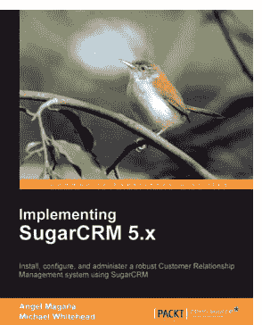
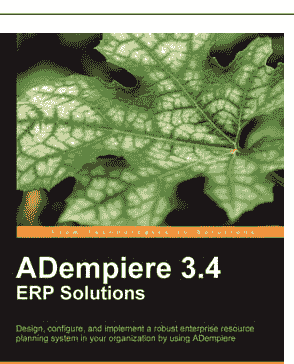
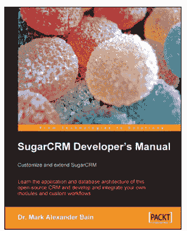
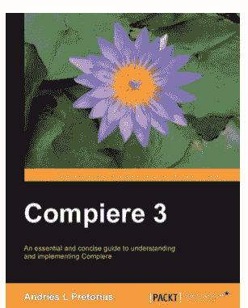
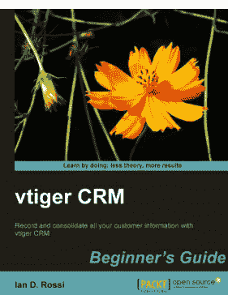
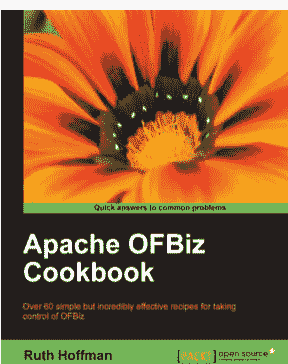

## 索引

### 符号

- <ActivitySets> 块 384
- <ActivityTypes> 标签 383
- <ActivityType> 标签 380
- <CaseRoles> 标签 386
- <label> 标签 383
- <name> 标签 382
- <RelationshipType> 标签 386
- <timeline> 标签 383
- .tpl 模板文件 345

### A

- 接受的信用卡
  - 配置 265
- 活动
  - 关于 154, 155
  - 定义 379, 380
- 活动导入过程 214
- 添加相关记录操作 167
- 添加关系操作 166
- 高级搜索 157
- 敏捷开发方法论 33, 34
- 备选工作流，联系人记录 169, 170
- API
  - 关于 422
  - 列表 422
- 自动归档电子邮件功能
  - 设置 249
- 自动通信 219
- Avery 标签类型 229
- Avery 网站
  - URL 229

### B

- 基线
  - 创建 41
- 基本搜索 157
- 基准测试 257
- 早餐研讨会示例，活动 360
- 广播邮件发送
  - 使用 CiviCRM 223
  - 使用外部客户端 222
  - 实现 222
- 广播邮件 222
- 浏览器/FTP 过程，CiviCRM 安装 73-75
- buildForm 钩子 420
- 批量邮件
  - 配置 240-242
  - 构建 238
  - 配置页脚 238, 239
  - 配置页眉 238, 239
  - 管理邮件 243
  - 发送 238-242
- 批量邮件模板
  - 创建 245
- 业务流程 48

### C

- 案例活动 374
- 案例配置
  - 关于 376
  - 定义活动 379-381
  - 涉及附加联系人 387
  - 附加选项和测试 387, 388
  - 为关键参与者定义案例角色 385, 386
  - 定义时间线 381-383
  - 定义工作流 381-384

案例管理
约 373
案例组活动 374
案例可定义角色 374
案例可定义工作流 374
用例 375
案例记录
创建 389-392
管理 389-392
案例报告模板 414
案例资源组
创建 387
设置 387
案例资源组，设置
<ActivityTypes> 388
<AllowMultipleCaseClients> 387
<RedactActivityEmail> 387
案例
配置 376-379
报告 392, 393
搜索 392, 393
跟踪 392, 393
案例研究
FPAGM 34
CC/BCCed 357
CiviAuthenticate 337
CiviCampaign 418
CiviCase 418
CiviContribute 配置
关于 263
接受的信用卡，配置 265
捐款类型，配置 264
支付工具，配置 265
支付处理器，配置 266, 268
溢价，配置 268
价格集，配置 269, 271
CiviCRM
关于 13, 14
活动导入，访问 214
地址标签 228
替代方案 15, 16
备份策略和程序，开发 123-125
基线，创建 41
益处，对组织 24, 25
广播电子邮件 222
批量电子邮件，发送 238
批量电子邮件模板，创建 245
案例配置 376
案例管理 373
CMS 集成 61
沟通计划，创建 217
配置 81
捐助者 47-49
联系人和活动数据，导入 207
联系人导入，访问 208
联系人导入工具 208
联系人记录 127
捐款，手动记录 272-274
捐款，导入 275
cron 作业，配置 321, 322
自定义数据接口 177-181
Drupal 升级 118-120
Drush CiviCRM 命令 76
外部电子邮件，记录 248
extras.css 116
功能 17
功能性需求 53
函数 335
筹款呼吁，实现 294
筹款配置 263
筹款计划，开发 252
资助申请流程 395, 396
资助申请，跟踪 399
受助者，管理 397, 398
钩子 116
实施计划 63
安装，迁移到新服务器 121, 122
安装 68, 69
在 Drupal 中安装 72
在 Joomla! 中安装 70, 71, 72
Joomla! 升级 116
本地化论坛 70
本地化指南 70
邮件标签，生成 228
会员目录 335, 336
会员类型，定义 314, 315
使命 47-49
新闻通讯订阅资料，创建 236
在线表单，创建 187
在线支付处理器，选择 258-262
在线翻译工具 Transifex 70
其他类型的捐赠 311
覆盖目录 116
所有权成本 46
PDF 信件，打印 230-232
权限 311
分期付款，手动创建 276-278
预配置规则 317
项目计划，创建 44
续费提醒，设置 320, 321
报告 289
修订 115
搜索 156
搜索构建器 159
搜索结果操作 165
服务器采购 62
状态规则，审查 316, 319
订阅，鼓励使用资料 235-237
系统维护 122, 123
系统工作流消息，自定义 245-248
团队，组建 37-40
第三方集成 62
实施组的经验法则 234
升级 115
URL 19
用例 13
版本 115
愿景，开发 43
网站表单，设置 328-330
社区 424
自定义 420
活动 342
活动，管理 341
新功能 418
即将发布的版本 417, 419
CiviCRM 访问控制，在 Drupal 下 106, 107
CiviCRM 博客 419
CiviCRM 社区 419
CiviCRM 配置
关于 81
地址设置 84
CMS 用户，与之同步 99, 100
组件 98
联系人，编辑 83, 84
联系人，组织 98
联系人，查看 83, 84
联系人回收站和取消删除选项 86
联系人类型 87
cron 作业，设置 108, 110, 114
自定义 98
仪表板 108
仪表板缓存超时选项 86
Drupal 访问控制 100, 103
电子邮件处理器，配置 91-93
电子邮件服务器声誉，维护 90
电子邮件，发送 88
映射和地理编码 84
杂项 86
导航 108
在线支付处理器 93, 94
选项列表 99
支付处理器，配置 96
返回电子邮件流量，处理 88, 89
搜索设置 85
站点配置 82
系统工作流模板 97
版本检查和统计报告选项 86
WYSIWYG 编辑器 84
CiviCRM 自定义
关于 420
API 422
开发者文档 423
论坛 423
钩子 420
IRC 424
问题跟踪器 424
覆盖 421
示例代码 423
CiviCRM 事件块模块
启用 359
CiviCRM 论坛
URL 51
CiviCRM 安装
关于 70
下载 68
Joomla!-alt 包 69
故障排除 79, 80
CiviCRM，在 Drupal 中安装
浏览器/FTP 流程 73-75
Drush 流程 76-78

CiviCRM 界面
关于 128
水平导航菜单 128
左侧边栏 128
主要内容区域 128

CiviCRM 方法 359
CiviCRM OG Sync 105
CiviCRM 支付处理器插件
Authorize.net AIM 94
Chase Paymentech 94
Click and Pledge 94
DPS Payment Express 94
Elavon Payment Processor 94
eWAY 单币种 94
FirstData Linkpoint 94
Google Checkout 94
Moneris 94
Payflow Pro 94
PayJunction 94
PayPal - Express 94
PayPal - 网站支付专业版 94
PayPal - 网站支付标准版 94
Quickbooks 94
Realex Payment 94

CiviCRM 报告
关于 403, 404
报告实例 333
报告模板 333

CiviEngage
关于 310
安装流程链接 310

CiviEvent 418
CiviGrant 418
CiviGroup Roles Sync 103, 104
CiviMail 222, 418
civimail.cronjob.php，cron 脚本 110
CiviMember Roles Sync 104, 105
CiviPledge 配置 272
CiviReportMail.php，cron 脚本 113
CiviSchool 423
CiviSMTP
关于 89
URL 89
CiviUser 337
CKEditor 226
CMS 集成 61
沟通计划
自动通信 219
品牌，强化 221
号召行动，有说服力 220
创建 217
努力，与目标保持一致 218
组，组织 233, 234
在线病毒式传播通信 220
时效性通信 219
语气 219
主题 218
处理 218

社区 424
捐助者关系管理。
参见 CRM
捐助者，CRM 12, 13
联系人管理系统 8
联系人记录管理
关于 53
联系人子类型 54
自定义数据 54
联系人记录
关于 127
替代工作流 169, 170
重复项，消除 171
会员名录 324–327
使用 169
联系人
关于 130
活动 154
联系人类型，规划 132
核心信息字段 134, 135
删除 142
家庭联系人 131
个人联系人 130
备注 156
组织联系人 130
关系 150
子类型 131
标签和组窗格 142–144
联系人搜索
与组件搜索对比 162, 163
联系人导入
访问 208, 209
从 CSV 文件 209, 210
联系人导入流程 208–213
联系人子类型 131

州和省份 182
是/否功能 182
去重/合并引擎 418
开发者资源 423
开发方法论
关于 31
敏捷开发方法论 33, 34
迭代开发方法论 32, 33
传统瀑布开发方法论 32
直接联系筹款 310
直接邮件
发送 308
自定义数据接口显示类型
高级多选 184
自动完成选择 184
复选框 184
链接 184
多选 184
多选国家 184
多选州/省 184
单选 183
RichTextEditor 184
选择 183
选择国家 184
选择日期 184
选择文件 184
选择州/省 184
文本 183
文本域 184
Drupal
CiviCRM 访问控制 106, 107
CiviCRM，安装 72
CiviCRM 资料，公开 205, 206
新闻通讯订阅资料，显示 235
Drupal 访问控制系统
关于 100, 101
CiviCRM OG Sync 105
CiviGroup Roles Sync 103, 104
CiviMember Roles Sync 104, 105
权限 101, 102
Drupal/CiviCRM 集成 338
Drupal 升级 118, 120
Drush CiviCRM 命令
civicrm-cache-clear 76
civicrm-install 76
civicrm-rest 76
civicrm-restore 76
civicrm-sql-cli 76
civicrm-sql-conf 76
civicrm-sql-connect 76
civicrm-sql-dump 76
civicrm-sql-query 76
civicrm-update-cfg 76
civicrm-upgrade 77
civicrm-upgrade-db 77
Drush Drupal shell 76
Drush 流程，CiviCRM
安装 76-78

E

电子邮件联系人
调用 223
电子邮件，使用 CiviCRM
关于 224
标准电子邮件表单功能 225-228
向多个联系人发送电子邮件 224
向单个联系人发送电子邮件 224
标准电子邮件表单 225
电子邮件处理器
配置 91, 92
EmailProcessor.php，cron 脚本 112, 239
电子邮件服务器声誉
维护 90
实体关系图 ERD 423
活动
早餐研讨会示例 360
构建 342, 343
活动地点 350
费用 350-354
信息和设置表单 343-345
最大参与人数，定义 347
在线注册 354-357
推广 342, 343, 358-360
告诉朋友表单 357
测试 358-360
活动管理工具
关于 342
功能 342
活动注册
预期付款，处理 364
使用 361-363

event-related links
  accessing 358, 359
event reports
  about 369, 370
  event income report (detail) 370
  event income report (summary) 370
  event participation report 370
event report templates 413
events
  about 342
  integrating, into CRM strategy 370, 371
events listing module
  about 360
  downloading 360
event templates
  about 343
  creating 343
  selecting 343
event type 344
expected payments
  handling 364
export/map actions 167
external e-mails
  recording 248-250

## F
features, CiviCRM
  documentation 24
  Drupal integration 19, 20
  dynamic open source development 20-22
  focused on needs of non-profits 18
  Joomla! integration 19, 20
  no vendor lock-in 19
  responsive community support 24
  total cost 20
  user satisfaction 19
features, standard e-mail form
  add cc/ add bcc 226
  attachments 228
  e-mail templates 226
  from 225
  HTML format 226
  plain-text format 228
  send e-mail button 228
  subject 226
  to 225
find members 324

fixed membership types 314
forums 423
FPAGM 315, 331, 360, 361
FPAGM case study 34
full-text search 159
functionalities, CiviCRM
  advanced search 418
  CiviCampaign 418
  CiviCase 418
  CiviEvent 418
  CiviGrant 418
  CiviMail 418
  dedupe/merge engine 418
functional requisites, CiviCRM
  about 53
  activities 58
  bulk e-mails 55
  case management 59
  contact record management 53
  e-newsletters 55
  events 57
  fundraising 55
  grant management 58
  memberships 56
  permissions 60
  roles 60
  subscriptions 56
functions, CiviCRM 335
fundraising appeal
  about 294
  direct contact 310
  direct mail, sending 308, 309
  implementing 294
  online contribution page, creating 295, 296
  planning 294, 295
  telemarketing appeal, running 309, 310
fundraising configuration
  about 263
  CiviContribute, configuring 263
  CiviPledge, configuring 272
fundraising plan
  benchmarking 257
  developing 252
  donors 256
  fundraising programs 254
  high-level plans 252
  major channels 254
minor channels 254
money 256
prospects 256
segmenting, by category 253
segmenting by channel 254
templates 252
fundraising program
  about 254
  approaches 254, 255

## G
Glorian t CiviCRM 337
grant application process
  about 395, 396
  tracking 399
  workflow 396
grantees
  managing 397, 398
grant management tools 395
grant report templates 414
grants
  applying for 400, 401
groups
  about 145, 233
  creating 147-149, 233
  group membership, managing 150
  organizing 233, 234
  using 146
groups and tags actions 166

## H
hook, for customization
  about 183
  reference link 183
hooks
  about 421
  implementing 421
  list 421
horizontal navigation bar 129

## I
iCal feeds 346
import tool
  accessing 366
info and settings form, events
  about 343-346
  waitlisting 347-349
installation
  CiviCRM 68
installation, CiviCRM
  in Drupal 72
  in Joomla! 70-72
integrated processors
  versus, redirection processors 95
IRC channel 423
issue tracker
  about 424
  URL 424
iterative development methodology 32, 33

## J
Joomla!
  CiviCRM, installing 70-72
  CiviCRM profiles, exposing 203, 204
  newsletter subscription profile, displaying 235
Joomla! extensions
  about 337
  CiviAuthenticate 337
  CiviUser 337
  download link 337
  Gloriant CiviCRM 337
Joomla!'s module management 204
Joomla! upgrades 116

## L
left sidebar 130
listing templates
  name and email 345
  name only 345
  name, status and register date 345

## M
mail actions 165
mailing labels
  generating 228
  postal mailing, recording 229
  printing 228
major channels, fundraising
  direct dialog 254
direct mail 254
online 254
telemarketing 254
market segmentation 253
member report templates 413
membership directories 335, 336
membership listings
  active memberships 325
  inactive memberships 325
membership report templates. See report templates
membership search tool
  implementing 331-334
memberships tools
  working with 323, 324
membership types
  Affiliate (large) 314
  Affiliate (medium) 314
  Affiliate (small) 314
  defining 314, 315
  fixed 314
  rolling 314
minor channels, fundraising
  direct response television 254
MIT approach 30
multiple contacts
  e-mailing to 224
multiple participant records
  event reports 369, 370
  participants, searching for 368, 369
  registrations, tracking using dashboard 366, 367
  working with 366

## N
new membership menu item 323
newsletter subscription profile
  creating 236
notes 156

## O
online contribution page
  contribution amounts 298-300
  contribution widget 305, 306
  creating 295, 296
  include profile 302
  live contribution page 307
  membership settings 301
  personal campaign pages 303, 304
  premiums 306
  publicizing 307
  settings 297
  tell a friend form 303
  testing 307
  thank-you and receipting 302, 303
  title 297
online forms
  creating, profiles using 187-190
online payment processors
  about 94
  PayPal Pro 262
  PayPal Standard 262
  selecting 258-263
online registration 354, 355
override directory 421
override files
  using 422

## P
page title
  configuring 357
ParticipantProcessor.php, cron scripts 110, 347
participant records
  importing 365, 366
participant roles
  categorizing 345
participants
  searching for 368, 369
pay later option
  about 350
  enabling 351
payment instruments
  configuring 265
  reviewing 265
payment processor plugins
  URL 259
payment processors
  about 258
  configuring 266
  setting up 350
PayPal Pro 262
PayPal Standard 262
PDF letter
  printing 230-232
PDF receipts 284
peer pressure 345
pending 364
permissions 311
PHP override directory 421
pledge
  creating manually 276-278
  deleting 289
  examining 287
  exporting 288
  searching 286, 287
  working with 288
pledge report templates 414
potential barriers
  identifying 28, 29
pre-configured rules, CiviCRM 317
premiums
  about 268
  configuring 268, 269
prepped 352
price sets
  about 269
  configuring 270, 271
profile
  about 356
  advanced settings panel 189
  creating 188
  options 190-192
  settings 188
  visibility option 193, 194
  visibility option, configuring 193
profile, in action
  batch updates 200-202
  including, in component pages 200
  online directory, searching 198-200
  search result views 200-202
  users, empowering for information update 195-197
profile pages
  exposing, through URL variables 206, 207
  exposing, to Drupal 205, 206
  exposing, to Joomla! 203, 204
  exposing, to website 202
profile questionnaires
  researching with 293
project plan
  creating 44

## Q
quick search 156

## R
RapidSSL certificates 261
reCAPTCHA
  reCAPTCHAURL 190
record duplication
  dealing with 171
  merging 174, 175
  searching 172-174
  strategies, for dealing 171, 172
record options, custom data interface
  display preference 180
  multiple records 180
redirection processors
  configuring 96
registrations
  tracking, dashboard used 366, 367
relationships
  about 150, 374
  adding 152, 153
  types 150-152
renewal reminders
  setting up 320, 321
report criteria 405
reporting
  about 289
  advanced tools 291, 292
  contribution reports 293
  prospects, counting with advanced search 289, 291
  researching, with profile questionnaires 293
reporting tools
  about 404
  report criteria 405
  report instances 404
  report settings 407, 408
  report templates 404
  report workflows 410
report instances 404
reports, CiviCRM
  about 403
reporting tools 404
report settings 407, 408
report templates
  about 404, 411
  bookkeeping report 294
  building 415
  case report templates 414
  contact report templates 411, 412
  contribution report templates 412, 413
  customizing 415
  donor report (detail) 293
  donor report (summary) 293
  donor summary report (household) 293
  donor summary report (organization) 293
  donor summary report (repeat) 293
  event report templates 413
  grant report templates 414
  LYBUNT report 294
  member report templates 413
  membership report (detail) 333
  membership report (lapsed) 333
  membership report (summary) 333
  online documentation, for customizing 415
  pledged but not paid report 294
  pledge report templates 414
  pledge summary report 294
  soft credit report 294
  SYBUNT report 293
  top donors report 294
report workflows 410
return e-mail traffic
  handling 88, 89
RimuHosting 261
roles 374
rolling membership types 314

## S
Salesforce 17
search
  advanced search 157
  basic search 157
  contact search, versus component search 162, 163
  custom search 163, 164
  full-text search 159
  quick search 156
search builder
  about 159
  accessing 160
search engine friendly (SEF) option 205
search result actions
  about 165
  add related record actions 167
  add relationship actions 166
  export/map actions 167
  groups and tags actions 166
  mail actions 165
  subsequent actions on same selection 169
  update contact actions 167
segmenting donor revenue
  categories 253
server sourcing 62
single contact
  e-mailing to 223
site configuration, CiviCRM 82
SSL 260
standard elements, for fundraising appeal plan
  appreciation 295
  ask 294
  case 294
  closing 295
  creative 295
  events 295
  face 294
  follow-up 295
  goal 294
  message 295
  schedule 295
  segment 294
  team 295
standard e-mail form
  features 225
status rules
  reviewing 316-319
subscriptions
  encouraging, profiles used 235-237
system maintenance, CiviCRM 122, 123
system workflow messages
  customizing 245-248
system workflow templates 97

## T

- tags 142, 143
- tags and groups tab, contact record 142
- telemarketing appeal
  - running 309
- Voice over IP (VoIP) phones, employing 309
- templates, fundraising plans 252
- third-party extensions 337-339
- third-party integration 62
- time-based workflows 374
- timelines
  - defining 382
- time-sensitive communication 219
- tinkering 420
- TinyMCE 226
- tokens, letter
  - about 231
  - addressee 232
  - display name 232
  - postal greeting 232
- traditional Waterfall development methodology 32
- troubleshooting
  - CiviCRM installation 79, 80

## U

- upcoming versions, CiviCRM
  - about 417
  - features 419
- UpdateAddress.php, cron scripts 111
- update contact actions 167
- UpdateGreeting.php, cron scripts 112
- UpdateMembershipRecord.php, cron scripts 111
- UpdatePledgeRecord.php, cron scripts 111
- Urban Alliance for Sustainability 89
- use cases, case management
  - donor courting 375
  - grant application 375
  - human services/service delivery 375
  - membership/affiliation processes 375

## V

- Variable Envelope Return Path. *See* VERP
- VERP 91
- vision
  - developing 43, 44

## W

- waitlist feature 347
- Waterfall model about 32
- website form
  - setting up 328–330
- wget method 114
- workflow message templates 246

## Thank you for buying Using CiviCRM

### About Packt Publishing

Packt, pronounced 'packed', published its first book "Mastering phpMyAdmin for Effective MySQL Management" in April 2004 and subsequently continued to specialize in publishing highly focused books on specific technologies and solutions.

Our books and publications share the experiences of your fellow IT professionals in adapting and customizing today's systems, applications, and frameworks. Our solution based books give you the knowledge and power to customize the software and technologies you're using to get the job done. Packt books are more specific and less general than the IT books you have seen in the past. Our unique business model allows us to bring you more focused information, giving you more of what you need to know, and less of what you don't.

Packt is a modern, yet unique publishing company, which focuses on producing quality, cutting-edge books for communities of developers, administrators, and newbies alike. For more information, please visit our website: www.packtpub.com.

### About Packt Open Source

In 2010, Packt launched two new brands, Packt Open Source and Packt Enterprise, in order to continue its focus on specialization. This book is part of the Packt Open Source brand, home to books published on software built around Open Source licences, and offering information to anybody from advanced developers to budding web designers. The Open Source brand also runs Packt's Open Source Royalty Scheme, by which Packt gives a royalty to each Open Source project about whose software a book is sold.

### Writing for Packt

We welcome all inquiries from people who are interested in authoring. Book proposals should be sent to author@packtpub.com. If your book idea is still at an early stage and you would like to discuss it first before writing a formal book proposal, contact us; one of our commissioning editors will get in touch with you.

We're not just looking for published authors; if you have strong technical skills but no writing experience, our experienced editors can help you develop a writing career, or simply get some additional reward for your expertise.

## [PACKT] PUBLISHING open source community experience distilled

### Implementing SugarCRM 5.x

ISBN: 978-1-847198-66-2      Paperback: 352 pages

A complete guide to implementing SugarCRM including needs assessment, installing and using the software, training users, integrating with existing systems, and more

- 1. Analyze and weigh deployment options based on your needs and resources
- 2. A brief overview of the benefits of SugarCRM 6.0
- 3. Review powerful built-in customization tools and popular third-party enhancements for your SugarCRM system

### ADempiere 3.4 ERP Solutions

ISBN: 978-1-847197-26-9      Paperback: 460 pages

Design, configure, and implement a robust enterprise resource planning system in your organization using ADempiere

- 1. Successfully implement ADempiere — an open source, company-wide ERP solution — to manage and coordinate all the resources, information, and functions of a business
- 2. Master data management and centralize the functions of various business departments in an advanced ERP system

## [PACKT] PUBLISHING open source community experience distilled

### SugarCRM Developer's Manual: Customize and extend SugarCRM

ISBN: 978-1-847192-06-6      Paperback: 296 pages

Learn the application and database architecture of this open-source CRM and develop and integrate your own modules and custom workflows

- 1. Learn to customize SugarCRM code
- 2. Develop modules from scratch
- 3. Learn database and application architecture

### Compiere 3

ISBN: 978-1-849510-84-4      Paperback: 224 pages

An essential and concise guide to understanding and implementing Compiere.

- 1. Successfully implement Compiere, the leading open source ERP business solution, to manage and coordinate all the resources, information, and functions of a business
- 2. Efficiently manage business documents such as purchase/sales orders, material receipts/shipments, and invoices
- 3. A quick way to evaluate the Compiere software against your needs, or to get a prototype implementation to test with users or management

Please check www.PacktPub.com for information on our titles

## [PACKT] PUBLISHING open source community experience distilled

### vtiger CRM Beginner's Guide

ISBN: 978-1-849511-86-5      Paperback: 300 pages

Record and consolidate all your customer information with vtiger CRM

- 1. Take control of your sales operations and customer relationships
- 2. Make your sales team more productive and cohesive
- 3. Organize sales processes better and automate them

### Apache OfBiz Cookbook

ISBN: 978-1-847199-18-8      Paperback: 300 pages

Over 60 simple but incredibly effective recipes for taking control of OFBiz

- 1. Optimize your OFBiz experience and save hours of frustration with this timesaving collection of practical recipes covering a wide range of OFBiz topics.
- 2. Get answers to the most commonly asked OFBiz questions in an easy-to-digest reference style of presentation.

Please check www.PacktPub.com for information on our titles

