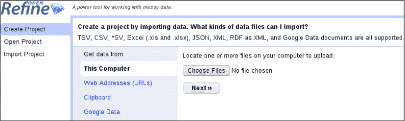
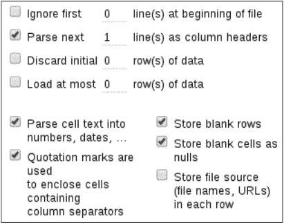
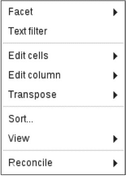
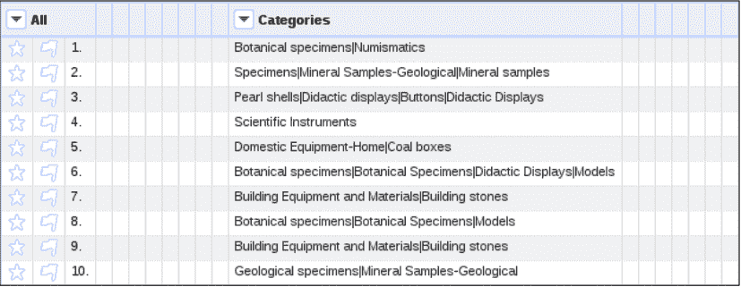
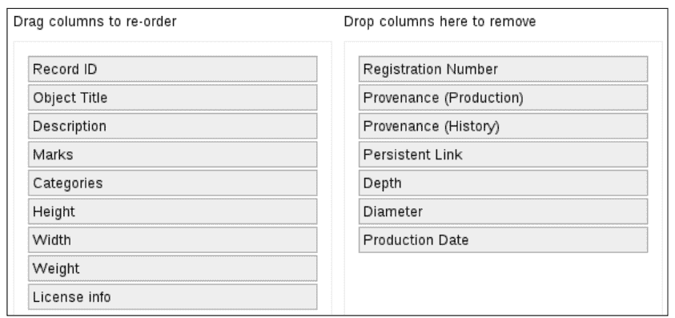
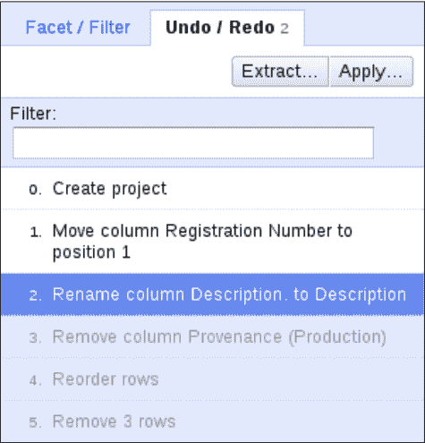
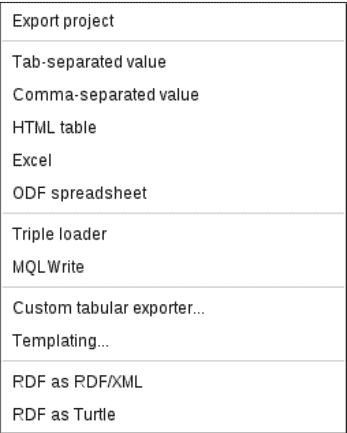

# 深入 OpenRefine

在本开篇章中，我们将了解 OpenRefine 的用途、为什么要使用它，以及如何使用它。在简短介绍之后，我们将学习七个基本操作指南，让你初步领略 OpenRefine 的强大功能：

- 操作指南 1 – 安装 OpenRefine
- 操作指南 2 – 创建新项目
- 操作指南 3 – 探索你的数据
- 操作指南 4 – 操作列
- 操作指南 5 – 使用项目历史
- 操作指南 6 – 导出项目
- 操作指南 7 – 增加内存

虽然每个操作指南都可以独立阅读，但我们建议 OpenRefine 的新手用户按照原有顺序阅读，至少前几个操作指南应按顺序阅读，因为它们提供了有关其整体运作方式的关键信息。已经安装并运行 OpenRefine 的高级用户则可以按任何顺序挑选他们喜欢的技巧。

## OpenRefine 简介

让我们面对一个不争的事实：你的数据是杂乱的。所有数据都是杂乱的。无论你在创建大型数据集时多么小心，错误总会出现，尤其是当数据集的创建涉及多人并且/或者跨越了较长时间时。无论你的数据是数字原生还是数字化而来的，无论它们存储在电子表格还是数据库中，总会有某些地方出错。

### Windows

- 1. 下载 ZIP 压缩包。
- 2. 解压缩并将压缩包内容提取到你选择的文件夹中。
- 3. 双击 `openrefine.exe` 启动 OpenRefine。

### Mac

- 1. 下载 DMG 文件。
- 2. 打开磁盘映像并将 OpenRefine 图标拖入 `Applications` 文件夹。
- 3. 双击图标启动 OpenRefine。

### Linux

- 1. 下载 gzipped tar 压缩包。
- 2. 将文件夹解压到你的主目录。
- 3. 在终端中输入 `./refine` 启动。

需要注意的是，默认情况下，OpenRefine 只会为 Java 分配 1 GB 内存。虽然这足以处理小型数据集，但在处理较大的数据集合时很快就会显得捉襟见肘。在 *操作指南 7 – 增加内存* 中，我们将详细介绍如何让 OpenRefine 分配更多内存，该操作也因操作系统的不同而有所差异。

## 操作指南 2 – 创建新项目

在本操作指南中，你将学习如何将数据导入 OpenRefine，无论是通过**创建**新项目并加载数据集、**打开**之前会话中的现有项目，还是**导入**他人的项目。

如果你按照 *操作指南 1 – 安装 OpenRefine* 中的说明成功安装并启动了 OpenRefine，你会注意到 OpenRefine 会在你的默认浏览器中打开。然而，重要的是要认识到该应用程序是在本地运行的：你不需要互联网连接即可使用 OpenRefine，除非你想通过使用扩展程序将你的数据与外部来源进行调和（有关此类高级用法，请参阅 *附录：正则表达式和 GREL*）。同时请放心，你的敏感数据不会被存储到网上或与任何人共享。实际上，OpenRefine 使用你本地机器的 3333 端口，这意味着你可以通过 URL `http://localhost:3333/` 或 `http://127.0.0.1:3333/` 访问它。

## 深入 OpenRefine

这是你首次打开 OpenRefine 时会看到的启动界面：



在左侧，有三个选项卡可用：

- **创建项目**：此选项将数据集加载到 OpenRefine 中。这是你首次使用 OpenRefine 时需要的选项。如前面的截图所示，支持多种格式。你可以通过不同的方式导入数据：
  - **这台计算机**：选择存储在你本地机器上的文件
  - **网址（URL）**：直接从在线来源导入数据*
  - **剪贴板**：将你的数据复制粘贴到文本字段中
  - **Google 数据**：启用对 Google 电子表格或 Fusion Table 的访问*
  
  *需要互联网连接
- **打开项目**：此选项帮助你返回到之前会话中创建的现有项目。下次启动 OpenRefine 时，它会显示现有项目列表，并建议你继续处理之前使用过的数据集。
- **导入项目**：使用此选项，我们可以直接导入现有的 OpenRefine 项目归档文件。这使你能够打开其他人导出的项目，包括自项目创建以来对数据执行的所有转换的历史记录。

## OpenRefine 支持的文件格式

以下是 OpenRefine 支持的一些文件格式：

- 逗号分隔值（CSV）、制表符分隔值（TSV）和其他 *SV 格式
- MS Excel 文档（.XLS 和 .XLSX）以及 Open Document Format（ODF）电子表格（.ODS），尽管后者未被明确提及
- JavaScript 对象表示法（JSON）
- XML 和资源描述框架（RDF）作为 XML
- 基于行的格式（日志）

如果你需要其他格式，可以通过 OpenRefine 扩展程序添加。

使用 OpenRefine 创建项目非常简单，只需三个简单步骤：选择文件、预览导入，以及确认让 OpenRefine 创建项目。让我们通过点击**这台计算机**选项卡中的**选择文件**按钮来创建一个新项目，选择你的数据集（请参阅下面的信息框），然后点击**下一步**。

> 虽然我们鼓励你在自己的数据集上尝试 OpenRefine，但你能够重现本书中使用的示例可能会很有用。为了便于阅读，本书所有操作指南均使用悉尼动力博物馆（Powerhouse Museum）的数据集进行演示，你可以从 http://www.packtpub.com 的账户中免费获取该数据集（使用 chapter1.tsv 文件）。请随意下载此文件并将其加载到 OpenRefine 中，以便更轻松地跟随操作指南进行操作。其余章节也有类似格式的文件可供下载。如果你在其他地方购买了这本书，可以访问 http://www.packtpub.com/support 并注册，以便将文件直接通过电子邮件发送给你。

在下一个屏幕上，你会看到数据集在 OpenRefine 中的呈现概览。在右下角，你可以看到以下解析选项，如下面的截图所示：



默认情况下，第一行将被解析为列标题，这是一种常见做法，并且适用于 Powerhouse 数据集。OpenRefine 还会尝试猜测每个单元格的类型，以区分字符串、整数、日期和 URL 等。这在之后对数据进行排序时会很有用（例如，如果你选择将单元格保持为纯文本格式，10 会排在 2 之前）。

此屏幕上可以看到四个区域；让我们从上到下逐一介绍，即前面截图中编号为 1 到 4 的区域：

- 1. **总行数：** 如果你没有忘记指定忽略引号（请参阅 *操作指南 2 – 创建新项目*），你应该会看到 Powerhouse 文件中共有 **75814 行**。当数据按给定条件过滤时，此栏会显示类似 **123 行匹配（共 75814 行）** 的信息。
  
- 2. **显示选项：** 尝试点击**行**或**记录**这两个词之一来切换。确实，不会有太大变化，只是你现在可能会在区域 1 中看到 **75814 条记录**。在新建项目中，行数总是等于记录数，但从现在起它们将独立变化。该区域还允许你选择每页显示 5、10、25 或 50 行/记录，并提供了正确的翻页导航方式。
  
- 3. **列标题和菜单：** 你可以在这里找到创建项目时被解析为列标题的第一行。在 Powerhouse 数据集中，列显示为**记录 ID、对象标题、注册号**等（如果你取消选中**将接下来的 1 行解析为列标题**选项框，则会看到**列 1、列 2**等）。最左侧的列始终称为**全部**，分为三个子列，分别包含星标（例如用于标记好记录）、旗帜（例如用于标记坏记录）和 ID。带星标和带旗帜的行可以轻松地进行分面操作，我们将在 *第 2 章，分析和修复数据* 中看到。每一列还有一个菜单（请参阅下面的截图），可以通过点击列标题左侧的小下拉箭头来访问。
  
- 4. **单元格内容：** 此区域为显示单元格实际值的主要区域。




开始对数据进行剖析和清理之前，了解数据并熟悉 OpenRefine 很重要：使用水平滚动条查看每一列，以验证列标题是否已正确解析，单元格类型是否被正确猜测，等等。将每页显示的行数改为 50 并浏览几页，以检查值是否一致（理想情况下，你在创建项目之前在预览期间就应该已经这样做了）。当你觉得已足够熟悉界面时，可以考虑继续进行下一个菜谱。

## 配方 4 – 操作列

在本菜谱中，你将学习如何在 OpenRefine 中**折叠**列并再次**展开**，**移动**列到任意方向，或随意**重命名**和**删除**列。

列是 OpenRefine 的重要组成部分：它们包含成千上万相同性质的值，并且可以以多种方式进行操作。

### 折叠和展开列

默认情况下，OpenRefine 中所有列都是展开的，如果项目中有很多列，这可能会很麻烦。如果你想暂时隐藏一列或多列以便于对其他列进行操作，请点击任意列中的下拉菜单显示菜单并选择 **View**。有四个选项可供选择：

- Collapse this column
- Collapse all other columns
- Collapse columns to left
- Collapse columns to right

以下是导航到 **View | Collapse all other columns** 在列 **Categories** 上后的 Powerhouse 数据集的截图。要再次展开列，只需点击它。要展开所有列并返回初始视图，请参阅本菜谱中的 *Moving columns around* 部分。



### 移动列

在某些情况下，可能需要更改原始文件中的列顺序，例如，将需要比较的列放在一起。为此，进入所选列的菜单并点击 **Edit column**。再次，在子菜单底部有四个选项：

- Move column to beginning
- Move column to end
- Move column to left
- Move column to right

如果你想完全重新排序列，请使用第一个名为 **All** 的列。此列允许你同时对多个列执行操作。
**View** 选项提供了一种快速折叠或展开所有列的方法，而 **Edit columns | Re-order / remove columns...** 则是一种高效的方式，通过拖拽列或将它们丢弃到右侧来重新排列列，如以下截图所示：



### 重命名和删除列

在同一个 **Edit column** 菜单项下，你也有可能：

- Rename this column
- Remove this column

你可以使用重命名来消除 **Description** 列标题末尾不必要的点，例如。删除列比简单地折叠它要激进得多，但这仍然可以逆转，正如你在阅读 *Recipe 5 – using the project history.* 时将学到的那样。

## 配方 5 – 使用项目历史

在本菜谱中，你将学习如何在项目的任何阶段回到过去，以及如何在项目已关闭并重新打开后仍在历史记录中导航。

OpenRefine 的一个非常有用的功能是它对自项目创建以来影响数据的所有修改的历史记录处理。实际上，这意味着你永远不必害怕尝试新事物：随时都可以随意摆弄数据并应用任何想到的转换，因为如果意识到是错误，一切都可以撤销（即使更改已过去数月）。

要访问项目历史记录，请点击屏幕左上角的 **Undo / Redo** 选项卡，就在 **Facet / Filter** 旁边，如以下截图所示：



为了回溯时间，请点击你想要保留的最后一步。例如，要取消列 **Provenance (Production)** 的删除以及所有后续步骤，请点击 **2. Rename column Description. to Description.** 第 2 步将被高亮显示，第 3 步到第 5 步将被灰显。这意味着重命名将被保留，但接下来的三个步骤不会被保留。要取消所有更改并恢复数据到任何转换之前的状态，请点击 **0. Create project**。要撤销取消操作（重做），请点击你想要恢复历史记录到的步骤：例如，点击 **4. Reorder rows** 再次应用步骤 3 和 4，同时保持步骤 5（行删除）的抑制。

然而要谨慎，后退并做其他事情会删除所有后续步骤。例如，如果你从步骤 5 后退到步骤 2，然后选择将列 **Description** 移到左侧，步骤 3 现在将读作 **3. Move column description to position 1**，而前一张截图中的灰色步骤将永远消失：你不能同时记录两个冲突的历史记录。务必在此进行实验，以避免将来出现不愉快的意外。

重要的是要注意，只有实际影响数据的操作才会在项目历史记录中列出。诸如在行视图和记录视图之间切换、每页显示更少或更多记录、再次折叠和展开列等视觉辅助工具并不是真正的转换，因此不会被保存。其结果是它们会在一次会话到另一次会话之间丢失：当你返回之前关闭的项目时，所有列都将再次展开，而重命名和删除的列仍将保持你上次离开时的状态，以及项目历史记录中存储的每一次其他操作。在 *Chapter 2, Analyzing and Fixing Data* 中，我们将看到这也适用于其他类型的操作：虽然单元格和列转换会记录在历史记录中，但过滤器和分面不会。

请注意，操作历史记录也可以通过点击 **Undo / Redo** 下方的 **Extract...** 按钮以 JSON 格式提取。这将允许你选择要提取的步骤（请注意，只有可重用的操作可以提取，这排除了对特定单元格执行的操作），然后它们将被自动转换为 JSON，可以复制粘贴。前一张截图中的步骤 1 和 2 将表示为：

```
[
  {
    "op": "core/column-move",
    "description": "Move column Registration Number to position 1",
    "columnName": "Registration Number",
    "index": 1
  },
  {
    "op": "core/column-rename",
    "description": "Rename column Description. to Description",
    "oldColumnName": "Description.",
    "newColumnName": "Description"
  }
]
```

## 下载示例文件


你可以从 http://www.packtpub.com 在你购买的所有 Packt 书籍的账户中下载示例文件。如果你是在其他地方购买本书，你可以访问 http://www.packtpub.com/support 并注册以便将文件直接发送到你的电子邮件。

在前面的代码中，**op** 代表操作，**description** 实际上描述了操作的作用，而其他变量是传递给操作（函数）的参数。之前保存为文本文件中的 JSON 的步骤随后可以通过点击 **Apply...** 按钮并将提取的 JSON 历史记录粘贴到文本区域，重新应用于同一项目或另一个项目。最后，如果你执行了数百次操作并且难以找到某个特定步骤，你可以使用 **Filter** 字段将历史记录限制为匹配文本字符串的步骤。例如，对 remove 的过滤（甚至是 rem）将把显示的历史记录限制为步骤 3 和 5。

## 配方 6 – 导出项目

在本菜谱中，你将探索保存修改后的数据以便在其他上下文中重用的各种方法，包括 **templating**，它允许使用任何自定义导出格式。

尽管你可能已经移动、重命名，甚至删除了列，但这些修改都没有保存到原始数据集中（即 *Recipe 1 – installing OpenRefine* 中的 chapter1.tsv 文件保持不变）。事实上，与大多数直接将更改记录到与其打开的文件中的电子表格软件不同，OpenRefine 总是在内存中对数据的内部副本进行操作。虽然这是一个额外的安全保障，但这也意味着在与他人共享或注入到另一个应用程序之前，任何修改后的数据都需要导出。屏幕右上角的 **Export** 菜单允许你这样做：




### Mac

Mac的说明稍微复杂一些，因为这个操作系统将配置文件隐藏了起来。关闭OpenRefine后，按住control键并点击其图标，从弹出菜单中选择“显示包内容”。然后，从Contents文件夹中打开`info.plist`文件。现在你应该看到一系列OpenRefine设置。导航到Java设置并编辑`VMOptions`的值（这些是Java虚拟机的属性）。查找以`-Xmx`开头的部分，并将其默认值1024 M改为所需的内存量，例如，`-Xmx2048M`。

### Linux

这可能会让你感到惊讶，但在Linux中增加分配的内存是最简单的。不要像通常那样用`./refine`启动OpenRefine，只需输入`./refine -m 2048M`，其中2048是所需的内存量（以MB为单位）。要使更改永久生效，你可以在主文件夹中隐藏的`.bashrc`文件中创建一个别名，在文件末尾添加以下行：

```
alias refine='cd path_to_refine ; ./refine -m 2048M'
```

这里，`path_to_refine`是从你的主文件夹到OpenRefine文件夹的相对路径。然后，下次你用`./refine`启动OpenRefine时，它将默认分配2 GB内存。

## 总结

在本章中，你已经了解了OpenRefine，它是你在数据剖析、清洗、转换以及许多其他有待发现的功能方面的新好朋友。你现在已经运行了一个OpenRefine安装，并且知道如何通过创建新项目将数据导入其中，以及完成后如何再次导出数据。行和列的机制对你来说已不再是秘密，你也理解了如何在项目历史中导航。你还掌握了内存分配，这使你能够处理更大的数据集。

虽然在弄脏双手之前，先全面了解数据集中有什么总是很重要的，但你现在可能已经迫不及待地想要对你的数据执行实际更改了。如果是这样，你已经准备好进入第2章“分析和修复数据”，这一章将继续教你分析和修复数据所需的所有基本操作的来龙去脉。
