# 2

# 分析和修复数据

在本章中，我们将更深入地了解OpenRefine，并回顾其大部分用于数据修复和分析的基本功能。我们将涵盖以下主题，分布在六个配方中：

- 配方1 – 排序数据
- 配方2 – 分面数据
- 配方3 – 检测重复项
- 配方4 – 应用文本过滤器
- 配方5 – 使用简单的单元格转换
- 配方6 – 删除匹配的行

与*第1章，深入OpenRefine*相比，这些配方更是为了让读者可以根据自己的需求和兴趣，以任意方式从一个配方跳到另一个配方。当然，连续阅读本章也是可行的，但完全不是必须的。

请注意，这些配方的长度并不相同；有些非常简短且切中要点，但其他一些则无法压缩到一两页。例如，*配方2 – 分面数据*涵盖了分面这一广泛主题，跨越了许多页，并分为子配方。

> 要跟随本章使用的示例，我们建议你在启动时选择**导入项目**直接加载`chapter2.openrefine.tar.gz`文件。或者，你也可以使用从`chapter1.tsv`文件创建自己的OpenRefine项目，如*第1章，深入OpenRefine*所述。

## 配方1 – 排序数据

在本配方中，你将学习如何将数据排序作为视觉辅助，以及如何永久地重新排序行，作为更高级操作的前提。

因为排序后的值更容易探索和操作，排序数据当然是你使用OpenRefine时在某个时刻想要做的事情；你可以将排序后的值用作视觉辅助，也可以永久地重新排序你的记录。例如，要按**记录ID**对数据进行排序，请在列菜单中选择**排序...**以访问以下窗口：

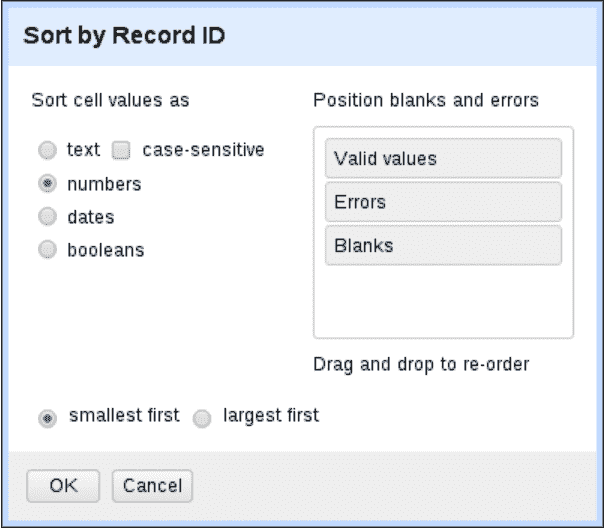

单元格值可以根据其类型进行排序：文本（区分大小写或不区分大小写）、数字、日期或布尔值。对于每种类型，我们有两种可能的排序顺序：

- **文本：** 字母顺序（a到z）或字母逆序（z到a）
- **数字：** 最小在前或最大在前
- **日期：** 最早在前或最晚在前
- **布尔值：** 先false后true或先true后false

此外，我们可以通过按所需顺序拖放，选择错误值和空值相对于有效值的位置。例如，错误值可以排在前面（以便更容易发现），空值排在最后（因为我们对它们不太感兴趣），有效（正常）值排在中间。

例如，通过选择**数字**和**最小在前**按**记录ID**对数据进行排序，将得到新的顺序7、9、14等，而之前是**267220、346260、267098**等。以下截图说明了排序前后的顺序：

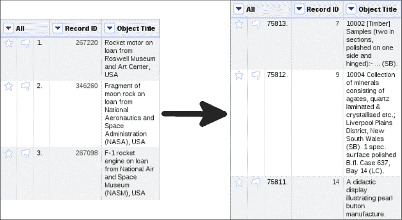

按文本排序会产生不同的顺序，从100、1001、10019等开始。但请注意，此排序并未记录在项目历史中；你可以通过点击屏幕左上角的**撤销/重做**选项卡自行检查。

这是因为OpenRefine中排序的默认行为不是影响数据，而只是按你喜欢的方式显示它们，例如行/记录的交替或折叠不需要的列（你也可以想到电子表格软件中的排序过滤器）。因此，每次你对给定列的数据进行排序时，你都会面临三个选项：移除排序并返回原始顺序，将其保留为临时的视觉辅助，或者使重新排序永久生效。

这些选项不能在原始的列菜单中选择，但可以在顶部出现的专用“排序”菜单中使用，如下面的截图所示：

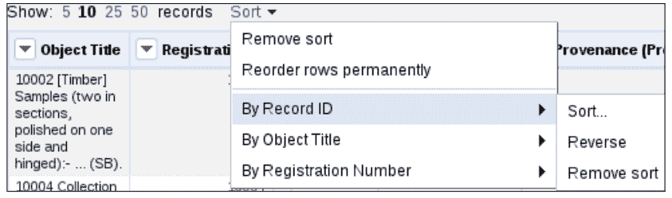

### 重新排序行

“排序”菜单允许你移除排序或永久地重新排序行。此外，它会提醒你哪些列用于排序，这使得组合各种排序标准成为可能（参见前面的截图）。例如，你可以首先按注册号排序数据，然后按对象标题排序，作为双重视觉辅助。之后，你可以决定仅移除对数字的排序（通过导航到“排序 | 按注册号 | 移除排序”）并使对标题的排序永久化。各个排序子菜单还允许你一键反转排序顺序。

如果你需要将任何重新排序用于其他操作（例如清空或向下填充单元格），请务必使其永久生效，以避免不一致的结果。在配方3 – 检测重复项中，我们将看到如何使用排序作为删除重复项的初步步骤。

## 配方2 – 分面数据

你经常使用的OpenRefine功能之一是分面。分面不影响数据的值，但允许你获得数据集的有用见解；你可以将分面视为查看数据的各种方式，就像一颗仍需打磨的宝石的各个刻面。分面还允许你对数据的子集应用转换，因为它们允许你仅显示符合给定条件的行。

在本配方中，我们将根据数据的值和你的需求探索分面的各种方式：用于字符串的文本分面、用于数字和日期的数值分面、一些预定义的自定义分面，最后是如何使用星标和旗标。OpenRefine的大部分强大之处在于能够组合这些不同类型的分面。

### 文本分面

例如，如果你的数据集有一个包含城市或国家名称的列，你会希望一眼看到该字段的不同值以及每个值的出现次数。这正是文本分面的用途。当然，分面只有在可供选择的选项数量有限时才有用；列出所有对象标题或描述是没有意义的，因为它们不太可能重复出现（除非是重复项，这将在下一个配方中处理）。

在Powerhouse藏品中，文本分面的最佳候选显然是“类别”列，因为它包含来自受控词表的关键词（如果你好奇的话，该词表称为Powerhouse博物馆对象名词词库）。简单来说，类别是用于描述藏品中对象的几千个术语的集合。

那么，让我们尝试通过在“类别”列菜单中选择“分面 | 文本分面”来概览这些类别。此分面的结果显示在屏幕左侧的“分面/过滤器”选项卡中。糟糕的是，OpenRefine告诉我们总共有14,805个选项，由于内存原因，显示太多选项了。实际上，分面选项的默认上限仅为2,000。我们可以尝试通过点击“设置选项计数限制”链接并将上限提高到例如15,000来克服此限制，但请注意，这可能会减慢应用程序的速度，尤其是在你没有更改默认RAM分配的情况下（参见第1章“深入OpenRefine”中的配方7 – 争取更多内存）。

> 如果你选择在弹出的窗口中提高限制，OpenRefine真正做的是更改一个名为`ui.browsing.listFacet.limit`的Java变量的值。虽然在大多数情况下你不需要理会这个古怪的名称，但如果你意识到自己把值增加得太高并想将其降低时，它可能会派上用场。事实上，当选项计数超出标准时，OpenRefine总是会提供提高限制的选项，但绝不会提供降低的选项。要做到这一点，请转到系统偏好设置 http://127.0.0.1:3333/preferences，编辑键为`ui.browsing.listFacet.limit`的偏好设置，并将其值设置为较小的值。要恢复默认的2000值，你也可以完全删除此偏好设置。

相反，请单击下方的**按选择计数分面**链接，它将在第一个分面下方打开第二个分面。这个新分面同样位于**类别**列上，允许你限制要显示在第一个文本分面中的类别范围。首次打开时，OpenRefine 会尝试显示所有类别，无论它们在集合中只出现一次还是出现数千次。由于要显示的类别太多，因此在第一阶段至少关注最常用的类别是有意义的。

拖动左侧的手柄，将下限从 0 提高到 1,000。之前的文本分面会自动刷新，现在显示的类别只是那些用于描述集合中至少 1,000 个对象的类别。它们只有 7 个，显示和浏览起来要容易得多。为了更好地了解情况，你可以选择按**计数**（从最频繁到最不频繁）而不是按**名称**（按字母顺序）对它们进行排序。

以下截图显示了你现在应该在这两个分面中看到的内容：

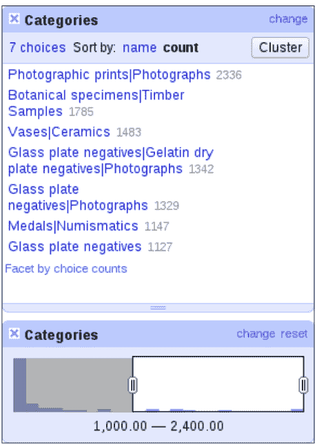

如果你想导出这七个顶级类别，只需点击**7 个选择**链接，就能以整洁的**制表符分隔值（TSV）**格式获得它们，可以随时复制并粘贴到你喜欢的文本编辑器或电子表格中。然而，这些类别中的大多数看起来都非常可疑。事实上，**Photographic prints | Photographs（摄影印品 | 照片）** 并不是一个单一类别，而是由竖线（管道符 |）分隔的两个类别。

这恰恰是一开始我们有这么多选择的原因。因此，**Glass plate negatives | Gelatin dry plate negatives | Photographs, Glass plate negatives | Photographs, and Glass plate negatives（玻璃板底片 | 明胶干板底片 | 照片、玻璃板底片 | 照片和玻璃板底片）**都被列为不同的选择，尽管它们包含相同的类别。然而，这就是多值单元格的弊病，我们目前还没有准备好处理它们。我们必须等到*第 3 章“高级数据操作”*，在那里我们还将了解这个有趣的**聚类**按钮的更多信息，我们暂时故意忽略了它。

由于类别的分面结果有些偏斜，在继续使用数值分面之前，让我们快速看一下另一个文本分面。列的选择不那么明显，但我们可以看到**高度**字段不仅包含数字，还包含数字后跟度量单位，例如**990 mm**。这意味着我们将无法对此列应用数值分面（或者至少不能直接应用），但我们可以尝试使用文本分面，希望不会有太多不同的值需要显示。

幸运的是，从**高度**列菜单导航到**分面 | 文本分面**，我们得知有 1,313 个选择，远低于 2,000 的默认限制。按**计数**而不是名称排序，揭示了一个令人惊讶的事实：集合中有 **1,368** 个对象的高度恰好为 **164 mm**，而第二常见的尺寸 **215 mm** 仅出现在 **400** 个对象中。这些值可以在以下截图中看到：

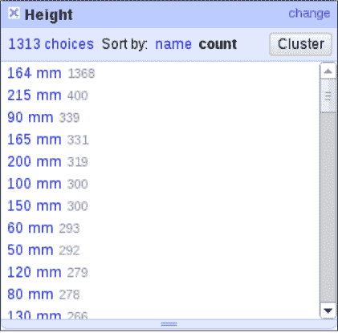

在该列表的底部，我们还可以看到有 45,501 个对象的高度值为空白，这意味着没有为它们记录任何高度。但是，我们现在不会在这些对象上多费时间，因为 OpenRefine 为我们提供了一种专门处理空白行的分面，我们将在讨论自定义分面时发现它。

### 数值分面

找到与数值分面相关的列比文本分面容易得多，因为其中几列包含数字。数字很容易发现，因为它们以绿色显示，前提是在创建项目时选中了**将单元格文本解析为数字、日期...**复选框。Record ID 列与其他列一样都是不错的选择，因为分面可以让我们概览 ID 的分布，并检查所有对象是否都有一个 ID。

在“记录 ID”列菜单中，导航到**分面 | 数值分面**，查看左侧“分面/筛选”选项卡中出现的内容。文本分面返回的是不同选择的列表，而数值分面产生的是值范围，就像我们按选择计数分面时看到的那样。

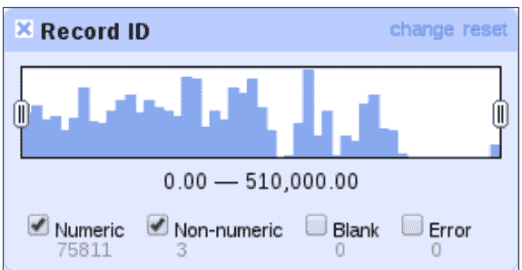

我们可以看到“记录 ID”列的值范围从 0 到 510,000，在 270,000 和 280,000 之间有一个小间隙，在 410,000 和 500,000 之间有一个较大的间隙。通过滑动滑块手柄，我们可以更仔细地查看 ID 大于 500,000 的 533 行。

在图下方，值分为四类：数值、非数值、空白和由问题操作导致的错误。由于我们还没有修改这些值，所以没有发现错误，也没有发现空白，这意味着集合中的所有对象都已分配了记录 ID。然而，有三行的值是非数值，这对 ID 来说出乎意料。让我们取消选中“数值”复选框，只选中“非数值”复选框，来进一步了解这些行。

在右侧，我们现在可以看到三个匹配的行。它们不仅缺少记录 ID，而且所有其他列都是空白的，除了自动生成的对象持久链接和许可信息。这些行不代表实际对象，它们只是可以安全删除的空行（我们将在本章最后一个操作指南中了解如何删除）。

然而，这里有些不对劲；如果这些行确实是空白的，为什么它们被归类为非数值而不是计入**空白**复选框之下呢？罪魁祸首是空白字符，我们可以通过编辑三个单元格中的一个来验证。为此，只需将鼠标悬停在**记录 ID**列下的其中一个单元格上，就会出现一个小编辑按钮。点击它，自己观察一下，它们包含一个空格，如下面的截图所示：

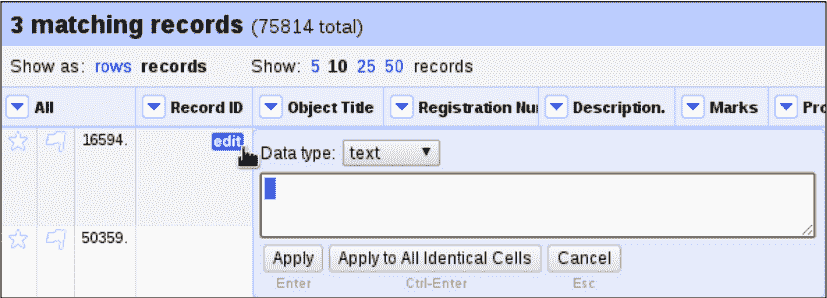

要纠正这种情况，请按*Backspace*或*Delete*键删除有问题的空白字符，然后点击下方的**应用到所有相同单元格**按钮，或按*Ctrl + Enter*。OpenRefine 在屏幕顶部的黄色框中提示你，**记录 ID**列中有三个单元格已被批量编辑。因此，左侧的分面会刷新，所涉及的三个单元格会切换到“空白”框。

在进入自定义分面之前，让我们简要提一下与数值分面相关的另外两种分面方式：时间轴分面和散点图分面。

时间轴分面需要日期，因此类似 17/10/1890 这样的文本字符串需要先转换为日期格式。你可以尝试对**制作日期**列进行转换，但要注意真正的日期只占少数，因为它还包含年份（如 1984）和范围（如 2006 到 2007）。不过，我们仍然可以在该列菜单中导航到**编辑单元格 | 常用转换 | 转换为日期**，将 79 个单元格转换为日期格式；例如，17/10/1890 将被转换为 1890-10-17T00:00:00Z，其中零表示一天中的小时、分钟和秒。

显然，在总共 75,814 个单元格中，79 个单元格并不多，但基于这些值的时间轴分面仍然会显示在 1880 年 2 月 26 日至 1952 年 1 月 31 日这一给定日期范围内创建的对象，而大多数值要么不是时间表达式（19,820），要么是空白（55,915）。

以下截图显示，将日期转换为 OpenRefine 的内部时间格式后，在**制作日期**列上使用时间轴分面可以得到的结果：

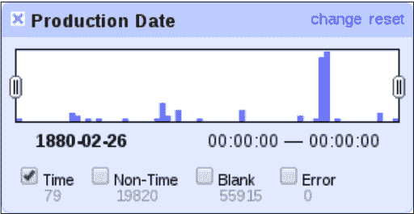

最后，散点图分面允许以图形方式表示数值。我们不会深入介绍这种分面的细节，但如果你好奇，可以自己尝试一下。

### 自定义分面

现在我们已经了解了两种主要的分面类型，文本分面和数值分面，但还有更多类型存在，你可以根据自己的需求几乎任意地对数据进行分面。自定义分面正是让你做到这一点；定义你自己的分面，无论是文本类型（例如，对字符串的第一个字符进行分面），还是数值类型（例如，对一个数的平方根进行分面）。然而，它们需要对**通用提炼表达式语言（GREL）**有基本的了解，这将在*附录“正则表达式与 GREL”*中介绍。

然而，OpenRefine 还提供了一些自定义分面；这些是预定义的自定义分面，已被证明对许多用户来说具有常见用途。接下来，我们将浏览这些分面，特别关注其中最有用的几个。首先让我们快速查看一下自定义分面子菜单，该子菜单可以从任何列访问：

| 单词分面 |
| 重复项分面 |
| 数值对数分面 |
| 1-有界数值对数分面 |
| 文本长度分面 |
| 文本长度对数分面 |
| Unicode 字符代码分面 |
| 按错误分面 |
| 按空白分面 |

**单词分面**列出字段中使用的所有不同单词，而单词被简单定义为两个空白字符之间的文本字符串。你可能会想在数据的子集上尝试此功能，因为选项数量可能迅速变得非常庞大；例如，对**描述**列使用单词分面会显示 212,751 个不同的单词，这肯定会让应用程序崩溃。

单词分面可用于细化你的类别列表。例如，简单文本分面会告诉你有多少对象被描述为“鸡尾酒裙”，而单词分面会将该类别拆分为两个词，让你可以分别浏览各种连衣裙，以及另一边与鸡尾酒（例如鸡尾酒杯）相关的对象。

**重复项分面**允许你检测重复值；因此我们将把它留到下一个技巧中。

**数值对数分面**是显示数字对数而非实际值的快捷方式，如果你的数据遵循幂律分布，这将非常有用。**1-有界数值对数分面**与之相同，只是它不接受小于 1 的值。

## 分析和修复数据

**文本长度分面**根据某个字符串中包含的字符数来组织对象，例如**对象标题**。在该列菜单中导航到**分面 | 自定义分面 | 文本长度分面**，你将看到标题长度从 0 到 260 个字符。然后你可以关注 92 个短于 10 个字符的标题（在大多数情况下不超过一个词，而且信息量不大），或 2007 个长于 250 个字符的标题（这些标题通常与描述重复）。

说到描述，对其长度的分析也很值得关注，但分布范围太大（从 0 到 4,100 个字符，尽管 85% 的描述短于 500 个字符），因此很难理解。这时，文本长度对数分面（见下图）便派上了用场，它提供了更清晰的图表：

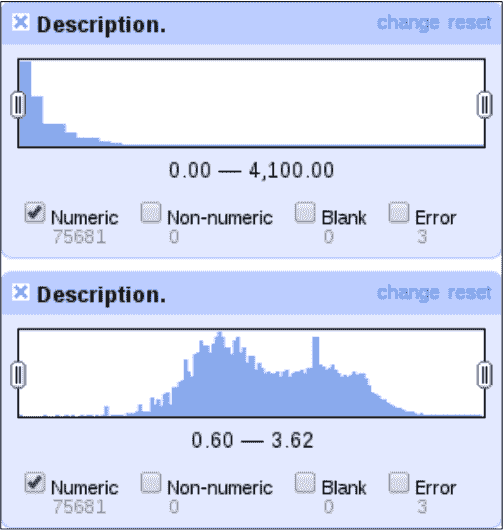

**Unicode 字符代码分面**不是计算字符串长度，而是列出字符串中使用的所有字符。例如，在**对象标题**列上试试；大多数英文字符的字符代码在 128 以下，但其他欧洲语言中的带重音字母可以达到 256，甚至更高，例如阿拉伯语或中文字符。不过，如果你注意到高得可疑的值，这可能意味着 OpenRefine 没有正确识别你的数据集的编码。在这种情况下，请重新开始一个新项目并手动选择正确的编码。

最后，你可以按错误对数据进行分面（假设数据包含错误），或者按空白进行分面。最后这个选项非常有用，可以了解某个字段在集合中的填充比例，并且通常可以与另一个分面结合使用。快速查看**标记**列，可以看到前几个单元格是空的，因此我们可导航到**分面 | 自定义分面 | 按空白分面**以进一步了解。此分面告诉我们，18,968 个值为 false（即非空白），56,846 个值为 true（即空白）。换句话说，只有四分之一的对象在文件中有一些标记描述。

更值得注意的是，**重量**列（在右侧，使用水平滚动条查看）只填充了 179 个对象，在 99.998% 的情况下都是空白的。对对象标题按空白分面显示，有 118 条记录是虚假的；它们有一个记录 ID，以及一个基于此 ID 的持久链接和一些伪造的许可信息，但其他所有列都是空的，因此它们并不真正指向一个对象。

### 按星标或旗标分面

在*第 1 章：深入探索 OpenRefine*中，我们简要提到了左侧特殊**全部**列中星标和旗标的存在。现在该来看看如何利用它们以有意义的方式对数据进行分面。星标可用于标记好的行或你希望选中的收藏行，以便稍后返回查看；相反，旗标可用于指示需要进一步特别关注的问题行或错误行。请注意，这只是一个建议；你也可以赋予星标和旗标完全不同的含义。

要标记或旗标单个行，只需单击左侧对应的符号。然而大多数时候，你会希望一次性标记多行。为此，你首先需要在显示中隔离这些行，通常可以使用另一个分面。例如，你可以通过转到**登记号**列菜单并导航到**分面 | 自定义分面 | 按空白分面**来检测空行，然后点击左侧的**true**，仅显示 118 个匹配（空）行。要全部标记为旗标，请打开**全部**列菜单并导航到**编辑行 | 旗标行**。星标操作同理，你也可以在同一菜单中对多行取消旗标或取消星标。

现在假设你想显示那些具有直径或重量信息的行。如果同时对这两列按空白分面并点击两次 false，你最终只会得到 29 个匹配行，它们对应于数据集中同时具有直径和重量记录的对象。要实现我们想要的，解决方案分两步进行：对“直径”列按空白分面，选择标记为 false 的 2106 行（即具有直径的行），并通过“全部 | 编辑行 | 星标行”为它们添加星标。清除分面，然后对“重量”列中的 179 行重复这些步骤（你可能会注意到实际只有 150 行被星标，因为其余 29 行已经具有两项测量值，因此已被星标）。再次清除分面，并通过导航到“全部 | 分面 | 按星标分面”来显示我们正在寻找的内容。当然，旗标操作也同样适用。

呼，我们终于到达了这个长技巧的终点！也许感觉有些不成比例，但分面确实是 OpenRefine 的基础，所以这是值得的。

## 技巧3 —— 检测重复项

在本技巧中，你将了解什么是重复项、如何发现它们以及为什么这很重要。

我们在前一个技巧中唯一没有提到的自定义分面类型是重复项分面。重复项是令人讨厌的记录，它们在数据集中出现了两次（或更多）。保留完全相同的记录会浪费空间并可能产生歧义，因此我们会希望移除这些重复项。这个分面是检测它们的一种简单方法，但它有一个缺点：它只对文本字符串有效，至少直接使用是这样（要了解如何调整它使其也适用于整数，请参阅附录“正则表达式和 GREL”）。

真遗憾，我们不能在“记录 ID”列上使用重复项分面。次优的选择是在“登记号”上运行它，登记号是集合中对象的内部分类，尽管它们不如 ID 可靠，因为对集合管理者来说它们具有外在意义。无论如何，让我们尝试一下，导航到“登记号 | 分面 | 自定义分面 | 重复项分面”；281 行被标记为重复项，我们可以通过点击左侧分面中的 true 来显示它们。

现在向下滚动几行查看这些重复项。我们发现了一个问题；重复项分面包含了所有空白行，这些行本身确实是相同的，但它们并不是对象的重复项，因为它们不代表任何对象。要排除这 118 个空行，我们需要另一个分面，可通过“登记号 | 分面 | 自定义分面 | 按空白分面”访问。点击 false 以保留 163 个真正的重复项，并注意上方的第一个分面会自动刷新。

最后，添加第三个方面（facet），这次是一个简单的文本方面，用于列出数据集中出现多次的不同登记号。按计数排序后，我们可以看到在79个选项中，77个确实是完全重复的（值出现两次），而一个值出现了三次（2008/37/1），还有一个值出现了六次（86/1147-3）。这三个方面可以在以下截图中看到：

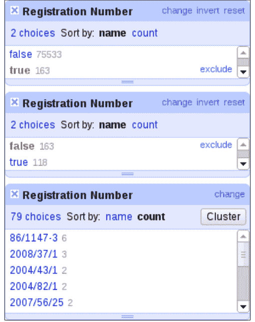

现在回到我们的记录ID。由于重复方面（duplicates facet）对整数没有用处，我们将使用一种变通方法来检测该列中的重复项。为此，我们首先通过导航到 **Record ID | Sort...**，并切换为“数字”和“最小优先”来按ID对数据排序。你可能还记得第1章“深入OpenRefine”中的内容，排序只是一种视觉辅助，因此需要通过转到刚刚出现的排序菜单（位于“显示：5 10 25 50行”右侧）并点击“永久重新排序行”来使重新排序永久生效。如果你忘记重新排序行，后续操作将忽略排序并产生意外结果。

现在行已按ID排序，重复项必然会被分组在一起，因此我们可以导航到 **Record ID | Edit cells | Blank down**，将重复行的ID替换为空白（每个原始行都会保留其ID，只有后续行会失去ID）。通过导航到 **Record ID | Facet | Customized facets | Facet by blank** 对空白行进行分面，将显示86个冗余行（如果你已经删除了空白行，则可能是84个），其中包括每对中的一个、三个一组中的两个以及六个一组中的五个。这86行是真正的重复项，不包括需要保留的原始行，我们将在*配方6 – 删除匹配行*中学习如何删除它们。

## 配方4 – 应用文本过滤器

在本配方中，你将了解允许你搜索显示某些模式值的过滤器。

当你想要查找匹配特定字符串的行时，依赖简单的文本过滤器比使用繁琐的方面（facet）更容易。让我们从一个简单的例子开始。假设你想要筛选所有与美国相关的标题。导航到 **Object Title | Text filter**，观察过滤器框在左侧打开，与方面出现的选项卡相同。现在输入USA。OpenRefine会告诉你共有1,866行匹配。选中**区分大小写**复选框，以消除偶然匹配，例如karakusa和Jerusalem，这样我们就减少到1,737行：

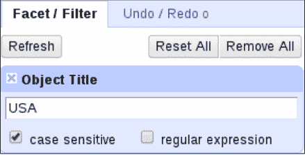

尽管如此，我们仍不能确定这些匹配中没有剩余噪声；例如，可能存在全大写的JERUSALEM。为了解决这个问题，我们可以尝试在USA两侧添加空格，但这样可能会丢失诸如[USA]或/USA等情形，以及标题开头或结尾的出现。事实上，仅带空格的过滤器USA只返回172个匹配，约占USA所有出现次数的十分之一，这造成了大量漏检。

另一方面，我们简单的文本过滤器没有考虑到诸如U.S.A.（201个匹配）、U S A（29个匹配）或U.S.A（22个匹配）等拼写。跟踪所有变体很快就会变成一场噩梦，你需要逐条对行进行星标，以便稍后将它们全部组合在一起。

这就是正则表达式登场的时候。正则表达式（通常被称为regex）非常强大，但在有效使用之前，它们需要对其特殊语法有基本的理解。例如，像\bU.?S.?A\b这样的表达式（选中正则表达式框）将匹配所有前面提到的相关情况，同时排除有问题的情形，并返回1,978个匹配行。

本配方不打算教你如何掌握正则表达式，但附录“正则表达式和GREL”将为你解释基础知识。

我们可以用文本过滤器做的另一件有用的事情是检查分隔符的适用性。在Categories列中，管道字符（|）用于分隔类别。让我们在该列上添加一个文本过滤器，先输入一个单独的管道。OpenRefine显示71,105个匹配行，这意味着大多数对象至少用两个类别来描述（因为单个类别不需要管道分隔符）。

现在添加第二个管道以得到||；检测到九个有问题的行包含双管道而不是单管道。在第3章“高级数据操作”中，我们将看到如何使用GREL来修复此问题。另一个问题是单元格以管道开头或结尾，但找到它们也需要使用正则表达式，因此这必须等到附录“正则表达式和GREL”。

## 配方5 – 使用简单的单元格转换

在本配方中，你将学习如何使用OpenRefine的内置转换来修改数据的子集。

在使用方面和过滤器时，我们基本上是以各种方式显示数据，但并没有真正影响它们。现在终于到了修改数据的时候了，这意味着进入强大的**Edit cells**菜单。虽然我们已经使用**Blank down**来检测重复项，但其他转换（例如拆分和合并多值单元格，或聚类和编辑值）更为高级，因此我们将把它们的讨论推迟到下一章。其他转换则更容易掌握；不过，我们现在将重点放在**Common transforms**子菜单中可用的转换，如下面的截图所示：

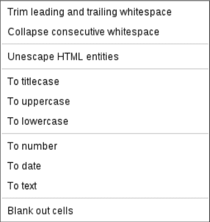

**修剪字符串开头和结尾的空白**是提高数据质量的良好第一步。这将确保相同的值不会仅仅因前导和尾随空白而不同（这可能很难检测），从而使数据更加一致。它还有助于通过消除不必要的字符来减小数据集的规模；虽然一个小空格占不了多少空间，但几千个空格就可能产生影响并造成隐藏的破坏。还记得那些仅因单个空白字符而被归类为非数字的空白值吗？

唯一标识符也不应包含空格；让我们通过导航到 **Registration Number | Edit cells | Common transforms | Trim leading and trailing whitespace** 来检查一切是否正常。2,349个单元格受到此操作的影响，这意味着它非常必要。请注意，我们不能对Record ID列执行相同操作，因为修剪仅适用于字符串，不适用于整数；结果将是删除所有ID！

**连续空白**在快速输入时也很常见，我们预计会在诸如对象标题或描述等长文本字段中找到一些。令人惊讶的是，这些列中并没有发现连续空白，而在**Production Date**列上运行**Collapse consecutive whitespace**却显示有7,671个值受到影响，但这些大多是整数被转换为字符串。请务必自己在其他列上尝试这两种转换；它们是安全的，只会对你的数据有益。

如果你的数据是从某个Web应用程序导出的，那么它们很可能包含**超文本标记语言（HTML）**代码。在HTML中，特殊字符通过数字或被称为HTML实体的自定义快捷方式来进行转义（即保护）。例如，法语字符é（带尖音符的e）将根据所使用的范式编码为`&#233;`或`&eacute;`。

虽然这些在Web上有助于避免浏览器中的编码问题，但当它们没有被正确反转义时（例如，反转义`&eacute;`意味着将其转换回é），可能会使阅读变得困难。因此，如果你发现某些值以与号（&）开头并以分号（;）结尾，请转到 **Edit cells | Common transforms | Unescape HTML entities**，然后观察你的数据被转换为可读的内容。

## 分析和修复数据

下一个转换族是 **大小写转换**；我们可以将文本字符串转换为小写、UPPERCASE 或 Titlecase。例如，我们可以通过导航到 **Registration Number | Edit cells | Common transforms | To uppercase** 来检查注册号中是否不存在小写字母。2,349 个单元格被转换，这可能意味着巨大的质量问题，但实际上只是小题大做。被转换的值只是整数，在转换过程中被转换为字符串（因为数字没有大小写）。你可以通过先在 **Registration Number** 列上添加一个数值分面，然后启动大小写转换并观察数值消失，被一条信息取代，告知你没有数值存在，来自行检查。

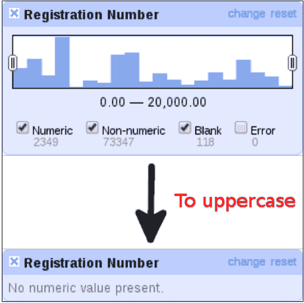

同样，我们可以使用 **To lowercase** 来验证持久链接 URL 中是否不存在大写字母，或使用 **To titlecase** 来标准化类别的拼写，例如将 Didactic Displays 和 Didactic displays 之间的差异平滑处理。然而，**To titlecase** 仅在空白字符后保留大写字母，因此 **Spacecraft | Models | Space Technology** 将被转换为 **Spacecraft | models | space Technology**，这远非理想。不过现在不必太在意这个问题，因为 *第 3 章，高级数据操作* 将介绍一种更好、更强大的处理此类情况的方法：聚类。

在 Recipe 2 – faceting data 中，我们使用了其中一种类型转换。事实上，你可能还记得，时间表达式必须先转换为日期（即 OpenRefine 对日期的内部格式，为 yyyy-mm-ddThh:mm:ssZ），我们才能对其使用时间线分面。同样的方法也适用于将值转换为文本或数字。我们可以将记录 ID 转换为文本，以便能够对其使用重复项分面，但随后在排序时（以避免 10 被排在 2 之前）或使用数值分面时，我们需要再次将其转换回数字。

OpenRefine 为我们预定义的最后一个转换相当粗暴；Blank out cells 正如其名，它会删除给定列中的所有值。当然，这最好在行子集上使用，而不是整个数据集。一个有用的组合是标记出对某个字段具有问题值的行，导航到 All | Facet | Facet by flag，然后对匹配的行清空单元格。

我们现在已经完成了常用转换，但请放心，这只是冰山一角；转换的可能性无穷无尽，正如你在第 3 章，高级数据操作 和附录，Regular Expressions and GREL 中会发现的那样。事实上，Edit cells | Transform... 会打开自定义文本转换窗口，让你可以用 GREL 定义自己的转换。这乍听起来可能令人害怕，但请相信这是值得的。

## 配方 6 – 删除匹配的行

在本教程中，你将学习如何通过使用分面和过滤器先前筛选出的有问题行进行抑制。

检测重复项或标记冗余行是可以的，但这只是工作的一部分。在某个时候，你会想要跨越数据剖析（或分析）与数据清洗之间的界限。实际上，这意味着在诊断阶段被识别为不合适的行（并且可能已被标记）需要从数据集中删除，因为它们会损害其质量。

要删除行，请先确保已设置分面或过滤器，否则你将删除数据集中所有行。让我们再次从干净的项目开始（重新导入一次或切换到 Undo / Redo 选项卡并选择 0. Create project 以取消所有修改），看看我们能对这个数据集做哪些清理工作。另请检查 OpenRefine 显示你的数据为行，而不是记录。

我们首先删除缺少记录 ID 的行。为此，导航到 Record ID | Facet | Numeric facet 并取消在左侧打开的分面中的 Numeric 复选框。这会只留下 Non-numeric 被选中，并且有三行匹配。请记住 Facet by blank 不会起作用，因为这三行并非真正空白，而是在 Record ID 单元格中有一个单个空白字符。现在转到 All | Edit rows | Remove all matching rows 并观看行消失。

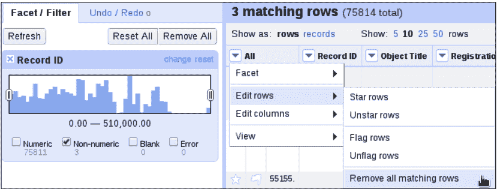

做得好，数据集减少了三行，不再有非数值记录 ID（正如已刷新的分面所示），数据质量已得到改善。清除分面并检查总数是否降至 75,811 行。

接下来，我们将处理没有注册号且在博物馆收藏中也令人怀疑的行。这里没有空格干扰（你可以通过在 Registration Number 列上使用简单的文本过滤器输入单个空白字符来检查；没有匹配行），因此我们可以导航到 Registration Number | Facet | Customized facets | Facet by blank。点击左侧的 true 以选择 115 个对应行；它们也都是空的，因此我们可以再次选择 Remove all matching rows。

正如你所见，删除空白行相当容易；我们现在将重点放在重复行上。重复项有点棘手，正如你在 Recipe 3 – detecting duplicates 中回忆的那样，但我们仍然想摆脱它们。开始导航到 Registration Number | Facet | Customized facets | Duplicates facet 并点击 true 查看 163 个匹配行。问题是，如果我们抑制所有这些行，我们不仅会删除重复项，还会删除原始值。换句话说，如果一行在数据集中出现两次，删除所有匹配行将删除两者，而不仅仅是一个。如果发生了这种情况，请记住你始终可以返回项目历史。

因此，我们需要一种在保护原始行的同时删除重复项的方法。这可以通过以下方式实现：按列 **Registration Number** 排序，选择 **text** 和 **a-z** 作为选项（**case sensitive** 框无需勾选，因为该字段中只有大写字母），然后基于该排序重新排列行，导航到 **Sort | Reorder rows permanently**。最后，通过导航到 **Registration Number | Edit cells | Blank down** 将重复值替换为空白，这应影响 84 个单元格。

如果你保持重复项分面打开，你会看到它刷新为显示这 84 个匹配行。发生的情况是，原始值（原本是 163 中的一部分）现在被单独列出，因此不再被视为重复项并切换到 **false**。真正的重复项 however 已被向下清空，因此它们现在都具有相同的值：空白。就好像它们是一个包含 84 行的大重复簇。在任何情况下，你现在可以删除这些匹配行，而原始行保持不变。

如果一切顺利，你现在应该剩下 75,612 行。我们本可以继续进行其他删除，但你现在可能已经掌握了总体思路，所以我们将留给你自行尝试其他列。查看 **Undo / Redo** 选项卡中的项目历史以回顾我们所经历的步骤。

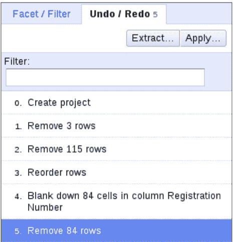

我们首先删除了三行空白行，随后删除了 115 行几乎空白但因其记录 ID 而存在的行。为了删除 84 个重复项，我们必须重新排序行并在列 **Registration Number** 上向下清空。总共，我们删除了 202 行，使数据集更加干净。请注意，文本分面和排序操作未列在历史记录中，因为它们并未影响数据，而只是作为执行删除的视觉辅助。

## 总结

在本章中，我们学习了如何掌握 OpenRefine 的基础知识以分析和修复数据集，这是数据剖析和清洗的重要组成部分。

分析数据涉及排序和各种分面的使用，也包括文本过滤器的应用和重复项的检测。

修复数据是通过重新排序、单元格转换和删除来完成的。

在下一章中，我们将通过深入高级数据操作，将对 OpenRefine 内部工作原理的理解提升到另一个层次。

