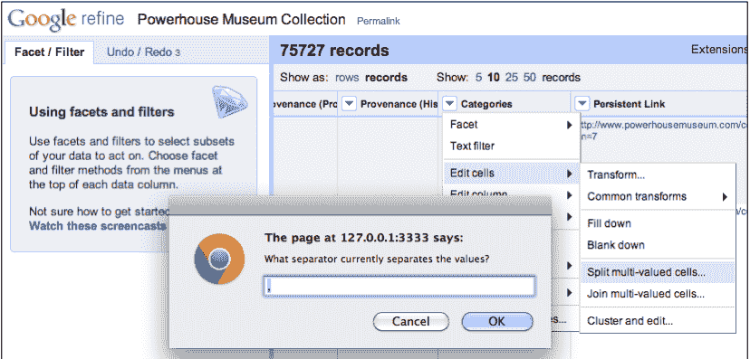
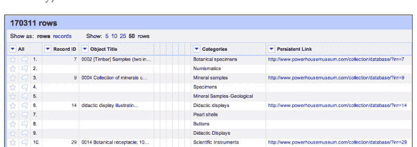
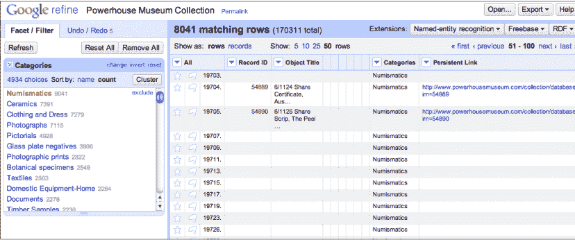
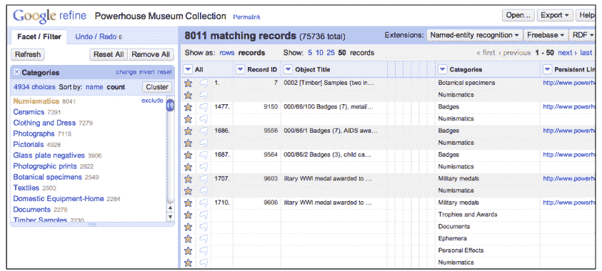
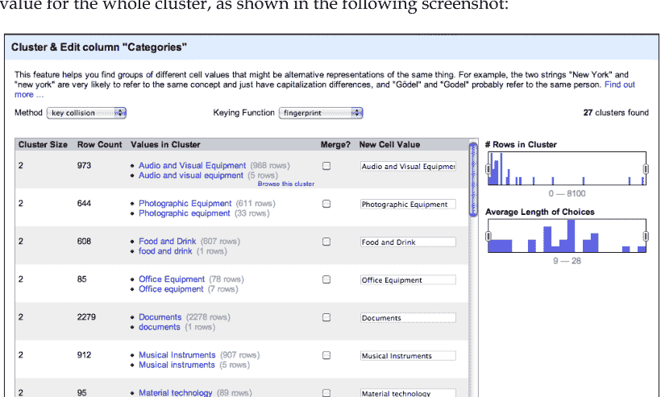
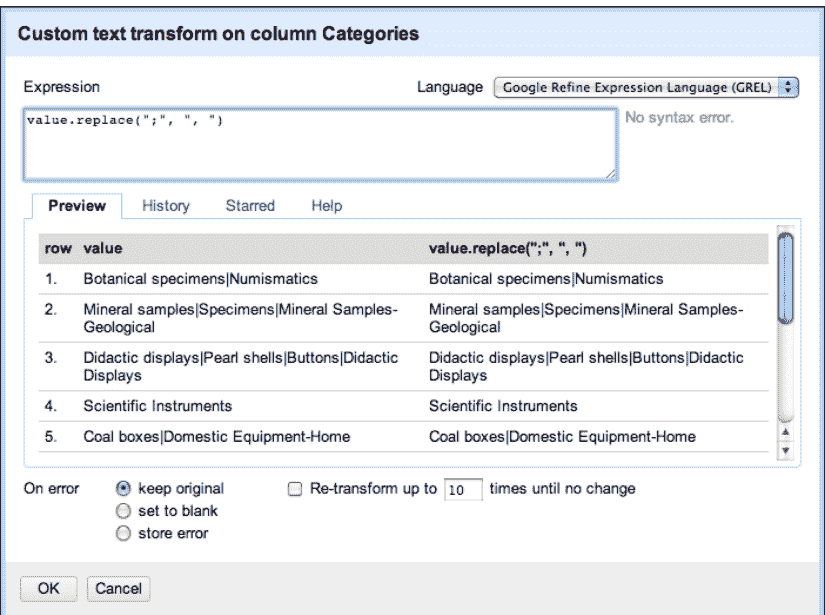
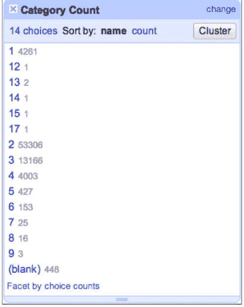
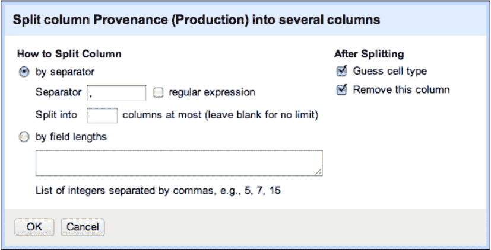
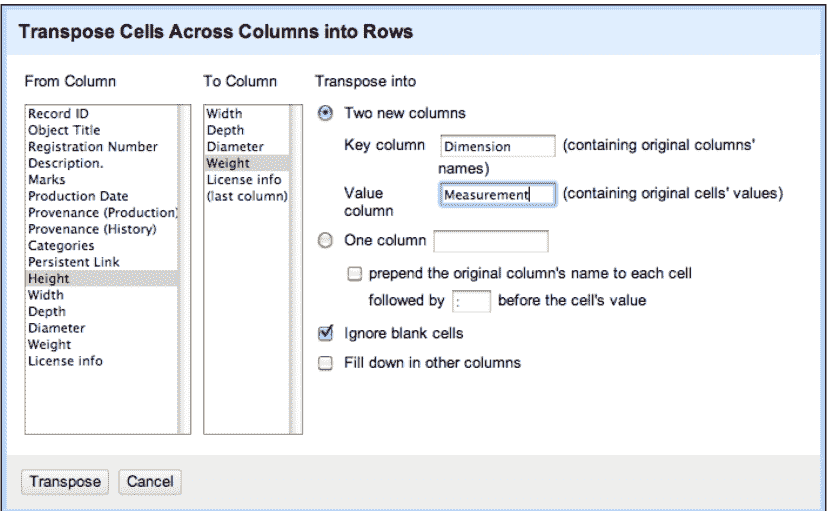
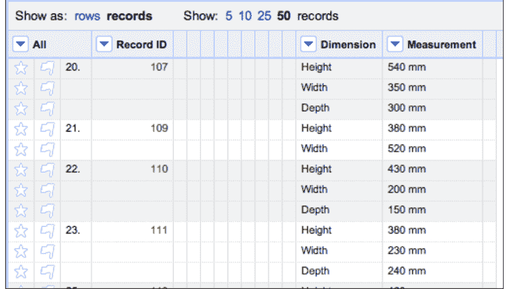

# 高级数据操作

## 技巧 1 – 处理多值单元格

在许多表格中，这是一个常见问题：当单个单元格有多个值时该怎么办？例如，考虑一个包含常规姓名、地址和电话字段的客户表。一位打字员正在向表中添加新联系人，突然发现汤普森先生提供了两个地址，且每个地址对应不同的电话号码。对此基本上有三种可能的处理方式：

- **只向表中添加一个地址**：这是最简单的做法，因为它省去了一半的录入工作。不幸的是，这也意味着有一半信息丢失，因此表的完整性会受到威胁。
- **向表中添加两行**：虽然表现在完整了，但产生了冗余数据。冗余同样危险，因为它会导致错误：这两行可能意外地被当成两个不同的汤普森先生，如果汤普森先生被重复收取订阅费，这会很快成为问题。此外，由于这两行之间没有关联，更新其中一行的信息不会自动传播到另一行。
- **将所有信息添加到一行中**：在这种情况下，两个地址和两个电话号码被加入到相应字段。我们说该字段相对于其最初设想的定义而言过载了。乍一看，这既完整又不冗余，但一个微妙的问题出现了。人类能完美理解这些信息，而自动化流程却不能。想象一下信封标签打印机，它现在会在一个信封上打印两个地址；或者自动拨号器，它会把两个号码的数字合并当成一个电话号码。该字段确实失去了其精确语义。

请注意，有多种技术解决方案可以处理多值问题，例如表关系。但是，如果你无法控制所处理的数据模型，就只能选择前述解决方案之一。

幸运的是，OpenRefine 能够兼顾两者优点。由于它同样是一款自动化软件，在对字段执行合理操作之前，需要告知它该字段是否为**多值**。在 Powerhouse Museum 数据集中，**Categories** 字段是多值的，因为馆藏中的每个对象可能属于不同类别。在该字段上执行有意义的操作之前，我们必须告诉 OpenRefine 以某种方式对其进行稍微不同的处理。

假设我们想仔细查看 **Categories** 字段，以了解其中有多少个不同类别，以及哪些类别最为突出。首先，让我们看看尝试通过点击 **Categories** 旁边的下拉菜单并导航到**分面 | 文本分面**来创建文本分面时会发生什么，如下面的截图所示。正如你可能从*第 2 章，分析和修复数据*中记得的那样，这并不会按预期工作，因为单个类别的组合实在太多。OpenRefine 干脆放弃，提示总共有 14,805 个选项，超出了显示上限。虽然你可以通过点击**设置选项数量限制**来增加最大值，但我们强烈建议不要这样做。首先，这会让 OpenRefine 慢得令人痛苦，因为它会给我们列出一个包含 14,805 种可能性的列表，对于概览来说无论如何都太大了。其次，这对我们毫无帮助，因为 OpenRefine 只会列出组合后的字段值（例如 Hen eggs | Sectional models | Animal Samples and Products）。这让我们无法检查单独的类别，而这才是我们感兴趣的。

要解决这个问题，请保持分面打开，但再次进入 **Categories** 下拉菜单，选择**编辑单元格 | 拆分多值单元格...**，如下面的截图所示：

OpenRefine 现在会询问：**当前用什么分隔符来分隔这些值？** 正如我们在前几条记录中看到的，值之间用竖线（pipe character）分隔。因此，请在对话框中输入竖线 `|`。如果你在键盘上找不到对应按键，可以尝试从某个 Categories 单元格中选择该字符并复制，然后粘贴到对话框中。接着，点击**确定**。

## 技巧 2 – 在行模式和记录模式之间切换

现在，让我们来看一下 OpenRefine 是如何让你访问多值单元格的。当我们按照上一个技巧的说明拆分列的值时，我们会看到 OpenRefine 做了两件事。一方面，它取出单元格不同值中的第一个，放入原始行；另一方面，它将每个剩余值分别放在一个单元格中，这些单元格所在的行原本为空。例如，在下面的截图中，你可以看到 ID 为 9 的记录被展开成三行，每行都包含一个类别名称。只有第一个类别所在的行包含该字段的其他值；其他行除了类别值外都是空的（为了清晰起见，隐藏了部分列）。

行（row）是数据集中的单行数据。

记录（record）由属于同一对象的所有行组成。记录的第一行以标识该记录的非空单元格开始；在后续行中，这些标识值为空，表示它们属于同一记录。

虽然这避免了信息重复以及由此可能产生的错误，但也使得查看哪些类别属于哪个对象变得困难。例如，如果我们在 **Categories** 上创建文本分面（参见上一个技巧），我们可以点击分面中的每个类别名称来查看包含该类别的行。然而，如果这样做，我们会看到很多空行：

原因是 OpenRefine 确实会显示所有类别值为 **Numismatics** 的行，其中包括所有那些 **Numismatics** 不是第一个类别的对象的空行。但它并不包含属于同一对象的其他行。如果我们关心一个对象的所有行，这就成了问题。例如，我们可能想给 **Numismatics** 类别中的所有对象加星标，以便对它们执行操作。现在让我们试试，看看会发生什么。

在文本分面中高亮 **Numismatics** 后，点击**全部**下拉菜单，导航到**编辑行 | 星标行**。现在点击分面上的**重置**，查看发生了什么。我们注意到，只有包含 **Numismatics** 的行被加星标，但属于同一对象的其他行没有被加星标。显然我们遗漏了什么。所以，让我们从**撤销 / 重做**标签页恢复到之前的状态，以撤销加星标操作。

OpenRefine 允许你将属于同一对象的所有行视为单个**记录**。这样，你既能享受将多值单元格拆分为不同行的好处，又能将它们作为一个整体来处理。要切换到记录模式，请将顶部栏的**显示为**设置从**行**改为**记录**。你会立即注意到 OpenRefine 的交替着色方案发生了变化。它不再每隔一行进行着色，而是每隔一条记录进行着色，具体取决于每条记录包含的行数。

如果现在，在仍处于**记录**模式时，从 **Categories** 分面应用 **Numismatics** 过滤器，我们会看到，选中的是 **Numismatics** 类别中对象的所有字段。如果我们现在通过**全部**下拉菜单导航到**编辑行 | 星标行**来给这些记录加星标，我们会看到属于该对象的所有行都变成了加星标状态：

这表明，在**记录**模式下，所有操作都作用于至少有一行匹配的整个记录。总结一下，我们可以说，**行**模式会显示所有符合你选择条件的单个行，而**记录**模式则会显示所有具有匹配行的对象。

> **匹配满足多个条件的记录**
> 
> 如果我们想匹配所有同时属于 **Numismatics** 类别和 **Medals** 类别的记录，该怎么办？要做到这一点，我们需要确保处于**记录**模式，并在 **Categories** 字段上添加第二个文本分面。在第一个分面中选择 **Numismatics**，在第二个分面中选择 **Medals**。现在我们会看到同时属于这两个类别的所有记录。
> 
> 那么，如果我们切回**行**模式会发生什么？突然，零条记录符合我们的选择。乍一看这似乎很奇怪，但实际上非常合乎逻辑：没有任何单行的类别同时等于 **Numismatics** 和 **Medals**；每行最多只包含这两者之一。因此，像这样的复杂选择应该在**记录**模式下进行。

另外，请确保在本书的其他技巧中恢复到**行**模式，否则你可能会得到完全出乎意料的结果。如果发生了无法解释的情况，请始终先检查你是否处于正确的模式。这可以为你省去很多麻烦。

## 配方 3 – 聚类相似单元格

得益于 OpenRefine，你不必担心在数据创建过程中溜进来的不一致性。如果你已经在拆分多值单元格后调查了各个类别，你可能会注意到相同的类别标签并不总是拼写相同。例如，有 Agricultural Equipment 和 Agricultural equipment（大小写差异），Costumes 和 Costume（单复数差异），以及各种其他问题。好消息是，这些问题可以自动解决；好吧，几乎可以。但 OpenRefine 确实让它变得容易得多。

寻找拼写略有不同的相同项目的过程称为聚类。在拆分多值单元格后，你可以点击 Categories 下拉菜单并导航到 Edit cells | Cluster and edit.... OpenRefine 会为你呈现一个对话框，你可以在其中在不同的聚类方法之间进行选择，每种方法都可以使用各种相似度函数。当对话框打开时，key collision 和 fingerprint 已被选为默认设置。

过了一段时间（这可能需要一段时间，具体取决于项目大小），OpenRefine 将在 Categories 字段上执行聚类算法。它按行列出找到的聚类以及每个聚类中的拼写变体和整个聚类的建议值，如以下屏幕截图所示：

请注意，OpenRefine 并不会自动合并聚类的值。相反，它希望你确认这些值是否确实指向同一个概念。这避免了相似名称但含义仍然不同而意外合并的情况。

在开始做决定之前，让我们先了解所有列的含义。**Cluster Size** 列指示被认为找到的某个概念的不同拼写数量。**Row Count** 列指示包含其中任一找到拼写的行数。在 **Values in Cluster** 中，你可以看到不同的拼写以及包含特定拼写的行数。此外，这些拼写是可以点击的，因此你可以指出哪个是正确的。如果你将鼠标悬停在拼写上，会出现一个 **Browse this cluster** 链接，你可以使用它在单独的浏览器标签页中检查聚类中的所有项目。**Merge?** 列包含一个复选框。如果你勾选它，所有该聚类中的值都将在你点击 **Merge Selected** 按钮之一时更改为 **New Cell Value** 列中的值。你也可以手动选择新的单元格值，如果自动值不是最佳选择的话。

那么，让我们执行第一次聚类操作。我强烈建议你仔细滚动浏览列表，以避免将不属于一起的值聚类。在这种情况下，算法并没有过于激进：事实上，所有建议的聚类都是正确的。与其在每一个上手动勾选 **Merge?** 复选框，我们可以简单地点击底部的 **Select All**。然后，点击 **Merge Selected & Re-Cluster** 按钮，这将合并所有选定的聚类，但不会关闭窗口，因此我们也可以尝试其他聚类算法。

OpenRefine 立即使用相同的算法重新聚类，但由于我们已经合并了所有聚类，因此没有找到其他聚类。让我们看看当我们尝试不同的相似度函数时会发生什么。从 **Keying Function** 菜单中，点击 **ngram-fingerprint**。请注意，我们获得了额外的参数 **Ngram Size**，我们可以尝试它以获得更少或更激进的聚类。我们看到 OpenRefine 又找到了几个聚类。可能会很诱人再次点击 **Select All** 按钮，但请记住我们警告过要仔细检查列表中的所有行。你能发现错误吗？请仔细查看以下屏幕截图：

| 2 | 12 | • Bookmarks (11 rows) • book marks (1 rows) | ☐ | Bookmarks |
| 2 | 202 | • Shirts (115 rows) • T-shirts (87 rows) | ☐ | Shirts |
| 2 | 3 | • Bonbon dishes (2 rows) • Bon bon dishes (1 rows) | ☐ | Bonbon dishes |

确实，聚类算法决定 **Shirts** 和 **T-shirts** 相似到足以合并。不幸的是，这是不正确的。因此，要么手动选择所有正确的建议，要么取消选择不正确的建议。然后，点击 **Merge Selected & Re-Cluster** 按钮。

除了尝试不同的相似度函数外，我们还可以尝试完全不同的聚类方法。从 **Method** 菜单中，点击 **nearest neighbor**。我们再次看到新的聚类参数出现（**Radius** 和 **Block Chars**，但我们目前将使用其默认设置）。OpenRefine 又找到了几个聚类，但现在，它有点过于激进了。事实上，几个建议是错误的，例如 **Lockets / Pockets / Rockets** 聚类。一些其他建议，例如 "Photocopiers" 和 "Photocopier"，是可以的。在这种情况下，最好手动挑选出少数正确的建议，而不是众多不正确的聚类。

假设所有聚类都已识别，点击 **Merge Selected & Close** 按钮，这将对选定的项目应用合并并带你返回到主 OpenRefine 窗口。如果你现在查看数据或在 **Categories** 字段上使用文本分面，你会注意到不一致性已经消失。

### 什么是聚类方法？

OpenRefine 提供了两种不同的聚类方法，**key collision** 和 **nearest neighbor**，它们在功能上根本不同。对于 key collision，想法是使用一个 **keying function** 将字段值映射到某个键。映射到相同键的值被放在同一个聚类中。例如，假设我们有一个 keying function 去除所有空格；那么，A B C、AB C 和 ABC 将被映射到同一个键：ABC。在实践中，keying functions 的构造方式更为复杂和有帮助。

Nearest neighbor 另一方面是一种技术，其中每个唯一值都使用 **distance function** 与每个其他唯一值进行比较。例如，如果我们将每次修改计为一个单位，则 Boot 和 Bots 之间的距离为 2：一次添加和一次删除。这对应于 OpenRefine 中的一个实际距离函数，即 `levenshtein`。

在实践中，很难预测对于给定字段哪种方法和函数的组合是最好的。因此，最好尝试各种选项，每次都仔细检查聚类的值是否确实属于一起。OpenRefine 界面通过按最有可能有帮助的顺序排列各种选项来帮助你：例如，先尝试 key collision 再尝试 nearest neighbor。

## 配方 4 – 转换单元格值

在第 2 章《分析和修复数据》中，我们看到 OpenRefine 可以自动更改列中所有单元格的内容，例如修剪空白。在之前的食谱中，我们了解到聚类是执行列范围值更改的另一种方法。然而，这些操作是转换单元格内容更一般机制的一部分。你可以以各种复杂的方式更改每个单元格的值。虽然这看起来有点像 Excel 公式，但令人惊讶的是，仅用一点点就能完成多少。

例如，假设你不喜欢 Categories 字段中的垂直条作为分隔符，而希望改用逗号后跟空格。虽然这可以通过先拆分多值单元格然后再重新连接来解决，但我们实际上可以在一次转换步骤中完成此操作。点击 Categories 下拉菜单并导航到 Edit cells | Transform.... 转换对话框如下所示：

此对话框的核心是 **Expression**，一个小的脚本，解释 OpenRefine 如何更改每个值。**Language** 列表允许我们选择表达式的语言，目前支持 **General Refine Expression Language (GREL)**、**Jython**（用 Java 实现的 Python）和 **Clojure**（一种类似于 Lisp 的函数式语言）。如果你熟悉后两者，你可能会发现用这些语言编写表达式更容易。然而，GREL 是专门为简单的转换而创建的，这就是为什么我们将在本书中使用它。

在 **Preview** 选项卡中，你可以看到前几个单元格的值在转换前后的情况。这使你可以在实时查看结果的同时迭代更改转换表达式。**History** 选项卡跟踪你过去使用过的表达式，这对于重复使用之前的转换非常方便。你经常使用的表达式可以在 **History** 选项卡中加星标，这使得它们也出现在 **Starred** 选项卡中以便更快访问。最后，**Help** 选项卡提供了最重要的表达式构造的概述。

在对话框底部，你可以决定如果表达式对某个单元格值导致错误会发生什么。你可以选择保留原值、使单元格为空，或将错误存储在单元格中。此外，你还可以选择重复应用转换表达式，这在转换结果需要再次检查时很有用。例如，如果你有一个表达式删除以大写字母开头的第一个单词，你可以重复它，直到没有大写字母的单词为止。

回到我们的任务：将垂直条更改为逗号后跟空格。默认表达式是 `value`，但正如你可能猜到的，这相当于初始单元格值。让我们先尝试一个简单的例子，看看会发生什么；因此，将新单元格值输入为 `1234`。预览已更新并显示每个单元格的新值现在将为 **1234**。不是很有帮助，但你明白了。我们真正想要的是从原始值开始并执行一些替换。在 **Help** 选项卡中，我们可以看到对应的 GREL 函数称为 `replace`。由于我们想用逗号替换垂直条，我们输入表达式 `value.replace("|", ", ")`。请注意，我们在字符周围添加了引号，因为它们是字符串，而不是数字。预览使用新的单元格值进行了更新，结果确实是我们期望的，因此我们点击 **OK**。在惊人地短暂的时间内，OpenRefine 已转换 **Categories** 列中的所有单元格，所有垂直条现在都不见了。

> 更改分隔符时务必小心，因为如果新分隔符作为值的一部分出现，可能会产生意想不到的副作用。事实上，这里也是这种情况：类别 **Cup, saucer and plate sets** 包含一个逗号。因此，如果该字段再次被处理，这很可能会导致错误。然而，为了示例的缘故，我们在这里继续使用逗号。

为了增加对单元格变换的信心，我们或许应该再试一次。假设我们想把 **来源** 列中的分号改成逗号。点击 **来源（生产）** 下拉菜单，选择 **编辑单元格，变换...**，然后输入表达式 `value.replace(";", ",")`。表达式本身看起来没问题，但我们在预览面板中看到几条错误消息。这可能是测试不同 **出错时** 设置的良机（我鼓励你这么做），但我们应该真正反思出错的原因。错误消息显示：**错误：replace 需要 3 个字符串，或 1 个字符串、1 个正则表达式和 1 个字符串；** 也就是说，我们的表达式向 replace 传递了错误的输入。如果我们查看出现该错误消息的值，会发现 null 值是罪魁祸首。确实，null 不是字符串，所以我们无法替换其中的字符。我们需要告诉 OpenRefine，只有非空单元格才需要变换。点击 **取消** 关闭对话框，点击 **来源（生产）** 下拉菜单，选择 **文本过滤器**。虽然我们本可以选择 **按空值分面**，但只变换那些确实包含分号的单元格可以节省一些处理时间。在文本过滤器中输入 ;，它将过滤掉所有其他值。现在重试单元格变换，你会看到变换只应用于选中的单元格，不会引发任何错误。

最后，为了展示单元格变换的强大功能，我们将做一些真正复杂的事情。虽然竖线现在已经被改成逗号，但 **分类** 字段仍然存在问题。确实，有些对象同一个类别出现了多次，比如记录 14：**教学展示、珍珠贝壳、纽扣、教学展示**。不幸的是，我们无法像之前消除重复行那样解决这个问题，因为这里的重复发生在一行之内。幸运的是，GREL 可以帮我们。在 **分类** 列上打开变换对话框，输入以下表达式：`value.split(", ").uniques().join(", ")`。这个表达式看起来复杂，但很容易理解各个部分：首先，值按每个 ,（逗号加空格）拆分，然后通过 `uniques` 函数保留唯一值，最后再将它们重新连接起来。点击 **OK** 时，OpenRefine 将应用变换并告知有多少单元格受到影响。

### 掌握 GREL 很容易

本操作介绍了一些示例，但如果这些不能满足你的需求怎么办？*附录 A，正则表达式与 GREL* 将向你介绍 GREL，使你可以学习如何自行构建表达式。

## 操作 5 – 添加派生列

有时，你确实想变换单元格的内容，但同时保留原始值。虽然在出错时可以使用 撤销 / 重做 选项卡回到单元格之前的状态，但能够同时看到原始值和变换后的值也很有用。因此，OpenRefine 允许你基于另一列添加一列。

假设我们想有一个单独的字段，统计每条记录的分类数量。点击 分类 下拉菜单，点击 编辑列 和 基于此列添加列... 一个与单元格变换对话框非常相似的对话框弹出；不过，这次它还额外要求输入列名。在 新列名称 字段中输入 Category Count。现在，我们必须创建统计分类数量的表达式。由于所有分类都由一个字符分隔（竖线，如果你遵循了上一个操作则是逗号），我们可以直接拆分它们并统计分段数量。这个表达式可以做到：`value.split(",").length()`。预览面板显示了前几个单元格的结果，看起来没问题，所以点击 OK。

OpenRefine 现在已经创建了一个新列。我们现在可以使用 Category Count 列来分析数据。例如，我们可以通过点击 Category Count 下拉菜单并导航到 分面 | 文本分面 来创建分面。注意，这里文本分面更合适，即使数据是数值型的，因为我们不想选择范围，而是想检查各个计数。分面出现在左侧，告诉我们有多少对象被分配了特定数量的分类，如下面的截图所示：

我们还注意到一些奇怪的地方：其中一个值是 (blank)。如果我们点击它，会看到所有对应记录的 分类 字段都是空的。为什么 Category Count 列不直接显示有 0 个分类呢？答案是，对于这些空单元格，变换表达式出错了，因为没有可拆分的值。和上一个操作一样，我们本可以在开始变换之前过滤掉这些行。

相反，让我们修复这些行。在分面中仍然选中 (blank) 选项时，点击 Category Count 列下拉菜单，导航到 编辑单元格 | 变换.... 如果我们输入 0 作为表达式并点击 OK，空单元格现在就包含 0。如果现在看不到任何行，不要困惑：分面中的 blank 过滤器仍然处于活动状态。点击 0 过滤器（或其他任何过滤器），你就会看到预期的数据。

从数据分析的角度来看，现在有趣的是看看每条记录有多少个分类是常见的。在 Category Count 分面中，将 **排序依据：** 设置为 count。我们现在可以得出结论，每条记录 2 个分类是最常见的情况。请注意，如果你已经按照前面的操作对值进行了聚类并移除了重复项，这些数字会更加合适。GREL 又一次派上了用场。

## 操作 6 – 将数据拆分到多列

本章开头我们展示了如何将单个单元格中的多个值拆分到不同行。然而，这并不总是你想要的。在迄今为止的示例中，每个不同的值都扮演着相同的角色：一个分类与其他分类没有区别，它们的顺序可以互换。当一个字段中堆满了不同类型的值时，情况就不同了。例如，当 `Clients` 表包含电话字段但没有电子邮件字段，而联系人同时提供了这两种信息时，就可能发生这种情况。结果，这个人的电话号码和电子邮件地址可能会出现在同一个字段中，用斜杠分隔。

我们在 Powerhouse Museum Collection 数据的各个列中也看到了类似的情况。例如，在 **来源** 字段中，我们看到了关于设计师、制作者以及其他各种信息。把这些信息放到不同的列中，以便我们可以单独分析它们，是很有意义的。为此，点击 **来源（生产）** 下拉菜单，导航到 **编辑列 | 拆分为多列…**。然后我们会看到一个包含各种拆分选项的对话框：

我们可以在 **按分隔符** 拆分（这是目前我们一直在做的）或 **按字段长度** 拆分之间选择。如果你的字段包含结构化数据，例如 `1987 en-us,x/Y`，其中没有固定的分隔符（或根本没有分隔符），后者就很有意义。然而，我们的数据使用简单的分隔符。一个有趣的选项是设置限制，因为否则可能会产生很多列，所以将其设置为 5 之类的值是明智的。别忘了让分隔符与数据中的分隔符匹配，在我们的例子中就是竖线 `|`。你可以选择让 OpenRefine 在拆分后猜测单元格类型（例如，如果你有数值）以及是否移除原始列。

点击 **OK** 后，你会看到 OpenRefine 将名为 Provenance (Production) 的一列替换为多个带编号的列，称为 Provenance (Production) 1、Provenance (Production) 2 等，之后可以根据它们包含的值重命名。并非所有列都包含值；只有那些字段中至少有 5 个项目的记录才能找到值。虽然拆分创建的列永远不会超过你设置的限制，但如果单元格中实际出现的值没有那么多，则可能创建更少的列。

另一个适合拆分的候选是 **对象标题** 列。我们看到在某些字段中，标题前面有一个数字。将数字与实际的标题拆分开来会很有趣。首先，让我们过滤掉以数字开头的行。点击 **对象标题** 下拉菜单，点击 **文本过滤器**。我们需要在这个字段中写入 `starts with a number`，但我们可以用正则表达式 `^\d` 来表达这一点。这告诉过滤器从开头（`^`）开始查找任意数字（`\d`）。不过别忘了勾选 **正则表达式** 复选框，否则 OpenRefine 会尝试按字面意思查找该表达式。我们现在只能看到以数字开头的标题。

再次点击 **对象标题** 下拉菜单，导航到 **编辑列 | 拆分为多列....** 现在我们使用单个空格作为分隔符，指出我们希望最多 2 列，然后点击 **OK**。描述编号和标题已移动到单独的列中。

拆分列远比拆分多值单元格强大，因为你有多种配置选项。你甚至可以使用正则表达式来定义分隔符，这样分隔符可以根据上下文而不同。顺便说一句，如果这个操作让你对正则表达式产生了好奇，别忘了查看 *附录 A，正则表达式与 GREL*，那里会更详细地介绍它们。

## 操作 7 – 行列转置

有时数据的行列排列方式并不符合你的喜好。确实，安排内容归属的方式多种多样，选择取决于具体情况。例如，在 Powerhouse Museum 数据集中，有多个维度分别占据单独的列：高度、宽度、深度、直径和重量。然而，并没有多少对象在这些列中有数据，因此相对于它们增加的价值，维护它们的成本可能很高。另一种选择是将这五列转换为两列：一列包含维度名称（例如 高度 或 重量），另一列包含测量值（例如 35mm 或 2kg）。

我们在这里要做的是将列转置为行。要做到这一点，请点击高度下拉菜单并导航到 Transpose | Transpose cells across columns into rows...，这将弹出以下对话框：

左侧，你可以选择 From Column，即开始转置的列。Height 列已被选中，因为我们正是用它来调出转置对话框的。To Column 是转置停止的位置。这两个设置之间的范围是将被转换的列（因此如果它们是分开的，你必须先将它们放在一起）。在这里，我们将选择 Weight，因此这两列以及它们之间的所有内容都将被包含在转置操作中。

在右侧，我们可以选择转置列后会发生什么。第一个选项 Two new columns 允许我们拥有一个 Key 列，其中包含原始列名（Height、Weight...），以及一个 Value 列，其中包含原始单元格值（35mm、2kg...）。你可以为两列选择名称，例如 Dimension 和 Measurement。或者，One column 选项允许你将键和值合并到单个单元格中；然而，这在以后分析时可能更困难。设置好选项后，点击 Transpose 开始操作。五列现在被重新排列为两列，如以下屏幕截图所示：

注意 OpenRefine 如何再次使用记录来将相关信息保持在一起。因此，如果某一行存在不同的测量值，它们已被分散到几行中。也许你希望看到全部五个值，即使其中一些是空的。要实现这一点，请在转置对话框中取消选择 Ignore blank cells 选项。

执行反向操作也是可能的，通过导航到 Transpose | Columnize by key/value columns... 命令即可。然而，此操作对空白单元格很敏感，因此请谨慎进行。有一定技巧的话，你甚至可以将包含键/值对的 Provenance 列转换为完整的列。

## 总结

本章介绍了高级数据操作的配方。我们以不同的方式查看了多值单元格：当它们的值同等重要时，我们将它们拆分到多行；当它们具有不同功能时，我们将它们拆分到多列。我们还看到 OpenRefine 有一种特殊模式，用于处理跨不同行分布的多值单元格，称为 **records** 模式。在 **records** 模式下，属于同一对象的多行可以被视为一个，从而为你提供强大的搜索和操作选项。

我们还向你介绍了聚类，如果你的某些单元格值需要一致但实际上有点混乱，这非常有帮助。你甚至可以进一步为单元格值定义自己的转换操作，并基于现有列创建新列。最后，你学会了如何灵活地在行和列之间移动数据。因此，本章为你提供了 OpenRefine 提供的更深层次界面中隐藏的高级可能性。到现在为止，你几乎可以自称 OpenRefine 大师了。
