# 4 链接数据集

你的数据集不是孤岛。在某些地方，甚至在你可能不期望的地方，都存在相关的数据集。例如，如果你的数据集有一个 Country of Origin 列，那么它就与列出每个国家总面积的地理数据库相关。图书数据集中的 Author 列与包含传记数据的作者列表相关。所有数据集都有这样的联系，但你可能不知道这一点，包含你数据集的计算机也不知道。例如，The Picture of Dorian Gray 的记录可能将 Wilde, O. 列为作者，而传记数据集可能只有 Oscar Wilde 的条目。尽管它们指向同一个人，但字符串值不同，因此很难连接数据集。此外，将所有可能的数据集相互链接将非常不切实际，因为它们的数量巨大。

相反，方法是为单元格值找到唯一标识符，特别是 URL（统一资源定位符）。我们不是通过姓名来识别 Oscar Wilde，而是通过诸如 http://en.wikipedia.org/wiki/Oscar_Wilde 这样的 URL 来识别他。不仅此 URL 唯一标识作家 Oscar Wilde（而不是其他同名的人），它还可以在浏览器中访问以查找有关他的更多信息，例如相关数据集。因此，URL 允许我们将不同的数据集连接在一起。在本章中，我们将学习如何使用以下配方将字段值转换为它们所标识概念的 URL：

- Recipe 1 – reconciling values with Freebase
- Recipe 2 – installing extensions
- Recipe 3 – adding a reconciliation service
- Recipe 4 – reconciling with Linked Data
- Recipe 5 – extracting named entities

与往常一样，你可以直接跳到感兴趣的配方。然而，在继续进行最后三个配方之前，请确保先学习如何安装 OpenRefine 扩展。每个配方都从清理后的 Powerhouse Museum 数据集开始，其中 Categories 列已分散到多行。

## 配方 1 – 与 Freebase 协调

当你想将单元格值从简单字符串转换为 URL 时，有不同的选择。毕竟，给定概念可以用许多 URL 来标识，因为网络上关于同一主题有很多页面。只要每个 URL 明确标识单个概念，这就不是问题。然而，我们必须选择要使用的 URL。在网络上，有许多概念数据库，其中最著名的是 Wikipedia。除了面向人类的数据库外，还有一些面向机器的数据库。一个例子是 Freebase，这是一个协作知识库，其中存储了几乎所有主题的机器可读事实。

> 在 OpenRefine 被称为 Google Refine 时，它由 Freebase 创建者 MetaWeb 拥有并称为 Freebase Gridworks。作为操作大型数据集的工具，它很好地契合了 Freebase 让结构化数据可用的理念。

因此，我们将把单元格值与 Freebase URL 进行协调。由于 Freebase 协调已内置于 OpenRefine 中，我们可以立即尝试。注意，我们从 Categories 列已按行拆分的 Powerhouse 数据集开始。这很重要，因为每个单元格应包含与 Freebase 主题匹配的单个值。像 Description 这样的全文字段因此不是协调的好候选（它却是命名实体提取的好候选，如本章最后一个配方所示）。

要开始协调，请转到 Categories 下拉菜单并导航到 Reconcile | Start reconciling... OpenRefine 显示协调对话框。在对话框的右侧，你可以看到所有可能的协调服务。两个 Freebase 协调服务是内置的：

- **Freebase Query-based Reconciliation**：如果你的列值已经是 Freebase ID（例如 `/en/solar_system`）或 GUID（十六进制标识符），这很有用。
- **Freebase Reconciliation Service**：这为不一定与 Freebase 标识符相关的术语提供更通用的方法。

很明显我们在这里属于第二种情况，因此选择 **Freebase Reconciliation Service**。经过一些处理后，OpenRefine 在右侧加载此服务的选项：

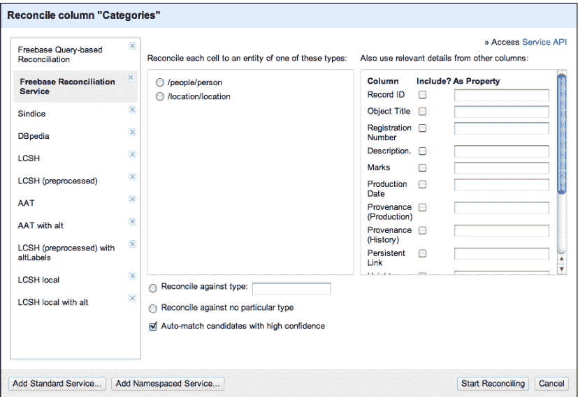

> 你 OpenRefine 安装中的服务可能与屏幕截图中看到的不同。那是因为你可以自己添加协调服务，正如我们将在下一个配方之一中向你展示的那样。

现在你可以设置三个选项。首先，你必须决定要针对什么类型的记录进行协调。这可以限制搜索到特定主题，如果你的列只包含城市或人名，这很有用。这样，协调可以更快进行，并且找到假阳性的可能性更低。在你选择服务后的处理步骤中，OpenRefine 已联系服务并使用部分数据来尝试猜测你的列数据类型。不幸的是对我们而言，它提供的两个选项与 **Categories** 字段不相关：persons 和 locations。幸运的是，我们也有 **Reconcile against type** 选项来自行选择类型。然而，由于我们不确定我们的数据集中的类别是否实际上属于单一特定类型，我们只需选择 **Reconcile against no particular type.**

我们可选的第二个选项是 **自动匹配高置信度的候选项**。对账服务还会返回一个匹配分数，用来表示其对匹配结果的信心程度。自动匹配选项默认是开启的，这意味着如果分数足够高，OpenRefine 就会假定它做出了正确的选择并将其声明为匹配。对于其他单元格值（或如果你取消了复选框），你将需要手动确认匹配。我们建议保留此选项的勾选，因为它可以为你节省相当多的工作。

第三个也是最后一个选项允许你向对账服务发送额外数据。匹配不再基于单一列值，而是可以考虑不同的列。为此，你需要指明属性名称。对于 Powerhouse Museum 数据集，并不存在此类其他相关列。但如果你有一个包含国家名称和国家代码的数据集，将两者都发送给对账服务可能会有所帮助。

在勾选了 **不对特定类型进行对账** 后，点击 **开始对账**。对账过程可能需要一些时间，因为 OpenRefine 现在会要求对账服务为每个唯一的单元格值查找一个 URL。窗口顶部的黄色信息栏会告诉你已完成多少。

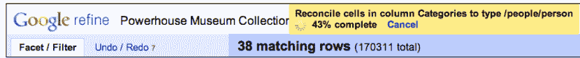

这可能是你去喝杯咖啡或在电脑上做另一项任务，让对账在后台运行的好时机。当过程完成后，你会注意到 OpenRefine 已自动为你创建了 **判断** 和 **最佳候选分数** 两个分面。

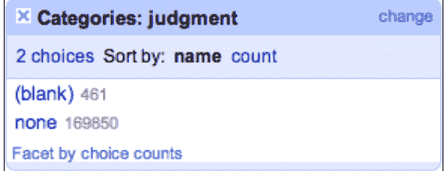

**判断** 分面允许你将数据集划分为已完成对账的行和未完成的行，以及 **Categories** 单元格为空值因此不是对账候选的行。你在这里看到的内容可能会让你感到惊讶，分面中只有 **(blank)** 和 **none** 两个过滤器。已对账的行在哪里？

事实证明，不幸的是，使用 Freebase 进行对账并未成功，没有找到任何匹配项。这是否意味着我们做错了什么？不，我们没有做错，只是我们数据库中的术语似乎并不是 Freebase 所涵盖的那种主题。这是否意味着 Freebase 不是对账的好选择？完全不是，只是碰巧我们的数据集不太合适。你在其他数据集上可能会有更好的运气，所以一定要试试。

让我们通过使用 Remove All 按钮删除分面并在 Undo / Redo 菜单中后退一步来撤销这次不成功的对账。（你可以通过转到 Categories 下拉菜单 | Reconcile | Facets 来恢复它们。）接下来的食谱将向你展示如何尝试其他对账服务。

> 有时你只是想尝试使用某个服务进行对账，看看它是如何工作的。这是否意味着每次都要经历整个对账过程？如果巧妙地使用分面，就不必如此！我们倾向于先在数据集的一小部分上尝试对账，然后再决定是否要在所有行上运行它。为了做出或多或少的随机选择，我们可以在 Record ID 列上添加一个文本过滤器并输入一个数字，例如 4。假设所有 ID 中的数字分布相等，这将选择大约 10% 的行。如果这仍然太多，只需不断添加数字，直到行数减少到几百行。例如，413 对我们来说就奏效了。

## 配方 2 – 安装扩展

虽然 OpenRefine 可以开箱即用地添加新的对账服务，但这些只是底层以某种方式工作的服务。然而，还有其他类型的服务，如果你想使用它们，你需要在 OpenRefine 中添加一些功能形式的扩展。因此，在向你展示如何添加这些服务之前，我们首先必须解释如何安装 OpenRefine 扩展。并非所有扩展都提供对账服务，因此本食谱描述的是通用安装程序。截至撰写时，有多个 OpenRefine 扩展可用，包括以下几点：

- 由 Digital Enterprise Research Institute (DERI) 提供的 RDF 扩展，它增加了对 RDF 导出和与 SPARQL 端点对账的支持。我们将在下一个食谱中解释这两个术语。
- 由本书作者之一编写的 Named-Entity Recognition (NER) 扩展，它允许你从全文字段中提取 URL。本章最后一个食谱将详细介绍该扩展的使用。

与 OpenRefine 一样，所有扩展都是免费提供的。可用扩展的最新列表维护在 https://github.com/OpenRefine/OpenRefine/wiki/Extensions，也包括它们的下载位置。由于扩展种类繁多，安装它们看起来可能很棘手。然而，本食谱将向你展示安装任何扩展的技术。

首先，你需要找到扩展需要安装的路径。这取决于你的操作系统，但 OpenRefine 可以帮助你找到它。在起始页底部，有一个名为 Browse workspace directory 的链接。

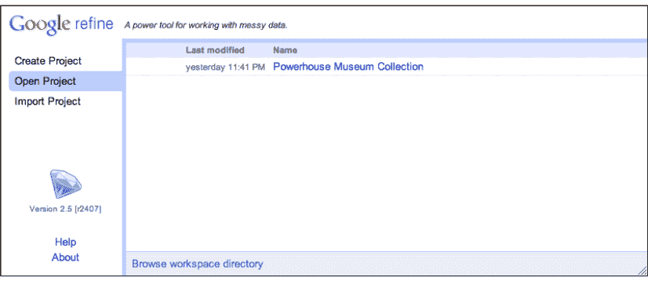

如果你点击此链接，你将进入 OpenRefine 应用程序文件夹（至少在 Windows 和 Mac 上；Linux 请继续阅读）。在此文件夹中，你需要创建一个名为 extensions 的新文件夹（如果它还不存在）。这将是你需要添加扩展的路径。对于不同的操作系统，它应该如下所示：

- Windows: C:\Documents and Settings\(your username)\Application Data\OpenRefine\extensions 或可能在 Local Settings 文件夹中 C:\Documents and Settings\(your username)\Local Settings\Application Data\OpenRefine\extensions
- Mac OS X: /Users/(your username)/Library/Application Support/OpenRefine/extensions 或从你的主文件夹开始，在 /Users/(your username)/Library/Application Support/OpenRefine/extensions
- Linux: /home/refine/webapp/extensions

下一步是下载一个扩展并将其放置在该文件夹中。例如，让我们安装 RDF 扩展。从 http://refine.deri.ie/ 下载扩展；这将为你在下载文件夹中获取一个 ZIP 文件。以你习惯的方式解压此 ZIP 归档的内容。根据你使用的软件，可能会生成额外的文件夹，但我们感兴趣的文件夹名为 rdf-extension。

将此文件夹移动到我们之前找到的 OpenRefine 的 extensions 文件夹中。在 extensions 文件夹中，你现在应该看到一个名为 rdf-extension 的文件夹，其中包含其他文件夹，例如 images、MOD-INF、scripts 和 styles。

现在重新启动 OpenRefine 以使扩展生效。仅仅关闭浏览器窗口是不够的；你必须真正关闭 OpenRefine 应用程序本身，通过在屏幕底部右键或 control-点击其图标并选择 Close。然后，像往常一样重新启动 OpenRefine 并打开一个项目。当项目加载后，右上角出现一个新的 RDF 按钮，这表明安装成功：

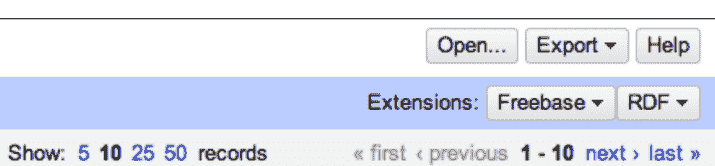

如果你看不到该按钮，请确保正确的扩展文件夹已放置在正确的位置，并且 OpenRefine 已正确重新启动。

你也可以对其他扩展重复本食谱中的步骤。在接下来的食谱中，我们将使用 RDF 扩展，因此请确保安装它。在后面的食谱中，我们也将需要 NER 扩展，所以趁此机会也安装它吧。

## 配方 3 – 添加对账服务

本食谱需要你已安装 RDF 扩展。如果没有，请查看上一食谱。如果你已安装，你可能会想知道 RDF 和 SPARQL 这些术语的含义，因为它们在整个扩展中都被使用。这马上就会变得清晰。

**资源描述框架（RDF）**是一种可被机器解释的数据模型。虽然人类可以在网络上阅读 HTML，但机器无法理解自然语言，因此必须以另一种形式提供信息。消歧是一个重要方面；华盛顿指的是城市还是人物？是哪个人？为了表达这一点，RDF 中的信息通过 URI 或 URL 来引用，就像我们在 OpenRefine 中进行 reconciliation 时所做的那样。这就是 RDF 在 reconciliation 中派上用场的原因。

**SPARQL**（**SPARQL 协议和 RDF 查询语言**的递归缩写）是一种用于查询 RDF 数据源的语言。传统的 relational 数据库使用 SQL 作为查询语言；RDF 数据库以及对我们而言重要的 reconciliation 服务使用 SPARQL 进行通信。

如果你想将你的数据与 RDF 数据源进行 reconciliation，那么你必须告诉 OpenRefine 它如何与该数据源通信。当你安装了 RDF 扩展时，你已经为 OpenRefine 添加了 SPARQL 支持。然而，在我们能够将单元格值 reconciliation 到 URL 之前，我们必须配置数据源。为此，点击右上角的新 RDF 按钮并导航到 **Add reconciliation service | Based on SPARQL endpoint...**。请注意，你也可以使用本地 RDF 文件进行 reconciliation，如果你有自己的 URL 数据集，这很方便。OpenRefine 会显示 **Add SPARQL-based reconciliation service** 对话框。

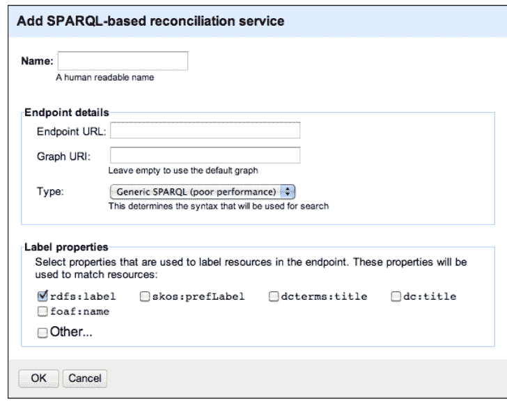

此对话框允许你为 SPARQL 端点选择一个名称，添加端点的详细信息（它位于何处以及如何工作），以及用于将单元格值匹配到 URL 的信息类型。你可以使用自己的 SPARQL 端点或在 `http://www.w3.org/wiki/SparqlEndpoints` 上列出的任何公共可用端点。

对于本示例，我们将使用我们设置的一个端点。它包含公开可用的 **美国国会图书馆主题词表（LCSH）** 数据集的处理版本。要使用此端点，请按如下方式填写详细信息：

- **Name:** LCSH
- **Endpoint URL:** `http://sparql.freeyourmetadata.org/`
- **Graph URI:** `http://sparql.freeyourmetadata.org/authorities-processed/`
- **Type:** Virtuoso
- **Label properties:** 仅勾选 **skos:prefLabel**

**Endpoint URL** 是端点所在的地址，而 **Graph URI** 标识在此端点中应使用的数据集。端点的 **Type** 用于指示底层端点软件；指定此项不是强制性的，但知道正确的类型可以启用低级技巧，从而大大提高 reconciliation 速度。最后，**Label properties** 指示可用于查找单元格值的字段名称。在 RDF 中，这些属性通常具有通用名称（实际上它们本身大多是 URL）。设置好这些属性后，点击 **OK** 按钮。

由于现在没有任何反应，你可能会好奇如何检查新 reconciliation 是否已正确添加。你可以通过转到 **Categories** 下拉菜单并导航到 **Reconcile | Start reconciling...** 来验证这一点。在左侧，你会看到新添加的服务。现在如果迫不及待想使用它，请继续阅读下一条 recipe！

## 配方 4 – 与链接数据协调

在上一条 recipe 中，我们谈到了 RDF 和 SPARQL，但没有勾勒出这些技术诞生的更广泛背景，所以现在让我们介绍一下。2000 年左右，网络研究人员和工程师注意到人类不再是网络的唯一消费者；越来越多的机器客户端，也就是软件，开始为各种目的使用网络。然而，每一个这样的软件都必须为特定任务硬编码，并且无法解析人类网络上文档中的自然语言。因此，提出了一个名为 **Semantic Web** 的愿景，即一个信息也能被机器解释的网络。这是 RDF 和 SPARQL 的开端。

### Linking Datasets

然而，该愿景对许多人来说相当抽象且难以理解。其中几个概念依赖于本体和推理等概念，这些概念会迅速变得非常复杂。*Tim Berners-Lee*，网络的发明者，也是 Semantic Web 愿景的创建者之一，意识到了这一点，并推出了 Linked Data 原则（http://www.w3.org/DesignIssues/LinkedData.html）。这些原则将 Semantic Web 的重点转移到创建与其他数据集互联的数据上。原则如下：

- 1. 使用 URI 作为事物的名称
- 2. 使用 HTTP URI，以便人们可以查找这些名称
- 3. 当有人查找一个 URI 时，使用标准（RDF、SPARQL）提供有用的信息
- 4. 包含指向其他 URI 的链接，以便他们可以发现更多事物

因此，第一条原则要求为你的概念使用无歧义的标识符，第二条原则特别要求使用 HTTP URI，即 URL。这些原则已在我们将用于 reconciliation 的数据集中使用。第三条原则关注你的数据如何发布。事实上，RDF 扩展允许我们将数据集导出为 RDF，所以这也涵盖了。第四条原则是关于链接到其他数据集，这正是 reconciliation 将为我们做的事情。

言归正传，让我们开始 reconciliation。像 *Recipe 1 – reconciling values with Freebase* 一样，转到 **Categories** 下拉菜单并导航到 **Reconcile | Start reconciling...**，这将在你的屏幕上打开 reconciliation 对话框。这次，选择左侧你已在上一条 recipe 中安装的 **LCSH reconciliation service**。OpenRefine 现在将尝试一些单元格值，以查看是否能确定其类型。几秒钟后，它建议值类型为 skos:Concept。这确实是正确的，因为所有 **Category** 值实际上都是概念。你可以保留所有设置不变并点击 **Start Reconciling**。

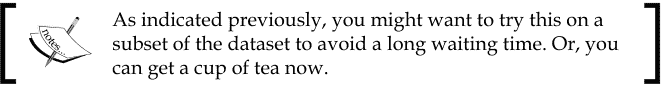

当 reconciliation 完成后，你会注意到三件事。首先，OpenRefine 创建了两个 facets，帮助我们找到匹配和未匹配的行。其次，你会在 **Category** 列顶部看到一个绿色条，指示有多少单元格值已被 reconciliation。第三，单元格值显示方式不同；有些是蓝色的，其他则有新选项。

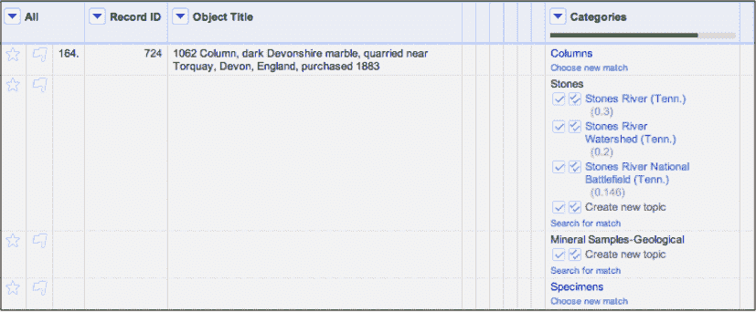

让我们先关注显示为蓝色的已 reconciliation 值。你看到的越多，reconciliation 就越成功（因此列顶部的条会越绿）。它们是蓝色的，因为它们实际上是链接；如果你点击它们，就会进入该术语已被 reconciliation 到的 URL 页面。例如，如果我们点击 **Specimens** 链接，我们将被导向 `http://id.loc.gov/authorities/subjects/sh87006764.html`，这确实是美国国会图书馆主题词表中 Specimens 的条目。这就是我们创建 Linked Data 的方式；而不是仅仅字符串 Specimens，对计算机来说看起来像九个随机字符，OpenRefine 将该值与一个 URL 进行了 reconciliation。该 URL 可被机器解释，因为该 URL 又链接到其他 URL，有助于定义其含义。

当你看到黑色未 reconciliation 的值时，对于该特定术语你运气不佳。它们不是链接，因此 OpenRefine 无法自动找到匹配的 URL。未 reconciliation 的值有两种情况；首先是找到了一些建议，但 OpenRefine 无法找到正确的一个。在这种情况下，它会为你列出几个替代方案。如果其中任何一个替代方案是正确的，你可以点击单个复选标记，这将仅用所选术语替换当前单元格值，或点击双重复选标记，这将替换所有具有相同值 的单元格。请注意替换所有相同值时要小心，因为其中一些可能实际上指的是另一个术语。请注意，你也可以点击建议，这会带你到其对应的网页以获取更多信息。

未 reconciliation 值的另一种情况是 OpenRefine 没有找到任何建议。在这种情况下，你就没什么运气了。也许所讨论的术语在你进行 reconciliation 的数据集中不存在，或者名称不同。无论如何，你唯一能做的就是手动分配一个 URL。为此，点击 **search for match** 链接，这将显示一个对话框，帮助你找到正确的匹配项。

## 链接数据集

最后一种选项是通过点击**创建新主题**链接，或从**搜索匹配**对话框中选择**新主题**按钮，为单元格值创建一个新主题。这不会在LCSH数据集中创建新的URL（因为您没有这样做的权限），但会将单元格值标记为**新**。这将使您能够在**判断**分面中选择所有这些单元格，以便您能够对它们进行其他操作。例如，您可以将所有新值与另一个数据集进行调和，看看是否能在那里找到匹配项。

您可能会想知道如何获取调和带来的URL。但同时，我们仍然想保留原始类别名称。因此，正确的方法是基于**类别**列创建一个新列，就像我们之前做的那样。点击**类别**下拉菜单，导航到**编辑列 | 基于此列添加列...**。我们将此列命名为`Category URLs`。将已调和的单元格转换为其URL的表达式是`cell.recon.match.id`。这行GREL选择单元格，获取其调和信息，取出接受的调和匹配，并提取ID（在这种情况下是URL）。没有匹配的单元格将导致错误，因此请确保针对错误选择了**设为空白**选项。点击确定后，您将看到带有相应URL的新列。

当您完成调和过程并提取了所需的URL后，您可能希望让**类别**列恢复其原来的外观。毕竟，调和数据仍然存在，而且可能会分散注意力。要清除它，再次进入**类别**下拉菜单，导航到**调和 | 操作 | 清除调和数据**。此时类别列再次成为普通列。此外，您可以通过点击左侧边栏顶部的**全部移除**来移除分面。

## 方法5 – 提取命名实体

调和对于数据集中包含单个词条的字段效果很好，例如人名、国家或艺术作品。然而，如果您的列包含连续文本，则调和无法帮助您，因为它只能在其使用的数据集中搜索单个词条。幸运的是，另一种称为`named-entity extraction`的技术可以帮助我们。提取算法在文本中搜索命名实体，这些实体是文本元素，例如人名、地点、数值、组织和其他广泛知名的事物。除了仅仅提取词条外，大多数算法还会尝试进行消歧。例如，如果算法在文本中找到华盛顿，它会尝试确定提到的是城市还是人物。这使我们不必对提取的词条执行调和。

OpenRefine本身不支持命名实体识别，但命名实体识别扩展为您添加了此功能。在继续本方法之前，请从`http://software.freeyourmetadata.org/ner-extension/`下载扩展，并按照*安装扩展*的方法操作。如果安装成功，在重新启动OpenRefine后，屏幕右上角会出现**命名实体识别**按钮。

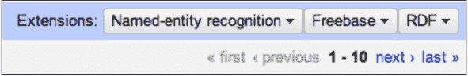

> 对于本方法，您可能希望从类别未被拆分为多行的数据集开始，因为如果单个记录中找到多个词条，命名实体识别将创建新行。如果每个记录已经有多个行，这可能会变得混乱。

查看Powerhouse Museum数据集，我们看到**描述**列是命名实体提取的良好候选，因为它包含连续文本。如果我们想将此字段链接到其他数据集，我们必须首先提取实体。为此，点击**描述**下拉菜单，并在底部选择**提取命名实体…**。屏幕上将出现**提取命名实体**对话框。

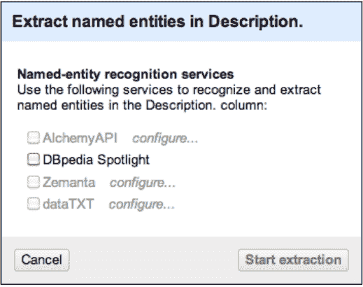

该扩展本身不包含任何命名实体识别算法，而是使用现有服务，就像调和功能也依赖外部调和服务一样。这使您可以选择自己喜欢的服务。然而，与开放的调和服务相比，一些命名实体识别服务要求您创建账户。虽然所有受支持的服务都有免费选项，但其中一些还提供高级账户，为您带来额外好处，例如更快或无限制的提取。

DBpedia Spotlight服务不需要账户，因此已经可用。因此，在对话框中勾选其复选框，并选择开始提取。OpenRefine现在将开始提取过程，这可能需要一些时间。因此，正如我们之前解释的那样，先在子集上尝试提取可能会很有趣。高级服务可能提供更快的提取。但是，如果您勾选多个复选框以同时使用多个服务进行提取，则提取速度只与最慢的服务一样快。

当命名实体识别完成后，您会看到OpenRefine在描述列旁边创建了一个名为DBpedia Spotlight的新列。

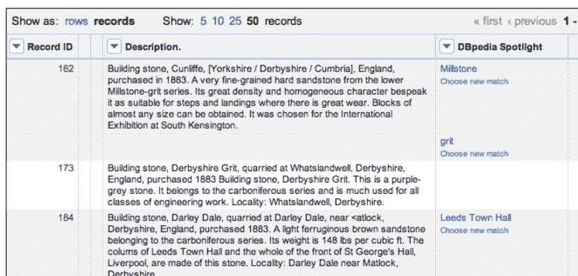

在这个新列中，您可以看到提取的词条。如果找到多个词条，它们会跨多行拆分，因此您可以在OpenRefine的行和记录模式之间切换。截图显示DBpedia Spotlight在记录162中找到两个词条，在记录173中没有找到词条，在记录184中找到一个词条。如您所见，词条以蓝色显示，表明它们实际上是链接。例如，如果您点击Leeds Town Hall，您会到达一个关于这座建筑的页面，其中包含指向相关资源的链接。这是Linked Data的最佳体现；过去只能由人类阅读的文本字段，现在包含了机器可解释的指向其所含概念的链接。

但是，您可能会失望地发现并非所有单元格值都有相关的词条。那么，让我们看看其他服务是否做得更好。为此，我们必须为每一项服务添加账户信息。要执行此操作，点击右上角的命名实体识别按钮，并选择配置API密钥...。以下对话框显示支持的服务及其所需的配置参数：

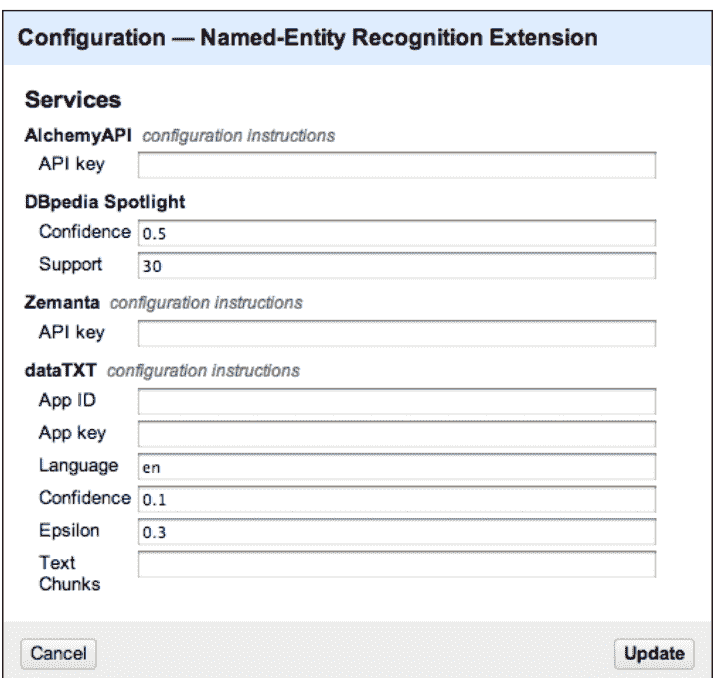

例如，如果您想使用Zemanta执行命名实体识别，请将您的应用程序编程接口（API）密钥添加到相应字段。如果您还没有API密钥，请点击配置说明链接。这将带您进入一个页面，其中列出了通过Zemanta获取API密钥的步骤。所有服务都有免费选项，因此您只需注册一个账户，就可以在您的数据上试用该服务。除此之外，某些服务还可以配置额外的参数，这些参数决定服务的功能。配置说明在这里非常有帮助。

当您配置了额外的服务，并再次在**描述**列上尝试命名实体提取时，您现在将能够同时选择多个服务。每个单独服务的结果将被添加到一个新列，因此您可能会有额外的**Zemanta**和**AlchemyAPI**列，每列都包含提取的词条。根据数据集的不同，您可能会在某个服务上取得更大的成功，因此一定要进行实验！

## 总结

在本章中，我们看到了如何将您的数据集从一座孤岛转变为互联的数据集合。一方面，您可以对包含简单字段值的列执行调和。因此，单元格中的文本通过添加一个可以在线查找的URL而获得意义。您可以使用内置的Freebase调和，或安装RDF扩展，该扩展允许针对Linked Data源进行调和。另一方面，您可以再次使用扩展对包含流动文本的单元格执行命名实体识别。这使OpenRefine能够在单元格值中搜索概念，并尝试为每个概念找到URL。最终，您的数据集将丰富地链接到其他数据集，当您在网上发布数据集时，这是一项宝贵的资产。

