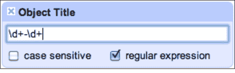

# 正则表达式
与 GREL

在高级 OpenRefine 用户的工具箱中，还有两个实用工具：正则表达式和 GREL。**正则表达式**是用于匹配和替换文本的模式，在处理大量数据时非常有用。**通用精炼表达式语言（GREL）** 让你在需要特定操作时获得一些编程能力。本附录将向你介绍这两种技术。

## 用于文本模式的正则表达式

OpenRefine 提供了多种方法来查找你需要的数据。但如果你不知道确切的文本，或者更常见的是，在处理大数据集时，文本在每个单元格之间略有差异，那该怎么办？虽然查找所有值包含字母 a 的单元格很容易，但查找包含数字（或者更复杂一点，字母 a 后跟数字）的值就更难了。这时正则表达式就派上用场了。

正则表达式的目的是定义一种文本模式，而不是一段精确的文本。它可以让你表达诸如“字母后跟数字”以及许多更复杂的内容。正则表达式由**字符类**构建而成，这些字符类代表你要查找的字符，并通过**量词、锚点、选择**和**分组**组合在一起。

OpenRefine 提供了一种简单的方式来试用正则表达式。在任何列上创建文本筛选（Powerhouse Museum 数据集中的**对象标题**列尤其有趣）：点击其下拉菜单并选择**文本筛选**。在新创建的筛选中，勾选**正则表达式**复选框，然后就可以开始了（请参考下面的截图）。数据将根据你输入的表达式进行筛选：



## 字符类

正则表达式使用**字符类**（字母、数字、空白符）来表示你正在查找的字符。例如，如果你要查找字母或数字，可以直接输入它们：

- 模式 `Aar` 将查找所有包含大写 A 后跟小写 a 和 r 的文本。如果未勾选**区分大小写**复选框，则大小写无关紧要。
- 模式 `123` 查找所有包含此数字的文本。请注意，包含数字 41235 的文本也会被匹配，因为 `123` 是其中的文本部分。
- 如你所见，这与普通文本匹配还没有区别。使用正则表达式，我们还可以表示我们可以期望任意字母或任意数字。我们可以给出一个**字符集**，通过将备选字符用方括号 `[]` 括起来从中选择。我们可以在这些括号中通过用连字符分隔边界来指示**字符范围**。
- 模式 `[0123456789]` 匹配所有包含数字的文本。
- 模式 `[0-9]` 功能相同，只是更简洁。它表示 0 到 9 之间的任何字符都可以。
- 类似地，模式 `[a-z]` 匹配所有小写字母（如果不使用区分大小写选项，也匹配大写字母）。`[A-Z]` 匹配大写字母，`[a-zA-Z]` 匹配所有字母，与区分大小写选项无关。
- 如果你想查找数字和字母，请使用 `[0-9a-zA-Z]`。可以读作“0 到 9、a 到 z 或 A 到 Z 之间的任何字符”。
- 与前面的示例一样，我们可以将多个匹配器放在一起。`analy[sz]e` 将同时匹配美式拼写（analyze）和英式拼写（analyse）。

- 类似地，表达式 `[0-9][a-z]` 将查找数字后紧跟至少一个字母的内容。表达式 `[a-z][0-9][0-9][0-9]` 查找字母后紧跟至少三个数字的内容。
- 如果你想查找像 `1 cm` 或 `25 in` 这样的测量值，使用前面的表达式将找不到它们，因为它们之间有空格。幸运的是，空格也是一个符号，因此表达式 `[0-9] [a-z]` 可以找到它们。请注意括号对之间的空格，并注意它甚至可以找到像 `12345 meters` 这样的更长的测量值。确实，表达式匹配一个数字后跟一个空格和一个字母，因此在这种情况下，匹配的是 `5 m`。是否还有其他数字或字母并不重要。
- 如果你只是查找以英寸为单位的测量值，表达式 `[0-9] in` 就足够了。
- 每次都完整写出 `[0-9]` 可能有点繁琐。这就是引入**简写字符类**的原因。它们是代表一组字符的符号。例如，符号 `\d` 代表任意数字，因此等同于 `[0-9]`，但写起来要快得多。相反的是 `\D`，它表示任何不是数字的字符，包括字母和符号。不幸的是，没有代表任意字母的简写，但有一个代表任意字母、数字或下划线的简写，即 `\w`，它代表任意单词字符。同样，`\W` 是相反的，它匹配那些既不是字母、数字，也不是下划线的所有字符。
- `\d [a-z]` 将再次匹配包含测量值的文本：任意数字后跟一个空格和一个字母。
- `\d\d\d` 匹配至少包含三位数字的文本。
- `\D\D` 匹配包含至少两个连续非数字字符的文本。如果你惊讶地看到也匹配包含数字的文本，请想一想：表达式只说明文本应包含一个非数字后跟一个非数字；它并没有说完全不包含数字。但是，如果文本字段只包含数字，则不会匹配。换句话说，表达式的意思是“我在找一行中的两个非数字，你有吗？”
- 你可能想知道 `\D` 是如何工作的。它是否会转换为一个包含除数字外所有内容的巨大集合？答案更简单：在方括号中，将脱字符 `^` 用作第一个字符，意味着模式中不应出现这些字符中的任何一个。因此，`\D` 代表 `[^0-9]`。
- 表达式 `[^a-zA-Z0-9]` 查找包含不是字母或数字的字符的文本。大多数文本都会匹配，例如空格和标点符号仍然是允许的。但是，空字段不会匹配，因为必须至少有一个不是字母或数字的字符。

- 表达式 `[^a-zA-Z0-9]\d[^a-zA-Z0-9]` 表示任何被非字母或非数字包围的数字。例如，我们看到括号中的单个数字会被匹配。请注意，像 `(123)` 这样的项不会匹配，但 `(3)` 会，因为我们明确表示它应该是一个单独的数字。

如果你真的想匹配任意字符，那么点号 `.` 就是你需要的。这个符号匹配任何内容（除了换行符 `\n`）。虽然这本身可能看起来没什么用，但与其他字符类结合使用时非常有用：

- 模式 `a.a.a` 匹配这样的文本：一个 a 后跟任意字符、另一个 a、任意字符、再另一个 a。例如，包含单词 `dulcamara`、`alabaster` 和 `salamander` 的文本都会匹配。
- 模式 `19..`（前后各有一个空格）将匹配 20 世纪的年份。
- 但是，你应该小心点号：最后一个模式也会匹配 `19th` 和 `19$`，因为点号确实表示任意字符。如果你想要的是年份，`19\d\d` 更准确。

现在，你可能想知道，如果要匹配实际的点号、实际的方括号，或实际的反斜杠后跟“d”，该怎么办。诀窍是在正则表达式中告诉它，什么时候你不希望某个符号被识别为特殊符号。对于字母、数字、空格和其他一些字符，这是默认行为。具有特殊含义的字符需要在其前面加上反斜杠 `\` 进行转义。因此，字面意义的点号表示为 `\.`；反斜杠本身表示为 `\\`。

- 要查找包含三个连续点号的文本，请使用 `\. \. \.`。（实际上这可以用更方便的方式完成，我们将在下一节中看到。）
- 要查找包含反斜杠的文本，请使用 `\\`。（数据集中没有。）
- 包含左方括号或右方括号的文本可以用 `[\[\]]` 找到。这看起来复杂，但相当符合逻辑：第一个和最后一个方括号表示“选择其中的任何内容”。而其中的内容是实际的方括号，但必须转义，因此它们变成 `\[` 和 `\]`。
- 使用 `[2]`，你可以找到包含数字 2 的文本（“选择其中的任何内容”，而其中唯一的内容是 2）。使用 `\[2\]`，你可以找到数字 2 被方括号括起来的文本，因为这次方括号被转义了，因此不再具有特殊含义。


## 量词

到目前为止，我们已经在正则表达式中看到了表示要匹配特定字符的方法。然而，我们还无法表达想要看到某个字符出现一定次数，而这个次数事先未知的需求。例如，我们如何表达“单引号内的一个数字”？我们可以从 `'\d'` 开始，但那样只会匹配包含 0、1、5 等单个数字的文本，而不会匹配像 23 或 478 这样的多位数。事实上，计算机会严格遵循表达式：一个单引号、一个数字、一个单引号。

**量词**可以表达重复。有三个简单的量词：加号 +，表示一次或多次；星号 *，表示零次或多次；问号 ?，表示零次或一次。它们只对紧邻其左侧的符号起作用：

- `bre+d` 匹配包含 bred、breed 或 breeed 的文本，这些文本中 e 的数量可以是任意个，但至少得有一个 e。
- `bre*d` 匹配包含 brd、bred、breed 或 breeed 的文本，e 的数量可以是任意个，甚至可以没有。注意，星号可以匹配 brd，但加号不行。
- `bre?d` 匹配 brd 和 bred，但不匹配 breed 或其他任意数量的 e。简单来说，它使 e 变为可选项。
- 组合也是可以的。`br?e+d` 匹配 bed、bred、beed、breed、beeed、breeed 等等。
- 此外，你可以使用花括号 {min,max} 来明确指定某个符号出现的次数。你可以设定它出现的最小和最大次数。两者都可以为空，表示没有最小或最大限制。请保留逗号，这样 OpenRefine 才能知道你指定的是最小值还是最大值。如果你只提供一个不带逗号的数字，则会匹配该确切次数。
- `N\d{5,8}` 匹配包含以 N 开头、后跟五、六、七或八位数字，再跟一个逗号的代码的文本。
- `N\d{5,}` 匹配包含以 N 开头、至少五位数字，再跟一个逗号的代码的文本。
- `N\d{,8}` 匹配包含以 N 开头、最多八位数字，再跟一个逗号的代码的文本。
- `N\d{5}` 匹配包含以 N 开头、恰好五位数字，再跟一个逗号的代码的文本。这等同于 `N\d\d\d\d\d`，但更简洁（尤其是数字变大时）。

毋庸置疑，量词和花括号是特殊符号，因此如果你想按字面意思匹配它们，就应该使用反斜杠对它们进行转义。例如，问号可以用 `\?` 来匹配。

## 锚点

有时候，你不仅想指定要匹配多少个字符，还想指定匹配发生的位置。锚点可以实现这一点。脱字符 ^ 表示匹配应发生在行的开头，而美元符号 $ 表示匹配应在行的末尾结束。（不要将其与方括号内表示否定的脱字符混淆；它在方括号外出现时含义不同。）此外，我们还可以使用锚点 `\b` 来指示匹配应在单词边界开始或结束：

- `^\d` 匹配所有以数字开头的文本。
- `\d$` 匹配所有以数字结尾的文本。
- `^\d.*\d$` 匹配所有以数字开头和结尾的文本。可以将这个表达式理解为：文本开头、一个数字、任意字符出现零次或多次（即点号）、一个数字、文本结尾。如果我们改用 `^\d+$`，那么匹配的就是只包含一个数字（任意长度）的所有文本。
- `\b\d{3}\b` 搜索包含至少一个恰好为三位数字的数字的文本，因为 `\b` 锚点匹配单词边界。如果文本包含四位数字但不包含三位数字，则不匹配。（如果我们移除 `\b` 锚点，它就会匹配。）
- `^\d{3}\b` 查找以三位数字开头的文本。

## 选择

我们已经看到了一种表示选择的机制。方括号让正则表达式可以从众多字符中选择一个：`[a-z123]` 搜索包含至少一个小写字母或 1、2、3 中任意一个数字的文本。通常情况下，选择范围更大，可能是多个字母或单词。为此，引入了或运算符 `|`。它作为多个候选项之间的 OR 运算符：

- `glass|wood|steel` 将匹配包含 glass、wood 或 steel 的文本。
- `\d+|many|few` 匹配一个数字、many 或 few。
- `N\d{5}, |N\d{8},` 匹配以 N 开头并以逗号结束的五位或八位数字，但不匹配中间长度的数字（例如六位数字）。

## 分组

到目前为止，我们唯一还没涉及的是**分组**。如果你想对一组字符而不是单个字符使用量词，就必须用圆括号 `()` 将它们括起来：

- `1a+` 匹配包含 `1a`、`1aa`、`1aaa` 等内容的文本，而 `(1a)+` 则匹配包含 `1a`、`1a1a`、`1a1a1a` 等内容的文本。
- 表达式 `analyz|se` 会匹配包含 `analyz` 的文本和包含 `se` 的文本。这可能不太有用。另一方面，表达式 `analy(z|s)e` 同时匹配 `analyze` 和 `analyse`。请注意，在这种情况下，它等同于 `analy[zs]e`，因为选项是单个字母。但对于 `analyz(e|ing)` 就不是这样了，它会匹配 `analyze` 和 `analyzing`。
- 由于圆括号具有特殊含义，因此也需要转义。`\(` 和 `\)` 按字面意思匹配圆括号。

## 概览

下表列出了正则表达式中的特殊符号概览：

| 符号 | 含义 |
|---|---|
| `ABC... abc...` | 按字面意思匹配相应的字母 |
| `123...` | 按字面意思匹配相应的数字 |
| `[xyz]` | 匹配方括号内的一个字符 |
| `[^xyz]` | 匹配不在方括号内的任意字符 |
| `[0-9]` | 匹配指定范围内的一个字符 |
| `\d` | 匹配一个数字 |
| `\D` | 匹配一个非数字 |
| `\w` | 匹配一个字母、数字或下划线 |
| `\W` | 匹配不是字母、数字或下划线的任意内容 |
| `.` | 匹配除换行符之外的任意字符 |
| `\n` | 匹配一个换行符 |
| `\.` | 匹配实际的点号（反斜杠对下一个字符进行转义） |
| `?` | 匹配前面的元素零次或一次 |
| `*` | 匹配前面的元素零次或多次 |
| `+` | 匹配前面的元素一次或多次 |
| `{3}` | 匹配前面的元素三次 |
| `{3,6}` | 匹配前面的元素三到六次 |
| `{3,}` | 匹配前面的元素至少三次 |
| `{,6}` | 匹配前面的元素最多六次 |
| `^` | 匹配文本开头 |
| `$` | 匹配文本结尾 |
| `\b` | 匹配单词边界 |
| `cat\|dog\|cow` | 匹配其中一个候选项 |

# 通用 Refine 表达式语言（GREL）

正则表达式的真正威力在于，我们不仅可以用它查找数据，还可以用它操作数据。GREL 可以实现这一点以及许多其他功能。它是一种为轻松操作值而设计的简单语言。它由一组内置函数以及通过 OpenRefine 可用的几个变量组成。我们在几个示例中已经简要提到过它，接下来我们将向你展示如何构建自己的 GREL 表达式。

## 转换数据

GREL 特别有用的一个场景是当你需要转换单元格中的值时。你可以就地修改单元格（转到相应列的下拉菜单，然后选择“编辑单元格 | 转换...”），或者使用转换后的值创建新列（转到相应列的下拉菜单，然后选择“编辑列 | 基于此列添加列...”）。我们将在 Object Title 列上尝试一些示例。

当你打开任意一个转换对话框时，会看到一个最初的 GREL 表达式。它简单地称为 `value`，返回单元格的原始值。这确实没什么用，但我们可以从它开始学习一些技巧。例如，GREL 表达式 `"TITLE: " + value + "."` 会在值前面加上文本 TITLE:，并在末尾附加一个点号。请注意，字面文本必须用单引号或双引号括起来，以免 OpenRefine 将其与命令混淆。你可以在构建表达式时看到预览随之更新。


更有用的操作是更改文本。例如，我们可以使用 `value.replace("stone", "stones")` 将每个单元格中的字符串 stone 替换为 stones。这里通过点表示法对 value 调用 replace 函数。我们告诉 OpenRefine 获取单元格的值，并将所有出现的 stone 替换为 stones。

如果将其与正则表达式结合使用，功能会更加强大。正如你所见，某些单元格的值以数字开头。我们可以通过 `value.replace(/^\d+ /, "")` 来移除这个数字。请注意，正则表达式用斜杠 `/` 括起来，而替换字符串用双引号 `""` 括起来。

我们甚至可以通过使用组来更进一步。组不仅在正则表达式中用于将多个字符视为一个单元，还会保存匹配的内容以供后续重用。因此，我们可以将开头的数字替换为更有意义的内容。例如：`234` 变成 `Object 234`。这可以通过以下表达式实现：`value.replace(/^(\d+) /, "Object $1: ")`。你可以使用美元符号后跟组号来标识一个组。第一个组称为 `$1`，特殊标识符 `$0` 用于表示整个表达式的结果。

功能仅受限于表达式的复杂程度。我们之前注意到的另一个更复杂的示例是，多值**分类**列中的单元格有时包含空值。例如，`"|Stones||Bones||Buildings"` 这样的值实际上只包含三个值，但如果按竖线拆分，则会得到七个值（包括四个空值），因为有六条分隔竖线。我们可以去掉所有这些虚假的竖线。开头的竖线必须移除，因此我们首先执行 `value.replace(/^\|/, "")`。这看起来比实际更复杂，因为竖线在正则表达式中具有特殊含义，因此必须进行转义。要将多个连续竖线变为单个竖线，我们可以执行 `value.replace(/\|+/, "|")`。请注意，竖线在正则表达式中进行了转义，但在替换字符串中没有转义，因为在那里它没有特殊含义。

OpenRefine 除了 `replace` 之外还有其他方法，正如你在表达式编辑器中有用的**帮助**选项卡或 https://github.com/OpenRefine/OpenRefine/wiki/GREL-Functions 上的概述中所见。其中一个示例是 `split` 方法。当用于**分类**字段时，我们可以像这样计算每个单元格中存在的不同值的数量：`value.split("|").length()`。在这里，我们指示 OpenRefine 在遇到竖线时拆分值，然后使用 length 函数计算结果值的数量。你甚至可以构建更复杂的表达式，例如 `value.split("|").unique().join("|")`，正如我们在*第3章，高级数据操作*中所见，它会从字段中移除重复值。

如果你想要自己的分面，则不必从任何预制的分面开始。例如，如果我们希望按分类数量进行筛选，可以通过转到**分类**下拉菜单并点击**分面 | 自定义文本分面...** 来创建自定义分面。输入表达式 `value.split("|").length()` 并点击**确定**。你会在左侧看到一个新的**分类**分面，可以让你选择分类数量。如果像这里一样，表达式的输出是数字，你可能希望改为创建数字分面。按照同样的步骤，但这次导航到**分面 | 自定义数字分面...**。这样你就可以按数字方式筛选记录。自定义分面是在不接触数据的情况下详细探索数据集的好方法。

## 使用 GREL 解决问题

最后，在某些功能表现不如预期的情况下，掌握一些 GREL 知识会派上用场。例如，我们在*第2章，分析和修复数据*中看到，重复分面在**注册号**列上运行良好，但在**记录ID**上则不然。让我们看看能否修复这个问题。通过点击**记录ID**下拉菜单并导航到**分面 | 自定义分面 | 重复**分面来创建一个重复分面。

> 请务必使用未经清理的原始数据集尝试此操作，否则重复项已被移除。

你可能还记得，OpenRefine 无法找到重复项。因此，让我们编辑表达式以更新这一点。当我们点击**更改**链接时，会看到原始表达式：

```
facetCount(value, 'value', 'Record ID') > 1
```

这里的问题在于 value 是一个数字，而 facetCount 只适用于字符串。解决方案是将 value 转换为字符串，如下所示：

```
facetCount(value.toString(), 'value', 'Record ID') > 1
```

这将正确地在分面中指示重复行。

你可能会想：我自己怎么可能发现这一点呢？秘诀在于练习和探索。你在 OpenRefine 中分析、清理和链接的数据集越多，你就会越熟练。此外，随着你逐渐掌握基础知识，你将积累越来越多的正则表达式和 GREL 经验。从那时起，离越来越复杂的内容就只有一步之遥了。本书试图为你指明方向；现在是时候走出你自己的路了。
