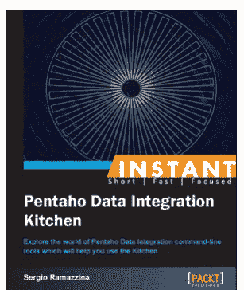
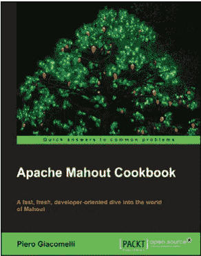
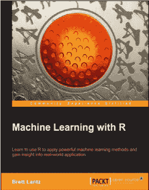

# 索引

## A

- 锚点 86

## C

- 大小写转换 40
- 单元格
  - 聚类 52-54
- 单元格值
  - 转换 55-57
- 字符类 82-84
- 选择 86
- Clojure 56
- 聚类 52
- 列
  - 折叠 12
  - 展开 12
  - 操作 12
  - 移动 13, 14
  - 移除 14
  - 重命名 14
  - 转置 61
  - 转置为行 62, 63
- 连续空白 39
- 自定义分面 30-33

## D

- 数据
  - 探索 10, 11
  - 分面 24, 25
  - 排序 22, 23
  - 跨列拆分 60, 61
- 数据清理 41, 6
- 数据剖析 41, 6
- DBpedia Spotlight 服务 78
- 派生列
  - 添加 58
- 距离函数 54
- 重复分面
  - 检测 34-36

## E

- 扩展。参见 OpenRefine 扩展

## F

- 分面操作
  - 关于 24
  - 使用星标或旗标 33, 34
- 分面
  - 关于 24
  - 自定义分面 30
  - 数字分面 28
  - 文本分面 25
  - 类型 25
- 文件格式，OpenRefine 8, 9
- Freebase Gridworks 66

## G

- 通用精炼表达式语言。参见 GREL
- GREL
  - 关于 30, 56, 81, 88
  - 创建自定义分面 90, 91
  - 转换数据 88, 89
  - 用于解决问题 91
- 组 87

## H

- **超文本标记语言（HTML）** 39
  - 代码 39

## I

- **交互式数据转换工具（IDTs）** 6

## J

- **Jython（Java 实现的 Python）** 56

## K

- **键冲突** 54
- **键控函数** 54

## L

- **美国国会图书馆主题词表（LCSH）** 73
- **关联数据** 74
  - 原则 74
  - 调和 73–76
- **Linux**
  - 安装 OpenRefine 7

## M

- **Mac**
  - 安装 OpenRefine 7
- **匹配行**
  - 移除 41–44
- **内存，OpenRefine**
  - 在 Linux 上 20
  - 在 Mac 上 20
  - 在 Windows 上 19
- **多值单元格**
  - 处理 46–48

## N

- **命名实体，Powerhouse 博物馆数据集**
  - 提取 76–80
- **命名实体识别扩展**
  - URL 77
- **命名实体识别（NER）扩展** 69
- **最近邻** 54
- **数字分面** 28–30

## O

- **OpenRefine**
  - 关于 5
  - 转换单元格值 55
  - 操作列 12
  - 转置列 61
  - 将列转置为行 62
  - 探索数据 10
  - 数据分面 24
  - 数据排序 22
  - 跨列拆分数据 60, 61
  - 添加派生列 58, 59
  - 下载 6
  - 检测重复分面 34
  - GREL 81
  - 安装 6
  - 在 Linux 上安装 7
  - 在 Mac 上安装 7
  - 在 Windows 上安装 7
  - 移除匹配行 41
  - 分配内存 19
  - 处理多值单元格 46, 47
  - 创建项目 7, 8
  - 导出项目 17
  - 使用项目历史 14
  - 正则表达式 81
  - 交替使用行和记录模式 49
  - 转置行 61
  - 对相似单元格进行聚类 52
  - 使用简单单元格转换 38
  - 支持的文件格式 8
  - 应用文本过滤器 36
- **OpenRefine 扩展**
  - 适用于 Linux 71
  - 适用于 Mac OS X 71
  - 适用于 Windows 70
  - 安装 69–71

## P

- **Powerhouse 收藏** 25
- **Powerhouse 博物馆数据集**

- 链接数据
  - 与 73-75 协调
  - 命名实体，提取 76-78
  - 协调服务，添加 71
  - 值，与 Freebase 协调 66-69
- 项目
  - 创建 7
  - 导出 17, 18
- 项目历史
  - 访问 15, 17

## Q

- 量词
  - about 85
  - 星号 * 85
  - 加号 + 85
  - 问号 ? 85

## R

- RDF 72
- RDF 扩展
  - 下载 71
  - 安装 71
- 协调服务
  - 添加 71
- 记录 49
- 记录模式
  - 与行模式交替 49-51
- 正则表达式
  - 关于 81
  - 概览 87, 88
- 用于文本模式的正则表达式
  - 关于 81
  - 锚点 86
  - 字符类 82
  - 选择 86
  - 分组 87
  - 量词 85
- 资源描述框架。参见 RDF
- 行模式
  - 与记录模式交替 49-51
- 行
  - 关于 49
  - 重新排序 24
  - 转置 61

## S

- 语义网 73
- 简写字符类 83
- 简单单元格转换
  - 使用 38-41
- SPARQL 72

## T

- 制表符分隔值 (TSV) 27
- 文本分面 25-28
- 文本过滤器
  - 应用 36, 37
- 时间线分面 29

## U

- Unicode 字符代码分面 32
- URL (统一资源定位符) 65

## W

- 空白字符
  - 去除 39
- Windows
  - 安装 OpenRefine 7

## 感谢您购买《使用 OpenRefine》

## 关于 Packt 出版社

Packt，发音为 'packed'，于 2004 年 4 月出版了首本书 "Mastering phpMyAdmin for Effective MySQL Management"，随后继续专注于出版关于特定技术和解决方案的高度聚焦的书籍。

我们的书籍和出版物分享了您同行 IT 专业人士在适应和定制当今系统、应用程序和框架方面的经验。我们的解决方案型书籍为您提供定制您正在使用的软件和技术以完成工作的知识和能力。Packt 的书籍比您过去看到的 IT 书籍更具体、更少泛泛而谈。我们的独特商业模式使我们能够为您提供更聚焦的信息，让您获得更多所需了解的内容，而非不必要的内容。

Packt 是一家现代而独特的出版公司，专注于为开发者、管理员和新手社区生产高质量的前沿书籍。有关更多信息，请访问我们的网站：www.packtpub.com。

## 关于 Packt 开源

2010 年，Packt 推出了两个新品牌 Packt Open Source 和 Packt Enterprise，以便继续专注于专业化。本书是 Packt Open Source 品牌的一部分，该品牌汇集了以开源许可构建的软件书籍，并为从高级开发者到初级网页设计师的任何人提供信息。开源品牌还运营着 Packt 的开源版税计划，通过该计划，Packt 将每本售出的书籍的版税支付给相关开源项目。

## 为 Packt 撰写

我们欢迎所有有兴趣撰稿的作者的咨询。书籍提案请发送至 author@packtpub.com。如果您的书的想法仍处于早期阶段，并且您希望在撰写正式书籍提案之前先讨论一下，请联系我们；我们的其中一位约稿编辑会与您联系。

我们不仅寻找已出版的作者；如果您拥有强大的技术技能但没有写作经验，我们经验丰富的编辑可以帮助您发展写作生涯，或为您提供专业知识的额外回报。

## [PACKT] PUBLISHING open source community experience distilled

## Instant Weka How-to [Instant]

ISBN: 978-1-78216-386-2      平装: 80 页

将 Weka 中的前沿数据挖掘功能实现到您的应用程序中

- 1. 立即学习新知识！
- 一本简短、快速、聚焦的指南，提供即时成果
- 2. 一本实用指南，包含在 Java 中编程 Weka 的示例和应用
- 3. 从基础开始，深入探索 Weka 的更高级方面
- 4. 学习如何在您的 Java 应用程序中包含 Weka 的机制

## Instant Pentaho Data Integration Kitchen [Instant]

ISBN: 978-1-84969-690-6      平装: 68 页

探索 Pentaho Data Integration 命令行工具的世界，这将帮助您使用 Kitchen

- 1. 立即学习新知识！
- 一本简短、快速、聚焦的指南，提供即时成果
- 2. 了解如何使用命令行脚本发现存储库结构
- 3. 学习如何正确配置日志以及如何收集有助于您调查任何问题的信息
- 4. 探索启动作业和学习转换的所有可能方式，无任何困难

请查看 www.PacktPub.com 获取我们书籍的信息

## Apache Mahout Cookbook

ISBN: 978-1-84951-802-4        平装: 300 页

快速、最新、面向开发者的 Mahout 世界探索

- 1. 学习如何设置 Mahout 开发环境
- 2. 开始在独立 Hadoop 集群中测试 Mahout
- 3. 学习如何使用逻辑回归找到股市方向
- 4. 超过 35 个食谱，包含真实世界示例，帮助熟练和非熟练开发者掌握 Mahout 的不同功能

## Machine Learning with R

ISBN: 978-1-78216-214-8        平装: 330 页

学习使用 R 应用强大的机器学习方法并深入了解现实世界的应用

- 1. 利用 R 进行统计计算和数据科学的力量
- 2. 使用 R 应用常见的机器学习算法并具有现实世界的应用
- 3. 准备、检查和可视化数据以进行分析
- 4. 了解如何在机器学习模型之间进行选择

