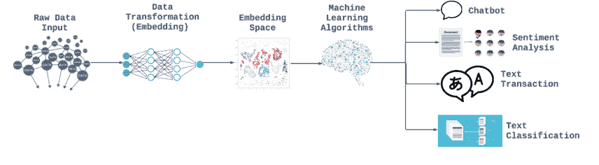
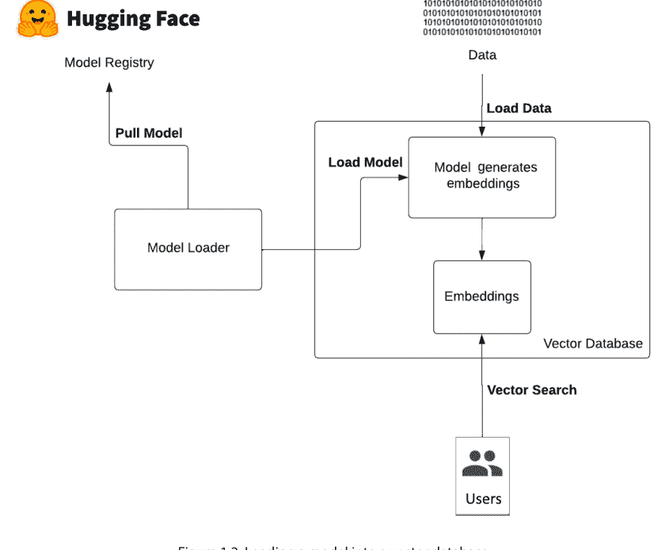

## 向量和嵌入简介

在本章中，我们将深入探索嵌入或向量的迷人世界及其在各个领域的多样化应用。我们将介绍嵌入的概念，它有助于表示复杂数据并使强大的机器学习（ML）模型能够分析和处理该数据。您将了解监督学习和无监督学习在创建嵌入中的作用以及向量所解决的挑战。此外，我们将讨论说明向量表示在不同领域广泛应用的示例。我们还将向您介绍增强开发人员在处理向量搜索时的开发体验的工具和平台生态系统，包括 Hugging Face 和各种后端考虑因素。

随着我们深入本章，您将发现快速发展的市场格局和促进向量搜索实施的平台。我们将探索一系列用例和应用领域，例如命名实体识别、情感分析、文本分类、问答和文本摘要。最后，我们将研究 Elastic 在这一领域发挥的作用，通过将向量集成到 Elasticsearch 领域中，并在搜索和网络安全中应用。在本章中，您将对向量表示的基础及其应用有扎实的理解，为在后续章节中更深入地探讨使用 Elasticsearch 实现向量搜索的实践方面奠定基础。

因此，本章将涵盖以下主题：

- 监督学习与无监督学习
- 应用用例和领域
- Elastic 在这一领域扮演什么角色？
- 本书将如何帮助您？

## 探索监督学习和无监督学习在向量搜索中的作用

监督学习是机器学习中的一种方法，其中模型从标记数据中学习以确定输入特征与输出标签之间的映射。在训练过程中，模型调整其参数以最小化其预测与真实标签之间的误差。监督学习广泛应用于图像分类、语音识别和自然语言处理（NLP）等各种应用。监督学习面临的关键挑战之一是必须提供经过整理的标记数据集来训练模型。

另一方面，无监督学习涉及在不使用标记示例的情况下发现输入数据中的模式和结构。这种学习类型侧重于通过使用聚类、降维和密度估计等技术在数据中寻找相似性、差异或潜在结构。无监督学习通常应用于异常检测、数据压缩和特征提取等任务。

在向量搜索和 NLP 的背景下，监督学习可用于通过训练模型根据给定词的邻近词预测其上下文，或将文档分类到预定义类别中来生成词或句子嵌入。这种方法有助于捕捉文本中的语义和句法关系，使生成的嵌入可用于各种 NLP 任务。另一方面，无监督学习可用于通过识别文本数据中的模式和相似性（例如词共现信息）来生成嵌入。诸如 word2vec 和 GloVe 之类的模型利用无监督学习创建可用于向量搜索和其他 NLP 应用的密集向量表示。

## 什么是嵌入/向量？

嵌入或向量在向量搜索和 NLP 任务中发挥着至关重要的作用，通过将复杂数据转换为数值表示。这些数学表示将词、短语、文档、图像、视频或声音在连续向量空间中表示，捕捉元素之间的语义和句法关系，使机器学习算法能够有效处理和分析。向量表示的应用包括情感分析、机器翻译、文本分类、图像识别、对象检测和图像检索。以下图表表示了获取数据、应用机器学习过程以及应用领域的整体过程：



图 1.1：机器学习管道


在 NLP 中，词、句子和文档嵌入作为文本信息的向量表示，使算法能够更有效地处理和理解文本。类似地，计算机视觉应用将图像表示为高维向量，每个像素值对应一个特定维度。其他领域，如社交网络、生物系统和推荐系统，也从向量表示中受益。例如，社交网络用户及其连接可以被编码为图嵌入，以捕捉网络的结构和动态。在推荐系统中，用户和商品都可以表示为向量，从而可以计算相似度和偏好。

用向量表示世界的能力使得开发强大的机器学习模型和应用成为可能，这些模型和应用能够在各个领域提供有价值的洞察和预测。

## 向量解决了哪些挑战？

BM25 是一种基于概率信息检索理论的广泛使用的文本检索算法。它根据查询词在文档中的出现频率对文档进行排序，同时考虑诸如词频、逆文档频率和文档长度归一化等因素。虽然 BM25 在传统搜索应用中很有效，但它存在一些局限性。例如，BM25 严重依赖于精确的词匹配，这在处理同义词、拼写错误或细微的语义变化时可能导致相关性较低的结果。此外，BM25 无法捕捉词语之间的上下文关系，使得它在理解短语或句子的含义方面效果较差。

向量搜索，包括精确匹配和 **近似最近邻 (ANN)** 搜索，通过利用现代嵌入模型生成的高维向量解决了 BM25 的一些局限性。这些向量捕捉了词语、短语甚至整个文档之间的语义和上下文关系。在向量搜索中，查询向量与文档向量之间的相似度用于确定相关性，超越了精确的词匹配。因此，向量搜索可以为包含同义词、拼写错误或不同措辞的查询返回更相关结果。精确匹配向量搜索可确保返回最相似的向量，而 ANN 搜索则提供更可扩展的方法，在准确性和速度之间进行权衡。通过关注底层含义和上下文，向量搜索为信息检索提供了一种更细致的方法，能够更好地理解和响应自然语言的复杂性。

以下是向量搜索应用的一些示例：

- **电子商务产品搜索**：客户即使在搜索查询中使用不同的术语或拼写错误，也能找到相关产品，提供更有效的购物体验。
- **文档检索**：用户可以找到具有相似内容、上下文或主题的文档，即使查询中使用的确切词语未出现在文档中，也能增强搜索引擎和知识管理系统[content]

在 NLP 中，词、句子和文档嵌入作为文本信息的向量表示，使算法能够更有效地处理和理解文本。类似地，计算机视觉应用将图像表示为高维向量，每个像素值对应一个特定维度。其他领域，如社交网络、生物系统和推荐系统，也从向量表示中受益。例如，社交网络用户及其连接可以被编码为图嵌入，以捕捉网络的结构和动态。在推荐系统中，用户和商品都可以表示为向量，从而可以计算相似度和偏好。

用向量表示世界的能力使得开发强大的机器学习模型和应用成为可能，这些模型和应用能够在各个领域提供有价值的洞察和预测。

## 向量解决了哪些挑战？

BM25 是一种基于概率信息检索理论的广泛使用的文本检索算法。它根据查询词在文档中的出现频率对文档进行排序，同时考虑诸如词频、逆文档频率和文档长度归一化等因素。虽然 BM25 在传统搜索应用中很有效，但它存在一些局限性。例如，BM25 严重依赖于精确的词匹配，这在处理同义词、拼写错误或细微的语义变化时可能导致相关性较低的结果。此外，BM25 无法捕捉词语之间的上下文关系，使得它在理解短语或句子的含义方面效果较差。

向量搜索，包括精确匹配和 **近似最近邻 (ANN)** 搜索，通过利用现代嵌入模型生成的高维向量解决了 BM25 的一些局限性。这些向量捕捉了词语、短语甚至整个文档之间的语义和上下文关系。在向量搜索中，查询向量与文档向量之间的相似度用于确定相关性，超越了精确的词匹配。因此，向量搜索可以为包含同义词、拼写错误或不同措辞的查询返回更相关结果。精确匹配向量搜索可确保返回最相似的向量，而 ANN 搜索则提供更可扩展的方法，在准确性和速度之间进行权衡。通过关注底层含义和上下文，向量搜索为信息检索提供了一种更细致的方法，能够更好地理解和响应自然语言的复杂性。

以下是向量搜索应用的一些示例：

- **电子商务产品搜索**：客户即使在搜索查询中使用不同的术语或拼写错误，也能找到相关产品，提供更有效的购物体验。
- **文档检索**：用户可以找到具有相似内容、上下文或主题的文档，即使查询中使用的确切词语未出现在文档中，也能增强搜索引擎和知识管理系统的有效性。
- **问答系统**：向量搜索可以将用户查询与大型数据集中的潜在答案进行匹配，从而在聊天机器人或基于 AI 的客户支持系统中实现更准确、上下文相关的响应。
- **图像识别和检索**：图像可以表示为高维向量以简化图像识别和检索。向量搜索可以在大型数据集中找到视觉上相似的图像，从而实现反向图像搜索、重复检测和视觉推荐系统等应用。
- **音乐推荐**：音频以向量表示时，向量搜索可以识别具有相似特征或风格的曲目，帮助用户根据其偏好和收听习惯发现新音乐。
- **安全和用户与实体行为分析 (UEBA)**：在安全和 SecOps 领域，向量搜索可用于 UEBA，以识别包含网络流量、日志、用户活动和其他安全相关数据的庞大数据集中的模式和关系。通过将用户表示为向量并利用向量搜索，分析人员可以高效地发现隐藏的连接并检测可能无法通过传统搜索方法轻易识别的潜在威胁、异常或恶意活动，从而提高组织的整体安全态势。

鉴于开始开发向量搜索项目的方式多种多样，我们现在将了解需要知道的主要组件以及开发人员体验是什么样的。

## 开发人员体验

为开发人员的使用案例选择合适的向量模型是开发人员从事向量搜索项目时至关重要的初始步骤。模型的选择，例如预训练的 BERT 模型或自定义训练的模型，取决于项目的具体要求和约束。开发人员需要考虑诸如数据集的大小和性质、预期的搜索性能以及用于训练和微调模型的可用资源等因素。应彻底评估不同模型，以确保所选模型在使用 k-最近邻 (kNN) 搜索时能提供相关结果。在 kNN 中，“k”指的是算法在进行预测时考虑的特征空间中最近邻居的数量——提供一个用户定义的参数来调整搜索或分类过程的粒度。

一旦选择了合适的向量模型，开发人员需要将模型加载到诸如 Elasticsearch 之类的向量数据库中。这涉及配置数据库以与所选模型配合使用，并指定必要的设置和参数以使模型能够存储和部署。以下图表显示了工作流程，其中模型从模型注册表 (Hugging Face) 中提取并加载到向量数据库中：



图 1.2：加载模型到向量数据库

该图表还显示，传入的数据正在经过已加载的模型以生成用户在其上运行向量搜索查询的嵌入。

为存储向量准备数据库涉及创建具有适当映射和设置的索引，以定义向量将如何存储和查询。在 Elasticsearch 的情况下，这涉及配置具有 dense_vector 类型的字段。开发人员需要指定向量维度、相似度度量和其他与用例相关的参数，确保数据库能够高效处理向量搜索操作。

一旦数据库设置完成，如前一图表所示，开发人员可以通过将模型应用于新数据摄取时的数据或现有数据来为数据集生成向量。该过程涉及将文本数据通过模型传递以获得密集向量表示，从而捕捉词语和短语之间的语义和句法关系。

开发人员还需要为新查询生成向量准备系统或流程。这通常涉及创建一个 API 或服务，该服务将用户查询作为输入，使用相同的向量模型进行处理，并生成相应的向量表示。然后可以使用该向量在数据库上执行 kNN 或精确匹配搜索以检索最相关结果。在 Elasticsearch 中，用户可以向 _infer 端点发送字符串，指定适当的模型，并作为响应的一部分获取向量。

模型部署并创建向量后，负载测试环境至关重要，以确保向量搜索系统能够处理预期的查询负载。存在特定的向量搜索系统资源，例如 RAM 和 CPU 线程，必须予以考虑。开发人员应模拟真实的用户流量和查询模式，以在各种条件下评估系统的性能。这有助于识别潜在的瓶颈和优化领域，确保系统保持性能和响应能力。

测试搜索结果的相关性对于确保向量搜索系统满足终端用户需求至关重要。开发人员应与领域专家或用户密切合作，评估搜索结果的质量，并在需要时微调模型或搜索参数。这一迭代过程有助于提高向量搜索系统的整体有效性。

一旦向量搜索系统投入生产，持续监控对于确保最佳查询性能是必要的。开发人员和运营人员应定期监控系统是否存在性能问题、资源使用情况和潜在错误。他们可能还需要根据用户反馈和不断变化的需求调整搜索参数、更新模型或重新训练系统。这一持续过程有助于使向量搜索系统保持最新并与终端用户相关。

## Hugging Face

Hugging Face 是一家领先的 AI 研究组织，在现代嵌入和 NLP 模型的发展和广泛采用中发挥了关键作用。通过其在 NLP 领域的开创性工作，Hugging Face 通过为开发人员、研究人员和企业民主化对最先进模型、资源和工具的访问，为该领域做出了重大贡献。以下是 Hugging Face 社区登陆页面的预览：


## 构建未来的 AI 社区。

图 1.3：Hugging Face 社区落地页

Hugging Face 的关键产品之一是 Model Hub，这是一个针对各种 NLP 任务的预训练模型集中存储库。Model Hub 使开发者能够轻松发现、下载并为其特定用例微调模型。通过提供从 BERT 和 GPT 到 T5 和 RoBERTa 的广泛模型，Hugging Face 使开发者更容易尝试并将先进的 NLP 能力集成到其应用中，包括向量搜索。Model Hub 还为研究人员和开发者提供了一个分享其自定义模型的平台，促进了社区内的协作和知识交流。

Hugging Face 在 Transformers 库的开发中发挥了重要作用，该库是一个流行的开源 Python 库，用于训练和使用基于 Transformer 的模型。Transformers 库为使用最先进的 NLP 模型提供了易于使用的 API，抽象掉了复杂性，使开发者能够专注于其特定任务。通过提供大量预构建模型、分词器和实用工具，Transformers 库显著加速了现代 NLP 技术在各种应用中的开发和采用。

Hugging Face Datasets 库是该组织提供的另一个宝贵资源。该库提供超过一千个用于 NLP 和 ML 任务的数据集，使开发者和研究人员更容易访问和使用高质量数据。Datasets 库提供数据预处理、操作和评估工具，简化了为模型训练和微调准备数据的过程。

Hugging Face 开发了一门全面的免费培训课程，涵盖 NLP 的基础知识，利用 Hugging Face 生态系统内的库和资源。该课程包括使用社区提供的模型的示例，以及针对特定任务和数据集微调这些模型的指导，使其成为开发者和爱好者不可或缺的资源。

## 市场格局及其如何加速开发者体验

近年来，出现了大量提供部分托管和完全托管数据库的平台，这些数据库专门为向量搜索用例而设计。这种选择的激增使得开发者能够在个人和组织层面探索、试验和实施向量搜索项目成为一个令人兴奋的时期。以下平台的精选展示了今天实现向量搜索的便捷性。需要指出的是，这里列出的公司并不是市场上唯一的参与者，也不是实现向量搜索的唯一手段。它们只是为了让你了解当前市场的一个概况而呈现。

### Pinecone

Pinecone 是一款专为大规模向量搜索和相似性应用而设计的托管向量数据库服务。作为托管服务，它在简化部署和维护方面表现出色，使开发者能够专注于应用而无需担心基础设施管理。Pinecone 支持多种距离度量，例如余弦相似度和欧几里得距离，并提供内置的去重和过滤支持。然而，作为托管服务，Pinecone 可能不如自托管解决方案可定制，其定价结构也可能成为某些用户的限制，特别是那些预算紧张或工作负载不可预测的用户。

### Vespa.ai

Vespa.ai 是一个开源、可扩展的实时搜索引擎，支持向量搜索、文本搜索和结构化数据搜索。Vespa 具有多功能性，可处理从推荐系统到新闻文章搜索等各种用例。它提供表达性查询语言，支持自定义排序函数，并允许实时索引。然而，Vespa 的多功能性也可能成为某些用户的弱点，因为其复杂性使其设置和配置比专门为向量搜索设计的数据库更具挑战性。

### Milvus

Milvus 是一个开源向量相似性搜索引擎，构建于其他流行的开源技术之上，例如 FAISS 和 NMSLIB。Milvus 专为高性能和可扩展性而设计，提供对各种相似性搜索算法和距离度量的支持。它能够处理数十亿个向量，并且可以轻松集成到 TensorFlow 和 PyTorch 等 ML 框架中。然而，一些用户可能会发现 Milvus 的学习曲线较陡，特别是如果他们不熟悉底层技术。此外，Milvus 主要专注于向量搜索，不支持其他搜索模式，这可能会限制其在需要向量、文本和结构化数据搜索组合的某些用例中的适用性。

### Weaviate

Weaviate 是一个基于 GraphQL 的开源向量搜索引擎，使用户能够使用自然语言查询搜索数据。Weaviate 的优势之一是其对语义搜索的关注，使其非常适合查询含义理解很重要的应用。它还支持基于模式的数据建模，允许用户定义数据的结构以及不同实体之间的关系。然而，Weaviate 对语义搜索（向量或混合搜索）的关注及其对 GraphQL 的依赖可能会为某些用户带来复杂性，特别是那些不熟悉这些概念的用户。

### Elasticsearch

Elastic.co 的 Elasticsearch v8+ 支持用于 ANN 和精确匹配搜索的密集向量存储，为大型数据集上的向量搜索提供可扩展方法。与精确匹配最近邻搜索不同，ANN 以完美的准确性换取速度，使其在高维向量上更高效。Elasticsearch 采用分层可导航小世界（HNSW）图 ANN 算法，具有强大的性能和广泛的行业使用。基于 Apache Lucene 构建，此功能可与 Elasticsearch 的其他功能无缝集成，包括过滤和与 BM25 的混合搜索。然而，Elasticsearch 的复杂性可能会给某些用户带来设置和配置挑战。Lucene 的 dense_vector 数据类型限制也适用于 Elasticsearch，虽然它可以处理庞大的向量数据集（达数十亿），但在这种规模下 ANN 的内存需求可能不切实际。

每个向量数据库都有其独特的优势和劣势，具体取决于特定用例和需求。Pinecone 在易用性和维护方面表现出色，Vespa 提供多搜索模式支持的多功能性，Milvus 专为高性能和可扩展性而设计，Weaviate 专注于具有自然语言能力的语义搜索。最后，Elasticsearch 提供密集向量和 ANN 搜索支持，并与其实搜索功能无缝集成。

在选择向量数据库时，开发者应仔细考虑其特定需求，并根据其功能、性能和易用性评估每个解决方案。

# 用例和应用领域

对于大多数用户来说，基于 AI 的搜索往往令人望而生畏，主要是因为我们认为缺乏标准化——入门的选择太多了。在本书中，我们认为让从业者了解从更成熟和被采用的技术、用例和应用领域入手开始会很有用。

我们将直接解决搜索的可能性范围，避开 ML、NLP 和深度学习复杂空间所带来的术语。

此外，在着手此类项目之前，有一点需要牢记：在复杂性、投入和成本之间保持平衡。鉴于该领域随着新研究技术的快速发展，初始投资可能很快就会过时。在本节中，我们将了解基于 AI 的搜索是什么，并探索不同的技术，例如 **命名实体识别（NER）**、情感分析、文本分类、**问答（QA）** 和文本摘要，并提供可运行的真实示例。

## 基于 AI 的搜索

过去三年里，不同行业一直在寻找将面向客户的搜索体验从关键词搜索升级到语义搜索的方法。除了让用户按其思考方式搜索外，组织还一直在寻找基于其浏览行为个性化客户体验的途径。

如前所述，针对这一挑战的完整解决方案很少；由于该领域如此充满活力且变化迅速，客户通常会使用 Elastic 等特权平台，因为它为他们提供了更高水平的灵活性。

从构建基于 AI 的搜索体验的整体过程来看，可以了解相对于技能、投入和成本的潜在挑战。一般来说，运行此类项目有五个高层次步骤；我们将在以下小节中深入探讨：

- 1. 收集数据
- 2. 表示数据
- 3. 应用 ML
- 4. 集成个性化
- 5. 将项目投入生产

让我们开始吧。

### *收集数据*

第一步可能是最具挑战性的，因为它将提供一个已知有趣事件的宇宙，从而设定模型能够从中学习的内容边界。它是为应用程序构建的领域收集和处理足够大量的数据。组织会使用文本，例如其产品描述、与用户相关的数据、评论，甚至客户支持数据。其目的是为比较和检索训练数据。

### *表示数据*

训练数据是一回事，但将其以有利于用户体验的方式表示又是另一回事。将数据表示为高维空间中的向量，使用词嵌入或其他向量化技术，是截至撰写本文时最有效的方法。主要好处


这意味着向量能够捕捉语义含义和上下文，最终服务于终端用户体验。

如果你感兴趣的话，在电商客户搜索“wireless headphones”的情况下，该组织会将用户查询表示为高维空间中的向量，并使用预训练模型如 *word2vec* 将查询中的每个词转换为向量表示。合并后的结果代表整个查询。这使我们能够将该向量与由产品表示构建的向量空间进行比较。以下是一个 10 维向量，给出了表示的示例：

```
[0.213, -0.178, 0.425, -0.067, 0.321, 0.195, -0.267, 0.132, -0.455, -0.033]
```

这里有趣的是，查询突然被转换到可能性空间，这使我们能够比较向量空间，而不是关键词，以确定相似性。产品是否存在？正在搜索的是什么类型的产品？从查询中提取的语义令人着迷。

### Applying ML

AI 搜索体验的另一个层级是使用诸如 **convolutional neural networks (CNNs)**、**recurrent neural networks (RNNs)** 或 **transformers** 等模型对数据进行训练。这是在之前向量化的数据上进行的，以学习和理解数据之间的模式和关系。此阶段的目标是为搜索应用程序做好准备，使其能够支持 NLP。

继续以无线耳机为例，使用诸如 CNNs 或 RNNs 等模型使我们能够浏览该特定文章可能拥有的连接图。在这种情况下，考虑诸如降噪、电池寿命、是否防水、或在做波比跳时是否仍留在佩戴者耳中的特征。

### Integrating personalization

没有个性化，搜索无论是否比关键词搜索更智能，都将保持冰冷。个性化允许你根据过去的搜索和类似搜索将上下文整合到搜索中。这些分别被称为网络画像和用户画像。

CNNs/RNNs/transformers 的美妙之处在于，其优势并不止于我们之前提到的内容——它们还能根据用户的过去搜索为用户提供推荐。

### Getting into production

我们很想告诉你，AI 搜索正在解决搜索应用程序在相关性和延迟性能之间所需的来回往复，从持续优化的角度来看，但事实并非如此。

拥有正确数据的关键是做出正确的决策并限制优化工作，这意味着你不仅需要能够完全监控用户体验，还需要“有趣的事件”来让你了解搜索质量。

为此你需要一定程度的 A/B 测试，并比较给定状态与搜索引擎的新状态的性能，例如在调整模型之后。然而，你也需要某种反馈循环来了解结果的相关性。

一旦你使用我之前提到的高级步骤构建了 AI 搜索系统，你就可以通过整合诸如 NER、情感分析、文本分类、Q/A 和文本摘要等技术来进一步增强系统。我们将在下一部分了解更多关于这些技术的信息。

### Named Entity Recognition (NER)

NER 是 NLP 的一个组件，用于在非结构化文本中检测和分类命名实体。实体可以是具有唯一名称或标识符的名称、品牌、位置或组织。

有了这种技术，流入系统中的非结构化数据将被分类，这通常是上游在标注数据上训练的 ML 模型的成果。在此过程中，数据会被标记为相应的类型。训练完成后，ML 模型使用标签来学习文本中的模式和关系，从而能够准确地识别和分类新文本中的命名实体。

我们可以想到的一种用例是 **personally identifiable information (PII)**，它指的是流入系统而没有任何控制的敏感信息。这些信息可以是姓名、地址、社会安全号码和财务信息。

对于银行来说，无法检测流入其数据中的 PII 可能会对银行及其客户造成严重后果。例如，如果黑客设法访问银行的数据并窃取 PII，他们可以利用它进行欺诈和身份盗窃，这可能导致客户的财务损失以及银行的处罚，因为他们受监管。

这就是为什么金融服务公司使用 NER 来降低 PII 暴露的风险，无论是在陈旧数据上还是在处理过程中对飞行中数据使用。结果是涂黑、加密、屏蔽或设置正确的数据访问权限，从而避免与 PII 暴露相关的法律和声誉风险。

### Sentiment analysis

NLP 的另一种技术是情感分析，其目的是识别和提取非结构化文本中的情感情绪。它通常用于社交网络，例如从推文中提取情绪。组织经常使用它来了解与他们的品牌相关的情感。

然而，虽然情感分析的使用很广泛，但它对于更具体的用例也很有用，例如实时分析产品评论或监控相对于新投资的市场情绪。这有助于金融分析师做出更明智的投资。

今天一家公司可能发生的最糟糕的事情是未能检测到对其产品或服务的负面情绪，这可能导致声誉受损和客户流失。

自然语言 Python 工具包 (https://www.nltk.org/) 对于这个非常流行的任务非常有用。以下代码示例展示了如何实现一个非常简单的情感分析以及结果可能是什么：

```
import nltk
nltk.download('vader_lexicon')

from nltk.sentiment import SentimentIntensityAnalyzer
sia = SentimentIntensityAnalyzer()
text = "I really enjoyed the new movie. The acting was great and the plot was engaging."
scores = sia.polarity_scores(text)
print(scores)
```

你可以在此 notebook 中找到上述代码并运行它：https://github.com/PacktPublishing/Vector-Search-for-Practitioners-with-Elastic/blob/main/chapter1/sentiment-analysis.ipynb。Python 代码使用 SentimentIntensityAnalyzer 执行实际的情感分析。然后返回极性分数，为每个极性（负面、中性和正面）提供分数，以及一个复合分数，从 -1（最负面）到 +1（最正面）。运行 notebook 应该会给你以下结果：

```
{'neg': 0.0, 'neu': 0.522, 'pos': 0.478, 'compound': 0.8777}
```

该分数表明文本中捕捉到的情绪非常积极！

### Text classification

文本分类是另一种 NLP 技术，它为非结构化数据分配预定义类别。影响我们所有人的一个现实生活例子是垃圾邮件管理或将电子邮件过滤和标记为垃圾邮件或非垃圾邮件的操作。

垃圾邮件可能具有许多会使其可疑的信号，例如使用某些关键词、拼写错误、链接等。一旦模型在大量标注数据集上训练完成，电子邮件就会自动被分类为垃圾邮件或非垃圾邮件。这会产生多个结果，例如整体更好的电子邮件体验或提高生产力。

为了简化起见，这里有一个使用在线数据源并显示分类结果及其准确性的示例：

```
from sklearn.datasets import fetch_20newsgroups
from sklearn.feature_extraction.text import CountVectorizer
from sklearn.naive_bayes import MultinomialNB
from sklearn.metrics import accuracy_score
#### Load the dataset
newsgroups_train = fetch_20newsgroups(subset='train')
newsgroups_test = fetch_20newsgroups(subset='test')
#### Vectorize the text data
vectorizer = CountVectorizer()
X_train = vectorizer.fit_transform(newsgroups_train.data)
X_test = vectorizer.transform(newsgroups_test.data)
#### Train a Naive Bayes classifier
clf = MultinomialNB()
clf.fit(X_train, newsgroups_train.target)
#### Predict on the test set
y_pred = clf.predict(X_test)
#### Print the accuracy and predicted classes
print(f"Accuracy: {accuracy_score(newsgroups_test.target, y_pred)}")
print(f"Predicted classes: {y_pred}")
```

在 Google Colab notebook 中执行代码应会给出以下输出：

```
Accuracy: 0.7728359001593202
Predicted classes: [ 7 11 0 ... 9 3 15]
```

让我们理解上述代码中我们实现了什么：

- 正如我们之前提到的，代码使用一个名为 20 Newsgroup 数据集 (http://qwone.com/~jason/20Newsgroups/) 的在线数据集。它是测试此类分类的绝佳游乐场，因为它汇集了 20,000 份新闻组文档，分为约 20 个不同的新闻组。该数据集由卡内基梅隆大学的 Ken Lang 汇编。
- 我们使用 scikit-learn，更为人所知的是 sklearn，一个非常流行且被广泛采用的 Python 开源 ML 库。因为它提供广泛的监督和无监督学习算法，如分类、回归、聚类和降维，我们将在本书中使用它作为工具。
- 我们在此示例中使用词频向量技术，通过 CountVectorizer 函数，本质上将文本数据转换为可用于 ML 的数字格式。
- 我们在向量化训练数据上训练朴素贝叶斯分类器。在此示例中，分类器假设文档中每个词的频率与文档中所有其他词的频率相互独立。该假设是为了对新文档的类别做出预测。


结果是对测试数据的类别标签的预测。由于我们使用了 20 Newsgroup 数据集，预测的类别标签是 0 到 19 之间的整数，用来表示 20 个不同的类别。作为示例，数组中第一个类别标签是 7，这意味着测试集中第一个实例属于整数 7 所代表的新闻组类别。这里的整数标签是任意的——它们本身没有任何固有含义。

## 问答 (QA)

QA 在 2022 年底随着 ChatGPT 的推出而变得极其流行。ChatGPT 不仅能理解对话的上下文，而且能够生成与用户问题相关的回复。它基于 GPT-3 架构的 QA 模型进行预训练。

QA 是 NLP 的一个领域，依赖于构建系统来自动回答人类提出的问题。这是一个非常具有挑战性的领域，因为正如我们前面提到的，系统必须在问题的范围内理解上下文。此外，问题可能是对话的一部分，并且在一次会话中可能交织着多个对话。

在大型语言模型 (LLM) 引入之前，基于事实的 QA 系统回答问题的过程需要几个步骤：

- 1. 首先，系统需要理解问题并将其构成部分分解为主题、对象和谓语。
- 2. 然后，它需要依赖一个庞大的数据库来搜索相关信息，并从检索到的信息中提取和综合答案。

这一过程大量涉及文本处理、搜索以及深度学习和神经网络等机器学习算法。

让我们转换思路，从现实生活角度来看这个问题。医疗行业可能是一个出人意料但很好的选择。它本质上可以帮助医生提供更好的患者护理。例如，当医生面对一位健康背景复杂的患者，并且需要在开具一种药物与另一种药物之间权衡后果时，QA 系统可以提供极大的帮助。错误的处方可能导致严重的副作用，而这种技术可以为患者节省时间和痛苦，并为医疗专业人员或组织提供更好的整体服务质量。

以下示例展示了如何使用 Hugging Face Transformers 库中的预训练模型，基于给定的上下文来回答一个问题：

```
!pip install transformers
from transformers import pipeline
#### Load the question answering model
model = pipeline("question-answering", model="distilbert-base-cased-distilled-squad", tokenizer="distilbert-base-cased")
#### Define a question and a context
question = "What is the capital city of Japan?"
```

```
context = "Japan is an island country in East Asia. Located in the Pacific Ocean, it lies to the east of the Sea of Japan, China, North Korea, South Korea and Russia, stretching from the Sea of Okhotsk in the north to the East China Sea and Taiwan in the south. The capital city of Japan is Tokyo."
#### Get the answer
result = model(question=question, context=context)
#### Print the answer
print(f"Answer: {result['answer']}")
```

这里，我们从 transformers 包加载一个预训练的 QA 模型，并使用 distilbert-base-cased-distilled-squad 模型，该模型在斯坦福问答数据集上进行预训练，更为人所知的名称是 SQuAD。你可以在 https://rajpurkar.github.io/SQuAD-explorer/ 找到该数据集（鸣谢 Pranav Rajpurkar, Robin Jia, 和 Percy Liang. 2018. Know What You Don’t Know: Unanswerable Questions for SQuAD. ArXiv）。

我们定义了一个问题和一个用于回答该问题的上下文，然后将其传递给模型。

如果你在 Google Colab 笔记本中运行代码，对于我们关于日本首都的问题，你应该会得到以下输出：

```
Answer: Tokyo
```

## 文本摘要

文本摘要是另一个具有挑战性的 NLP 任务，因为它需要理解文档的语义并识别最相关需要保留的信息。我们必须在不丢失其含义和准确性的情况下减少文本中的信息。

我们每天都习惯的一个现实生活例子就是我们消费的新闻推送。你用来消费这些内容的应用会总结数据以吸引你的注意力。这个过程存在真正的挑战，因为新闻推送行业需要在实时环境中生存，在这种环境中，你的滚动体验的任何纳秒都很重要。在你看到某条新闻的这短暂时间内，摘要应该激励你点击并进入新闻页面，而该页面几乎肯定包含大量广告，这是新闻机构获得收入的关键。

以下示例使用 Hugging Face Transformers 库来总结从 https://en.wikipedia.org/wiki/Blue-throated_macaw 获取的一段文本：

```
!pip install transformers
from transformers import pipeline
#### Define the text to be summarized
text = "The blue-throated macaw (Ara glaucogularis) is a species of macaw that is endemic to a small area of north-central Bolivia, known as the Llanos de Moxos. Recent population and range estimates suggest that about 350 to 400 individuals remain in the wild. Its demise was brought on by nesting competition, avian predation, and a small native
```

```
range, exacerbated by indigenous hunting and capture for the pet trade. Although plentiful in captivity, it is critically endangered in the wild and protected by trading prohibitions. In 2014, the species was designated a natural patrimony of Bolivia. This blue-throated macaw in flight was photographed at Loro Parque, on the Spanish island of Tenerife in the Canary Islands."
#### Instantiate the summarization pipeline
summarizer = pipeline("summarization")
#### Generate a summary of the text
summary = summarizer(text, max_length=100, min_length=30, do_sample=False)[0]["summary_text"]
#### Print the summary
print(summary)
```

使用 summarizer 和来自 Hugging Face 的 DistilBert 模型，并传递最大和最小长度等参数，我们得到以下输出：

```
The blue-throated macaw (Ara glaucogularis) is a species of macaw that is endemic to a small area of north-central Bolivia, known as the Llanos de Moxos. Recent population and range estimates suggest that about 350 to 400 individuals remain in the wild.
```

你触手可及的模型数量令人印象深刻。Hugging Face 等社区通过让你能够在无需甚至微调模型的情况下运行复杂的 NLP 任务，从而加速你的生产力。

到目前为止，你应该对基于 AI 的搜索有很好的把握，对如何使用可用技术有很好的理解，甚至能够立即将你的部分学习集成到应用程序的代码中。

## Elastic 在这个领域扮演什么角色？

那么 Elastic 在这里扮演什么角色呢？你可以利用 Elastic 的方式有很多——包括 Elasticsearch。Elasticsearch 是一个分布式且高度可扩展的数据存储。其专长是信息检索。在笔记本中运行前面的代码是一回事——让它在规模上投入运营并被数百、数千或数百万用户访问又是另一回事。

此外，训练可能很长，因为它要求算法能够访问大量数据，这些数据需要被索引以便快速访问，并且需要在规模上进行。能够同时处理结构化和非结构化数据、管理各种数据类型，并且在摄取和搜索方面可扩展的数据存储非常少。

Elasticsearch 是一个独特的选择，不仅因为其技术属性，还因为其充满活力的社区和广泛的采用。正如前面提到的，基于 AI 的搜索应用领域正在迅速变化，因此在过程中保持一定的连贯性是一种奢侈。Elasticsearch 和 Hugging Face 等技术和社区使用户能够拥有安全网，并在变化过程中具有一定的韧性。


我们喜欢将 Elasticsearch 描述为一个搜索和分析引擎。Elasticsearch 的分析方面发挥着至关重要的作用，因为它允许您对数据执行复杂的查询和聚合。

然而，锦上添花的是 Elasticsearch 的可扩展性。2021 年，Elastic 引入了索引向量的能力。这意味着 Elasticsearch 原生理解什么是向量，并且针对该任务进行了优化，不让用户管理并强迫数据存储处理不支持的数据类型。

除了搜索之外，我们希望打开你的思路，看看如何将向量搜索应用于其他用例，例如可观测性和网络安全。

## 可观测性和网络安全入门

向量不仅对 NLP 等任务很重要，而且在可观测性和网络安全等领域也很重要。它们允许对大量数据进行高效处理和分析。

让我们暂停一下，思考一下可观测性的现状。今天，运营团队在工具箱中有多种工具来加速调查过程，例如异常检测，同时主要依赖无监督学习。现在，文本分类对于日志等信号可能是一个很大的好处，其中数据相当非结构化，需要分组到桶中。结果是更好的分析师体验和加速的根本原因分析。现在，让我们思考一下未来状态会是什么样子。通过向量化数据——换句话说，将数据点转换为向量——识别模式和异常变得容易得多。

在网络安全中，向量可用于表示和分析多种类型的数据，例如网络流量、恶意软件签名和用户行为。

我们将在第 7 章和第 8 章分别讨论可观测性和网络安全，并查看您可以在环境中使用的实际示例并应用，然后我们将扩展到我们认为合适的地方。

## 总结

本书将指导您完成实用、实用的示例，您可以为自己的需求复制这些示例，从构建向量驱动的搜索应用程序到将向量应用于可观测性和安全等领域。它针对的是广泛的从业者，但更侧重于运营团队，他们面临特定的挑战，并且可以很好地利用向量和 Elastic 的结合。

在本章中，您了解了 NLP、向量搜索、基于 AI 的搜索及其相关技术的关键方面。您还看到了可以运行并为业务应用程序定制的代码片段。最后，您对 Elasticsearch 在此上下文中的作用以及如何将向量搜索应用于搜索用例之外，例如可观测性方面，有了高层次的理解。

在下一章中，我们将开始研究 Elasticsearch 中的向量。我们将探索当前的搜索方法，并了解向量如何增强和改进它。此外，我们将深入研究 Elasticsearch 中向量实现的复杂性。
