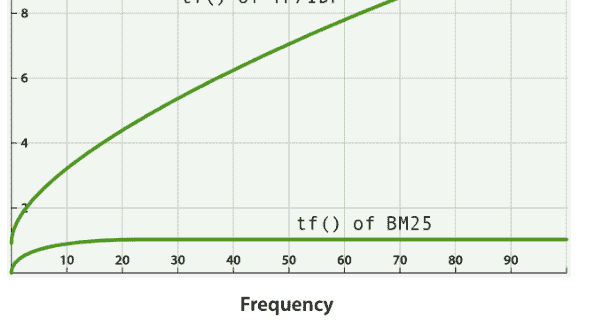
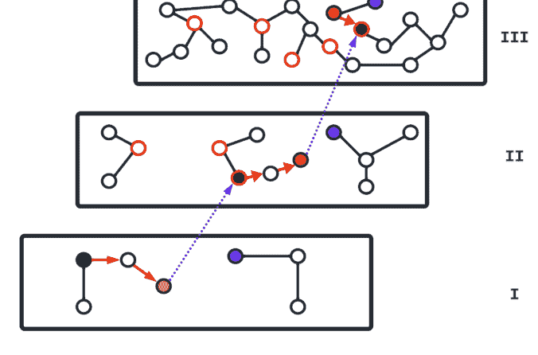
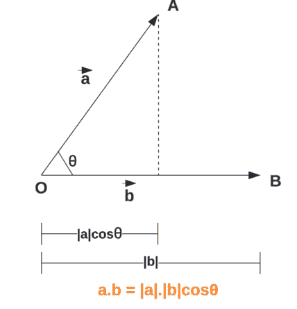
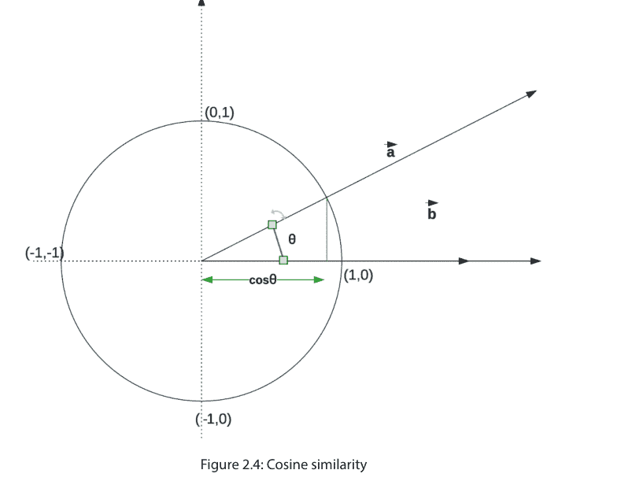
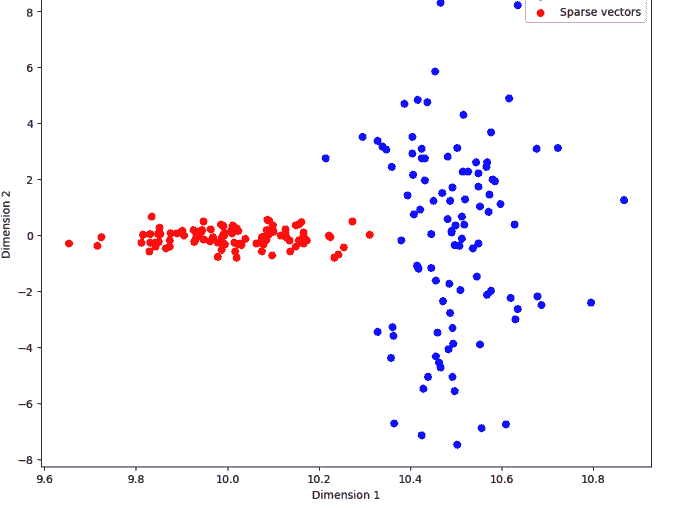
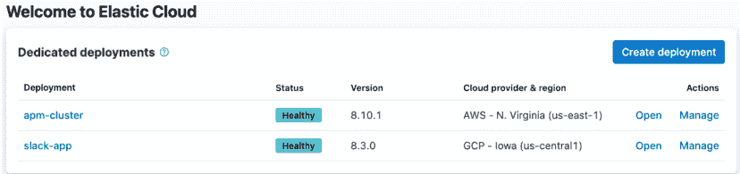
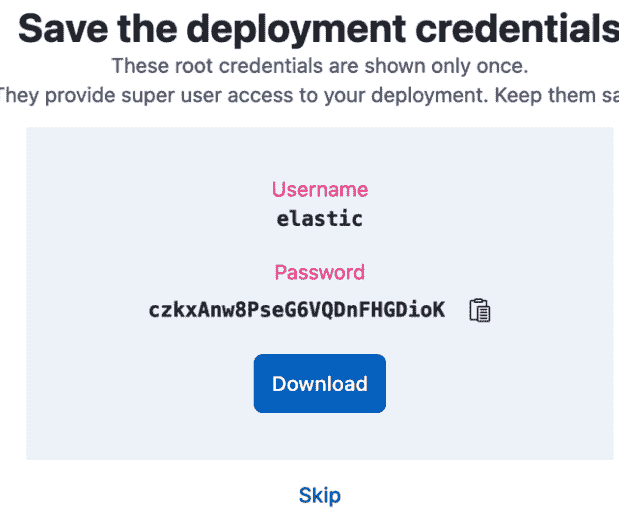
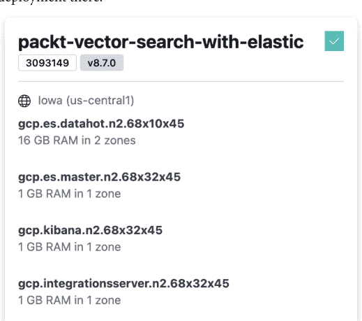
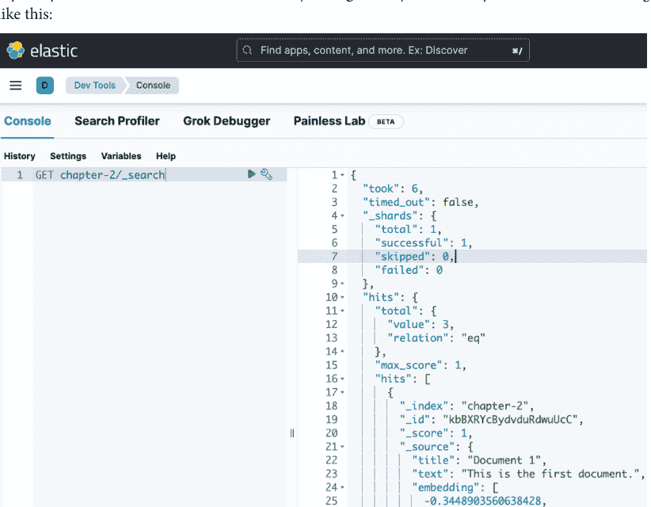

## 在 Elastic 中开始使用向量搜索

欢迎阅读 *在 Elastic 中开始使用向量搜索*。在本章中，我们将了解 Elastic 中搜索的基本范式，以及向量搜索如何成为实时、上下文感知、准确信息检索的强大工具。

在本章中，我们将涵盖以下主题：

- 在添加向量搜索之前 Elastic 中的搜索体验
- 对新表示形式的需求，例如向量和 **Hierarchical Navigable Small World (HNSW)**
- 一种新的向量数据类型
- 配置映射的不同策略以及存储向量的挑战，更好地了解如何优化其实现
- 如何构建查询，包括暴力搜索、**k-nearest neighbors (kNN)** 和作为资源的精确匹配

无论您是经验丰富的 Elastic 用户还是刚刚入门，本章都将为您提供有关 Elastic 中向量搜索的强大功能的宝贵见解。让我们开始吧！

## 在向量之前 Elastic 中的搜索体验

在 Elastic 中引入向量搜索之前，主要的相关性模型基于文本搜索和分析功能。Elasticsearch 提供各种数据类型 (https://www.elastic.co/guide/en/elasticsearch/reference/current/mapping-types.html) 和分析器 (https://www.elastic.co/guide/en/elasticsearch/reference/current/analysis-analyzers.html) 来提供高效的搜索。在这一部分，我们将进行水平设定并确保我们都了解“之前状态”是什么样的。

## 数据类型及其对相关性的影响

Elasticsearch 中有各种数据类型，但就本部分而言，逐一介绍它们并无用处。相反，我们将把它们分为两类：直接驱动相关性排名的类型和间接影响排名的类型。目标是了解它们与相关性模型的关系。

我们将首先查看直接影响相关性排名的类型：

- **Text**：`text` 数据类型是 Elasticsearch 中相关性模型最重要的一个数据类型。它用于存储和搜索文本数据，例如文章和产品描述。文本数据使用内置分析器进行分析，分析器将文本分解为标记并执行诸如小写化、词干提取和过滤等操作。
- **Geo**：`geo` 数据类型用于存储和搜索地理坐标。它使您能够执行基于地理的查询，例如查找特定距离或边界框内的文档。虽然不是基于文本的相关性模型的一部分，但基于地理的查询可以帮助缩小搜索结果并提高其相关性。

第二种数据类型是可以提高相关性的类型：

- **Keyword**：`keyword` 数据类型用于存储未分析的文本数据，通常用于过滤和聚合。它通过应用过滤器或聚合来细化搜索结果，从而提高结果的相关性。
- **Numeric types (integer, float, double, etc.)**：这些数据类型用于存储和搜索数值数据。虽然它们不直接影响基于文本的相关性模型，但它们可用于过滤或排序搜索结果，这可以间接影响结果的相关性。
- **Date**：`date` 数据类型用于存储和搜索日期和时间数据。与数值类型类似，日期数据类型可用于过滤和排序搜索结果，间接影响整体相关性。
- **Boolean**：`boolean` 数据类型用于存储 `true/false` 值。虽然它不直接有助于相关性模型，但它可用于过滤搜索结果，从而提高其相关性。

## 相关性模型

虽然本书不是 Elasticsearch  cookbook，而是专注于向量搜索，但在深入研究向量之前，了解相关性排名模型很重要，以便我们可以在需要时使用它们。我们将看到，通过结合向量搜索和“传统”搜索来构建混合搜索是一种可以改善最终用户体验的技术。

Elasticsearch 本身在相关性模型方面经历了迭代，最初是 **term frequency-inverse document frequency (TF-IDF)**，现在是 BM25。两者都是用于根据文档与查询的相关性对文档进行排名的文本检索算法。然而，它们有关键区别，我们现在将探讨。

### *TF-IDF*

为了说明 TF-IDF 概念，我们将使用一个包含三个文档的小集合的简单示例：

- **Document 1:** “I love vector search. Vector search is amazing.”
- **Document 2:** “Vector search is a method for searching high-dimensional data.”
- **Document 3:** “Elasticsearch is a powerful search engine that supports vector search.”

我们想要计算每个文档中术语 `vector search` 的 TF-IDF 分数。

首先，我们计算每个文档的 **term frequency (TF)**；请注意，我们在此处对 **bi-gram**（文本中两个相邻单词的序列——即 `vector` 和 `search` 一起）应用 TF：

Document 1: `vector search` 在 8 个词中出现了两次：TF = 2 / 8 = **0.25**

Document 2: `vector search` 在 9 个词中出现了 1 次：TF = 1 / 9 = **0.111**

Document 3: `vector search` 在 10 个词中出现了 1 次：TF = 1 / 10 = **0.110**

然后，我们计算术语 `vector search` 的 **inverse document frequency (IDF)**。

我们知道包含术语 `vector search` 的文档数量 = 3。

文档总数 = 3。

当这些用于公式中时，我们得到：

*IDF = log(3/3) = log(1) = 0*

最后，我们计算每个文档中术语 `vector search` 的 TF-IDF 分数：

- **Document 1:** TF-IDF = TF * IDF = 0.25 * 0 = 0
- **Document 2:** TF-IDF = TF * IDF = 0.111 * 0 = 0
- **Document 3:** TF-IDF = TF * IDF = 0.110 * 0 = 0

在这个特定示例中，IDF 值为 0，因为术语 `vector search` 出现在所有文档中，使其成为整个文档集合中的常见术语。因此，所有文档的 TF-IDF 分数也为 0。这说明了 TF-IDF 算法中 IDF 组件如何惩罚文档集合中的常见术语，降低它们对相关性分数的影响。


通过将第三份文档修改为“Elasticsearch is a powerful search engine that supports semantic search.”，搜索 semantic search，并应用我们刚刚学到的知识，排名变为如下：

- Document 3 (TF-IDF = 0.109)
- Document 1 (TF-IDF = 0)
- Document 2 (TF-IDF = 0)

虽然这种方法简单直接，但它会导致较长文档存在偏差，因为它们通常具有更高的词频。以下是需要考虑的另外两点：

- IDF 组件计算为 log (N/df(t))，其中 N 是集合中文档的总数，df(t) 是包含词项 t 的文档数量。IDF 组件旨在给予罕见词项更多重要性，而给予常见词项更少重要性。
- TF 没有上限，这意味着随着词项频率的增加，其对相关性评分的影响也会线性增加。

这促使我们考虑以下方法来对文档进行排名。

### BM25

借助 BM25，Elasticsearch 能够提高对数据的保真度并优化公式中的 TF 和 IDF 组件。例如，BM25 引入了饱和组件，这意味着词项对相关性评分的影响会在某一点趋于平稳，即使其在文档中的频率继续增加。这种饱和防止了极高的词项频率主导相关性评分。

下图显示了 TF-IDF 随着频率不断增加，而 BM25 则对其进行了中和：



Figure 2.1: The TF-IDF and BM25 scores by frequency comparison

你可以在此博客文章中了解更多信息：

https://www.elastic.co/blog/practical-bm25-part-2-the-bm25-algorithm-and-its-variables

为了简单起见并说明 BM25 的好处，我们将通过一个与之前 TF-IDF 类似的示例。

我们将使用与之前相同的文档，但现在，我们将计算词项 search 的 BM25 分数。目标是突出 BM25 的好处，例如词频归一化和饱和：

- **Document 1:** “I love vector search. Vector search is amazing.”
- **Document 2:** “Vector search is a method for searching high-dimensional data.”
- **Document 3:** “Elasticsearch is a powerful search engine that supports semantic search.”

首先，我们计算每个文档的 TF：

- **Document 1:** search 出现 2 次，共 8 个词：TF = 2 / 8 = **0.25**
- **Document 2:** search 出现 2 次，共 9 个词：TF = 1 / 9 = **0.111**
- **Document 3:** search 出现 2 次，共 9 个词：TF = 2 / 10 = **0.2**

现在，我们将使用以下公式计算每个文档的 BM25 分数：

∑ IDF(q_i) = f(q_i, D) · (k1 + 1) / [f(q_i, D) + k1 · (1 - b + b · fieldLen / avgFieldLen)]

首先，让我们看看如何计算 TF 归一化，然后是 IDF。

#### TF normalization

假设 k1 = 1.2 且 b = 0.75。平均文档长度 avgdl 为 (8 + 9 + 9) / 3 = 8.666：

- **Document 1:** ((1.2 + 1) * 2) / (1.2 * (1 - 0.75 + 0.75 * (8 / 8.666)) + 2) = **1.405**
- **Document 2:** ((1.2 + 1) * 2) / (1.2 * (1 - 0.75 + 0.75 * (9 / 8.666)) + 2) = **1.360**
- **Document 3:** ((1.2 + 1) * 2) / (1.2 * (1 - 0.75 + 0.75 * (10 / 8.666)) + 2) = **1.317**

#### IDF

BM25 中的 IDF 组件计算为 log ( (N - df(t) + 0.5) / (df(t) + 0.5) )，其中 N 是文档总数，df(t) 是包含词项 t 的文档数量。

我们已知，包含词项 search 的文档数量 = 3。

文档总数 = 3。因此，我们有以下结果：

IDF = log((3 - 3 + 0.5) / (3 + 0.5)) ≈ 0.287 (使用自然对数)

#### BM25 score

- Document 1: BM25 = IDF * TF normalization = 0.287 * 1.405=0.403
- Document 2: BM25 = IDF * TF normalization = 0.287 * 1.360=0.390
- Document 3: BM25 = IDF * TF normalization = 0.287 * 1.317≈0.377

基于 BM25 分数，我们可以按如下方式对查询 search 的文档进行排名：

- Document 2 (BM25 = 0.403)
- Document 1 (BM25 = 0.390)
- Document 3 (BM25 = 0.377)

这展示了 BM25 的一个好处，即其能够比 TF-IDF 更有效地处理多样化的文档长度。归一化有助于减少对较长文档的偏向，而较长文档由于词数更多而具有更高的词频。

我们在此尚未展示 BM25 防止极高的词项频率主导相关性评分，但如果你尝试更复杂的场景，你将看到图 2.1 中所说明的差异，其中高词频不会获得不合理高的相关性评分。

到此阶段，你应该对 TF-IDF 并且更具体地对 BM25 有了扎实的理解。到目前为止所涵盖的主题不仅会在本章剩余部分帮助你理解基于关键词的搜索与向量搜索之间的差异（其中一个显著区别是计算搜索的相关性），而且在本书后续阶段讨论混合搜索时也会证明有益。

## Evolution of search experience

我们现在将看到用户对更好搜索体验的需求要求我们考虑除基于关键词的搜索之外的其他技术。在本节中，我们将探讨基于关键词搜索的局限性，了解向量表示的含义，以及元表示 HNSW 如何出现以促进向量信息检索。

### The limits of keyword-based search

对于那些对该主题相对较新的人来说，在谈论向量表示之前，我们需要了解行业和基于关键词的搜索体验为何已达到其极限，未能完全满足终端用户需求。

基于关键词的搜索依赖于用户查询与文档中词项之间的精确匹配，如果搜索系统没有针对同义词、缩写、替代措辞等进行足够优化，就可能导致遗漏相关结果。因此，搜索系统将给定词与属于同一语义空间的其他词关联起来非常重要。

由于基于关键词的搜索缺乏上下文理解，它们不考虑词的上下文或含义。因此，澄清词的上下文很重要。例如，“bat”一词在不同上下文中有不同的含义——在体育上下文中，“bat”可以指棒球或板球中用来击球的球棒。在动物学上下文中，“bat”指的是飞行哺乳动物。

单个词由于上述限制已经具有挑战性，再加上语言依赖性、拼写错误和拼写变体。此外，基于关键词的搜索无法捕捉句子的结构或语义。例如，查询中词的顺序对于理解其含义很重要。词的顺序对于理解查询的含义很重要。词项之间存在语义关系，这使得难以检索使用不同词汇讨论相同主题的文档。

基于关键词搜索由于缺乏语义理解而存在局限性的一个很好的例子，可以在与“全球变暖”主题相关的搜索查询中看到。

假设用户使用术语“global warming”搜索文档，但一些相关文档使用术语“climate change”而不是“global warming”。由于基于关键词的搜索无法捕捉“global warming”与“climate change”之间的语义关系，它可能无法检索使用不同词汇讨论相同主题的相关文档。

需要明确的是，确实存在应对上述局限性的技术，但它们很难扩展或难以维护，并且需要相当多的专业知识。相反，使用模型生成嵌入可以帮助解决基于关键词搜索的许多局限性。

### Vector representation

如 *Chapter 1, Introduction to Vectors and Embeddings* 中所述，向量表示是将文本等复杂数据转换为可由机器学习过程轻松处理的固定大小数值格式的一种方法。在自然语言处理中，它有助于捕捉词、句子和文档的语义含义，从而更容易执行 *Chapter 1* 中描述的任务。我们现在将研究将原始数据向量化、提取特征并使用模型将其转换为数字表示的过程。此外，我们将熟悉 HNSW 及其在搜索过程中的作用。


## 向量化过程

从高层次来看，构建向量的过程包含以下步骤：

1. 首先，对文本进行处理——即对原始数据进行清洗和预处理，以去除噪声、纠正拼写错误，并将文本转换为标准化格式。

常见的处理步骤涉及诸如 **小写化**、**分词**、**停用词移除**、**词干提取** 和 **词形还原** 等任务。这与 Elastic 在发送和索引数据时非常接近，分析器在索引前执行这些任务。需要注意的是，这可能会损害嵌入模型，因为这些数据处理过程可能会移除语义细微差别。

2. 在对数据进行预处理后，从文本中提取相关特征。这可以使用诸如 **词袋模型 (BoW)**、TF-IDF 或更高级的技术如 **词嵌入** 等技术来完成。

词嵌入是捕捉词在连续向量空间中的语义含义的稠密向量表示。与 BoW 或 TF-IDF 等稀疏表示不同，稀疏表示中大部分值都是零，稠密向量表示在大多数维度上都有非零值。这意味着词嵌入在更小的空间中存储更多信息，使其更高效且计算上更易管理。词嵌入将词映射到连续的多维空间中的点。这意味着每个词在空间中的位置由一组连续的数值决定，即该词的向量，并且词在空间中的距离可以使用各种距离度量来衡量，例如欧几里得距离或余弦距离。连续向量空间允许相关词之间平滑过渡，使得识别和操作语义关系变得更容易。

3. 提取特征后，它们可以转换为可用于机器学习过程输入的数值向量。向量的每个维度对应一个特定特征，而该维度中的值反映了该特征在给定文本中的重要性或相关性。

结合向量表示，可以使用算法在高维空间中执行近似最近邻搜索，这正是 HNSW 的目标。

## HNSW

你可以在 Cornell University 网站 https://arxiv.org/abs/1603.09320 上找到关于 HNSW 的初始论文，但在这里，我们将把它分解为多个基本部分，以便更好地了解它是什么以及它实现了什么。

如前所述，需要一种算法在高维空间中执行最近邻搜索。HNSW 算法可以帮助根据其向量表示快速找到相似的文本。

从高层次来看，HNSW 构建一个分层图，其中每个节点映射到文本的向量表示。图是以具有小世界特性 的方式构建的，允许在高维空间中高效搜索，如下图所示：



not-visited   enter point   query
visited   nearest neighbor on one level

图 2.2：HNSW 中搜索最近邻

然后，近似最近邻搜索会找到与给定查询文本相似的文本。查询首先使用与数据集相同的方法转换为向量表示，以便在向量空间中找到最接近查询的向量表示。

HNSW 基于“小世界”网络的思想。在小世界网络中，大多数节点不是邻居，但可以从任何其他节点通过少量跳数到达。

在高维空间中搜索最近邻时，传统方法可能会陷入局部最小值。想象一下爬山并试图到达最高峰，但你最终停在附近的一个小山峰上，因为从你站立的位置看它是最高的点。那就是局部最小值。

HNSW 通过维护图的多个层级来克服这个问题。搜索时，HNSW 从顶层开始，与更深的层相比顶层节点更少，覆盖更广的区域；因此，不太可能陷入局部最小值。然后它逐步向下工作，随着深入不断细化搜索，直到到达包含详细数据的底层。

搜索在算法找到一个比其邻域中任何其他节点更接近查询的节点时停止。此时，据认为已在数据集中找到最接近的或近似最接近的匹配，基于当前搜索的层级。

HNSW 流行的原因有几个：

- **效率**：它在准确性和速度之间取得了平衡。虽然它是一种近似方法，但其准确性通常足以满足许多应用。
- **内存使用**：它比其他一些近似最近邻方法更节省内存。
- **多功能性**：它不绑定于特定的距离度量。它可以与欧几里得、余弦和其他距离度量一起工作。

这里，每个层都是前一层节点的子集。底层包含所有节点，即文本的向量表示。顶层有更少的节点，作为搜索过程的入口点。每个节点都与其 k 个最近邻连接，基于欧几里得、点积或余弦距离等距离度量。

现在你了解了 HNSW 背后的概念，让我们来看看如何计算距离。

## 距离度量

由于 Elasticsearch 提供了三种距离评估方法作为选择，这就是它们的计算方法：

- **欧几里得距离：**
  $d(A,B) = \sqrt{((A_1 - B_1)^2 + (A_2 - B_2)^2 + ... + (A_n - B_n)^2)}$, 其中 $d(A,B)$ 是欧几里得距离。
  在 2D 平面中，它只是连接点 A 到 B 的线段的长度。

- **点积：**
  $a \cdot b = \sum_{i=1}^{n} a_i b_i = a_1 b_1 + a_2 b_2 + ... + a_n b_n$
  这里，$a \cdot b$ 是点积。
  几何上，如果 $a$ 和 $b$ 之间有角度 $\theta$，则 $a \cdot b = |a| |b| cos(\theta)$，如下所示：



图 2.3：点积

- |a| = 向量 a 的大小（或长度）
- |b| = 向量 b 的大小（或长度）
- cos(θ) = 向量之间角度的余弦

这里有一个例子，在向量搜索的上下文中，针对 2 个向量 A 和 B：

- A 可能代表一篇关于“机器学习”的文档。
- B 代表一篇关于“深度学习”的文档。
- 鉴于“机器学习”和“深度学习”之间的密切关系，我们期望这些向量在向量空间中相当接近，但不相同。这意味着它们之间会有相对较小的角度。

- **余弦相似度：**

  $S_c(A,B) = \frac{(A \cdot B)}{(\|A\|\|B\|)}$, 其中 $S_c(A,B)$ 是余弦相似度。



图 2.4：余弦相似度

对于向量 A、B，其值例如：A = [1, 2] B = [3, 4]，它们的距离如下：

- `Euclidean_distance ≈ 2.83`
- `Dot_product = 11`
- `Cosine_similarity ≈ 0.98`

你可能会问什么时候选择其中一个。答案取决于用例、已向量化的文本、领域以及向量空间形状。

例如，欧几里得距离用于处理具有有意义原点的数据。在 2D 笛卡尔坐标系中，原点指的是零点，(0,0)。有意义的原点在被分析的数据上下文中具有某种意义或含义。换句话说，有意义的原点是一个所有特征值都为零的点，并且在问题域中具有明确的解释。我能想到的一个好例子是测量摄氏温度；原点 (0°C) 代表标准大气压下水的冰点。这个原点在温度测量的上下文中具有特定的、有意义的解释。


点积在处理同时包含正值和负值的数据，并且向量之间的角度并不重要时很有趣。点积可以为正、为负或为零。它没有归一化，因此向量的大小会影响结果。此外，如果向量是归一化的（即其大小为 1），则归一化向量的余弦相似度等价于点积：

cos similarity = A . B = dot product

这是一个有价值的信息，因为在 Elasticsearch 上使用点积进行向量搜索速度更快。

在表示文本的向量的上下文中，向量可以同时具有负值和正值。这些值源自训练过程以及用于创建嵌入的算法。这些向量中的正值或负值本身并不一定具有特定的含义。因此，具有较大大小但方向非常不同的两个向量会具有较大的点积，即使它们在语义上并不相似。

相比之下，余弦相似度源自点积，它归一化了向量的大小并关注它们之间的角度，这使得它们更适合文本数据。它衡量向量之间角度的余弦，从而捕捉其语义相似性。由于它是归一化的，范围从 −1 到 1，余弦相似度对特征尺度不那么敏感，也对大小不那么敏感。

请注意这里需要理解的两个重要组成部分：

- 方向，它由向量之间的角度定义
- 大小

让我们详细了解这些组成部分。

## 方向和大小

我们已经看到，在文本数据的上下文中，向量通常使用词嵌入或文档嵌入创建，它们是捕捉单词或文档在连续向量空间中的语义含义的稠密向量表示。

这些向量的方向和大小与实际文本通过数据集中词语之间的关系相关。文本的向量表示的方向表示文本在高维向量空间中的语义取向。方向相似的向量表示语义相似的文本。它们共享相似的上下文或含义。换句话说，当两段文本在语义上相关时，它们的向量之间的角度很小。

相比之下，如果角度很大，则表示文本具有不同的含义或上下文。这就是为什么余弦相似度专注于向量之间的角度，是衡量文本数据中语义相似性的热门选择。

以下是向量方向的一个示例，假设以下样本将使用词嵌入技术转换为向量表示：

- A: “The cat is playing with a toy.”
- B: “A kitten is interacting with a plaything.”
- C: “The chef is cooking a delicious meal.”

A 和 B 之间的角度可能很小；它们含义相似。相比之下，表示 A 和 C 的向量之间的角度肯定会很大，因为它们在语义上不同。

向量的大小表示文本在向量空间中的权重。在某些情况下，大小可能与文本中词语的频率或文本在数据集中的重要性相关。然而，大小也可能受到诸如文本长度或某些词语的存在等因素的影响，这些因素可能表明语义相似性。

这里是另一个示例：

- D: “Economics is the social science that studies the production, distribution, and consumption of goods and services.”
- E: “Economics studies goods and services.”

D 更长，并提供了经济学更详细的定义。E 更短，并提供了更简洁的定义。这种长度差异可能导致表示 D 的向量的大小大于 E。然而，这种差异并不表示语义上的差异。事实上，D 和 E 含义相似，应被视为语义相似，尽管它们的幅度不同。

在高维空间中比较文本时，如果目标是捕捉语义相似性，方向通常比大小更重要，因为角度直接代表词语之间的相似性。

以下是您可以在 Google Collab 中运行的代码示例，您可以在本书 GitHub 仓库的 chapter 2 文件夹中找到它 (https://github.com/PacktPublishing/Vector-Search-for-Practitioners-with-Elastic/tree/main/chapter2)，以查看我们文本样本的向量表示的欧几里得距离、余弦相似度和大小。我们将使用 spaCy 库来创建向量表示：

```
#### Install spaCy and download the 'en_core_web_md' model
!pip install spacy
!python -m spacy download en_core_web_md
import spacy
import numpy as np
from scipy.spatial.distance import cosine, euclidean
```

```
#### Load the pre-trained word embeddings model
nlp = spacy.load('en_core_web_md')
#### Define the texts
text_a = "The cat is playing with a toy."
text_b = "A kitten is interacting with a plaything."
text_c = "The chef is cooking a delicious meal."
text_d = "Economics is the social science that studies the production, distribution, and consumption of goods and services."
text_e = "Economics studies goods and services."
#### Convert the texts to vector representations using the spaCy model
vector_a = nlp(text_a).vector
vector_b = nlp(text_b).vector
vector_c = nlp(text_c).vector
vector_d = nlp(text_d).vector
vector_e = nlp(text_e).vector
#### Calculate the cosine similarity between the vectors
cosine_sim_ab = 1 - cosine(vector_a, vector_b)
cosine_sim_ac = 1 - cosine(vector_a, vector_c)
cosine_sim_de = 1 - cosine(vector_d, vector_e)
print(f"Cosine similarity between Text A and Text B: {cosine_sim_ab:.2f}")
print(f"Cosine similarity between Text A and Text C: {cosine_sim_ac:.2f}")
print(f"Cosine similarity between Text D and Text E: {cosine_sim_de:.2f}")
#### Calculate the Euclidean distance between the vectors
euclidean_dist_ab = euclidean(vector_a, vector_b)
euclidean_dist_ac = euclidean(vector_a, vector_c)
euclidean_dist_de = euclidean(vector_d, vector_e)
print(f"Euclidean distance between Text A and Text B: {euclidean_dist_ab:.2f}")
print(f"Euclidean distance between Text A and Text C: {euclidean_dist_ac:.2f}")
print(f"Euclidean distance between Text D and Text E: {euclidean_dist_de:.2f}")
#### Calculate the magnitudes of the vectors
magnitude_d = np.linalg.norm(vector_d)
magnitude_e = np.linalg.norm(vector_e)
print(f"Magnitude of Text D's vector: {magnitude_d:.2f}")
print(f"Magnitude of Text E's vector: {magnitude_e:.2f}")
```

输出将向您展示距离计算的结果，这将为您提供在这种情况下使用哪一种的视角。

在此时，您应该很好地掌握构成文本向量表示的一些基本概念，以及如何确定这些向量之间的相似性，从而确定文本之间的语义相似性。我们现在将探索 Elastic 并查看如何将其付诸实践。

## 新的向量数据类型和向量搜索查询 API

在本章的这一点上，您应该对 Elasticsearch 中的相关性排序有很好的理解，以及向量如何扩展搜索在关键词搜索甚至无法竞争的领域中的能力。我们还介绍了向量如何组织成 HNSW 图、在 Elasticsearch 中存储在内存中，以及评估向量之间距离的选项。现在，我们将把这些知识付诸行动，通过了解 Elasticsearch 中可用的 dense vector 数据类型、设置我们的 Elastic Cloud 环境，最后构建和运行向量搜索查询。

## 稀疏向量和稠密向量

Elasticsearch 支持映射中作为新数据类型的一部分的 dense_vector。它用于存储数值数组。这些数组是文本语义的向量表示。最终，稠密向量在向量搜索和 kNN 搜索的上下文中被利用。

dense_vector 类型的文档可以在这里找到：https://www.elastic.co/guide/en/elasticsearch/reference/current/dense-vector.html。

稀疏向量是具有很少非零值的向量，大多数维度具有零值。这导致低维向量空间，比稠密向量更节省内存且处理速度更快。

例如，考虑一个包含 100,000 个词的词汇表和一个包含 100 个词的文档。如果我们使用稠密向量表示该文档，我们需要为 100,000 个词分配内存，即使其中大部分为零。相比之下，相同的文档使用稀疏向量只需要 100 个非零值的内存，这是一个显著的内存使用量减少。原因在于文档或文本的稠密向量表示为词汇表中每个可能的词分配一个非零值。

如果您想亲眼看到一个示例，这里有一个笔记本构建了文本的稀疏和稠密向量表示，并帮助您通过热图直观地了解两者之间的差异：

```
import numpy as np
from scipy.sparse import random
from sklearn.decomposition import TruncatedSVD
import matplotlib.pyplot as plt

#### Generate a corpus of 100 documents, each containing 1000 words
```


vocab_size = 10000
num_docs = 100
doc_len = 1000

#### Create a vocabulary of 10000 words
vocab = [f'word{i}' for i in range(vocab_size)]

#### Generate a random dense vector representing each document
dense_vectors = np.zeros((num_docs, vocab_size))
for i in range(num_docs):
    word_indices = np.random.choice(vocab_size, doc_len)
    for j in word_indices:
        dense_vectors[i, j] += 1

#### Convert the dense vectors to sparse format
sparse_vectors = random(num_docs, vocab_size, density=0.01, format='csr')
for i in range(num_docs):
    word_indices = np.random.choice(vocab_size, doc_len)
    for j in word_indices:
        sparse_vectors[i, j] += 1

#### Use TruncatedSVD to reduce the dimensionality of the dense vectors
svd = TruncatedSVD(n_components=2)
dense_vectors_svd = svd.fit_transform(dense_vectors)

#### Apply TruncatedSVD to the sparse vectors
sparse_vectors_svd = svd.transform(sparse_vectors)

#### Plot the dense and sparse vectors on a scatter plot
fig, ax = plt.subplots(figsize=(10, 8))
ax.scatter(dense_vectors_svd[:, 0], dense_vectors_svd[:, 1], c='b', label='Dense vectors')
ax.scatter(sparse_vectors_svd[:, 0], sparse_vectors_svd[:, 1], c='r', label='Sparse vectors')
ax.set_title('2D embeddings of dense and sparse document vectors after TruncatedSVD dimensionality reduction')
ax.set_xlabel('Dimension 1')
ax.set_ylabel('Dimension 2')
ax.legend()
plt.show()

前面的示例生成了一个语料库，包含 100 份文档，每份文档包含从 10,000 个词的词汇表中随机选择的 1,000 个词。它创建了表示每份文档的稠密向量和稀疏向量。代码通过 TruncatedSVD 函数使用降维技术，以便能够将向量可视化为 2D。使用默认的文档数量、词汇表大小和文档长度设置运行代码大约需要两分钟。结果应接近如下：



图 2.5：稠密向量和稀疏向量的散点图

散点图显示了降维后文档向量的 2D 嵌入。稠密向量（右侧）分布较广，表明内容多样，而稀疏向量（左侧）紧密聚集，暗示内容相似。这些差异突出了在降维空间中稠密表示和稀疏表示的不同特征。

稀疏向量更节省内存，因为它们只存储非零值，而稠密向量为每个值分配内存。后者在深度学习模型中通常是首选，因为它们能够捕捉文档中词语之间更复杂的关联，因为它们为词汇表中的每个词分配非零值。该值是基于文档中的频率和上下文分配的。稀疏向量的另一个优势是由于它们具有固定的大小和形状，值存储在连续内存中，使得诸如矩阵乘法之类的数学运算更容易。

## An Elastic Cloud quick start

从现在开始，你需要一个沙箱来运行本书中的示例。你需要一个正在运行的 Elasticsearch 实例和一个 Kibana 实例。最短且最好的路径是使用 Elastic Cloud。如果尚未注册，请在 https://cloud.elastic.co 注册。

完成后，登录并继续通过单击 Create Deployment 按钮创建新的部署：



图 2.6：专用部署列表和创建部署按钮

不要忘记下载用于连接到部署的凭据。它们在部署过程中出现：



图 2.7：部署凭据

部署创建后，返回 https://cloud.elastic.co/deployments 并在那里单击你的部署：



图 2.8：新创建的部署

你将被重定向到部署页面，并在那里看到所有有用的端点：

### packt-vector-search-with-elastic

HEALTHY · GCP - Iowa (us-central1) · Deployment ID 309314

Deployment name
packt-vector-search-wit Edit
Custom endpoint alias
packt-vector-search-with-elastic Edit
Applications
Elasticsearch Copy endpoint Copy cluster ID
Kibana Copy endpoint Copy component ID Open
APM Copy endpoint Copy component ID Open
Fleet Copy endpoint Copy component ID Open
Enterprise Search Copy endpoint Copy component ID
Hardware profile
Storage optimized Newer version available Edit

图 2.9：部署页面和端点列表

在即将进行的练习中，你主要需要 Elasticsearch 端点，但你可能希望访问 Kibana 来运行查询，或在我们构建可视化时使用。

### Dense vector mapping

现在，让我们看看如何在 Elasticsearch 中为稠密向量构建映射。这是一个简单的练习；下面是一个映射示例：

```
{
  "mappings": {
    "properties": {
      "embedding": {
        "type": "dense_vector",
        "dims": 768,
      }
    }
  }
}
```

简单来说，前面的示例定义了一个名为 embedding 的字段，用于存储稠密向量。我们将维度设置为 768，因为在下面的示例中，我们使用 BERT 模型 bert-base-uncased，它有 768 个隐藏单元。BERT 模型是一个用于 NLP 任务的预训练深度学习模型，它处理小写文本，并且可以根据周围词理解一个词的上下文：

```
!pip install transformers elasticsearch
import numpy as np
from transformers import AutoTokenizer, AutoModel
from elasticsearch import Elasticsearch
import torch

#### Define Elasticsearch connection with credentials
es = Elasticsearch(
    ['https://hostname:port'],
    http_auth=('username', 'password'),
    verify_certs=False
)

#### Define the mapping for the dense vector field
mapping = {
'properties': {
'embedding': {
'type': 'dense_vector',
dims': 768 # the number of dimensions of the dense vector
```

```
}
}
}
#### Create an index with the defined mapping
es.indices.create(index='chapter-2', body={'mappings': mapping})

#### Define a set of documents
docs = [
{
'title': 'Document 1',
'text': 'This is the first document.'
},
{
'title': 'Document 2',
'text': 'This is the second document.'
},
{
'title': 'Document 3',
'text': 'This is the third document.'
}
]

##### Load the BERT tokenizer and model
tokenizer = AutoTokenizer.from_pretrained('bert-base-uncased')
model = AutoModel.from_pretrained('bert-base-uncased')

#### Generate embeddings for the documents using BERT
for doc in docs:
text = doc['text']
inputs = tokenizer(text, return_tensors='pt', padding=True,
truncation=True)
with torch.no_grad():
output = model(**inputs).last_hidden_state.mean(dim=1).squeeze(0).numpy()
doc['embedding'] = output.tolist()
#### Index the documents in Elasticsearch
for doc in docs:  es.index(index='chapter-2', body=doc)
```

你可以在博客文章 https://medium.com/computronium/hidden-units-in-neural-networks-b6a79b299a52 中了解更多关于隐藏单元的信息，但本质上，神经网络中的每个隐藏单元都与一组在训练过程中学习到的权重和偏置项相关联。它们决定了隐藏单元如何处理其输入并产生输出。

隐藏层中隐藏单元的数量是网络的超参数，并且会对网络的性能产生重大影响。更多的隐藏单元将有利于 NLP 用例，因为它允许网络学习输入数据的更复杂表示。然而，它使网络在训练和评估时计算成本更高。

前面的示例假设你有一个正在运行的 Elasticsearch 实例，如上一节中设置的那样。我们使用 BERT 分词器和模型为每个文档生成嵌入，最终将其编入 Elasticsearch 索引。

如果你尝试从 Kibana | Management | Dev Tools 获取文档，你应该会看到类似这样的内容：



图 2.10：Kibana 中显示的 embedding 字段


You will see your documents with the embedding field containing the dense vectors.

There are some caveats if you don’t customize the mapping slightly, which we will look at in the next section.

### Brute-force kNN search

As said, there is a caveat with the previous example, and it concerns the fact that the vector field is not indexed by default, which means that you cannot use it with the kNN endpoint. You can use the vectors in the script score function, with a couple of similarity functions available out of the box to perform a brute-force or exact kNN search, as explained at this link: https://www.elastic.co/guide/en/elasticsearch/reference/current/query-dsl-script-score-query.html#vector-functions. The script scoring query is particularly useful when you want to avoid applying the scoring function on all documents searches, and only apply it on the filtered set of documents. The drawback is that the more filtered the document, the more expensive the script score can be, and it linearly increases.

Elasticsearch offers the following out-of-the-box similarity functions:

- CosineSimilarity: Calculates cosine similarity
- dotProduct: Calculates the dot product
- l1norm: Calculates the L1 distance
- l2norm: Calculates the L2 distance
- doc[<field>].vectorValue: Returns a vector’s value as an array of floats
- doc[<field>].magnitude: Returns a vector’s magnitude

Thankfully, at this stage of the chapter, you have a good understanding of what the preceding represents, and you also know that the recommended similarities for vectors are the first four options.

As a rule of thumb, if the number of documents after filtering is under 10,000 documents, then not indexing and using one of the similarity functions should give good performance.

The last two options refer to situations where you want to access vectors directly. While it gives an important level of control to users, the performance of the code will depend on how narrowed down the document set is and the quality of the script on multidimensional vectors.

### kNN search

In this section, we’ll explore how to activate kNN search for your indices and execute an illustrative example.

#### Mapping

Now, to be able to use kNN search, you need to modify the mapping so that the dense vectors are indexed, as follows:

```
{
  "mappings": {
    "properties": {
      "embedding": {
        "type": "dense_vector",
        "dims": 768,
        "index": true,
        "similarity": "dot_product"
      }
    }
  }
}
```

Note that you also need to set the similarity function. The three options for the similarity are l2_norm, dot_product, and cosine. We recommend, when possible, to use dot_product for vector search in production. Using the dot product avoids you having to calculate the vector magnitudes for every similarity computation (because the vectors are normalized in advance to all have a magnitude of 1). This means it can improve search and indexing speed by ~2-3x.

The difference with the brute-force kNN search based on the script scoring query is that, in this case, the HNSW graph is built and stored in memory. In fact, it is stored at the segment level, and this is why:

- Force merging is recommended at the index level to merge all the segments in an index into a single segment. It will not only optimize the search performance but also avoid HNSW being rebuilt at any segments. To merge all segments, the following API can be called:
  POST /my-index/_forcemerge?max_num_segments=1

- Updating a document, thus the dense vector, is not recommended at scale, since this would rebuild the HNSW again.

#### An example illustrating the use of kNN search

As a reminder, the kNN search API is used to find the k approximate nearest neighbors to a query vector. The query is also a vector of numbers that represent the text search query. The k nearest neighbors are the documents whose vectors are the most similar to the query vector.

The following example illustrates a fun way to use Elastic to build a jokes database. In this, the Python notebook builds a joke index, where the BERT model is used to represent jokes as vectors. It vectorizes a query string and then uses it in a kNN search to get similar jokes.

We start by importing the dependencies and defining the connection to our cluster:

```
!pip install transformers elasticsearch
import numpy as np
from transformers import AutoTokenizer, AutoModel
from elasticsearch import Elasticsearch
import torch

es = Elasticsearch(
['https://host:port'],
http_auth=('username', 'password'),
verify_certs=False
)
```

Then we set our index mapping as well as defining a couple of documents representing jokes:
```
mapping = {
'properties': {
'embedding': {
'type': 'dense_vector',
'dims': 768,
'index': true,
"similarity": "cosine"
}
}
}
```

es.indices.create(index='jokes-index', body={'mappings': mapping})

jokes = [
{
'text': 'Why do cats make terrible storytellers? Because they only have one tail.',
'category': 'cat'
},
[... other funny dad jokes ...]
{
'text': 'Why did the frog call his insurance company? He had a jump in his car!',
'category': 'puns'
}]
```

We will now load our BERT model, generate the embeddings, and index it in Elasticsearch:

```
##### Load the BERT tokenizer and model
tokenizer = AutoTokenizer.from_pretrained('bert-base-uncased')
model = AutoModel.from_pretrained('bert-base-uncased')

##### Generate embeddings for the jokes using BERT
for joke in jokes:
    text = joke['text']
    inputs = tokenizer(text, return_tensors='pt', padding=True,
                       truncation=True)
    with torch.no_grad():
        output = model(**inputs).last_hidden_state.mean(dim=1).squeeze(0).numpy()
    joke['embedding'] = output.tolist()

##### Index the jokes in Elasticsearch
for joke in jokes:
    es.index(index='jokes-index', body=joke)
```

Lastly, we define a query, convert it to a query vector, and run a vector search in Elasticsearch:

```
query = "What do you get when you cross a snowman and a shark?"
inputs = tokenizer(query, return_tensors='pt', padding=True,
                   truncation=True)
with torch.no_grad():
    output = model(**inputs).last_hidden_state.mean(dim=1).squeeze(0).numpy()
query_vector = output

##### Define the Elasticsearch kNN search
search = {
  "knn": {
    "field": "embedding",
    "query_vector": query_vector.tolist(),
    "k": 3,
    "num_candidates": 100
  },
  "fields": [ "text" ]
}
##### Perform the kNN search and print the results
response = es.search(index='jokes-index', body=search)
for hit in response['hits']['hits']:
    print(f"Joke: {hit['_source']['text']}")
```

Here, we use the joke, “What do you get when you cross a snowman and a shark?” as the query.

The joke is not present in the dataset but has a similar semantic to returned jokes:

```
Joke: What did the cat say when he lost all his money? I am paw.
Joke: Why do cats make terrible storytellers? Because they only have one tail.
Joke: Why don't cats play poker in the jungle? Too many cheetahs.
```

Also, note the structure of the kNN search query:

```
search = {
"knn": {
"field": "embedding",
"query_vector": query_vector.tolist(),
"k": 3,
"num_candidates": 100
},
"fields": [ "text" ]
}
```

The query requires the dense vector field (here, the field called embedding) as well as the vector representation of the text query, k, and num_candidates.

In kNN search, the API first finds a certain number of approximate nearest neighbor candidates on each shard; the number is num_candidates. Then, it calculates the similarity between these candidates and the query vector, selecting k most similar results from each shard. Finally, the results from each shard are merged to obtain the top k nearest neighbors in the entire dataset.

## Summary

At this stage of the book, you should have a pretty good understanding of the fundamentals of vector search, including vector representation, how vectors are organized in an HNSW graph, and the method to calculate similarity between vectors. In addition, we have seen how to set up your Elastic Cloud environment as well as your Elasticsearch mapping to run Vector Search queries and leverage the k-nearest neighbors algorithm.

Now, you are equipped with the fundamental knowledge to explore all the subsequent chapters. We’ll discover vector search domains of applications in various code examples and fields such as observability and security.

In the following chapter, we will go a step further – we’ll not only learn how to host a model and generate vectors within Elasticsearch, as opposed to handling it externally, but also explore the intricacies of managing it at different scales and optimizing a deployment from a resource standpoint.


