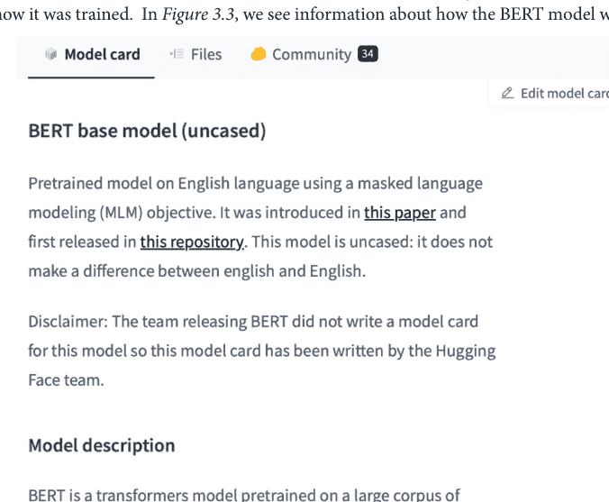
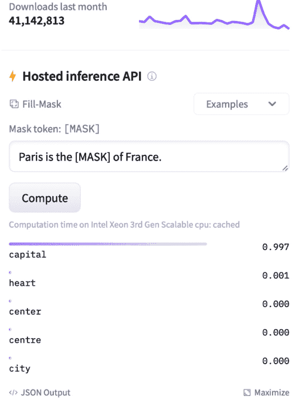
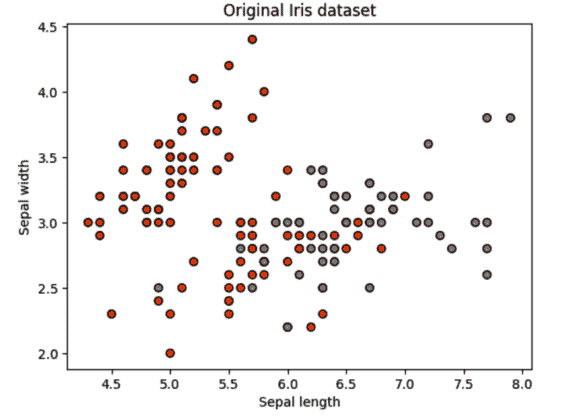
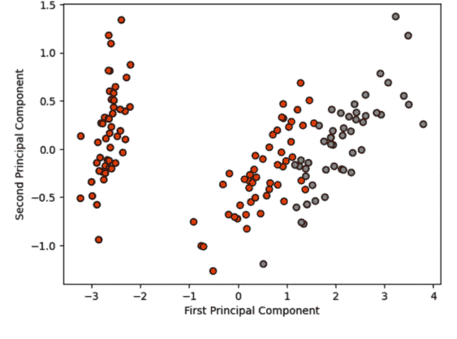

## Elastic 中的模型管理与向量考量

在本章中，我们将概述 Hugging Face 生态系统、Elasticsearch 的 Eland Python 库，以及在 Elasticsearch 中使用嵌入模型的实用策略。

我们将首先探索 Hugging Face 平台，讨论如何入门、选择合适的模型，以及利用其庞大的数据集集合。我们还将深入探讨 Hugging Face Spaces 的功能以及如何有效使用它们。

然后，我们将介绍由 Elastic 创建的 Eland Python 库，并通过 Jupyter Notebook 示例演示其用法。

本章将涵盖以下主题：

- 由 Elastic 创建的 Eland Python 库
- 索引映射
- **机器学习 (ML)** 节点
- 将 ML 模型集成到 Elasticsearch
- 规划集群容量的关键方面
- 存储效率策略，可帮助优化 Elasticsearch 集群的性能和资源利用率

## 技术要求

为了实现本章涵盖的概念，您需要以下内容：

- Elasticsearch 8.6 或更高版本：https://www.elastic.co/downloads/elasticsearch
- Eland 8.6 或更高版本：https://eland.readthedocs.io/en/latest/index.html
- Python 3.7 或更高版本：https://www.python.org/downloads/
- pandas 1.3 或更高版本：https://pandas.pydata.org/docs/getting_started/install.html

## Hugging Face

如介绍中简要讨论的那样，Hugging Face 的主要目标是民主化对最先进 NLP 技术的访问并促进其在各个行业和应用中的采用。通过提供大量预训练模型库（截至本文撰写时超过 120,000 个）、用户友好的 API，以及用于模型共享和微调的协作环境，Hugging Face 使开发人员和研究人员能够轻松创建先进的语言处理应用。

在此基础上，Hugging Face 不仅提供庞大的库，还确保流畅的访问和有效的应用管理。其突出功能之一是 Model Hub。

## Model Hub

Hugging Face 提供面向研究人员和企业的资源和服务。其中包括 Model Hub，它作为预训练模型的中央存储库，包括推理 API，可轻松访问这些模型。

模型可以通过名称或任务进行搜索，并可按任务类型架构等轻松筛选，以找到适合您用例的模型。在图 3.1 中，您可以看到我们在搜索术语 bert 时可用的模型列表：


图 3.1：Hugging Face 模型搜索结果页面

选择模型后，您将获得有关该模型的信息。在顶部，您将看到任务类型、可用架构、使用的库、语言、许可证等。在图 3.2 中，我们看到有关 bert-base-uncased 模型的信息：


图 3.2：Hugging Face Model Card 摘要信息

大多数模型，尤其是更受欢迎的模型，都有 Model Card。Model Card 包含开发者提供的信息，例如模型训练方式、详细描述、模型变体、相关模型、预期用途和限制、运行代码示例、已知偏差以及训练信息。在图 3.3 中，我们看到有关 BERT 模型训练方式的信息：



图 3.3：模型训练和描述信息

在图 3.4 中，我们可以看到上个月的下载次数，以及通常最有用的、托管推理 API 的实时界面。托管推理 API 允许以编程方式访问在 Hugging Face 共享基础设施上运行的模型，该模型将接受输入，通过模型处理并返回输出。此 API UI 允许您通过提供输入并查看输出来测试模型。



图 3.4：模型下载次数和测试推理 API

在讨论了 Model Hub 的相关性和其各种功能之后，同样重要的是要阐明为这些模型提供动力的底层数据。进入 Hugging Face Datasets，它是 NLP 和 ML 数据工具领域中的基石。

## Datasets

Hugging Face Datasets 是一个旨在简化下载、预处理和利用多样化数据集用于各种 NLP 和 ML 任务的过程的库。该库提供对大量数据集的访问，涵盖广泛的主题和语言，并适用于情感分析、翻译和摘要等多种用例。数据集来源于研究论文、网络抓取或用户贡献，并以标准化格式提供给社区。Hugging Face Datasets 的关键特性之一是其与 Transformers 库的直接集成，使用户能够轻松将这些数据集与 NLP 模型结合用于训练、评估和部署。

使用 Hugging Face Datasets 很简单。

首先，您需要使用 pip install datasets 安装库。安装库后，您可以通过导入库并使用 load_dataset() 函数来加载数据集。例如，如果您想加载 IMDb 电影评论数据集用于情感分析，可以使用以下代码：

```
from datasets import load_dataset
imdb_dataset = load_dataset("imdb")
```

Hugging Face Datasets 还提供用于数据集预处理和操作的有用功能，包括过滤、映射和洗牌。这些功能使用户能够轻松准备数据以供其模型使用。在此示例中，我们将使用 Transformers 库中的预训练分词器对 IMDb 数据集进行分词：

```
from datasets import load_dataset
from transformers import AutoTokenizer

#### Load a small portion of the IMDB dataset (100 samples)
imdb_dataset = load_dataset("imdb", split="train[:100]")

#### Initialize the tokenizer
tokenizer = AutoTokenizer.from_pretrained("bert-base-uncased")

#### Tokenize the IMDB dataset with truncation and padding
tokenized_imdb_dataset = imdb_dataset.map(
lambda x: tokenizer(x["text"], truncation=True, padding="max_length")
)

print(tokenized_imdb_dataset)
#### This prints out:
Dataset({
    features: ['text', 'label', 'input_ids', 'token_type_ids',
    'attention_mask'],
    num_rows: 100
})

#### Get the first row of tokens
first_row_tokens = tokenized_imdb_dataset[0]["input_ids"]

#### Print the first 10 tokens and their corresponding words
for token in first_row_tokens[:10]:
print(f"Token: {token}, Word: {tokenizer.decode([token])}")
```

这会打印出以下内容：

```
Token: 101, Word: [CLS]
Token: 1045, Word: i
Token: 12524, Word: rented
Token: 1045, Word: i
Token: 2572, Word: am
Token: 8025, Word: curious
Token: 1011, Word: -
Token: 3756, Word: yellow
Token: 2013, Word: from
Token: 2026, Word: my
```

在输出中，我们可以看到当我们运行 imdb_dataset['text'][0] 时，我们得到第一行的前 10 个标记和对应的词。

## Spaces

Hugging Face Spaces 是一个平台，旨在促进 ML 模型的部署、共享和协作，特别是专注于 NLP 的模型。借助 Spaces，用户可以轻松地将模型部署为交互式 Web 应用，由 Gradio 或 Streamlit 提供支持，无需额外的基础设施或复杂配置。Spaces 允许用户展示其工作成果、收集反馈并与社区中的其他人协作，使其成为 ML 和 NLP 领域经验丰富的从业者和初学者的宝贵工具。

Hugging Face Spaces 的关键特性之一是其与 Hugging Face 生态系统的无缝集成，包括 Transformers 库和 Hugging Face Hub。这种集成使用户能够快速将预训练或微调模型部署为交互式应用，使其他人能够测试模型并深入了解其功能。要开始使用 Spaces，用户需要在 Hugging Face 网站上创建账户并遵循部署新 Space 的指南。该过程通常涉及编写利用 Gradio 或 Streamlit 框架的 Python 脚本，从 Hugging Face Hub 导入所需模型，并为与模型交互定义用户界面组件。


让我们来看一下可以让你设置一个简单的 Gradio 界面的代码：

```
import gradio as gr
from transformers import pipeline
sentiment_pipeline = pipeline("sentiment-analysis")

def sentiment_analysis(text):
    result = sentiment_pipeline(text)
    return result[0]["label"]

iface = gr.Interface(fn=sentiment_analysis, inputs="text",
outputs="text")
iface.launch()
```

在这个示例中，使用 Hugging Face Transformers 库创建了一个情感分析 pipeline，并定义了一个 Gradio 接口来接受文本输入并将情感标签作为输出显示。一旦代码上传到 Hugging Face Space，用户就可以通过网络浏览器与应用程序交互，使用自己的文本输入测试情感分析模型。Spaces 提供了一种简单而强大的方式来展示 ML 模型并促进社区内的协作。


图 3.5：测试情感分析模型的一个简单示例

虽然 Hugging Face Spaces 为 NLP 应用提供了卓越的平台，但 Hugging Face 并不是我们唯一可用的资源。让我们通过将重点转移到 Eland 及其在 Elasticsearch 与传统数据处理框架（如 pandas）之间架起桥梁的作用上来丰富我们的工具箱。

## Eland

Eland 是 Elastic 开发的 Python 库，允许用户无缝地与 Elasticsearch 接口进行数据操作和分析。该库构建在官方 Elasticsearch Python 客户端之上，并扩展了 pandas API 到 Elasticsearch。这使得用户能够使用熟悉的 pandas 语法和约定与 Elasticsearch 数据交互，从而更轻松地将 Elasticsearch 与现有的数据分析工作流程和工具集成。

Eland 对于处理无法放入内存且需要分布式处理的大型数据集特别有用。Elasticsearch 可以通过将数据分布到集群中的多个节点来水平扩展。这使用户能够高效地处理比在笔记本电脑上可能处理的更大得多的<|message|> 集合。让我们来看一下 Eland 的一些功能：

- Eland 的一个关键用例是查询存储在 Elasticsearch 中的数据。用户无需编写原始 Elasticsearch 查询，而是可以编写类似于 pandas 语法的 Python 代码来过滤、排序和聚合数据。例如，你可以按如下方式从 Elasticsearch 索引中获取数据：
```
import eland as ed

df = ed.DataFrame("http://localhost:9200", "my_index")
filtered_df = df[df['some_field'] > 100]
```
- 除了数据查询和转换之外，Eland 还支持聚合，使用户能够生成汇总统计信息或对 Elasticsearch 数据计算复杂聚合。这对于理解大型数据集的分布和特征很有用。以下是如何计算特定字段平均值的示例：
```
average_value = df['some_field'].mean()
```
- Eland 还可用于数据可视化，因为它可与 Matplotlib 和 Seaborn 等流行的 Python 可视化库无缝集成。一旦使用 Eland 获取和操作数据，你就可以轻松地将结果转换为 pandas DataFrame 并创建可视化。以下是一个示例：
```
import seaborn as sns
import pandas as pd

filtered_df = df[df['some_field'] > 100]
pandas_df = filtered_df.to_pandas()
sns.boxplot(x='category', y='value', data=pandas_df)
```

最近，Eland 已扩展为将 NLP transformers 模型导入 Elasticsearch。Elasticsearch 目前支持在 PyTorch 中训练并符合标准 BERT 模型接口的一组选定架构。这允许 Elasticsearch 原生运行命名实体识别、零样本分类、问答等 NLP 任务。当前支持的任务列表可在文档中查看：https://www.elastic.co/guide/en/machine-learning/current/ml-nlp-model-ref.html。

与本书最相关的是对文本嵌入模型的原生支持。Eland 用于加载本地存储的模型，或更常见的是，直接从 Hugging Face 加载模型到 Elasticsearch。模型被下载然后分块，以便可以加载到 Elasticsearch 中。

现在我们将逐步介绍一个 Jupyter notebook，其中我们将配置 Elasticsearch 连接，从 Hugging Face 加载模型，部署（启动）模型，并生成测试向量。

完整代码可在本书 GitHub 仓库 chapter 3 文件夹中的 Jupyter Notebook 中查看：https://github.com/PacktPublishing/Vector-Search-for-Practitioners-with-Elastic/tree/main/chapter3。

在对 Eland 如何促进 Hugging Face 模型与 Elasticsearch 集成有了基础理解之后，让我们深入探讨使用代码的实际方面。接下来，我们将逐步了解如何将 Sentence Transformer 从 Hugging Face 高效加载到 Elasticsearch 中，阐明希望利用这些平台组合强大功能的人员的过程。

## 从 Hugging Face 加载 Sentence Transformer 到 Elasticsearch

此代码将向你展示如何将受支持的嵌入模型从 Hugging Face 加载到 Elastic Cloud 中的 Elasticsearch 集群：https://cloud.elastic.co/。

在这里，我们将安装并导入所需的 Python 库：

- eland
- elasticsearch
- transformers
- sentence_transformers
- torch==1.11

Elastic 使用 Eland 库从 Hugging Face Hub 下载模型并将它们加载到 Elasticsearch：

```
pip -q install eland elasticsearch transformers sentence_transformers torch==1.13
from pathlib import Path
from eland.ml.pytorch import PyTorchModel
from eland.ml.pytorch.transformers import TransformerModel
from elasticsearch import Elasticsearch
from elasticsearch.client import MlClient
```

### 配置 Elasticsearch 身份验证

推荐的身份验证方法使用 Elastic Cloud ID（https://www.elastic.co/guide/en/cloud/current/ec-cloud-id.html）和集群级 API 密钥（https://www.elastic.co/guide/en/kibana/current/api-keys.html）。

你可以使用任何你希望的方法来设置所需凭据。在此示例中，我们使用 getpass 来提示输入凭据以避免将它们存储在 GitHub 中：

```
import getpass
es_cloud_id = getpass.getpass('Enter Elastic Cloud ID: ')
es_api_id = getpass.getpass('Enter cluster API key ID: ')
es_api_key = getpass.getpass('Enter cluster API key: ')
#### Connect to Elastic Cloud
es = Elasticsearch(cloud_id=es_cloud_id, api_key=(es_api_id, es_api_key))
es.info() # should return cluster info
```

### 从 Hugging Face Hub 加载模型

Elastic Stack ML 功能支持符合标准 BERT 模型接口并使用 WordPiece 分词算法的 transformer 模型。

有关 WordPiece 分词的深入解释，请查看 Hugging Face NLP 课程的这一部分：https://huggingface.co/learn/nlp-course/chapter6/6?fw=pt。

使用如图 3.6 所示的复制链接从 Hugging Face 下载嵌入模型。

对于此示例，我们将使用 sentence-transformers/msmarco-MiniLM-L-12-v3 模型：https://huggingface.co/sentence-transformers/msmarco-MiniLM-L-12-v3。

### 下载模型

在这里，我们指定来自 Hugging Face 的模型 ID。获取此 ID 的最简单方法是单击复制模型名称的图标，该图标位于模型页面上名称旁边。


图 3.6：model_id 的复制位置

调用 TransformerModel 时，你指定 Hugging Face 模型的 ID 和任务类型。你可以尝试指定 auto，Eland 将尝试根据模型配置中的信息确定正确的类型。这并不总是可能的，因此可以设置特定 task_type 的列表：

```
hf_model_id='sentence-transformers/msmarco-MiniLM-L-12-v3'
tm = TransformerModel( model_id=hf_model_id, task_type="text_embedding")
```


接下来，我们设置并确认模型 ID。为了使名称与 Elasticsearch 兼容，/ 被替换为 __（双下划线）：

```
es_model_id = tm.elasticsearch_model_id()
```

以 TorchScript 形式导出模型，这是 Elasticsearch 使用的格式：

```
tmp_path = "models"
Path(tmp_path).mkdir(parents=True, exist_ok=True)
model_path, config, vocab_path = tm.save(tmp_path)
```

## 将模型加载到 Elasticsearch

在此，模型将被序列化并加载到 Elasticsearch，以便随后在 ML 节点上启动：

```
ptm = PyTorchModel(es, es_model_id)
ptm.import_model(model_path=model_path, config_path=None, vocab_path=vocab_path, config=config)
```

## 启动模型

此步骤将输出有关模型的信息，例如名称和状态：

```
#### List the in Elasticsearch
m = MLClient.get_trained_models(es, model_id=es_model_id)
```

## 部署模型

以下代码将在 ML 节点上加载模型并启动使其可用于 NLP 任务的过程：

```
s = MLClient.start_trained_model_deployment(es, model_id=es_model_id)
```

接下来，我们将验证模型是否已无问题启动：

```
stats = MLClient.get_trained_models_stats(es, model_id=es_model_id)
stats.body['trained_model_stats'][0]['deployment_stats']['nodes'][0]['routing_state']
```

你应该会看到以下输出，表明模型已部署到 ML 节点：

```
{'routing_state': 'started'}
```

## 为查询生成向量

在运行 kNN 查询之前，我们需要将查询字符串转换为向量。

接下来，我们将创建一个示例查询句子以验证一切是否已正确设置：

```
docs = [
    {
        "text_field": "Last week I upgraded my iOS version and ever since then my phone has been overheating whenever I use your app."
    }
]
```

我们调用 _infer 端点，它提供 model_id 和我们想要向量化的文档：

```
z = MLClient.infer_trained_model(es, model_id=es_model_id, docs=docs, )
```

第一个文档的向量可以在响应字典中访问，如下所示：

```
doc_0_vector = z['inference_results'][0]['predicted_value']
doc_0_vector
```

在加载并成功测试嵌入模型后，我们现在可以在生产环境中使用它。

## 在 Elasticsearch 中生成向量

向量可以在摄取期间在文档被索引（写入）到 Elasticsearch 之前使用摄取管道生成。摄取管道中的每个处理器执行不同的任务，例如丰富、修改或删除数据。该管道中的关键处理器是推理处理器，它将文本传递给嵌入模型，接收向量表示，然后在将文档传递以存储到索引之前将向量添加到原始文档负载中。这确保了文档的向量表示在摄取后立即可用于索引和搜索。

接下来是一个 Elasticsearch 摄取管道配置示例，它使用推理处理器与我们之前加载的 sentence-transformers/msmarco-MiniLM-L-12-v3 模型。管道从输入文档中获取名为 summary 的字段，使用嵌入模型对其进行处理以生成嵌入，并将生成的向量存储在名为 vector 的字段中。

这里，我们使用 HTTP 调用而不是 Python 代码来演示另一种方法。请注意，假设模型已在集群中加载，因为我们在之前的示例中已完成此操作：

```
PUT _ingest/pipeline/embedding_book_pipeline
{
  "description": "Ingest pipeline using bert-base-uncased model",
  "processors": [
    {
        "inference": {
            "target_field": "vector",
            "model_id": "sentence-transformers__msmarco-minilm-l-12-v3",
            "field_map": {
                "summary": "text_field"
            }
        }
    }
]
```

要在索引文档时使用此摄取管道，请在索引请求中包含 pipeline 参数：

```
PUT my_index/_doc/1?pipeline=embedding_book_pipeline
{
    "summary": "This is an example text for the embedding model."
}
```

此请求将索引一个文档，其中包含提供的文本字段和一个额外的向量字段，其中包含由 bert-base-uncased 模型生成的嵌入。

也可以直接调用 _infer 端点以在查询时（请参阅下一节）或出于任何其他临时原因生成向量：

```
POST _ml/trained_models/sentence-transformers__msmarco-minilm-l-12-v3/_infer
{
    "docs": [
    {"text_field": "How do I load an NLP model from Hugging Face"}
    ]
}
```

这将返回 200 响应代码和提交文本的向量表示：

```
{
    "inference_results": [
        {
            "predicted_value": [
                0.012806695885956287,
                -0.045506563037633896,
                0.014663844363951864,
                ...
                0.002125605707988143,
                0.06371472030878067
    ]
    }
]
}
```

在搜索时，可以调用 _infer 端点从输入文本生成向量，然后将其用作向量搜索查询的一部分。在这里，我们将使用之前生成的向量作为 kNN 查询的一部分：

```
GET search-elastic-docs-vectorized/_search
{
  "knn": {
    "field": "body_content-vector",
    "k": 1,
    "num_candidates": 20,
    "query_vector": [
      0.012806695885956287,
      -0.045506563037633896,
      0.014663844369351864,
      ...
      0.002125605707988143,
      0.06371472030878067
    ]
  },
  "fields": [ "body_content", "headings" ],
  "_source": false
}
```

或者，可以在 _knn 查询中指定嵌入模型（Elasticsearch 8.7 之后），Elasticsearch 将在运行其余 _knn 查询之前处理生成查询向量。这允许更简化的向量搜索功能集成并简化 kNN 搜索过程：

```
GET search-elastic-docs-vectorized/_search
{
  "knn": {
    "field": "dense-vector-field",
    "k": 10,
    "num_candidates": 100,
    "query_vector_builder": {
      "text_embedding": {
        "model_id": "my-text-embedding-model",
        "model_text": "The opposite of blue"
}
}
}
}
```

让我们看看如何在生产环境中规划集群容量和资源。

## 规划集群容量和资源

规划足够的集群容量和资源对于任何生产环境都至关重要，尤其是在实施相当规模的向量搜索用例时。为了确保最佳性能和效率，必须进行仔细的考虑、规划和测试。

在下一章中，我们将深入探讨负载测试，这是微调和优化 Elasticsearch 部署的重要部分。但在此之前，我们将探讨在 Elasticsearch 的 ML 节点上运行嵌入模型所需的条件，概述需要考虑的关键因素，以便在性能和资源利用之间取得正确的平衡。在本节中，我们将讨论 CPU、RAM 和磁盘需求的关键方面，为全面了解 Elasticsearch 中的资源管理奠定基础。

## CPU 和内存需求

Elasticsearch 中向量搜索的 CPU 需求与传统搜索没有太大区别。主要区别在于向量数据在 **近似 kNN**（为简单起见，我们在此称之为 **kNN**）查询期间如何被访问。

在传统搜索和暴力/精确匹配向量搜索中，随着更多文档的添加，磁盘空间会扩展，CPU 会扩展以适应增加的吞吐量。

在 Elasticsearch 中的 kNN 搜索中也是如此；然而，为了获得最快的响应时间，我们希望有足够的非堆 RAM 可用以将所有向量嵌入加载到内存中。当 Elasticsearch JVM 之外的 RAM 不足以容纳嵌入时，Elasticsearch 将不得不从磁盘读取，从而导致响应时间变慢，尤其是在频繁发生时。这种数据访问方式的转变可以提高性能，因为观察到当向量必须从磁盘而不是直接从内存读取时，更有可能出现热线程。通过直接从非堆 RAM 访问数据，向量搜索减少了这些热线程的影响并提供更高效的查询过程。

> **注意**
> `hot_threads` 是一个诊断 API，提供有关 Elasticsearch 节点中当前运行的最繁忙内部任务的见解。它通过突出显示消耗异常高 CPU 资源线程来帮助识别性能瓶颈。


鉴于 kNN 搜索对 page-cache 内存需求尤为重要，用户需要留意有多少个向量能放入节点的可用 page-cache RAM 中。假设使用分层可导航小世界 Hierarchical Navigable Small World (HNSW) 的默认配置，所需字节数的粗略计算如下：

```
num_vectors * 4 * (num_dimensions + 12) = total RAM in bytes
```

举例来说，如果你使用的是输出 512 维向量的模型，并且预计要将 2000 万个向量加载到 Elasticsearch 中，公式如下：

```
20,000,000 * 4 * (512 + 12) = 41,920,000,000 bytes
41,920,000,000 / 1024 ~= 39 GB RAM
```

2000 万个 embedding 字段大致估算需要约 39 GB 的 off-heap RAM 才能使 kNN 搜索性能最佳。如果将 Elasticsearch 中的一个完整节点视为 64 GB——其中一半分配给 Elasticsearch JVM，几 GB 分配给操作系统和其他进程——那么初步估算需要 2 个数据节点来处理这些向量。此外，请注意这尚未考虑副本。

这只是一个初步估算，是开始测试时一个不错的起点。它并非精确的 RAM 需求。后续章节中将介绍的测试将在投入生产前为你提供最佳数值。

在明确了 RAM 使用的要求和影响后，我们将注意力转向生态系统中的另一个关键资源：存储。

## 磁盘需求

正如我们所见，kNN 搜索性能的首要考虑因素之一是确保有足够的 off-heap RAM 可用于存储向量。然而，需要注意的是，这些向量仍然是在磁盘上生成和存储的。因此，用户必须确保有足够的存储空间可用。不过，由于磁盘大小相对于 RAM 大小，磁盘容量在规划集群容量时通常不是限制因素。

上一节中提到的估算所需 RAM 的公式与向量数据的磁盘容量计算相同，但你还需要考虑与向量一起存储的任何其他字段，例如向量的文本、其他文本字段和元数据。

磁盘容量的粗略初始估算如下：

```
size of a single document * number of documents * number of replicas * 1.2
```

这里，1.2 是 JSON 扩展与磁盘压缩之间的净乘数。请注意，这是一个非常粗略的估算。

然而，了解你的数据在 Elasticsearch 中的表现的唯一真实方法就是加载一个样本数据集。你可以轻松使用 Elastic Cloud 的免费试用版来启动一个小型集群并加载一个小型的代表性数据集。开始试用非常快速，只需在 https://cloud.elastic.co/registration 提供一个电子邮件地址即可。

你将获得一个小型、功能齐全的 Elasticsearch 集群，包括一个 ML 节点和所有企业功能。https://www.elastic.co/getting-started 上的入门指南可以帮助你快速上手。

加载数据后，你将能够看到数据实际扩展后的确切大小，这是规划生产需求的唯一真实方法。即使在免费试用期结束后，你也可以根据需要逐步扩展集群，采用灵活的按月付费方式。

你可以使用下一节介绍的磁盘使用 API 来查看磁盘使用情况，我们将在下一章介绍集群调优、负载测试和完整扩容测试。

既然我们已经讨论了了解数据大小和扩展影响的重要性，那么拥有能够提供这些资源实际使用情况精确洞察的工具就至关重要。Elasticsearch 套件中这样一个关键工具就是 analyze disk usage API。让我们探讨其功能以及它如何帮助了解磁盘空间消耗。

## Analyze Index Disk Usage API

一旦向量和其他数据被加载到 Elasticsearch 中，你可以使用 **analyze index disk usage API** 来计算占用的磁盘空间。对于 analyze disk usage API 的更多信息，请访问文档页面 https://www.elastic.co/guide/en/elasticsearch/reference/current/indices-disk-usage.html。

search-elastic-docs 索引包含多个数据量相对较小的向量字段，其中之一是 title-vector：

```
POST /search-elastic-docs/_disk_usage?run_expensive_tasks=true&pretty
```

这会给出以下响应（API 调用的完整响应非常长，这里仅显示包含相关部分的截断输出）：

```
{
  "_shards": {
    "total": 2,
    "successful": 2,
    "failed": 0
  },
  "search-elastic-docs": {
    "store_size": "989.5mb",
    "store_size_in_bytes": 1037592858,

```

```
"all_fields": {
    "total": "987.6mb",
    "total_in_bytes": 1035596641,
    "inverted_index": {
        "total": "69.8mb",
        "total_in_bytes": 73269048
    },
...
    "knn_vectors": "83.4mb",
    "knn_vectors_in_bytes": 87462952
},
"fields": {
...
    "title-vector": {
        "total": "40mb",
        "total_in_bytes": 42046916,
        "inverted_index": {
            "total": "0b",
            "total_in_bytes": 0
        },
...
        "knn_vectors": "40mb",
        "knn_vectors_in_bytes": 42046916
    },
...
```

我们可以看到向量占用了 83.4 MB。分析完磁盘使用情况后，我们可以将注意力转向 ML 节点容量规划。

## ML 节点容量

对于在 Elasticsearch 的 ML 节点上运行的 embedding 模型，你需要规划以确保节点在推理时有足够的容量来运行模型。Elastic Cloud 允许根据 CPU 需求自动扩展 ML 节点，这使得它们在计算需求增加时能够扩展，并在需求降低时缩减。

我们将在下一章更详细地介绍为推理调优 ML 节点，但至少，你需要一个具有足够 RAM 来加载至少一个 embedding 模型实例的 ML 节点。随着性能需求的增加，你也可以增加单个模型的分配数量以及每个分配分配的线程数。

要检查模型的大小以及加载模型所需的内存量，你可以运行 get trained models statistics API（有关此 API 的更多信息，请访问文档页面 https://www.elastic.co/guide/en/elasticsearch/reference/current/get-trained-models-stats.html#get-trained-models-stats）：

```
GET _ml/trained_models/dslim__bert-base-ner-uncased/_stats?human
```

这将返回各种统计信息，包括模型大小和内存需求：

```
{
  "model_id": "dslim__bert-base-ner-uncased",
  "model_size_stats": {
    "model_size": "415.4mb",
    "model_size_bytes": 435663717,
    "required_native_memory": "1gb",
    "required_native_memory_bytes": 1122985674
  },
}
```

当模型运行时，你也可以在 Kibana UI 中通过进入 Machine Learning > Model Management > Trained Models 并展开模型 ID 来获取其统计信息。

在规划 ML 节点容量时，需要考虑两种不同的情况：

- 索引时：通常，会有大量文档的初始批量加载到 Elasticsearch 索引中，这需要生成向量。这会对 ML 节点产生很大的需求，要求它们尽可能快地运行推理。这就是能够轻松扩展 ML 节点并动态增加模型分配数量的能力非常有用的地方。你可以在初始批量加载运行时扩展模型分配，然后在加载完成后减少分配。

- 搜索时推理：当用户发送搜索查询时，你需要使用与生成文档向量相同的 embedding 模型来生成查询向量。跟上平均查询负载将有助于你规划正常运行规模。如果预计查询负载会出现计划性峰值，例如电子商务中的繁忙购物周末，你可以主动增加模型分配数量，从而扩展 ML 节点。

测试这两种条件的唯一真实方法是对实际数据进行负载测试和性能调优，我们将在下一章更深入地介绍。


## 存储效率策略

随着用于向量搜索的生产数据集规模不断增长，用于存储这些向量以及及时搜索它们所需的资源也在增加。在本节中，我们讨论了用户可以采取的几种策略来减少这些资源。每种策略都有其权衡，在投入生产之前应仔细考虑并彻底测试。

### 降低维度

降低维度是指将高维数据转换为低维表示的过程。该过程通常用于缓解处理高维数据时出现的问题，例如维度灾难（https://en.wikipedia.org/wiki/Curse_of_dimensionality）。降维技术，如主成分分析（PCA）和 t-分布随机邻域嵌入（t-SNE），可以帮助提高 kNN 向量搜索的效率和有效性。然而，降低维度也存在优点和缺点。

降低维度的一个显著优点是存储、内存和计算需求的减少。高维向量数据可能消耗大量 RAM 和 CPU 资源，使其在 Elasticsearch 中难以处理。通过将数据转换为低维表示，所需的堆外 RAM 和计算量减少，从而可能提高 kNN 向量搜索算法的效率，并使其能够在资源受限的环境中应用。

降低维度的另一个优点是它可以帮助缓解维度灾难现象，该现象在维度数量增加且数据点变得越来越稀疏时出现。这种稀疏性可能导致基于距离的算法性能不佳，因为高维空间中数据点之间的距离变得不那么有意义。降低维度可以通过在低维空间中有效捕获最相关信息来缓解此问题，使基于距离的搜索算法更有效。

然而，降低维度也有一些缺点。其中一个主要缺点是信息可能丢失。降维技术通常涉及某种程度的近似或压缩，这可能导致数据中微妙关系或细微差别的丢失。这种信息丢失会影响 kNN 向量搜索的准确性和有效性，因为降维表示可能无法完全捕获原始高维空间中数据点之间的关系。

另一个缺点是降维过程带来的额外复杂性和计算开销。应用降维技术通常需要额外的计算和资源，这可能会抵消从降低数据维度中获得的部分收益。此外，选择合适的降维技术并调整其参数可能具有挑战性，因为最佳选择通常取决于数据的特定特征和问题领域。

以下是使用 Iris 数据集的示例，该数据集有四个维度，并使用 PCA 将其降维到两个：

```
import numpy as np
import matplotlib.pyplot as plt
from sklearn import datasets
from sklearn.decomposition import PCA

#### Load the Iris dataset
iris = datasets.load_iris()
X = iris.data
y = iris.target

#### Apply PCA for dimensionality reduction
pca = PCA(n_components=2)
X_reduced = pca.fit_transform(X)

#### Visualize the original data
plt.scatter(X[:, 0], X[:, 1], c=y, cmap=plt.cm.Set1, edgecolor='k')
plt.xlabel('Sepal length')
plt.ylabel('Sepal width')
plt.title('Original Iris dataset')
plt.show()

#### Visualize the reduced data
plt.scatter(X_reduced[:, 0], X_reduced[:, 1], c=y, cmap=plt.cm.Set1, edgecolor='k')
plt.xlabel('First Principal Component')
plt.ylabel('Second Principal Component')
plt.title('Iris dataset after PCA')
plt.show()
```

图 3.7 中的散点图显示了原始数据和降维后数据的分布。降低维度会导致一些信息丢失，但它也可以使数据更易于管理并提高基于距离的算法（如 kNN 搜索）的性能。





图 3.7：在 PCA 之前和之后可视化 Iris 数据集

另外，一些预训练模型会发布不同维度的大小。如果您从具有这些选项的预训练模型开始，在尝试自行进行降维之前，测试其中较小的维度选项是值得的。

### 量化

量化是向量搜索中用于减少高维数据的大小和复杂性，同时保持执行有意义搜索操作的能力的技术。量化过程涉及将连续向量值，通常表示为浮点数，转换为更小且更紧凑的表示形式，例如整数。这种转换减少了与高维数据相关的存储和计算需求，从而实现更高效的搜索和检索操作。

从浮点表示转换为 8 位向量会对数据的大小和存储需求产生重大影响。浮点数通常需要 32 或 64 位来表示单个值，而 8 位向量每个值仅使用 8 位。这种尺寸的减少可以带来存储和内存需求的实质性节省，从而能够高效处理大规模向量搜索应用。然而，这种压缩可能会以降低精度和准确性为代价，因为量化过程涉及用较少离散级别近似原始浮点值。这种精度损失可能会影响搜索结果的相关性，因为量化向量之间的距离可能无法完美反映原始高维空间中数据点之间的关系。

为了演示量化过程，让我们使用 scikit-learn 库中可用的 Public Digits 数据集，它是 MNIST 数据集的较小版本，包含 8x8 像素的手写数字图像。该数据集足够小，可以在笔记本电脑上运行，而无需太多内存或计算能力。我们将使用 PCA 方法进行降维，然后对降维后的向量应用量化：

```
import numpy as np
from sklearn import datasets
from sklearn.decomposition import PCA
from sklearn.preprocessing import MinMaxScaler, QuantileTransformer

#### Load the digits dataset
digits = datasets.load_digits()
X = digits.data

#### Print the first example from the original dataset
print("Original dataset (first example):\n", X[0])

#### Apply PCA for dimensionality reduction
pca = PCA(n_components=10)
X_reduced = pca.fit_transform(X)

#### Print the first example after PCA
print("\nReduced dataset after PCA (first example):\n", X_reduced[0])

#### Normalize the reduced vectors to the range [0, 255]
scaler = MinMaxScaler((0, 255))
X_scaled = scaler.fit_transform(X_reduced)

#### Print the first example after normalization
print("\nScaled dataset after normalization (first example):\n", X_scaled[0])

#### Quantize the scaled vectors to 8-bit integers
X_quantized = np.round(X_scaled).astype(np.uint8)

#### Print the first example after quantization
print("\nQuantized dataset (first example):\n", X_quantized[0])
```

这将输出以下内容：

```
Original dataset (first example): [ 0. 0. 5. 13. 9. 1. 0. 0. 0. 0. 13. 15. 10. 15. 5. 0. 0. 3. 15. 2. 0. 11. 8. 0. 0. 4. 12. 0. 0. 8. 8. 0. 0. 5. 8. 0. 0. 9. 8. 0. 0. 4. 11. 0. 1. 12. 7. 0. 0. 2. 14. 5. 10. 12. 0. 0. 0. 0. 6. 13. 10. 0. 0. 0.]
Reduced dataset after PCA (first example): [-1.25943119 21.27487713 -9.4630716 13.01409073 -7.12874004 -7.44073278 3.25357601 2.55756705 -0.58760376 3.63146582]
Scaled dataset after normalization (first example): [121.31621096 215.95604417 81.58062648 168.0966397 77.88288852 73.75078201 132.99089292 135.63851202 121.03524697 151.29258751]
Quantized dataset (first example): [121 216 82 168 78 74 133 136 121 151]
```

如前所述，虽然此过程可以带来显著的存储和性能改进，但也可能导致精度和搜索相关性降低。在考虑量化时，用户应在量化前后测试搜索结果的相关性，以查看降低是否可接受，然后再投入生产。

降低维度和量化是用于优化嵌入模型和向量表示的两种技术，但它们服务于不同的目的并解决数据的不同方面。降低维度针对向量表示中的维度数量，而量化则侧重于减少向量中每个元素的精度。这两种技术都可以提高效率并减少内存需求，但也可能引入一些信息或精度的损失，这可能会影响搜索结果的准确性和质量。

在讨论了优化向量表示的细微差别之后，重要的是要注意，系统的效率不仅取决于数据本身，还取决于数据的存储和检索方式。对于 Elasticsearch 和向量搜索，_source 字段发挥着关键作用，尤其是在处理高维数据时。让我们讨论 dense_vector 在 _source 字段中的含义及其对搜索性能的潜在影响。


## 从 _source 中排除 dense_vector

Elasticsearch 在索引时将原始 JSON 文档存储在 _source 字段中。默认情况下，搜索结果中的每个匹配项都包含完整文档。然而，当文档包含高维 dense_vector 字段时，_source 字段可能会变得相当大，导致加载数据时产生大量开销。因此，kNN 搜索的速度可能会显著降低，因为处理这些更大的 _source 字段需要额外的时间。

为缓解此问题，您可以使用 excludes 映射参数禁用在 _source 中存储 dense_vector 字段。这种方法可防止在搜索操作期间加载和返回大型向量，从而减少处理开销和索引大小。尽管被从 _source 中省略，向量仍可用于 kNN 搜索，因为搜索过程依赖于单独的数据结构以高效执行搜索。

在应用 excludes 参数之前，了解从 _source 中省略字段的潜在缺点非常重要。这样做可能会限制检索文档或执行需要访问原始字段值的某些更新操作的能力。

映射中此设置的示例如下：

```
PUT my_index
{
  "mappings": {
    "_source": {
      "excludes": [
        "vector_field"
      ]
    },
    "properties": {
      "vector_field": {
        "type": "dense_vector",
        "dims": 384,
        "index" : True,
        "similarity" : "dot_product"
      },
      "text_field": {
        "type": "text"
      }
    }
  }
}
```

除非您计划在某时重新索引该字段，否则对于任何包含 `dense_vector` 字段的索引，用户都应考虑设置此项，因为它将节省空间并提高 kNN 搜索速度。

在 Elasticsearch 中从 `_source` 中排除 `dense_vector` 字段可以实现高效的 kNN 搜索速度并减少索引大小。然而，用户应权衡其优点与潜在的重新索引需求，确保为其特定用例提供优化且有效的存储方法。

## 摘要

在本章中，我们深入探讨了 Hugging Face 生态系统的复杂性以及 Elasticsearch 的 Eland Python 库的功能，并提供了在 Elasticsearch 中使用嵌入模型的实用示例。我们探索了 Hugging Face 平台，强调了其数据集、模型选择以及其 Spaces 的潜力。此外，我们提供了对 Eland 库的实践方法，说明了其功能并解决了映射、ML 节点和模型集成等关键考虑因素。我们还触及了集群容量规划的细微差别，强调了 RAM、磁盘大小和 CPU 的考虑。最后，我们强调了多种存储效率策略，重点关注降维、量化以及映射设置，以确保您的 Elasticsearch 集群获得最佳性能和资源节约。

在下一章中，我们将深入数据工作的运营阶段，并学习如何为推理和查询调优性能。
