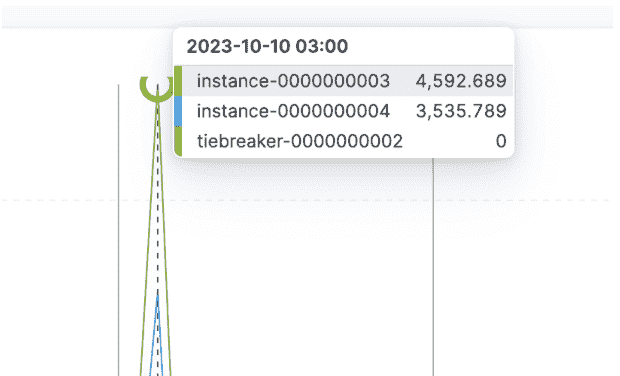

## 性能调优 – 处理数据

在上一章中，我们介绍了如何将 Elasticsearch 与 **机器学习 (ML)** 模型集成。在本章中，我们将重点关注优化 Elasticsearch 中的向量搜索性能。

我们将涵盖以下主题：

- ML 模型部署调优技术
- 估算 Elasticsearch 节点的向量容量
- 使用 Elastic 的性能工具 Rally 进行负载测试
- 排查缓慢的 **k-最近邻 (kNN)** 搜索响应时间

到本章结束时，您将了解如何估算用例所需的 Elasticsearch 节点数量，如何使用性能基准测试确保这些估算符合您的要求，以及识别缓慢 kNN 搜索响应时间的潜在原因。

让我们开始部署一个 **自然语言处理 (NLP)** 模型。

## 部署 NLP 模型

部署 NLP 模型需要选择一种部署方法，该方法能够在生产高峰期间处理预期的推理负载，同时高效且安全。在测试阶段，如果模型足够小，通常可以在本地运行。然而，生产用例需要生产部署策略。模型可以部署在虚拟机上，通过云提供商服务部署，在 Hugging Face 等专用模型托管服务上部署，或在可能的情况下部署在向量将被使用的同一服务中，例如 Elasticsearch。每种方法在效率、延迟、扩展和管理之间都有权衡。

与外部部署方法的交互通常涉及使用 API 发送文本输入并接收向量作为输出。无论向量如何生成，它们都会发送到数据存储以进行存储，并且以后可以使用精确匹配或近似最近邻搜索进行搜索。查询时生成的向量用于搜索之前存储的向量。

为获得最佳性能和效率而调优已部署模型可能涉及对硬件资源、软件配置和模型参数等因素进行调整。然而，具体的调优指南超出了本书的范围。

在 Elasticsearch 中部署嵌入模型时，模型在 Elasticsearch 集群内的专用 ML 节点上运行。这使得模型与 Elasticsearch 的搜索和索引功能无缝集成。我们接下来将介绍一些部署调优设置。

## 将模型加载到 Elasticsearch

Elasticsearch 版本 8.0+ 原生支持 libtorch，即 pytorch 中使用的 C++ 库。这使其能够在堆栈内运行基于 PyTorch 的模型并生成嵌入。

要将模型加载到 Elasticsearch，我们将使用上一章中讨论的 Eland Python 库。Eland 支持从本地驱动器加载模型或受支持的架构，但最简单的方法是从 Hugging Face 加载模型。文档涵盖了当前受支持的模型类型：https://www.elastic.co/guide/en/machine-learning/current/ml-nlp-model-ref.html。

在以下示例中，我们将直接从 Hugging Face 使用 Eland 加载 sentence-transformers/msmarco-MiniLM-L-12-v3 (https://huggingface.co/sentence-transformers/msmarco-MiniLM-L-12-v3) 模型。Eland 将下载模型并将其分块以加载到 Elasticsearch。

在上一章中，我们介绍了如何使用 Python 将 NLP 模型加载到 Jupyter Notebook 中。作为提醒，您可以在本书 GitHub 仓库的 chapter 3 文件夹中查看使用 Eland 的 Python 代码：https://github.com/PacktPublishing/Vector-Search-for-Practitioners-with-Elastic/tree/main/chapter3。

或者，如果您只需要使用它来加载模型，也可以将 Eland 与 Docker 一起使用。Docker 是一个开源平台，可在轻量级且可移植的容器内自动化应用程序的部署。它确保软件在从一个计算环境移动到另一个环境时可靠运行。它通过使用容器来简化开发流程，容器允许开发人员将应用程序及其所有依赖项打包到软件开发的标准单元中。有关安装和使用 Docker 的更多信息，请访问 www.docker.com。

Eland Docker 容器（一个标准化的、封装的环境，可在底层系统和其他容器之外隔离运行应用程序及其依赖项）可以从 Eland GitHub 仓库下载：https://github.com/elastic/eland。

要使用 Docker 从 Hugging Face 安装模型，您可以运行以下命令：

```
$ docker run -it --rm --network host \
  elastic/eland \
  eland_import_hub_model \
  --url http://host.docker.internal:9200/ \
  --hub-model-id sentence-transformers/msmarco-MiniLM-L-12-v3\
  --task-type ner
```

模型加载后，让我们看看如何部署它，以及我们有哪些配置选项。

## 模型部署配置

一旦模型加载到 Elasticsearch 中，它必须被部署或启动。模型在 ml 节点类型的节点上运行，就像在 Elastic Cloud 中部署时一样。

NLP 模型，例如嵌入模型，可以通过配置分配数和每个分配的线程数来扩展以处理所需生产推理负载：

- **分配数**: 在启动模型时增加分配数设置会增加模型在所有可用 ML 节点上的分配量。增加分配数通常会提高整体吞吐量。此设置即使在模型已启动后也可以增加或减少。
- **每个分配的线程数**: 增加每个分配的线程数会影响每个模型实例使用的 CPU 线程数。增加此数字通常会改善每个请求的推理时间。此值只能在模型部署时更改。

这两个设置的组合不得超过所有可用 ML 节点上可用的线程总数。增加这些数字时会出现收益递减点。您应使用特定工作负载进行测试以找到最佳设置：


Figure 4.1: Model deployment settings

Loading the model will allow us to begin using it in performance testing before we move to a production setting. Let’s look at the tool we have available to accomplish this.

## Load testing

Benchmarking ingest and queries in Elasticsearch plays a crucial role in optimizing the performance of search and analytics operations. With Elasticsearch being widely used for handling large volumes of data, it is essential to ensure that both ingestion and query performance are as efficient as possible. To achieve this, it is necessary to identify bottlenecks and areas for improvement within the system. This can be done through a thorough process of benchmarking and performance testing, allowing users to identify and resolve any performance issues before they become critical.

## Rally

Rally is a free benchmarking tool developed by Elastic that allows users to measure and optimize Elasticsearch performance. Rally can be used to benchmark various Elasticsearch operations, such as indexing, searching, and aggregating data. It is designed to support a wide range of scenarios and workloads, making it an ideal choice for users who want to ensure that their Elasticsearch clusters are running at peak performance. In this chapter, we will be focusing on using Rally to benchmark the performance of vector search in Elasticsearch, an essential aspect of many advanced search use cases.

Rally provides a set of tracks and datasets that represent various types of data, such as logging, metrics, security, and vectors. Users can use these provided tracks to benchmark a cluster as they make changes to configurations and/or version upgrades.

While there are many components to the Rally framework, the three main components we will be working with are as follows:

- **Track:** A track in Rally represents a series of benchmarks and workloads that simulate different operations (such as indexing or querying) against Elasticsearch
- **Race:** A race in Rally is an execution of a track, where the performance of Elasticsearch operations is measured under specific conditions
- **Challenge:** A challenge within Rally is a specific set of operations or tasks within a track, designed to test different aspects of Elasticsearch's performance under varying configurations and loads.

In Rally, a track defines the operations to be benchmarked, a challenge specifies the particular tasks and conditions under which the track is executed, and a race is the actual run of the challenge on the track to measure Elasticsearch's performance.

Users will get the most benefits when they take the time to create custom tracks with their data and configure Rally to use queries that are of the same structure so that they can used in production. One of the largest benefits provided by Rally is the ability to run repeatable tests as the user changes their data. This is especially useful early in the data cluster architecting phase to test how settings such as the number of shards and replicas and the number of docs on a single node will affect indexing speed and query response times.

Follow the download instructions for your environment, as outlined in the documentation at https://esrally.readthedocs.io/en/stable/install.html.

We will be using a vector track from Rally that's been specifically designed to benchmark advanced searches on dense vector fields. This track, known as the StackOverflow vector track, is derived from a dataset of StackOverflow posts and contains a variety of fields, including dense vectors, to support advanced search features such as ANN with filtering and hybrid search. By using this vector track, we will be able to measure and optimize the performance of vector search in Elasticsearch and gain insights into the best practices for managing Elasticsearch clusters that handle high-dimensional vector data.

> **Note**
> By default, Rally will output a large set of metrics to a log file, but an Elasticsearch cluster can be configured to collect these results. The results can then be searched and visualized on a Kibana dashboard so that you can compare tests.

Now that we know what Rally does, let's learn how to run it.

## Setting up our Python environment to run Rally

In this section, we will provide code snippets and descriptions that you can use as examples. You can copy and run these examples to follow along with the benchmarking process:

- 1. Create a Python virtual environment:
```
sudo apt-get install python3-venv
python3 -m venv rally_testing
source rally_testing/bin/activate
pip install --upgrade pip
```
- 2. Install the necessary dependencies and packages:
```
sudo apt-get install gcc libffi-dev python3-dev
pip install elasticsearch
```
- 3. Install Rally and the StackOverflow track:
```
pip install esrally
esrally --version
esrally list tracks
```

Now that we’ve set up our Python environment to run Rally, let’s see how to configure Rally.

## Configuring Rally

Next up, we will configure Rally to send metrics to an Elasticsearch cluster. The best practice is to send metrics to a separate cluster from the one you are benchmarking.

All the available options for reporting can be found in the documentation: https://esrally.readthedocs.io/en/stable/configuration.html?highlight=reporting#reporting.

Open the rally.ini file in a text editor of choice and modify the [reporting] section. When you are done editing, the .ini file should look as follows. This example is connecting to a dedicated monitoring cluster in Elastic Cloud. A monitoring cluster allows you to collect reporting metrics over time:

```
vim ~/.rally/rally.ini
[reporting]
datastore.type = elasticsearch
datastore.host = my_monitoring_cluster.es.us-central1.gcp.cloud.es.io
datastore.port = 9243
datastore.secure = true
datastore.user = rally
datastore.password = rally_password
```

With Rally configured, let’s move on to benchmarking our Elasticsearch cluster.

## Running a race on an existing cluster

We will be benchmarking an existing Elasticsearch test cluster to ensure our test Elasticsearch cluster is configured the way we need it for the test. We will pass the track information and test cluster information on the command line.

> **Warning**
> Do not benchmark a production cluster! Benchmarking is designed to find the limits of performance and can cause slowdowns in normal operations. This is expected when testing but it can affect the performance of a production environment where performance is critical to business operations.

More information can be found in the Rally docs: https://esrally.readthedocs.io/en/stable/recipes.html#benchmarking-an-existing-cluster.

Let’s break down the arguments for esrally:

- `race`: This tells esrally we will run a race
- `--track`: This defines the track we will use
- `--target-hosts`: This specifies which hosts we will run against – in this case, a test cluster in Elastic Cloud
- `--pipeline=benchmark-only`: This tells esrally not to create a new cluster and to use an existing one
- `--client-options`: This specifies the required options when security is enabled

Executing all these arguments with esrally looks like this:

```
esrally race --track=so_vector --target-hosts=deployment_name.es.us-central1.gcp.cloud.es.io:9243 --pipeline=benchmark-only --track-params ingest_percentage:100 --client-options="use_ssl:true,verify_certs:true,basic_auth_user:'elastic',basic_auth_password:'elastic_password'"
```

Please note that the so_vector track is over 32 GB in size.

Rally will start to run. It will download the track data if it has not been downloaded already.

Now that we understand how to run Rally, the next step is to get an Elasticsearch node ready for testing. To do that, we need to estimate how many vectors will “fit” on a single node.

## RAM estimation

For kNN search to be performant, vectors need to “fit” in off-heap RAM on the data nodes. See the kNN performance tuning documentation for more information: https://www.elastic.co/guide/en/elasticsearch/reference/current/tune-knn-search.html#ensure_data_nodes_have_enough_memory.

As of Elasticsearch version 8.7+, the rough estimate required for vectors is as follows:

```
num_vectors * 4 * (num_dimensions + 12)
```

Let's take a closer look:

- num_vectors: This is the count of individual vector fields. If you have 9 million documents and 1 vector per doc, the count would be 9 million. If you have 1 replica, then the count would be 18 million.
- num_dimensions: This is the number of dimensions the embedding model generates.

Note that this formula applies to float-type vectors only.

As an example, with 9 million vector fields, one per document, we would have the following:

```
9000000*4*(768 +12) =~ 26.2GB of RAM
```

This gives us a starting estimate of 26 GB of RAM (off-heap from the Elasticsearch JVM) required across the data nodes for performant kNN search. Note that each replica that's added requires the same amount of additional RAM. A standard Elasticsearch node is set up with the JVM taking half the available RAM. So, we are estimating that a standard 64 GB Elastic Cloud data node should be able to handle keeping 9 million 768 dimension vectors in cache. But we need to test this to confirm that this is the case!

With our estimate in place, we can begin the benchmarking process.

## Benchmarking vector search

As mentioned previously, Rally is a full-performance benchmarking tool with many uses and advanced configurations. Covering them all would take a book of its own, so we will just provide a high-level overview here. Rally has extensive documentation at https://esrally.readthedocs.io.

When using Rally to benchmark vector search, especially kNN search, the approach is fairly straightforward but intentionally methodical:

- 1. Start with a single full-sized node, such as a VM of 60 GB or 64 GB or RAM. By default, the Elasticsearch JVM will take half, but you can also experiment by configuring 16 GB JVM heaps.
- 2. Configure a test index to have a single primary shard and zero replicas.


+   3. 使用前面讨论的 RAM 计算，将估计向量的 60% 索引到单节点中。
+   4. 使用仅配置为搜索查询的自定义 track 运行 Rally。
+   5. 分析结果，同时注意 **service time** 和 **latency**：
+      - Service time 是在 Elasticsearch 中实际运行查询所需的时间。
+      - Latency 是从 Rally 将查询排队到任务完成的总时间。你通常希望延迟尽可能低。
+   6. 再向集群加载额外的 10% 文档。
+   7. 重复 Rally 测试并分析结果。
+   8. 如果时间保持一致，继续缓慢加载文档并重新运行 Rally，直到指标急剧增加。
+   9. 当响应时间飙升时，可以认为上一次“良好”运行的文档数量接近单节点在 RAM 中保存向量的容量。
+   10. 你可以通过运行 GET `/_nodes/hot_threads` 来确认这一点（本章后面会讨论）。

你需要使用这种方法来测试，以确定可以“容纳”在非堆 RAM 中的最大向量数量。然而，需要记住的是，标准的 Elasticsearch 每分片 10 至 50 GB 的指导原则仍然适用，因为在撰写本文时，搜索单个分片仍然是单线程的。

更多的主分片有可能通过将传入的文档分散到更多的数据节点（如果存在）来改善索引时间。对于快速搜索响应时间要求而言，目标通常是分片大小建议的较低端，这通常能获得最佳性能。

## Evaluating results

在本节中，我们将查看一些示例测试运行，使用以下值：

- 使用默认设置的 cohere_vector rally track：`github.com/elastic/rally-tracks/tree/master/cohere_vector`
- 向量为 768 维 `float32`
- 一个热节点，RAM 为 64 GB，使用 DATAHOT.N2.68X10X45 Elastic Cloud 配置
- 根据粗略计算，1100 万个向量在 8.10.3 Elasticsearch 中大约占用 32 GB RAM

每个用例都有其自身的一组要求。“可接受”的响应时间也必须通过考虑以下因素来决定：

- 数据的使用方式 – 外部用户、内部用户、程序化查询
- 要查询的数据大小
- 预算

这些只是几个例子。当你决定项目必须达到的响应时间时，所有这些因素都会发挥作用。

对于我们的测试示例，我们的目标响应时间小于 300 毫秒。该测试旨在帮助你了解单节点的性能，然后我们再扩展到多节点生产集群。

## Testing with 7.2 million vectors

此处的响应时间被认为是可以接受的：

| 50th percentile service time | standalone-knn-search-100-1000-single-client | 63.2092 | ms |
| 90th percentile service time | standalone-knn-search-100-1000-single-client | 70.9459 | ms |
| 100th percentile service time | standalone-knn-search-100-1000-single-client | 204.182 | ms |

## Testing with 9 million vectors

此处的响应时间仍然被认为是可以接受的：

| 50th percentile service time | standalone-knn-search-100-1000-single-client | 63.3707 | ms |
| 90th percentile service time | standalone-knn-search-100-1000-single-client | 71.7568 | ms |
| 100th percentile service time | standalone-knn-search-100-1000-single-client | 303.927 | ms |

## Testing with 13.8 million vectors

在这里，我们可以看到服务时间飙升至超出示例用例的可接受值。这很可能是由于向量大小超过了可用的非堆 RAM 导致 kNN 搜索响应时间显著增加：

| 50th percentile service time | standalone-knn-search-100-1000-single-client | 763.32 | ms |
| 90th percentile service time | standalone-knn-search-100-1000-single-client | 1045.13 | ms |
| 100th percentile service time | standalone-knn-search-100-1000-single-client | 1655.94 | ms |

在这种情况下，我们会说单节点的密集向量容量（用于 kNN 搜索）约为 1000 万。

以此数字为基础，我们可以开始扩展节点数量并根据需要添加额外的副本。

## Troubleshooting slowdown

我们已经确定了单节点缓存和运行向量的近似容量，但查看其他指标以检查或确认减速原因会很有帮助。

当 kNN 搜索出现减速时，通常与非堆 RAM 不足有关。让我们看看可以帮助我们诊断问题的其他方法。

## Hot Threads API

Elasticsearch 中的 Hot Threads API 通过提供集群中所有节点或特定节点的繁忙线程信息来帮助识别性能较差的组件。分析 Hot Threads API 的输出可以帮助诊断性能瓶颈和减速。让我们学习如何分析 Hot Threads API 的输出。

使用 Hot Threads API 获取最繁忙线程的详细信息。可以通过以下端点访问该 API：

```
GET /_nodes/hot_threads
```

你也可以通过指定附加参数来定位特定节点或自定义输出，例如要返回的线程数或快照之间的间隔：

```
GET /_nodes/{nodeId}/hot_threads?threads=3&interval=500ms&snapshots=5
```

API 的输出由最繁忙线程的堆栈跟踪组成。通常，你首先查看这些堆栈跟踪中的模式或反复出现的主题，以识别减速的来源。常见问题可能包括繁重的垃圾回收、缓慢或复杂的查询、分片重新平衡或资源密集型的聚合。

在专门排查 kNN 搜索减速时，我们首先查找与分层可导航小世界（HNSW）相关的线程。以下是其中一个线程的示例（部分）：

```
100.0% [cpu=4.7%, other=95.3%] (500ms out of 500ms) cpu usage by
thread 'elasticsearch[instance-0000000020][search][T#8]'
    2/10 snapshots sharing following 33 elements
        app//org.apache.lucene.codecs.lucene91.
Lucene91HnswVectorsReader$OffHeapVectorValues.
vectorValue (Lucene91HnswVectorsReader.java:499)
        app//org.apache.lucene.util.hnsw.HnswGraphSearcher.
searchLevel (HnswGraphSearcher.java:182)
```

在该堆栈跟踪中，我们可以看到以下内容：

- 大部分时间花费在 other（95.3%）而不是 cpu（4.7%）上
- 当我们查看正在运行的代码时，我们看到 Lucene91HnswVectorsReader$OffHeapVectorValues

这两个信息强烈表明减速至少部分是由 Lucene 必须从磁盘而不是从页面缓存中检索向量引起的。关键点在于，低 cpu 百分比和高 other 百分比表明它在等待从磁盘读取向量。

然而，请注意，如果大部分或全部百分比都在 cpu 中而不是 other 中，那很可能是预期的。

另一个值得关注的优秀指标是主要页面错误。

## Major page faults

监控主要页面错误指标可以帮助表明 Elasticsearch 必须从磁盘读取向量。

在 Linux 中，主要页面错误发生在操作系统需要从磁盘获取数据以满足程序对内存访问请求时。这发生在请求的内存页当前未加载到系统 RAM 中时。

由于磁盘访问比内存访问慢得多，主要页面错误被称为主要页面错误，因为它比次要页面错误花费的时间更长，在次要页面错误中，请求的数据已存在于内存中但尚未映射到程序的地址空间。主要页面错误会负面影响程序的性能。

Elastic 的 Metricbeat 是一个轻量级 shipper，你可以将其安装在服务器上，以定期从服务器上运行的操作系统和服务收集指标。其系统模块可以收集主要页面错误值（https://www.elastic.co/guide/en/beats/metricbeat/current/metricbeat-metricset-system-process.html）。

这些数据可以在 Kibana 中绘制图表，Kibana 是 Elasticsearch 的可视化应用程序。kNN 搜索期间的主要页面错误表明其中一些向量无法存储在页面缓存中，而必须从磁盘加载。监控此指标以及 hot_threads 可以最好地表明需要更多非堆 RAM 才能进行高效的 kNN 搜索：


Figure 4.2: Major page faults per Elasticsearch node in 3-hour buckets

（上图中文本细节已最小化，且与图形显示的直接相关性不大。请参阅 Free eBook 下载以访问图形中的详细信息。）


Zooming in on the largest spike, we can see that the page faults for instance 3 are above 4,592 for 4 hours. This is much higher than what we would normally want to see:



Figure 4.3: A zoomed-in view of the major page faults chart

Hot Threads and Major Page Faults are helpful tools for diagnosing search slowdowns. At indexing time, there are a few items to consider.

## Indexing considerations

The following are some aspects you should consider:

- Concurrent searches are supported, but heavy indexing can make searches slower. This is because indexing can steal computing resources from search. It can also cause many small segments to be created, which is not good for search performance.
- In general, we recommend separating active indexing/updates from search as much as possible. So, if you need to reindex to update the vector embedding, that should be done in a separate index (or better yet, a separate cluster) rather than in-place. Alternatively, you could reindex at off-peak hours, such as overnight (assuming there are off-peak hours).
- Prefer fewer bulk requests but with more vectors in them.
- Make fewer requests to the server.
- Start with 10 MB bulk and tune from there.

## Summary

In this chapter, you delved into the nuances of optimizing vector search performance in Elasticsearch. We explored various tuning techniques, highlighting the intricacies of ML model deployment, node scaling, and configuration tuning. Tools such as Rally were introduced to aid in load testing specific use cases. Moreover, the focus on troubleshooting – bolstered by insights into monitoring cluster metrics and the hot threads API – has empowered you with the skills to tackle slow queries effectively.

In the next chapter, we will shift from text-focused semantic search to image-focused semantic search and explore the history and practical uses for these models, expanding our vector search capabilities.
