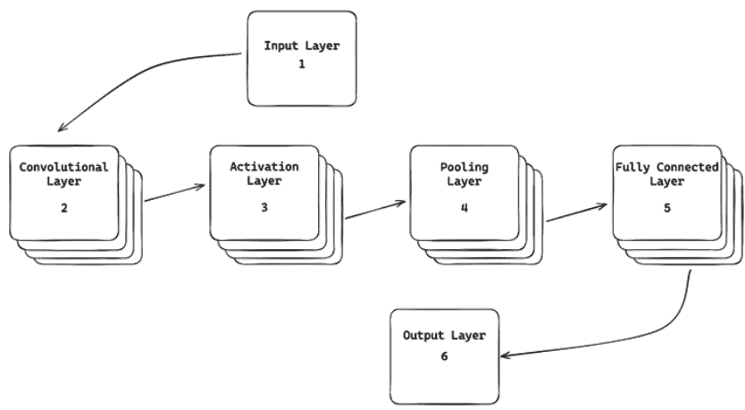

## Image Search

In this chapter, we will explore the techniques involved in similarity search with images. We will discuss the evolution of image search over recent years and delve into the mechanism behind image search. As similarity search continues to expand in the world of search today, it is becoming an integral part of what users come to expect.

We will cover the following concepts:

- An overview of image search
- The role of vector search with images
- Creating a vector representation of an image, storing it in Elasticsearch, and performing a kNN search using a source image
- Practical use cases for image and multimedia search today

### Overview of image search

Image search is a specialized data retrieval methodology that focuses on finding images through the analysis and comparison of their visual content. The demand for effective image search technology has grown exponentially over the last few years due to an explosion in digital imagery across the internet, social media, and other digital platforms.

### The evolution of image search

The origins of image search can be traced back to the early days of the internet when search engines could only analyze text associated with an image, such as filenames, alt text, or surrounding textual content, to match search queries. However, these methods had their limitations, as the actual content of images remained largely ignored.

With advancements in **artificial intelligence (AI)** and **machine learning (ML)**, the capabilities of image search have greatly expanded. Now, modern image search technology can analyze the actual visual content of images, thanks to the development of techniques such as **Convolutional Neural Networks (CNNs)**, image feature extraction, **Vision Transformers (ViT)**, and vector similarity search.

### The mechanism behind image search

In the context of machine learning, an image can be understood as a matrix of pixel values, and these values can be used as features for machine learning models. To make this data manageable, techniques such as **dimensionality reduction** (covered in *Chapter 3, Model Management and Vector Considerations in Elastic*) and **feature extraction** are employed.

Dimensionality reduction refers to techniques that transform high-dimensional image data into lower-dimensional image data—preserving the most significant patterns or structures, to facilitate more efficient processing and analysis. Ideally, without a substantial loss of information. The goal of dimensionality reduction is faster computations and improving overall model performance.

Feature extraction involves processing an image to identify and describe distinct characteristics, such as edges, colors, or shapes. These features can then be used as input for machine learning algorithms.

One popular method for feature extraction in image search is the use of deep learning models, specifically CNNs. These models are designed to automatically and adaptively learn spatial hierarchies of features from images, which has proven highly effective in tasks such as image classification and object detection.

Once features are extracted from images, they are typically transformed into a vector representation that can be easily compared for similarity. This process is often referred to as **vectorization**. Each vector represents a point in a multi-dimensional space, and the “distance” between these points can be calculated to determine the similarity between images. The shorter the distance, the more similar the images are.

By understanding the essence of each image through vector representation, systems can rapidly sift through vast databases to pinpoint the most similar matches to a query. In essence, vector similarity search is the mechanism that empowers robust and efficient image-based search experiences.

### The role of vector similarity search

**Vector similarity search** plays a crucial role in image search. After images are transformed into vectors, a search query (also represented as a vector) is compared against the database of image vectors to find the most similar matches. This process is known as **k-Nearest Neighbor (kNN)** search, where “k” represents the number of similar items to retrieve.

Several algorithms can be used for kNN search, including **brute-force search** and more efficient methods such as the **Hierarchical Navigable Small World (HNSW)** algorithm (see *Chapter 7, Next Generation of Observability Powered by Vectors* for a more in-depth discussion on HNSW). Brute-force search involves comparing the query vector with every vector in the database, which can be computationally expensive for large databases. On the other hand, HNSW is an optimized algorithm that can quickly find the nearest neighbors in a large-scale database, making it particularly useful for vector similarity search in image search systems.

The tangible benefits of image search are observed across industries. Its flexibility and adaptability make it a tool of choice for enhancing user experiences, ensuring digital security, or even revolutionizing digital content interactions.

### Image search in practice

Applications of image search are varied and far-reaching. In e-commerce, for example, reverse image search allows customers to upload a photo of a product and find similar items for sale. In the field of digital forensics, image search can be used to find visually similar images across a database to detect illicit content. It is also used in the realm of social media for face recognition, image tagging, and content recommendation.

As we continue to generate and share more visual content, the need for effective and efficient image search technology will only grow. The combination of artificial intelligence, machine learning, and vector similarity search provides a powerful toolkit to meet this demand, powering a new generation of image search capabilities that can analyze and understand visual content.

Traditionally, image search engines use text-based metadata associated with images, such as the image’s filename, alt text, and surrounding text context, to understand the content of an image. This approach, however, is limited by the accuracy and completeness of the metadata, and it fails to analyze the actual visual content of the image itself.

Over time, with advancements in artificial intelligence and machine learning, more sophisticated methods of image search have been developed that can analyze the visual content of images directly. This technique, known as **content-based image retrieval (CBIR)**, involves extracting **feature vectors** from images and using these vectors to find visually similar images.

Feature vectors are a numerical representation of an image’s visual content. They are generated by applying a feature extraction algorithm to the image. The specifics of the feature extraction process can vary, but in general, it involves analyzing the image’s colors, textures, and shapes. In recent years, CNNs have become a popular tool for feature extraction due to their ability to capture complex patterns in image data.

Once feature vectors have been extracted from a set of images, these vectors can be indexed in a database. When a new query image is submitted, its feature vector is compared to the indexed vectors, and the images with the most similar vectors are returned as the search results. The similarity between vectors is typically measured using distance metrics such as **Euclidean distance** or **cosine similarity**.

Despite the impressive capabilities of CBIR systems, there are several challenges in implementing them. For instance, interpreting and understanding the semantic meaning of images is a complex task due to the subjective nature of visual perception. Furthermore, the high dimensionality of image data can make the search process computationally expensive, particularly for large databases.


为应对这些挑战，**近似最近邻 (ANN)** 搜索算法，例如 HNSW 图，通常被用于优化搜索过程。这些算法以少量精度的损失换取显著的搜索速度提升，使其成为大规模图像搜索应用的实用选择。

随着 Elasticsearch 密集向量字段类型的出现，现在可以在 Elasticsearch 集群内直接索引和搜索高维向量。这种功能结合适当的特征提取模型，为构建高效且可扩展的图像搜索系统提供了强大的工具集。

在以下章节中，我们将深入探讨图像特征提取、向量索引和搜索技术的细节。我们还将演示如何使用 Elasticsearch 和预训练的 CNN 模型进行特征提取来实现图像搜索系统。总体目标是提供一份全面的指南，指导使用最先进技术构建和优化图像搜索系统。

## 使用图像的向量搜索

向量搜索是 Elasticsearch 和其他向量存储的变革性功能，它能够在图像等复杂数据类型中执行搜索。通过这种方法，图像被转换为可以被索引、搜索并相互比较的向量，从而彻底改变了我们检索和分析图像数据的方式。这种产生嵌入的固有特性同样适用于其他媒体类型。本节提供了使用图像的向量搜索过程的深入概述，包括图像向量化、Elasticsearch 中的向量索引、kNN 搜索、向量相似度度量以及 kNN 算法的微调。

## 图像向量化

向量搜索过程的第一阶段是将图像数据转换为向量，这一过程称为图像向量化。深度学习模型，特别是 CNN，通常用于此任务。CNN 设计用于理解和捕捉图像的复杂特征，例如颜色分布、形状、纹理和模式。通过将图像处理为卷积、池化和全连接节点的层，CNN 可以将图像表示为高维向量。该向量封装了图像的关键特征，作为其数值表示。

预训练 CNN 的输出层（通常称为嵌入或特征向量）通常用于此目的。该向量中的每个维度代表从图像中学习到的某个特征。例如，一个维度可能对应于特定颜色或纹理模式的存在。向量中的值量化了这些特征在图像中存在的程度。



图 5.1：CNN 模型的层

如前图所示，这些是 CNN 模型的层：

- 1. 接受图像的原始像素值作为输入。
- 2. 每一层提取特定的特征，如边缘、角点、纹理等。
- 3. 引入非线性，从错误中学习，并近似更复杂的功能。
- 4. 通过下采样降低特征图的维度以减少计算复杂度。
- 5. 由前几层的权重和偏置组成，用于进行分类过程。
- 6. 输出类别上的概率分布。

## 在 Elasticsearch 中索引图像向量

一旦获得图像向量，下一步就是将这些向量索引到 Elasticsearch 中以供将来搜索。Elasticsearch 提供了一种特殊的字段类型，dense_vector 字段，用于处理这些高维向量的存储。

dense_vector 字段被定义为数值数组，通常是浮点数，具有指定的维度数（dims）。目前允许索引向量的最大维度数为 2,048，未来可能会进一步增加。需要注意的是，每个 dense_vector 字段是单值的，这意味着不可能在一个这样的字段中存储多个值。

在图像搜索的上下文中，每个图像（现在表示为向量）都被索引到 Elasticsearch 文档中。该向量可以是每个文档一个或每个文档多个向量。表示图像的向量存储在文档中的 dense_vector 字段内。此外，关于图像的其他相关信息或元数据可以存储在同一文档中的其他字段中。

完整示例代码可以在本书 GitHub 仓库的 chapter 5 文件夹中的 Jupyter Notebook 中找到，地址为 https://github.com/PacktPublishing/Vector-Search-for-Practitioners-with-Elastic/tree/main/chapter5，但我们将在此处讨论相关部分。

首先，我们将使用 SentenceTransformer 库初始化一个预训练模型。

clip-ViT-B-32-multilingual-v1 模型将在本章后面详细讨论：

```
model = SentenceTransformer('clip-ViT-B-32-multilingual-v1')
```

接下来，我们将准备图像转换函数：

```
transform = transforms.Compose([
    transforms.Resize(224),
    transforms.CenterCrop(224),
    lambda image: image.convert("RGB"),
    transforms.ToTensor(),
    transforms.Normalize((0.5, 0.5, 0.5), (0.5, 0.5, 0.5)),
])
```

Transforms.Compose() 组合了以下所有转换：

- transforms.Resize(224)：在保持宽高比的同时将图像的较短边调整为 224 像素。
- transforms.CenterCrop(224)：裁剪图像中心，使结果图像的尺寸为 224x224 像素。
- lambda image: image.convert("RGB")：这是一个将图像转换为 RGB 格式的转换。这对于灰度图像或带 alpha 通道的图像很有用，因为深度学习模型通常期望 RGB 输入。
- transforms.ToTensor()：将图像（PIL 图像格式）转换为 PyTorch 张量。这会将数据从 PIL 图像格式的 [0, 255] 范围更改为 [0.0, 1.0] 范围的浮点数。
- transforms.Normalize((0.5, 0.5, 0.5), (0.5, 0.5, 0.5))：使用给定的均值和标准差对每个通道的张量图像进行归一化。在这种情况下，所有三个通道（R、G、B）的均值和标准差均为 0.5。这种归一化会将数据范围从 [0.0, 1.0] 转换为 [-1.0, 1.0]。

我们可以使用以下代码对图像文件应用转换，然后使用模型生成图像向量。有关针对实际图像文件运行的示例，请参阅本章的 Python 笔记本：

```
from PIL import Image
img = Image.open("image_file.jpg")
image = transform(img).unsqueeze(0)
image_vector = model.encode(image)
```

然后可以将向量和其他相关数据索引到 Elasticsearch 中以用于 kNN 搜索：

```
### Create document
document = {'_index': index_name,
'_source': {"filename": filename,
"image_vector": vector
```

请参阅本书 GitHub 仓库的 chapter 5 文件夹中的完整代码。

在向量生成并索引到 Elasticsearch 后，我们可以继续进行相似图像搜索。

## k-最近邻 (kNN) 搜索

向量现在已索引到 Elasticsearch 中，下一步是使用 kNN 搜索。你可以参考第 2 章《Getting Started with Vector Search in Elastic》，以了解有关 kNN 和 HNSW 搜索的完整讨论。

与基于文本的向量搜索一样，在使用图像进行向量搜索时，我们首先需要将查询图像转换为向量。该过程与我们在索引时将图像转换为向量的过程相同。

我们将图像转换为向量并将其包含在 knn 搜索函数的 query_vector 参数中：

```
knn = {
"field": "image_vector",
"query_vector": search_image_vector[0],
"k": 1,
"num_candidates": 10
}
```

在这里，我们指定了以下内容：

- field：索引中包含我们要搜索的图像向量表示的字段
- query_vector：我们查询图像的向量表示
- k：我们只想要一个最接近的图像
- num_candidates：每个分片上要搜索的近似最近邻候选数量


在了解了如何将图像转换为向量表示并执行近似最近邻搜索之后，让我们讨论一些挑战。

## 图像搜索的挑战与局限性

虽然使用图像的向量搜索为图像检索提供了强大的功能，但它也伴随着一定的挑战和局限性。其中一个主要挑战是图像向量的高维度，这可能导致计算效率低下，以及在可视化和解释数据时遇到困难。

此外，虽然用于特征提取的预训练模型可以捕捉到广泛的特征，但它们可能并不总是与特定用例相关的特征保持一致。这可能导致搜索结果不理想。一个潜在的解决方案，不仅限于图像搜索，是使用迁移学习在特定任务上微调特征提取模型，尽管这需要额外的数据和计算资源。

## 用于向量搜索的多模态模型

结合文本和图像分类可以更全面地理解多种类型数据之间的关系。我们已经为图像生成了向量并学会了如何搜索相似图像，所以让我们探索什么是多模态向量搜索以及它的一些实际用例。

## 引言与 rationale

多模态模型的出现引发了我们对数据分析和表示理解的地震式转变。三个可以利用这一创新技术的例子包括新闻机构、电子商务网站和社交媒体平台。这些行业中的每一个都可以从多媒体搜索的多功能性和适应性中显著受益，提升用户体验并推动其增长。

在核心上，多模态模型寻求整合和解释不同类型的数据信息，例如文本和图像。这种整合方法使这些模型能够捕捉各种数据类型之间细微的交互，通常产生的结果大于各部分之和。一个强大的协同作用示例是在同一向量空间中结合文本描述和图像分类。

这种方法的好处是多方面的。首先，它极大地增强了搜索能力，因为查询现在可以根据文本和视觉信息检索结果。例如，关于“绿色苹果”的查询可以返回绿色苹果的图像、绿色苹果的文本描述，或两者的组合。

其次，这种方法可以显著提高搜索结果的相关性。由于模型同时考虑文本和视觉信息，它对查询概念有更广阔、更丰富的理解。这种更丰富的理解可以帮助过滤掉无关结果，并优先考虑从不同角度最匹配查询的结果。

最后，这种方法促进了跨模态搜索，例如文本到图像和图像到文本搜索。例如，用户可以输入文本查询并接收图像结果，或反之亦然。这扩展了搜索系统的可用性，使其更灵活、更用户友好。

## 理解多模态模型中向量空间的概念

多模态模型的操作及其后续能力的基石在于其向量空间，通常表示为“共享”或“共同”向量空间。这个概念借鉴自线性代数，构成了多模态模型如何运作的基础，为不同类型的数据提供了可以和谐表示和处理的平台。

在这个共享向量空间中，向量——具有大小和方向的参数化数学实体——用于表示不同的数据模态。这可能包括模型正在处理文本描述和图像。每种向量然后代表多维空间中的一个点，对应于一个单独的文本描述或图像。这种表示既优雅又实用，因为两个向量之间的几何接近度或距离可用于表示两个对应实体之间的相似性或不相似性。

这里的几何接近度概念并非随意；它植根于度量空间理论，其中距离函数或度量量化空间内任意两个对象之间的不相似性。在多模态向量空间中，余弦相似度或欧几里得距离通常用作度量。距离越低或余弦相似度越高，两个向量——从而两个对应实体——就越相似。

为了实现这一想法，模型采用了本章前面讨论过的向量化。在向量化期间，模型使用两种不同的编码器——一个用于文本，另一个用于图像——将文本描述和图像转换为向量。这种转换类似于翻译过程，其中文本描述和图像的复杂性和特征被提炼成向量的语言，这是模型可以更轻松地理解、分析和学习的一种语言。

与需要标记图像数据集的传统计算机视觉模型不同，CLIP 利用在线上可用的大量文本-图像对来以灵活的方式理解和分类图像。这种独特的方法使 CLIP 能够在无需任务特定微调的情况下推广到广泛的任务，突出了多模态模型在弥合视觉与语言之间差距的强大潜力和潜力。

## OpenAI clip-ViT-B-32-multilingual-v1 模型的介绍

**OpenAI clip-ViT-B-32-multilingual-v1 模型**，通常简称为 **CLIP**，是多模态模型的典范。CLIP 于 2021 年 1 月 5 日推出，通过从自然语言监督中高效学习视觉概念，彻底改变了计算机视觉领域（openai.com/research/clip）。换句话说，它是根据互联网上发现的各种文本描述来识别各种图像进行训练的。

与在手动标记数据集上训练的大多数计算机视觉模型不同，CLIP 是在互联网上 readily 可用的文本-图像对上训练的。这种训练方法使 CLIP 能够学习各种视觉概念及其相关名称，使其能够执行各种分类任务。然而，CLIP 的能力并非没有局限性。它的性能取决于训练数据的质量和多样性，并且在需要理解训练数据中未充分捕捉的细微视觉细节或上下文的任务上可能表现不佳。

在了解了机制之后，让我们探索图像向量搜索的一些实际用例。

## 为多样化媒体类型实现向量搜索

现在我们已经了解了多模态或多媒体搜索的基础知识，让我们深入探讨一下它如何应用于各种类型的内容：

- **Text**: 向量搜索可用于查找相关文档、文章或文本片段。每个文档使用诸如 TF-IDF 或词、句子或文档嵌入等技术转换为向量。当用户输入搜索查询时，系统会找到最接近查询向量的文本向量。
- **Images**: 图像可以使用深度学习模型进行分析以提取特征向量。这些向量捕捉图像的视觉内容。如果用户使用图像查询进行搜索，系统会找到与查询图像向量最相似的图像向量。
- **Videos**: 视频稍微复杂一些，因为它们包含视觉和音频信息。然而，类似的技术可用于从视频和音频内容中提取特征向量。系统然后使用这些向量来查找响应用户查询的相关视频。

多媒体搜索的强大功能和潜力在实际场景中实施时真正闪耀。

## 新闻机构

在新闻机构的世界里，多媒体搜索是增强内容发现和提供全面新闻体验的强大工具。例如，记者可以从这项技术中显著受益。如果他们正在撰写关于气候变化的文章，多媒体搜索可以帮助他们访问文章的相关内容。不仅仅是相关文章，还有展示气候变化影响的图像、专家访谈的视频片段、说明气候趋势的信息图表，甚至气候活动人士演讲的音频片段。这种广泛的多媒体内容可以增强报道的深度和丰富性。此外，从消费者的角度来看，多媒体搜索可以为读者策划多媒体故事板，其中相关视频、信息图表、照片集和播客与文本文章一起呈现，提供更丰富、更身临其境的体验。


## 电子商务平台

电子商务平台可以利用多媒体搜索的力量，将其产品推荐提升到新的水平。通过分析产品描述和客户评论等文本数据，以及通过图像识别分析产品的视觉特征，它们可以提供更精确、更个性化的推荐。例如，如果用户一直在浏览古董手表，多媒体搜索算法可以分析所查看手表的图像，理解吸引用户的特定视觉元素。然后，该分析可用于推荐其他具有相同视觉特征的产品。这不仅提高了推荐的准确性，还增强了整体用户体验，有可能提高销售额和客户留存率。

## 社交媒体平台

社交媒体平台充斥着多媒体内容，可以显著受益于多媒体搜索，以改进内容发现和用户参与度。假设某个用户发布了一张自制披萨的照片。在这种情况下，多媒体搜索可以分析这张图片，识别出它是披萨，然后推荐其他相关内容——例如披萨制作视频教程、披萨食谱博客文章，或其他用户分享的自制披萨帖子。这不仅创造了更具吸引力和个性化的社交媒体体验，还加强了内容审核工作。通过分析文本、图像和视频内容，平台可以更好地检测和过滤不当或有害内容，提高平台的整体质量和安全性。

这些综合示例展示了多媒体搜索从新闻机构、电子商务平台到社交媒体网络等多个领域的变革潜力。通过提高用户参与度、增强内容发现和个性化，多媒体搜索提供了显著的好处，可以彻底改变我们与数字内容互动的方式。

这些示例只是图像和多媒体向量搜索潜在用例的冰山一角。随着模型不断进步，新行业开始探索各种可能性，新的用例每天都在涌现。

## 总结

在本章中，我们探索了图像相似性搜索的世界，了解了它的演变过程和实际工作机制。我们讨论了基于向量的图像搜索在当今快节奏数字环境中的变革性力量。我们获得了创建图像向量表示并将其集成到 Elasticsearch 中的能力。我们了解了利用 kNN 搜索的力量如何为提升用户体验带来无数可能。我们还看到了图像和多媒体搜索的应用如何跨越众多领域，巩固了其在现代数字时代的重要性。

在下一章中，我们将讨论如何利用 NLP 模型以及其他 Elasticsearch 功能，在个人身份信息被摄入 Elasticsearch 之前对其进行脱敏处理。
