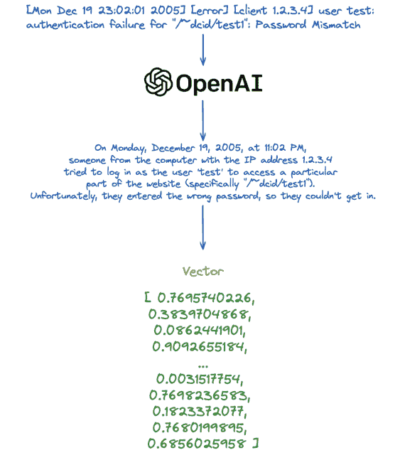
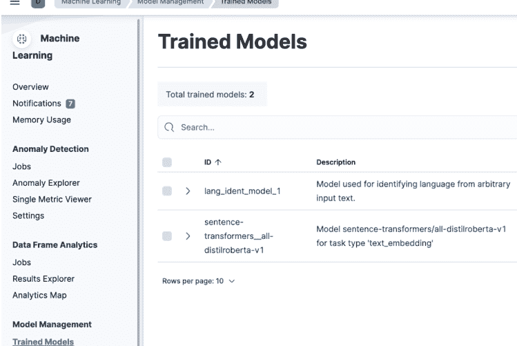
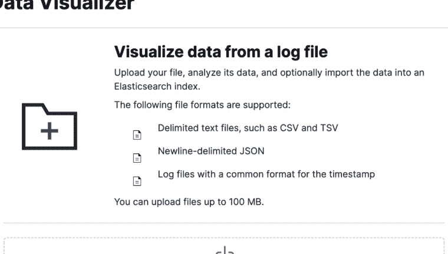
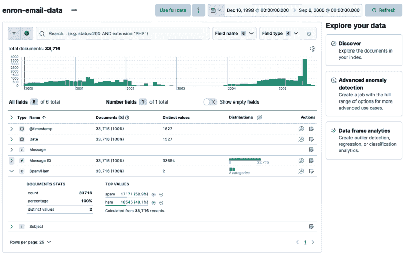
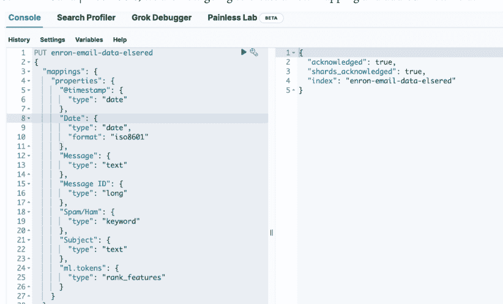
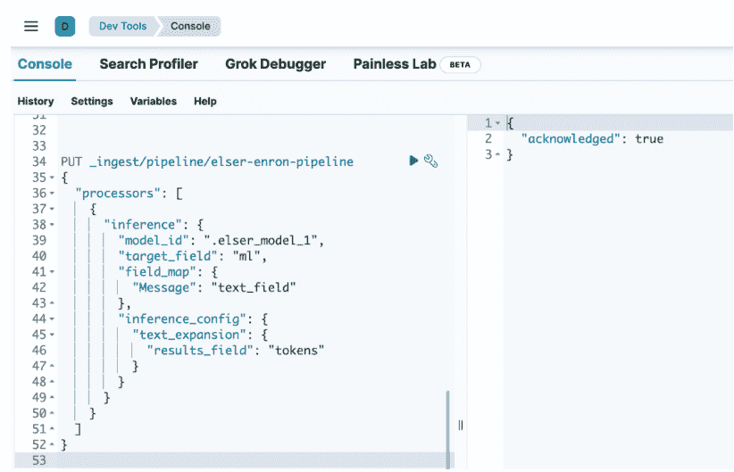
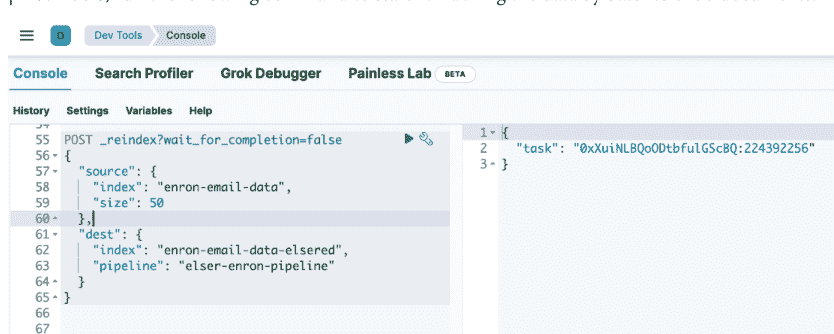
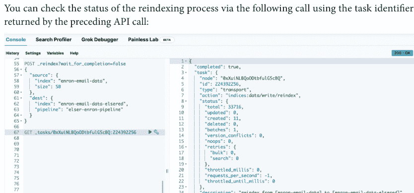
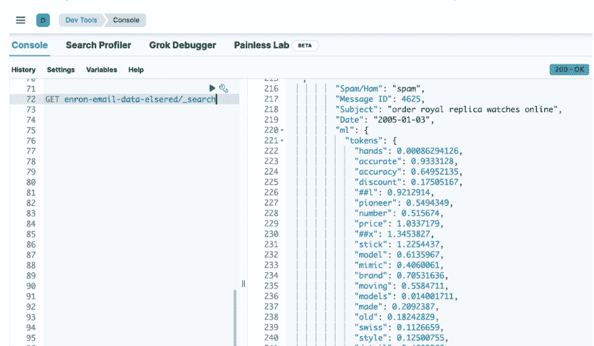

## 使用 Elasticsearch 脱敏个人身份信息

在本章中，我们将探索如何在 Elasticsearch 中创建和配置 **个人身份信息（PII）** 脱敏管道，以有效识别和脱敏数据中的敏感信息。随着数据隐私和安全性变得越来越重要，保护个人信息的能力对组织来说至关重要。

我们将介绍以下内容：

- 如何使用 Elasticsearch 的摄取处理器安装和定制 PII 脱敏管道
- 扩展和增强管道，以满足贵组织的特定数据脱敏需求

这个过程将使你能够创建一个稳健、准确、高效的解决方案，以保护敏感信息并确保符合数据隐私法规。

## PII 与脱敏概述

PII 指任何可用于识别个人身份的数据，无论是直接识别，还是与其他信息结合后间接识别。PII 包括姓名、地址、电话号码、电子邮件地址、社会安全号码、驾驶证号码和信用卡号等数据。由于隐私问题，以及规定公司应如何管理和保护此类数据的法律和监管要求，保护 PII 至关重要。

在数据隐私的背景下，**脱敏**是从文档、日志和其他数据源中移除或隐藏敏感信息的过程，以便剩余数据可以在不暴露 PII 的情况下共享或分析。这涉及**掩蔽**、**假名化**或**加密**等技术，具体取决于环境和要求。脱敏的目标是在保持数据实用性和维护相关个人隐私之间取得平衡。

## 可能包含 PII 的数据类型

可能包含 PII 的数据类型多种多样，了解敏感信息可能存在于公司系统的哪些位置至关重要。最常见的四种数据类型如下：

- **日志**：应用程序、服务器和其他系统生成的日志通常包含 PII。这可能包括用户身份验证数据、IP 地址、用户生成的内容，或可能无意中包含敏感信息的错误消息。日志对于故障排除、监控和分析系统性能至关重要，但若管理不当也可能带来风险。
- **应用程序性能监控（APM）数据**：APM 工具通常通过捕获用户交互、系统性能和错误数据，帮助企业监控和管理应用程序的性能。如果未妥善净化，这些数据可能无意中包含 PII，如用户名、电子邮件地址，甚至支付信息。
- **数据库和数据存储**：公司在数据库和其他数据存储中存储大量信息，包括客户信息、员工记录和交易数据。这些存储库通常保存大量 PII，因此受严格数据保护法规的约束。
- **非结构化数据**：PII 也可能出现在非结构化数据源中，例如电子邮件、文档、图像等。这可能使识别和脱敏 PII 变得更加困难，因为需要更高级的技术（如自然语言处理）来解析和理解内容。

在强调 PII 可能存在的主要领域之后，必须更深入地探讨处理此类敏感信息不当所带来的潜在危害。具体而言，在日志中，PII 往往容易被忽视，因此理解其中的风险至关重要。现在，我们将讨论无意在日志中存储 PII 所带来的复杂问题和后果。

## 在日志中存储 PII 的风险

在日志、APM 数据和其他数据源中存储 PII，如果未妥善管理和保护，可能对企业和个人都产生严重后果。风险包括（但不限于）以下几点：

- **财务罚款和处罚**：未能遵守数据保护法规（如 **通用数据保护条例（GDPR）** 或 **加州消费者隐私法案（CCPA）**）的公司可能面临严厉的罚款和处罚。根据违规严重程度和公司规模，这些罚款可能高达数百万美元。
- **声誉损害**：数据泄露和隐私违规行为会损害公司声誉并削弱客户信任。在某些情况下，此类事件的后果可能导致业务损失、股价下跌，甚至破产。
- **法律和监管后果：** 未能保护 PII 的公司可能面临诉讼、监管行动和其他法律后果。这些可能代价高昂且耗时，在某些情况下甚至可能导致公司高管面临刑事指控。
- **对个人的风险：** 当 PII 泄露或丢失时，会对受影响的个人造成严重后果。他们可能面临身份盗窃、财务损失或其他形式的伤害，并可能需要采取措施保护自己和自身财产。

既然我们了解了 PII 的类型以及存储 PII 的风险，下面我们来探讨 PII 数据通常是如何丢失或暴露的。

## PII 是如何泄露或丢失的

PII 可能通过各种方式泄露或丢失，其中有些是无意的，而另一些则可能是恶意活动的结果。了解这些潜在的数据泄露来源，对于公司预防和减轻 PII 暴露至关重要。PII 泄露或丢失的一些常见方式包括：

- **人为错误：** 员工或其他个人的失误可能导致 PII 被无意暴露。这可能包括意外共享敏感数据、错误配置安全设置，或使用容易被破解的弱密码。
- **内部威胁：** 怀有恶意的员工或承包商可能故意泄露 PII，通常是为了个人利益或对公司造成损害。这可能涉及窃取敏感数据或破坏系统以暴露 PII。
- **外部攻击：** 网络罪犯和黑客经常以公司为目标窃取 PII，然后可能在暗网上出售，或用于身份盗窃或其他不法目的。这些攻击可能以网络钓鱼诈骗、勒索软件或利用公司系统漏洞的形式出现。
- **不安全的存储和传输：** 以未加密或其他不安全格式存储 PII 会增加数据泄露的风险。同样，通过不安全的渠道传输敏感数据可能会使 PII 被恶意行为者截获。
- **第三方泄露：** 公司经常与供应商、合作伙伴或其他第三方共享 PII。如果这些组织遭遇数据泄露，公司提供的 PII 可能会暴露，即使公司本身已采取适当的安全措施。

通过了解这些 PII 泄露和丢失的潜在来源，公司可以采取措施保护敏感数据、实施适当的安全措施，并尽量降低与存储和处理 PII 相关的风险。这包括实施访问控制、加密静态和传输中的数据、定期进行安全审计和漏洞评估，并为员工提供有关数据隐私和安全最佳实践的培训。


现在我们已经掌握了识别 PII 来源的重要性以及实施严格安全措施的重要性，下一步的逻辑步骤是讨论用于涂抹此类敏感信息的实用技术。在数字时代，结构化和非结构化数据经常混杂在一起，使用 NER 模型和正则表达式模式的混合方法成为一种强大的解决方案。让我们探讨如何有效地利用这些工具来保护 PII。

## 使用 NER 模型和正则表达式模式涂抹 PII

涂抹 PII 的过程通常需要多方面的方法，以确保敏感数据能够从各种数据源中准确识别并移除。用于涂抹 PII 的两种关键技术是 **命名实体识别 (NER)** 模型和 **正则表达式 (regex)** 模式。结合这些方法可以帮助识别广泛的 PII 类型并确保全面的数据保护。

## NER 模型

NER 是一种 **自然语言处理 (NLP)** 技术，用于识别和分类文本数据中的命名实体，例如人名、地点、组织和其他特定信息。NER 模型在涂抹 PII 时特别有用，因为它们可以识别不遵循通用模式或结构的实体。这使得能够检测和涂抹不太可预测的 PII 类型，而这些类型仅使用正则表达式模式可能更难以识别。

诸如基于 **BERT (Bidirectional Encoder Representations from Transformers)** 的机器学习模型在 NER 任务中已显示出显著的成功。其中一个模型是来自 Hugging Face 的 **dslim/bert-base-NER**，它已被训练用于识别各种命名实体。通过利用此类 NER 模型，组织可以高效地识别并涂抹存在于非结构化文本数据中的 PII，例如电子邮件、文档和日志。

## 正则表达式模式

Regex 是在文本数据中进行模式匹配和操作的有力工具。正则表达式模式对于识别和涂抹遵循标准模式或结构的 PII 特别有用。通过设计正则表达式模式来匹配这些常见结构，组织可以快速、准确地从各种数据源中检测并移除 PII。

**Grok 模式** 为文本数据中的模式匹配提供了比正则表达式更用户友好的替代方案。Grok 模式本质上是一组预定义的正则表达式模式，可以组合和重用以更轻松地创建更复杂的表达式。这种方法简化了编写和维护模式匹配规则的过程，使其对不熟悉正则表达式语法的用户更易于访问。

对于 Elasticsearch 中的涂抹管道，我们将使用一个名为 **redact processor** 的新处理器。该处理器使用 Grok 模式而非传统的正则表达式进行模式匹配。在以下部分，我们将更详细地讨论 redact processor 的实现和使用情况，概述它如何利用 Grok 模式来识别并从数据源中涂抹 PII。

可使用正则表达式/grok 模式识别的 PII 类型示例包括以下内容：

- **信用卡号码**：信用卡号码通常遵循特定模式，具有固定数量的数字和可识别的格式。可以设计正则表达式模式来识别并涂抹这些号码，而与发卡机构无关。
- **社会安全号码**：美国的社会安全号码由九位数字组成，以连字符分隔为三组（例如，123-45-6789）。这种标准格式使得创建正则表达式模式来识别和涂抹这些号码变得简单。
- **银行账号**：虽然银行账号的长度和格式可能因金融机构而异，但许多银行遵循可使用正则表达式模式识别的通用模式。此外，特定关键词的存在，例如“account number”或“routing number”，可以帮助细化正则表达式模式以准确识别和涂抹此信息。
- **电子邮件地址**：电子邮件地址遵循标准格式，包括本地部分、“@”符号和域名。可以设计正则表达式模式来识别并涂抹电子邮件地址，有助于保护个人隐私并防止潜在的数据泄露。
- **电话号码**：电话号码通常遵循可识别的模式，具有固定数量的数字和标准格式（例如，(123) 456-7890 或 +1 123 456 7890）。正则表达式模式可用于从各种数据源中识别和涂抹电话号码，确保联系信息保持私密。

虽然 grok 模式擅长识别信用卡号码或电子邮件地址等结构化数据形式，但在非结构化数据中仍存在可能逃避它们的细微差别。这正是将 grok 与 NER 模型合并的价值所在。通过将 Grok 的精确性与 NER 的上下文深度相结合，我们旨在创建更全面的涂抹策略，显著降低 PII 未被注意的机会。让我们探索这种组合方法以实现更强大的数据保护。

## 结合 NER 模型和正则表达式（或 grok）模式进行 PII 涂抹

为了最大化 PII 涂抹的有效性，组织应考虑使用 NER 模型和正则表达式模式的组合。这种两阶段方法确保结构化和非结构化 PII 都能从数据源中准确识别并移除。

在第一阶段，可以将 NER 模型应用于文本数据以识别可能包含 PII 的命名实体。然后可以利用 NER 模型的输出来涂抹或屏蔽文本中已识别的实体。

在讨论了 NER 模型与正则表达式在发现 PII 方面的协同作用后，让我们讨论如何在 Elasticsearch 中操作化 PII 涂抹管道。Elasticsearch 平台提供了一个强大的解决方案，即 ingest pipelines，旨在在数据摄取时清理数据。将 grok 模式的精确性与我们讨论的技术相结合，为敏感数据处理提供了更整体的方法。

## Elasticsearch 中的 PII 涂抹管道

Elasticsearch 中的 PII 涂抹管道旨在在数据被摄取到 Elasticsearch 集群时自动涂抹敏感信息。此过程确保敏感数据得到保护，这在处理可用于识别个人的个人信息时尤其重要，例如姓名、地址、电话号码和社会安全号码。

在本节中，我们将讨论用户可以采取的步骤来配置 Elasticsearch 中的 PII 涂抹管道。

要查看完整代码，请打开本书 GitHub 仓库 chapter 6 文件夹中的 Jupyter Notebook：https://github.com/PacktPublishing/Vector-Search-for-Practitioners-with-Elastic/tree/main/chapter6。

我们将回顾管道的关键要点。

## 生成合成 PII

要运行我们的管道，我们需要一个数据集。幸运的是我们有 faker，即用于生成给定类型假数据的 Python 库。我们在此的任务涉及两个步骤：

- 使用 faker 生成数据
- 批量将数据索引到 Elasticsearch

以下是生成数据的代码（如果尚未安装，可使用 pip install 命令安装 Faker）：

```
from faker import Faker
import json
from pprint import pprint

### Create an instance of the Faker class
fake = Faker()

### Define a function to generate fake personal identification information
def generate_fake_pii(num_records):

fake_data = []

for x in range(num_records):
### Generate fake personal identification information
fn = fake.first_name()
ln = fake.last_name()
pn = fake.phone_number()
```

```
sn = fake.ssn()
ai = fake.random_element(elements=('active', 'inactive'))

call_log = {
'message' : f'{fn} {ln} called in from {pn}. Their account number is {sn}',
'status' : ai
}

fake_data.append(call_log)
return fake_data

### Generate fake personal identification information for N individuals
num_records = 10 # Set the desired number of records
fake_pii_data = generate_fake_pii(num_records)

pprint(fake_pii_data)
```

这将输出如下所示的记录：

```
{
'message': 'Stephen Gomez called in from 9162417050. Their account number is ' '275-51-8055',
'status': 'inactive'
},
### Import the required libraries
from faker import Faker
import json
### Create an instance of the Faker class
fake = Faker()
### Define a function to generate fake personal identification information
def generate_fake_pii(num_records):
### Create an empty list to store the fake data
fake_data = []
### Generate the specified number of fake records
for _ in range(num_records):
### Generate fake personal identification information
person = {
'first_name': fake.first_name(),
'last_name': fake.last_name(),
'email': fake.email(),
'phone_number': fake.phone_number(),
```


```
'address': fake.address(),
    'ssn': fake.ssn(),
    'birthdate': fake.date_of_birth(tzinfo=None, minimum_age=18, maximum_age=90).strftime('%Y-%m-%d'),
    'gender': fake.random_element(elements=('M', 'F'))
}
### Append the fake data to the list
fake_data.append(person)
return fake_data

### Generate fake personal identification information for N individuals
num_records = 10 # Set the desired number of records here
fake_pii_data = generate_fake_pii(num_records)
print(fake_pii_data)
```

前面的代码允许你设置要生成的文档数量。该数据集应具有足够的（虚假）PII，供你测试脱敏管道。

一旦这些测试文档生成后，你可以执行第二步，将文档批量索引到 Elasticsearch 中：

```
from elasticsearch import Elasticsearch, helpers
## Bulk Indexer
### Define a function to generate an array of documents for Elasticsearch
def generate_documents_array(fake_data, index_name):
### Create an empty list to store the documents
    documents = []
### Iterate over the fake data and format it as documents
    for person in fake_data:
### Create a document with the _index and _source keys
    document = {
        '_index': index_name,
        '_source': person
    }
### Append the document to the list of documents
    documents.append(document)
return documents
### Generate the array of documents for Elasticsearch
index_name = 'pii' # Set the desired index name here
documents_array = generate_documents_array(fake_pii_data, index_name)

### Initialize the Elasticsearch client
es = Elasticsearch(['HOSTNAME:PORT'],basic_auth=('USERNAME', 'PASSWORD'),verify_certs=False)
```

```
### Convert the bulk index body to a single string with newline separators
print("Bulk request: ")
print(documents_array)

try:
    response = helpers.bulk(es, documents_array)
    print ("\nRESPONSE:", response)
except Exception as e:
    print("\nERROR:", e)
After running this code, you should see the following type of document in the "pii" index in your Elasticsearch cluster:
{
    "_index": "pii",
    "_id": "Hzge9IcBeW7_RVqxfOJf",
    "_score": 1,
    "_source": {
        "first_name": "Jessica",
        "last_name": "Baker",
        "email": zrojas@example.com,
        "phone_number": "+1-537-947-4261",
        "address": "\"96702 Cannon Mall Serranofurt, KS 41609\"",
        "ssn": "811-48-4463",
        "birthdate": "1977-10-30",
        "gender": "M"
    }
}
```

在生成并索引了虚假数据后，我们需要配置默认的 ingest 管道和索引模板，并加载 NER 模型。

## 安装默认管道

要在 Elasticsearch 中设置 PII 脱敏管道，我们需要安装默认管道并将其配置为使用来自 Hugging Face 的提供的 NER 模型。步骤如下：

- 1. ingest pipeline 是一系列处理器，用于在数据被索引到 Elasticsearch 之前修改或丰富数据。在 PII 脱敏管道的上下文中，管道将用于从数据中删除敏感信息。要安装管道，你需要从 GitHub 仓库复制提供的 JSON 示例，并在 Elasticsearch 中使用此配置创建一个新管道。

你可以使用 Elasticsearch 的 REST API 按如下方式创建管道：

```
PUT _ingest/pipeline/pii_redaction_pipeline
{
  "description": "PII redacting ingest pipeline",
  "processors": [
    {
      "set": {
        "field": "redacted",
        "value": "{{message}}"
      }
    },
    {
      "inference": {
        "model_id": "dslim__bert-base-ner",
        "field_map": {
          "message": "text_field"
        }
      }
    },
    {
      "script": {
        "lang": "painless",
        "source": """String msg = ctx['message'];
        for (item in ctx['ml']['inference']['entities']) {
          msg = msg.replace(item['entity'], '<' + item['class_name'] + '>')
        }
        ctx['redacted']=msg""",
        "if": "return ctx['ml']['inference']['entities'].isEmpty() == false",
        "tag": "ner_redact",
        "description": "Redact NER entities"
      }
    },
    {
      "redact": {
        "field": "redacted",
        "patterns": [
          "%{PHONE:PHONE}",
          "%{SSN:SSN}"
        ],
        "pattern_definitions": {
          "SSN": """\d{3}-?\d{2}-?\d{4}""",
          "PHONE": """\d{3}-?\d{3}-?\d{4}"""
        }
      }
    }
  ]
}
```

```
}
    }
},
{
    "remove": {
        "field": [
            "message",
            "ml"
        ]
    }
}
],
"on_failure": [
    {
        "set": {
            "field": "failure",
            "value": "pii_script-redact"
        }
    }
]
}
```

- 2. 从 Hugging Face 加载并启动 NER 模型。

- 3. 你需要使用 Python 中的 eland 库从 Hugging Face Model Hub 加载一个兼容的 NER 模型。示例中使用的模型是 dslim/bert-base-NER，但你可以使用任何 Elastic 兼容的 NER 模型。

- 4. 要加载并启动模型，你可以按照以下步骤操作：

```
### Install the necessary Python packages:
pip install eland elasticsearch transformers sentence_transformers torch==1.13

#Import the required Python libraries:
from pathlib import Path
from eland.ml.pytorch import PyTorchModel
from eland.ml.pytorch.transformers import TransformerModel
from elasticsearch import Elasticsearch
from elasticsearch.client import MLClient
from elasticsearch.exceptions import NotFoundError

### Set up an Elasticsearch connection using your Elastic Cloud ID and cluster-level API key:
es = Elasticsearch(cloud_id=es_cloud_id,
                api_key=(es_api_id, es_api_key))
```

```
)
es.info() # should return cluster info

### Download the model from Hugging Face and load it into Elasticsearch:
hf_model_id='dslim/bert-base-NER'
tm = TransformerModel(model_id=hf_model_id, task_type="ner")

es_model_id = tm.elasticsearch_model_id()
es_model_id

### Load the model into Elastic Cluster
### <Load the model using the provided Python code from the GitHub repository>
```

- 5. 配置 inference processor 以使用 NER 模式 ID。

inference processor 负责在摄取的数据上运行 NER 模型。你需要配置处理器以使用你在上一步中加载的 NER 模型的 model_id。在 ingest pipeline 的 JSON 示例中，你会找到以下部分：

```
{
  "inference": {
    "model_id": "dslim__bert-base-ner",
    "field_map": {
      "message": "text_field"
    }
  }
}
```

将 model_id 值（"dslim__bert-base-ner"）替换为你已加载到 Elasticsearch 中的 NER 模型的实际 model_id。

- 6. 在设置好管道和 NER 模型后，你需要确保摄取到 Elasticsearch 索引中的数据首先经过管道。你可以通过将管道指定为索引的一部分来实现这一点。配置数据源或索引设置，以便进入索引的数据首先经过管道。请查阅文档以了解如何将 ingest pipeline 添加到索引请求中的示例（https://www.elastic.co/guide/en/elasticsearch/reference/current/ingest.html#add-pipeline-to-indexing-request）。

在配置了 ingest pipeline 并加载了 NER 模型后，我们最终将配置索引模板。模板定义了字段数据类型，并配置写入索引的数据通过脱敏管道。

随附的 Python 笔记本包含完整的 Python 代码。我们使用以下设置定义管道：

```
"index.default_pipeline": "pii_redaction_pipeline_book"
```

最后一步是使用 Elasticsearch bulk index API 索引虚假数据并确认敏感数据已被脱敏。

完成此步骤后，输出文档应类似于以下示例：

```
{'_source':
  {
  'redacted': '<PER> called in from 001-<PHONE>x1311. Their account
  number is <SSN>'
  'status': 'active'
  }
```

你会注意到个人的姓名、电话号码和社会安全号码（SSN）已被脱敏。

## 预期结果

一旦在 Elasticsearch 中配置并设置了 PII 脱敏管道，预期结果如下：

- 当 NER 模型识别出一个实体时，该实体将被替换为用尖括号括起来的对应实体类型。例如，如果 NER 模型识别出一个人的姓名，它将被替换为 <PERSON>。
- 当正则表达式模式匹配一个值时，该值将被 <redacted> 术语替换。这确保了敏感信息，例如电话号码和 SSN，在处理后的数据中永远不可见。

在设置了示例 PII 脱敏管道后，让我们看看如何进一步自定义它以满足组织的特定需求。


## 在 Elasticsearch 中扩展和自定义 PII 脱敏管道的选项

Elasticsearch 中的 Ingest 处理器提供了一种强大且灵活的方式来自定义数据处理和操作，可以根据公司特定的 PII 数据脱敏需求进行定制。在本节中，我们将讨论几种扩展和增强默认 PII 脱敏管道的选项，以更好地满足特定的用例和需求。

## 自定义默认 PII 示例

示例中提供的默认 PII 脱敏管道可以轻松自定义，以更好地适应您组织的数据和需求。一些可能的自定义包括以下内容：

- **用任何其他 Elastic 兼容的 NER 模型替换示例 NER 模型**：默认管道使用来自 Hugging Face 的 dslim/bert-base-NER 模型，但您可以将其替换为更符合您特定需求的任何其他 Elastic 兼容的 NER 模型。
- **如果不需要这种形式的识别，则移除 NER 模型**：如果您的数据不需要基于 NER 的识别，您可以从管道中移除 NER 模型，从而简化管道并可能提高性能。
- **轻松修改 regex/grok 模式步骤**：管道使用 regex/grok 模式来识别和脱敏数据中的特定模式，例如社会安全号码和电话号码。您可以轻松按如下方式修改此步骤：
- **在发现或识别新的 PII 来源时添加新模式**：随着新的 PII 来源被发现或数据发生变化，您可以向管道添加新的 regex/grok 模式，以确保新的 PII 得到正确脱敏。
- **修改现有模式以匹配可能通过或被错误匹配的模式**：如果现有模式未按预期工作，您可以修改它们以更好地匹配数据并改进脱敏过程。
- **在不再需要或未按预期工作时移除模式**：如果某些模式不再相关或导致问题，您可以将其从管道中移除以提高性能并降低误报的可能性。

## 克隆管道以创建不同数据流的不同版本

根据您组织的数据处理需求，您可能需要为不同的数据流提供不同的脱敏管道。通过克隆和自定义默认 PII 脱敏管道，您可以创建针对特定数据源或类型的多个管道版本，确保每个数据流的脱敏过程准确高效。

## 为特定数据集微调 NER 模型

示例中提供的默认 NER 模型可能不适合每个数据集或用例。对 NER 模型进行微调可以提高模型对您特定数据的性能和准确性：

- **识别您数据中特定的 PII 实体**：默认 NER 模型旨在识别常见的实体，例如姓名、组织和位置。然而，您的数据可能包含默认模型无法识别的独特或行业特定的 PII 实体。通过在您的数据上微调模型，您可以提高其识别和脱敏这些特定 PII 实体的能力。
- 此类实体的示例可能包括医疗记录号、客户 ID 或您组织或行业特有的其他敏感标识符。
- **微调的总体概述**：微调是指取一个预训练的 NER 模型并在您特定数据上进一步训练它。这可以产生更适合您的数据且更准确地识别和脱敏 PII 的模型。

微调 NER 模型的高级过程通常涉及以下步骤：

- I. 收集并预处理包含您希望模型识别的 PII 实体的示例的标注数据集。
- II. 将标注数据集拆分为训练集和验证集，确保两个集合都包含您希望模型识别的 PII 实体的代表性样本。
- III. 在训练集上微调预训练的 NER 模型，根据需要调整模型参数和超参数以实现最佳性能。
- IV. 在微调过程中定期在验证集上评估模型的性能，以防止过拟合并确保模型能很好地推广到未见数据。
- V. 微调过程完成后，在测试集上评估模型的性能，以确认其满足您组织对 PII 脱敏准确性和性能的要求。
- VI. 将微调后的模型集成到您的 Elasticsearch PII 脱敏管道中，替换默认的 NER 模型。

PII 脱敏中的上下文感知允许更细致的数据保护。不是一刀切的脱敏，Elasticsearch PII 脱敏管道可以根据其周围内容定制移除数据。这确保了有意义的隐私措施，同时避免不必要的数据丢失。

## 上下文感知的逻辑

在某些情况下，您可能只想在信息出现在特定上下文中或被某些单词或短语包围时才进行脱敏。例如，一些组织可能不需要仅仅因为电话号码出现在日志消息中就脱敏它，而只在电话号码所有者的姓名出现在同一条日志消息中时才脱敏，从而将电话号码与某个人联系起来。通过向 PII 脱敏管道添加自定义逻辑，您可以确保管道仅在这些特定条件下触发脱敏。

要在 PII 脱敏管道中实现上下文感知，请考虑以下步骤：

- 1. 分析您的数据并识别应触发 PII 脱敏的上下文或周围单词。这些上下文可能包括特定的关键词、短语或指示敏感信息的模式。
- 2. 修改管道以包含分析数据以查找这些上下文触发器的自定义脚本处理器。脚本处理器可以使用 Painless 编写，Painless 是 Elasticsearch 的脚本语言。
- 3. 在自定义脚本处理器中，实现检查数据中是否存在已识别上下文触发器的逻辑。如果发现触发器，脚本处理器应修改数据以标记相关 PII 以便脱敏。
- 4. 更新管道中的 NER 和 regex/grok 模式步骤，仅在被自定义脚本处理器标记后才脱敏 PII。

通过实施这些扩展和增强选项，您可以创建一个定制化的 PII 脱敏管道，该管道针对您组织特定的数据和需求量身定制。这确保了您的管道既准确又高效，使您能够有效保护敏感信息，同时最大限度地降低误报或脱敏不完整的风险。

实施 PII 脱敏管道，或事实上任何 ingest 管道时需要考虑的一个最后但至关重要的方面是它可能给数据摄取过程带来的潜在延迟。摄取过程中纳入的每个步骤本质上都会导致延迟。然而，可以认为可接受的延迟程度在很大程度上是个别或业务判断的问题。

用户必须了解此上下文中几个关键点的后果。首先，在数据变得可搜索之前，必须衡量脱敏管道引入的延迟量。这对于在数据保护和运营效率之间保持平衡至关重要。

其次，应评估管道配置的每种数据类型脱敏的重要性。这将涉及对每种数据类型敏感性的透彻理解及其对隐私和合规问题的潜在影响。

第三点是确定是否需要扫描每条消息，或者抽样子集是否足够。如果选择后一种方法，组织必须随后决定未抽样的包含 PII 的数据是否需要清理，以及以后是否可以轻松清理或删除。


虽然在 *第 4 章、性能调优——处理数据* 中已详细介绍了集群基准测试，但这里仍值得提及一些高层次的方法：

- 使用 Elasticsearch 的 Rally 工具来比较有和没有 PII 脱敏管道时的数据摄取情况。

> **注意**
> 你应确保日志中包含一些虚假的 PII，以模拟脱敏信息的处理时间，而不仅仅是扫描数据。参见本章前面关于 Faker 的部分，了解生成虚假 PII 的示例。

- 使用自定义脚本或其他你可能已搭建好的性能工具。

- 使用 Metricbeat 中 Elasticsearch 模块的 `ingest_pipeline` 指标集来收集处理器计时信息。然后你可以同时监控测试数据以及处理器和整个管道的持续和实时生产计时数据。

在实施 PII 脱敏管道时牢记这些注意事项，可以确保在不影响运营效率的前提下维护数据隐私。

## 摘要

在本章中，我们深入探讨了在 Elasticsearch 中创建、配置和自定义 PII 脱敏管道的过程，这是当今数据驱动世界中保护敏感信息的重要工具。你现在应该全面了解如何设置默认管道、根据组织独特需求对其进行自定义，并通过微调 NER 模型或加入上下文感知能力进一步增强它。掌握这些知识后，你已做好充分准备来应对数据隐私和安全方面的挑战，确保你的组织符合法规要求，并在有效保护其个人信息的同时保持用户信任。

在下一章中，我们将探讨如何将向量搜索用例与 Elastic 平台中的可观测性解决方案相结合。

## 由向量驱动的可观测性新一代

随着我们继续在不同用例中应用向量的旅程，我们将在本章中看到如何将其与可观测性相结合。该领域是 Elastic 平台提供的解决方案的一部分。可观测性涵盖了诸如日志分析、指标分析和应用性能监控（APM）等概念，其共同目的是建立对系统健康状况的认知，并帮助运维团队在发生时诊断和修复事件的根本原因。

随着系统变得越来越复杂，这些系统的管理对运维团队来说也变得同样复杂。这些系统产生的数据量不断增加，变得难以甚至不可能由人类跟踪，而且变得越来越不稳定和分布式。任何事件管理工作流的一个主要方面都是与数据的交互，无论是通过查询、仪表板还是警报。所有这些操作最终都归结为一个或多个搜索查询。市场上每个解决方案都有自己的查询数据方式，事实上，公司很少为其需要管理的多个信号（日志、指标等）使用单一解决方案。他们甚至可能为指标、日志、APM 等分别使用不同的解决方案，这最终只会增加工作流的复杂性。

有了向量、嵌入和语义搜索，就有显著的机会通过规范化查询语言来降低上述复杂性——本质上是在任何可观测性场景中使用 NLP 与数据交互。然而，要实现这一点，运维团队需要一个足够多功能的平台来提供可观测性、传统搜索和语义搜索的功能。这正是 Elastic 在市场上具有显著优势的地方，因为它将所有这些基本功能集中在一起。

在本章中，我们将重点关注日志，因为它们是可观测性中最常见的元素。我们将涵盖以下主题：

- 可观测性的基础概念
- 为运维团队的日志提供语义搜索功能的两种方法
- 使用 Elastic 实现该工作流的端到端实现

## 可观测性及其在现代软件系统中的重要性简介

在将向量应用于可观测性之前，花时间了解可观测性本身的高层次概念很重要。

可观测性是指基于其外部输出来理解构成系统的任何层内部状态的能力。当这些系统是具有多层但产生集中日志输出来描述该“黑盒”行为的单体时，这相对容易。然而，随着公司采用微服务等去中心化云原生架构，该过程变得越来越复杂。这里的可观测性输出变得去相关、分布式，并由多个信号组成，例如日志、指标和追踪等。包括 Elastic 在内的大多数厂商都通过努力提供集成化的可观测性体验来应对这一挑战，其主要目标是降低平均解决时间（MTTR）指标。

该领域经历了快速发展，许多参与者提供出色的解决方案，帮助客户更轻松地观察软件系统。

让我们来看看构成可观测性主要支柱的信号。

## 可观测性——主要支柱

信号是用于观察 IT 系统健康状况的数据源。信号报告事件，这些事件可以分解为结构化和非结构化事件（就其而言，有些非常标准，如 Apache 日志，而另一些则高度定制，如来自自定义 Java 应用的日志）。为了使运维团队能够观察其生产运行并了解正在发生的事情，他们需要能够收集、聚合和关联多个信号并为其创建警报。虽然随着 IT 系统的演进会出现新的信号，但基本且不可避免的信号如下：

- **日志：** 日志是系统中发生的事件的时间戳记录。它们由基础设施、应用程序、操作系统、网络设备以及系统中任何数量的其他组件生成。它们可以携带从简单的状态更新和用户操作到错误和中断的广泛信息。日志通常是非结构化的；事实上，大多数日志都是自定义日志。即使这些日志来自某种标准化系统（例如 Apache 服务器），通常也存在一定程度的定制，使它们在一次部署与另一次部署之间有所不同。

- **指标**：指标是表示系统在特定时间点的状态或性能的数值测量。常见指标包括 CPU 使用率、内存消耗、响应时间、存储容量、错误率和吞吐量。指标是系统化的，通常经过汇总，非常结构化，并在固定间隔收集。指标之间的差异在于它们所携带的标签基数。例如，在 Kubernetes 集群中，其本身就很复杂，尽管规模很小，指标的基数会随着 Kubernetes 集群中定义的命名空间数量增加而增加。

- **追踪**：APM 中涉及的追踪是指与业务应用程序中发生的事务直接相关的<|message|> 高级信号。为了更好地理解这一点，请将日志视为显示在电话账单上的电话通话，而追踪则是实际对话的内容。值得注意的是，追踪是日志和指标的组合。这里的复杂性在于能够在分布式去中心化系统中关联同一整体事务中涉及的不同追踪。

正如你到目前为止可能已经意识到的那样，通过结合日志、指标和 APM 数据，我们可以提供对系统状态和行为的全面视图。基于此，运维团队可以接收通知、调查和诊断问题，并识别事件的根本原因。

现在，让我们深入研究日志分析，因为我们将在本章中尝试使用向量改进日志管理流程。

## 日志分析及其在可观测性中的作用

为给定系统实施日志分析的过程已有数十年历史，并随着时间的推移以不同的方式演变，但该过程的核心仍然相同。传统的日志分析方法主要是运维团队连接到有问题的主机，浏览日志文件，使用 grep 过滤内容，然后希望一切顺利。虽然这种流程对于非常小的部署可能有效，但当日志量和主机数量增长时，它很快就会成为一个头痛问题。鉴于此，已创建了解决方案来将来自不同来源的日志传输到集中位置、解析它们并使其可用于分析。

大多数现有解决方案使用以下流程来实现此目的：

1. 在机器上部署代理。
2. 代理有时会通过丰富日志源或应用简单的数据转换来执行一定程度的处理。
3. 代理将日志传输到中央服务器，在那里进行额外的处理。
4. 用户连接到 UI 并开始使用查询语言搜索、过滤和聚合日志并构建仪表板。

日志不会消失；事实上，当我们查看可观测性时，即使行业试图将信号归入各自的类别，每个信号最终都是一种日志形式。


我们认为行业应专注于抽象信号并提出利用数据并为给定用户画像生成情境化用户体验的解决方案……但那是另一本书的内容。虽然日志是最流行且最直接的观察系统的方式，但与之相关存在各种挑战，包括以下几点：

- 日志量庞大，需要一个可扩展的解决方案，在终端用户分析时提供不错的性能。
- 随着日志量的增长，支持可观测性平台所需的基础设施也会增加，进而导致处理和存储成本上升。
- 日志量可能变得难以承受，而从所有 surrounding 噪音中提取重要信息并非易事。传统上这是手动完成的，这一过程现在受益于机器学习技术（如无监督学习和异常检测）带来的加速。
- 搜索日志并减少响应时间需要对日志进行结构化。如果日志保持非结构化，搜索和分析性能会很差。然而，对非技术用户而言，结构化日志的过程本身也可能令人难以承受。

这里列出的挑战都有特定的解决方案。我们将专注于运维团队分析师的体验，更具体地说，如何通过 NLP 增强该体验。

## 一种新方法——将向量和嵌入应用于日志分析

正如你在第 1 章《向量和嵌入简介》中所学，向量和嵌入可用于描述各种概念和思想，我们可以构建代表给定领域的向量空间。谈到日志向量化，有几种方法可用。在以下章节中，我们将回顾我们认为最常见的两种方法：为日志训练或微调现有模型，以及生成人类可理解的描述并对这些描述进行向量化。

## 方法 1——为日志训练或微调现有模型

在此方法中，现有语言模型，例如 word2vec、BERT 或 GPT，会针对日志数据进行训练或微调。这意味着使用原始日志数据集来调整模型的<|message|> 参数，使其能够有效捕捉日志数据中独特的特征和模式。训练或微调后的模型随后可用于对原始日志进行向量化，生成代表日志语义内容的嵌入。


图 7.1：日志直接向量化

让我们来看一下这种方法的优缺点。

### 优点

- **高准确性**：在日志上训练或微调模型时，模型会专门化以理解这些日志及其结构。因此，模型生成的日志嵌入更加准确，更接近给定日志的真实含义。
- **直接向量化**：使用专用模型时，不会有任何中间过程。原始日志可直接向量化，无需额外处理或人工干预，使过程更高效且可扩展。
- **可定制性**：模型可针对特定类型的日志（例如服务器日志或应用日志）或特定日志格式进行定制，这可根据其应用的用例提供一定程度的灵活性。

### 缺点

- **需要标注数据**：这种方法的主要不足之一是训练过程本身。在日志上训练模型需要一个大型代表性数据集，而且还需要标注数据。这本身就是一个高耗能项目；并非不可能，只是需要大量工作且构成昂贵的过程。
- **训练复杂性**：这并非要阻止你进行此过程，但请注意，训练数据集在机器学习领域仍然是一个高门槛。它计算密集，需要特定技能，且缺乏民主化的方法。
- **对日志格式敏感**：这种方法的主要缺点之一是日志结构可能非常不稳定，无论是不同来源之间，还是同一来源在不同部署中。模型需要在面对日志结构变化时表现出一定程度的弹性。这让我们回到第一个缺点，即数据集需要足够多样化以使模型具有弹性。

## 方法 2——生成人类可理解的描述并对这些描述进行向量化

在此方法中，使用模型生成原始日志的人类可理解描述。然后使用通用语言模型（例如 BERT 或 GPT）对这些描述进行向量化，该模型已在大规模通用文本语料库上训练。 resulting 嵌入捕捉从原始日志派生的描述的语义内容。我们可以在图 7.2 中看到此过程的描述。



图 7.2：日志解释后向量化

现在，让我们来看一下这种方法的优缺点。

### 优点

- **可解释性**：通过生成人类可理解的描述，这种方法提供了一定程度的可解释性，有助于理解和解释日志内容。
- **灵活性**：这种方法可应用于不同类型的日志和日志格式，因为模型生成的描述独立于原始日志结构。
- **利用预训练模型**：从在大规模文本语料库上训练的预训练模型开始，可节省你从头训练模型的时间，并立即带来价值。在某些情况下，你可能会损失准确性，但你仍有微调模型的能力。

### 缺点

- **信息丢失**：从原始日志生成描述时，你可能会在保真度上有所损失，尤其是在描述被简化或抽象化的情况下。
- **额外处理**：添加描述的需求会增加数据收集管道的开销，可能导致性能不佳。因此，我们需要考虑日志描述生成过程应在日志存储时进行还是在读取时进行。
- **描述质量**：嵌入的质量取决于生成描述的质量。如果描述不准确或未捕捉到日志中的关键信息，嵌入可能就没那么有用。

这种第二方法非常有趣的地方在于，日志被扩展并翻译成人类可读的描述。这使我们能够避免通过为其训练模型来为原始日志创建特定的向量空间，因为使用 OpenAI 的扩展将日志规范化为可向量化的版本。总结来说，对扩展后的日志进行向量化本质上使我们能够在不创建第一个向量空间的情况下将一个向量空间转置到另一个向量空间。

这里的另一个好处是，原始日志中的内容现在被向量化了。这些向量由有意义的嵌入组成，可以轻松地与空间中的其他日志进行语义关联。

在下一节中，我们将介绍扩展和向量化日志以使其准备好进行语义搜索的过程，使用向量搜索。

## 日志向量化

日志向量化是将日志转换为嵌入的过程。此过程需要几个步骤，例如为测试生成日志、扩展并使用通用模型生成向量。

此外，我们在此处做出了在 Python 中完成所有事情的任意选择，这使你能够出于教育目的在 Google Colab 笔记本中重新执行相同的示例。

本章的所有代码都可在本书 GitHub 仓库的 chapter 7 文件夹中获得：https://github.com/PacktPublishing/Vector-Search-for-Practitioners-with-Elastic/tree/main/chapter7。


注意，我们将不采用第一种方法直接从日志生成向量，而是采用先将其扩展为人类可读描述的策略，从而避免模型训练的密集过程。

我们现在将学习如何生成合成日志。

## 合成日志

通过合成日志，我们能够在无需生成日志的情况下测试整个管道。合成日志可以被视为任何开发项目中使用的模拟数据。

为了能够在本书中用于测试目的运行该流程，我们准备了一段代码块，可帮助生成合成日志。以下代码块分别通过大量使用 Faker 库生成 Apache HTTP 访问日志、nginx、Syslog、AWS CloudTrail、Microsoft 事件日志、Linux 审计日志等。

### *Apache HTTP server (common log format)*

以下代码生成 Apache HTTP Server 日志，我们随后将看到如何对所有其他日志格式使用相同的代码结构：

```
fake = Faker() #we use a single instance for the rest of the code
def generate_apache_log():
    return
        '{RemoteHost} - - [{Timestamp}]
        "{RequestMethod}{RequestURI} {Protocol}" {StatusCode}
        {ResponseSize}'.format(RemoteHost=fake.ipv4(),
            Timestamp=fake.date_time_this_year()
                .strftime('%d/%b/%Y:%H:%M:%S %z'),
            RequestMethod=fake.http_method(),
            RequestURI=fake.uri(),
            Protocol='HTTP/1.1',
            StatusCode=random.choice([200, 404, 500]),
            ResponseSize=random.randint(100, 10000))
```

### *nginx (combined log format)*

```
def generate_nginx_log():
return '{RemoteAddress} - {RemoteUser} [{Timestamp}] "{RequestMethod} {RequestURI} {Protocol}" {StatusCode} {ResponseSize} "{Referer}" "{UserAgent}"'.format(
RemoteAddress=fake.ipv4(),
RemoteUser='-',
Timestamp=fake.date_time_this_year().strftime('%d/%b/%Y:%H:%M:%S %z'),
RequestMethod=fake.http_method(),
RequestURI=fake.uri(),
Protocol='HTTP/1.1',
StatusCode=random.choice([200, 404, 500]),
ResponseSize=random.randint(100, 10000),
Referer=fake.uri(),
UserAgent=fake.user_agent()
)
```

### Syslog (RFC 5424)

```
def generate_syslog():
return '<{Priority}>{Version} {Timestamp} {Hostname} {AppName} {ProcID} {MsgID} {StructuredData} {Message}'.format(
Priority=random.randint(1, 191),
Version=1,
Timestamp=fake.date_time_this_year().isoformat(),
Hostname=fake.hostname(),
AppName=fake.word(),
ProcID=random.randint(1000, 9999),
MsgID=random.randint(1000, 9999),
StructuredData='-',
Message=fake.sentence()
)
```

### AWS CloudTrail

```
def generate_aws_cloudtrail_log():
return '{"eventVersion": "{EventVersion}", "userIdentity": {{"type": "IAMUser", "userName": "{UserName}"}}, "eventTime": "{Timestamp}", "eventSource": "{EventSource}", "eventName": "{EventName}", "awsRegion": "{AwsRegion}", "sourceIPAddress": "{SourceIPAddress}", "userAgent": "{UserAgent}", "requestParameters": {{"key": "value"}}, "responseElements": {{"key": "value"}}, "requestID": "{RequestId}", "eventID": "{EventId}", "eventType": "AwsApiCall", "recipientAccountId": "{RecipientAccountId}"}' .format(
EventVersion='1.08',
UserName=fake.user_name(),
Timestamp=fake.date_time_this_year().isoformat(),
EventSource='s3.amazonaws.com',
EventName='GetObject',
AwsRegion='us-east-1',
SourceIPAddress=fake.ipv4(),
UserAgent=fake.user_agent(),
RequestId=fake.uuid4(),
EventId=fake.uuid4(),
RecipientAccountId=fake.random_number(digits=12)
)
```

### Microsoft Windows event log

```
def generate_windows_event_log():
return '<Event xmlns="http://schemas.microsoft.com/win/2004/08/events/event"><System><Provider Name="{ProviderName}"/><EventID>{EventID}</EventID><Level>{Level}</Level><TimeCreated SystemTime="{Timestamp}"/><SourceName>{SourceName}</SourceName><Computer>{Computer}</Computer></System><EventData>{Message}</EventData></Event>'.format(
ProviderName=fake.word(),
EventID=random.randint(1000, 9999),
Level=random.randint(1, 5),
Timestamp=fake.date_time_this_year().isoformat(),
SourceName=fake.word(),
Computer=fake.hostname(),
Message=fake.sentence()
)
```

### Linux audit log

```
def generate_linux_audit_log():
return 'type={AuditType} msg=audit({Timestamp}): {Message}'.format(
AuditType=fake.word(),
Timestamp=fake.date_time_this_year().isoformat(),
Message=fake.sentence()
)
```

### Elasticsearch

```
def generate_elasticsearch_log():
return '{"timestamp": "{Timestamp}", "level": "{LogLevel}", "component": "{Component}", "cluster.name": "{ClusterName}", "node.name": "{NodeName}", "message": "{Message}", "cluster.uuid": "{ClusterUuid}", "node.id": "{NodeId}"}'.format(
Timestamp=fake.date_time_this_year().isoformat(),
LogLevel=random.choice(['INFO', 'WARN', 'ERROR']),
Component=fake.word(),
ClusterName=fake.word(),
NodeName=fake.word(),
Message=fake.sentence(),
ClusterUuid=fake.uuid4(),
NodeId=fake.uuid4()
)
```

### MySQL (general query log)

```
def generate_mysql_log():
return '{Timestamp} {ThreadID} {CommandType}      {CommandText}'.format(
Timestamp=fake.date_time_this_year().isoformat(),
ThreadID=random.randint(1000, 9999),
CommandType=fake.word(),
CommandText=fake.sentence()
)
```

### MongoDB (log format)

```
def generate_mongodb_log():
return '{Timestamp} {Severity} {Component} [{Context}] {Message}'.format(
Timestamp=fake.date_time_this_year().isoformat(),
Severity=random.choice(['I', 'W', 'E']),
Component=fake.word(),
Context=fake.word(),
Message=fake.sentence()
)
```

### Kafka (server log)

```
def generate_kafka_log():
return '[{Timestamp}] {LogLevel} {Component} ({ThreadName}) - {Message}'.format(
Timestamp=fake.date_time_this_year().isoformat(),
LogLevel=random.choice(['INFO', 'WARN', 'ERROR']),
Component=fake.word(),
ThreadName=fake.word(),
Message=fake.sentence())
```

现在我们已经准备好日志生成基础设施来模拟由我们的应用程序发送的日志，我们将处理日志扩展。

## 使用 OpenAI 在写入时扩展日志

我们现在有一组准备好进行扩展的日志。这里，“扩展”是指我们将使用 OpenAI 模型来解释日志，这将相应地扩大其大小。以下代码位于本书 GitHub 仓库的第 7 章文件夹中，说明了如何运行之前的函数。

在此示例中，我们决定生成 Apache 访问日志：

```
### Example usage
sources_to_use = ['apache']
total_logs_to_generate = 15
random_logs_per_source = True
logs = generate_logs(sources_to_use, total_logs_to_generate, random_logs_per_source)
stringifiedPromptsArray = json.dumps(logs)
prompts = [{
"role": "user",
"content": stringifiedPromptsArray
}]

batchInstruction = {
"role": "system",
"content": "Explain what happened for each log line of the array. Return a python array of the explanation. Only the array, no text around it or any extra comment, nothing else than the array should be in the answer. Don't forget in your completion to give the day, date and year of the log. Interpret some of the log content if you can, for example you have to translate what an error code 500 is."
}
prompts.append(batchInstruction)
### Define the OpenAI API key and Elasticsearch connection details
openai_api_key = "YOUR_OPEN_AI_KEY"

### Initialize the OpenAI API client
openai.api_key = openai_api_key
stringifiedBatchCompletion = openai.ChatCompletion.create(model="gpt-3.5-turbo",
messages=prompts,
max_tokens=1000)
print(stringifiedBatchCompletion.choices[0].message.content)
batchCompletion = ast.literal_eval(stringifiedBatchCompletion.choices[0].message.content)
```

请注意，提示是通过用逗号分隔符连接所有日志构建的。这是因为 OpenAI API 不提供批量查询的选项。OpenAI 将一次运行一个提示。

来自日志生成函数的输入将如下所示：

```
['200.19.87.161 - - [23/Mar/2023:23:03:39 ] "PATCH http://www.obrien-arias.com/category/login.php HTTP/1.1" 200 9727', '202.90.114.96 - - [11/Mar/2023:22:11:23 ] "CONNECT http://clark.com/terms/ HTTP/1.1" 200 7022', '198.55.207.252 - - [06/Apr/2023:05:43:19 ] "HEAD https://
```


www.ward.com/index.htm HTTP/1.1" 200 3016', '3.178.238.218 - - [21/
Jan/2023:12:08:38 ] "PUT http://www.hobbs.com/ HTTP/1.1" 500 8772',
'110.184.88.144 - - [09/Jan/2023:20:20:37 ] "DELETE https://robertson.
com/tag/author/ HTTP/1.1" 404 3548'

The expanded logs become the following:

```
["On March 23rd, 2023 at 11:03:39 PM, a PATCH HTTP request was sent to http://www.obrien-arias.com/category/login.php and received a 200 response code with a payload size of 9727.",
"On March 11th, 2023 at 10:11:23 PM, a CONNECT HTTP request was sent to http://clark.com/terms/ and received a 200 response code with a payload size of 7022.",
"On April 6th, 2023 at 05:43:19 AM, a HEAD HTTP request was sent to https://www.ward.com/index.htm and received a 200 response code with a payload size of 3016.",
"On January 21st, 2023 at 12:08:38 PM, a PUT HTTP request was sent to http://www.hobbs.com/ and received a 500 response code indicating an internal server error, with a payload size of 8772.",
"On January 9th, 2023 at 08:20:37 PM, a DELETE HTTP request was sent to https://robertson.com/tag/author/ and received a 404 response indicating the page was not found, with a payload size of 3548."]
```

Expanding the logs makes it easier to find a general model to apply to the logs to vectorize them, which is what we are going to do in the next part.

## Semantic search on our logs

In this section, we will focus on transforming the expanded logs into vectors in Elasticsearch and then implementing a semantic search functionality on top of the vectorized content. We do this because—remember—our logs are now stored in human-readable language, so we can apply to them the principles of NLP and semantic search we saw earlier.

### Building a query using log vectorization

The following code takes the sequence of expanded logs to build a bulk indexing query for Elasticsearch:

```
#### Generate the sequence of JSON documents for a bulk index operation
bulk_index_body = []
for index, log in enumerate(batchCompletion):
document = {
    "_index": "logs",
    "pipeline": "vectorize-log",
    "_source": {
        "text_field": log, "log": logs[index]
    }
}
bulk_index_body.append(document)
```

The code then executes the bulk indexing operation using a Python helper. Note that we do not apply vectorization in the Python code; instead, we have loaded a model in Elasticsearch using Eland:

```
try:
    response = helpers.bulk(es, bulk_index_body)
    print ("\nRESPONSE:", response)
except Exception as e:
    print("\nERROR:", e)
```

### Loading a model

To learn more about loading models in Elasticsearch, I recommend you read this blog post from Jeff on the Elastic website: https://www.elastic.co/blog/chatgpt-elasticsearch-openai-meets-private-data.

Also see the following link demonstrating an example of loading a model using Eland: https://github.com/jeffvestal/ElasticDocs_GPT/blob/main/load_embedding_model.ipynb.

The example shows how you can download a model from Hugging Face and load it into Elasticsearch using a couple of lines of Python code:

```
#### Set the model name from Hugging Face and task type hf_model_id='sentence-transformers/all-distilroberta-v1'
tm = TransformerModel(hf_model_id, "text_embedding")

#set the modelID as it is named in Elasticsearch es_model_id = tm.elasticsearch_model_id()

#### Download the model from Hugging Face
tmp_path = "models"
Path(tmp_path).mkdir(parents=True, exist_ok=True) model_path, config, vocab_path = tm.save(tmp_path)

#### Load the model into Elasticsearch ptm = PyTorchModel(es, es_model_id) ptm.import_model(model_path=model_path, config_path=None, vocab_path=vocab_path, config=config)
```

Ultimately, in Kibana | Machine Learning | Model Management | Trained Models, you should see the model has been loaded:



Figure 7.3: Loaded trained model in Kibana

### Ingest pipeline

Now, you might have noticed in the previous bulk indexing code that we reference a pipeline called vectorize-log. This pipeline is intended to use the model that we loaded to generate vectors from the expanded logs. To define a pipeline, you can go to Kibana | Stack Management | Ingest Pipelines or try my preferred technique, which is to push a pipeline via the create pipeline API (https://www.elastic.co/guide/en/elasticsearch/reference/current/put-pipeline-api.html).

Here is the definition of our pipeline:

```
[
  {
    "inference": {
      "model_id": "sentence-transformers__all-distilroberta-v1",
      "target_field": "description_vectorized"
    }
  },
  {
    "set": {
      "field": "description_vectorized",

```

```
"copy_from": "description_vectorized.predicted_value"
}
},
{
"grok": {
"field": "log",
"patterns": [
"%{IP:source.ip} - - \\[%{DATE_YMD:@timestamp}\\]\n\"%{WORD:http.request.method} %{DATA:url.original} HTTP/%{NUMBER:http.version}\" %{NUMBER:http.response.status_code:int}"
],
"pattern_definitions": {
"DATE_YMD":
"%{MONTHDAY}/%{MONTH}/%{YEAR}%{SPACE}%{HOUR}:%{MINUTE}: \
?%{SECOND}%{SPACE}"
}
}
]
```

Each JSON object in this JSON array is a processor. We have three of them in total:

- **Inference**: The first one references the ID of the model we loaded. This is done to vectorize the content of the field with the name `text_field` to a field called `description_vectorized`.
- **Set**: The second processor is used to format the output JSON. You will see that if you don’t have this processor, the `description_vectorized` output field will have a subfield called `predicted_value` in which the vector is stored, but that’s not what we want. Our aim is to store the vector directly in our `description_vectorized` dense vector field without any unnecessary subfields being introduced.
- **Grok**: Lastly, with the Grok processor, we parse the log to be more structured. The eventual goal here is to use the structured log for aggregation and analytics.

By this point, you now have a grasp on how to model your data in a way that enables you to keep the source log, benefit from a structured data model, and have vectorized content with which you can initiate a semantic search.

### Semantic search

We are now going to build a function that calls the kNN API to do two things:

- Make a query to filter documents for those where the `description_vectorized` field exists
- Run the actual vector search

Here is the ESSearch function implementation:

```
def ESSearch(query_text):
#### Elasticsearch query (BM25) and kNN configuration for hybrid search
query = {
"bool": {
"filter": [{
"exists": {
"field": "description_vectorized"
}
}]
}
}

knn = {
"field": "description_vectorized",
"k": 1,
"num_candidates": 20,
"query_vector_builder": {
"text_embedding": {
"model_id": "sentence-transformers__all-distilroberta-v1",
"model_text": query_text
}
},
"boost": 24
}

fields = ["text_field"]
index = 'logs'
resp = es.search(index=index, query=query, knn=knn, fields=fields, size=1, source=False)
print(resp['hits']['hits'][0]['fields']['text_field'][0])
return resp['hits']['hits'][0]['fields']['text_field'][0]
```

An interesting aspect of this code is the use of the semantic search feature (https://www.elastic.co/guide/en/elasticsearch/reference/master/knn-search.html#semantic-search), which essentially spares the user from vectorizing the query and passing the vector as an argument to the kNN search. The semantic search query allows users to directly pass the text version of the query and the model that has been used to vectorize the indexed document. As a result, the query and the document are vectorized in the same vector space.

To use the function, simply call the function with the query you want to submit to Elastic:

```
ESSearch("Were there any errors?")
```

The result should look like this:

```
On March 8th, 2023 at 09:27:46 AM, a GET HTTP request was sent to https://www.pratt.com/faq.htm and received a 404 response indicating the page was not found, with a payload size of 3510.
```

The simplicity of a semantic search implementation with Elasticsearch is so disconcerting that we forget the significant value it delivers for **site reliability engineering (SRE)** in terms of our understanding of what’s happening in our system based on our logs. Operations teams can simply query the system with natural language and get the most relevant pieces of information to guide them through their investigation.

The expansion of logs is a substantial improvement in the incident management process, taking all the complexity of log management away from the operations team, who no longer need to learn a specific language for the given observability solution to interact with their data. Instead, operations teams can now come up with their own language.

The learning curve is thus significantly reduced, not only for querying data but also for automation, as the same semantic search queries can be used to define alerts. This can also be taken further, with the results of the alerts expanded into a ticket with a recommended solution. There is a lot of potential in leveraging vectors to automate manual effort in our current workflows, reducing the MTTR and increasing our application’s users’ satisfaction.

## Summary

In this chapter, you hopefully have learned the end-to-end process of setting up log vectorization for your log analysis workload based on Elastic. One important point for you to decide on while doing this is whether you expand the log on write or on read, meaning preparing the data while ingesting it or expanding to the meaning of the raw log only when querying it. As you can appreciate, this is still an exploratory domain where applying vector search, or GenAI, to accelerate observability incident management workflow is just beginning to murmur. But you are now prepared with the necessary guidance to implement it as it grows.

In the next chapter, we will address another domain of application for vectors and semantic search—cybersecurity, where the requirements are pretty similar to observability in terms of data, but the workflow is quite different.


## 向量和嵌入在增强网络安全中的力量

在不断演变的网络安全威胁面前，信息不断涌入，需要创新的工具和方法来筛选庞大的数据集。当需要确定文本背后的细微差别和意图时，这一挑战变得尤为艰巨。

例如，随着网络钓鱼攻击变得越来越复杂，我们如何区分恶意内容和良性内容，尤其是在它们看起来如此相似时？这时 Elastic Learned Sparse EncodeR（ELSER）登场：这是一种强大的工具，旨在从语义层面理解文本，并辨别表面之下的模式和意图。

本章将深入探讨 ELSER，这是由 Elastic 提供的预训练模型，它利用了向量的力量，而无需让用户承受其复杂性。我们将讨论以下关键主题：

- ELSER 概述，我们将深入探讨其本质和在语义搜索中的作用
- 使用 ELSER 处理数据，包括上传、[content]

## 向量和嵌入在增强网络安全中的力量

在不断演变的网络安全威胁面前，信息不断涌入，需要创新的工具和方法来筛选庞大的数据集。当需要确定文本背后的细微差别和意图时，这一挑战变得尤为艰巨。

例如，随着网络钓鱼攻击变得越来越复杂，我们如何区分恶意内容和良性内容，尤其是在它们看起来如此相似时？这时 Elastic Learned Sparse EncodeR（ELSER）登场：这是一种强大的工具，旨在从语义层面理解文本，并辨别表面之下的模式和意图。

本章将深入探讨 ELSER，这是由 Elastic 提供的预训练模型，它利用了向量的力量，而无需让用户承受其复杂性。我们将讨论以下关键主题：

- ELSER 概述，我们将深入探讨其本质和在语义搜索中的作用
- 使用 ELSER 处理数据，包括上传、[content]

## 向量和嵌入在增强网络安全中的力量

在不断演变的网络安全威胁面前，信息不断涌入，需要创新的工具和方法来筛选庞大的数据集。当需要确定文本背后的细微差别和意图时，这一挑战变得尤为艰巨。

例如，随着网络钓鱼攻击变得越来越复杂，我们如何区分恶意内容和良性内容，尤其是在它们看起来如此相似时？这时 Elastic Learned Sparse EncodeR（ELSER）登场：这是一种强大的工具，旨在从语义层面理解文本，并辨别表面之下的模式和意图。

本章将深入探讨 ELSER，这是由 Elastic 提供的预训练模型，它利用了向量的力量，而无需让用户承受其复杂性。我们将讨论以下关键主题：

- ELSER 概述，我们将深入探讨其本质和在语义搜索中的作用
- 使用 ELSER 处理数据，包括上传、可视化和处理数据的步骤
- 利用 ELSER 识别潜在的网络钓鱼威胁

在本章结束时，你不仅将掌握 ELSER 的巨大潜力，还将能够将其集成到各种应用中，而不仅仅是网络安全。

## 技术要求

在本章中，你将设置 Elastic 环境以使用 ELSER。为此，你需要在 https://cloud.elastic.co/registration 创建一个 Elastic Cloud 账户。

ELSER 是白金许可证下的商业功能。好消息是 Elastic 提供了试用期来测试它。在试用期间，你可以通过聊天机器人向 Customer Engineers 团队提问，他们会指导你完成体验。

## 理解电子邮件钓鱼检测的重要性

在深入了解 ELSER 及其在网络安全中的应用之前，我们将彻底了解网络钓鱼，然后再转向语义搜索的更高级技术。

### 什么是网络钓鱼？

**网络钓鱼** 是一种常见的网络攻击类型，涉及在电子通信中伪装成可靠实体以获取敏感信息，例如凭据，如用户名和密码，以及付款信息，如信用卡号或社会安全号码。

**电子邮件欺骗** 是用于网络钓鱼的主要方法。随着通信应用的增加，网络钓鱼也发生在提供即时消息的平台上，并且经常引导用户在与合法网站外观和感觉相匹配的假网站上输入个人信息。

网络钓鱼每天直接影响数千人。网络犯罪分子使用社会工程技术欺骗毫无戒心的个人和组织泄露敏感信息或向犯罪分子控制的账户进行交易。

“网络钓鱼”一词是对“钓鱼”一词的戏仿，因为这些诈骗涉及诱饵受害者并将他们钓上来，就像钓鱼运动一样。“ph” 是黑客对 “f” 的常见替换，也是对最初称为 “phreaking” 的黑客形式的致敬。

网络钓鱼攻击的范围从简单和通用到高度复杂和有针对性。最危险的类型，如 spear phishing 和 whaling，专门针对个人或组织，并经过精心策划以获得攻击者高回报。

我们建议你阅读 Wikipedia 上关于网络钓鱼的广泛内容：https://en.wikipedia.org/wiki/Phishing。

现在，让我们来看一下网络钓鱼的不同类型。

## 不同类型的网络钓鱼攻击

让我们根据上下文或其针对的人物来看一下网络钓鱼的不同形式：

- **Spear phishing：** 这是一种有针对性的网络钓鱼形式，攻击者已经做了功课。他们会用目标的姓名、职位、公司、工作电话号码和其他信息个性化他们的电子邮件，以使电子邮件看起来不那么可疑。目标是欺骗收件人相信他们与攻击者有联系。
- **Whaling：** 这是一种针对高层员工，如首席执行官或首席财务官的网络钓鱼攻击，以窃取公司的敏感信息，因为这些个人通常可以完全访问敏感公司数据。
- **Clone phishing：** 这种类型的网络钓鱼攻击涉及获取先前发送的电子邮件及其内容和收件人地址，并创建几乎相同或克隆的电子邮件。电子邮件中的原始附件或链接被恶意版本替换，然后从伪装成来自原始发送者的电子邮件地址发送。
- **Pharming：** Pharming 是一种更复杂的网络钓鱼方法，涉及恶意代码和欺诈性网站。攻击者在用户计算机或服务器上安装恶意代码，该代码会在用户不知情或未经同意的情况下将用户在网络浏览器中点击的内容重定向到欺诈性网站。
- **Smishing 和 vishing：** 这些术语用于描述通过短信 (**smishing**) 和语音电话 (**vishing**) 发生的网络钓鱼攻击。
- **商务电子邮件泄露 (BEC)：** 这是一种针对与外国供应商合作和/或定期进行电汇付款的企业的复杂诈骗。该诈骗通过社会工程或计算机入侵技术入侵合法的企业电子邮件账户来进行，从而进行未经授权的资金转移。

这些类型的网络钓鱼攻击各有其独特特征，但它们都有相同的目标：欺骗受害者泄露敏感信息。

虽然网络钓鱼可以通过不同方式进行，但本章将特别关注电子邮件钓鱼，这是网络钓鱼攻击最常见和最普遍的媒介。

电子邮件钓鱼之所以构成重大威胁，是因为它能够一次性覆盖大量潜在受害者。许多网络犯罪分子青睐这种方法，因为它简单有效。攻击者只需点击一下即可发送数千封欺诈性电子邮件，而只需要一个毫无戒心的收件人上钩，攻击就会成功。

我们将探讨它们的构建方式、为什么有效，以及最重要的是，我们如何使用 Elastic 等工具，如 ELSER 来检测和防止它们。我们将使用一个真实世界的电子邮件数据集，标记为 **ham**（合法）或 **spam**（网络钓鱼），来演示这些工具如何在实践中应用。

通过专注于电子邮件钓鱼，我们旨在让你深入了解这种特定威胁，并为你提供有效打击它的知识和工具。这种关注尤其相关，因为个人和专业环境中对数字通信的依赖日益增加，这伴随着电子邮件钓鱼尝试的增加。

## 网络钓鱼攻击频率的统计数据

在深入技术考虑之前，我认为了解网络钓鱼在我们社会中造成的挑战及其影响很重要。当然，攻击者总会有方法创新其网络钓鱼方法。然而，公司可以部署强大的防御措施，包括基于文本语义的更智能检测，这将有助于最大程度地减少挑战。以下是有关网络钓鱼攻击频率的一些全球统计数据：

- 估计每天发送 34 亿封网络钓鱼电子邮件
- 约 90% 的数据泄露是由于网络钓鱼造成的
- 83% 的组织在过去一年中经历过网络钓鱼攻击
- 处理一次网络钓鱼攻击的平均成本为 180 万美元
- 最常见的网络钓鱼诈骗策略如下：
  - 看起来来自合法公司（如你的银行或信用卡公司）的电子邮件。这些电子邮件通常要求你点击链接或提供个人信息，如密码或信用卡号。
  - 包含感染恶意软件的附件的电子邮件。当你打开这些附件时，恶意软件可能会感染你的计算机并窃取你的个人信息。
  - 看起来来自合法公司（如你的货运公司）的短信。这些短信通常要求你点击链接或提供个人信息，如跟踪号码。

以下是一些网络钓鱼攻击及其影响的著名例子：

- **Facebook 和 Google 诈骗：** 2013 年，一起 spear phishing 诈骗发送给数百万 Facebook 用户。电子邮件看起来来自 Facebook，并要求用户点击链接以更新其账户信息。当用户点击链接时，他们被带到一个假的 Facebook 网站，该网站旨在窃取他们的登录凭据。
- **NotPetya 恶意软件攻击：** 2017 年，一起 clone phishing 攻击被用来投递 *NotPetya* 恶意软件。该恶意软件伪装成货运公司的发票，并发送给 Maersk 和 FedEx 等多家大型公司的员工。当员工打开附件时，恶意软件感染了他们的计算机并传播到网络上的其他计算机。该攻击造成数十亿美元的损失。


- **乌克兰电网攻击：** 2015年，一次 spear phishing 攻击被用于获取对乌克兰电网的访问权限。该攻击由一个名为 *Sandworm* 的黑客组织实施。黑客使用钓鱼邮件诱骗员工点击链接，导致其电脑感染恶意软件。该恶意软件使黑客能够控制电网并切断乌克兰部分地区的电力供应。
- **Ubiquity Networks 社会工程攻击：** 2018年，一次社会工程攻击被用于窃取 Ubiquity Networks 的数据，该组织为家庭和企业销售无线和有线产品。 spear phishing 攻击由一个名为 *Cobalt Strike* 的黑客组织实施。黑客冒充合法公司向 Ubiquity Networks 的员工发送钓鱼邮件。邮件包含链接，导致员工电脑感染恶意软件。该恶意软件使黑客能够访问公司网络并窃取数据。
- **FACC BEC 攻击：** 2019年，一次 whaling/BEC 攻击从 FACC 窃取了 1 亿美元。该攻击由一群冒充 FACC 首席执行官在系列邮件中实施的黑客实施。邮件指示员工将资金汇至欺诈性银行账户。员工遵守指示，黑客得以窃取资金。

电子邮件钓鱼的影响涵盖财务损失、数据泄露、声誉受损、运营中断以及法律和监管后果。

现在我们了解了各种类型的钓鱼攻击和一些真实案例，让我们分析检测钓鱼邮件的挑战。

## 检测钓鱼邮件的挑战

检测钓鱼邮件就像在大海捞针，随着现代攻击手段的日益复杂，这一任务变得越来越困难。

例如，一封钓鱼邮件可能会完美复制知名银行邮件的品牌、风格和语气。它甚至可能看起来来自官方电子邮件地址，这得益于电子邮件伪造等技术。该邮件可能包含指向一个几乎与银行官方网站完全相同的网站的链接，诱骗收件人输入其登录信息。

此外，检测钓鱼邮件的挑战不仅仅是技术问题；它还关乎人性。即使是最先进的电子邮件过滤系统也无法完全防止人为错误。人们天生倾向于信任并回应紧急请求，尤其当它们似乎来自权威来源时。一封精心制作的钓鱼邮件可以利用这些倾向，诱骗即使最警惕的人点击恶意链接或下载感染的附件。

例如，一名员工可能会收到一封看似来自其公司 IT 部门的邮件，敦促其立即更新密码，因为怀疑存在安全漏洞。担心保护其账户，员工点击了邮件中的链接，不知不觉中落入了钓鱼者的陷阱。

这些挑战凸显了需要先进的检测方法，以跟上网络犯罪分子的不断演变策略，以及持续的教育来帮助个人识别和避免钓鱼尝试。

让我们来看看传统自动化检测——它如何捕获看似钓鱼攻击的事件以及其局限性。

## 自动化检测的作用

面对钓鱼带来的挑战，自动化检测发挥着至关重要的作用，就像一只永不睡觉的警惕看门狗，不断监控入侵迹象。

传统的安保措施，如防火墙和防病毒软件至关重要，但它们并不总是足以捕获钓鱼邮件。这些方法通常依赖于检测已知威胁，例如特定的恶意软件签名。然而，钓鱼邮件可以通过使用社会工程技术而非已知恶意软件来绕过这些防御。这就像试图抓住一只变色龙：威胁不断改变外观以融入周围环境。

这就是自动化检测发挥作用的地方。通过使用机器学习和自然语言处理等先进技术，自动化系统可以分析电子邮件的内容和上下文以检测钓鱼迹象。它们可以寻找人类肉眼看不见的细微线索，例如电子邮件地址的细微差异或邮件文本中不寻常的模式。

例如，自动化系统可能会注意到一封声称来自主要银行的邮件实际上来自与银行官方电子邮件地址略有不同的地址，或者它可能检测到邮件中的语言异常紧迫或威胁，这是钓鱼邮件中的常见策略。

此外，自动化系统可以高速处理大量数据，使其能够在钓鱼邮件到达收件人收件箱之前将其拦截。

然而，需要注意的是，没有任何系统是完美的。自动化检测可以显著降低钓鱼风险，但无法完全消除它。这就是为什么将自动化检测与用户教育相结合至关重要，以确保个人知道如何识别和应对任何溜网而过的钓鱼尝试。

邮件的内容、其语义以及背后的意图都是钓鱼攻击的关键方面。事实上，正是这些元素的操纵使得钓鱼攻击如此具有欺骗性和有效性。

想象钓鱼邮件是一只披着羊皮的狼。这只狼不仅仅穿着羊毛；它还学会了像羊一样行为并像羊一样咩叫。它模仿羊的行为和交流以融入其中。同样，钓鱼邮件不仅仅看起来像合法邮件；它还试图听起来像合法邮件。它使用模仿收件人习惯接收的合法邮件的语言、语气和内容。

这就是语义理解的强大之处所在。通过理解邮件的语义，自动化检测系统可以分析的不仅是邮件的表面特征，还有其潜在意图。它可以识别出看起来像例行密码更新请求的邮件实际上是钓鱼尝试。它可以检测出看似来自同事的邮件实际上是巧妙伪装的攻击。

这就是为什么 Elastic 的 ELSER 等技术在打击钓鱼方面如此宝贵，因为它们旨在理解文本的语义。通过理解邮件的内容和意图，这些系统可以增强检测能力并提供更强大的钓鱼防御。

## 用自然语言处理增强现有技术

当我们在这个复杂领域中航行时，我们的下一个路标是对 ELSER 的探索，ELSer 是 Elastic 开发的预训练模型，它将嵌入和语义理解的力量结合起来以应对钓鱼检测问题。在接下来的部分中，我们将深入探讨 ELSER 是什么，它如何工作，最重要的是，它如何被利用来增强我们检测和挫败钓鱼攻击的能力。通过理解文本的语义，ELSer 提供了一种新的方式来看穿钓鱼邮件的伪装，为这种普遍威胁提供更强、更细致的防御。那么，让我们踏上这段发现之旅，看看 ELSER 如何在打击电子邮件钓鱼的斗争中赋能我们。

## 介绍 ELSER

ELSER 是一款突破性的工具，它将机器学习的力量带入语义搜索。它能够辨别文本的底层含义和意图。这在电子邮件钓鱼检测等任务中尤其有价值，因为理解邮件内容对于识别威胁至关重要。

想象尝试理解一个文本语料库。传统方法可能涉及 painstakingly 分析每个句子，查找不熟悉的单词，并尝试拼凑整体含义。这可能是一个缓慢而繁琐的过程。另一方面，ELSer 可以立即提供文本的详细分析，突出关键主题并解释细微差别。ELSer 独特之处在于执行文本扩展，创建一组构成语义空间的标记，从而允许对处理的任何文本字段进行更丰富的理解。

ELSer 的突出特点之一是其用户友好性。ELSer 提供即开即用的解决方案，用户可以将数据推送到 Elasticsearch 并立即受益于语义搜索功能，这显著缩短了价值实现时间。然而，ELSer 不仅仅关乎速度；它还关乎灵活性和可扩展性。作为 Elastic 平台的一部分，它可以轻松扩展以处理大量数据，使其适用于从小型项目到企业级应用的一切。它就像一辆高性能跑车，可以在城市街道巡航和在专业赛道上比赛之间轻松切换。


然而，需要注意的是，ELSER 目前处于技术预览阶段，这意味着它仍在不断完善和改进中。尽管如此，即使在当前状态下，ELSER 也代表了语义搜索领域的一项重大进步。

在接下来的章节中，我们将深入探讨 ELSER 如何应用于电子邮件钓鱼检测任务。我们将看到这种创新工具凭借其速度、灵活性和强大功能如何增强网络安全工作，并为抵御钓鱼攻击提供强有力的防御。

## ELSER 在 GenAI 中的作用

ELSER 不仅仅是一个孤立的工具；它是科技行业更广泛运动的一部分，该运动旨在普及诸如向量搜索、**大型语言模型 (LLMs)** 和 **生成式人工智能 (GenAI)** 等先进技术。这有点像 1980 年代个人电脑的出现，它将计算能力带入了普通用户的手中，引发了我们工作、交流和娱乐方式的革命。

像 ELSER 这样的工具使更广泛的用户能够使用先进的 AI 能力。向量搜索涉及将文本转换为高维向量并搜索相似向量，这曾经是一个需要专业知识和资源才能完成的复杂过程。现在，有了 ELSER，用户可以在无需理解底层复杂性的情况下利用向量搜索的强大功能。

LLMs 如 GPT 因其生成类人文本的能力而成为头条新闻，但其使用主要局限于研究人员和大型科技公司。像 ELSER 这样的工具正在帮助普及这些模型，使其功能可供更广泛的用户使用。

这种普及是 GenAI 运动的一部分，该运动旨在使 GenAI 对所有人可访问并有益。通过将先进的 AI 能力带给大众，像 ELSER 这样的工具正在推动这场革命，打破壁垒，为个人和企业 alike 开辟新的可能性。随着我们探索 ELSER 如何应用于电子邮件钓鱼检测，我们将看到 AI 民主化如何产生现实世界的影响，增强网络安全并帮助抵御威胁。

在我们对 ELSER 的探索中，我们看到了这种创新工具如何利用 ML 的强大功能为语义搜索带来新的理解水平。就像一位语言大师一样，ELSER 解释数据的细微语言，对文档的前几百个词进行编码以提供自动语义丰富。尽管存在当前局限性，例如仅关注英文文本并仅考虑文档的第一部分，ELSER 仍代表了文本分析领域的重大进步。它就像一台高功率显微镜，让我们能够看到文本的复杂细节，增强我们检测模式、理解意图并最终识别钓鱼邮件等威胁的能力。

展望未来，我们将把这些见解应用于一个现实世界的挑战：电子邮件钓鱼检测。在下一节中，我们将介绍我们将用于此任务的数据集——Enron 电子邮件数据集，该数据集已被标记为 ham（合法）或 spam（钓鱼）。该数据集将作为我们的试验场，让我们看到 ELSER 的实际应用，并探索其语义理解能力如何增强我们检测钓鱼邮件的能力。那么，让我们深入挖掘，看看该数据集包含哪些见解。

## Enron 电子邮件数据集简介（ham 或 spam）

Enron 数据集是一个庞大的电子邮件数据集合，已成为文本分析和机器学习领域的核心。它就像一个庞大的图书馆，充满了多样化的文本，为懂得如何解读的人提供了丰富的见解。

该数据集最初是在对 Enron Corporation 的法律调查期间公开的，Enron Corporation 是一家在 2001 年因广泛的企业欺诈而倒闭的美国能源公司。该数据集包含约 150 名用户、主要是 Enron 高级管理人员的超过 600,000 封电子邮件，使其成为同等规模的真实电子邮件公开可用集合之一。

就我们的目的而言，Enron 数据集中包含的电子邮件已被标记为 ham（合法）或 spam（钓鱼）。这种标记提供了宝贵的真实基准，使我们能够训练和测试钓鱼检测模型。标记告诉我们哪些电子邮件是安全的，哪些是危险的，有助于我们了解钓鱼邮件的特征并改进检测方法。

然而，需要注意的是，Enron 数据集像任何数据集一样存在局限性。数据集中的电子邮件来自 2000 年代初期，反映了当时的沟通风格和安全威胁。虽然钓鱼的许多原则保持不变，但钓鱼者使用的具体策略和技术随着时间的推移而演变。因此，虽然 Enron 数据集为我们本书理解和检测钓鱼邮件提供了宝贵的资源和示例，但重要的是用更近期的示例和持续学习来补充这些数据。

在本書中，我们将使用托管在以下 GitHub 仓库中的 Enron 数据集版本：https://github.com/MWiechmann/enron_spam_data。

我们将使用的 Enron 数据集的结构为 CSV 文件，其中每一行代表一封电子邮件，每一列代表该电子邮件的特定属性。

数据集包含五列：

- Message ID：这是每封电子邮件的唯一标识符，就像序列号一样。它帮助我们跟踪单独的电子邮件并在需要时引用它们。
- Subject：这是电子邮件的主题行。它就像一本书的标题，简要概述了电子邮件的内容。
- Message：这是电子邮件的正文。这是主要内容，发件人通过它向收件人传达信息。
- Spam/Ham：这是分配给每封电子邮件的标签，指示它是 spam（钓鱼邮件）还是 ham（合法邮件）。它就像一个交通灯，指示电子邮件是否安全（绿色）或可能危险（红色）。
- Date：这是电子邮件发送的日期。它为每封电子邮件提供了时间上下文，有助于我们了解通信发生的时间。

下面是 CSV 中的一条消息示例：

```
Message ID: 3675
Subject: await your response
Message: " dear partner , we are a team of government officials (...) john adams ( chairman senate committee on banks and currency ) call number : 234 - 802 - 306 - 8507"
Spam/Ham: spam
Date: 2003-12-18
```

该电子邮件被标记为 spam，表明它是一封钓鱼邮件。主题和消息提供了电子邮件的内容，而日期告诉我们发送时间。Message ID 允许我们在数据集中唯一标识这封电子邮件。

在接下来的章节中，我们将探讨如何使用该数据集结合 ELSER 来增强我们检测钓鱼邮件的能力。

另一种方法是加载 Elasticsearch 中的数据集并使用 Kibana 中的数据可视化器。为此，首先连接到你的 Kibana 实例并前往 Machine Learning | Data Visualizer | File 部分：

## Data Visualizer



图 8.1：Kibana 中的文件视图

从那里，继续上传 enron_spam_data.csv 文件；在导入文件之前，你应该会得到以下摘要：

## Data Visualizer

### enron_spam_data.csv

## File contents

```
First 950 lines
1 Message ID, Subject, Message, Spam/Ham Data
2 christina j rodriguez tree farm pictures ,ham,1999-12-10
3 1,"vastar resources, inc." "gary", production from the high island larger block a - 1 # 2 commenced on
4 saturday at 2 : 00 p.m. at about 6, 500 gross . carlos expects between 9, 500 and
5 19,000 gross for tomorrow . vastar owns 68 % of the gross production .
6 george x 3 - 6992
7 am ---------------------------- forwarded by george weissman / hou / ect on 12 / 13 / 99 10 : 16
8 
9 doren j farmer
10 12 / 10 / 99 18 : 30 am
11 to : carlos j rodriguez / hou / ect @ ect
12 cc : george weissman / hou / ect @ ect , melissa graves / hou / ect @ ect
```

## Summary

| Number of lines analyzed | 950 |
| Format | delimited |
| Delimiter | , |
| Has header row | true |
| Time field | Date |
| Time format | ISO8601 |

Override settings
Analysis explanation

图 8.2：文件上传摘要

数据可视化器会取样：在本例中，为前 950 行。点击 Import 按钮，设置 Index name，然后确认导入：


### 数据可视化器

### enron_spam_data.csv

### 导入数据

Simple   Advanced

索引名称

enron-email-data

创建数据视图

导入

图 8.3：索引名称

你应该会看到以下确认屏幕：

File processed   Index created   Ingest pipeline created   Data uploaded   Data view created

导入完成
Index   enron-email-data
Data view   enron-email-data
Ingest pipeline   enron-email-data-pipeline
Documents ingested   7

View index in Discover   Index Management   Data View Management   Create Filebeat configuration   Open in Data Visualizer

图 8.4：文件上传确认屏幕

点击 Open in Data Visualizer 按钮以显示以下图表：

### 数据可视化器



图 8.5：数据分布

我们可以看到，该索引包含超过 33,000 封电子邮件，有 2 个标签——spam 和 ham，其中略多于一半的电子邮件为垃圾邮件，其余为正常邮件。我们很幸运拥有这样一个简单直接的数据集和用于 ELSER 的参考，因为从数据结构化的角度来看，重活已经为我们完成，而数据导入功能使我们能够快速将数据引入 Elastic。接下来，我们将看到 ELSER 在此数据之上运行，并开始在数据集中检测垃圾邮件，以验证我们是否接近已准备好的标签。

### 亲眼见证 ELSER 的运行

在本部分，我们将带你了解开始使用 ELSER 是多么容易，并且开箱即用即可看到显著的结果。第一部分将介绍所需的硬件。然后，我们将查看准备索引；最后，我们将执行几个查询来说明 ELSER 的强大功能。

### 硬件考虑

ELSER 文档（https://www.elastic.co/guide/en/machine-learning/current/ml-nlp-elser.html#elser-hw-benchmarks）介绍了代表性数据中的基准测试，其中突出了推理、索引、查询和延迟等 KPI。

你会看到，硬件配置对 ELSER 的性能有显著影响。以下是为你的基础设施进行容量规划时需要考虑的一些关键要点：

- **CPU 和内存**：ML 节点（在 CPU 和内存方面）越强大，性能越好。例如，内存为 16 GB 且 vCPU 为 8 的 ML 节点表现优于内存为 4 GB 且 vCPU 为 2 的节点。这在推理时间和索引速度方面都很明显。
- **线程分配**：线程的分配方式也很重要。例如，在 16 GB、8 vCPU 的 ML 节点上进行单次分配并使用多个线程（本例中为 8 个），与多次分配每个单线程相比，可显著改善推理时间并降低查询延迟。
- **数据集特征**：数据集的特征，例如文档和查询的长度，会影响性能。更长的文档和查询可能会增加推理时间和查询延迟。

总之，为了获得最佳的 ELSER 性能，结果建议使用强大的 ML 节点（高内存和高 CPU）并将多个线程分配给单个分配。这将增加单个推理由多个线程处理的速率。然而，这些是通用指南，因此建议始终针对你的数据集和可用硬件进行测试。

### 在 Elastic 中下载 ELSER 模型

默认情况下，模型未在 Elastic 中部署。你需要进入 Kibana 中的 **Machine Learning** | **Trained Models**，点击 ELSER 模型列表旁边的 **Download** 按钮，并启动模型，以便看到以下内容：

### 启动 .elser_model_1 部署

分配数与每个分配的线程数的乘积应小于 ML 节点上的处理器总数。

Deployment ID
为模型部署指定唯一标识符。

Priority
选择低优先级用于演示，其中每个模型的使用量非常轻。

Number of allocations
增加以提高所有请求的吞吐量。

Threads per allocation
增加以提高每个请求的延迟。

Learn more

### 图 8.6：启动 ELSER

在前面的屏幕截图中，我们将部署名称设置为 .elser_model_1 并启动模型。你现在应该有一个正在运行的 ELSER 模型，如下所示：

### 训练模型

Total trained models: 5

### 图 8.7：ELSER 已下载并部署

我们现在将了解如何创建索引并重新索引我们的数据以使用 ELSER。

### 设置索引和摄取管道

ELSER 将数据集中包含的文本扩展为有意义的令牌，这些令牌属于同一语义空间。在这方面，目标索引需要使用 rank_features 类型的字段进行映射。

你可以在以下链接找到有关 rank features 的更多文档：https://www.elastic.co/guide/en/elasticsearch/reference/current/rank-features.html。

### 索引映射

在我们的示例中，我们将创建一个名为 enron-email-data-elsersed 的索引，其映射与之前的索引相同，但增加了一个字段来存储 ELSER 生成的令牌。要获取当前索引映射，请在 Kibana | Dev Tools 中运行以下 API 调用：


图 8.8：原始数据映射

仍在 Kibana | Dev Tools 中，我们现在将创建新的映射并添加新的字段：



图 8.9：带有 rank features 字段的新映射

现在目标已准备就绪，我们需要构建摄取管道，它将从初始索引中获取数据并将其编入我们的新索引。

### 摄取管道

在本例中，摄取管道相当简单；它涉及获取正确的源字段并使用 ELSER 模型的正确推理来扩展文本并构建我们的令牌稀疏向量。该向量将保存在 ml.tokens 字段中。

（你可以在此处阅读有关 Ingest Pipeline API 的更多信息：https://www.elastic.co/guide/en/elasticsearch/reference/current/inference-processor.html。）

为此，我们仍将在 Kibana | Dev Tools 中运行以下 API：



图 8.10：带有 rank features 字段的新映射

摄取处理器有两个部分：

- `field_map`，它将源索引中名为 Message 的源文本字段映射到模型期望的 text_field 对象。
- 推理配置，它利用 ELSER 对数据应用的推理，构建存储在 ml.tokens 字段中的令牌集合。这些令牌将基于用户稍后进行的搜索使用。它们用作语义空间来比较搜索内容。

我们现在准备重新索引数据。

### 重新索引数据

我们已创建摄取流程，它在原始文本和 ELSER 模型扩展文本所需的格式之间充当数据映射器。我们在这里使用多步骤方法，首先通过数据可视化器引入 Enron 数据集并创建管道，现在即将将此数据重新索引到 ELSER 格式的索引中。你可能不需要经历此过程，具体取决于你的数据是否已存在于 Elasticsearch 中（如果是这种情况，你将使用此方法）。否则，你可以直接将数据发送到此新索引。话虽如此，

让我们看一下重新索引过程，它与经典重新索引没有区别。它使用我们的源索引和目标索引并利用新创建的摄取管道。仍在 Kibana | Dev Tools 中，运行以下命令以分批每次 50 个文档开始重新索引数据：



图 8.11：在 ELSER 索引中重新索引 Enron 数据

你可以通过使用前一个 API 调用返回的任务标识符通过以下调用检查重新索引过程的状态：



图 8.12：重新索引任务状态


前面的 API 响应显示 completed 字段的值为 true，这意味着重新索引过程已完成；我们应该能在新导入的索引中看到文档：



图 8.13：文本扩展和生成的 token

你可以看到扩展正在发生，并且这个新的 ml.tokens 字段包含了相对于该特定垃圾邮件所创建的所有 token。我们现在准备好运行由 ELSER 驱动的语义搜索了。

## 使用 ELSER 进行语义搜索

在数据得到正确扩展后，我们现在可以使用新的 text_expansion 查询来运行语义搜索。我们将模拟这样一种情况：收到一封邮件，其内容或其内容的一部分被发送到 Elastic。在生产环境中，实际上不会将整个邮件语料库发送到此检测器。

相反，可以将从邮件中提取的文本块流式传输到 Elasticsearch。每个块都会从检测器得到一个结果。为了进一步操作，可以使用脚本将分数聚合起来，为流式传输的文本块集合构建一个总体分数。

这可能不是分析邮件是否属于网络钓鱼攻击的最佳方法，但它具有将句子与邮件其余上下文隔离并对参考数据进行某种盲测的优点。它同时也有瓦解上下文的缺点。

让我们运行一个示例来说明这一过程。以下是一个查询，它查看句子中的特定部分，以判断在我们的参考数据集中是否已创建出具有相同意图的垃圾邮件：


图 8.14：使用 text_expansion 查询进行语义搜索

这里的语义搜索显示，在我们数据集中选出的 1,677 封邮件中，有 448 封是垃圾邮件，这仅针对这段特定文本就代表了 27% 的分数。现在，我们能得出结论这就是垃圾邮件吗？还不能。

因此，我们实际上有两个选择：

- 我们可以使用整个邮件语料库运行查询。这种方法的挑战在于，如果不是标准垃圾邮件，它会大幅限制相似邮件的数量。
- 或者，我们可以在这里对不同的重叠文本部分运行相同的查询，并累积一个全局分数。

无论使用哪种方法，请记住你是在尝试根据文本相似度检测邮件的意图。任何方法都会给你一个分数，然后由你根据获得的分数设定隔离邮件的阈值。换句话说，组织需要设定对他们而言合理的阈值来将邮件分类为垃圾邮件。

## ELSER 的局限性

虽然 ELSER 是语义搜索的强大工具，但了解其当前局限性很重要。理解这些局限性可以帮助用户充分利用 ELSER 的能力并为潜在挑战做好计划。

ELSER 的关键局限之一是它目前仅考虑每个字段的前 512 个 token。这相当于每个字段大约前 300–400 个词会通过推理管道。这有点像阅读一本书的前几页并试图理解整个故事。虽然你可以感受到书籍的主题和风格，但可能会错过后面出现的重要细节。这意味着对于较长的文档，部分内容可能不会被纳入语义分析。

另一个局限是硬件要求。ELSER 至少需要一个具有最少 4 GB 内存的 ML 节点。对于资源充足的大型组织来说这可能不是问题，但对于小型组织或个人用户而言，这一要求可能构成挑战。

此外，ELSER 目前处于技术预览阶段，这意味着它仍在不断完善和改进。这就像一款已发布供试驾但尚未最终确定量产的新车型号。这意味着某些功能在未来版本中可能会发生变化，并且该工具尚未被像正式通用可用功能那样的支持服务等级协议所覆盖，例如生产级别支持。ELSER 在本书出版时可能已达到通用可用状态。

尽管存在这些局限，ELSER 仍代表了语义搜索领域的重大进步。Elastic 正在积极解决这些局限并增强 ELSER 的能力，计划在未来版本中将此功能提升至通用可用。就像任何工具一样，成功使用的关键在于理解其优势和局限并相应地调整方法。

另一个需要注意的重要局限是，ELSER 目前设计为仅处理英语文本。这一局限反映了自然语言处理领域的更广泛挑战，即由于该语言的训练数据丰富，许多工具和模型主要针对英语设计。然而，对英语的这种关注会限制这些工具在多语言或非英语环境中的适用性。

Elastic 已意识到这一局限，并表示计划在未来版本中扩展 ELSER 到其他语言。这将使 ELSER 在更广泛的上下文中更具多功能性和实用性。

目前，使用非英语文本的用户需要考虑这一局限，并探索其他专为其特定语言设计的工具或方法。尽管存在这一当前局限，ELSER 对语义理解的关注仍代表了文本分析和搜索领域的重大进步。

## 总结

在本章中，我们介绍了使用名为 ELSER 的预训练模型的可能性，它利用向量而无需用户管理向量化过程。这是一个开箱即用的模型，可从语义搜索角度立即产生价值。我们将 ELSER 应用于网络钓鱼攻击的挑战，任务是限制此类攻击的影响。你现在应该能够构建管道将数据加载到 Elasticsearch，并开始构建利用 ELSER 的应用程序，无论是在网络安全领域还是更广泛的应用中。

在下一章中，我们将进一步利用向量，通过构建检索增强生成应用程序来更进一步。
