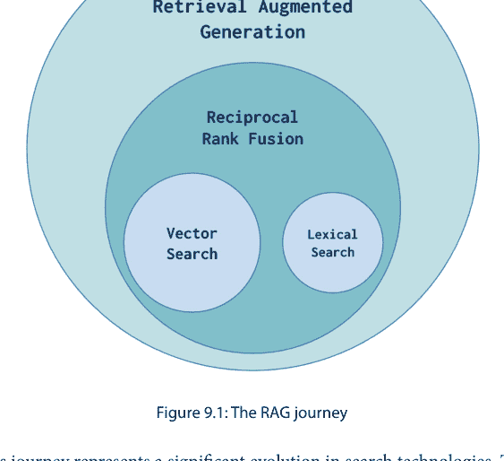
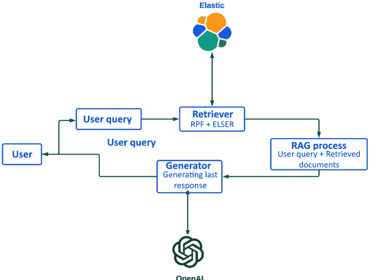

## 使用 Elastic 进行检索增强生成

在本章中，我们将继续在 Elasticsearch 世界中的旅程，并深入探讨 Elastic 提供的最先进和令人兴奋的功能之一：**检索增强生成 (RAG)** 搜索体验。如果你跟随我们之前的章节，你将熟悉 **Elastic Learned Sparse EncodeR (ELSER)** 预训练模型以及向量搜索的概念，它为搜索结果提供了语义理解的便利。你还了解了 **互惠排序融合 (RRF)** 在结合词汇搜索和向量搜索优势方面的强大功能。

在本章中，我们将更进一步，将这些概念集成到一个全面的管道中，最终实现通过 RAG 扩展 **大型语言模型 (LLM)**。这里的目标是结合词汇、向量和上下文搜索的优势，提供最相关的搜索结果，从而增强用户体验。

我们将介绍以下主题：

- 构成 RAG 的基本概念
- 如何通过 RRF 将 ELSER 与 BM25 结合
- 通过 RAG 扩展我们的 LLM 知识
- 探索一个真实案例研究 – CookBot，我们的烹饪聊天机器人助手

到本章结束时，你将具备基于 Elasticsearch 构建 RAG 应用的能力。

## 为 RAG 增强搜索做准备，使用 ELSER 和 RRF

在我们继续讨论语义搜索及其各个方面时，我们现在将注意力转向 RAG 增强搜索与 ELSER 和 RRF 的集成。

在深入探讨 RAG、ELSER 和 RRF 集成的细节之前，了解将我们带到这里的搜索方法论的历程和演变至关重要。


旅程始于词法搜索。这种简单却强大的方法论涉及匹配精确术语，已被广泛采用并能够提供可靠的结果。它为即将发生的事情奠定了基础。

下一步的飞跃来自于向量搜索的引入，为我们对搜索查询的理解增添了新的维度。这种技术使系统能够理解查询背后的“含义”或语义内容，远远超出了基础词法搜索的能力。

Elastic RRF 进一步提升了结果的相关性。这种技术巧妙地融合了词法搜索和向量搜索的优势，将两者之长结合起来，进一步优化了搜索输出的质量。

最后，最近最令人兴奋的发展是 LLM 集成到这一框架中。以 RRF 的输出为基础，这些模型实现了 RAG。这种巧妙的技术利用了 LLM 的上下文感知能力，使其能够基于搜索结果生成精确、相关的内容。

图 9.1 总结了上述信息：



图 9.1：RAG 之旅

这一旅程中的每一步都代表了搜索技术的重要演进。这种渐进式增强持续改善了 Elastic 提供日益智能、以用户为中心的搜索体验的能力。

现在，在了解了这一演进背景之后，让我们深入探讨 RAG、ELSER 和 RRF 如何协同工作以进一步提升我们的搜索能力。

## 使用 ELSER 进行语义搜索

正如我们之前讨论的，语义搜索改变了我们理解和响应用户查询的方式。ELSER 是这一领域中的有价值工具，提供了一种独特的方式来表示和理解用户查询的内容和上下文，使其更加深入。

我们之前研究过 ELSER 如何将大量内容纳入高维 token 空间，创建某种语义地图，从而产生更具上下文准确性的结果。然而，当我们引入 RAG 和 RRF 等元素时，ELSER 如何发挥作用呢？让我们来了解一下。

## RAG 的关键注意事项回顾

要在任何搜索系统中成功实现 RAG，我们必须考虑三个关键组件：文档存储、检索器和生成器。这些元素相互作用，形成有效 RAG 增强搜索系统的支柱。

## 文档存储

Elasticsearch 在我们的搜索系统中充当文档存储，提供所有可搜索数据驻留的平台。这些数据必须全面且多样化，以适应查询可能收到的广泛信息范围。Elasticsearch 以其快速高效地处理多样化数据类型而闻名，使其成为这一角色的理想选择。

Elasticsearch 不仅充当被动存储库，还在提供成功的搜索体验中发挥积极作用。凭借其强大的全文搜索功能、高效的索引以及处理大量数据的可扩展性，Elasticsearch 构成了部署成功 RAG 增强搜索系统的坚实基础。

## 检索器

在此上下文中，检索器在用户查询和 Elasticsearch 之间运行，我们的文档存储。在这里，预训练模型 ELSER 发挥了关键作用。

ELSER 通过扩展 Elasticsearch 中索引的文档语料库的 token 来发挥作用，增强其根据用户查询理解和定位语义相关信息的能力。它与 RRF 协同工作，RRF 是一种融合词法搜索和基于 ELSER 的搜索的技术。

RRF 通过创建子查询来实现这一点，有助于将词法搜索精确的术语匹配与 ELSER 提供的丰富语义理解相结合。这两种技术的整合使得检索过程更加全面和有效，显著提升了我们 RAG 系统中搜索结果的相关性和精确度。

## 生成器

在由 ELSER 和 RRF 驱动的检索器识别出 Elasticsearch 中最相关的文档后，就轮到生成器大放异彩了。在我们的设置中，生成器由 OpenAI 的 GPT-4 提供支持，这是截至撰写时最先进的语言模型之一。

GPT-4 使用检索器的输出生成详细、连贯且上下文相关的文本片段。利用这些先进 LLM 的能力，生成器可以生成直接回答用户查询或提供与其相关的有价值信息的文本。

随着 GPT-4 的引入，文本生成过程变得更加动态和准确，将语义搜索体验提升到全新水平。通过将 GPT-4 纳入我们的 RAG 系统，我们确保生成的响应不仅在上下文上与用户查询保持一致，而且保持高标准的一致性和相关性。

请记住，虽然检索器使用 Elasticsearch 识别相关的“信息块”，但由 GPT-4 支持的生成器会将这些信息块综合成全面且用户友好的响应。这些组件共同构成了一个强大、智能且有效的 RAG 增强搜索系统，如下图所示：



图 9.2：RAG 搜索系统

正是这些组件之间的交互和和谐，才造就了既相关又上下文丰富的搜索体验。

现在我们已经重申了 RAG 的关键注意事项，我们可以继续探讨 ELSER 如何在这一框架中发挥重要作用。

## 将 ELSER 与 RRF 集成

在 Elastic 8.9 更新中，引入了子搜索功能，为搜索操作开启了新的可能性。该功能对于将 ELSER 与 RRF 集成至关重要。

子搜索使多个不同的搜索查询能够在单个搜索请求中执行。该功能显著提高了组合不同搜索方法的能力。

将 ELSER 与 RRF 集成时，过程涉及两个子搜索和一个融合步骤。

### BM25 子搜索

最初执行 BM25 子搜索。此子查询专注于搜索用户查询中的精确或密切相关术语。

### ELSER 子搜索

同时执行 ELSER 子搜索。此子搜索捕获词法搜索中可能遗漏的上下文细微差别。

### RRF 融合

随后，使用 RRF 融合 BM25 和 ELSER 子搜索的结果。此方法创建了一个统一的列表，优先考虑被两个子搜索都识别为相关的文档。

这种整合方法使 Elastic 能够提供更先进的搜索体验，不仅识别匹配搜索词的文档，还能理解用户意图和查询上下文。

通过子搜索将 ELSER 集成到 RRF 中，Elastic 的搜索能力已为下一步发展做好准备：RAG 增强搜索。在此场景中，由 ELSER 和 RRF 共同努力产生的排序文档列表被用作 GPT-4 等复杂语言模型的基础上下文，提供更准确、更直观的搜索结果。

您也可以在以下博客文章中找到有关实际相关性性能的更多信息：

```
https://www.elastic.co/blog/improving-information-retrieval-elastic-stack-hybrid
```

## 语言模型和 RAG

截至撰写时，已有多种 LLM 选项可用，无论是付费软件，如 OpenAI，还是开源软件，如 Meta 最新发布的 Llama 2 (https://ai.meta.com/llama/) 和 Amazon Bedrock (https://aws.amazon.com/bedrock/)，均提供免费和付费选项。为本章目的，我们将使用 OpenAI 的 GPT-4。

## 预训练 LLM

预训练 LLM，如 OpenAI 的 GPT-4，在自然语言处理领域具有变革性。这些模型在庞大的文本语料库上训练，通过这一过程，它们学习语言的复杂模式，从基本语法到复杂的语义关系。因此，它们能够针对给定提示生成高质量、上下文相关的文本，使其成为改善搜索结果的优秀工具。

## RAG 如何扩展 LLM

LLM 的强大功能在 RAG 框架中通过在生成阶段使用它们来发挥作用。一旦检索器（在我们的例子中是 ELSER 和 RRF 的组合）选择了相关文档，这些文档就会作为上下文提供给 LLM。然后 LLM 会根据用户查询生成响应，该响应不仅与查询相关，而且基于检索到的文档中的信息。

## 向 LLM 提供语义索引数据

为了最大化 LLM 在 RAG 上下文中的有效性，至关重要的是向其提供语义索引数据。这涉及使用 ELSER 丰富索引文档并添加语义 token，以增强文档的上下文理解。

随着 RRF 和 ELSER 的纳入，Elasticsearch 可以基于词法搜索和语义搜索检索最相关的文档。当这些文档提供给 LLM 时，它会同时考虑用户查询和检索到的文档，生成与搜索意图准确一致的响应。RRF、ELSER 和 LLM 之间的这种交互产生了全面、上下文感知且更精确的搜索体验，这是 RAG 增强搜索的核心。

## 深入案例研究——实现 RAG 增强的 CookBot

人人都知道这个古老的烹饪难题：“我手头的食材能做什么菜？” 许多人在面对各种食材却缺乏灵感或知识来烹饪一道菜时需要帮助。这个日常问题正是我们想法的火花——CookBot。


CookBot 不仅仅是普通的 AI。它被构想为一个先进的烹饪助手，不仅可以根据现有食材推荐食谱，还能理解用户查询的细微差别，适应个人的饮食偏好和限制，并生成富有洞察力的烹饪建议。

我们的目标是将 RAG、ELSER 和 RRF 技术融入 CookBot。这些技术旨在增强查询的语义理解，优化信息检索，并生成相关、个性化的响应。通过利用这些先进工具的能力，我们希望 CookBot 能够为每个用户的独特需求提供无缝、上下文感知的烹饪帮助。


图 9.3：由 Elastic 驱动的 CookBot

## 数据集概览 – Allrecipes.com 数据集简介

Allrecipes.com 数据集以原始 CSV 格式存在，是一个充满多样化和详细烹饪信息的宝库。因此，它是训练我们的 CookBot 的完美基础。它收录了大量食谱，每条食谱都以一个独特的条目呈现，包含丰富的信息。

你可以在这里找到并下载该数据集，后续章节会用到：

https://www.kaggle.com/datasets/nguyentuongquang/all-recipes

为了说明该数据集的丰富性，让我们来看一个条目：

```
"group","name","rating","n_rater","n_reviewer","summary","process","ingredient"
"breakfast-and-brunch.eggs.breakfast-burritos","Ham and Cheese Breakfast Tortillas",0,0,44,"This is great for a special brunch or even a quick and easy dinner. Other breakfast meats can be used, but the deli ham is the easiest since it is already fully cooked.","prep: 30 mins,total: 30 mins,Servings: 4,Yield: 4 servings","12 eggs + <U+2153> cup milk + 3 slices cooked ham, diced + 2 green onions, minced + salt and pepper to taste + 4 ounces Cheddar cheese, shredded + 4 (10 inch) flour tortillas + cup salsa"
```

数据集中每个条目代表一个独特的食谱，并包含各个字段：

- `group`：这是食谱的分类。它提供了关于菜品类型和性质的总体概念。
- `name`：这是食谱的标题或名称。该字段直接告诉我们菜品是什么。
- `rating` 和 `n_rater`：这些字段表示菜品在用户中的受欢迎程度和认可度。
- `n_reviewer`：这是对该食谱进行过评论的用户数量。
- `summary`：这是菜品的简要概述或描述，通常提供有关其口味、用途或制作方法的宝贵背景信息。
- `process`：该字段概述了准备时间、总烹饪时间、份量和产量等关键细节。
- `ingredient`：这是制作食谱所需的所有配料的全面清单，包括其用量。

每个字段提供的详细信息为我们提供了广阔而多样的信息空间，有助于检索器在数据中导航，并确保生成器能够准确响应各种烹饪查询。随着我们继续推进，我们将讨论如何使用 Elasticsearch 对该数据集进行索引，ELSER 和 RRF 在有效检索数据中的作用，以及 GPT-4 模型如何基于检索到的数据生成相关、个性化的响应。

## 为 RAG 增强搜索准备数据

要将 Allrecipes.com 数据转换为可搜索的数据库，我们首先需要解析 CSV 文件，随后创建一个 Elasticsearch 索引来存储和查询数据。让我们逐步了解作为 Python 代码一部分实现的过程。

### 连接到 Elasticsearch

首先，我们需要与 Elasticsearch 实例建立连接。此连接由 Elasticsearch Python 模块中的 Elasticsearch 对象处理：

```
from elasticsearch import Elasticsearch
es = Elasticsearch()
```

在此情况下，我们假设 Elasticsearch 实例在本地以默认设置运行。如果不是这样，我们需要向 Elasticsearch 类提供适当的 host 和 port 信息。

### 定义索引

下一步是定义一个用于存储食谱的索引。Elasticsearch 中的索引类似于传统数据库系统中的数据库。在此，我们将索引命名为 recipes：

```
index_name = 'recipes'
```

### 创建映射

现在，我们需要为索引创建映射。映射类似于 SQL 数据库中的模式，定义了将存储在索引中的文档中每个字段的类型。我们将映射定义为 Python 字典：

```
mapping = {
    "mappings": {
        "properties": {
            "group": { "type": "text" },
            "name": { "type": "text" },
            "rating": { "type": "text" },
            "n_rater": { "type": "text" },
            "n_reviewer": { "type": "text" },
            "summary": {
                "type": "text",
                "analyzer": "english"
            },
            "process": { "type": "text" },
            "ingredient": {
                "type": "text",
            },
            "ml.tokens": {
                "type": "rank_features"
            }
        }
    }
}
```

这里，所有字段都定义为 text，这意味着它们是全文可搜索的。我们还指定 summary 字段应使用 English 分析器进行分析，这将有助于优化英语文本的搜索，考虑到词干提取和停用词等因素。最后，我们创建 ELSER 用于创建 token 集合的字段，该集合是基于传递给 ELSER 的术语进行扩展的结果。

### 创建索引

定义映射后，我们可以使用以下命令在 Elasticsearch 中创建索引：

```
es.indices.create(index=index_name, body=mapping)
```

这会向 Elasticsearch 发送请求，以指定名称和映射创建索引。

### 读取 CSV 文件

索引准备就绪后，我们现在可以从 CSV 文件读取数据集。我们将使用 pandas，一个强大的 Python 数据处理库，来完成此操作：

```
import pandas as pd
with open('recipe_dataset.csv', 'r', encoding='utf-8',
errors='ignore') as file:
    df = pd.read_csv(file)
```

此代码打开 CSV 文件并将其读入 pandas dataframe，这是一个完美的二维表格数据结构，用于操作结构化数据。

### 转换为字典

为了将数据编入 Elasticsearch 索引，我们需要将 dataframe 转换为字典列表，其中每个字典对应 dataframe 中的一行（即文档或食谱）：

```
recipes = df.to_dict('records')
print(f"Number of documents: {len(recipes)}")
```

此时，我们的数据集已准备好在 Elasticsearch 中进行索引。然而，考虑到数据集的大小，建议使用批量索引功能以实现高效的数据摄取。这将在下一节中介绍。

## 批量索引数据

让我们深入了解在 Elasticsearch 中批量索引数据集的逐步过程。

### 定义预处理管道

在进行批量索引之前，我们需要设置一个管道来预处理文档。在此，我们将使用 elser-v1-recipes 管道，该管道利用 ELSER 模型进行语义索引。管道定义如下：

```
[
  {
    "inference": {
      "model_id": ".elser_model_1",
```

```
"target_field": "ml",
"field_map": {
  "ingredient": "text_field"
},
"inference_config": {
  "text_expansion": {
    "results_field": "tokens"
  }
}
}
]
```

该管道包含一个推理处理器，使用 ELSER 预训练模型执行语义索引。它将食谱数据中的 ingredient 字段映射到 ELSER 模型的 text_field 对象。输出（ELSER 模型的扩展 token）存储在文档的 ml 字段下的 tokens 字段中。

### 创建批量索引序列

鉴于 Allrecipes.com 数据集的大小，逐个索引每个文档是不切实际的。相反，我们可以利用 Elasticsearch 的 bulk API，它允许我们在一个请求中索引多个文档。首先，我们需要生成一个字典列表，其中每个字典对应一个批量索引操作：

```
bulk_index_body = []
for index, recipe in enumerate(recipes):
    document = {
        "_index": "recipes",
        "pipeline": "elser-v1-recipes",
        "_source": recipe
    }
    bulk_index_body.append(document)
```

在此循环中，我们遍历 recipes 列表中的每个食谱（一个字典），然后构建一个包含批量索引操作所需信息的新字典。此字典指定文档将存储的索引名称（recipes）、用于处理文档的 ingest 管道（elser-v1-recipes）以及文档源本身（recipe）。


#### 执行批量索引操作

在准备好 `bulk_index_body` 数组后，我们现在可以执行批量索引操作：

```
try:
    response = helpers.bulk(es, bulk_index_body, chunk_size=500,
    request_timeout=60*3)
    print ("\nRESPONSE:", response)
except BulkIndexError as e:
    for error in e.errors:
        print(f"Document ID: {error['index']['_id']}")
        print(f"Error Type: {error['index']['error']['type']}")
        print(f"Error Reason: {error['index']['error']['reason']}")
```

我们使用 Elasticsearch 库中的 `helpers.bulk()` 函数，将我们的 Elasticsearch 连接（`es`）和我们刚刚创建的 `bulk_index_body` 数组传入，并设置 `chunk_size` 值为 500（表示我们希望每个请求发送 500 个文档）以及 `request_timeout` 值为 180 秒，这意味着我们允许每个请求最多耗时 3 分钟才超时，因为在使用 ELSER 的情况下，索引过程可能需要较长时间。

`helpers.bulk()` 函数将返回一个响应，指示尝试的操作数量和错误数量（如果有的话）。

如果在批量索引操作过程中发生任何错误，这些错误将作为 `BulkIndexError` 抛出。我们可以捕获该异常，并遍历其 `errors` 属性以获取每个单独错误的信息，包括导致错误的文档 ID、错误类型及其原因。

在这个过程的结束时，你将成功地在 Elasticsearch 中索引了整个 Allrecipes.com 数据集，使其准备好被你的 RAG 增强版 CookBot 检索和处理。

## 构建检索器——带有 ELSER 的 RRF

在我们的食谱检索任务背景下，我们的目标是根据用户查询最大化返回食谱的相关性。我们将利用经典全文搜索（通过 BM25）、语义搜索（使用 ELSER）以及一种强大的排名融合方法（RRF）的组合。这种组合使我们能够处理更复杂的查询，并返回与用户意图高度契合的结果。

让我们考虑以下查询：

```
GET recipes/_search
{
  "_source": { "includes": [ "name", "ingredient" ] },
  "sub_searches": [
    {
      "query": {
        "bool": {
```

```
"must": { "match": { "ingredient": "carrot beef" } },
"must_not": { "match": { "ingredient": "onion" } }
},
{ "query": { "text_expansion": { "ml.tokens": { "model_id": ".elser_model_1", "model_text": "I want a recipe from the US west coast with beef" } } } },
"rank": { "rrf": { "window_size": 50, "rank_constant": 20 } }
```

此查询包含两种类型的搜索。第一种使用经典的 Elasticsearch 布尔搜索，以找到同时包含胡萝卜和牛肉作为成分的食谱，并排除含有洋葱的食谱。这种传统方法确保了满足用户最基础的约束条件。

第二种 `sub_search` 使用 ELSER 对查询 "I want a recipe from the US west coast with beef"（我想要一个来自美国西海岸且含有牛肉的食谱）进行语义扩展。ELSER 基于其对语言的理解来解释此请求，使系统能够匹配那些可能不包含确切短语但在上下文相关的文档。这使得系统能够考虑用户更细致的偏好。

然后，该查询采用 RRF 来结合两个 `sub_search` 的结果。`window_size` 参数设置为 50，意味着考虑每个子搜索的前 50 个结果。`rank_constant` 参数设置为 20，引导 RRF 算法融合两个 `sub_search` 的分数。

因此，此查询展示了 BM25、ELSER 和 RRF 的有效组合。利用各自的优势，CookBot 可以超越简单的关键词匹配，提供更具上下文相关性的食谱，从而改善用户体验并提高系统的整体实用性。

## 利用检索器并实现生成器

既然我们已经设置好 Elasticsearch 检索器并准备就绪，让我们继续 RAG 系统的最后一部分：生成器。在我们的应用程序背景下，我们将使用 GPT-4 模型作为生成器。我们将在 `recipe_generator.py` 模块中实现生成器，然后将其集成到我们的 Streamlit 应用程序中。

### 构建生成器

我们将首先创建一个 `RecipeGenerator` 类。该类使用 OpenAI API 密钥进行初始化（关于如何获取 OpenAI 密钥，请参阅 https://help.openai.com/en/articles/4936850-where-do-i-find-my-secret-api-key），用于对 GPT-4 模型的请求进行身份验证：

```
import openai
import json
from config import OPENAI_API_KEY

class RecipeGenerator:
    def __init__(self, api_key):
        self.api_key = api_key
        openai.api_key = self.api_key
```

接下来，我们在 `RecipeGenerator` 类中定义 `generate` 函数。
此函数接收一个食谱作为输入，并将其作为提示发送给
GPT-4 模型，要求它生成一份详细的分步指南。

```
def generate(self, recipe):
    prompts = [{"role": "user", "content": json.dumps(recipe)}]
    instruction = {
        "role": "system",
        "content": "Take the recipes information and generate a recipe with a mouthwatering intro and a step by step guide."
    }
    prompts.append(instruction)

    generated_content = openai.ChatCompletion.create(
        model="gpt-4",
        messages=prompts,
        max_tokens=1000
    )
    return generated_content.choices[0].message.content
```

提示格式符合 OpenAI API 的要求，`max_tokens` 参数设置为 1000 以限制生成文本的长度。然后，生成的食谱由该函数返回。

## 将生成器集成到 Streamlit 应用程序

有了我们的 `RecipeGenerator` 类，我们现在可以将其集成到 `main.py` 中的 Streamlit 应用程序中。在导入必要的模块并初始化 `RecipeGenerator` 类后，我们将设置带有文本输入字段的用户界面：

```
from recipe_generator import RecipeGenerator
from config import OPENAI_API_KEY
generator = RecipeGenerator(OPENAI_API_KEY)
input_text = st.text_input(" ", placeholder="Ask me anything about cooking")
```

当用户输入查询时，我们将使用 Elasticsearch 检索器获取相关食谱。然后，我们将此食谱传递给 `RecipeGenerator` 的 `generate` 函数，生成的文本将在 Streamlit 应用程序中显示（示例视频见 https://www.linkedin.com/posts/bahaaldine_genai-gpt4-elasticsearch-activity-7091802199315394560-TkPY）：

```
if input_text:
    query = {
        "sub_searches": [
            {
                "query": {
                    "bool": {
                        "must_not": [
                            {
                                "match": {
                                    "ingredient": "onion"
                                }
                            }
                        ]
                    }
                }
            },
            {
                "query": {
                    "text_expansion": {
                        "ml.tokens": {
                            "model_id": ".elser_model_1",
                            "model_text": input_text
                        }
                    }
                }
            }
        ],
        "rank": {
            "rrf": {
```

```
"window_size": 50,
"rank_constant": 20
    }
}
recipe = elasticsearch_query(query)
st.write(recipe)
st.write(generator.generate(recipe))
```

生成器因此与检索器协同工作，根据用户的查询提供详细的分步食谱。这完成了我们在 Streamlit 应用程序中 RAG 系统的实现，填补了检索相关信息与生成连贯、有意义响应之间的差距。

## 总结

在深入探讨了构建 CookBot 所涉及的众多技术细节和高级方法后，我们可以得出结论：RAG、ELSER、BM25 和 RRF 的应用极大地增强了 CookBot 以更高的精确度和深度回答烹饪查询的独特能力。

在这一章的过程中，我们发现了 RAG 作为检索相关文档的检索器和制作详细响应的生成器的潜力。通过结合 ELSER 和 BM25，检索组件获得了语义背景和关键词效率的优势。这些检索方法与 RRF 的融合导致生成了高度相关的食谱集合，即使面对复杂或模糊的查询也是如此。

将 RAG 集成到 CookBot 的架构中进一步增强了其能力，展示了一种迭代方法的价值，即知识在多步过程中得到精炼。通过在 RAG 设置中使用 GPT-4 作为生成器，CookBot 能够产生多样化、丰富且上下文准确的响应。

通过利用 Allrecipes.com 数据集作为基础，并协调使用 RAG、ELSER、BM25 和 RRF，我们成功创建了 CookBot，一个能够熟练导航烹饪领域并提供个性化帮助的机器人。此模型说明了如何将最先进的检索方法与强大的语言模型相结合，从而为各种领域产生实用且高效的解决方案。

展望未来，我们可以预见 CookBot 将得到进一步的增强和完善，展示了 AI 驱动烹饪协助领域的无限可能性。这次探索为我们深入更先进的技术和策略奠定了基调，这些技术和策略可用于创建强大的对话式 AI 系统。

我们希望你已经对这些关键概念及其应用有了全面的理解，从而更深入地欣赏人工智能这一迷人领域。在下一章，我们将探讨 ChatGPT 插件框架，并将我们获得的关于 RAG 的知识扩展到直接集成到 ChatGPT 体验中。


## 10