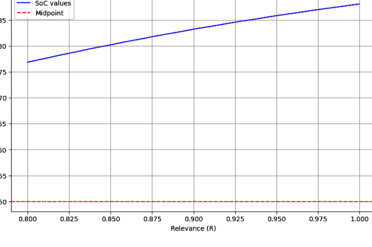
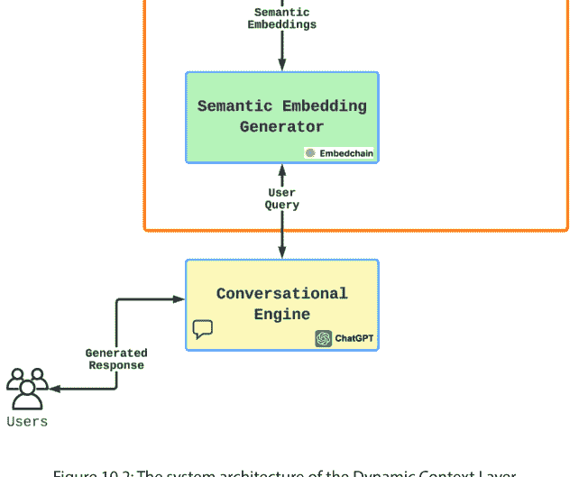
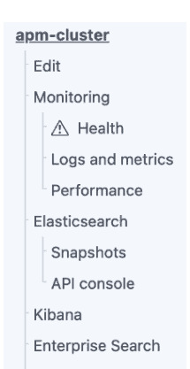
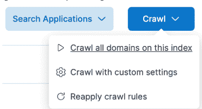
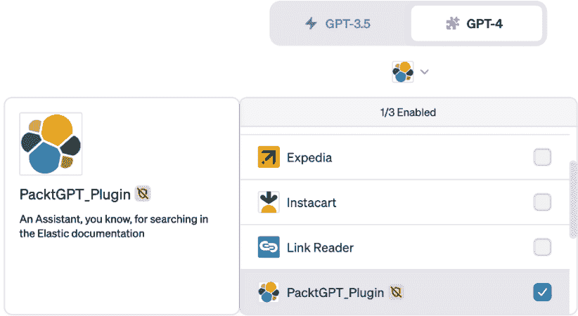
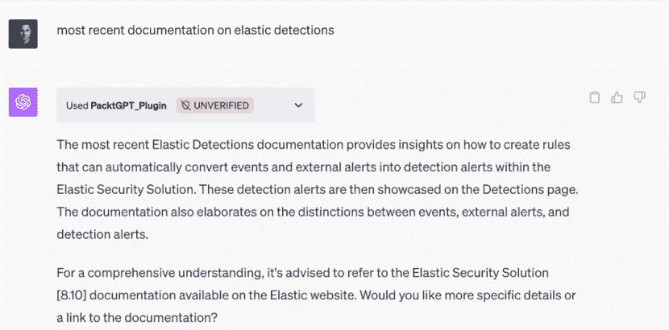

为 ChatGPT 构建一个 Elastic 插件

上下文是理解的支柱。对于 ChatGPT 等对话式 AI 系统而言，保持最新信息至关重要，以便在瞬息万变的科技环境中保持相关性。虽然静态知识库可以应对各种问题，但当系统理解当前上下文时，答案的精确性和相关性可以得到显著提升。

动态上下文层（DCL）提供了一种解决方案。通过持续用最新数据更新模型的知识，DCL 确保 AI 的响应不仅准确，而且及时且具有上下文感知能力。本章重点介绍如何利用 Elasticsearch 的向量功能结合 Embedchain 为 ChatGPT 创建这样的层，Embedchain 是一个旨在轻松构建可在任何数据集上运行的 LLM 驱动型机器人的框架。我们的主要目标是使 ChatGPT 能够提取并理解最新的领域特定信息，确保其为用户查询提供最及时的答案。

在本章中，我们将涵盖以下主题：

- 大语言模型中上下文的重要性
- 上下文重要性概念
- Embedchain 作为在不同数据集上创建 LLM 驱动型机器人的框架
- 如何为 Elasticsearch 构建 ChatGPT 插件

随着我们的推进，我们将评估系统。配备最新 Elastic 上下文的 ChatGPT 如何响应用户查询？动态、最新的数据集会带来什么不同？

到本章结束时，你不仅会理解构建 DCL 背后的机制，还会认识到为你的对话式 AI 提供实时、不断更新的数据源的价值。

## 上下文基础

上下文基础为我们的旅程奠定了基础，我们将重温 **上下文** 在 **大语言模型（LLMs）** 领域中的重要性。在本简短部分中，我们将了解为什么保持相关且动态的上下文对于有意义的交互至关重要，尤其是在内容不断演变的应用程序中。这种基础知识将为我们在后续部分中探索的创新提供基础。

### 动态上下文范式

在任何对话中，响应的丰富性和相关性往往取决于其所处的上下文。随着我们阅读本书，我们已经领略到 GPT 等 LLM 所依赖的庞大知识库。但当我们希望模型把握新鲜数据的细微差别时会发生什么？本节介绍动态上下文的概念——其意义、挑战，以及它为现代聊天机器人带来的潜力。我们将深入探讨为何要使用最新数据动态增强 ChatGPT 响应的原因，为后续更深入的技术探索奠定基础。

### 大语言模型中上下文重要性的演变

当我们讨论大语言模型如 ChatGPT 的上下文时，我们不仅仅指的是用户的即时输入。上下文是塑造模型输出的隐式和显式信号的组合，确保其响应与整体对话的主题和具体细微差别保持一致。

GPT-4 等 LLM 通过在广泛的数据集上进行大量训练，发展出了对上下文的本能理解。这些庞大的训练使它们能够生成受训练期间辨识模式启发的人类般文本。简单来说，它们通过研究无数对话学会了模仿人类交谈的方式。

ChatGPT 的一个显著特征是其在滚动上下文窗口上运行。通过优先考虑最近的交互来为其下一个响应提供信息，它们确保对话的连贯性。如果用户突然转换话题或回到之前提到的点，LLM 会由于该上下文窗口而做出适当响应。这使得与 ChatGPT 或类似模型的对话感觉连贯而不是支离破碎。

### 为什么静态知识不够——动态上下文的优势

当我们与人类交谈时，我们很大程度上依赖于我们可获得的最新的相关信息。我们的决策、见解和讨论不仅仅基于多年前的记忆；它们还融入了最新新闻、最近的经历和更新的知识。LLM 本质上应努力模仿人类对话的这一方面。然而，当受限于静态知识时，其潜力就会受到限制。

让我们看看原因：

- **过时信息**：静态知识是时间上的一个快照。无论这个快照多么庞大或详细，它最终都会过时。例如，静态模型可能精通软件应用程序在其最后更新时的功能。但之后添加的新功能或修改呢？寻求最新信息的用户会发现静态知识不完整，甚至更糟——具有误导性。
- **相关性丧失**：几年前、几个月前甚至几周前被认为相关或必不可少的信息，今天可能不再具有同样的意义。趋势在演变，全球形势在变化，用户兴趣也在转移。动态上下文确保所访问的数据与当前情况保持一致，从而保持其对用户的相关性。
- **无法应对最新发展**：从技术进步到全球事件，世界处于不断变化的状态。如果没有利用动态上下文的能力，LLM 对这些发展一无所知，无法回答或涉及近期事件的问题或主题。
- **静态数据库的深度**：虽然静态数据库可以非常庞大，但它们不会实时增长或演变。它们可能对特定主题有深入的知识，但缺乏应对更新的跨学科主题所需的广度。

### 动态上下文的力量

与静态知识的局限性相反，动态上下文提供了一个不断演进的知识库。让我们现在看看动态上下文的优势：

- **实时更新**：通过连接到实时数据源或当前数据库，所提供的信息始终保持更新。用户获得反映给定主题最新知识状态的答案。
- **提高相关性**：动态上下文使 LLM 能够利用当前趋势、讨论和全球动态。这确保所提供的答案与当下相关的内容密切契合。
- **可扩展性**：随着世界的成长和演变，动态上下文也在增长。它随新数据的涌入而扩展，确保知识库持续扩展。
- **交互性**：通过与当前上下文保持同步，LLM 可以提供更具交互性和吸引力的对话。它们可以响应实时事件，提供正在进行情况的更新，甚至对新趋势做出反应，就像一位见多识广的人类一样。

本质上，虽然静态知识提供了坚实的基础，但正是动态上下文为 LLM 注入了活力，将其从单纯的信息存储库转变为能够进行有意义、当前和互动对话的实体。

## 上下文的重要性

为了介绍上下文重要性（SoC）的概念，请考虑以下类比，该类比利用了我们在第 9 章《使用 Elastic 的检索增强生成》中构建的示例。

想象使用一个食谱应用来准备晚餐。最初，你只能访问来自一本过时食谱书的食谱。虽然这些食谱提供了基本基础，但它们可能无法满足当今的饮食偏好或使用你橱柜中现有的食材。

一周后，该应用进行了升级。现在，它不仅包含来自多个来源的食谱，还可以根据用户评论、食材季节性和你的个人饮食限制进行调整。此外，每次使用时，应用都会从你的选择中学习，并开始建议更符合你口味的食谱。

让我们将此与上下文重要性的因素联系起来：

- **相关性（R）**：最初的广泛食谱范围具有一般相关性，但在学习了你的特定偏好后，应用的建议变得与你的口味高度相关。借助个性化，你获得了增强的用户体验。
- **连续性（C）**：随着你不断向应用提供饮食偏好的反馈，你看到的食谱类型保持一致，提供持续的定制化建议流。
- **及时性（T）**：应用还考虑季节和最新的烹饪趋势。通过这样做，它确保所建议的食谱是及时的，使用季节性食材并与当前烹饪趋势保持一致。
- **准确性（A）**：通过与经过验证的烹饪来源同步并整合用户评论，应用确保其食谱建议不仅受欢迎，而且在食材、比例和烹饪方法方面也是准确的。LLM 与上下文的结合将有助于最大限度地减少 LLM 幻觉。LLM 幻觉是指 LLM 由于对信息的误解或训练数据集中存在偏见信息而呈现虚假、捏造或无意义的信息。

正如我们在 ChatGPT 中为 Elastic 文档构建 DCL 的目标一样，我们旨在确保所提供的信息不仅准确，而且对用户的需求高度相关、连续且及时。

SoC 类似于搜索引擎中的相关性评分，可以作为量化评估语言模型上下文感知效率和准确性的衡量标准。在本书中，我们希望尝试为 SoC 创建一个数学表示。鉴于上述因素，这里是一个可能的表示：

SoC = 1 / (1 + e^(-k(w_R R + w_C C + w_T T + w_A - threshold)))


在前面的公式中，权重如下：

- w_R = 相关性的权重
- w_C = 连续性的权重
- w_T = 时效性的权重
- w_A = 准确性的权重

在此上下文中，*threshold* 将是调整后的值（通常是权重的总和），它确保 sigmoid 函数的中点与参数的期望平衡点对齐。sigmoid 函数用于将 SoC 限制在 0 到 1 之间，确保其代表上下文重要性的百分比或类似概率的度量。

例如，在实时新闻机器人中，时效性可能具有更大的权重，而对于技术支持机器人，相关性和准确性可能更为重要。

为了使其具有可操作性，每个分数（R、C、T 和 A）理想情况下应在 0 到 1 之间，其中 1 为最佳可能分数。

这些分数的数据可通过用户反馈、直接评估或其他指标获得，例如后续问题的耗时（表明可能存在困惑或缺乏清晰度）。

随着时间的推移，随着更多数据的收集，权重可以进行调整以更好地反映用户需求和偏好。

## sigmoid 函数中 k 的作用

*k* 决定 sigmoid 曲线的陡峭程度。

增加 *k* 会使 sigmoid 函数变得更陡，这意味着 SoC 对平均表现的敏感度降低，而对 exceptional 表现的辨别力增强。

减小 *k* 会使曲线变平缓，使得输入分数的微小变化也能明显影响 SoC。

通过评估 SoC，不仅可以评估语言模型的性能，还可以识别改进领域。它还提供了一种可操作的方法来迭代增强模型。在探讨了动态上下文的重要性和必要性之后，让我们深入了解如何实现它。接下来，我们将研究 DCL 插件的架构和流程，说明理论与应用之间的桥梁。

## 示例

让我们尝试看看为什么拥有一个数据存储——也就是说，不仅是一个向量数据库，而且是一个能够提供最相关搜索结果的搜索引擎——很重要。以下代码展示了如何在相关性驱动 SoC 时绘制 SoC：

```
### Import necessary libraries
import numpy as np
import matplotlib.pyplot as plt
### Define the SoC function using sigmoid
def soc_function(R, C, T, A, k=1, threshold=2):
return 1 / (1 + np.exp(-k*(R + C + T + A - threshold)))
### Sample R, C, T, A values
R_values = np.linspace(0.8, 1, 50)
C_values = np.linspace(0.8, 1, 50)
T_values = np.linspace(0.8, 1, 50)
A_values = np.linspace(0.8, 1, 50)
### Compute SoC values for the sample R, C, T, A values
soc_values = soc_function(R_values, C_values, T_values, A_values)

### Plotting the function
plt.figure(figsize=(10, 6))
plt.plot(R_values, soc_values, label="SoC values", color='blue')
plt.axhline(y=0.5, color='r', linestyle='--', label="Midpoint")
plt.title("Significance of Context (SoC) vs. R (with C, T, A held constant)")
plt.xlabel("Relevance (R)")
plt.ylabel("SoC Value")
plt.legend()
plt.grid(True)
plt.show()
```

前面的代码将绘制以下内容：



图 10.1：相关性为函数、 C、T 和 A 保持恒定的上下文重要性度量

Elasticsearch 具有显著的优势，即它使用户能够微调相关性。 该图显示，尽管除了相关性之外还有三个因素构成 SoC，但数据存储对相关性的控制越多，动态上下文的重要性就越高。

## 动态上下文层插件愿景——架构和流程

在本节中，我们将深入项目的核心：DCL 插件的设计和流程。我们将概述其结构，解释 ChatGPT、Embedchain 和 Elasticsearch 如何协同工作。通过了解底层架构和数据流的步骤，您将了解如何将实时数据集成到聊天机器人的响应中。我们将讨论为什么做出某些设计选择以及它们对系统功能的影响。

在任何高级系统中，结构和功能的清晰度至关重要。DCL 也不例外。为了了解 ChatGPT 如何通过 Embedchain 与 Elasticsearch 交互的机制，我们必须首先熟悉实现这种集成的基础组件。每个组件都有其独特的目的，共同使我们的聊天机器人能够动态检索、理解和传递当前信息。

DCL 的核心是三个主要组件：**向量搜索引擎（VSE）**、**语义嵌入生成器（SEG）** 和 **对话引擎（CE）**。这些组件远非孤立的单元，它们紧密相连，确保我们的聊天机器人的见解不仅准确，而且及时且上下文相关。

随着我们深入本章，这些组件将作为我们的导航灯塔，引导我们了解 DCL 系统的架构和流程。让我们首先了解这些基础支柱中的每一个，开始这段旅程。

下图是 DCL 系统的视觉表示，展示了每个核心组件如何交互以提供无缝且动态的对话体验：



图 10.2：动态上下文层的系统架构

**动态上下文接口（DCI）**充当中央枢纽，协调聊天机器人与 VSE 之间信息和交互的流转。它是一个多功能的接口，旨在理解、解释并在对话引擎和底层数据存储库之间转换请求和响应。另一方面，实时上下文提取器（RCF）体现了整个系统的动态方面。顾名思义，RCF 负责从 VSE 中主动检索最新和最相关信息。无论是提取最新的文档更新还是提取向量嵌入的见解，RCF 都确保提供给聊天机器人的数据始终是最新的，使对话尽可能相关和知情。DCI 和 RCF 共同构成了连接数据和对话的静态世界与动态世界的活跃纽带。

在建立了对 DCL 插件架构的清晰理解之后，是时候从蓝图过渡到建设阶段了。在下一节中，我们将详细介绍构建动态层的步骤和注意事项，确保我们的 ChatGPT 能够有效地利用 Elasticsearch 和 Embedchain 进行实时上下文适配。

## 构建 DCL

在本节中，我们将着手构建我们设想的工具的具体步骤。我们将深入探讨将 Elasticsearch 的功能与 Embedchain 合并的技术细节，重点关注与 ChatGPT 集成和优化的实际方面。到本节结束时，您将全面了解如何使此 DCL 投入运行以及如何微调其性能以获得最佳用户体验。

## 从 Elastic 文档获取最新信息

让我们现在深入探索的实际方面。在这里，我们将讨论如何从 Elastic 获取最新的文档，这是确保我们的动态上下文保持最新状态的关键步骤。此过程作为填充上下文的相关且及时数据的初始步骤，为 ChatGPT 以上下文感知的方式进行交互奠定了基础。

数据提取是我们创建 DCL 的基础步骤。在 Elastic 中有不同的数据上板选项；在这里我们将使用 Elastic 网页爬虫。爬虫使用户只需一个 URL 即可开始从网站摄取数据。通过 Elastic 网页爬虫，我们有一种简化和直接的方式来获取必要的数据。网页爬虫的优点如下：

- **简单设置**：无需构建复杂的 数据集成管道或处理各种内容来源，Elastic 网页爬虫只需一个 URL 即可开始其提取过程。
- **与 Elasticsearch 直接集成**：激活后，爬虫直接获取数据并将其馈送到 Elasticsearch 索引中。这种无缝流程确保数据可随时用于后续阶段，无需延迟。
- **可配置性**：该工具用途广泛。虽然默认配置适用于许多场景，但可以自定义爬取，例如专注于网站的特定部分或调整检查新内容的频率。


针对我们的特定需求，从 https://www.elastic.co/guide 获取 Elastic 文档用例，Elastic 网页爬虫至关重要。它系统地扫描指南，确保全面捕获最新的文档。此数据一旦编入 Elasticsearch 索引，即可为语义嵌入和后续与 ChatGPT 的交互做好准备。

借助 Elastic 网页爬虫等工具，我们可以少担心如何收集数据，而更专注于如何有效利用这些数据来提升聊天机器人的性能。

让我们首先确保您在 Elastic Cloud 部署中运行着一个 Enterprise Search 节点：

+   1. 打开您的部署并检查是否看到如下截图中所示的节点：


图 10.3：Elastic Cloud 控制台中的 Enterprise Search 节点

+   2. 如果没有，则需要编辑您的部署以添加一个。点击左侧的 Edit 按钮：



图 10.4：Elastic Cloud 控制台中的侧边菜单

3. 向下滚动并使用以下设置添加一个 Enterprise Search 实例：

## Enterprise Search

Edit user settings

## Enterprise Search instances info

Add modern search to your application or connect and unify content across your workplace.

Size per zone
2 GB RAM | Up to 4.2 vCPU

Availability zones
1 zone 2 zones 3 zones

Total (size x zone)
2 GB RAM | Up to 4.2 vCPU

图 10.5：Enterprise Search 实例配置

4. 更新您的部署。完成后，导航到您的 Kibana 实例，然后进入 Content/Indices 下的 Search 部分。从那里，您应该会看到一个 Create an Index 按钮，如以下截图所示：

## Elasticsearch indices

Create a new index

## Welcome to Enterprise Search

## Add data and start searching

Your content is stored in an Elasticsearch index. Get started by creating an Elasticsearch index and selecting an ingestion method. Options include the Elastic web crawler, third party data integrations, or using Elasticsearch API endpoints.

Whether you're building a search experience with App Search or Elasticsearch, you can now get started here.

Create an Elasticsearch index

Learn more

图 10.6：Enterprise Search 添加数据助手

5. 点击此按钮并从出现的选项中选择 Use a web crawler（已知问题链接：https://www.elastic.co/guide/en/enterprise-search/current/crawler-known-issues.html）：

## Select an ingestion method

Create a search optimized Elasticsearch index to store your content. Start by selecting an ingestion method.

图 10.7：摄取方法选择

6. 为您的索引命名——这里，我使用了名称 packt-cdl-source：

## Web crawler search index

Use the web crawler to programmatically discover, extract, and index searchable content from websites and knowledge bases.

## Create an Elasticsearch index

This index will hold your data source content, and is optimized with default field mappings for relevant search experiences. Give your index a unique name and optionally set a default language analyzer for the index.

图 10.8：网页爬虫搜索索引创建

7. 在 Domain URL 字段中，添加 https://www.elastic.co，因为这是我们想要爬取的：

## search-packt-cdl-source

## Add a domain to your index

Configure the domains you'd like to crawl, and when ready trigger your first crawl.

Domain URL

https://www.elastic.co

Domain URLs require a protocol and cannot contain any paths.

Web Crawler entry point has been set as /guide

Initial validation

Network connectivity

Indexing restrictions

Found a robots.txt file at https://www.elastic.co/robots.txt and it allows us access to the domain with some restrictions that may affect content indexing.

Content verification

图 10.9：爬虫域名验证

8. 由于我们只想爬取文档，请添加 /guide 入口点：

## Manage https://www.elastic.co

## Entry points

Include the most important URLs for your website here. Entry point URLs will be the first pages to be indexed and processed for links to other pages.

Learn more about entry points.

URL

https://www.elastic.co/guide

图 10.10：爬虫入口点

然后，通过点击右上角的 Crawl 按钮开始爬取所有域名：



图 10.11：爬虫操作

9. 您可以通过在 Dev Tools 中运行 GET search_packt_cdl_source/_search 查询来验证文档是否正在进入。

好消息是我们不必对这些文档进行任何转换或数据处理即可与 Embedchain 一起使用。相反，我们将专注于这些文档的 URL 字段，因为这是构建我们的可插拔 DCL 的关键。

## Elevating data with Embedchain

在本节中，我们深入探讨 Embedchain（https://github.com/embedchain/embedchain）的机制，Embedchain 是一个开源数据平台，旨在利用 LLM 功能增强数据集。我们将探讨它如何无缝集成 Elasticsearch，使 ChatGPT 能够基于数据集增强的语义上下文进行理解和响应。本节提供了利用 Embedchain 在原始数据和有意义交互之间架起桥梁的如何以及为何。

我们喜欢将 Embedchain 视为 LangChain、向量数据库和 LLM 之上的另一个抽象层。它提供更高级别的控制，并专门用于从不同类型的数据源向 LLM 加载上下文。我能想到的最接近的例子是在电影《黑客帝国》中，Trinity 请求一个直升机训练程序，Tank 将其加载到她的脑海中。Embedchain 基本上以同样的简易程度工作。以下是一个示例：

```
elastic_bot.add(" https://jobs.elastic.co/jobs/csm/san-francisco-ca/customer-architect/5112073?gh_jid=5112073#/" )
```

这将加载包含职位描述的页面到名为 elastic_bot 的 Embedchain 应用中，这样当用户提交有关此职位的提问时，elastic_bot 应用将拥有上下文：

```
elastic_bot.query("Tell me about  the Customer Architect role at Elastic")
```

这是此示例的 Embedchain 机器人输出：

```
elastic_bot.query("Tell me about the Customer Architect role at Elastic")
```

'The Customer Architect role at Elastic is a position within the Customer Success Group. Customer Architects at Elastic are responsible for working with customers to understand their needs and requirements, and then designing and implementing solutions using Elastic's technology stack. They help customers optimize their use of Elastic's products for search, observability, and security purposes. Customer Architects also provide technical guidance and support to customers throughout the implementation process.'

图 10.12：Embedchain 输出

就这么简单！那么，让我们将其置于我们的目标背景下。我们希望用户通过 ChatGPT 与我们的插件交互，该插件会响应提示，通过 Embedchain 加载正确的文档页面。当 Embedchain 应用添加内容时，它实际上将其存储在底层向量数据库中。它使用 OpenAI 的 Ada 嵌入模型从其抓取的数据块创建嵌入。所有的数据分块和水合处理均由 Embedchain 完成。

在此示例中，我们将使用 Elasticsearch 作为向量数据库。以下代码块显示了当添加链接时 Embedchain 索引的文档结构：

```
{
    "_index": "embedchain_store_1536",
    "_id": "635ef64b5a99725d3b2cdf1cca86d5570a70388aa4d8d328cb2a02dd74b232c8",
    "_score": 1,
    "_source": {
        "text": "Aligning with customer business goals, you'll also guide them through onboarding, ensure they adopt our solutions, and aid in their growth. As a Customer Architect, you'll stand as the Go-to Technical Counsel, collaborating closely with the customer and partnering with teams like Field and Services. Your role ensures that Elastic's offerings consistently surpass customer hopes. Leveraging your technical knowledge, business acumen, and commitment to value, you'll enhance and elevate the customer journey.",
        "metadata": {
            "url": "https://jobs.elastic.co/jobs/csm/united-states/customer-architect/5112021?gh_jid=5112021#",
            "data_type": "web_page",
            "hash": "832c08a036185237195ac37a6133db16"
        },
        "embeddings": [...] 
    }
}
```


前面的代码展示了一个由 Embedchain 提取的文档块以及使用 OpenAI 的 embeddings 数组。因此，最终在我们的文档用例中，我们希望数据源的结构与在 Elastic 中的结构保持一致。如果用户输入“告诉我 Elastic 的 Customer Architect 职位的职责是什么”，该问题会通过插件从 ChatGPT 传递给 Embedchain。插件首先查询 Elasticsearch 以从已抓取的内容中获取最合适的 URL，然后 Embedchain 会动态地将该 URL 添加到上下文中以使用 GPT 生成响应。

在以 Elasticsearch 和嵌入技术奠定基础之后，我们现在将焦点转向对话的核心：ChatGPT。我们如何确保我们的强大搜索引擎能够与这位对话者无缝通信？让我们深入探讨集成过程。

## 集成 ChatGPT——创建实时对话者

在本节中，我们将探讨将 ChatGPT 与我们丰富的 Elasticsearch 数据集融合的机制。通过桥接这些技术，我们旨在创建一个不仅具有反应性，而且还能深刻地以我们构建的动态上下文为依据的机器人。我们将逐步介绍集成步骤，确保 ChatGPT 能够流畅地访问并解释存储在 Elasticsearch 中的大量信息。

## 处理 Elasticsearch 与 ChatGPT 之间的实时数据流

让我们先退一步，提醒自己期望的组件和流程：

- 1. 用户仅与 ChatGPT 交互。
- 2. 用户已激活插件。
- 3. 当用户就 Elastic 文档中的最新信息提问时，用户提示会传递给插件。
- 4. 插件分析提示，然后查询包含已抓取文档的索引。
- 5. Elasticsearch 返回一个或多个 URL。
- 6. 这些 URL 由 Embedchain 添加到上下文中。
- 7. Embedchain 生成响应。
- 8. 插件将 Embedchain 返回的响应打印到 ChatGPT 中供用户查看。

到目前为止，我们已经有了包含文档的索引——现在，我们必须构建 ChatGPT 插件。请参考 OpenAI 的文档了解插件框架的基础知识（https://platform.openai.com/docs/plugins/introduction）。我们将假设你已阅读文档并理解创建插件所需的基础知识。

## 插件代码

插件必须符合 OpenAI 文档的要求才能在 ChatGPT 中通过验证并安装。我们将首先查看存储库结构，然后继续创建一些必要的文件以及实现代码以实现我们的目标。

## 存储库结构

存储库结构很简单，如下图所示：


图 10.13：ChatGPT 插件存储库结构

让我们分解结构：

- - 主要服务代码在 app.py 中
- - 插件的 logo（logo.png）将在 ChatGPT 插件商店中显示
- - 插件清单存储在 .well-known 目录下的 ai-plugin.json 文件中
- - OpenAPI 描述符包含在 openapi.yaml 文件中

请注意，我们在此使用 Dockerfile 作为部署插件的资源。插件部署平台可以根据你可用的资源而有所不同；我使用的是 Google Cloud Compute。你需要选择你喜欢的部署平台或云提供商。插件代码部署超出了本书的范围。现在，让我们看看公开我们 API 的代码。

## 服务代码

服务代码由 ChatGPT 为验证插件和运行代码而期望的四个 REST API 端点组成：

```
...
@app.get("/search")
...

@app.get("/logo.png")
```

```
async def plugin_logo():
    filename = 'logo.png'
    return await quart.send_file(filename, mimetype='image/png')

@app.get("./.well-known/ai-plugin.json")
async def plugin_manifest():
    host = request.headers['Host']
    with open("./.well-known/ai-plugin.json") as f:
        text = f.read()
    text = text.replace("PLUGIN_HOSTNAME", f"https://{host}")
    return quart.Response(text, mimetype="text/json")

@app.get("/openapi.yaml")
async def openapi_spec():
    host = request.headers['Host']
    with open("openapi.yaml") as f:
        text = f.read()
    text = text.replace("PLUGIN_HOSTNAME", f"https://{host}")
    return quart.Response(text, mimetype="text/yaml")
...
```

第一个 /search API 是实现的核心。其余部分按出现顺序返回 logo、清单和 OpenAPI 定义。

/search API 是魔法的发生地。以下是实现的分解：

```
async def search():
    query = request.args.get("query")
    url = ESSearch(query)
    return quart.Response(url)
```

ESSearch 函数是最重要的一部分，因为它在 Elasticsearch 中搜索最相关的文档并将它们的链接传递给 Embedchain 以构建上下文。请注意，我们在此使用简单的 BM25 Elasticsearch 查询，因为我们使用 Embedchain 为我们抽象上下文构建过程。这意味着 Embedchain 会根据我们提供的链接生成嵌入并返回生成的答案：

```
def ESSearch(query_text):
    cloud_url = os.environ['cloud_url']
    cid = os.environ['cloud_id']
    cp = os.environ['cloud_pass']
    cu = os.environ['cloud_user']
    es = es_connect(cid, cu, cp)
    # Elasticsearch query (BM25)
    query = {
```

```
"bool": {
    "filter": [
        {
            "prefix": {
                "url": "https://www.elastic.co/guide"
            }
        }
    ],
    "must": [{
        "match": {
            "title": {
                "query": query_text,
                "boost": 1
            }
        }
    }]
}

fields = ["title", "body_content", "url"]
index = 'search-elastic-doc'
resp = es.search(index=index,
                query=query,
                fields=fields,
                size=10,
                source=False)

body = resp['hits']['hits'][0]['fields']['body_content'][0]
url = resp['hits']['hits'][0]['fields']['url'][0]
elastic_bot = App()
### Assuming 'resp' is the response object you've mentioned
for hit in resp['hits']['hits']:
    for url in hit['fields']['url']:
        print(url)
        #es_app.add(url)
        elastic_bot.add(url)

return elastic_bot.query("What can you tell me about " + query_text)
```

请注意，我们通过在用户输入前加上“what can you tell me about”来保持提示的宽泛性。

测试代码应会在 URL http://0.0.0:5001 上公开一个端点。打开你选择的测试工具并传递类似以下的查询：

```
http://0.0.0:5001/search?query=detections
```

此查询要求机器人构建关于 Elastic Security detections 的上下文。如果你在控制台中打印 URL，你会看到 Embedchain 正在向上下文中添加内容：

```
https://www.elastic.co/guide/en/siem/guide/current/detection-engine-overview.html
Successfully saved https://www.elastic.co/guide/en/siem/guide/current/detection-engine-overview.html (DataType.WEB_PAGE). New chunks count: 15
https://www.elastic.co/guide/en/siem/guide/current/rule-api-overview.html
Successfully saved https://www.elastic.co/guide/en/siem/guide/current/rule-api-overview.html (DataType.WEB_PAGE). New chunks count: 5
https://www.elastic.co/guide/en/security/current/detection-engine-overview.html
Successfully saved https://www.elastic.co/guide/en/security/current/detection-engine-overview.html (DataType.WEB_PAGE). New chunks count: 17
https://www.elastic.co/guide/en/security/8.9/detection-engine-overview.html
Successfully saved https://www.elastic.co/guide/en/security/8.9/detection-engine-overview.html (DataType.WEB_PAGE). New chunks count: 17
https://www.elastic.co/guide/en/security/current/rule-api-overview.html
Successfully saved https://www.elastic.co/guide/en/security/current/rule-api-overview.html (DataType.WEB_PAGE). New chunks count: 5
https://www.elastic.co/guide/en/security/current/detections-permissions-section.html
Successfully saved https://www.elastic.co/guide/en/security/current/detections-permissions-section.html (DataType.WEB_PAGE). New chunks count: 18
```

再次说明，为本示例的目的，我们保持 Elasticsearch 查询相当宽泛，以避免过度缩小结果范围，但 SoC 在这里确实会受到影响，因为准确性可能会下降。因此，根据你的需求，你可能需要微调查询以产生更少或更多结果。

REST 调用应返回有关 Elastic detections 的内容：

```
Detections are alerts that are created based on rules in the Elastic Security Solution. These alerts are generated automatically when events and external alerts are sent to Elastic Security. They are displayed on the Detections page, and provide information about potential security threats or suspicious activities. For more detailed information about the differences between events, external alerts, and detection alerts, you can refer to the Elastic Glossary.
```


At this stage, we have validated that the endpoint is functional. We now need to describe our plugin for OpenAI.

## Manifest

The manifest describes what your plugin is going to achieve and gives a direction to the model that tells when to trigger the plugin depending on the prompt that is submitted by the user. Here is the JSON content:

```
{
"schema_version": "v1",
"name_for_human": "PacktGPT_Plugin",
"name_for_model": "PacktGPT_Plugin",
"description_for_human": "An Assistant, you know, for searching in the Elastic documentation",
"description_for_model": "Get most recent elastic documentation post 2021 release, anything after release 7.15",
"auth": {
"type": "none"
},
"api": {
"type": "openapi",
"url": "PLUGIN_HOSTNAME/openapi.yaml",
"is_user_authenticated": false
},
"logo_url": "PLUGIN_HOSTNAME/logo.png",
"contact_email": "info@info.co",
"legal_info_url": "http://www.example.com/legal"
}
```

All the preceding fields help describe in detail the plugin we are publishing in ChatGPT, such as the name of the plugin or the URL to get the description of the API, or even the email to contact the developer. The most notable one is description_for_model, as this is the one the ChatGPT framework uses to guide the model in terms of what is expected from it.

The plugin description helps ChatGPT to understand what the plugin is providing and to set the behavior of the model. We now have to describe what the exposed APIs are in the plugin.

## OpenAPI definition

The OpenAPI definition is a standard representation of the API exposed by the plugin, including the paths, HTTP verb, and relative parameters, as you can see in the following snippet:

```
openapi: 3.0.1
info:
title: PacktGPT_Plugin
```

```
description: Retrieve information from the most recent Elastic documentation
version: 'v1'
servers:
- url: PLUGIN_HOSTNAME
paths:
/search:
get:
operationId: search
summary: retrieves the document matching the query
parameters:
- in: query
name: query
schema:
type: string
description: use to filter relevant part of the elasticsearch documentations
responses:
"200":
description: OK
```

Having established a seamless integration between ChatGPT and Elasticsearch, our next step is to look at how this solution is rolled out in real-world scenarios. As we transition to the topics of deployment and extensions, we'll discuss strategies for deploying our dynamic conversationalist and also brainstorm ways to further enhance its capabilities.

## Deployment

As we near the completion of publishing our plugin in ChatGPT, our next move involves setting our solution live. This section dives into deploying our plugin in ChatGPT. This is a very simple process on the ChatGPT side, but you have to deploy your code on a public endpoint so that ChatGPT can call the different endpoints exposed by your code not only to run the code but also to verify whether the plugin is compliant.

You can follow this guide I have written on how to deploy the plugin on GCP: https://www.elastic.co/blog/chatgpt-elasticsearch-plugin-elastic-data.

There are plenty of other options, including using Replit (https://replit.com/)—a browser-based IDE that can run the code and expose public API—or deploying the code in a cloud provider of your choice (Azure, GCP, AWS). I leave it to you to choose what you are comfortable with.

For what concerns ChatGPT, just go to https://chat.openai.com/, click on the Plugin dropdown, and scroll down to Plugin store:

Figure 10.14: ChatGPT Plugin dropdown

Click on Plugin store, as shown in the previous screenshot, and in the window that appears, locate and click on Develop your own plugin in the bottom-right of the screen:

Figure 10.15: ChatGPT Plugin store

In the window that appears, copy the URL exposed by your plugin, paste it into the text field, and click on Find manifest file:

### Enter your website domain

Visit our documentation to learn how to build a plugin.

> If your plugin has been approved to be in the ChatGPT plugin store, and you have made changes to your plugin's manifest, your plugin will be removed from the store, and you will need to resubmit it for review.

Domain

Cancel

Find manifest file

Figure 10.16: ChatGPT Plugin manifest finder

Your plugin should be validated, as shown in the following screenshot. Click Next to continue the installation steps:

### Found plugin

+ Validated manifest
+ Validated OpenAPI spec

PacktGPT_Plugin

An Assistant, you know, for searching in the Elastic documentation

Next

Figure 10.17: ChatGPT Plugin retrieval confirmation

Go through the plugin installation until the plugin is installed and appears in the list. Make sure the plugin is checked to enable it:



Figure 10.18: ChatGPT plugin installed and available in the list

You can now enjoy the power of a dynamic layer in ChatGPT through your new plugin, allowing you to simply prompt ChatGPT for the most recent Elastic documentation of your choice. It should trigger your plugin and give you an answer in return. An example is shown in the following screenshot:

Plugins • Enabled plugins:



Figure 10.19: PacktGPT plugin test

You now have control over the context ChatGPT is learning from thanks to the combination of Elastic and Embedchain!

## Summary

As we close this chapter on integrating dynamic context into ChatGPT, it’s fitting to reflect on the broader themes we’ve tackled throughout this book. We embarked on a journey that weaved through the intricacies of large language models, the immense potential of Elasticsearch, and the power of contextual information to enhance user experiences.

Our venture into creating a ChatGPT plugin to dynamically pull the latest Elastic documentation represents the pinnacle of the union between static knowledge and live data. The ability to access, understand, and respond using the most recent information changes the essence of the dynamics of user-chatbot interactions, making them more timely, relevant, and impactful.

But this final chapter is merely one application in a vast landscape of possibilities. With tools such as Embedchain, the doors have been opened wide for developers and enthusiasts alike to innovate, experiment, and push the boundaries of what conversational AI can achieve when integrated with real-time data sources.

While we’ve covered vast ground, remember that technology is ever-evolving. The landscape we see today will be transformed tomorrow. The tools, techniques, and best practices will continue to evolve. Yet, integrating a depth of knowledge with the agility of real-time adaptability will always be at the heart of next-generation conversational AI.

I highly recommend you continue your journey of vector search with Elastic by browsing the Elastic Search Labs, the new dedicated mini-site by Elastic, here:

```
https://www.elastic.co/search-labs
```

As this book draws to a close, the onus now falls on you, the reader, to take these learnings, insights, and tools to craft the next breakthrough in AI conversations. As you move forward, remember to keep pushing boundaries, stay curious, and, most importantly, never stop learning.

## Index

### A

AI-based search 12
  data collection 12
  data representation 12
  ML application 13
  personalization 13
  personalization, integrating 13
Allrecipes.com dataset 173
  fields 174
  reference link 173
Amazon Bedrock
  URL 172
application performance monitoring (APM) 123
approximate nearest neighbor (ANN) 96
automated detection
  role 146, 147
average document length (avgdl) 25

### B

Bag-of-Words (BoW) 28
BERT model 41
bi-gram 23
BM25 5, 24, 25
BM25 sub-search 171
brute-force kNN search 44
brute-force search 94
Business Email Compromise (BEC) 143

### C

ChatGPT integration, with DCL
  manifest 203
  OpenAPI definition 203, 204
  plugin code 199
  real-time conversationalist, creating 198
  real-time data flow, handling 198
  repository structure 199
  service code 199, 200, 201, 202
clone phishing 143
cluster capacity and resources, planning 65
  analyze index disk usage API 67, 68
  CPU and memory requirements 65, 66
  disk requirements 66, 67
Cobalt Strike 145
content-based image retrieval (CBIR) 95
contextual foundations 184
  dynamic context 184
  dynamic context, advantages 184, 185
  Significance of Context (SoC),
    in LLM 184-186


对话引擎 (CE) 190
卷积神经网络 (CNNs) 94
余弦相似度 32, 95
维度灾难
  参考链接 70
网络安全 20

## D

数据提取 191
数据
  重新索引 158-160
数据类型
  布尔数据类型 22
  日期 22
  地理数据类型 22
  对相关性的影响 22
  关键字数据类型 22
  数值类型 22
  文本数据类型 22
包含 PII 的数据类型
  APM 数据 106
  数据库和数据存储 106
  日志 106
  非结构化数据 106
稠密向量 36, 38
  映射 41, 42, 44
降维 94
距离评估方法
  余弦相似度 32, 33
  点积 30, 31
  欧几里得距离 30
文档存储 169
点积 30, 31
dslim/bert-base-NER 模型 108
动态上下文层 (DCL) 183

动态上下文层插件
  架构 189-191
  构建 191
  ChatGPT 集成 198
  数据提升，与 Embedchain 196, 198
  部署 204-207
  信息获取，从 Elastic 文档 191-196
动态上下文接口 (DCI) 190

## E

Eland 57, 58
Elastic
  搜索体验 21
Elastic Cloud 39-41
  参考链接 39, 59
Elastic 学习稀疏编码器 (ELSER) 147, 153, 167
  用于 RAG 增强搜索 167
  用于语义搜索 169
  硬件考虑 154
  索引，设置 156
  限制 162
  模型，在 Elastic 中下载 154-156
  角色，在 GenAI 中 148
  语义搜索 160-162
Elasticsearch 11, 19
  身份验证，配置 59
  图像向量，索引 97-99
  模型，部署 61
  模型，加载 61
  模型，启动 61
  NLP 模型，部署到 78, 79
  Sentence Transformer，从 Hugging Face 加载 59
URL 192
向量，为查询生成 62
向量，生成 62-65
Elastic 网页爬虫 191
优势 191
ELSER，与 RRF 集成 171
BM25 子搜索 171
ELSER 子搜索 171
RRF 融合 171
ELSER 子搜索 171
电子邮件钓鱼检测 142
挑战 145
电子邮件欺骗 142
Embedchain
URL 196
嵌入 (向量) 4
加密 105
Enron 电子邮件数据集 149-153
欧几里得距离 30, 95
现有模型，日志
训练或微调 126, 127

## H

分层可导航小世界 (HNSW) 11, 28-30, 94
方向和幅度 33-36
距离度量 30
特性 30
hot_threads 65
Hugging Face 8, 9, 52
数据集 55, 56
特性 9
模型，下载 60, 61
模型中心 52-54
Sentence Transformer，加载到 Elasticsearch 59
空间 56, 57
Hugging Face Hub
模型，从中加载 60
人类可理解描述
生成 128, 129

## F

FACC BEC 攻击 145
Facebook 和 Google 诈骗 144
特征提取 94
特征向量 95

## G

生成式人工智能 (GenAI) 148
ELSER 角色 148
生成器 170
获取训练模型统计 API
参考链接 69
grok 模式 108

## I

图像搜索
挑战和限制 100
演变 93, 94
实现 95
机制 94
概述 93
向量相似度搜索，作用 94
图像向量化 96
索引映射 156, 157
信息检索，在 Elastic Stack 中改进
参考链接 171
摄取管道 157, 158
逆文档频率 (IDF) 23

## K

k-最近邻 (kNN) 搜索 6, 44, 94
  映射 45
  使用，示例 45-48
RAG 的关键考虑
文档存储 169
生成器 170
检索器 169

## L

语言模型，与 RAG 172
LLM 的扩展 172
预训练 LLM 172
语义索引数据，
  馈送到 LLM 172
大语言模型 (LLMs) 17, 148, 184
词汇搜索 168
Llama 2
  URL 172
负载测试 80
  Rally 80
  RAM 估算 84
  减速，故障排除 87
日志分析
  嵌入，应用 126
  可观测性，作用 125, 126
  向量，应用 126
日志向量化 129
  Apache HTTP 服务器 130
  AWS CloudTrail 131
  Elasticsearch 133
  Kafka (服务器日志) 133
  Linux 审计日志 133
  Microsoft Windows 事件日志 130
  MongoDB (日志格式) 133
  MySQL (通用查询日志) 133
  Nginx (组合日志格式) 130
  Syslog (RFC 5424) 131
  合成日志，生成 130
  用于构建查询 135, 136

## M

机器学习
  管道 4
市场，向量搜索
  Elasticsearch 11
  Milvus 10
  Pinecone 10
  Vespa.ai 10
  Weaviate 11
屏蔽 105
平均解决时间 (MTTR) 124
Milvus 10
ML 节点容量
  规划 68, 69
模型卡 53
现代软件系统
  可观测性 124
多模态模型
  向量空间 101
多模态模型，用于向量搜索 100
  整合方法 100

## N

命名实体识别 (NER) 模型 12, 14, 108
  PII 删减，使用其执行 108
自然语言处理 (NLP) 108
  技术，增强 147
自然语言 Python 工具包
  URL 15

## NLP 模型

部署 77, 78
部署配置 79, 80
加载到 Elasticsearch 78
NotPetya 恶意软件攻击 144
类型 143
vishing 143
whaling 143
phreaking 142
PII 删减
  NER 模型和 regex (或 grok)
    模式，组合用于 109
  使用 NER 模型 108
  使用 regex 模式 108, 109
Elasticsearch 中的 PII 删减管道 110
  克隆，以创建不同数据流的不同版本
    用于不同数据流 118
  上下文感知，
    实现 119-121
  自定义选项 118
  默认 PII 示例，自定义 118
  默认管道，安装 113-117
  扩展选项 118
  预期结果 117
  NER 模型，为特定数据集微调
    119
  合成 PII，生成 110-113

## O

可观测性 20, 124
  日志 124
  指标 125
  支柱 124, 125
  作用，日志分析 125, 126
   traces 125
OpenAI
  日志在写入时，扩展 133-135
OpenAI clip-ViT-B-32-multilingual-v1
  模型 101, 102

## P

pandas API 57
个人身份信息 (PII) 105
  泄露 107
pharming 143
网络钓鱼 142
  参考链接 142
网络钓鱼攻击
  企业电子邮件泄露 (BEC) 143
  克隆网络钓鱼 143
  示例 144, 145
  频率统计 144
  pharming 143
  smishing 143
   spear 网络钓鱼 143
PII 存储，在日志中
  风险 106
PII 类型
  使用 regex/grok 模式识别 109
Pinecone 10
预训练 LLM 172
主成分分析 (PCA) 70
假名化 105

## Q

量化 73, 74
问答 (QA) 12, 17, 18

## R

RAG 增强 CookBot 实现 172
批量索引操作，执行 178
批量索引序列，创建 177
连接，与 Elasticsearch 实例建立 174
CSV 文件，读取 176
数据，批量索引 176
数据框，转换为字典列表 176
数据，准备 174
生成器，构建 180
生成器，集成到 Streamlit 应用 181, 182
索引，创建 176
索引，定义 175
映射，为索引创建 175
预处理管道，为文档定义 176
检索器，构建 178, 179
检索器，利用 180
RAG 增强搜索，使用 ELSER 和 RRF 167
Rally 80, 81
挑战 81
配置 82
Python 环境，设置 82
竞赛 81
竞赛，在现有集群上运行 83
轨道 81
RAM 估算 84
结果，评估 85, 86
向量搜索，基准测试 84, 85
实时上下文提取器 (RCF) 191

互惠排名融合 (RRF) 167
用于 RAG 增强搜索 167
循环神经网络 (RNNs) 13
删减 105
正则表达式(regex) 模式 108
PII 删减，使用其执行 108, 109
相关性模型 22
BM25 24-26
TF-IDF 23, 24
检索增强生成 (RAG) 167, 168
基本考虑 169-171
检索器 169
RRF 融合 171

## S

Sandworm 145
搜索体验
演变 26
基于关键字的搜索，限制 26, 27
向量表示 27
语义嵌入生成器 (SEG) 190
语义搜索
使用 ELSER 169
语义搜索，在日志上 135-140
摄取管道 137, 138
模型，加载 136
查询，使用日志向量化构建 135, 136
Sentence Transformer
从 Hugging Face 加载到 Elasticsearch 59
情感分析 14, 15
上下文重要性 (SoC) 186
  示例 188, 189
  因素 186
  sigmoid 函数中的 k 187
站点可靠性工程 (SRE) 140
smishing 143
稀疏向量 36, 38
spear 网络钓鱼 143
SQuAD 18
StackOverflow 向量轨道 81
存储效率策略 70
  从 _source 排除 dense_vector 75, 76
  维度，减少 70-72
  量化 73, 74
监督学习 4

## T

t-分布随机邻域嵌入 (t-SNE) 70
词频-逆文档频率 (TF-IDF) 23, 24
词频 (TF) 23
文本分类 15, 16
文本摘要 18, 19
Transformers 库 55
故障排除减速 87
  Hot Threads API 87
  索引考虑 89
  页面错误 88, 89

## U

Ubiquity Networks 社会工程攻击 145
乌克兰电网攻击 145
无监督学习 4

## V

向量数据类型 36
向量化 94
向量表示 27
  HNSW 28, 29
  向量化过程 28
向量搜索 5, 168
  AI 搜索 12
  应用领域 11
  应用 5, 6
  网络安全 20
  开发者体验 6, 8
  实现，用于多样化媒体类型 102
  k-最近邻 (kNN) 搜索 6
  市场 10
  可观测性 20
  用例 11
向量搜索引擎 (VSE) 190
向量搜索实现，用于多样化媒体类型
  电商平台 103
  新闻机构 102
  社交媒体平台 103
向量搜索，使用图像 96
  图像向量化 96, 97
  k-最近邻 (kNN) 搜索 99, 100
Vespa.ai 10
视觉 Transformer (ViT) 94

## W

Weaviate 11
whaling 143
词嵌入 28


www.packtpub.com

订阅我们的在线数字图书馆，即可完全访问超过 7,000 本图书和视频，以及领先行业的工具，帮助您规划个人发展并推进职业生涯。更多信息，请访问我们的网站。

## 为什么订阅？

- 花更少时间学习，花更多时间编码，借助来自 4,000 多名行业专业人士的实用电子书和视频
- 使用专为你打造的技能计划提升学习效果
- 每月免费获得一本电子书或视频
- 完全可搜索，便于轻松获取重要信息
- 复制粘贴、打印和书签收藏内容

您知道 Packt 为每本出版的图书都提供电子书版本，文件格式包括 PDF 和 ePub 吗？您可以在 packtpub.com 升级为电子书版本，作为印刷图书客户，您有权享受电子书折扣。欲了解更多详情，请联系 customercare@packtpub.com。

在 www.packtpub.com，您还可以阅读大量免费技术文章，订阅各类免费通讯，并获得 Packt 图书和电子书的独家折扣和优惠。

## 其他您可能喜欢的图书

如果您喜欢这本书，您可能对 Packt 出版的以下其他图书感兴趣：


## 使用 PyTorch 和 Scikit-Learn 进行机器学习

Sebastian Raschka, Yuxi (Hayden) Liu, Vahid Mirjalili

ISBN: 978-1-80181-931-2

- 探索机器“学习”数据的框架、模型和技术
- 使用 scikit-learn 进行机器学习，使用 PyTorch 进行深度学习
- 在图像、文本等数据上训练机器学习分类器
- 构建并训练神经网络、transformer 和 boosting 算法
- 发现评估和调优模型的最佳实践
- 使用回归分析预测连续目标结果
- 使用情感分析深入挖掘文本和社交媒体数据


## 图机器学习

Claudio Stamile, Aldo Marzullo, Enrico Deusebio

ISBN: 978-1-80020-449-2

- 编写 Python 脚本来从图中提取特征
- 区分主要的图表示学习技术
- 学习如何从社交网络、金融交易系统以及文本分析等中提取数据
- 实现主要无监督和有监督的图嵌入技术
- 掌握浅层嵌入方法、图神经网络、图正则化方法等
- 无缝部署和扩展您的应用程序

## Packt 正在寻找像您这样的作者

如果您有兴趣成为 Packt 的作者，请访问 authors.packtpub.com 并立即申请。我们已与数千名像您一样的开发人员和技术专业人士合作，帮助他们与全球技术社区分享见解。您可以提交通用申请、申请我们正在招聘作者的特定热门主题，或提交您自己的想法

## 分享您的想法

现在您已完成 *Vector Search for Practitioners with Elastic*，我们很想听听您的想法！如果您是在 Amazon 购买的图书，请点击此处直接前往该书在 Amazon 的评论页面并分享您的反馈，或在您购买的网站上留下评论。

您的评论对我们和技术社区非常重要，将帮助我们确保提供卓越质量的内容。

## 下载本书的免费 PDF 副本

感谢您购买本书！

您喜欢随时随地阅读，但又无法随身携带印刷图书吗？

您购买的电子书与您选择的设备不兼容吗？

不用担心，现在每本 Packt 图书都免费赠送一本无 DRM 的 PDF 版本。

在任何地方、任何地点、在任何设备上阅读。直接从您喜爱的 technical 书籍中搜索、复制和粘贴代码到您的应用程序中。

福利还不止于此，您还可以每天通过电子邮件获得独家折扣、通讯和精彩免费内容

按照以下简单步骤获取福利：

- 1. 扫描二维码或访问下方链接
- 2. 提交您的购买证明
- 3. 就这样！我们会直接将免费 PDF 和其他福利发送到您的电子邮件


```
https://packt.link/free-ebook/9781805121022
```

