## #2 WebCenter 安装和配置

Oracle WebCenter 11g 配备了 Oracle Fusion Middleware 架构的最新组件。WebLogic 应用程序服务器（Oracle 从 BEA 收购）、JDeveloper 11g、对 Oracle 11g 数据库的支持以及完全集成 Web 2.0 服务和 Spaces。

以下图示概述了安装过程中应了解的构建块。我们将在本章中使用此构建块图来向您展示正在安装的组件。有关安装所有 WebCenter 组件的全面指南，请参阅“Oracle Fusion Middleware Enterprise Deployment Guide for WebCenter 11g Release 1”。

> 外围组件（即 SOA、身份管理）和 WebCenter 开发 IDE（JDeveloper）的安装不在本章范围内。

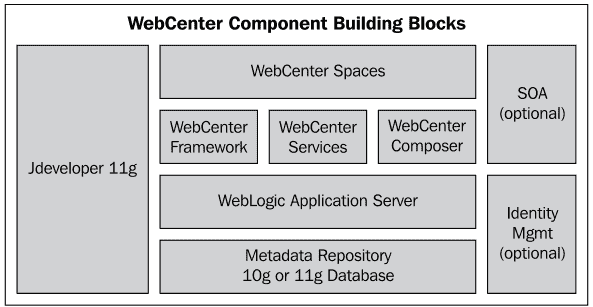

## #硬件和软件要求

Oracle WebCenter 11g 的硬件和软件要求大致遵循 Oracle Fusion Middleware 11g 的最低要求。各种要求矩阵可在 http://www.oracle.com/technology/software/products/ias/files/fusion_requirements.htm 下的“Oracle Fusion Middleware 11g System Requirements”中找到。

## #高级安装步骤

以下是 WebCenter 11g 的高级安装步骤，您可以在进行我们的逐步安装时参考这些步骤。

- 1. 安装受支持的操作系统 (OS)。
- 2. 安装受支持的 Oracle 数据库以存放元数据存储库。WebCenter 11g 目前支持 Oracle 数据库版本 10.2.0.4 到 11.0.7。
- 3. 运行存储库创建实用程序 (RCU) 以创建元数据存储库。
- 4. 安装中间件主目录 (Oracle WebLogic 应用程序服务器) 11gR1 (10.3.1)。
- 5. 安装 WebCenter 框架和服务。
- 6. 配置 WebLogic、WebCenter 和 Web 2.0 服务。

## #逐步安装

在本节中，我们将详细阐述先前概述的高级步骤，并带您逐步详细地了解 WebCenter 11g 的安装过程。

- 1. 安装受支持的 OS
  在撰写本文时，WebCenter 11g 尚无官方认证矩阵可用，但我们在环境中使用的是 Oracle Enterprise Linux 5.3 32 位版本，配备 Intel Core 2 Duo 2.13 GHz CPU 和 3GB 内存。我们认为这是服务器环境的最低硬件配置，且 WebCenter 运行时没有任何性能问题。据我们了解，以下操作系统将受到支持：
  - AIX
  - HPUX
  - Red Hat Enterprise Linux
  - Oracle Enterprise Linux
  - Solaris
  - Windows

> 本书不涉及操作系统的逐步安装过程。

## ##2. 安装前步骤

- 创建一个名为 `oracle` 的组，该组属于名为 `dba` 的组，用于安装。
- 确保 `/etc/hosts` 文件配置了完全限定域名 (FQDN) 作为第一个条目。我们使用了以下内容：`192.168.1.74 wc11g.mandsconsulting.com`。
- 确保已在操作系统上设置打开文件数。通过添加以下行在 `/etc/security/limits.conf` 中设置适当的限制：
  ```
  oracle soft nproc 2047
  oracle hard nproc 16384
  oracle soft nofile 1024
  oracle hard nofile 65536
  ```
- 确保 Linux 系统设置正确。编辑 `/etc/sysctl.conf` 文件并添加以下行：
  ```
  kernel.shmall = 2097152
  kernel.shmmax = 2147483648
  kernel.shmmni = 4096
  kernel.sem = 250 32000 100 128
  fs.file-max = 6553600
  net.ipv4.ip_local_port_range = 1024 65000
  net.core.rmem_default = 4194304
  net.core.rmem_max = 4194304
  net.core.wmem_default = 262144
  net.core.wmem_max = 262144
  ```

## ##3. 安装受支持的 Oracle 数据库（我们安装了 Oracle Express Edition – XE – 10.2.0.1 Universal）

- 从 Oracle.com 下载文件：`oracle-xe-univ-10.2.0.1-1.0.i386.rpm`

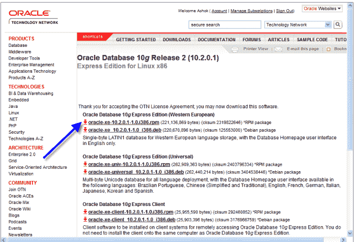

- 使用以下命令运行 `.rpm` 文件：
  ```
  rpm -ivvh oracle-xe-univ-10.2.0.1-1.0.i386.rpm
  ```

- `rpm` 成功完成后配置 Oracle XE（此处我们选择了默认设置）。

默认设置将 Oracle Application Express 设置为监听端口 8080，Oracle 数据库监听器监听端口 1521。为 DB SYS 和 SYSTEM 账户选择一个密码。记住所选密码。

验证 XE 数据库是否已正确安装。一种方法是导航到 XE 管理控制台。

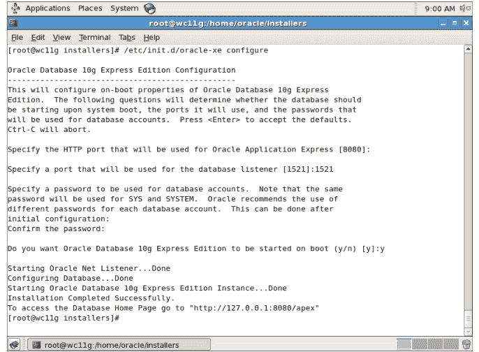

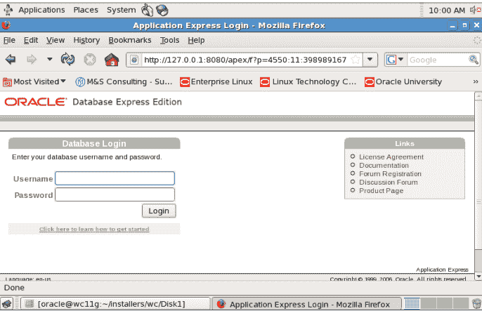

确保数据库运行正常后，需要增加进程数量。默认进程数设置为 40。但是，对于 WebCenter，进程数应至少设置为 300。可以使用以下命令完成：

alter system set processes=300 scope=spfile;

更改进程数量后重启数据库。
/etc/init.d/oracle-xe restart

- 4. 运行存储库创建实用程序 (RCU) 以创建元数据存储库：
  - 导航到 RCU_MEDIA /bin。
  - 使用 ./rcu 运行 RCU。
  - 按照图形安装向导操作。

欢迎屏幕提供有关该工具的一些常规信息。在左侧导航中，您可以看到正常配置期间将遵循的步骤列表。当前步骤被强调显示。单击“下一步”进入下一步。

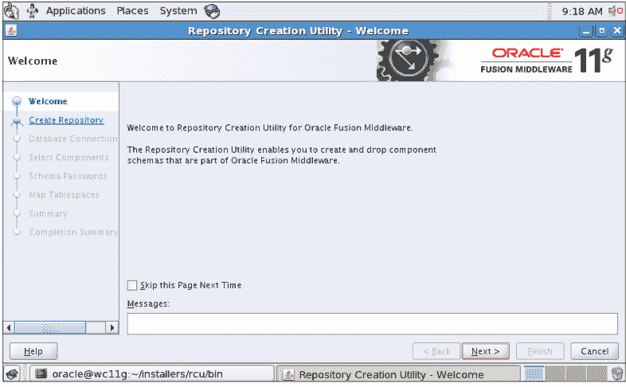

创建存储库屏幕提供两个选项：创建和删除。在此安装中，我们将创建一个新存储库。选择“创建”并单击“下一步”进入下一步。

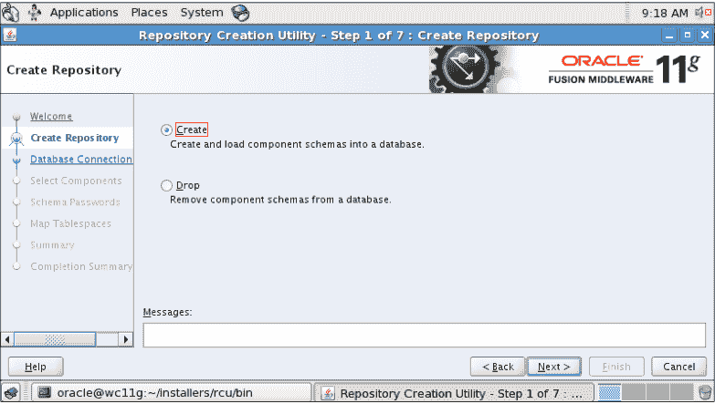

在数据库连接详细信息屏幕中，我们提供将用于连接已安装的 Oracle XE 数据库的详细信息。如果您迄今遵循了 XE 数据库安装所示的步骤，此处显示的值应适用。数据库配置（oracle-xe configure）期间选择的密码应在此处输入。单击 **下一步** 进入下一步。

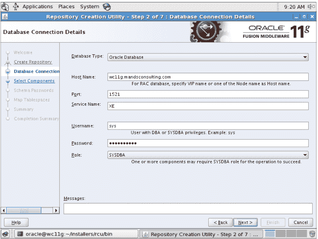

## #RCU 检查是否满足所有全局先决条件。单击“确定”继续

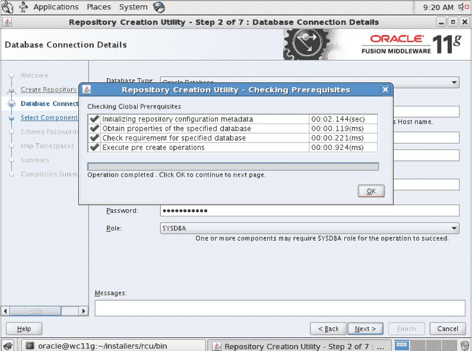

选择架构前缀。默认前缀为 DEV。如果您愿意，可以选择将前缀更改为其他合适的前缀。我们使用了默认的 DEV 前缀。接下来，我们选择打算安装的各种组件。此处我们选择了 WebCenter Spaces、Portlet Producers、Content Server、Discussions 和 Wiki and Blogs。显示的其他选定组件会自动作为先决条件添加。单击“下一步”继续。

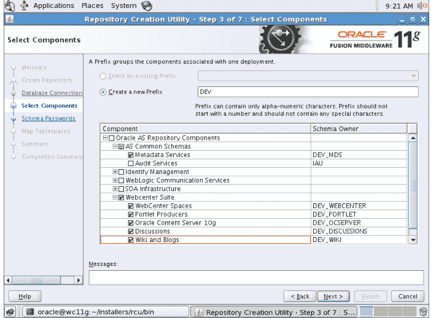

在 **架构密码** 屏幕中，我们可以选择为所有架构使用相同的密码，或为每个架构指定单独的密码。我们选择为所有架构使用相同的密码。单击“下一步”进入下一步。

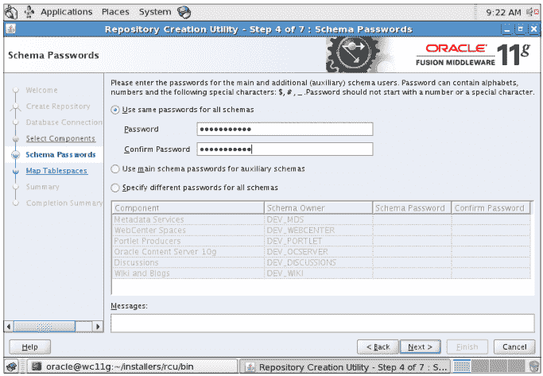


此屏幕显示对需求进行的各种检查的进度。所有需求检查完成后，单击 OK 以继续。

摘要屏幕显示将要创建的各种表空间。单击 Create 以开始创建表。

**完成摘要**屏幕显示存储库创建的最终状态。将显示各种日志文件的位置。有兴趣的用户可以查看日志文件，以获取存储库创建过程的详细报告。

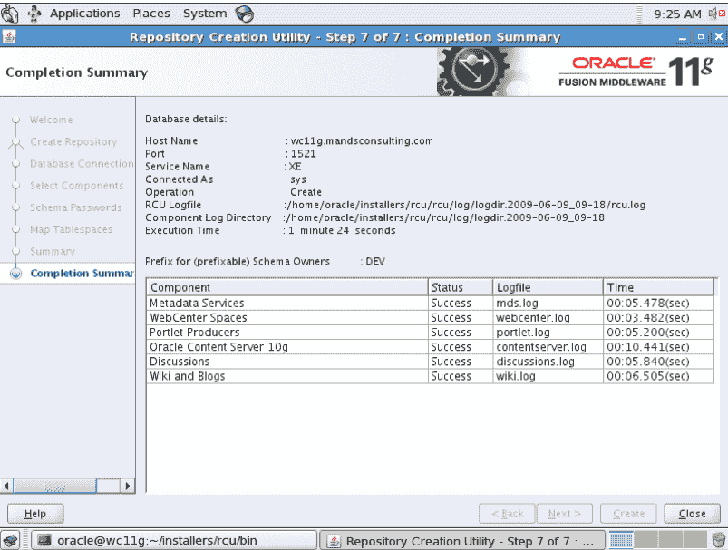

恭喜！您现在已完成底层元数据存储库的安装。我们现在准备进入 WebLogic 应用程序服务器（中间件主目录）。

## 安装中间件主目录

在本节中，我们将安装中间件主目录（WebLogic 应用程序服务器）11gR1（10.3.1）。对于那些使用过之前的 Fusion Middleware 产品，甚至 WebCenter 10g 的用户，您会注意到 WebLogic Server 的默认支持是新的，因为 Oracle 在 BEA 收购后转变了方向，远离了 Oracle 之前的应用程序服务器产品。

导航到 WebLogic 应用程序服务器介质并运行安装程序，按照图形向导操作。

## WebCenter 安装和配置

向导启动后，将显示欢迎屏幕。单击 **Next** 以继续安装。

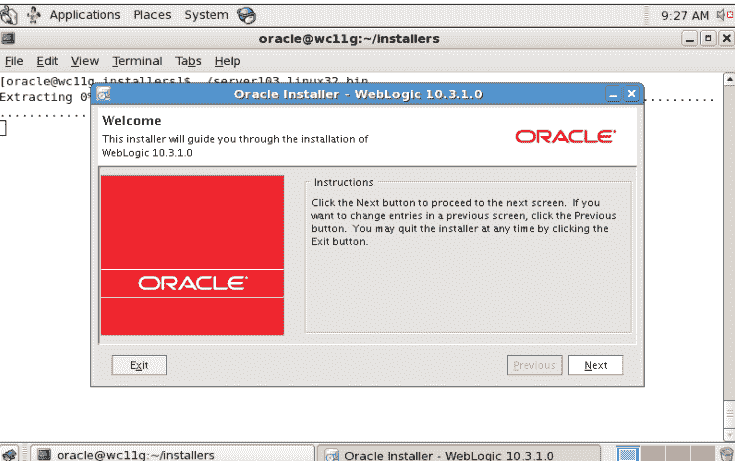

安装 WebLogic 服务器将创建一个中间件目录，中间件将安装在其中。我们已选择向导建议的默认目录。单击 **Next** 以继续。

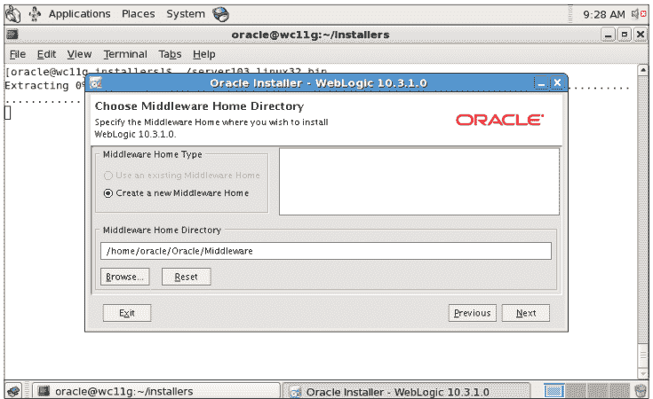

如果您希望接收有关 WebLogic 产品的 Oracle 安全更新，请输入您的电子邮件地址。强烈建议您这样做。对于此测试安装，我们已跳过此步骤。单击 Next 以继续。

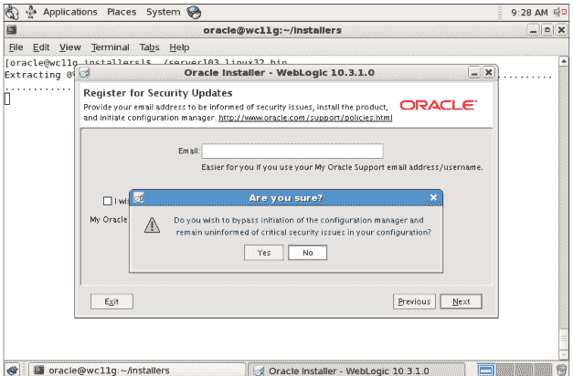

此处向导提供执行典型安装或自定义将要安装的组件的选项。我们已选择典型安装选项，这将安装 WebLogic Server。单击 Next 以继续。

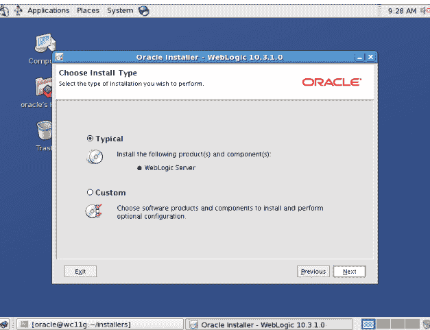

## WebCenter 安装和配置

向导提供了选择安装 WebLogic 服务器的目录的选项。我们已选择向导建议的默认目录。这将在中间件主目录下的 `wlserver_10.3` 目录中安装 WebLogic 服务器。单击 **Next** 以继续。

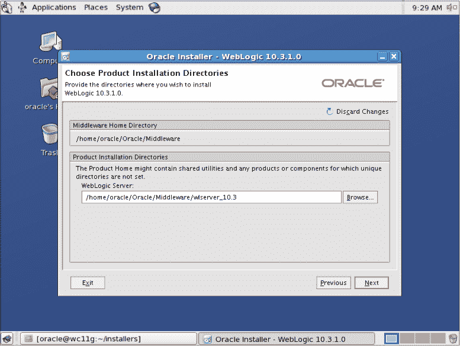

**安装摘要**屏幕显示将要安装的 WebLogic 服务器的各种组件。请注意，作为 WebLogic Server 安装的一部分，还安装了两个 JDK。单击 **Next** 以继续安装。

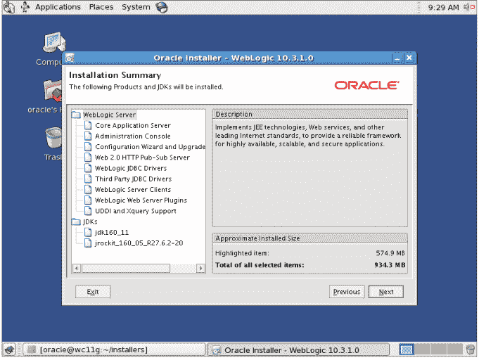

向导显示安装进度。由于要安装所有组件，此步骤可能需要几分钟。

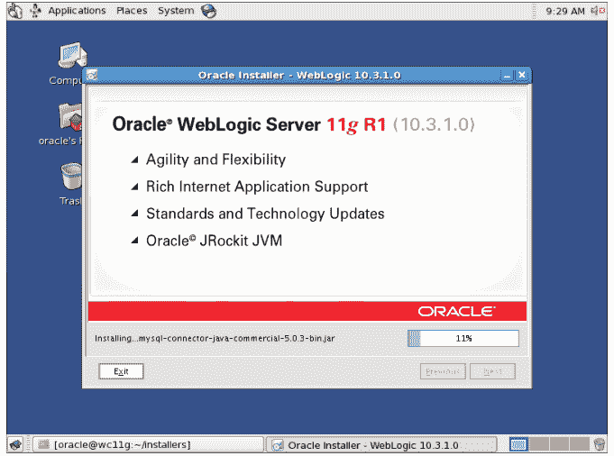

**安装完成**屏幕提供运行 **Run Quickstart** 的选项。目前不需要，因为我们将接下来配置 WebCenter。取消选中 **Run Quickstart** 选项并单击 **Done**。

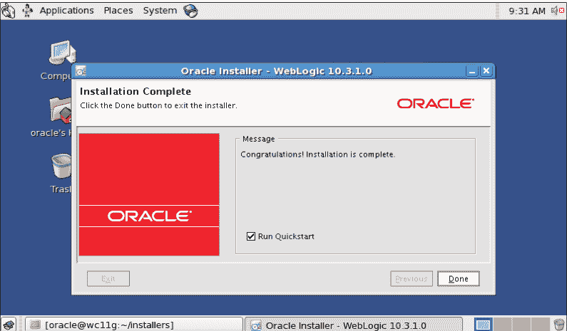

恭喜！您现在已完成 WebLogic 应用程序服务器（中间件主目录）的安装。我们已在构建块图中突出显示了该部分，并准备进入 WebCenter 框架。

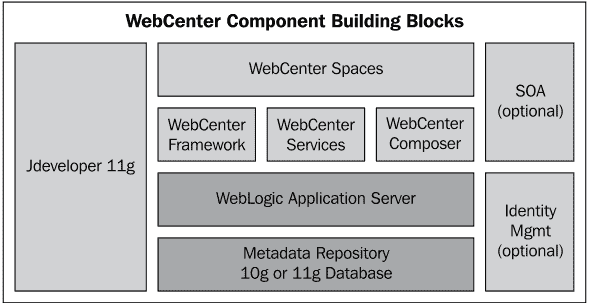

## 安装 WebCenter 框架和服务

现在 WebLogic 应用程序服务器已安装，我们需要继续进行 WebCenter 框架和服务的安装。

运行 WebCenter 安装，指定与 WebLogic 一起安装的 JRE 的位置。

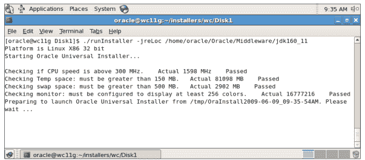

按照图形安装向导操作。向导将提示输入一个目录（清单目录），用于存储有关已安装组件的信息。我们已选择向导建议的默认目录。单击 OK 以继续。

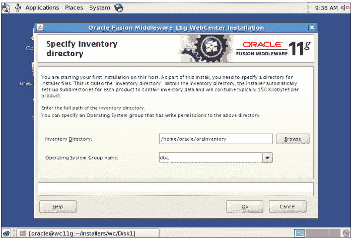

## WebCenter 安装和配置

此时，向导将提示以 root 用户身份运行特定脚本。启动新终端并切换用户到 root。

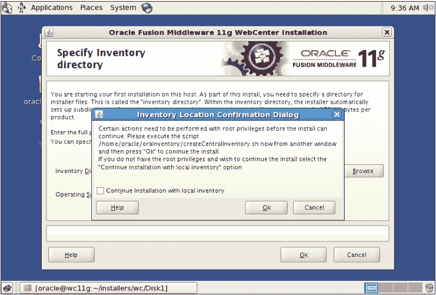

以 root 用户身份执行 createCentralInventory.sh 脚本，然后切换回图形向导。

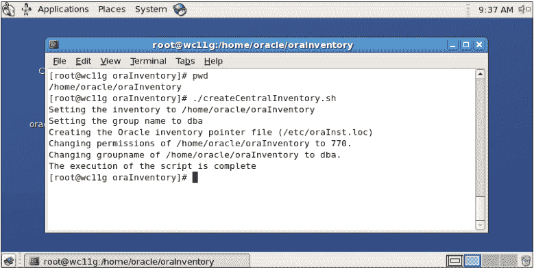

向导告知用户 WebCenter 安装的先决条件。我们已在之前的步骤中运行了 RCU 并安装了 WebLogic Server，因此单击 Next 以继续。

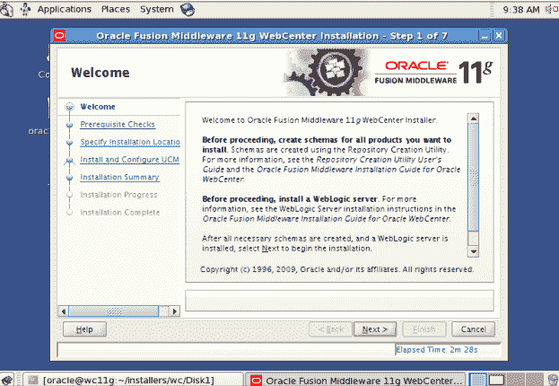

安装程序检查以确保各种系统参数和库已就绪。单击 Next 以继续。如果在检查中遇到任何错误，请查看错误日志并安装适当的库。在采取适当措施修复错误后，您可以单击 Retry 以检查是否满足要求。

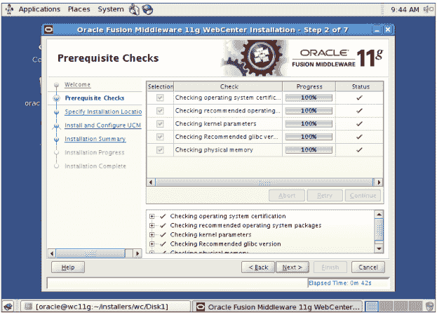

## WebCenter 安装和配置

向导提示输入 Oracle 主目录。这是将安装 WebCenter 组件的位置。默认值是中间件主目录下的子目录 `Oracle_WC1`。我们选择默认值并单击 **Next** 以继续。

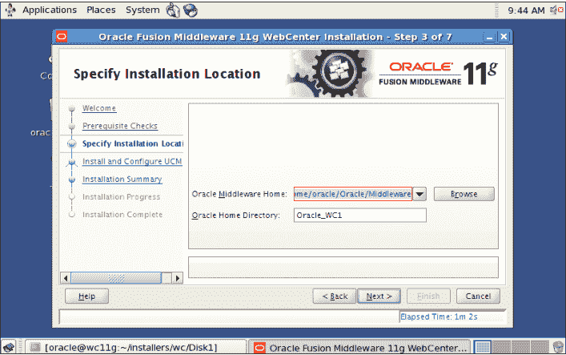

接下来，向导提供配置 Oracle 通用内容管理的选项。如果您尚未安装 UCM，则可以跳过此步骤。取消选择该选项并单击 **Next** 以继续。

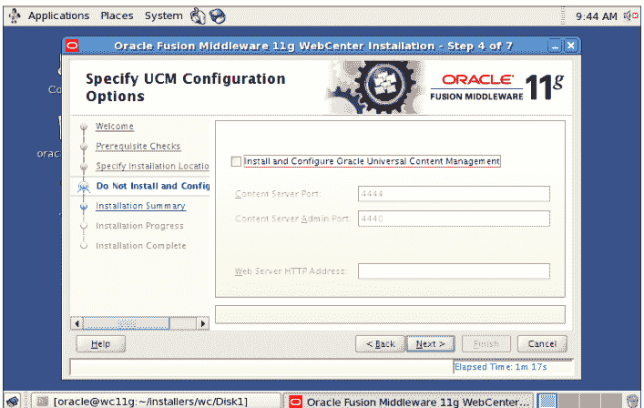

向导显示 **安装摘要** 屏幕，列出将要安装的各种组件和安装位置。单击 **Install** 以继续。

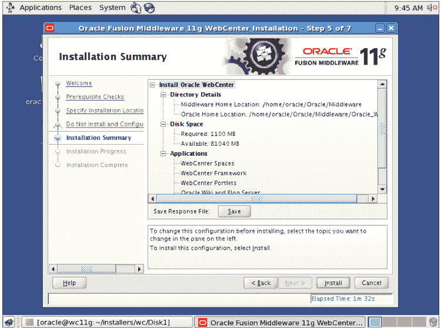

## WebCenter 安装和配置

向导显示安装进度。所有组件安装可能需要几分钟。

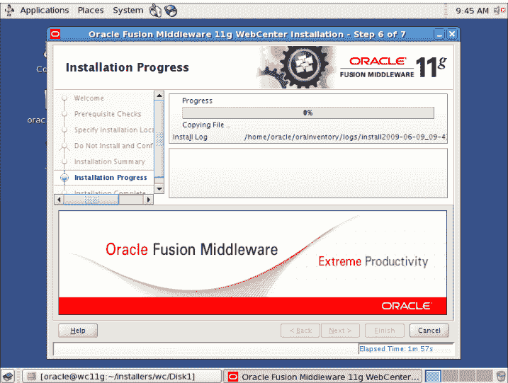

**安装完成**屏幕告知用户安装已成功完成。如果您希望稍后查看，可以选择保存详细信息。单击 **Finish** 以继续。

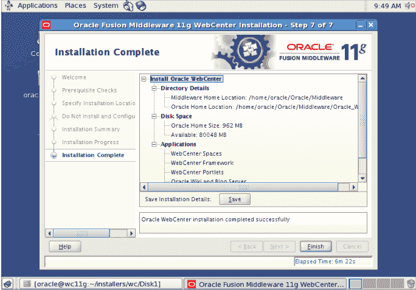

恭喜！您现在已完成 WebCenter 框架和服务的安装。

## 摘要

在本章中，我们在 Linux 环境中安装了 WebCenter 11g 的核心构建块。这些构建块为创建 WebCenter 复合应用程序奠定了基础，这些应用程序通过 Web 服务、SOA 等中间件组件以及通过 WebCenter 热插拔架构集成的其他业务应用程序等“触手”真正得以实现。

重要说明：

- 这是一个单服务器、独立环境，可以快速搭建以满足测试和培训的基本需求。它不考虑高可用性、企业安全性或生产解决方案通常需要的其他考虑因素。

- 此环境将用作开发我们示例应用程序的基线，因此确保您已成功完成上述步骤非常重要。

要开始 WebCenter 开发，我们将使用 JDeveloper IDE，我们将在下一章中对其进行回顾，并附带一个简单的示例——WebCenter 版本的“Hello World”。
