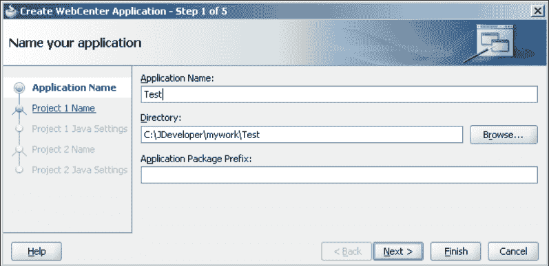
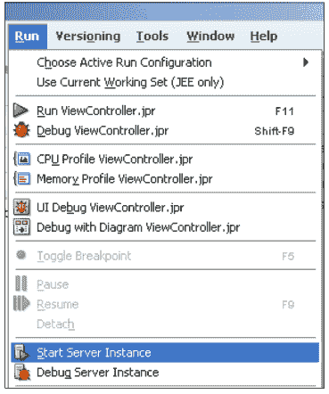
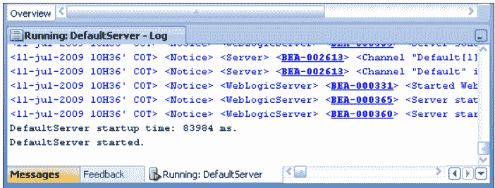
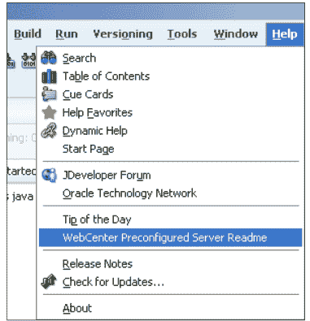
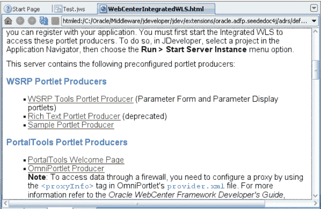
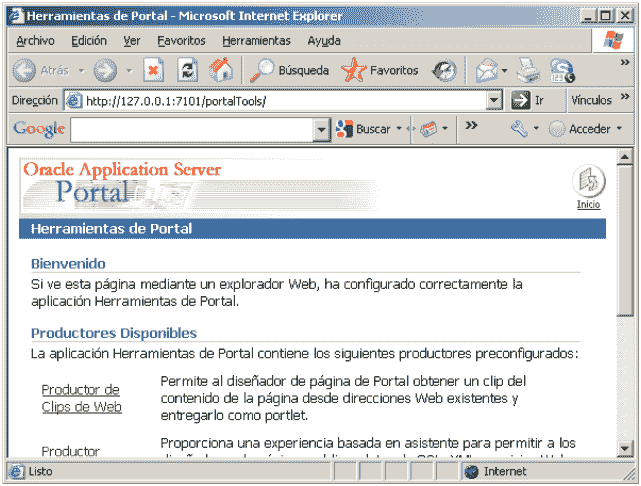

## 3 设置开发环境

在服务器端安装 Oracle WebCenter 组件后，有必要准备开发环境。

如前所述，构建 Oracle WebCenter 解决方案的工具是 JDeveloper 11g。该工具通常用于开发 Java EE 解决方案；然而，在本书中，我们将其用于构建复合解决方案。这意味着我们将把不同种类的组件（如 portlets、数据访问组件（表、值列表）和促进参与的组件（讨论、wiki））组合到单个用户界面中，以门户的概念为基础。

那么，在本章中，我们将专注于准备开发环境，我们将使用该环境来创建我们的 WebCenter 应用程序。

因此，在本章中，我们将涵盖以下主题：

- JDeveloper 11g 安装
- 为 JDeveloper 添加 WebCenter 扩展
- 安装控制版本系统（Subversion）
- 将 JDeveloper 与 Subversion 集成
- 测试 WebCenter 服务器的集成

那么，让我们开始工作吧。

## Oracle JDeveloper 11g 安装

在编写本书期间，我们将使用 Oracle JDeveloper 11g Release 1 (11.1.1.1.0) 版本。

### 系统要求

在使用 Windows 操作系统时，推荐的系统要求如下：

- 操作系统：Windows Vista
- Windows Server 2003 R2
- Windows XP-Service Pack 2
- CPU 类型和速度：Pentium IV 2 GHz 或更高
- 内存：2 GB RAM
- 显示：65536 色，分辨率至少设置为 1024 X 768
- 硬盘空间：2.5 GB
- JDK：Windows 版 JDK 6.0 Update 11

如果需要在其他操作系统上安装该工具，请参阅以下链接中的《Oracle JDeveloper 安装指南》：

`http://www.oracle.com/technology/documentation/jdev.html`

### 下载工具

要开始使用，我们必须先从以下页面下载：

`http://www.oracle.com/technology/software/products/jdev/index.html`

从可用文件中，下载 jdevstudio11111install.exe。

## JDeveloper 安装

执行以下步骤安装该工具：

1. 双击下载的文件。

2. 默认情况下，JDeveloper 11g 将安装在 c:\Oracle\Middleware。

3. 接受向导建议的所有选项，以进行 JDeveloper 的典型安装。

4. 接下来，从安装创建的菜单中运行 JDeveloper。

5. 第一个窗口允许您定义开发人员的角色。选择 **Default Role** 并按 OK。

6. 接下来，您将看到一个名为“Tip of the Day”的窗口。单击取消按钮以打开开发环境。

## Oracle WebCenter 扩展 for JDeveloper

该工具已准备好用于开发 Java EE 解决方案。但是，我们希望将其用于创建 WebCenter 解决方案。这就是为什么我们需要安装 JDeveloper 的扩展，以支持 WebCenter 应用程序的开发。

要安装扩展，请执行以下步骤：

1. 选择选项 **Help | Check for Updates**。在欢迎窗口中单击 **Next** 按钮。

2. 在下一个窗口中，选择 **Oracle Fusion Middleware Products**，如下图所示，然后单击 Next。

3. 然后，选择 Oracle WebCenter Framework and Services Design Time 并按 OK。

4. 要继续安装，您需要输入 oracle.com 用户名和密码，然后单击 OK。

5. 接下来，您将看到类似于下一个屏幕的屏幕，指示安装结束。单击 Finish 完成此过程。

6. 最后，JDeveloper 将要求重新启动以实施更改。单击 Yes 完成安装。

## 版本控制系统安装

在开发团队中工作时，建议使用版本管理软件。出于这个原因，我们将使用一个名为 CollabNet Subversion 的产品，它是一个开源的 Subversion 项目。我们将按以下方式安装此软件：

1. 从以下地址下载 CollabNet Subversion：http://www.open.collab.net/downloads/subversion/。

选择版本：CollabNet Subversion Server and Client v1.6.3（适用于 Windows）。

2. 运行下载的安装程序，接受向导建议的所有默认选项。此设置将创建基目录 `c:\svn_repository`。

3. 单击 **Install** 开始安装。

4. 此最终屏幕指示安装成功。单击 **Finish** 关闭窗口。

Subversion 服务器使用 Apache Web 服务器，允许我们使用 HTTP 协议访问 Subversion 存储库。Apache 服务器使用端口 80，并且每次打开计算机时自动启动。

5. 安装存储库后，有必要创建一个项目来保存 WebCenter 应用程序代码。为此，通过 **Start | Run** 打开 Windows 命令行选项，键入命令 `cmd`，然后按 **Enter**。

6. 转到存储库目录，在我们的情况中为 `c:\svn_repository`：
> cd c:\svn_repository

7. 接下来，创建项目 `webcenter_repository`，我们将使用它来存储代码的版本。命令是：
> svnadmin create webcenter_repository

8. 现在编辑以下 Apache 配置文件以允许在存储库中注册用户。
C:\Program Files\CollabNet SubVersion Server\httpd\conf\ httpd.conf

9. 转到以下部分：
<Location /svn>
DAV svn
SVNParentPath C:\svn_repository
</Location>
并将其修改为：
<Location /svn>
DAV svn
SVNParentPath C:\svn_repository
SVNListParentPath On
Require valid-user
AuthType Basic
AuthName "SubVersion Repository"
AuthUserFile C:\svn_repository\password-file
</Location>
通过此更改，我们指示用户和密码将从文件 password-file 中提取。

10. 转到 Subversion 软件的安装目录：
> cd c:\Program Files\CollabNet Subversion Server\httpd\bin

11. 在下一步中，我们将创建访问存储库的用户。要创建 admin 用户，请按以下方式使用 htpasswd 命令：
> htpasswd -cm c:\svn_repository\password-file admin
然后系统将提示您输入用户将使用的密码。

-cm 选项用于创建密码文件并加密密码。要注册更多用户，只需使用 -m 选项，因为我们在创建第一个用户时已创建密码文件。请记住，您必须为团队中的每个开发人员创建一个用户。请参见下一个示例：
> htpasswd -m c:\svn_repository\password-file joe

12. 最后，要验证服务器版本安装，请转到以下链接：
http://localhost/svn/。

13. 输入在上一步中定义的用户和密码信息。

14. 最后，我们将看到以下页面：

## JDeveloper 与 Subversion 集成

要集成这些技术，请执行以下操作：

1. 打开 JDeveloper。

2. 转到选项 **View | Versioning Navigator**。

3. 在左下角窗口中，您将看到版本导航器。右键单击 Subversion 节点并选择 **New Repository Connection**。

4. 在下一个窗口中，您将定义数据连接，单击 **Test Connection** 进行检查，最后单击 **OK**。

- **Repository URL**: `http://localhost/svn/webcenter_repository/`
- **Connection Name**: `webcenter_repository`
- **User Name**: `<User Registered>`
- **Password**: `<Password Registered>`

## 测试 WebCenter 预配置服务器

JDeveloper 还包含一个 BEA WebLogic 服务器，我们将使用它来部署和测试我们的应用程序。此外，此服务器提供一个 Portlet 容器，提供一组预构建的 Portlet，我们可以在项目中利用它们。例如，您可以使用 Web Clipping 功能从现有网站捕获内容和功能。要确认此服务器的可用性，我们将执行以下步骤：

1. 转到 JDeveloper 的选项 File | New。

2. 在下一个窗口中，选择 Applications 类别，然后选择 WebCenter Application 项目并单击 OK。

## 设置开发环境

3. 在下一个窗口中，将应用程序名称更改为 Test 并单击 Finish。

4. 使用选项 **运行 | 启动服务器实例** 启动 WebLogic Server。

5. 日志控制台中的消息 **DefaultServer 已启动** 表示服务器已启动。

6. 最后，要检查我们的 portlet 容器是否处于活动状态，请选择选项 **帮助 | WebCenter 预配置服务器自述文件**。

## 设置开发环境

7. 然后，您将看到一个带有 WebCenter 服务器提供的各种服务链接的页面。要检查 portlet 容器的可用性，请单击链接 **PortalTools 欢迎页面**。

8. 互联网浏览器必须显示创建 portlet 的页面，这确认 portlet 容器已成功安装。

## 摘要

本章帮助我们准备了开发环境和应用程序服务器，以支持我们的 WebCenter 应用程序。

我们将使用 JDeveloper 开发 WebCenter 解决方案，并将其容器 WebLogic 用作 portlet 的存储库。

此外，我们还安装了服务器版本管理软件，这将帮助我们保持对项目更改的控制，并且还将允许多名开发人员参与解决方案的构建。

一旦我们的开发环境准备就绪，在下一章中，我们就可以开始使用 JDeveloper 构建我们的第一个 WebCenter 应用程序了。

> 请注意，WebLogic Server（已包含 WebCenter Services）运行在端口 7101 上。您可以从选项 **视图 | 运行管理器** 中更改端口。
