## 开始 WebCenter 开发：Hello World(s)

在我们开始开发 Enterprise 2.0 内联网之前，我们将创建一个简单的 WebCenter 应用程序来演示工具、开发方法论和自定义 WebCenter 应用程序的部署。

本章将详细介绍逐步说明，为您提供在实现本书余下部分的示例以及您自己的项目时所需的知识。

我相信您注意到了本章标题中包含短语 "Hello World(s)"，其中的 "(s)" 非常突兀。这是有意为之，但并非表示我们要构建多个 WebCenter 示例，也不是为了潜意识地宣告和承认外星种族的存在。事实是，当单个 WebCenter Hello World 应用程序由几个 Hello World 组件构建时，其完整性最能体现。我们将向您展示一个 Web 服务，由 portlet 消费，再由 WebCenter 应用程序消费。

- **HelloWorldWS**：一个简单的 Web 服务，公开一个单一方法，用于向输入的名称打招呼
- **HelloWorldPortlet**：一个基于标准的 Java Portlet，使用 HelloWorldWS Web 服务
- **HelloWorldApp**：一个消费 HelloWorldPortlet 的 WebCenter 应用程序

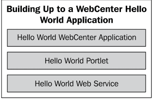

为了明确，最简单的 WebCenter Hello World 应用程序不需要所有这些组件，但我们选择这条路，以便您拥有更广泛的基础知识。

## 先决条件

本教程使用在 Windows 平台上运行的 JDeveloper 11g。我们将使用 JDeveloper 中集成的 WebLogic Server 来测试本教程过程中开发的应用程序。本章不会介绍操作系统或 JDeveloper 11g 的安装过程。

## 创建 Hello World Web 服务

我们将从基于 Java 类创建一个 `HelloWorld` Web 服务开始。该类公开一个方法 `sayHello`，该方法将字符串 `name` 作为输入参数，并输出 `Hello name`。

## 步骤 0：启动 Oracle JDeveloper 11g

JDeveloper 的欢迎屏幕显示 **每日提示**。这是学习 JDeveloper 各种功能的好方法。关闭 **每日提示** 窗口。

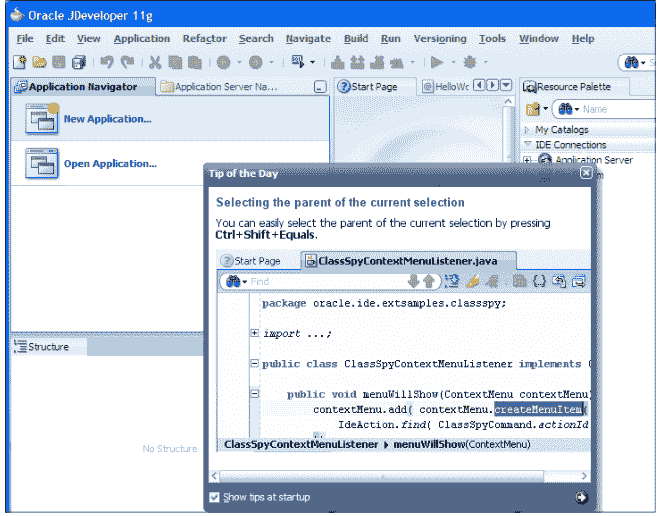

## 步骤 1：创建新应用程序

在应用程序导航器中，单击 **新建应用程序** 以开始创建应用程序。您也可以通过从主菜单单击 **应用程序 | 新建** 来执行相同操作。

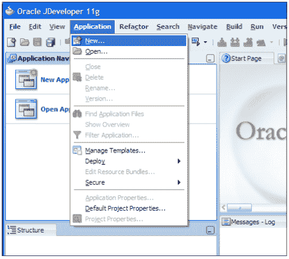

## 步骤 2：配置应用程序设置

从应用程序模板列表中，选择 **通用应用程序**。当您打算手动选择项目的技术范围时，通用应用程序模板非常合适。为应用程序选择一个名称，本例中为 `HelloWorldWSApp`。单击下一步。

> 请注意列表末尾存在各种模板，包括 `Portlet Producer Application` 和 `WebCenter Application`。如果您找不到上述模板，那么最可能的原因是未安装 JDeveloper 的 WebCenter 扩展。

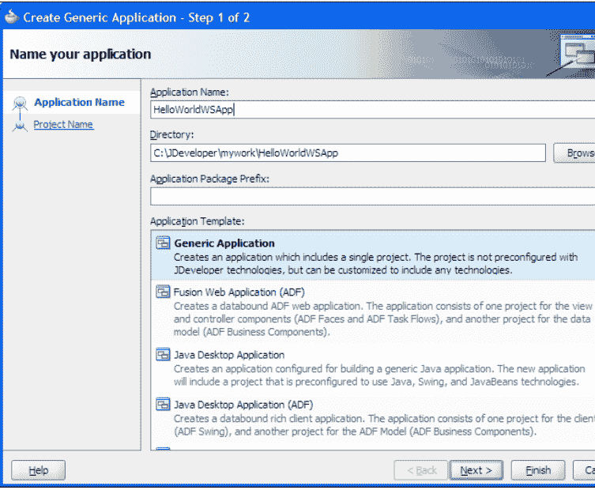

## 步骤 3：配置项目设置

在项目名称对话框中，为项目选择一个名称，本例中为 HelloWorldWS。请注意可包含在项目中的各种可用技术。对于开发 Web 服务，我们必须将 Web Services 包含在项目范围内。选择 Web Services 后，Java 会自动作为先决条件包含。单击完成。

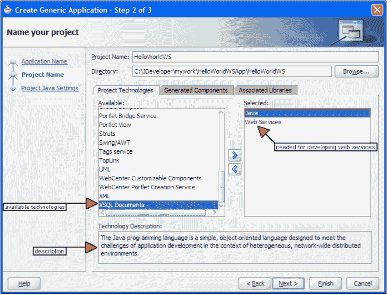

## 步骤 4：创建 Java 类

接下来，我们将创建一个供 Web 服务使用的 Java 类。在应用程序导航器中，右键单击 HelloWorldWS 项目，并从上下文菜单中选择新建。

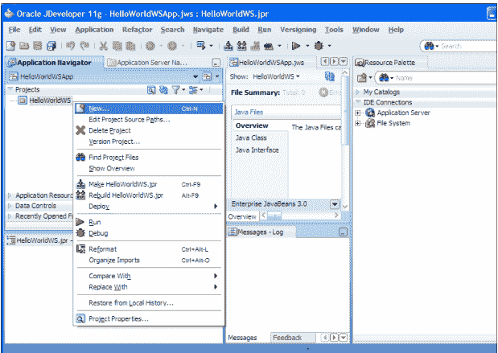

在新建画廊中，选择常规节点。右侧显示可用项目列表。从列表中选择 Java 类，然后单击确定。

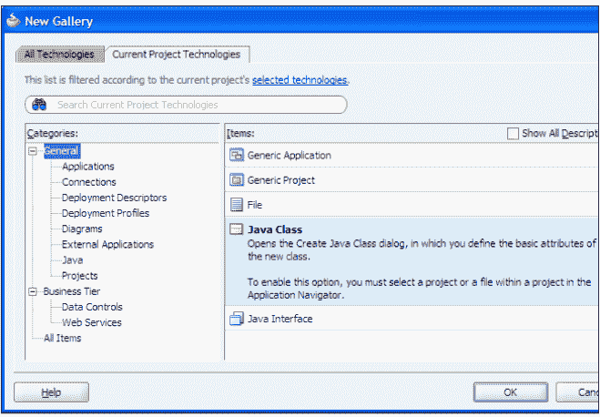

为类选择一个名称，本例中为 HelloWorld，然后单击确定。

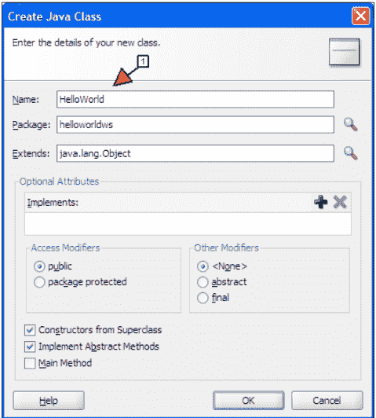

编辑 HelloWorld.java 文件，添加一个 sayHello 方法，该方法将字符串作为输入，并返回带有 Hello 前缀的输入。单击生成以编译该类。消息 - 日志窗口应显示编译成功。

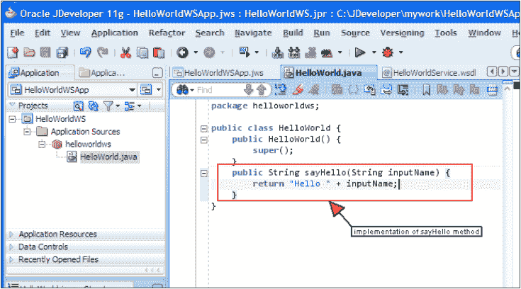

## 步骤 5：从 Java 类创建 Web 服务

在应用程序导航器中，选择 `HelloWorld.java` 文件并右键单击它。从上下文菜单中，选择 **创建 Web 服务**。这将启动 Web 服务创建向导。

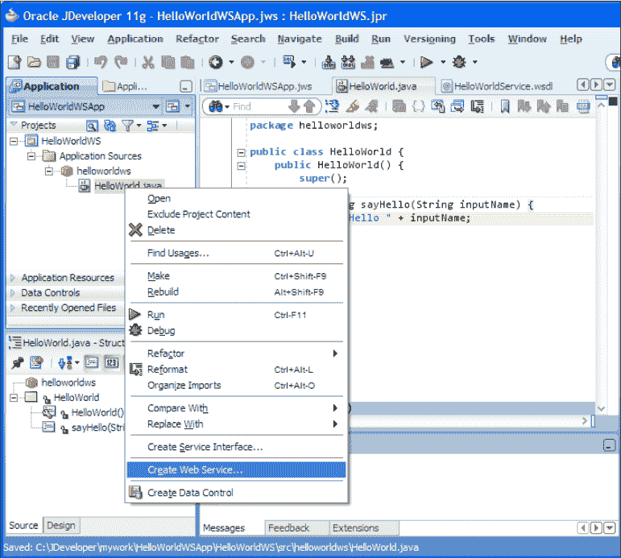

我们将为 Weblogic 10.3 创建一个 Java EE 1.5 Web 服务。从 **平台** 列表中选择适当的平台。

## 选择部署平台

选择与您的要求匹配的部署平台。

## 平台

- J2EE 1.4 JAX-RPC，支持 10.3 WLS  
  支持将 JAX-RPC Web 服务部署到 WLS 10.3 版。

- Java EE 1.5，支持 JAX-WS 注释  
  支持使用 JAX-WS 注释规范的 Java 注释部署到 10.3 WLS。

- Java EE 1.5，支持 JAX-WS RI  
  支持部署到任何支持 Sun JAX-WS 参考实现的容器。

在 **常规选项** 对话框中，可以配置 Web 服务名称和端口。我们选择了 `HelloWorldService` 作为 Web 服务名称，`HelloWorldPort` 作为端口名称。本教程其余步骤的默认值均可接受。单击 **完成** 以完成此步骤。

## 生成选项

选择要发布的 Java 类或无状态会话 EJB，以及 Web 服务的 J2EE 和注释选项。

要发布的组件：  
helloworlds.HelloWorld

Web 服务名称：  
HelloWorldService

端口名称  
HelloWorldPort

添加 SEI

你可以通过右键单击 HelloWorld.java 文件，并从上下文菜单中选择 **Show WSDL for Web Service Annotations** 来查看生成的 WSDL。

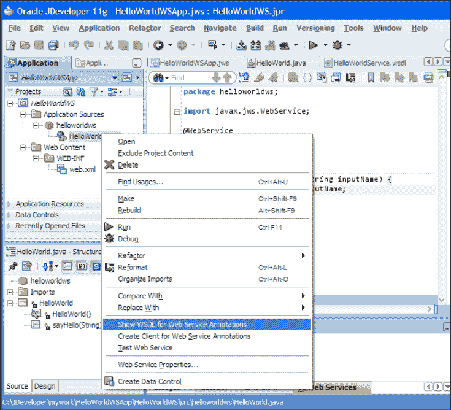

## Step 6: 创建部署配置文件

在此步骤中，我们将编辑默认部署配置文件以更改 Context Root。从 Application Navigator 中选中 **HelloWorldWS** 项目，右键单击它，并从上下文菜单中选择 **Project Properties**。

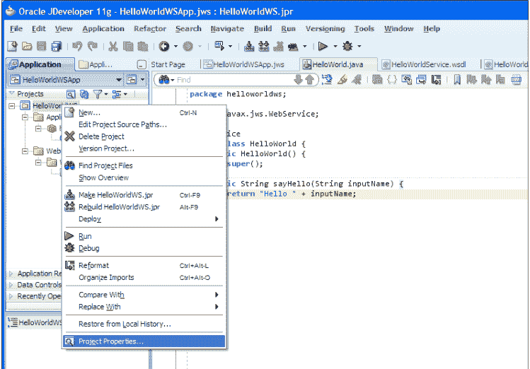

从 Project Properties 中，选择 Deployment，选中默认的 WebServices (WAR File)，然后单击 Edit。

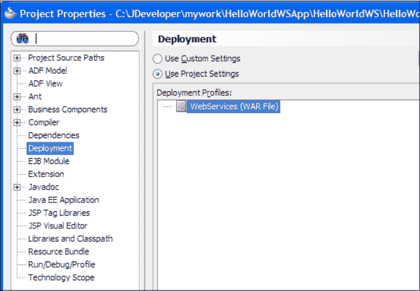

从 Edit WAR Deployment Profile Properties 对话框中，在左侧窗格中选择 General。在右侧窗格中，选择 Specify Java EE Web Context-Root 并将值更改为 HelloWorldWS。

> 注意，虽然此步骤并非严格要求，但它能提高服务 URL 的可读性。

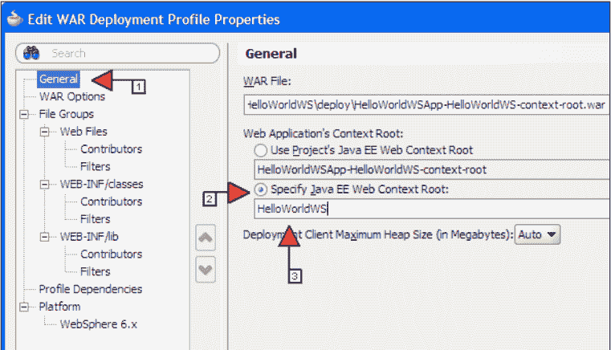

## Step 7: 将 Web 服务部署到集成 Weblogic Server

通过单击主菜单中的 Run | Start Server Instance 启动集成 Weblogic Server 实例。这将启动一个本地 Weblogic 服务器实例，我们可以使用它来测试 Web 服务。

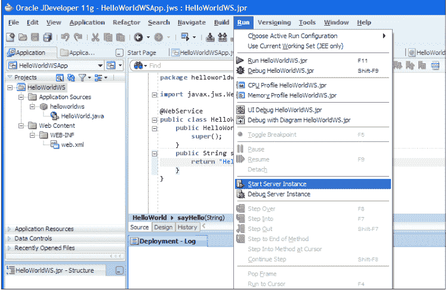

如果没有错误，则日志中将显示 **DefaultServer started** 消息。

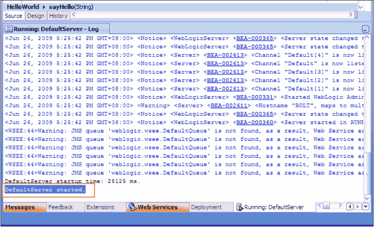

## Getting Started with WebCenter Development: Hello World(s)

从 Application Navigator 中右键单击 HelloWorldWS 项目，并在上下文菜单中导航至 Deploy | Webservices | to | IntegratedWLSCConnection。

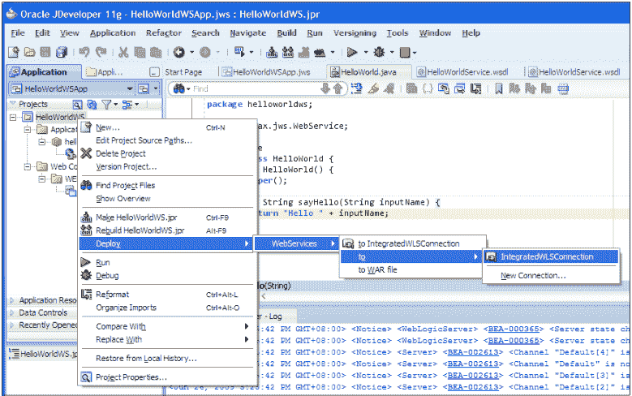

部署完成后，部署日志中将显示 Deployment finished 消息。此时，HelloWorldWs 已部署，我们可以对其进行测试。

## Step 8: 测试 Web 服务

使用 Web 浏览器导航至 HelloWorld Web 服务端口。此安装的默认值为 http://localhost:7101/HelloWorldWS/HelloWorldPort。

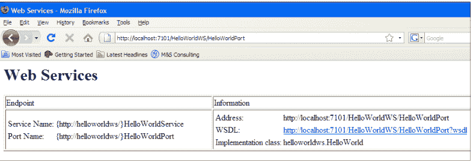

[ 70 ]

要查看已部署 HelloWorld 服务的 WSDL，请单击 WSDL URL。

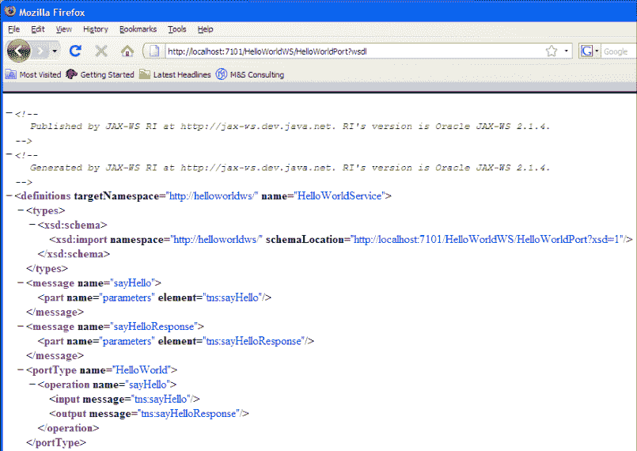

记下 WSDL URL（默认：http://localhost:7101/HelloWorldWS/HelloWorldPort?wsdl）。创建 portlet 时将需要此 URL。

至此，我们已成功创建并部署了 HelloWorld Web 服务。在后续章节中，我们将使用此 Web 服务创建一个 HelloWorld portlet。

## Hello World Portlet

在接下来的步骤中，我们将创建 Hello World Portlet。

## Step 1: 创建新的 Portlet Producer 应用程序

从主菜单中选择 **Application | New** 以创建新应用程序。选择应用程序名称，本例中为 **HelloWorldPortletApp**，并从 Application Templates 列表中选择 **Portlet Producer Application**。单击 **Next**。

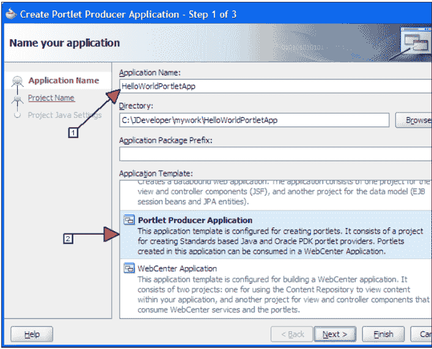

在 Project Name 对话框中选择 **Project Name**，本例中为 **HelloWorldPortlet**。从 **Project Technologies** 列表中选择 **Web Services** 并将其添加到选定列表中。单击 **Finish**。向导将创建应用程序并显示应用程序概览屏幕。

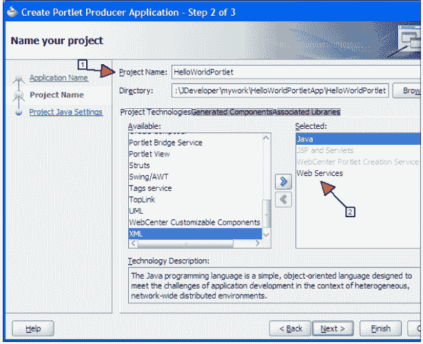

## Step 2: 创建新的 Portlet

在 Application Navigator 中，右键单击 HelloWorldPortlet，并从上下文菜单中选择 New。

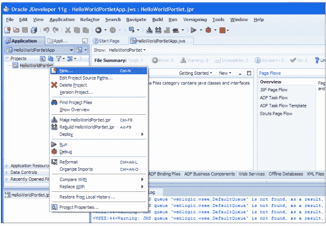

在 New Gallery 中，展开 Web Tier 节点并选择 Portlets。从右侧窗格的 Items 列表中，选择 Standards-based Java Portlet。单击 OK。

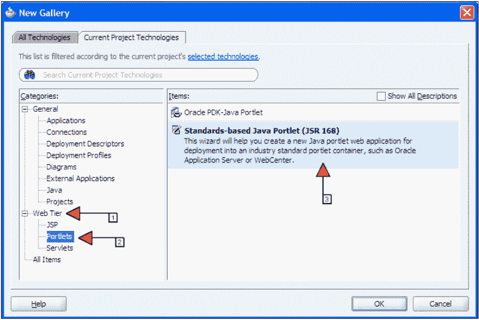

在 General Portlet Information 对话框中，保留默认值并单击 Next。

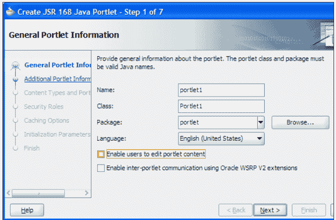

在 Additional Portlet Information 对话框中，输入 Display Name、Portlet Title 和 Short Title，然后单击 Next。

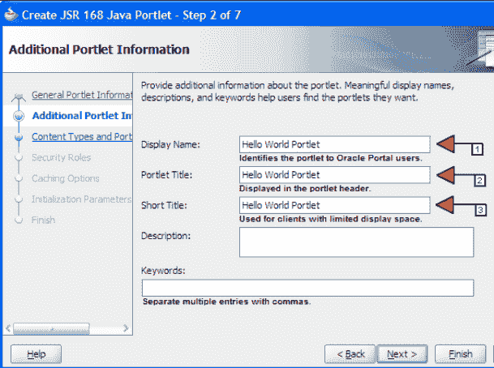

在 Content Types and Portlet Modes 对话框中，单击 view 并将实现方法更改为 Generate ADF-Faces JSPX。单击 Finish。向导将创建若干文件和配置，如 Application Navigator 中所示。

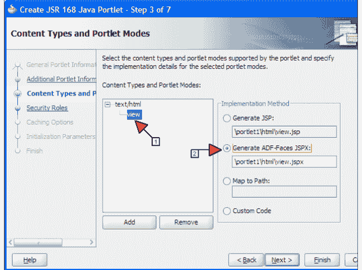

## Step 3: 为 Hello World Web 服务创建 Web Service Data Control

在此步骤中，我们将创建 Web Service Data Control 以使用之前创建的 `HelloWorld` Web 服务。

在 Application Navigator 中，选择 **HelloWorldPortlet** 项目，右键单击它，并从上下文菜单中选择 **New**。

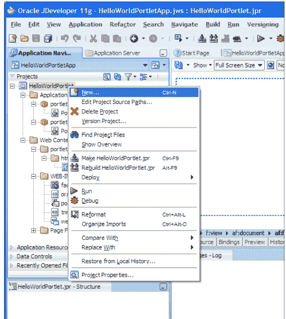

从 **New Gallery** 中展开 **Business Tier** 节点并选择 **Web Services**。在右侧页面中，从 **Items** 列表中选择 **Web Services Data Control**。

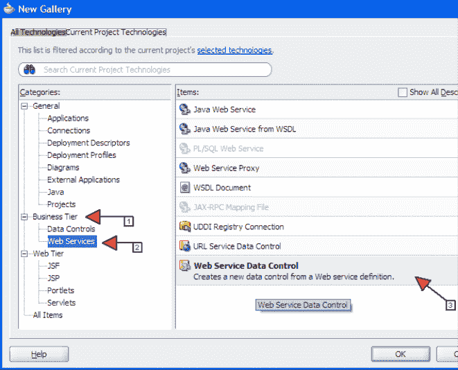

为数据控件选择一个名称，本例中为 HelloWorldWs，并粘贴 HelloWorld Web 服务的 URL（来自创建 Hello World Web 服务的 Step 8）。单击 Next 继续。

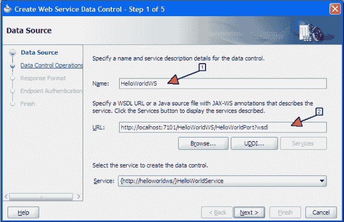

从 **Data Control Operations** 中，选择 `sayHello` 方法并将其添加到 **Selected** 方法中。单击 **Finish**。

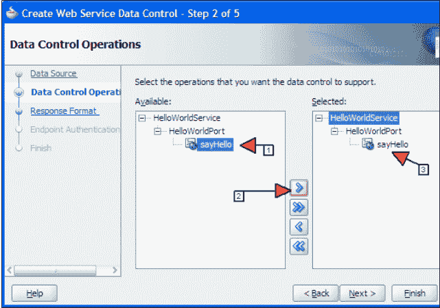

展开 **Data Controls** 面板以查看新创建的数据控件。你应该能看到 **HelloWorldWS** 数据控件。

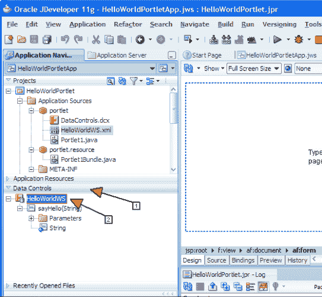

接下来，我们将使用 HTML 表为 portlet 创建一个简单布局。从 Application Navigator 中双击 view.jsp。从 Component Palette 下拉列表中选择 HTML 并展开 Common 组件。

## Step 4: 创建使用数据控件的基本视图

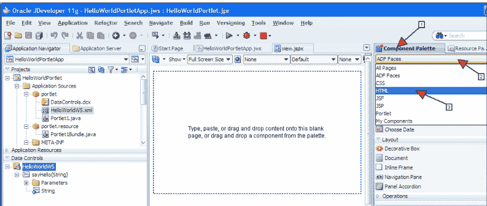

从 HTML 组件面板中选择一个表并将其拖放到 view.jsp 页面上。将表配置为一行两列。

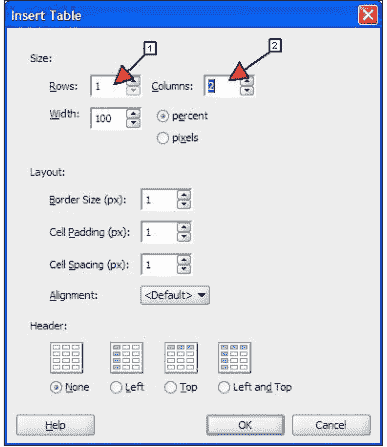

## Step 5: 使用创建的 Web Service Data Control

从 Data Control 中选择 sayHelloWorld(String) 并将其拖放到创建的表格左侧列中。选择 Create | Parameters | ADF Parameter Form。

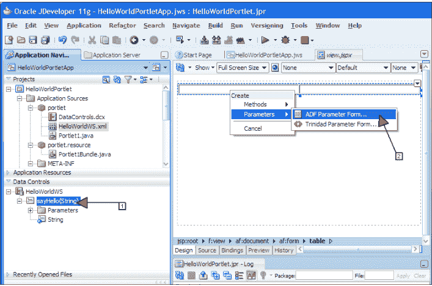

## Chapter 4

在 Edit Form Fields 对话框中，编辑 Display Label。此处我们使用了 Input name。单击 OK。

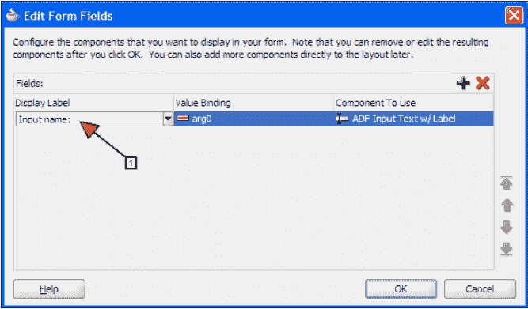

输入参数表单放置在左侧窗格中。

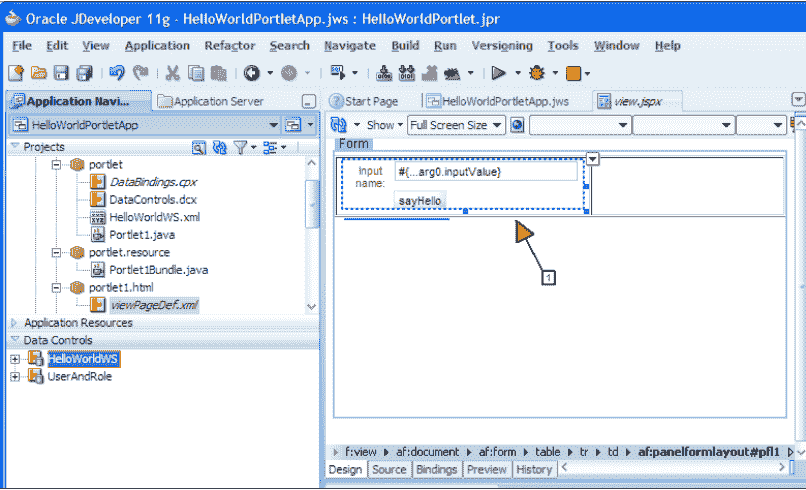

[ 81 ]

接下来，将 sayHello 方法的输出参数拖动到右侧列。选择 Create | Texts | ADF Output Text。sayHello 方法的返回值将显示在右侧列中。

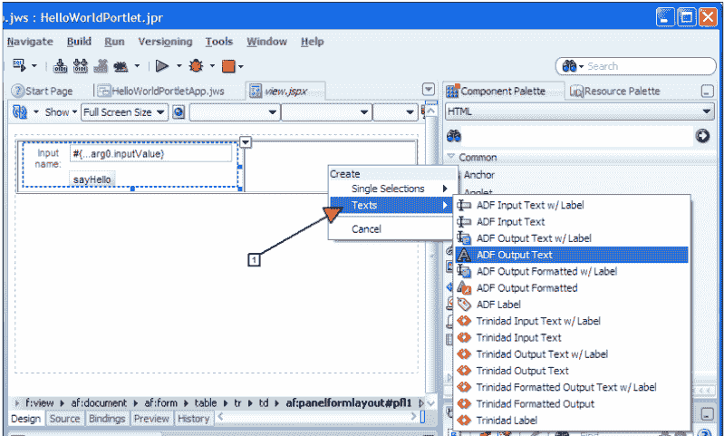

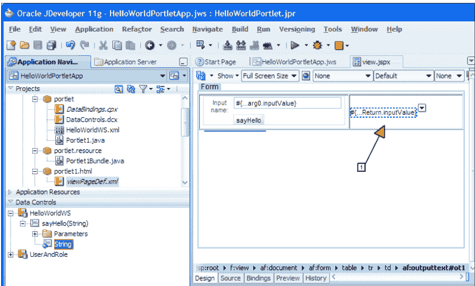

## Step 6: 创建部署配置文件

接下来，我们为 portlet 创建部署配置文件。从 Application Navigator 中选择 HelloWorldPortlet 项目并右键单击它。从上下文菜单中选择 Project Properties。在 Project Properties 中，选择 Deployment 并创建新部署。

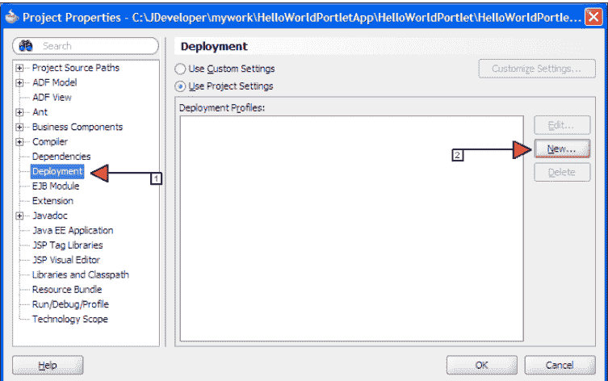

在 Create Deployment Profile 中，从下拉列表中选择 Archive Type 为 WAR File。为配置文件选择一个名称；此处我们使用 HelloWorldPortlet。单击 OK。

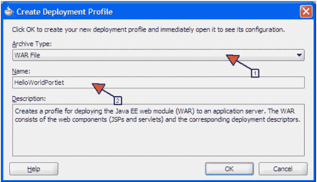

接下来，我们设置 Context Root。我们使用 **HelloWorldPortlet** 作为 Context Root。单击 OK。

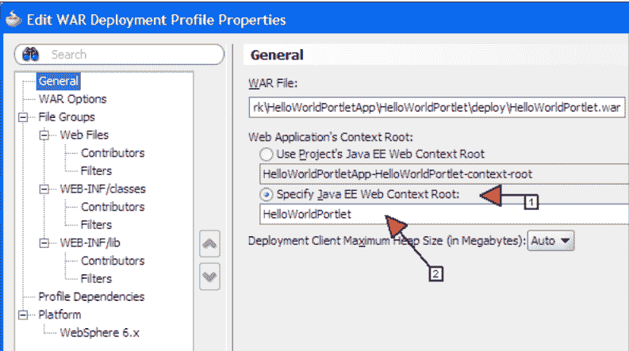

你可以在 **Project Properties** 中看到创建的配置文件 `HelloWorldProtlet`。

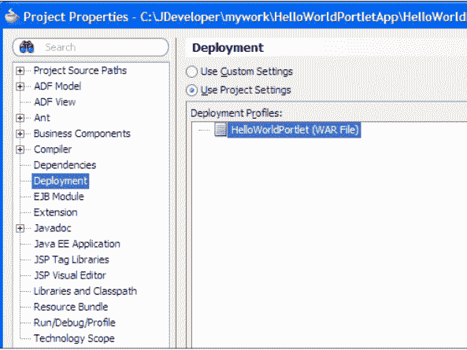

## 步骤 7：将 portlet 部署到集成 WebLogic 服务器

从 Application Navigator 中，选中 **HelloWorldPortlet** 并右键单击。从上下文菜单中选择 Deploy | **HelloWorldPortlet** | to | **IntegratedWLSConnection**。这将把 WAR 文件部署到集成 WebLogic 服务器。

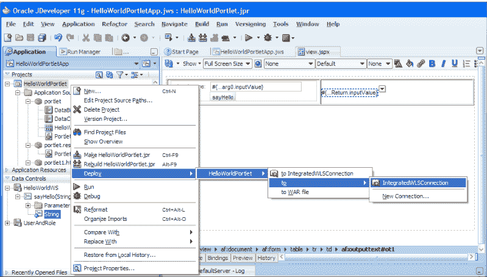

在 **Select deployment type** 对话框中，选择 **Yes** 以允许 JDeveloper 将 portlet 公开为 WSRP 服务。单击 **OK**。

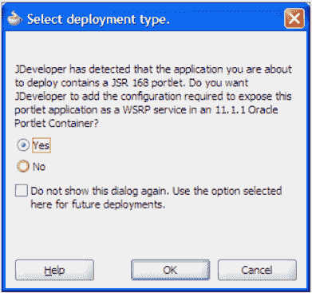

在 **Deployment Configuration** 对话框中单击 **Deploy** 以完成部署。

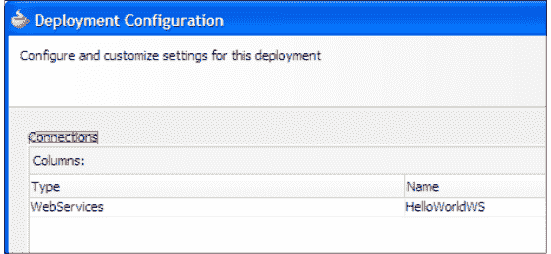

## 步骤 7：测试 portlet

使用浏览器导航到部署 URL，`http://localhost:7101/HelloWorldPortlet/`。将显示 WSRP producer 测试页面。页面底部显示 WSDL 链接。单击 **WSRP v2 WSDL** 链接以查看 portlet producer 的 WSDL。

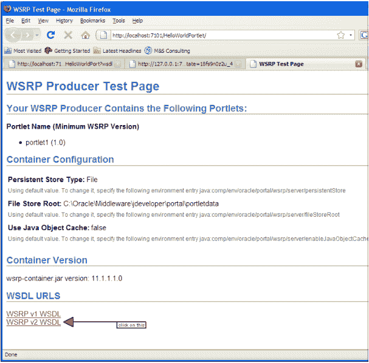

记下 WSDL 链接。在 WebCenter 应用程序中使用该 portlet 时会用到它。

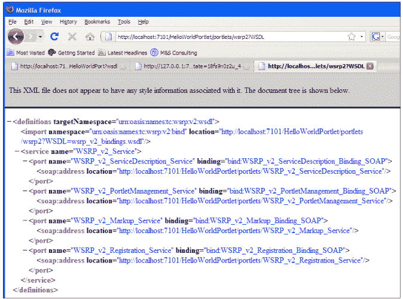

至此，我们已开发、部署并测试了 portlet producer 应用程序。接下来，我们将创建一个 WebCenter 应用程序来使用该 portlet。

## Hello World WebCenter 应用程序

我们将创建一个 WebCenter 应用程序来使用创建的 portlet。该应用程序基于 WebCenter Application 模板，并将使用 ADF Faces 创建 Web 应用程序。

## 步骤 1：创建 WebCenter 应用程序

使用 Application | New 创建新应用程序。从应用程序模板中选择 WebCenter Application。这将确保设置所有适当的技术范围。为应用程序命名；我们使用了 HelloWorldWCApp。单击 Next。

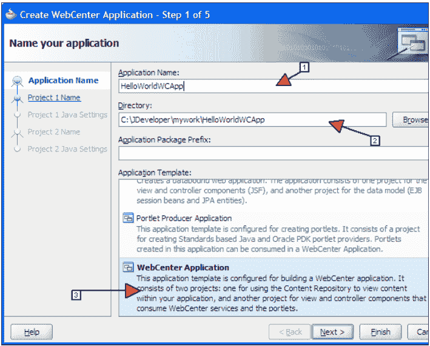

使用 WebCenter Application 模板时会创建两个项目：Model 和 ViewController。将 Web Services 技术添加到选定的技术范围中。单击 Next。

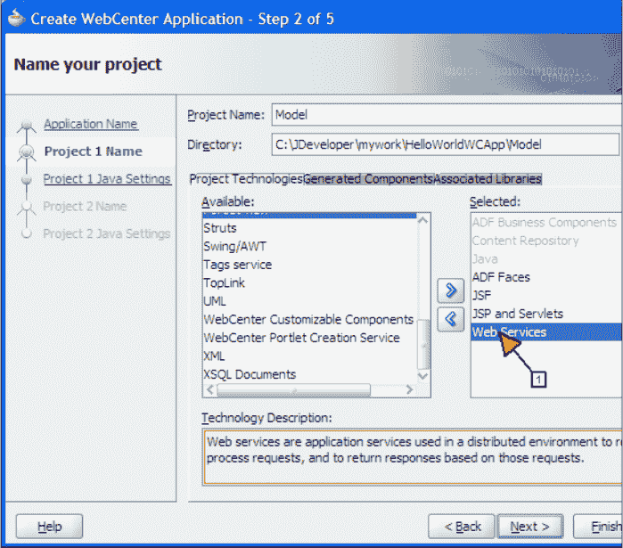

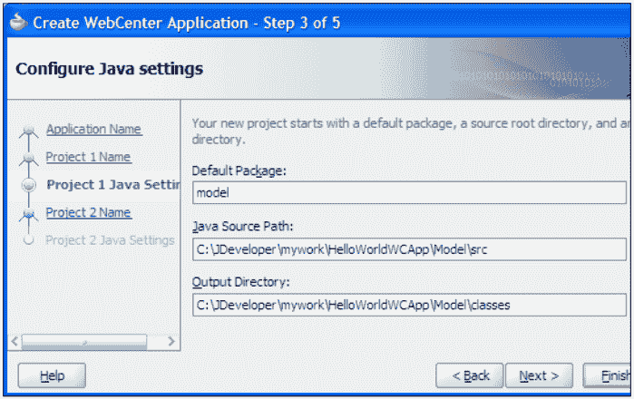

## WebCenter 开发入门：Hello World(s)

接下来，将创建 **ViewController** 项目。默认值即可。
单击 **Finish**。

## 步骤 2：使用 portlet producer

从 Application Resources 中，选择 **Connections** 并右键单击。从上下文菜单中选择 **WSRP Producer**。我们将使用它来使用创建的 portlet。

接下来，配置 portlet producer。为此，我们需要 portlet 的 WSDL。
单击 Next。

选择超时的默认值并单击 Finish。

## 步骤 3：创建用于托管 portlet 的 JSF 页面

从 Application Navigator 中，选中 Web Content 并右键单击，然后从上下文菜单中选择 New。

从 New Gallery 中，在 Web Tier 节点下选择 JSF。在右侧窗格中，从 Items 列表中选择 JSF Page。

在 Create JSF Page 对话框中，选择文件名；我们使用了 helloworld.jspx。选择 Create as XML Document 选项并选择 Quick Start Layout。单击 OK 继续。

## 步骤 4：创建页面布局

从 Application Navigator 中，选择 HelloWorld.jsp 并为其创建页面布局。
我们创建了一个标题表格、一个用于 portlet 的中间区域和一个页脚表格。

## 步骤 5：为 WebCenter 应用程序创建部署配置文件

在 Application Navigator 中，选择 ViewController 项目并右键单击。从上下文菜单中选择 Project Properties。创建新的部署配置文件。从 Archive Type 下拉菜单中选择 WAR File。对于 Name 字段，我们选择了 HelloWorldApp。单击 OK 继续。

接下来，将 Context Root 更改为 HelloWorldApp。单击 OK 继续。

## 步骤 6：将 WebCenter 应用程序部署到集成 WebLogic 服务器

在 Application Navigator 中，选择 ViewController 项目并右键单击。
选择 Deploy | HelloWorldApp | to | IntegratedWLSConnection 将其部署到集成 WebLogic 服务器。

在 Deploy Configuration 对话框中，单击 Deploy 完成部署。

部署完成后，可以在 Deployment log 中看到 **Deployment Finished** 消息。

## 步骤 7：测试 WebCenter 应用程序

使用浏览器，导航到应用程序 URL（默认：http://localhost:7101/HelloWorldApp/faces/helloworld.jspx）。

恭喜！您已完成本教程并构建了一个完整的 Hello World WebCenter 应用程序。

## 摘要

在本教程中，您创建了一个 HelloWorld Web 服务，该服务由 HelloWorld portlet producer 使用。该 portlet producer 被 HelloWorld WebCenter 应用程序使用。

您已验证开发环境，并增强了构建 WebCenter 开发所需基础组件和技能的信心。

在下一章中，我们将从 ABC 的内联网开始构建基础页面。
