## 5 设计与个性化

使用 Oracle WebCenter 开发的应用程序将传统信息系统的数据与 Wiki、讨论和博客等协作资源相结合。

因此，在本章中，我们将教您如何开发传统应用程序。在后续章节中，您将学习如何将协作资源添加到传统应用程序中，以将其转换为 Enterprise 2.0 解决方案。

在本章中，我们将涉及以下项目：

- 入门 ADF Faces Rich Client 框架
- 创建 WebCenter 应用程序
- 使用模板
- 构建数据组件
- 开发示例页面

好了，让我们开始构建传统应用程序。

## ADF Faces Rich Client 组件

ADF Faces Rich Client 是一组用于构建丰富用户界面的组件。这些组件的关键在于使用 AJAX 技术，这使用户能够享受与桌面应用程序（例如 EJM Swing 应用程序）类似的体验和视觉效果。这类应用程序称为富互联网应用程序（RIA）。

## ADF Faces 组件类型

ADF Faces Rich Client 组件可按功能分为以下类型。

| 组件 | 描述 |
|---|---|
| 布局组件 | 这些组件用于定义页面上的区域，这些区域将作为其他组件的容器。 |
| 输入组件 | 用于允许输入任何类型的信息。 |
| 表格和树组件 | 用于使用有组织的结构显示信息。 |
| LOV 组件 | 我们将使用这些组件来显示列表。 |
| 弹出组件 | 用于在页面中生成弹出窗口。 |
| 菜单和工具栏组件 | 用于在应用程序中创建选项菜单的组件类型。 |
| 输出组件 | 用于以不同格式显示信息。 |
| 标签和消息组件 | 此类组件将帮助我们在组件上放置描述性标签。 |
| 导航组件 | 用于促进页面之间的流动。 |

## 创建新应用程序

要使用 Oracle WebCenter 开发应用程序，请执行以下步骤：

1. 执行 JDeveloper，使用 Windows 开始菜单中的选项 **Oracle Fusion Middleware | JDeveloper Studio**。
2. 进入工具后，选择选项 **File | New** 以启动向导。接下来，选择 **WebCenter Application** 选项并按 **OK** 按钮，如下图所示：

3. 在下一页中，我们定义以下信息：

- **Name**：标识应用程序的名称。在本例中，我们的应用程序将被称为 Paracas。
- **Directory**：这定义了我们将存储应用程序代码的目录。对于该项目，目录将是 `c:\Paracas`，因此你需要事先创建它。此后，我们将使用 `<app_directory>` 来引用该目录。
- **Application Package Prefix**：我们将使用此属性来标识构建应用程序的根包。当前应用程序的根包为 `com.paracas`。

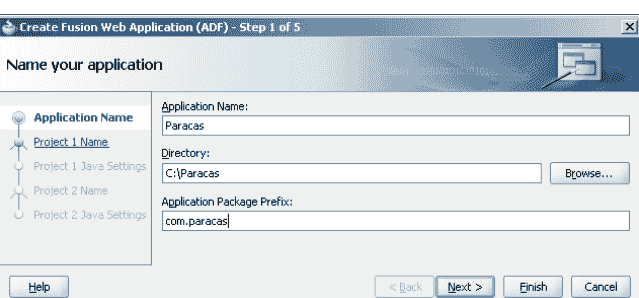

## 为我们的应用程序包含模板

在开始开发任何页面之前，有必要创建一个具有标识我们公司的颜色和徽标的模板。我们应用程序的所有页面都将使用此模板，以减少每个页面的设计时间。此活动的步骤如下：

1. 转到应用程序调色板，右键单击项目 ViewController，并选择 New。

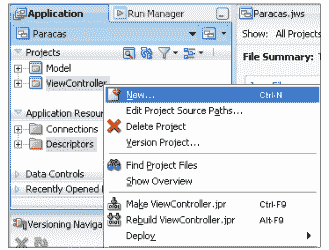

2. 在 New Gallery 窗口中，选择 JSF 类别，并选择 JSF Page Template 选项，如下图所示，然后单击 OK 按钮。

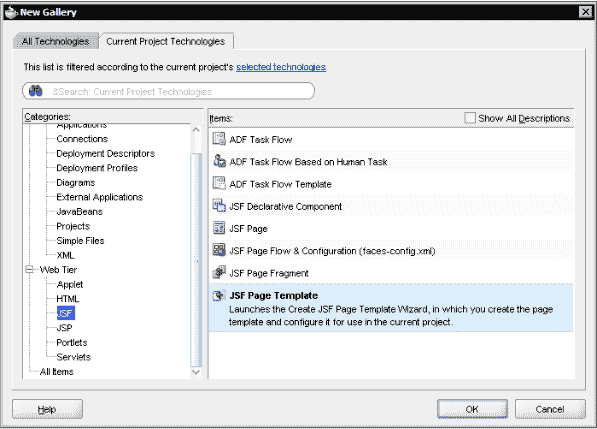

3. 在下一个窗口中，我们需要输入以下数据：
   - **File Name**：templateParacas.jspx
   - **Directory**：C:\Paracas\ViewController\public_html\templates
   - **Page Template Name**：templateParacas

暂时不要按 OK 按钮。

4. 我们的模板将有三个区域，一个位于顶部，两个位于左侧和右侧。上部区域将是固定的，并将包含我们公司的徽标。接下来的两个区域将是可变的，也就是说，这些区域的内容将在基于此模板可变区域开发的页面中发生变化。下图显示了模板中区域的布局：

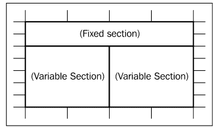

5. 在创建模板期间，我们需要识别可变区域。为此，在 **Facet Definitions** 选项卡中，单击 **New** 按钮以输入一个新的 Facet 来标识可变区域。输入 Facets **customLeft** 和 **customRight**，如下图所示：

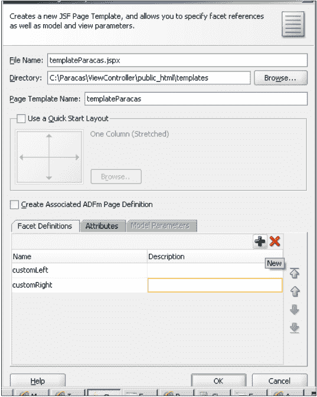

6. 按 **OK** 按钮生成模板，该模板将在工具的主窗口中显示。

7. 选择并拖动 **Panel Group Layout** 组件到模板中，该组件位于组件调色板的 **Layout** 类别中。

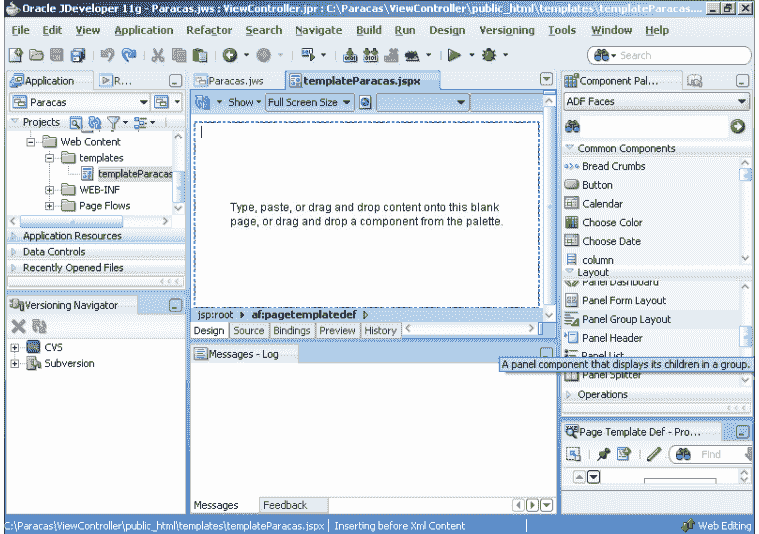

8. 在属性检查器中，将 Layout 属性更改为 scroll。通过此更改，将出现滚动条以显示页面的完整内容。

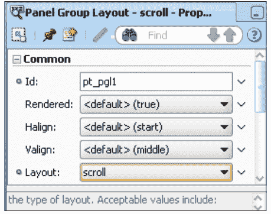

## 设计和个性化

9. 转到组件调色板，将 **Panel Splitter** 组件拖动到页面中心。

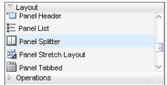

10. 转到 **Property Inspector** 并选择 **Common** 类别，将 **Orientation** 字段的值更改为 **vertical**。

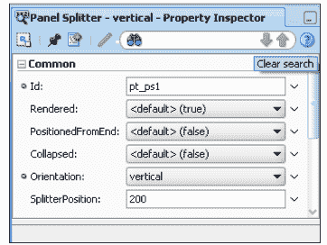

11. 接下来，选择 **Style** 类别，按 **Box** 选项卡，并将 **Width** 和 **Height** 属性更改为 100 百分比的值。

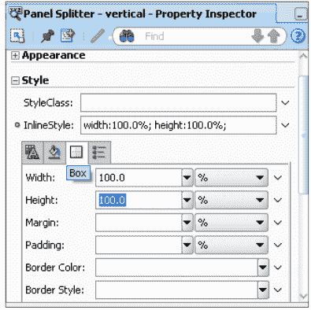

12. 模板到目前为止已生成两个区域，分别称为 first 和 second。first 将显示标题的数据，而 second 将具有与可变区域相关的组件，这些组件将由基于模板的页面使用。

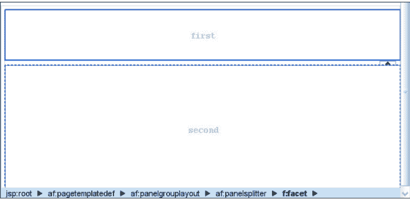

13. 将光标放在 first 和 second 区域之间，并更改它们的比例，如下图所示：

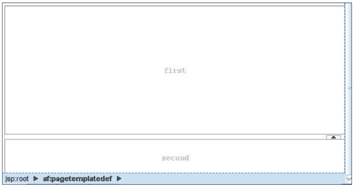

14. 现在，我们将把 second 区域分为两部分。为此，再次将 Panel Splitter 组件拖动到 second 区域中。

## 15. 在属性检查器中，选择 Style 类别，选择 Box 选项卡，并将 Width 和 Height 更改为 100 百分比，如下所示：

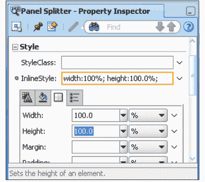

## 16. 经过上述更改，我们看到模板被分为三个区域。有必要根据第 5 节中定义的 Facets 来标识可变区域。为此，转到组件调色板的 Common 类别，并将 Facet Ref 组件拖动到模板左侧区域；它将启动一个窗口，我们必须在其中选择之前定义的自定义 Facet。选择 customLeft，如下图所示，并单击 OK 按钮。

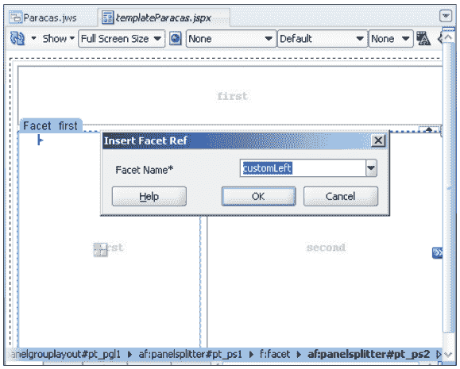

17. 在右侧区域重复相同的过程，使用 **customRight** Facet。我们最终得到以下模板：

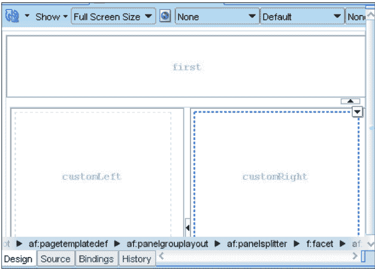

18. 在模板顶部，我们将放置公司的徽标。为此，从组件调色板拖动一个 **Image** 组件。

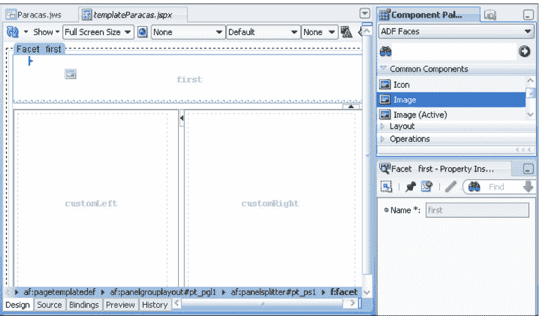

19. 然后会出现一个浮动窗口；单击 **Source** 字段的 **edit** 选项，并选择带有公司徽标的文件（你可以使用文件 `logo.gif`，它是本书文件的一部分）。选择文件后，单击 **Finish**。

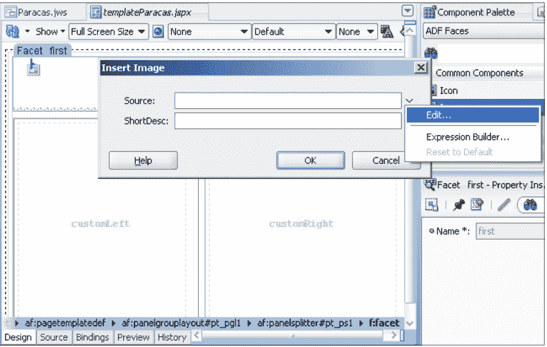

20. 我们将通过设置背景颜色来完成模板的开发。为此，选择结构调色板（位于 JDeveloper 左下角），并选择引用 **af: panelGroupLayout - Scroll**，如下图所示：

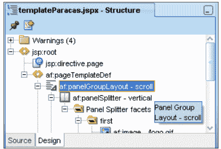

21. 转到 **Property Inspector**，选择 **Style and Theme** 类别，单击 **StyleClass** 字段的箭头按钮，并选择 **Edit** 选项。

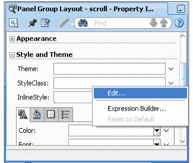

22. 在 **Edit Property** 窗口中，选择 **OraBGColorVeryDark** 样式并单击 **OK**。

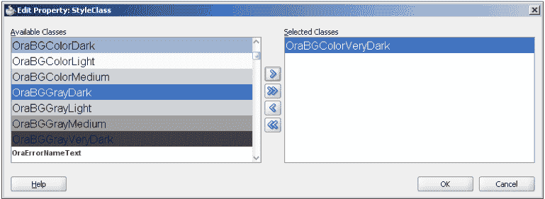

23. 最后，我们的模板应具有以下外观：

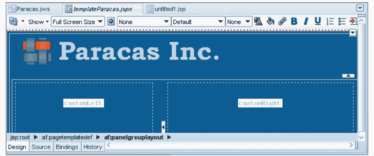

## 构建具有数据库交互的页面

此时，我们有了一个适用于所有页面的自定义模板。现在，让我们使用它来构建一个具有数据库访问功能的页面。与往常一样，我们先简要介绍一下要使用的技术。

## ADF Business Components

ADF Business Components 是一个用于在 JEE 应用程序中实现持久层和业务层的框架。它易于使用并提高了生产力。此外，我们可以在组件之上添加业务逻辑。

ADF Business Components 的架构包括以下组件：

- **Entity**：这是一个 Java 组件，代表特定的信息源（即数据库表）。
- **View Object**：此组件将用于实现查询以访问数据。
- **Application Module**：我们应用程序的主要业务规则将在此组件中定义。通常，我们为每个用例拥有一个应用程序模块。

> 有关 ADF Business Components 的更多详细信息，请参阅 _Fusion Developer's Guide, Part II Building Your Business Services_ http://download.oracle.com/docs/cd/E12839_01/ web.1111/b31974.pdf。

## 创建持久层

首先，我们将创建一个架构并执行相关脚本。确保你已从本书网站下载脚本到你的目录中。此脚本将创建我们应用程序中将使用的数据和结构。

## 为我们的应用程序创建架构

对于此练习，需要有一个 Oracle 数据库。以下练习是使用 Oracle 10g Express Edition 数据库进行的。

使用数据库的命令行，运行以下指令：

1. 作为 dba 用户（如 `sys` 或 `system`）连接到数据库。

## 在 JDeveloper 中创建数据库连接

1. 在 JDeveloper 中，转到 Application Resource Palette，在 Connection 选项上右键单击，并选择 New Connection | Database。

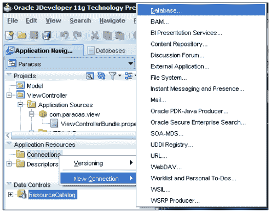

2. 在当前窗口中，配置以下参数：

- Connection Name: db_paracas
- Connection Type: Oracle(JDBC); we use Oracle Database
- Username: paracas; identifies the user previously created
- Password: paracas; define the password user

2. 执行以下命令：
SQL> create user paracas identified by paracas

3. 为 paracas 用户授予权限：
SQL> grant connect, resource to paracas;

4. 作为 paracas 用户连接：
SQL> conn paracas/paracas;

5. 从以下位置执行脚本：
SQL> start c:\paracas\script\paracas.sql

## 设计和个性化

- Host Name: **localhost**; we assume a local database
- SID: **XE**; we use Oracle Express Edition version

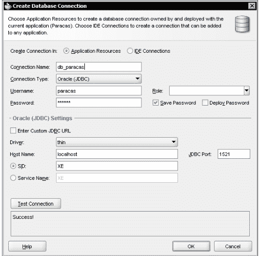

按 OK 完成。

> 关于 Oracle Database Express Edition 的更多信息，请参阅以下链接：
> http://www.oracle.com/technology/products/database/
> xe/index.html

## 创建业务组件

1. 在 Project Palette 中，右键单击 Project Model 并选择 New。

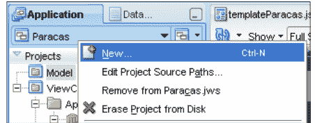

2. 在下一页中，选择类别 **Business Tier | ADF Business Components** 并选择 **Business Components from Tables**。接下来，按 OK 按钮。

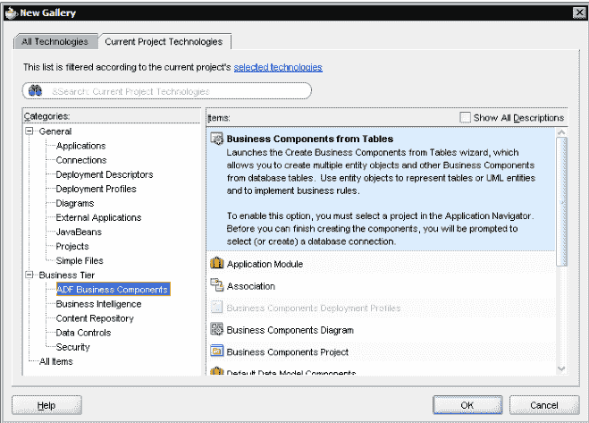

3. 在下一页中，您配置到数据库的连接。此时，您只需确保 **db_paracas** 是所选的连接。按 OK 按钮。

## 4. 现在，选择作为创建实体基础的表。检查 **Auto-Query** 选项并使用箭头键移动和选择所有内容，如下面的屏幕截图所示，然后单击 **Next** 按钮。

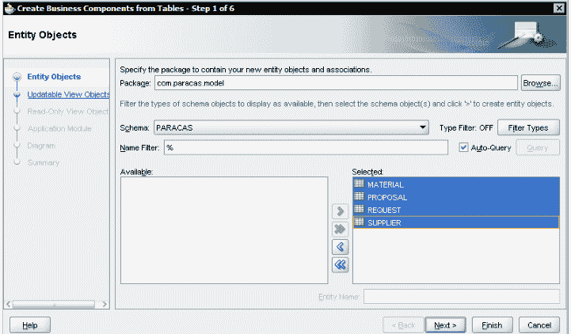

## 5. 下一页允许您创建 **View Objects** 组件，这些组件对于查询定义是必要的。与上一步类似，选择并移动所有组件，然后单击 **Next** 按钮。

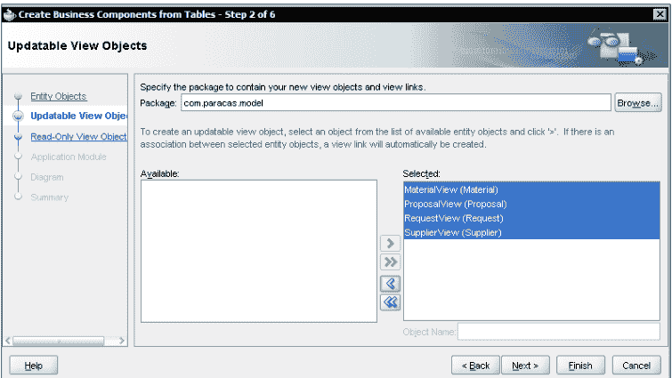

6. 在下一屏幕上，**Read-Only View Objects**，不做任何更改并单击 **Next** 按钮。

7. 最后，在下一屏幕上，保留建议的选项，并按 **Finish** 按钮。

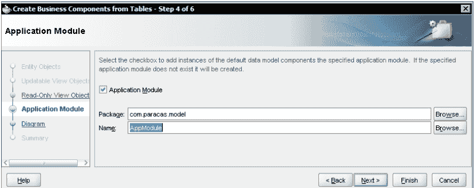

最后几步允许我们基于表创建组件。RequestView 组件包括，在其属性中，所请求材料的代码。但是，RequestView 将需要材料的描述。要添加此描述，我们将进行以下自定义：

1. 在 Project Palette 中，双击 **RequestView**。

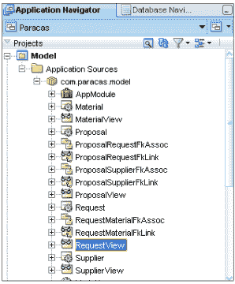

## 2. 在工具右侧，您应该看到组件的配置。选择类别 **Entity Objects** 并在 **Selected** 区域中添加 material，如下面的屏幕截图所示。通过此步骤，**RequestView** 将从 Request 和 Material 实体获取此信息。

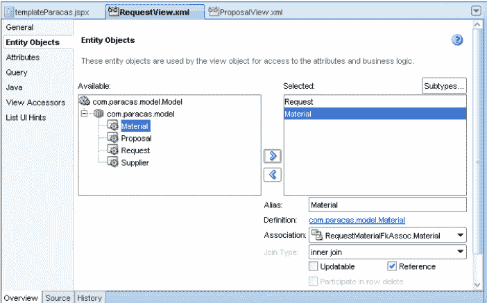

## 3. 然后选择类别 **Attributes** 并单击页面右上角的 **Add from Entity** 按钮。

## 4. 在显示的窗口中，选择 **Description** 字段并将其移动到右侧，如下面的屏幕截图所示：

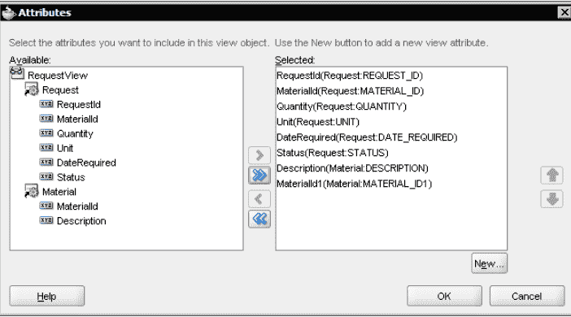

5. 按 OK 按钮应用更改。
6. ProposalView 视图对象也需要供应商的描述。因此，对 RequestView 执行相同的步骤，并添加实体 Supplier 的 Description 属性。

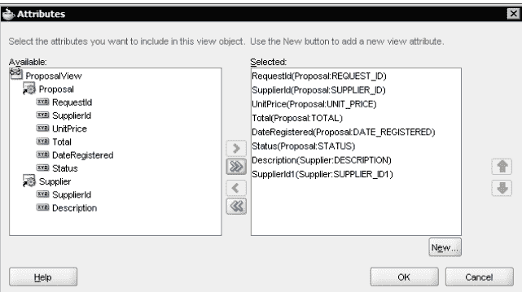

7. 使用 JDeveloper 菜单中的 Save All 按钮保存所有更改。

## 创建页面

1. 在 Project Palette 中，右键单击项目 ViewController，然后选择 New。

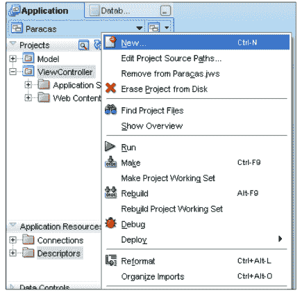

## 设计和个性化

2. 在下一个窗口中，选择类别 **Web Tier JSF**，选择选项 **JSF Page**，并单击 OK 按钮。

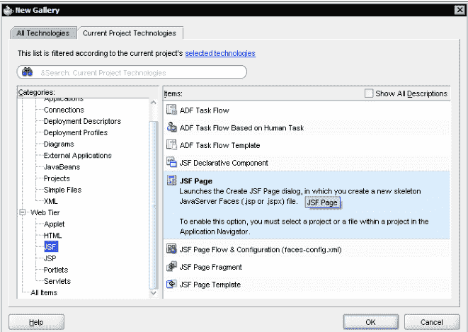

3. 对于下一步，检查 **Create as XML Document option**，为页面定义名称 `requestMaterial.jspx`，选择 **Page template** 选项，选择 `templateParacas`，并单击 OK 按钮。

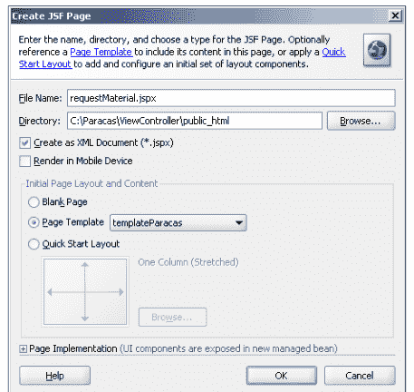

4. 创建页面后，将 Panel Splitter 拖入 customLeft 区域：

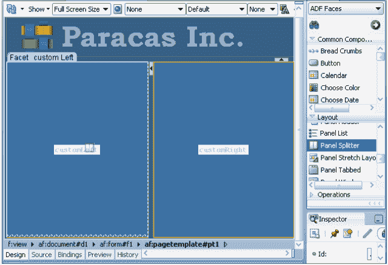

5. 转到属性检查器并更改以下属性：

- Common | Orientation : vertical
- Style | Box | Width : 100
- Style | Box | Height : 100

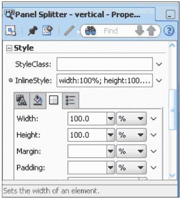

## 设计和个性化

6. 通过上述更改，我们将左侧区域分成了两部分。我们将利用第一部分显示带有请求信息的表。为此，转到 Data Control Palette 并将 **AppModuleDataControl | RequestView1** 引用拖入顶部（第一个）面板。接下来，从上下文菜单中选择 **Tables | ADF Read Only Table**。

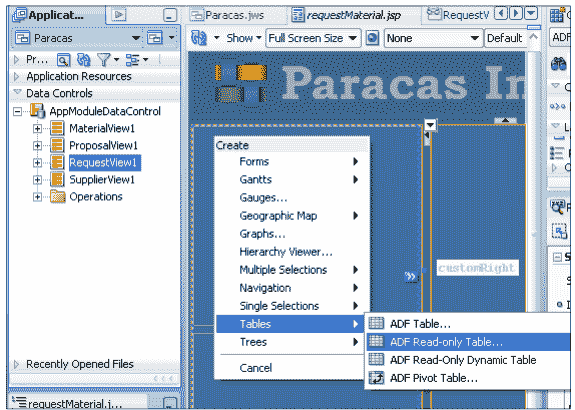

7. 在下一个窗口中，我们必须选择要在页面上显示的字段。检查 **Row Selection** 并使用滚动按钮删除一些字段以定义类似于下面所示的屏幕。接下来，单击 **OK** 按钮。

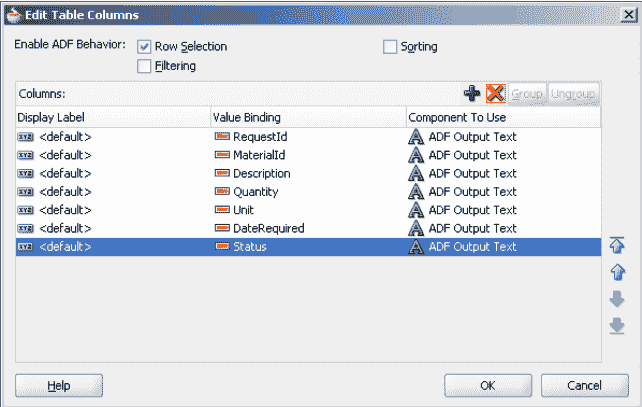

8. 最后，为了测试页面，右键单击页面并选择 **Run**。

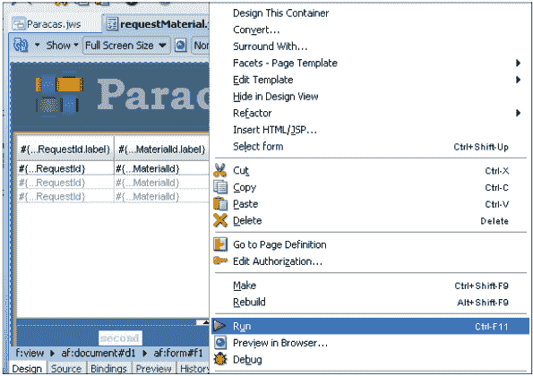

9. 结果应显示材料请求。

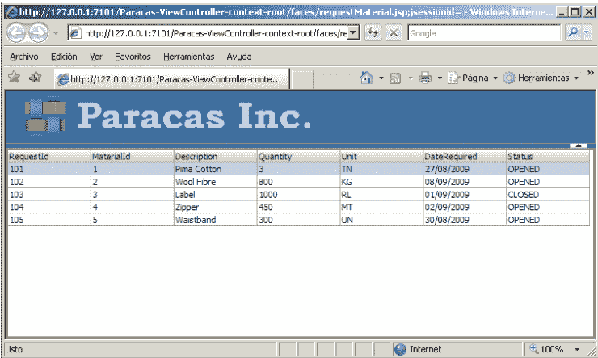

请注意，页面仅显示第一个区域的内容，因为其他区域为空。在接下来的章节中，我们将继续处理此页面，通过向可用区域添加其他功能。

## 摘要

在本章中，我们了解了如何开发模板并将数据访问功能添加到我们的 WebCenter 应用程序中。

如果您需要有关应用程序中数据访问的更多详细信息，我们建议您查阅以下地址的 _Fusion Developer's Guide for Oracle Application Development Framework_：

`http://download.oracle.com/docs/cd/E12839_01/web.1111/b31974.pdf`
