## Discussions, Wiki, and Blog Services

Oracle WebCenter Discussions Service 提供了一个论坛工具，可在组织内部用于共享信息和促进协作。论坛是互联网上最流行的信息交换机制之一。我们都熟悉论坛创建用户社区和传播信息的强大功能。

如果您使用过 Oracle Technology Network Forums，WebCenter Discussions Service 会让您感到非常熟悉——两者都使用相同的强大论坛软件。

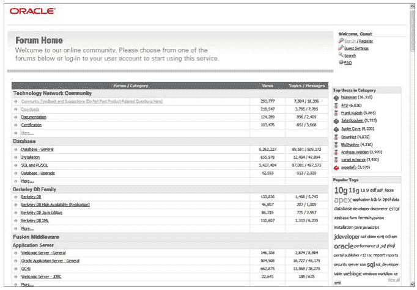

我们在为企业实现论坛时遇到的一些常见挑战与以下内容有关：

1. 集成到现有的技术栈
2. 使用现有 LDAP 进行用户和组管理
3. 支持
4. 文化采纳

最流行的许多论坛软件解决方案都基于 PHP 和 MySQL。不久前，我们为一个 Oracle Fusion Middleware 客户实现了开源 phpBB 解决方案。大部分实现时间和成本都花在与现有门户基础设施和身份管理组件集成上。

通过 Discussions，Oracle 在实现过程中成功地最大限度地减少了所需的技术工作量，解决了主要技术挑战（上述第 1 和第 2 项）。并且，由于提供了正式支持，以及普遍认为使用 Discussions 进行论坛集成在每次实现中都不会独特，组织可以对可行的长期支持感到更加放松。鉴于 Discussions 很好地解决了前三个挑战，我们现在将文化采纳视为最大的挑战，可以通过有效的培训和战略管理决策来克服。论坛在组织内部变得越来越流行，Oracle 已实现了直观的最终用户方法。

Discussions Server 作为 Oracle WebCenter 安装的一部分进行安装。可以在默认位置 `http://hostname:8890/owc_discussions` 直接访问它。虽然 Discussions 本身是一个有用的论坛工具，但真正的强大功能来自 Discussions Service，它使我们能够将论坛嵌入、查看和与之交互，作为自定义 WebCenter 应用程序的一部分，其中论坛可以作为企业在当前使用的应用程序内部获取和共享信息的一种手段。

**Wiki** 是一个允许一组编辑人员使用简单的标记语言以协作方式轻松创建网页的网站。标记语言有助于组织和格式化网页。许多公司使用 Wiki 来内部创建文档。公司的每位员工都可以轻松访问编辑 Wiki 中的信息，因此可以为整个社区纳入新信息。

A **Blog** 是允许个人作者发布内容流供社区查看的网站。“Blog”一词源自“Web Log”的缩写。Blog 流中的每个项目都可以视为一篇文章。文章可以简单到视频或图片发布，也可以正式到报纸文章。作者决定发布什么内容。通常，作者允许社区成员通过在文章上发布评论来参与与博客文章相关的对话。

Wiki 服务和 Blog 服务都依赖于 WebCenter Wiki 和 Blog 服务器。两项服务都使用单个连接连接到单个后端服务器。

在本章中，我们将执行以下操作：

- 介绍如何创建利用 Discussions 服务的自定义 WebCenter 应用程序
- 介绍一些任务流
- 介绍在自定义应用程序中配置 Discussions 服务连接所需的关键信息的位置
- 了解如何将自定义 WebCenter 应用程序与 Wiki 和 Blog 服务集成，具体来说，是使用 IFrame 和使用 Web Clipping Portlet

## Discussions 配置

我们的应用程序使用 JDeveloper 11g 构建，并连接到 Oracle WebCenter Discussions 服务器。通过连接到 Discussions 服务器 URL（http://hostname:8890/owc_discussions）确保 Discussions 服务器正在运行。最好在 Discussions 服务器中填充一些示例用户、类别和论坛。Forums Admin Console 用于创建新用户和论坛。管理控制台可以通过 http://hostname:8890/owc_discussions/admin 访问。

默认管理员用户名是 weblogic，密码是 weblogic。这与安装时指定的任何用户名/密码无关。

您可以在管理控制台中配置各种设置，包括但不限于以下内容：

- 内容结构：类别、子类别、论坛
- 用户和组
- 权限
- 过滤器和拦截器
- 审核
- 用户界面（颜色和主题）
- 报告和指标
- 系统设置（缓存、电子邮件、区域设置等）
- 插件

以下是管理控制台主页的截图：

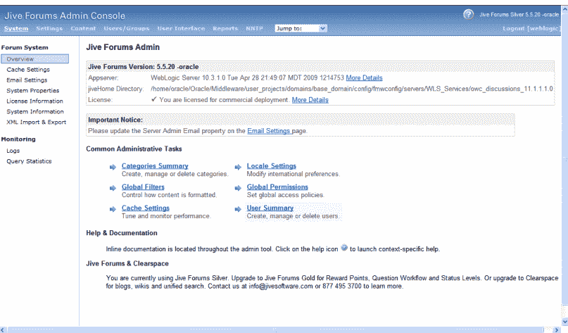

我们不会关注配置论坛的所有方面，而是关注开始并集成到 WebCenter 所需的主要部分。具体来说，我们将关注用户/组和整体论坛内容结构。Jive 文档详尽，详细解释了各个设置。

## 内容结构

Discussions 的一般结构如下：

- 类别：讨论内容的逻辑分组
  - 子类别：可选的子分组
    - 论坛：最终用户可以创建讨论线程的最低级别分组
      - 线程：最终用户创建的条目，包含原始条目以及回复

在 Forums Admin Console 中，您可以定义适合您组织的结构。适用于其他论坛软件的相同原则也适用于 Discussions 内容结构。

为了本演示的目的，我们创建了一个 **Marketing** 类别和一个 **Marketing Ideas** 论坛。

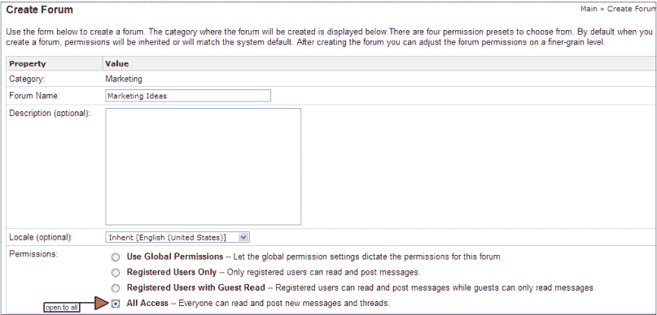

## Discussions、Wiki 和 Blog 服务

以下是反映刚刚创建的 **Marketing Ideas** 论坛的 **Category Summary** 图像：

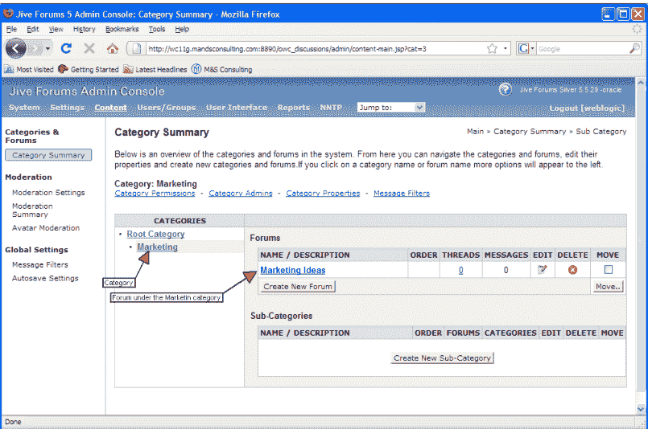

## 用户和组结构

我们将此 Discussions 服务作为独立服务进行处理，因此手动创建了用户和组。在企业解决方案中，您可能会使用 Enterprise Manager 将其与 LDAP（如 Oracle Internet Directory）集成。以下是我们在 Discussions 管理中配置的用户截图：

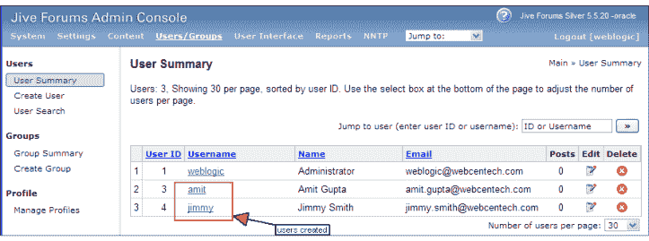

如前所示，我们添加了两个用户——amit 和 jimmy——并授予他们适当的权限以在 Marketing Ideas 论坛上发布内容。

## 将 Discussions 与 WebCenter 集成

在本章的其余部分，我们将创建一个自定义 WebCenter 应用程序，该应用程序将与 Discussions 服务器集成，并公开一个论坛视图，允许您使用任务流与论坛进行交互。

Oracle 为 Discussions 服务公开了多个任务流。我们在以下表格中列出了所有开箱即用的任务流，并加粗了我们将放入 WebCenter 应用程序的任务流：

| Task Flow | Description |
|---|---|
| **Discussions Forums** | 此任务流显示与指定论坛关联的所有主题。用户可以根据其权限创建、读取、更新和删除主题。 |
| Discussions – Popular Topics | 显示给定类别 ID 或论坛 ID 下的热门主题。 |
| Discussions – Recent Topics | 显示给定类别 ID 或论坛 ID 下的所有最近主题。 |
| Discussions – Watched Forums | 允许用户查看给定类别 ID 下的所有关注的论坛。 |
| Discussions – Watched Topics | 允许用户查看给定类别 ID 或论坛 ID 下的所有关注的主题。 |
| **Discussions – Sidebar View** | 这显示了 Popular Topics、Recent Topics、Watched Topics 和 Watched Forums 任务流的组合视图。 |

我们将完成的主要步骤如下：

1. 确保 Discussions 服务器正在运行
2. 创建 WebCenter 应用程序
3. 创建到 Discussions 服务器的连接
4. 创建 JSF 页面
5. 选择适当的 Discussions Service Task Flow 并将其嵌入页面
6. 部署、运行和测试应用程序

## 确保 Discussions 服务器正在运行

在开始开发应用程序之前，请确保 WebCenter Discussions 服务器正在运行。如果 Discussions 服务器未运行，请按照 WebCenter 安装和配置章节中所述启动 WLS_Services 托管服务器。使用浏览器打开 Discussions 的 URL（例如，http://hostname:8890/owc_discussions）。

使用新创建的用户登录并发布一些示例文章。

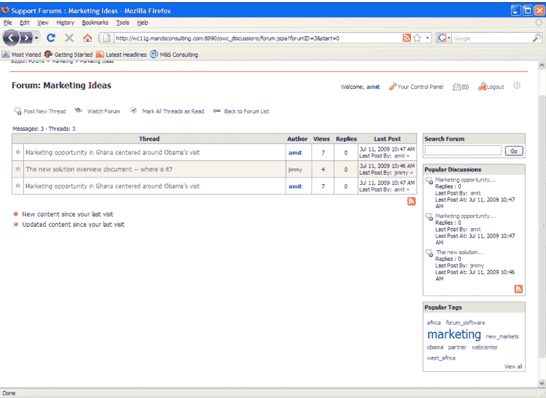

## 创建新的 WebCenter 应用程序

使用 JDeveloper 创建新应用程序，选择 WebCenter 应用程序模板。要遵循的步骤与 HelloWorldApp 中使用的步骤类似，因此我们不会在此重复。

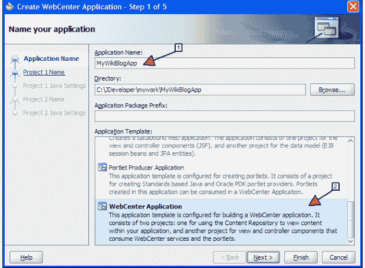

## 创建 JSF 页面

接下来，我们将创建一个 JSF 页面来托管 Discussions Forum 的视图。在应用程序导航器中，突出显示 ViewController 项目，右键单击它，并从上下文菜单中选择 New。在新建库中，选择 JSF Page 以创建新的 JSF 页面。

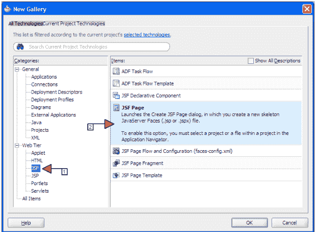

在创建 JSF 页面对话框中，为页面选择名称并创建页面。

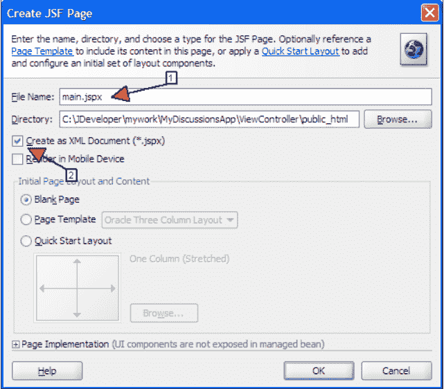

## 创建到讨论论坛的连接

为了在我们的应用程序中使用 Discussions 服务，我们需要创建到 Discussions 服务器的 Discussions Forum 连接。应用程序将使用此连接连接到后端 Discussions 服务器。请注意，可以通过使用 Enterprise Manager Fusion Middleware Control 在应用程序部署到 WebLogic 服务器后修改连接。

要设置讨论连接，请在 **Application Resources** 窗格中右键单击 **Connections** 节点，并选择 **New Connection | Discussions Forum**。

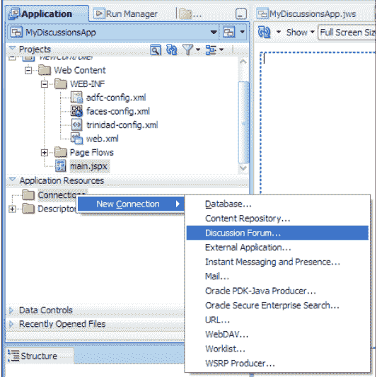

为连接选择唯一名称，例如 **MyDiscussions**。确保 **Make this the connection default** 复选框已选中。接下来，我们需要设置 `forum.url` 和 `admin.user` 的属性值。`forum.url` 的值应为 Discussions 服务器的 URL。默认管理员用户是 `weblogic`。单击 **Test Connection** 以确保连接设置正确。单击 **Finish** 完成此步骤。

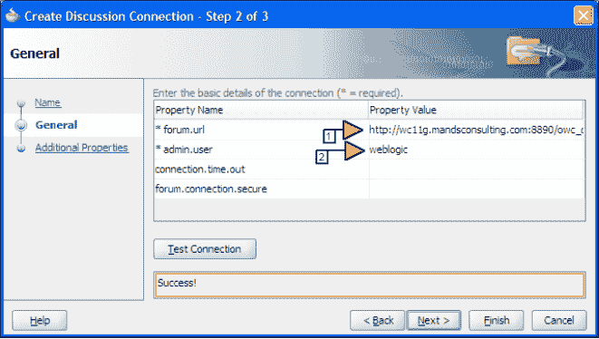

## 讨论、Wiki 和博客服务

单击 **资源调色板** 并打开 **我的目录**。现在，您应该能看到 **WebCenter 服务目录**。展开目录以查看可用的各种任务流。

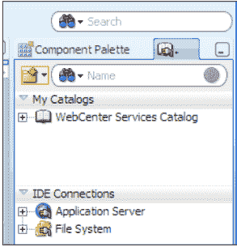

在显示的任务流中，您可以看到各种与讨论相关的任务流，例如 **讨论论坛**、**讨论 - 热门主题**、**讨论 - 最近主题** 等等。我们将在应用程序中使用这些任务流来创建讨论论坛的视图。

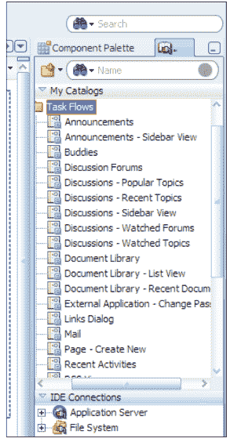

## 在 JSF 页面中嵌入讨论任务流

从资源调色板中，将讨论论坛任务流拖动到 JSF 页面上。出现提示时，选择 Region 作为创建任务流的方式。

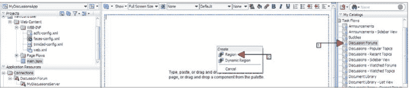

在任务流绑定对话框中，输入 categoryId 和 forumId 的值。您可以使用 Jive Forums 管理控制台查找这些 ID。

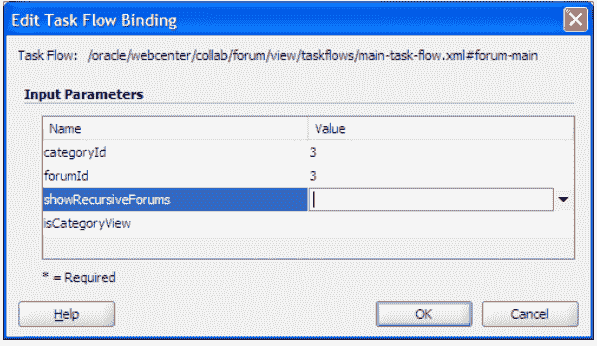

| 参数   | 说明    |
|--------------|----------------|
| categoryId   | 现有 WebCenter 讨论实例中现有类别的类别 ID，视图应将其范围限定为此类别。    |
| forumId      | 指定类别中现有论坛的标识符。您应确保特定论坛存在。 |
| showRecursiveForums | 确定是仅显示指定类别中的论坛，还是同时显示所有子类别。如果设置为 false（默认值），则仅显示给定类别下的论坛，否则将显示该类别及其子类别下的所有论坛。    |
| isCategoryView | 如果设置为 true，则任务流将列出分组在类别下的论坛。当设置为 false（默认值）时，将显示与论坛关联的主题。 |

请参阅以下屏幕截图以查找 CATEGORYID：

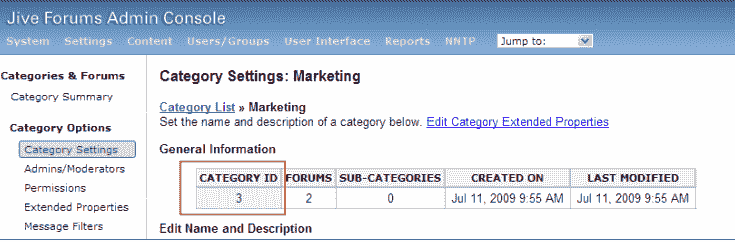

请参阅以下图像以查找 FORUMID：

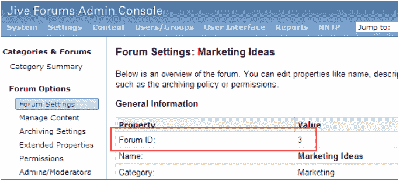

如果提示添加库，请单击 **添加库**。

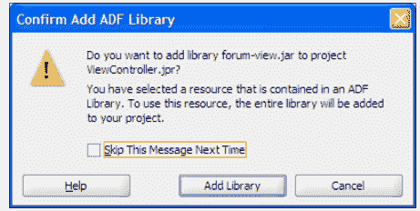

接下来，我们将使用与 **讨论论坛** 相同的过程，将 **讨论 - 侧边栏视图** 任务流嵌入到页面中。

## 部署、运行和测试

现在，您可以在应用程序导航器中右键单击 main.jspx 文件，并从上下文菜单中选择 **运行** 来运行该页面。该应用程序将部署到集成 WebLogic 服务器，并且默认浏览器将使用相应的 URL 启动。

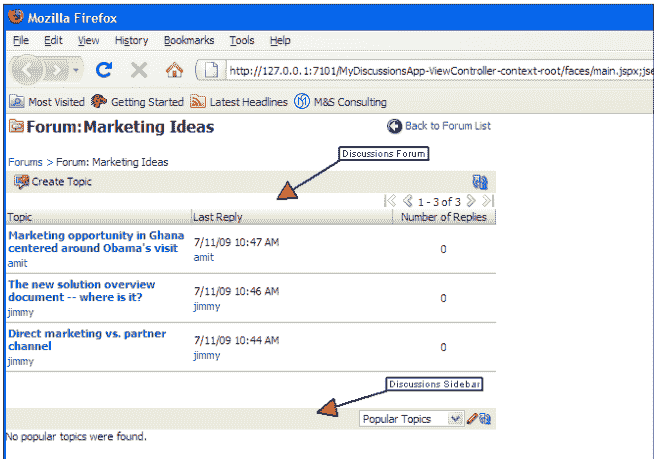

## 将 Wiki 和博客与 WebCenter 集成

将 Oracle WebCenter Wiki 和博客服务器集成到自定义 WebCenter 应用程序中有三种主要方法。它们如下：

1. 使用 IFrame，将其包含在自定义 WebCenter 应用程序的页面中。
2. 使用任何能够消耗 URL 的端口，例如 Web 剪辑端口。
3. 使用提供的 Web 服务，这需要自定义构建的用户界面。我们不会详细介绍此方法。

在本章中，我们将演示前两种方法的使用。有关如何使用 Wiki 和博客服务器的 Web 服务接口的详细信息，请参阅 Oracle WebCenter 开发者指南。

## 先决条件

在开始开发自定义 WebCenter 应用程序以与 Wiki 和博客服务器集成之前，我们应确保 WebCenter Wiki 和博客服务器正在运行。如果 Wiki 和博客服务器未运行，请按照 WebCenter 安装和配置章节中所述启动 WLS_Services 托管服务器。使用浏览器打开 Wiki 主页的 URL（例如，http://hostname:8890/owc_wiki）。

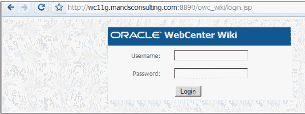

## 使用 IFrame 集成 Wiki 和博客

我们将按照以下方式查看如何集成它。

## 创建新的 WebCenter 应用程序

使用 JDeveloper，创建新应用程序并选择 WebCenter 应用程序模板。要遵循的步骤与第 4 章 WebCenter 开发入门中 HelloWorldApp 的步骤类似。

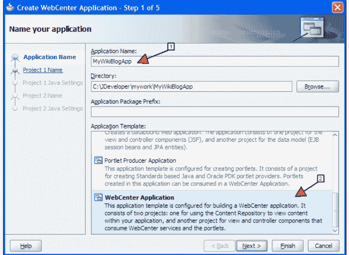

此应用程序的默认设置应该没问题，因此单击 **完成** 以继续。

## 创建 JSF 页面

接下来，我们将创建一个 JSF 页面来托管 Wiki 和博客服务器的视图。在应用程序导航器中，选择 ViewController 项目，右键单击它，并从上下文菜单中选择 **新建** 以启动新建库。

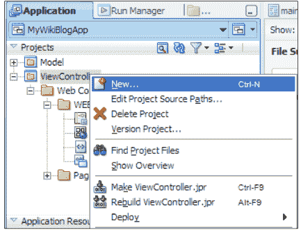

## 讨论、Wiki 和博客服务

在新建库中，选择 JSF 页面以创建新的 JSF 页面。

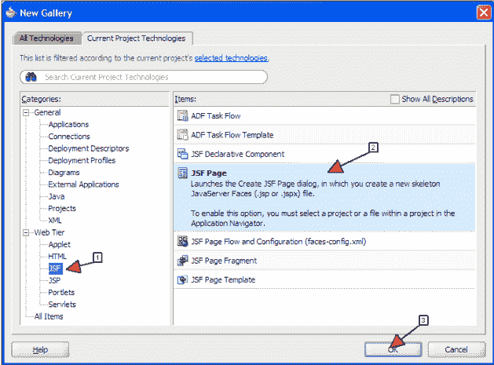

在创建 JSF 页面对话框中，为页面选择名称并创建页面。

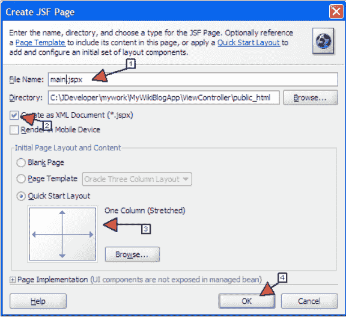

## 创建 IFrame 以包含 Wiki 和博客服务器页面

为了将 Wiki 和博客服务器页面集成到自定义 WebCenter 应用程序中，请从 **组件调色板** 将 **内联框架** 组件拖动到创建的 JSF 页面上。

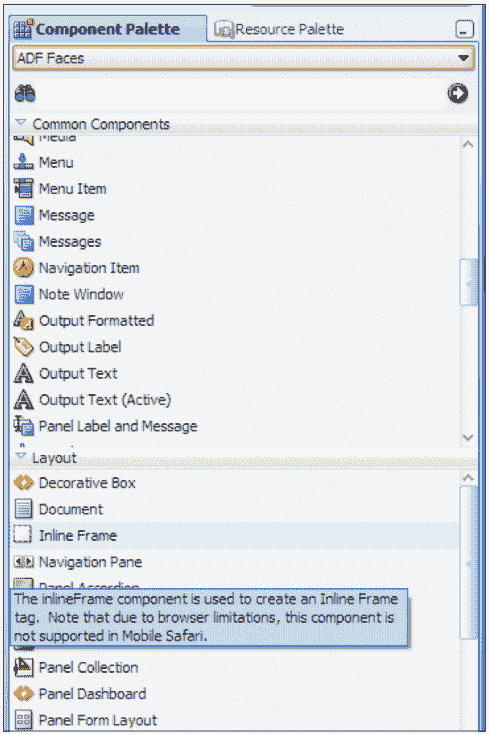

接下来，修改 IFrame 的 **源** 属性，使其指向要在应用程序中嵌入的 Wiki 和博客服务器页面。URL 的格式为 http://hostname:port/owc_wiki/page/show.jz?page=domain:wikiPageName。此处我们使用了域 webcentech 的 StartPage。

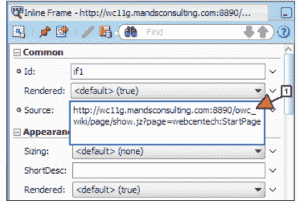

我们现在准备查看页面。在应用程序导航器中右键单击 main.jspx 文件，并从上下文菜单中单击 **运行**。Web 浏览器将启动并显示 Wiki 和博客服务器的登录页面。使用任何有效的用户名和密码登录到 Wiki 和博客服务器。

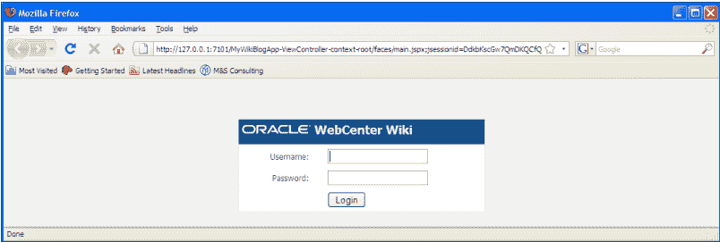

## 使用 Web 剪辑端口集成 Wiki 和博客

在以下部分中，我们将演示如何使用 Web 剪辑端口将 Wiki 和博客服务器添加到自定义 WebCenter 应用程序中。Oracle WebCenter 框架包含一个 Web 剪辑端口，我们可以将其注册到自定义 WebCenter 应用程序中。在浏览器中运行应用程序时，我们可以使用 Web 剪辑工作室消耗 Wiki 和博客服务器 URL。

## 向应用程序添加新的 JSF 页面

使用前面描述的过程向应用程序添加新的 JSF 页面。

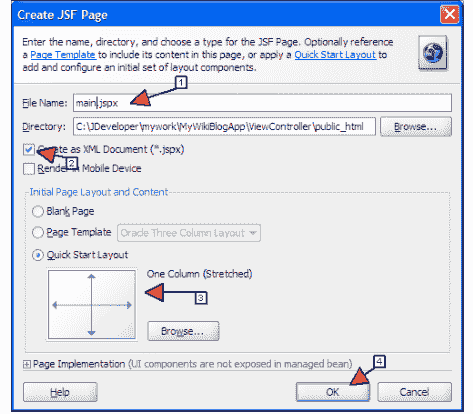

## 注册 Web 剪辑端口

从应用程序资源中，选择 连接 | 新建连接 | Oracle PDK-Java 生产者。

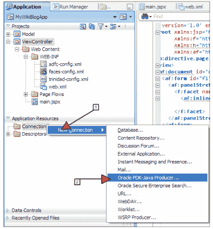

接下来，指定连接详细信息。Web 剪辑端口的默认 URL 为 http://hostname:port/portalTools/webClipping/providers/webClipping。其他配置参数的默认值可接受，因此单击 **完成** 以完成注册。

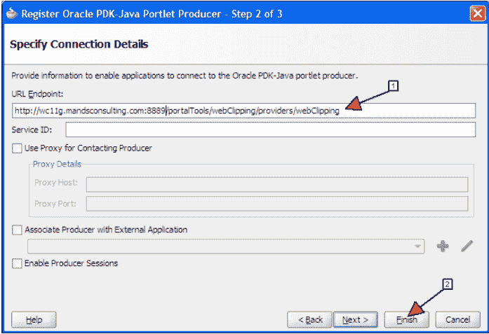

注册 Web 剪辑端口后，您可以在连接下看到其条目。

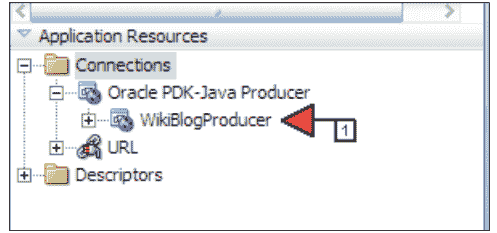

### 将 Web 剪辑端口添加到 JSF 页面

将 Web 剪辑端口从连接拖动到 portlet.jspx 页面。这将把端口添加到页面中。

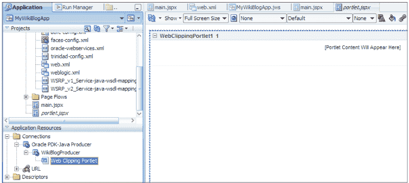

## 运行端口页面

在应用程序导航器中右键单击 portlet.jspx 页面，并从上下文菜单中选择 运行 以运行页面。浏览器将启动并显示 Web 剪辑工作室。接下来，我们需要自定义 Web 剪辑工作室并输入 Wiki 和博客服务器 URL。单击页面右上角的下拉列表以打开 Web 剪辑端口菜单。

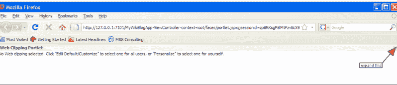

从菜单中，选择 自定义。这将打开用于输入 URL 位置的表单。

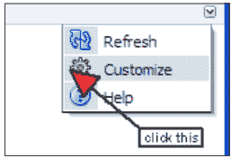

## Discussions, Wiki, and Blog Services

在 **URL Location** 字段中输入 Wiki 的 URL。输入 URL 后，单击 **Start** 即可查看 Wiki 和 Blog 页面，如下图所示：

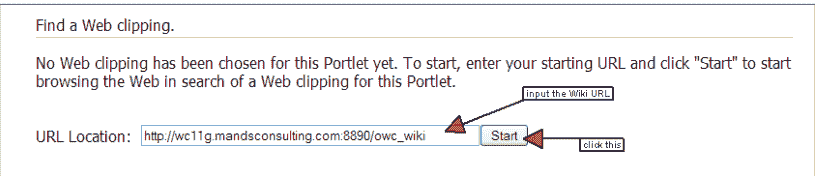

输入有效的用户凭据以登录 Wiki Server。

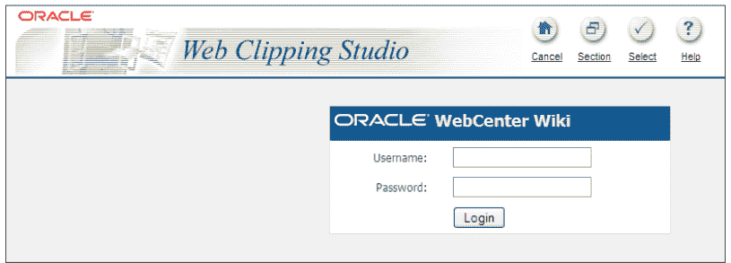

Wiki 页面显示在 **Web Clipping Studio** 中。

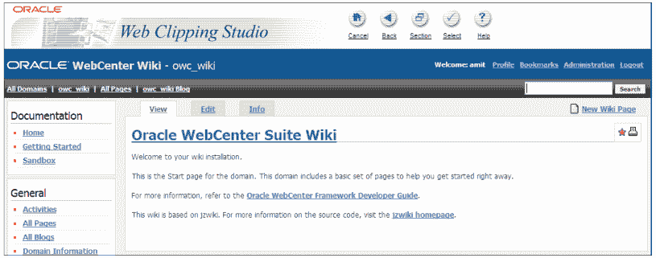

最后，您必须选择希望 Web Clipping Portlet 剪辑的区域，然后保存设置。
至此，我们完成了如何使用 iFrame 和 Web Clipping Portlet 将 Oracle WebCenter Wiki and Blog Server 与自定义 WebCenter 应用程序集成的演示。

## Summary

在本章中，我们开始将 WebCenter 服务集成到自定义 WebCenter 应用程序的路径上。我们演示了有用的 Discussion Forums Service 如何用于在应用程序中创建论坛视图。
我们演示了将 Wiki 和 Blog Services 集成到自定义 WebCenter 应用程序的简单方法。在组织内利用这些服务可以显著改善沟通和生产力。个人也可以从利用这些服务中受益。例如，用户可以将 Wiki 用作个人记事本，将 Blog 用作个人日记。
