# 8 Search Service

在上一章中，我们了解了如何集成各种 WebCenter 协作工具，例如 Wiki、Blogs 和 Discussions。这些协作工具允许在企业中共享信息，从而构建和存储集体知识。访问信息的主要方式之一是使用搜索工具。WebCenter 通过提供内置的 Search Service 来满足这一需求。

在本章中，我们将探索 WebCenter Search Service、Tags 和 Links。Search Service 允许 WebCenter 应用程序搜索其他服务拥有的资源。搜索是从各种 WebCenter 应用程序中发现信息并链接它们的强大工具。

通过创建示例应用程序，我们将演示如何在自定义 WebCenter 应用程序中集成 WebCenter Search Service。

Tags 和 Links 是组织信息以便于搜索以及在不同信息片段之间创建上下文的有用工具。通过创建指向不同资源的链接，我们可以促进重用，避免在多个位置重复相同的信息。例如，在讨论线程中，可以创建指向正在讨论或包含更多主题信息的另一文档的链接，从而轻松访问存储在企业其他位置的其他信息。另一方面，Tags 允许为资源添加标签，以便在 Search 中轻松发现，并提供信息的松散组织。当用户为资源添加标签时，他们可以根据自己的临时标签快速搜索该资源。

**Really Simple Syndication (RSS)** 是一种重要工具，允许我们从多个来源收集信息并在单个位置呈现。RSS 的典型用途是在单个 RSS Reader 中阅读（更新的）来自多个网站的信息。自定义 WebCenter 应用程序可以使用 RSS Service 在单个位置呈现从多个外部 RSS 源（feeds）收集的信息。

具体来说，我们将涵盖以下主题：

- Role of search in WebCenter applications
- Methods of integrating the Search Service in WebCenter applications
- An example showing how to integrate Search task flows in a custom WebCenter application
- Integrating with WebCenter Tags Service
- Integrating with the WebCenter Links Service
- Integrating with the WebCenter RSS Service in a custom WebCenter application

## Search in enterprise applications

随着企业中收集和存储的信息量不断增加，拥有能够轻松发现文档、Blogs、论坛等中信息的工具非常重要。搜索是定位信息最流行的机制。WebCenter 提供了一项方便的服务，允许与 WebCenter 应用程序轻松集成，将搜索的优势带给任何自定义 WebCenter 应用程序。使用 WebCenter Search task flows，我们可以搜索应用程序拥有的资源。大多数 WebCenter 服务（如 Wiki、Blogs、Discussions 和 Documents）都支持 Search。

## Integrating the WebCenter Search Service

在自定义 WebCenter 应用程序中，我们可以使用 Search Service 提供一个方便的搜索设施，以搜索应用程序中使用的其他 WebCenter 服务。通常，任何拥有资源的 WebCenter Web 2.0 服务都支持 Search，包括公告、讨论、文档、Tags 和 Page service。

Search Service 可以使用多种 task flows 与自定义 WebCenter 应用程序集成。它们列表如下：

| Task Flow | Description |
|---|---|
| Search | 这是最全面的 task flow，提供搜索、细化和保存搜索结果的选项。 |
| Search Preferences | 此 task flow 允许您选择要搜索的 WebCenter 服务。您还可以设置首选项，例如搜索结果中可用列的顺序。 |
| Search – Saved Searches | 此 task flow 允许用户从应用程序中运行其保存的搜索。 |
| Search Toolbar | 此 task flow 允许用户快速输入简单的搜索条件并从应用程序中搜索。 |

为了演示在自定义 WebCenter 应用程序中使用 Search，我们将创建一个连接到 Discussions Server 的应用程序。然后，我们将使用 Search task flow 在自定义开发的应用程序中为 Discussions Server 提供搜索设施。

## Ensuring that the WebCenter Wiki and Blog Server are running

在开始开发应用程序之前，请确保 WebCenter Discussions Server 正在运行。如果 Discussions Server 未运行，则按照第 2 章中所述启动 WLS_Services 托管服务器。

## Creating a new WebCenter Application

使用 JDeveloper，创建一个新的 Application 并选择 WebCenter Application 模板。要遵循的步骤与 HelloWorldApp 中使用的步骤类似，因此我们在此不再重复。

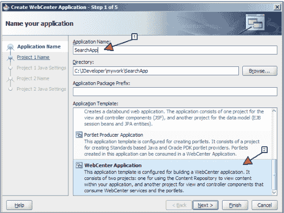

## Creating a JSF page

接下来，我们将创建一个 JSF 页面来托管 Discussions Service 和 Search task flow 的视图。在 Application Navigator 中，突出显示 ViewController 项目，右键单击它，并从上下文菜单中选择 New。在 New Gallery 中，选择 JSF Page 以创建新的 JSF 页面。

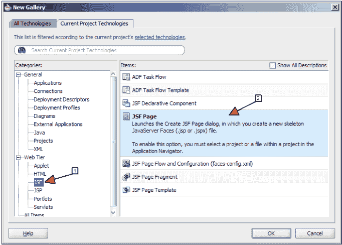

在 Create JSF Page 对话框中，为页面选择一个名称并创建页面。确保选中 Create as XML Document (.jspx) 复选框。

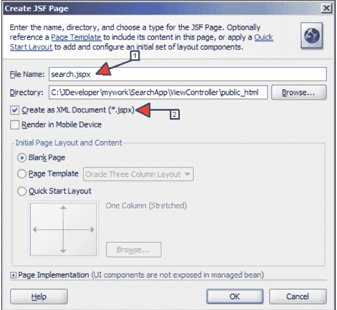

## Creating a connection to the Discussions Service

在第 7 章中，我们列出了与 Discussions Service 集成的步骤。我们在此简要重复这些步骤。

在 **Application Resources** 中，创建一个新的连接到 **Discussions Forum**。

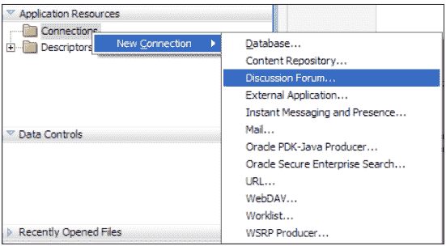

输入连接名称，并确保将连接设置为默认连接。

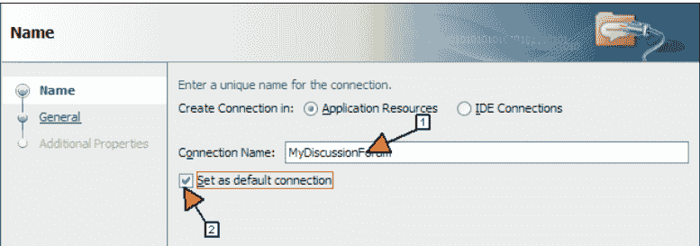

在下一页中，输入论坛 URL 和管理员用户名。测试连接以确保连接设置正确。单击 **Finish** 继续。

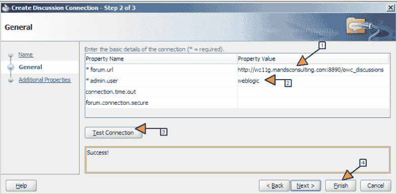

## Adding the Discussions Forum task flow to the JSF page

从 **Resource Palette** | **Task Flows** 选择 **Discussion Forums** 并将其拖动到页面上。出现提示时，选择 **Region** 作为布置 task flow 的方法。

## 将搜索任务流添加到 JSF 页面

我们现在可以将搜索任务流添加到页面中。从 **资源调色板** 中选择 **搜索** 任务流，并将其拖动到页面上。出现提示时，选择 **区域** 作为布局模式。

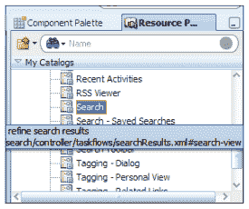

我们现在可以预览页面了。在 **应用程序导航器** 中右键单击 `search.jspx` 文件，并从上下文菜单中单击 **运行**。Web 浏览器将启动并显示搜索页面。页面上半部分显示讨论论坛，下方显示搜索表单。输入搜索词以在讨论论坛中进行搜索。

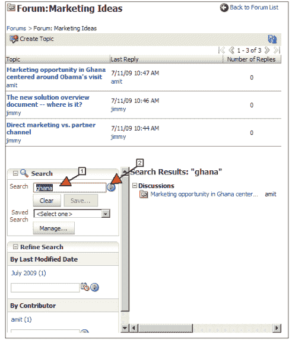

## 集成 WebCenter 标记服务

标记是 Web 2.0 世界中的热门功能。标记允许信息的消费者对信息进行分类，而不是由发布者来分类。在标记的各种用途中，分类、书签和增强搜索是最受欢迎的。WebCenter 标记服务允许最终用户为各种资源（包括页面和文档）添加标记。标记通过启用标记共享，促进资源用户之间的协作。这样，其他用户就可以在搜索中发现已标记的项目。

## 标记服务的要求

要在自定义 WebCenter 应用程序中集成标记服务，需要连接到已安装 WebCenter 架构的数据库。使用标记服务没有其他要求。在本章中，我们将使用 WebCenter 安装期间安装的 WebCenter 架构。

## 与 WebCenter 标记服务集成

我们将在以下部分中了解如何与 WebCenter 标记服务集成。

## 创建新的自定义 WebCenter 应用程序

首先创建一个新的自定义 WebCenter 应用程序。我们将应用程序命名为 TagsApp。单击 **完成** 以创建应用程序。

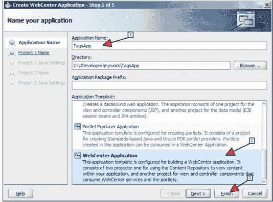

## 添加所需的库

为了允许用户在此应用程序中为页面添加标记，我们需要添加 WebCenter 页面服务和 WebCenter 页面服务视图库。在应用程序导航器中，右键单击 **ViewController**，并从上下文菜单中选择 **项目属性**。将这两个库添加到项目中。

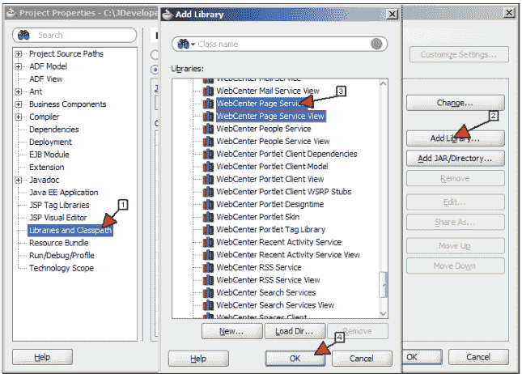

## 创建到 WebCenter 架构的连接

标记服务需要连接到 WebCenter 架构。我们使用了 WebCenter 安装期间安装的架构。从 **应用程序资源** 中，选择 **连接** 并右键单击它。从上下文菜单中，选择 **新建连接 | 数据库**。

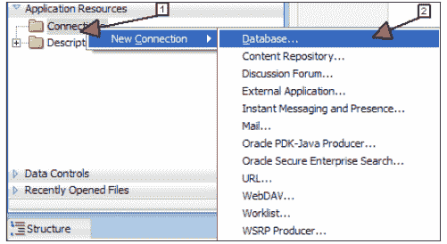

填写连接详细信息。**连接名称** 必须为 **WebCenter**。单击 **测试连接** 以验证连接是否设置正确。单击 **确定** 以继续。

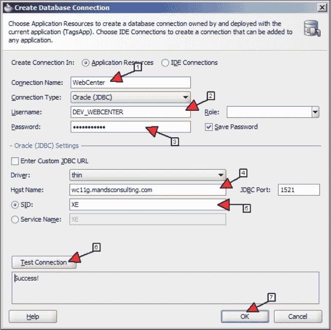

## 创建带有标记按钮的 JSF 页面

接下来，我们将创建一个 JSF 页面，在该页面中放置标记按钮以启用页面标记功能。右键单击 **ViewController**，并从上下文菜单中选择 **新建**。创建新的 JSF 页面。

为 JSF 页面选择一个名称；我们使用了 `test_page.jspx`。单击 **确定** 以完成页面的创建。

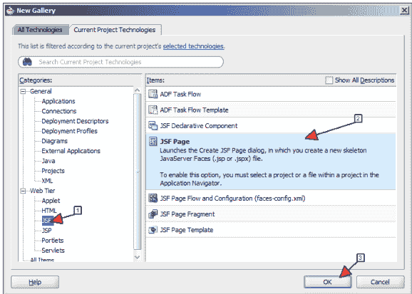

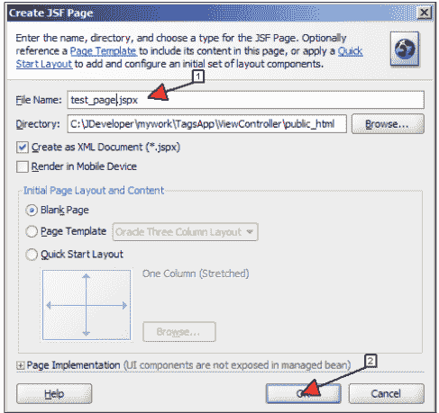

从 **组件调色板** 中，选择 **面板组布局** 并将其拖动到页面上。

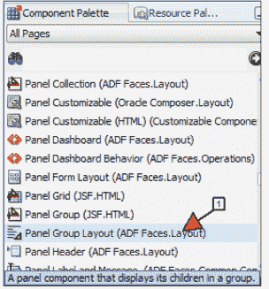

接下来，从 **组件调色板** 中选择 **标记按钮**，并将其放置在页面上的 **面板组布局** 内。

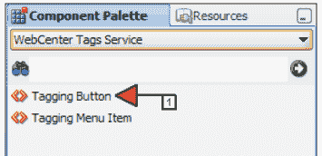

在 **插入标记按钮** 对话框中填写三个参数的值。

| 字段    | 描述    |
|---|---|
| ResourceId    | 唯一标识要绑定标记按钮的对象的 ID。例如：要标记页面，请输入 #{ facesContext.viewRoot.viewId }。要标记自定义组件，请输入 customComponentABC。    |
| ResourceName    | 要绑定标记按钮的对象的名称。例如：要标记页面，请输入 #{ facesContext.viewRoot.viewId }。要标记自定义组件，请输入 Custom Component ABC。    |
| ServiceId    | 应用程序范围的 ID：要标记页面，请输入 oracle.webcenter.page。要标记自定义组件，请输入 mycompany.myproduct.myapp.mycomponent。    |

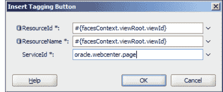

从资源调色板 | WebCenter 服务目录中选择标记对话框，并将其放置在标记按钮旁边，使标记按钮和标记对话框成为同级。

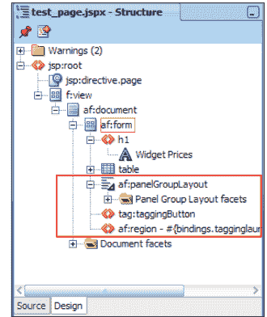

至此完成了 test_page 的创建。接下来，我们将创建一个托管搜索工具栏的页面，用于搜索标记。

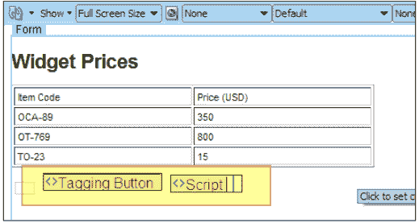

## 创建托管搜索工具栏的 JSF 页面

接下来，我们创建一个带有搜索工具栏的 JSF 页面，以便搜索已标记的项目。创建一个名为 `tag_view.jspx` 的新 JSF 页面。从 **资源调色板 | WebCenter 服务目录 | 任务流** 中选择 **搜索工具栏** 并将其拖放到页面上。

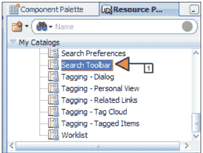

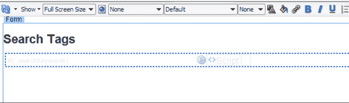

至此完成了 `tag_view` 页面的创建。

## 配置 ADF 安全性

ADF 安全性是一个保护框架，用于授权用户对迭代器、操作和属性绑定的访问。虽然任何用户都可以标记页面（匿名角色），但为了使已标记的资源出现在搜索结果中，应用程序必须受到保护。在此步骤中，我们将配置 ADF 安全性以保护我们的应用程序。

从应用程序菜单中选择 安全 | 配置 ADF 安全性。

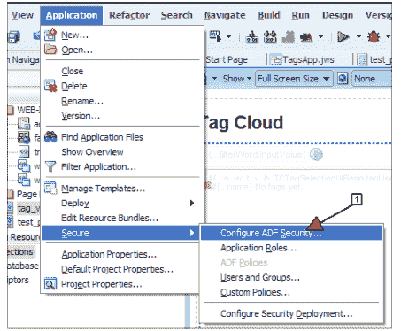

在配置 ADF 安全性对话框中，选择 ADF 身份验证和授权，然后单击完成。其余步骤的默认设置对我们的应用程序是可接受的。ADF 身份验证和授权是标准 Web 容器安全性的替代方案。

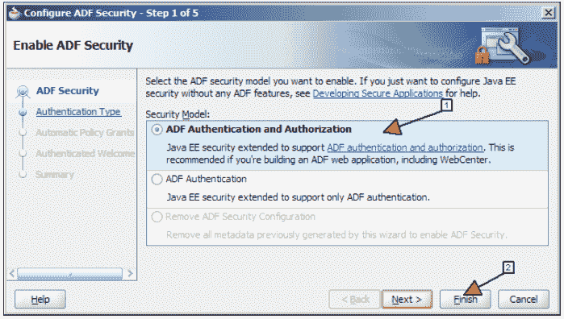

接下来，我们将在创建的两个页面上设置 ADF 策略。从应用程序菜单中选择 安全 | ADF 策略。ADF 策略允许您对任务流和 JSP/JSPX 页面定义精细的访问控制。

我们将向经过身份验证的角色授予页面 test_page.jspx 和 tag_view.jspx 的查看权限。这将确保只有经过身份验证的用户才能查看页面。打开页面时，用户将被提示输入身份验证凭据。

## 创建部署配置文件

为了将应用程序及其安全策略部署到 WebLogic 服务器，我们将创建部署配置文件。右键单击 **ViewController**，并从上下文菜单中选择 **项目属性**。在 **项目属性** 对话框中，选择 **部署** 并创建新的部署配置文件。部署应用程序及其安全策略时，Web 容器将代表应用程序应用安全策略。

选择存档类型为 **WAR 文件** 并选择一个名称。我们使用 **TagsApp** 作为存档的名称。

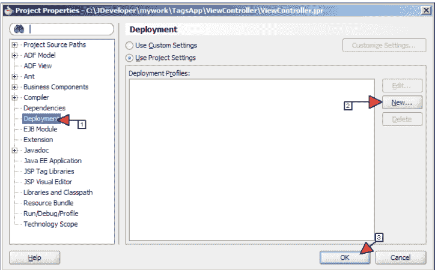

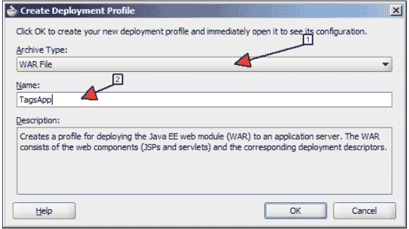

## 将应用程序部署到集成 WebLogic 服务器

右键单击 **ViewController**，并从上下文菜单中选择 **部署 | TagsApp | 到 | IntegratedWLSConnection**。这完成了应用程序的部署。我们现在可以使用浏览器查看页面。

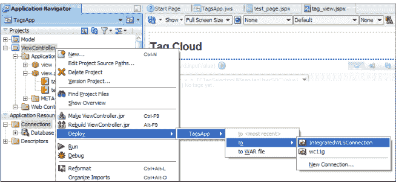

## 查看应用程序

使用浏览器打开 test_page.jspx 的 URL。在我们的示例中，URL 为 http://127.0.0.1:7101/TagsApp-ViewController-context-root/faces/test_page.jspx。将显示身份验证提示。输入集成 WebLogic 服务器上配置的任何有效用户。您可以使用默认管理员帐户 (weblogic/weblogic1)。

单击 **标记** 链接为此页面创建新标记。输入空格分隔的标记并单击 **保存**。这会将输入的标记与该页面关联。接下来，我们将了解如何使用标记搜索此页面。

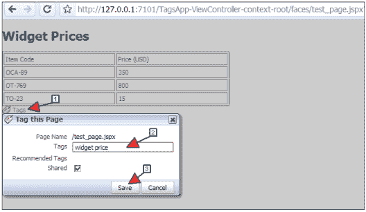

使用浏览器打开 tag_view.jspx 的 URL。在我们的示例中，URL 为 http://127.0.0.1:7101/TagsApp-ViewController-context-root/faces/tag_view.jspx。在搜索框中输入用于标记 test_page.jspx 的标签。在搜索结果中，我们可以看到已标记的页面 test_page.jspx。

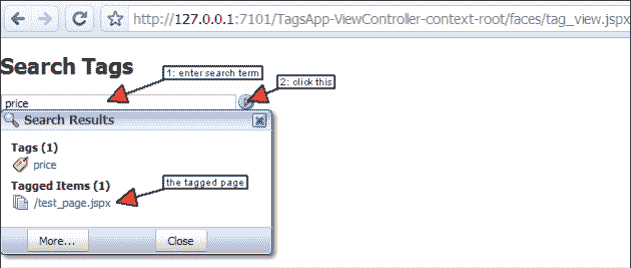

## 与 WebCenter 链接服务集成

我们将在以下步骤中看到这一点。

## 修改 test_page 以包含链接详情按钮

打开 test_page.jspx，并从组件调色板中将链接详情按钮拖放到页面上。

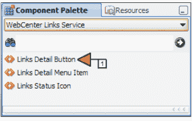

在插入链接详情按钮中，填写参数的详细信息。ServiceID 和 ObjectName 在整个应用程序中应是唯一的。应当注意，链接可以在内部对象和外部对象之间建立。它们不仅限于链接到 URL。您可以链接到 WebCenter 中的各种对象类型，也可以从这些对象类型链接出来。

您可以从以下对象进行链接：公告、讨论、文档、事件、列表、页面，或者您将自定义 JSF 组件绑定到的任何对象，例如链接详情按钮。

您可以链接到以下现有对象：公告、讨论、文档、事件。

您可以链接到以下新对象：讨论、文档、事件、笔记、URL。

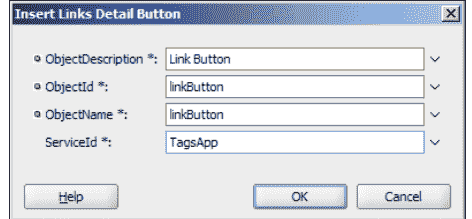

接下来，从 **资源调色板 | WebCenter 服务目录** 中选择 **链接对话框**，并将其放置在链接详情按钮旁边。

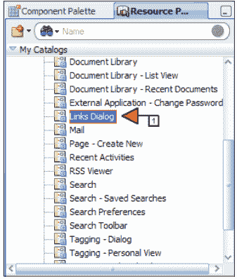

## 将应用程序部署到集成 WebLogic 服务器

使用前面描述的步骤将应用程序部署到集成 WebLogic 服务器。部署完成后，我们可以使用浏览器查看新的 test_page.jspx 页面。在我们的示例中，URL 为 http://127.0.0.1:7101/TagsApp-ViewController-context-root/faces/test_page.jspx。

我们将创建一个指向 URL 的新链接，在此示例中，链接到一个提供货币转换功能的网站。

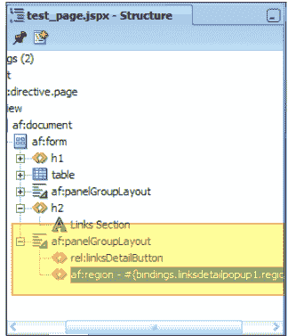

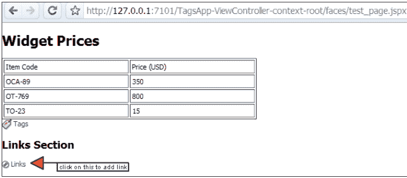

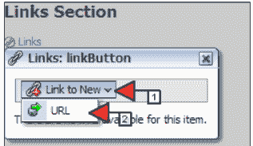

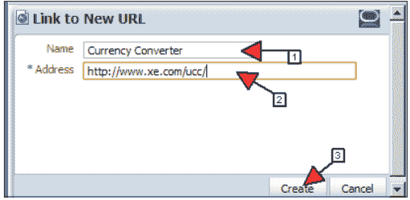

创建链接后，我们可以刷新页面以查看链接。刷新页面后，单击 **链接** 链接。我们附加到页面上的 **货币转换器** 链接如下所示：

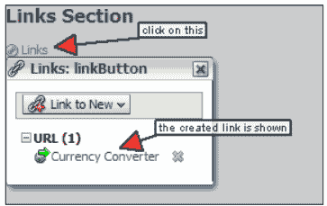

至此，我们完成了集成标记和链接服务的示例应用程序。

## 为何使用 WebCenter RSS 服务

RSS 服务允许您将通过 RSS 源提供的内容集成到自定义 WebCenter 应用程序中。RSS 是传播网页更改的一种非常流行的方式。这在页面更新频繁的网站（例如新闻网站）中尤其流行。WebCenter RSS 查看器任务流使在 WebCenter 应用程序中包含 RSS 内容变得非常简单。

## WebCenter RSS 服务的要求

RSS 服务不需要任何其他资源。您只需在自定义 WebCenter 应用程序中包含 RSS 查看器任务流即可。如果环境中存在 HTTP 代理，则需要使用 **工具 | 首选项 | Web 浏览器和代理** 配置代理。

## 集成 WebCenter RSS 服务

步骤说明如下：

## 创建新的自定义 WebCenter 应用程序

首先创建一个新的自定义 WebCenter 应用程序。我们将应用程序命名为 RSSApp。单击 **完成** 以创建应用程序。

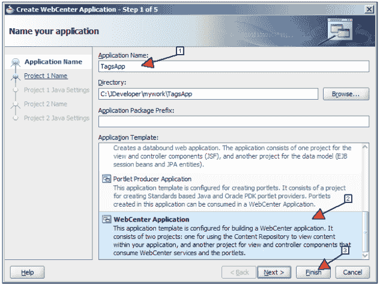

## 创建用于托管 RSS 查看器任务流的 JSF 页面

右键单击 ViewController 项目，并从上下文菜单中选择 **新建** 以创建新的 JSF 页面。

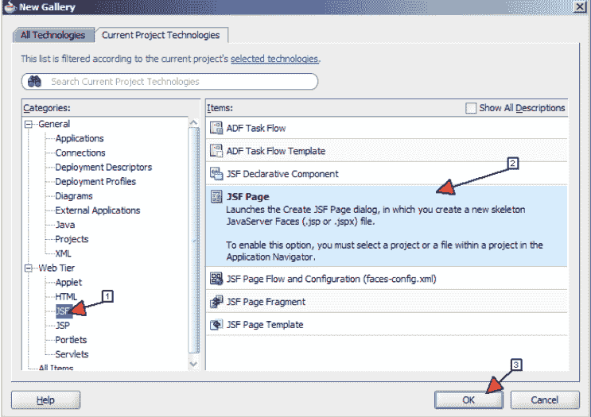

为页面选择一个名称。我们使用了 `rss_news.jspx`。单击确定以完成页面创建。

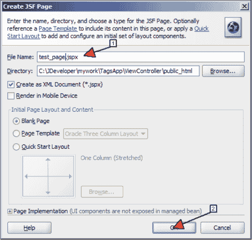

## 添加 RSS 查看器任务流

在新创建的页面上，我们将添加 RSS 查看器任务流。从资源调色板 | WebCenter 服务目录 | 任务流中选择 RSS 查看器，并将其拖放到页面上。如果系统提示将 `rss-service-view.jar` 库添加到 ViewController 项目，请选择 **添加库**。

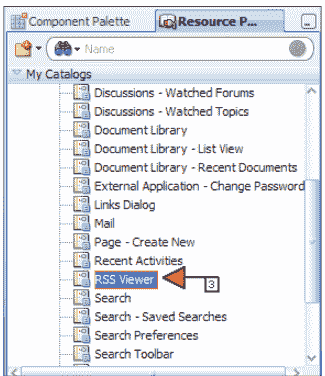

在 **编辑任务流绑定** 中，输入要查看的 RSS 源的 URL。保持 **extAppId** 字段为空。仅当 RSS 源需要身份验证时才需要填写。

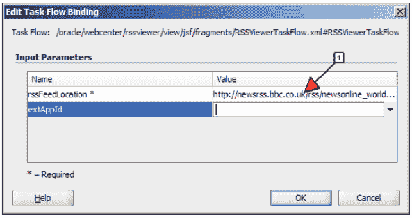

## 运行应用程序

现在我们已准备好运行应用程序。右键单击 `rss_news.jspx`，并从上下文菜单中单击 **运行**。

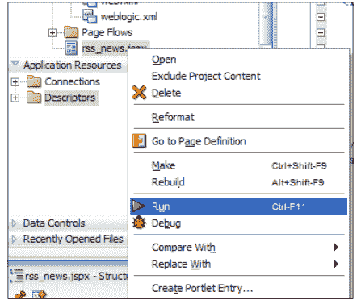

## 查看应用程序

应用程序将在浏览器中打开，并显示 RSS 新闻条目。

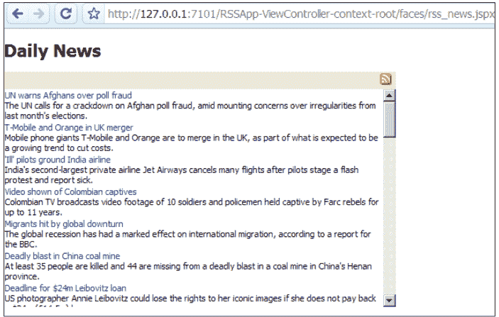

## 摘要

在本章中，我们演示了 WebCenter 提供的搜索服务的使用。通过使用 JDeveloper 中可用的搜索任务流，我们可以快速将搜索服务集成到任何自定义 WebCenter 应用程序中。

我们学习了如何与两个关键 WebCenter 服务集成，即标记服务和链接服务。通过与上述服务集成，自定义 WebCenter 应用程序可以受益于 WebCenter 提供的信息组织和发现功能。能够为便于发现的信息打上标签，并链接到其他资源，使企业能够受益于更好地组织的知识。

我们演示了如何使用 RSS 查看器任务流来显示从 RSS 源获取的信息。WebCenter RSS 服务使与提供 RSS 接口的信息源集成变得非常容易。这使得在您的应用程序中轻松收集和显示 RSS 源中的信息成为可能。
